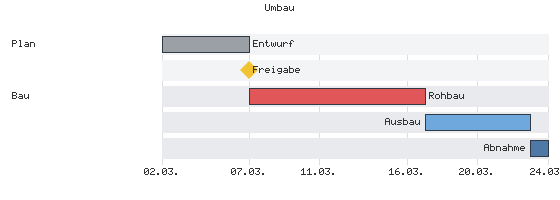
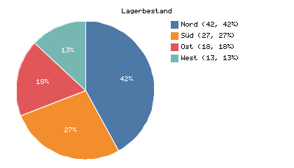
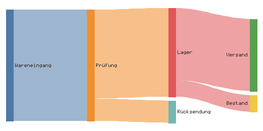

# Diagramme

Kästen, Pfeile, Balken und Kreise entstehen in reinem Tcl, ohne
Browser und ohne Node. Die Eingabe ist ein Text in einer Teilmenge
der Mermaid-Schreibweise, die Ausgabe SVG oder PNG. Für
Knoten-Kanten-Graphen ist das Modell ein Dict von
[tudiagram]{.index}: `layout` rechnet die Kästen in Pixeln, `toSvg`
und `toPng` zeichnen daraus. Die übrigen Arten haben je ein eigenes
Modul mit eigenem Modell und eigener Zeichnung.

[tuflow]{.index} 0.3 ist der Eingang für alle Arten. Beim Laden
holt `tuflow` nur `tudiagram` 0.5. Das Modul einer Art kommt beim
ersten Aufruf mit diesem Schlüsselwort. Die Liste steht auch im
Kapitel [Umbrella und Module](030-umbrella-und-module.md).

| Art | Schlüsselwort | Modul | `parse` liefert Graph | PNG-Optionen |
|---|---|---|---|---|
| Flussdiagramm | `flowchart`, `graph` | `tuflow` | ja | `-scale`, `-fontfile` |
| Zustände | `stateDiagram`, `stateDiagram-v2` | `tustate` | ja | `-scale`, `-fontfile` |
| Klassen | `classDiagram`, `classDiagram-v2` | `tuclass` | ja | `-scale`, `-fontfile` |
| Entitäten | `erDiagram` | `tuer` | ja | `-scale`, `-fontfile` |
| Anforderungen | `requirementDiagram` | `turequirement` | ja | `-scale`, `-fontfile` |
| Mindmap | `mindmap` | `tumindmap` | ja | `-scale`, `-fontfile` |
| C4 | `C4Context`, `C4Container`, `C4Component`, `C4Dynamic`, `C4Deployment` | `tuc4` | ja | `-scale`, `-fontfile` |
| Blöcke | `block-beta` | `tublock` | ja | `-scale`, `-fontfile` |
| Git-Verlauf | `gitGraph` | `tugit` | ja | `-scale`, `-fontfile` |
| Architektur | `architecture`, `architecture-beta` | `tuarchitecture` | ja | `-scale`, `-fontfile` |
| Sequenz | `sequenceDiagram` | `tusequence` | nein, `UNSUPPORTED` | Fläche aus dem Inhalt |
| Gantt | `gantt` | `tugantt` | nein | Breite 800, Höhe ab 400 nach Aufgaben |
| Kreis | `pie` | `tupie` | nein | 480 × 320, `-legend` |
| XY | `xychart-beta` | `tuxychart` | nein | 520 × 340 |
| Quadrant | `quadrantChart` | `tuquadrant` | nein | 420 × 420 |
| Journey | `journey` | `tujourney` | nein | 600 × 360 |
| Zeitleiste | `timeline` | `tutimeline` | nein | 640 × 380 |
| Sankey | `sankey`, `sankey-beta` | `tusankey` | nein | 700 × 400 |
| Radar | `radar`, `radar-beta` | `turadar` | nein | 600 × 600 |
| Treemap | `treemap`, `treemap-beta` | `tutreemap` | nein | 640 × 400 |
| Bitfelder | `packet`, `packet-beta` | `tupacket` | nein | Breite 640, Höhe aus den Zeilen |
| Kanban | `kanban` | `tukanban` | nein | Fläche aus Spalten und Karten |

Die Maße in der letzten Spalte sind die Vorgaben von `-width` und
`-height`; jede Art ohne Graph nimmt dazu `-scale` und `-fontfile`.
Mermaid kennt weitere Arten (`zenuml`, `xychart` ohne `-beta`). Ein
solcher Text geht als Flussdiagramm durch, das erste Wort wird ein
Knoten.

---

## Vom Text zur Datei: tuflow

```tcl
::tclutils::tuflow::parse    text                ;# -> tudiagram-Modell
::tclutils::tuflow::toSvg    text ?opt wert ...? ;# -> SVG-Text
::tclutils::tuflow::toPng    text ?opt wert ...? ;# -> PNG-Bytes
::tclutils::tuflow::writeSvg text datei ?opt wert ...?  ;# -> datei
::tclutils::tuflow::writePng text datei ?opt wert ...?  ;# -> datei
```

`toSvg` und `toPng` lesen das erste Wort der ersten Zeile, die weder
leer noch ein `%%`-Kommentar ist, ohne Rücksicht auf Groß- und
Kleinschreibung. Steht dort eine Art ohne Graph, ruft die Fassade
`parse` und `toSvg` oder `toPng` des Moduls dieser Art. Sonst ruft
sie das eigene `parse` und zeichnet das Modell mit `tudiagram`.
`writeSvg` schreibt UTF-8 mit LF, `writePng` binär; beide geben den
Dateinamen zurück. Bei allen Diagrammmodulen geht das Schreiben über eine
temporäre Datei
(`common::replaceFile`): Scheitert es, bleibt die alte Datei stehen, und
kein Kanal bleibt offen.

```tcl
package require tclutils::tuflow
set t {flowchart LR
    A --> B
}
string range [::tclutils::tuflow::toSvg $t] 0 3   ;# -> <svg
string range [::tclutils::tuflow::toPng $t] 1 3   ;# -> PNG
::tclutils::tuflow::writePng $t fluss.png         ;# -> fluss.png
```

| Option | Vorgabe | Wirkung |
|---|---|---|
| `-scale` | 1 | ganze Zahl ab 1; PNG: Fläche und Zeichnung mal Faktor |
| `-fontfile` | leer | TTF- oder OTF-Datei für die PNG-Schrift |
| `-width` | je Art | Breite in Pixeln, nur Arten ohne Graph |
| `-height` | je Art | Höhe in Pixeln, nur Arten ohne Graph |
| `-legend` | 1 | nur `pie`: 0 lässt die Legende weg |

Für einen Graphen nimmt `toPng` nur `-scale` und `-fontfile`, `toSvg`
gar keine Option. Für die anderen Arten gilt `-scale` auch im SVG:
Die Fläche bleibt bei `-width` × `-height`, Schrift, Linien und
Abstände werden um den Faktor größer. Eine Option, die die Art nicht
kennt, lässt die Fassade ohne Fehler fallen; `-scale 0` dagegen
wirft den Fehler `ARG` der Art, beim Graphen
`{TCLUTILS TUDIAGRAM ARG}`. `-width 0` bei einer festen Fläche wirft
`{TCLUTILS COMMON INTEGER width}` aus der Zeichenfläche.

```tcl
set p "pie\n\"a\" : 1\n"
set a [::tclutils::tuflow::toPng $p -farbe rot]
string equal $a [::tclutils::tuflow::toPng $p]   ;# -> 1
catch {::tclutils::tuflow::toPng $p -scale 0} m o
dict get $o -errorcode                     ;# -> TCLUTILS TUPIE ARG
```

Das Modul einer Art direkt aufzurufen lohnt sich in drei Fällen: wenn
das Modell gebraucht wird (`parse` jeder Art liefert ein Dict), wenn
eine unbekannte Option als Fehler auffallen soll (die Module prüfen
streng mit `{TCLUTILS COMMON OPTION ...}`), und wenn ein
`tudiagram`-Modell vor dem Zeichnen geändert wird, etwa mit
`setMeta -theme`. Jedes Modul ohne Graph hat dieselben fünf Befehle:
`parse text` und `toSvg`, `toPng`, `writeSvg`, `writePng` mit dem
Modell statt des Texts.

`tuflow::parse` liefert für eine Art ohne Graph den Fehler
`{TCLUTILS TUFLOW UNSUPPORTED}`, auch für `sankey` ohne `-beta`.

```tcl
catch {::tclutils::tuflow::parse "pie\n\"a\" : 1\n"} m o
dict get $o -errorcode               ;# -> TCLUTILS TUFLOW UNSUPPORTED
catch {::tclutils::tuflow::parse "sankey\na,b,1\n"} m o
dict get $o -errorcode               ;# -> TCLUTILS TUFLOW UNSUPPORTED
```

---

## Modell: tudiagram

```tcl
::tclutils::tudiagram::create   ?-title t? ?-direction d? ?-theme t?
                                ?-fontfile f?
::tclutils::tudiagram::addNode  d id ?-label t? ?-shape s?
                                ?-style dict?
::tclutils::tudiagram::addEdge  d von nach ?-label t? ?-style s?
                     ?-arrow a? ?-startMark m? ?-endMark m?
::tclutils::tudiagram::addGroup d id ?-label t? ?-members ids?
::tclutils::tudiagram::setMeta  d ?-schlüssel wert ...?
::tclutils::tudiagram::validate d           ;# -> Liste der Probleme
::tclutils::tudiagram::layout   d           ;# -> Dict mit Koordinaten
::tclutils::tudiagram::theme    name        ;# -> Farb-Dict
::tclutils::tudiagram::toSvg    d
::tclutils::tudiagram::toPng    d ?-scale n?
::tclutils::tudiagram::writeSvg d datei
::tclutils::tudiagram::writePng d datei ?-scale n?
```

`create` liefert das Dict mit den Schlüsseln `version`, `meta`,
`nodes`, `edges` und `groups`. `meta` hält `title`, `direction`,
`theme`, `fontfile`, `nodeGap` 30, `rankGap` 70 und `padding` 20.
Die Richtung ist `LR`, `TB`, `RL` oder `BT`, Vorgabe `LR`. Themen
sind `default`, `pipeline` und `mono`. Statt des Namens geht auch
ein Dict mit mindestens `fill`; fehlende Farben kommen aus `default`.
Jeder andere Wert wirft `{TCLUTILS TUDIAGRAM THEME}`, in `theme`,
`create` und `setMeta`. Der Titel steht mittig über dem Graphen:
`layout` schiebt alle Knoten und Kanten um das Titelband nach unten
(`titleH` in `meta`, 26 Pixel) und verbreitert die Fläche, wenn der
Titel breiter ist als der Graph. `addNode`, `addEdge` und `addGroup`
geben das erweiterte Dict zurück, sie ändern das übergebene nicht.
`setMeta` setzt beliebige Schlüssel in `meta` und prüft nur
`-direction` und `-theme`.

| Form | Namen |
|---|---|
| Knoten `-shape` | `box` (Vorgabe), `rounded`, `dot`, `circle`, `stadium`, `diamond`, `hexagon`, `cylinder` |
| Knoten `-style` | Dict mit `fill`, `stroke`, `text` als `#rrggbb`; fehlende Schlüssel nimmt das Thema |
| Kante `-style` | `solid` (Vorgabe), `dashed`, `dotted`, `thick` |
| Kante `-arrow` | `end` (Vorgabe), `none`, `both`, `start` |
| Kante `-startMark`, `-endMark` | `none` (Vorgabe), `exactlyOne`, `zeroOrOne`, `oneOrMany`, `zeroOrMany` |

Ein Knoten ohne `-label` trägt seine Id. Ein `dot` zeigt keine
Beschriftung. Die Marken an den Kantenenden sind Krähenfüße wie im
ER-Diagramm. `addEdge` prüft weder die Enden noch die Werte von
`-style` und `-arrow`.

`validate` wirft nicht. Eine leere Liste heißt: es gibt Knoten, und
jede Kante nennt bekannte Enden. `layout` setzt an jedem Knoten `x`,
`y`, `width` und `height`, an jeder Kante `points`, `arrowStart` und
`back`, in `meta` die Gesamtmaße `width` und `height` sowie die
Höhe des Titelbands `titleH`. Die Schriftmetrik ist das feste
6×8-Raster, auch ohne Zeichenfläche. Eine
Kante von einem Knoten zu sich selbst nimmt die Rangfolge nicht auf
und wird nicht gezeichnet. Ein Zyklus wird an einer Kante gebrochen,
die dann rückwärts läuft (`back` 1).

```tcl
package require tclutils::tudiagram
set d [::tclutils::tudiagram::create -title Lager -direction LR]
set d [::tclutils::tudiagram::addNode $d A -label Eingang]
set d [::tclutils::tudiagram::addNode $d B -label Pruefung \
    -shape diamond]
set d [::tclutils::tudiagram::addEdge $d A B -label ja]
::tclutils::tudiagram::validate $d           ;# -> (leer)
set L [::tclutils::tudiagram::layout $d]
dict keys [lindex [dict get $L nodes] 0]
                         ;# -> id label shape style x y width height
dict get [dict get $L meta] width            ;# -> 394
dict get [dict get $L meta] titleH           ;# -> 26
```

Nach `layout` steht `A` bei x 20, y 46, 112×44, und `B` bei x 202,
y 46, 172×56; ohne Titel stehen beide bei y 20. `toSvg` beginnt mit
`<svg xmlns="http://www.w3.org/2000/svg"`.

Gruppen sind Rahmen mit Beschriftung um die Knoten in `-members`.
Ein Name in `-members`, der kein Knoten ist, fällt beim Zeichnen weg.
Liegt eine Gruppe ganz in einer anderen, bekommt die äußere mehr
Abstand. Mit Gruppen ordnet `layout` die Mitglieder jeder Gruppe in
ein eigenes Band, damit sich die Rahmen nicht überlappen.

Eine zweite Id `A` wirft `{TCLUTILS TUDIAGRAM DUPID}`. Die Richtung
`XX` wirft `{TCLUTILS TUDIAGRAM DIR}`, eine Form `triangle`
`{TCLUTILS TUDIAGRAM ARG}`. Ein Modell ohne Knoten ergibt aus
`validate` den Eintrag `EMPTY no nodes`, `layout` wirft dann
`{TCLUTILS TUDIAGRAM EMPTY}`. Eine Kante nach `Z` und `Y` hängt an
`validate` je einen Eintrag `NONODE` für beide Enden.

```tcl
catch {::tclutils::tudiagram::create -theme neon} m o
dict get $o -errorcode               ;# -> TCLUTILS TUDIAGRAM THEME
```

---

## Flussdiagramm: tuflow parse

`parse` liest `graph` und `flowchart` und liefert ein
`tudiagram`-Modell. Die Kopfzeile ist optional, Groß- und
Kleinschreibung zählen nicht (`FLOWCHART td`, `Graph LR`); ohne
Richtung gilt `LR`, `TD` wird `TB`. Eine Id besteht aus Buchstaben,
Ziffern und `_`, Umlaute eingeschlossen: `Büro[Amt]` ist der Knoten
`Büro` (bis tclutils 0.68.0 nur ASCII, und die Zeile fiel weg). Die
Form steckt in der Klammer, Anführungszeichen
um die Beschriftung fallen weg.

| Schreibweise | Form |
|---|---|
| `A` allein | `box`, Beschriftung `A` |
| `A[Text]` und `A[[Text]]` | `box` |
| `A(Text)` | `rounded` |
| `A([Text])` | `stadium` |
| `A((Text))` | `circle` |
| `A{Text}` | `diamond` |
| `A{{Text}}` | `hexagon` |
| `A[(Text)]` | `cylinder` |

| Pfeil | `-style` | `-arrow` |
|---|---|---|
| `-->`, `--o`, `--x` | `solid` | `end` |
| `---` | `solid` | `none` |
| `-.->` | `dotted` | `end` |
| `-.-` | `dotted` | `none` |
| `==>` | `thick` | `end` |
| `===` | `thick` | `none` |

Die Beschriftung steht als `A -->|Text| B`, `A -- Text --> B`,
`A -. Text .-> B` oder `A == Text ==> B`. Ketten `A --> B --> C`
gelten. `&` verbindet mehrere Knoten auf einer Seite:
`A & B --> C & D` ergibt eine Kante für jedes Paar, hier vier. `%%`
ist ein Kommentar, Anweisungen dürfen mit `;` getrennt sein; ein `;`
in einer Beschriftung (`A[Jörg;Büro]`, `-->|a;b|`) oder in
Anführungszeichen trennt nicht. Wird
eine Id zweimal mit Form genannt, gilt die letzte.
`subgraph name [Beschriftung]` bis `end` wird eine Gruppe mit den
Knoten darin, auch verschachtelt; `direction` darin entfällt. Eine
Kante auf die Gruppen-Id entfällt.

Nicht gelesen werden:

- `style`, `classDef`, `class`, `click` und `linkStyle`: übergangen;
- `A:::klasse`: die Klasse entfällt, der Knoten bleibt;
- `A[/Text/]` und die anderen Trapez- und Parallelogrammformen: `box`
  mit der Beschriftung `/Text/`;
- `--o` und `--x` zeichnen eine gewöhnliche Spitze, keinen Kreis und
  kein Kreuz.

```tcl
package require tclutils::tuflow
set src {flowchart TD
    A[Eingang] --> B{Pruefung}
    B -->|ja| C[(Lager)]
}
set m [::tclutils::tuflow::parse $src]
dict get [dict get $m meta] direction        ;# -> TB
set e [lindex [dict get $m edges] 1]
list [dict get $e label] [dict get $e style] ;# -> ja solid
set w [::tclutils::tuflow::parse "Graph RL\nA & B --> C\n"]
dict get [dict get $w meta] direction        ;# -> RL
lmap k [dict get $w edges] {dict get $k from}  ;# -> A B
```

Die Knoten sind `A` als `box` „Eingang“, `B` als `diamond`
„Pruefung“ und `C` als `cylinder` „Lager“. Eine Kante ist ein Dict
mit `from`, `to`, `label`, `style`, `arrow`, `startMark` und
`endMark`.

```tcl
set g {flowchart LR
    subgraph kasten [Kasten]
        A[a] --> B[b]
    end
}
dict get [::tclutils::tuflow::parse $g] groups
                 ;# -> {id kasten label Kasten members {A B}}
```

`A-3` wirft `{TCLUTILS TUFLOW BADID}`. Ein Text ohne Knoten wirft
`{TCLUTILS TUFLOW EMPTY}`.

Das folgende Skript erzeugt das Bild darunter.

```tcl
set fluss {flowchart TB
    A([Eingang]) --> B{Prüfung}
    B -->|ja| C[(Lager)]
    B -->|nein| D[Rücksendung]
    subgraph halle [Halle 2]
        C --> E(Versand)
    end
    D -.-> E
}
::tclutils::tuflow::writePng $fluss 056-fluss.png  ;# -> 056-fluss.png
```


---

## Zustandsdiagramm: tustate

[tustate]{.index} liest `stateDiagram` und `stateDiagram-v2`. Ein
Zustand wird ein `rounded`-Knoten, ein Übergang eine Kante mit
Spitze. Die Richtung ist `TB`.

| Schreibweise | Ergebnis |
|---|---|
| `A --> B` und `A --> B : Text` | Kante, Text als Beschriftung |
| `[*] --> A` | Startpunkt `__start` als `dot` |
| `A --> [*]` | Endpunkt `__end` als `dot` |
| `A : Text` | Beschriftung des Zustands `A`; die Id darf Umlaute haben (`Büro : Jörg`) |
| `A` allein | Zustand ohne Kante |
| `state X <<fork>>`, `<<join>>` | Zustand `X` als `rounded` |
| `direction LR` | `LR`; `RL` wird `LR`, `BT` und `TD` werden `TB` |

Nicht gelesen werden:

- `state X { … }`: der Rahmen entfällt, die Übergänge darin bleiben;
- `note … : Text` und `note … end note`: übergangen;
- `state "Lang" as L`: übergangen, `L` entsteht erst bei der ersten
  Kante;
- eine Kante von `A` nach `A`: im Modell, nicht gezeichnet.

```tcl
set st {stateDiagram-v2
    [*] --> Bereit
    Bereit --> Laeuft : start
    Laeuft --> [*]
    Bereit : wartet
}
set m [::tclutils::tuflow::parse $st]
lmap n [dict get $m nodes] {dict get $n label}
                                ;# -> __start wartet Laeuft __end
lmap n [dict get $m nodes] {dict get $n shape}
                                ;# -> dot rounded rounded dot
```

Ein Text ohne Zustand wirft `{TCLUTILS TUSTATE EMPTY}`.

---

## Klassendiagramm: tuclass

[tuclass]{.index} liest `classDiagram` und `classDiagram-v2`. Jede
Klasse wird ein `box`-Knoten mit drei Teilen: Name, Attribute,
Methoden. Eine Zeile `----------` trennt die Teile. Ein Mitglied mit
`(` ist eine Methode, alle anderen sind Attribute. Die Richtung ist
`TB`.

| Schreibweise | Ergebnis |
|---|---|
| `class X {` … `}` über mehrere Zeilen | Klasse mit einem Mitglied je Zeile |
| `class X { +a; +b() }` | Block auf einer Zeile, `;` trennt die Mitglieder; in Anführungszeichen nicht (0.3) |
| `class X`, `class X { }` | Klasse ohne Mitglieder |
| `X : +int alter`, `X : +laut()` | Mitglied von `X` |
| `A <\|-- B` | Kante `B` nach `A`, Beschriftung `extends` |
| `A *-- B` | Kante `A` nach `B`, `composition` |
| `A o-- B` | `aggregation` |
| `A ..> B` | `dependency`, gestrichelt |
| `A ..\|> B` | `extends`, gestrichelt |
| `A --> B` | ohne Beschriftung |
| `A --> B : Text` | Text als Beschriftung |
| `A "1" --> "*" B` | Kante `A` nach `B`; die Kardinalitäten entfallen |

Steht `<` vorn im Pfeil, zeigt die Kante zur linken Klasse. Jede
Kante hat eine einfache Spitze; die UML-Spitzen (Dreieck, Raute)
zeichnet das Modul nicht. Ein Mitglied vor der schließenden Klammer
(`+b() }`) zählt mit.

Nicht gelesen werden:

- `class X~T~`, `class X:::k`, `<<interface>> X`: übergangen.

```tcl
set cl {classDiagram
    class Tier {
        +String name
        +laut()
    }
    Tier <|-- Hund
}
set m [::tclutils::tuflow::parse $cl]
split [dict get [lindex [dict get $m nodes] 0] label] \n
           ;# -> Tier ---------- {+String name} ---------- +laut()
lrange [lindex [dict get $m edges] 0] 0 5
                           ;# -> from Hund to Tier label extends
set k [::tclutils::tuflow::parse \
    "classDiagram\nclass Ort { }\nKunde \"1\" --> \"*\" Ort : hat\n"]
lmap n [dict get $k nodes] {dict get $n label} ;# -> Ort Kunde
dict get [lindex [dict get $k edges] 0] label   ;# -> hat
```

Ein Text ohne Klasse wirft `{TCLUTILS TUCLASS EMPTY}`.

---

## ER-Diagramm: tuer

[tuer]{.index} 0.4 liest `erDiagram`. Eine Entität wird ein
`box`-Knoten mit dem Namen in der ersten Zeile und einem Attribut je
weiterer Zeile. Eine Beziehung wird eine Kante ohne Spitze mit
Krähenfüßen an beiden Enden. Die Richtung ist `TB`.

| Schreibweise | Ergebnis |
|---|---|
| `NAME {` … `}` | Entität; Attributzeile `typ name` |
| `typ name PK` | Attribut `typ name (PK)`; weitere Wörter entfallen |
| `A \|\|--o{ B : Text` | durchgezogene Kante, Beschriftung `Text` |
| `A }\|..\|\| B : Text` | gestrichelte Kante |
| `NAME` allein | Entität ohne Attribute |

Jede Seite der Kardinalität wird eine Marke: `{` oder `}` heißt
viele, `o` heißt null. `||` wird `exactlyOne`, `|o` und `o|`
`zeroOrOne`, `}|` und `|{` `oneOrMany`, `}o` und `o{` `zeroOrMany`.
Anführungszeichen um die Beschriftung fallen weg: `: "gibt auf"`
wird die Beschriftung `gibt auf`.

Ein Entitätsname besteht aus Buchstaben jeder Schrift, Ziffern, `_` und
`-`, also geht auch `Büro {`. Drei Wörter sind nur dann eine Beziehung,
wenn das mittlere `--` oder `..` enthält. Zeilen mit `direction`,
`title`, `accTitle` und `accDescr` werden übergangen; jede andere Zeile,
die weder Block noch Entität noch Beziehung ist, wirft
`{TCLUTILS TUER SYNTAX}`. Bis 0.3 blieb `Büro {` unerkannt, und aus der
Attributzeile `string name PK` wurde eine Kante von `string` nach `PK`.

```tcl
set er "erDiagram
    KUNDE ||--o\{ AUFTRAG : gibt
    KUNDE \{
        string name PK
    \}
"
set m [::tclutils::tuflow::parse $er]
set e [lindex [dict get $m edges] 0]
dict get $e startMark                        ;# -> exactlyOne
dict get $e endMark                          ;# -> zeroOrMany
split [dict get [lindex [dict get $m nodes] 0] label] \n
                           ;# -> KUNDE {string name (PK)}
```

Ein Text ohne Entität wirft `{TCLUTILS TUER EMPTY}`.

---

## Anforderungen: turequirement

[turequirement]{.index} liest `requirementDiagram`. Jede Anforderung
und jedes Element wird ein `box`-Knoten. Die erste Zeile nennt die
Art in `<<…>>`, die zweite den Namen, danach folgen die Felder
`id`, `text`, `type`, `risk`, `verifymethod` und `docref` in dieser
Reihenfolge, soweit vorhanden. Die Richtung ist `TB`.

| Schreibweise | Ergebnis |
|---|---|
| `requirement n {` … `}` | Knoten `<<requirement>>` |
| `functionalRequirement`, `performanceRequirement`, `interfaceRequirement`, `physicalRequirement`, `designConstraint` | ebenso, mit dieser Art |
| `element n {` … `}` | Knoten `<<element>>` |
| `feld: wert` im Block | Feldzeile; andere Felder als die sechs entfallen |
| `a - satisfies -> b` | Kante `a` nach `b`, Beschriftung `satisfies` |
| `b <- derives - a` | Kante `a` nach `b` |

Eine Beziehung zu einem unbekannten Namen legt einen Knoten mit
diesem Namen an. Lange Feldwerte werden nicht umbrochen, der Kasten
wird breit. Alle Arten zeichnen dieselbe Form.

```tcl
set rq {requirementDiagram
    requirement schnell {
        id: 1
        risk: high
    }
    element server {
        type: simulation
    }
    server - satisfies -> schnell
}
set m [::tclutils::tuflow::parse $rq]
split [dict get [lindex [dict get $m nodes] 0] label] \n
           ;# -> <<requirement>> schnell {id: 1} {risk: high}
dict get [lindex [dict get $m edges] 0] label  ;# -> satisfies
```

Ein Text ohne Anforderung und Element wirft
`{TCLUTILS TUREQUIREMENT EMPTY}`.

---

## Mindmap: tumindmap

[tumindmap]{.index} liest `mindmap`. Die Einrückung bestimmt die
Ebene: Eine Zeile, die tiefer steht als die vorige, ist ihr Kind;
eine flachere Zeile hängt am nächsten Vorfahren mit kleinerer
Einrückung. Ein Tabulator zählt vier Leerzeichen. Die Ids sind
erzeugt (`n1`, `n2`, …), die Kanten haben keine Spitze. Das Ergebnis
ist ein Baum von oben nach unten (`TB`), keine Sternform.

| Schreibweise | Form |
|---|---|
| `Text` | `rounded` |
| `id((Text))`, `((Text))` | `circle` |
| `id{{Text}}` | `hexagon` |
| `id[Text]` | `box` |
| `id(Text)` | `rounded` |
| `)Text(` und `))Text((` | `rounded` |

Eine Klammer zählt nur, wenn sie den ganzen Text umschließt;
`API (REST)` bleibt Text. Zeilen mit `::icon(…)` oder `class`
entfallen. Eine zweite Zeile auf der Ebene der Wurzel wird eine
zweite Wurzel.

```tcl
set mm {mindmap
    root((Lager))
        Eingang
        [Ausgang]
}
set m [::tclutils::tuflow::parse $mm]
lmap n [dict get $m nodes] {dict get $n shape}
                                ;# -> circle rounded box
lmap e [dict get $m edges] {dict get $e to}  ;# -> n2 n3
```

Ein Text ohne Zeile nach dem Kopf wirft `{TCLUTILS TUMINDMAP EMPTY}`.

---

## C4: tuc4

[tuc4]{.index} liest `C4Context`, `C4Container`, `C4Component`,
`C4Dynamic` und `C4Deployment`. Die Richtung ist `TB`. Ein Element
`Typ(id, "Name", …)` wird ein Knoten mit der Id und dem ersten Text
in Anführungszeichen als Beschriftung; Technik und Beschreibung
entfallen. Die Id besteht aus Buchstaben, Ziffern und `_`, Umlaute
eingeschlossen: `Person(größe, "Weg")` hat die Id `größe` (bis
tclutils 0.68.0 `gr`). Die Füllfarbe kommt aus dem Typ.

| Typ | Form | Farbe |
|---|---|---|
| `Person`, `Person_Ext` | `rounded` | violett |
| `System`, `Container`, `Component` | `box` | blau, grün, orange |
| Typ mit `Db`, etwa `SystemDb`, `ContainerDb` | `cylinder` | nach Typ |
| Typ mit `_Ext` | wie oben | grau |
| `Rel(a, b, "Text")`, `BiRel`, `Rel_U`, `Rel_D`, `Rel_L`, `Rel_R` | Kante `a` nach `b` mit Spitze | |
| `title Text` | Titel, mittig über dem Graphen | |

Nicht gelesen werden:

- Grenzen wie `System_Boundary(…) {` … `}` und `Deployment_Node`:
  der Rahmen entfällt, die Elemente darin bleiben;
- `BiRel` bekommt nur eine Spitze; die Richtung in `Rel_U` bis
  `Rel_R` entfällt;
- `UpdateElementStyle`, `UpdateRelStyle` und alle Zeilen mit
  `Update` am Anfang: übergangen.

Eine Beziehung zu einer unbekannten Id legt einen `box`-Knoten ohne
Farbe an.

```tcl
set c4 {C4Context
    title Lager
    Person(kunde, "Kunde")
    System(lag, "Lager")
    Rel(kunde, lag, "holt")
}
set m [::tclutils::tuflow::parse $c4]
dict get [dict get $m meta] title            ;# -> Lager
dict get [lindex [dict get $m nodes] 0] style
                                ;# -> fill #e8def8 stroke #6a1b9a
```

Ein C4 ohne Elemente wirft `{TCLUTILS TUC4 EMPTY}`.

---

## Blöcke: tublock

[tublock]{.index} liest `block-beta`. Jedes Wort einer Zeile ist ein
Block; Klammern und Anführungszeichen halten Leerzeichen zusammen.
Die Formen entsprechen dem Flussdiagramm: `a["Text"]` `box`,
`a("Text")` `rounded`, `a(("Text"))` `circle`, `a{"Text"}`
`diamond`, `a{{"Text"}}` `hexagon`, `a(["Text"])` `stadium`,
`a[("Text")]` `cylinder`, `a[["Text"]]` `box`. Die Blöcke werden als
Graph von oben nach unten (`TB`) gelegt, nicht im Raster. Ids dürfen
Umlaute haben: `Büro[Jörg]` ist der Block `Büro` mit der Beschriftung
`Jörg` (bis tclutils 0.68.0 ein einziges Token).

| Schreibweise | Ergebnis |
|---|---|
| `a --> b`, `a ==> b`, `a -.-> b` | Kante mit Spitze |
| `a --- b` | Kante ohne Spitze |
| `a -->\|Text\| b`, `a -- Text --> b` | Kante mit Beschriftung |
| `a["Text"]:2` | die Spanne `:2` entfällt |
| `columns N`, `space`, `space:N` | übergangen |
| `block:id` … `end` | der Rahmen entfällt, die Blöcke darin bleiben |
| `style`, `classDef`, `class`, `click` | übergangen |

Pfeilblöcke wie `a<["Text"]>(right)` werden ein Knoten mit genau
dieser Zeichenfolge als Id.

```tcl
set bl {block-beta
    columns 3
    a["Eingang"] b(("Prüfung")) c["Lager"]
    a --> b
    b -->|ok| c
}
set m [::tclutils::tuflow::parse $bl]
lmap n [dict get $m nodes] {dict get $n shape}
                                ;# -> box circle box
dict get [lindex [dict get $m edges] 1] label  ;# -> ok
```

Ein Text ohne Block wirft `{TCLUTILS TUBLOCK EMPTY}`.

---

## Git-Verlauf: tugit

[tugit]{.index} liest `gitGraph`. Jeder Commit wird ein Knoten, jede
Elternbeziehung eine Kante vom Eltern- zum Kind-Commit. Der erste
Zweig heißt `main`. Die Richtung ist `LR`, mit `gitGraph TB:` `TB`.
Jeder Zweig bekommt eine Füllfarbe; Spuren wie bei Mermaid zeichnet
das Modul nicht.

| Schreibweise | Ergebnis |
|---|---|
| `commit` | Knoten `c1`, `c2`, … als `rounded` |
| `commit id: "X"` | Knoten `X` |
| `commit tag: "T"` | Beschriftung mit ` [T]` |
| `branch name` | neuer Zweig ab dem aktuellen Stand, wird aktuell |
| `checkout name` | Zweig wechseln |
| `merge name` | `box` „merge name“ mit zwei Eltern |
| `cherry-pick id: "X"` | `rounded` „pick X“ |

`commit type: …` wird übergangen. Eine Commit-Id darf nur einmal
vorkommen, wie in Mermaid: eine zweite `commit id: "X"` oder ein
`merge … id: "X"` mit vergebener Id wirft `{TCLUTILS TUGIT DUPID}`
(bis tclutils 0.68.0 fiel der zweite Commit weg, und eine Kante lief
von `X` auf sich selbst). Erzeugte Ids (`c1`, `c2`, …) überspringen Ids,
die der Text schon nutzt.

```tcl
set gg {gitGraph
    commit
    branch dev
    commit
    checkout main
    merge dev
}
set m [::tclutils::tuflow::parse $gg]
lmap n [dict get $m nodes] {dict get $n label}
                                ;# -> c1 c2 {merge dev}
llength [dict get $m edges]                  ;# -> 3
```

Ein Text ohne Commit wirft `{TCLUTILS TUGIT EMPTY}`, eine doppelte
Commit-Id `{TCLUTILS TUGIT DUPID}`.

---

## Architektur: tuarchitecture

[tuarchitecture]{.index} liest `architecture-beta` und
`architecture`. Dienste werden Knoten, Gruppen Rahmen. Die Richtung
ist `LR`.

| Schreibweise | Ergebnis |
|---|---|
| `service id(icon)[Text]` | Knoten, Form nach dem Symbol; die Id darf Umlaute haben |
| `service id(icon)[Text] in g` | Knoten in der Gruppe `g` |
| `group id(icon)[Text]` | Rahmen um ihre Mitglieder |
| `group id(icon)[Text] in g` | verschachtelte Gruppe |
| `junction id` | Knoten `dot` |
| `a:R -- L:b` | Kante ohne Spitze |
| `a:R --> L:b`, `<--`, `<-->` | Spitze am Ziel, am Anfang, an beiden |
| `a{group}:R -- L:b` | `{group}` entfällt, die Kante bleibt |

Das Symbol bestimmt die Form: `database`, `db`, `disk`, `storage`
ergeben `cylinder`, `cloud` und `internet` `rounded`, alle anderen
`box`. Die Seiten `L`, `R`, `T`, `B` werden gelesen, aber nicht
benutzt; die Lage der Anschlüsse bestimmt `tudiagram`. Ein Ende, das
nicht als Dienst steht, wird ein `box`. Die Beschriftung ist der Text
in `[…]`, ohne ihn die Id.

```tcl
set ar {architecture-beta
    group api(cloud)[API]
    service db(database)[Datenbank] in api
    service web(server)[Web] in api
    web:R --> L:db
}
set m [::tclutils::tuflow::parse $ar]
lmap n [dict get $m nodes] {dict get $n shape}  ;# -> cylinder box
dict get $m groups      ;# -> {id api label API members {db web}}
```

Ein Text ohne Dienst wirft `{TCLUTILS TUARCHITECTURE EMPTY}`.

---

## Sequenzdiagramm: tusequence

[tusequence]{.index} liest `sequenceDiagram` und zeichnet selbst,
ohne `tudiagram`. Die Fläche ergibt sich aus dem Inhalt
(`-width 0 -height 0`); eine Zahl über 0 setzt sie fest.

| Schreibweise | Ergebnis |
|---|---|
| `participant A`, `participant A as Text` | Teilnehmer, Reihenfolge der Nennung |
| `actor A as Text` | Teilnehmer, als Kasten gezeichnet |
| `A->>B: Text` | durchgezogen, gefüllte Spitze |
| `A-->>B: Text` | gepunktet, gefüllte Spitze |
| `A->B`, `A-->B` | offene Spitze |
| `A-)B`, `A--)B` | offene Spitze |
| `A-xB`, `A--xB` | Kreuz |
| `A<<->>B`, `A<<-->>B` | gefüllte Spitzen an beiden Enden, durchgezogen oder gepunktet |
| `A->>+B: Text`, `A->>-B: Text` | aktiviert `B`, deaktiviert `A` |
| `activate A`, `deactivate A` | Aktivierungsbalken |
| `Note left of A: Text`, `right of`, `over A,B` | Notiz |
| `loop`, `opt`, `alt`, `par`, `critical`, `break`, `rect` … `end` | Rahmen über die ganze Breite |
| `else`, `and`, `option` | Trennlinie im Rahmen |
| `autonumber` | Nachrichten mit `1.`, `2.`, … |
| `title Text` | Titel, mittig über den Teilnehmern |

Ein Teilnehmer entsteht auch aus der ersten Nachricht oder Notiz, die
ihn nennt. Eine Nachricht braucht den Doppelpunkt; `A->>B` ohne `:`
wird übergangen.

Nicht gelesen werden:

- `create`, `destroy`, `box`, `link`: übergangen;
- Strichmännchen für `actor`.

Ein Titel schiebt die Zeichnung um ein Band von 24 Pixeln nach unten;
ist er breiter als die Teilnehmer, wird die Fläche breiter.

`parse` liefert ein Dict mit `type sequence`, `participants` (Ids in
Reihenfolge), `labels` (Id auf Beschriftung), `isActor`, `steps`,
`autonumber` und `title`. Jeder Schritt ist ein Dict mit `kind`
`message`, `note`, `activate`, `deactivate`, `blockStart`,
`blockElse` oder `blockEnd`.

```tcl
package require tclutils::tusequence
set sq "sequenceDiagram\nK->>+L: bestellt\nL-->>-K: liefert\n"
set m [::tclutils::tusequence::parse $sq]
dict get $m participants                     ;# -> K L
lindex [dict get $m steps] 0
        ;# -> kind message from K to L op ->> act + text bestellt
set bi "sequenceDiagram\nK<<->>L: Abgleich\n"
set b [::tclutils::tusequence::parse $bi]
dict get $b participants                     ;# -> K L
```

| `-errorcode` | Ursache |
|---|---|
| `{TCLUTILS TUSEQUENCE EMPTY}` | kein Teilnehmer |
| `{TCLUTILS TUSEQUENCE ARG}` | `-scale` keine ganze Zahl ab 1 |
| `{TCLUTILS TUSEQUENCE FONT}` | `-fontfile` nennt keine Datei |

Das folgende Skript erzeugt das Bild darunter.

```tcl
set seq {sequenceDiagram
    title Bestellung
    autonumber
    actor K as Kunde
    participant L as Lager
    K->>+L: Bestellung
    L-->>-K: Lieferschein
    Note over K,L: Zahlung offen
    alt bezahlt
        K-)L: Quittung
    else offen
        L-xK: Mahnung
    end
}
::tclutils::tuflow::writePng $seq 056-sequenz.png
                                             ;# -> 056-sequenz.png
```


---

## Gantt: tugantt

[tugantt]{.index} liest `gantt`. Jede Aufgabe ist eine Zeile mit
Balken; links steht der Abschnitt, rechts vom Balken der Name.
Vorgabe der Breite ist 800. Ohne `-height` ist die Fläche 400 Pixel
hoch und wächst mit, wenn die Aufgaben mehr Platz brauchen: Jede Zeile
nimmt 26 Pixel, bei 400 Pixeln haben mit Titel 13 Zeilen Platz. Mit
`-height` bleibt die Höhe fest.

| Schreibweise | Ergebnis |
|---|---|
| `title Text` | Titel, mittig oben |
| `dateFormat F` | Eingabeformat, Vorgabe `YYYY-MM-DD` |
| `axisFormat F` | Format der Achse, Vorgabe wie `dateFormat` |
| `section Name` | Abschnitt, Hintergrund im Wechsel |
| `Name : done, a1, 2026-03-02, 5d` | Aufgabe mit Marke, Id, Start, Dauer |
| `Name : 2026-03-20, 2026-03-30` | Start und Ende als Datum |
| `Name : after a1, 3d` | Start am spätesten Ende der genannten Ids |
| `Name : 3d` | Start am Ende der vorigen Aufgabe |
| Marken `active`, `done`, `crit` | hellblau, grau, rot |
| Marke `milestone` | gelbe Raute in der Mitte der Spanne |

`dateFormat` und `axisFormat` übersetzen `YYYY`, `YY`, `MM`, `DD`,
`HH`, `mm` und `ss` in `clock`-Formate; `%`-Formate wie `%d.%m.`
bleiben stehen. `X` heißt Sekunden seit 1970. Dauern sind Zahl und
Einheit: `ms`, `s`, `m` oder `min`, `h`, `d`, `w`; eine andere Einheit
wirft beim Zeichnen `{TCLUTILS TUGANTT DURATION}` (seit 0.3; bis 0.2
zählte sie 0). Eine Id darf Buchstaben jeder Schrift enthalten
(`büro`). Die erste Aufgabe braucht einen Start: Ohne Datum und ohne
`after` auf eine frühere Aufgabe wirft das Zeichnen
`{TCLUTILS TUGANTT DATE}`, wie Mermaid es ohne Startdatum nicht
zeichnet. Die Achse hat bis zu sechs Marken, gerundet auf ganze
Einheiten des Achsenformats: Sekunden, wenn es Sekunden zeigt,
Minuten bei Minuten, Stunden bei Stunden, sonst Tage. Eine Marke mit
derselben Beschriftung wie eine vorige entfällt, so steht jedes Datum
nur einmal da.

Nicht gelesen werden: `excludes`, `todayMarker`, `tickInterval`,
`weekday`, `vert` (übergangen), `until`, Wochenenden ausnehmen,
kompakte Darstellung.

`parse` prüft die Daten noch nicht. Es liefert `type gantt`, `title`,
`dateFormat`, `axisFormat`, `haveSection` und `tasks`; jede Aufgabe
ist ein Dict mit `title`, `section`, `tags`, `id`, `startTok` und
`endTok`. Die Zeiten rechnet erst das Zeichnen aus.

```tcl
package require tclutils::tugantt
set gt "gantt\nsection Bau\nRohbau :crit, b1, 2026-03-02, 2w\n"
set m [::tclutils::tugantt::parse $gt]
set a [lindex [dict get $m tasks] 0]
dict keys $a       ;# -> title section tags id startTok endTok
dict get $a startTok                         ;# -> 2026-03-02
dict get $a endTok                           ;# -> 2w
```

| `-errorcode` | Ursache |
|---|---|
| `{TCLUTILS TUGANTT EMPTY}` | keine Zeile mit `:` nach dem Kopf |
| `{TCLUTILS TUGANTT DURATION}` | Dauer mit unbekannter Einheit, etwa `5x`; erst beim Zeichnen |
| `{TCLUTILS TUGANTT DATE}` | Datum passt nicht zu `dateFormat` oder gibt es nicht, oder die erste Aufgabe hat keinen Start; erst beim Zeichnen |
| `{TCLUTILS TUGANTT ARG}` | `-scale` keine ganze Zahl ab 1 |
| `{TCLUTILS TUGANTT FONT}` | `-fontfile` nennt keine Datei |

Ein Datum muss es geben: `tugantt` schreibt das gelesene Datum im
selben Format zurück und vergleicht es mit der Eingabe, führende
Nullen ausgenommen. `2026-13-45` und `2026-02-30` werfen so unter
Tcl 8.6 und 9.0 gleich `DATE`, `2026-3-2` gilt.

```tcl
set g1 [::tclutils::tugantt::parse "gantt\nA : 3d\n"]
catch {::tclutils::tugantt::toSvg $g1} m o
dict get $o -errorcode                  ;# -> TCLUTILS TUGANTT DATE
set g2 [::tclutils::tugantt::parse "gantt\nA : 2026-13-45, 1d\n"]
catch {::tclutils::tugantt::toSvg $g2} m o
dict get $o -errorcode                  ;# -> TCLUTILS TUGANTT DATE
```

Das folgende Skript erzeugt das Bild darunter.

```tcl
set gantt {gantt
    title Umbau
    dateFormat YYYY-MM-DD
    axisFormat %d.%m.
    section Plan
    Entwurf  :done, e1, 2026-03-02, 5d
    Freigabe :milestone, m1, after e1, 0d
    section Bau
    Rohbau   :crit, b1, after e1, 10d
    Ausbau   :active, after b1, 6d
    Abnahme  : 1d
}
::tclutils::tuflow::writePng $gantt 056-gantt.png \
    -width 560 -height 200                   ;# -> 056-gantt.png
```



---

## Kreisdiagramm: tupie

[tupie]{.index} liest `pie`. Eine Zeile `"Beschriftung" : Zahl` wird
ein Sektor; die Anführungszeichen dürfen fehlen, die Beschriftung
reicht bis zum letzten Doppelpunkt. Im Sektor steht der Anteil in
Prozent, rechts die Legende mit Beschriftung und Anteil.

| Schreibweise | Ergebnis |
|---|---|
| `pie`, `pie title Text` | Kopf, Titel optional |
| `pie showData` | Legende zeigt auch den Wert |
| `title Text` | Titel auf eigener Zeile |
| `"Nord" : 42`, `Sued : 2.5` | Sektor |

Ein Wert ist eine Dezimalzahl, auch mit Exponent: `42`, `2.5`,
`1e3`. Führende Nullen zählen dezimal, `010` ist 10. Ein negativer
Wert wirft `{TCLUTILS TUPIE VALUE}` mit der Zeilennummer. Eine Zeile,
deren Wert keine Zahl ist, ist kein Sektor. Ein Sektor mit 0 bleibt im
Modell. Die Farben wiederholen sich nach zehn Sektoren.

| Option | Vorgabe | Wirkung |
|---|---|---|
| `-width` | 480 | Breite in Pixeln |
| `-height` | 320 | Höhe in Pixeln |
| `-legend` | 1 | 0 lässt die Legende weg |
| `-scale` | 1 | Faktor, ganze Zahl ab 1 |
| `-fontfile` | leer | TTF oder OTF, nur PNG |

```tcl
package require tclutils::tupie
set pt "pie title Lager\n\"Nord\" : 1\n\"Sued\" : 3\n"
::tclutils::tupie::parse $pt
             ;# -> title Lager showData 0 slices {{Nord 1} {Sued 3}}
dict get [::tclutils::tupie::parse "pie\nA : 1e3\n"] slices
                                             ;# -> {A 1e3}
catch {::tclutils::tupie::parse "pie\nA : 3\nB : -1\n"} m
set m              ;# -> line 3: negative pie slice value "-1"
```

| `-errorcode` | Ursache |
|---|---|
| `{TCLUTILS TUPIE EMPTY}` | kein Sektor |
| `{TCLUTILS TUPIE VALUE}` | negativer Wert, oder Summe nicht positiv |
| `{TCLUTILS TUPIE ARG}` | `-scale` keine ganze Zahl ab 1 |
| `{TCLUTILS TUPIE FONT}` | `-fontfile` nennt keine Datei |

Das folgende Skript erzeugt das Bild darunter.

```tcl
set pie {pie showData title Lagerbestand
    "Nord" : 42
    "Süd" : 27
    "Ost" : 18
    "West" : 13
}
::tclutils::tuflow::writePng $pie 056-pie.png \
    -width 420 -height 240                   ;# -> 056-pie.png
```



---

## XY-Diagramm: tuxychart

[tuxychart]{.index} liest `xychart-beta` mit Balken- und
Linienreihen. Vorgabe der Fläche ist 520 × 340.

| Schreibweise | Ergebnis |
|---|---|
| `xychart-beta` | Kopf; ein angehängtes `horizontal` steht im Modell, gezeichnet wird senkrecht |
| `title "Text"` | Titel |
| `x-axis "Titel" [a, b, c]` | Achse mit Kategorien, Titel optional |
| `x-axis "Titel" 1 --> 5` | Zahlenachse von 1 bis 5 |
| `y-axis "Titel" 0 --> 100` | Titel und Bereich, beides optional |
| `bar [1, 2, 3]` | Balkenreihe, mehrere erlaubt |
| `line [1, 2, 3]` | Linienreihe, mehrere erlaubt |

Ohne Bereich wählt `y-axis` die Skala selbst. Der Titel der y-Achse
steht waagerecht über der Achse. Mehrere Balkenreihen stehen je
Kategorie nebeneinander. `xychart` ohne `-beta` erkennt die Fassade
nicht.

```tcl
package require tclutils::tuxychart
set xy {xychart-beta
    x-axis [Jan, Feb, Mar]
    y-axis "EUR" 0 --> 100
    bar [40, 65, 50]
}
set m [::tclutils::tuxychart::parse $xy]
dict get $m categories                       ;# -> Jan Feb Mar
list [dict get $m ymin] [dict get $m ymax]   ;# -> 0 100
dict get $m series             ;# -> {type bar values {40 65 50}}
```

| `-errorcode` | Ursache |
|---|---|
| `{TCLUTILS TUXYCHART EMPTY}` | keine Reihe |
| `{TCLUTILS TUXYCHART VALUE}` | Wert in einer Reihe keine Zahl |
| `{TCLUTILS TUXYCHART COUNT}` | mit Kategorien: eine Reihe hat nicht einen Wert je Kategorie (seit 0.2) |
| `{TCLUTILS TUXYCHART ARG}` | `-scale` keine ganze Zahl ab 1 |
| `{TCLUTILS TUXYCHART FONT}` | `-fontfile` nennt keine Datei |

---

## Quadrant: tuquadrant

[tuquadrant]{.index} liest `quadrantChart`. Beide Achsen laufen von
0 bis 1. Vorgabe der Fläche ist 420 × 420.

| Schreibweise | Ergebnis |
|---|---|
| `title Text` | Titel |
| `x-axis links --> rechts` | Beschriftung der Enden; ohne `-->` nur links |
| `y-axis unten --> oben` | ebenso |
| `quadrant-1 Text` bis `quadrant-4 Text` | 1 oben rechts, 2 oben links, 3 unten links, 4 unten rechts |
| `Name: [0.3, 0.6]` | Punkt; Werte außerhalb 0..1 werden auf den Rand gesetzt |

Angaben hinter dem Punkt wie `radius: 9` oder `color:` entfallen; die
Punkte nehmen Farben aus einer festen Reihe. Die Beschriftung der
y-Achse steht waagerecht links. Der Kopf ist nicht nötig: Jeder Text
mit mindestens einer erkannten Zeile ist gültig.

```tcl
package require tclutils::tuquadrant
set q {quadrantChart
    x-axis wenig --> viel
    A: [0.3, 0.6]
    B: [1.4, -0.2]
}
set m [::tclutils::tuquadrant::parse $q]
list [dict get $m xleft] [dict get $m xright] ;# -> wenig viel
dict get $m points                ;# -> {A 0.3 0.6} {B 1.0 0.0}
```

| `-errorcode` | Ursache |
|---|---|
| `{TCLUTILS TUQUADRANT EMPTY}` | keine erkannte Zeile |
| `{TCLUTILS TUQUADRANT ARG}` | `-scale` keine ganze Zahl ab 1 |
| `{TCLUTILS TUQUADRANT FONT}` | `-fontfile` nennt keine Datei |

Das folgende Skript erzeugt das Bild darunter.

```tcl
set quad {quadrantChart
    title Aufwand und Nutzen
    x-axis wenig Aufwand --> viel Aufwand
    y-axis wenig Nutzen --> viel Nutzen
    quadrant-1 planen
    quadrant-2 sofort
    quadrant-3 später
    quadrant-4 lassen
    Etiketten: [0.15, 0.9]
    Scanner: [0.6, 0.6]
    Regale: [0.8, 0.15]
    Ablage: [0.3, 0.1]
}
::tclutils::tuflow::writePng $quad 056-quadrant.png \
    -width 400 -height 400                   ;# -> 056-quadrant.png
```


---

## Journey: tujourney

[tujourney]{.index} liest `journey`. Die Aufgaben stehen von links
nach rechts in der Reihenfolge des Texts, eine Linie verbindet ihre
Bewertungen. Oben stehen die Abschnitte als Bänder, unter jeder
Aufgabe die Beteiligten als farbige Punkte, dazu eine Legende.
Vorgabe der Fläche ist 600 × 360.

| Schreibweise | Ergebnis |
|---|---|
| `title Text` | Titel |
| `section Name` | Abschnitt für die folgenden Aufgaben |
| `Aufgabe: 5: Ich, Du` | Aufgabe, Bewertung, Beteiligte |
| `Aufgabe: 2` | Aufgabe ohne Beteiligte |

Die Bewertung ist eine Zahl ab 0 aus Ziffern mit optionalem
Nachkommateil, `2.5` gilt. Mermaid bewertet von 1 bis 5; Werte über 5
gelten, die Achse reicht dann bis zur nächsten ganzen Zahl über dem
größten Wert. Jede andere Bewertung (`gut`, `-1`) wirft
`{TCLUTILS TUJOURNEY VALUE}` mit der Zeilennummer. Zeilen mit
`accTitle` und `accDescr` entfallen. Lange Namen stehen waagerecht
und können sich überdecken.

```tcl
package require tclutils::tujourney
set jo {journey
    title Tag
    section Morgen
        Kaffee: 5: Ich, Du
        Bus: 2
}
set m [::tclutils::tujourney::parse $jo]
dict get $m tasks
              ;# -> {Kaffee 5 {Ich Du} Morgen} {Bus 2 {} Morgen}
dict get $m actors                           ;# -> Ich Du
set j [::tclutils::tujourney::parse "journey\nTee: 2.5\n"]
lindex [dict get $j tasks] 0 1               ;# -> 2.5
```

| `-errorcode` | Ursache |
|---|---|
| `{TCLUTILS TUJOURNEY EMPTY}` | keine Aufgabe |
| `{TCLUTILS TUJOURNEY VALUE}` | Bewertung keine Zahl ab 0 |
| `{TCLUTILS TUJOURNEY ARG}` | `-scale` keine ganze Zahl ab 1 |
| `{TCLUTILS TUJOURNEY FONT}` | `-fontfile` nennt keine Datei |

---

## Zeitleiste: tutimeline

[tutimeline]{.index} liest `timeline`. Die Zeitachse läuft
waagerecht, die Zeitpunkte stehen darunter, ihre Ereignisse als
Kästen darüber. Abschnitte sind farbige Bänder oben. Vorgabe der
Fläche ist 640 × 380.

| Schreibweise | Ergebnis |
|---|---|
| `title Text` | Titel |
| `section Name` | Abschnitt für die folgenden Zeitpunkte |
| `2022 : Muster : Alpha` | Zeitpunkt mit zwei Ereignissen |
| `: Beta` | weiteres Ereignis zum vorigen Zeitpunkt |

Getrennt wird an einem Doppelpunkt, dem ein Leerraum oder das
Zeilenende folgt. `12:30 : Mittag` ist der Zeitpunkt `12:30` mit dem
Ereignis `Mittag`; `2020:Start` ohne Leerzeichen bleibt ein
Zeitpunkt ohne Ereignis. Lange Texte werden nicht umbrochen.

```tcl
package require tclutils::tutimeline
set tl "timeline\n2021 : Idee\n2022 : Muster : Alpha\n     : Beta\n"
dict get [::tclutils::tutimeline::parse $tl] periods
               ;# -> {2021 Idee {}} {2022 {Muster Alpha Beta} {}}
set uhr "timeline\n12:30 : Mittag\n"
dict get [::tclutils::tutimeline::parse $uhr] periods
                                        ;# -> {12:30 Mittag {}}
```

| `-errorcode` | Ursache |
|---|---|
| `{TCLUTILS TUTIMELINE EMPTY}` | kein Zeitpunkt |
| `{TCLUTILS TUTIMELINE ARG}` | `-scale` keine ganze Zahl ab 1 |
| `{TCLUTILS TUTIMELINE FONT}` | `-fontfile` nennt keine Datei |

---

## Sankey: tusankey

[tusankey]{.index} liest `sankey-beta` und `sankey`. Nach dem Kopf
folgen CSV-Zeilen `Quelle,Ziel,Wert`. Ein Name mit Komma steht in
Anführungszeichen, ein Anführungszeichen darin wird verdoppelt
(`""`). Vorgabe der Fläche ist 700 × 400.

Die Knoten stehen in Spalten nach dem längsten Weg von einer Quelle.
Die Höhe eines Knotens folgt dem größeren Wert aus Zu- und Abfluss,
die Breite eines Bands dem Wert. Ein Band hat die Farbe seiner
Quelle.

Eine Zeile mit weniger als drei Feldern, leerem Namen oder einem
Wert, der keine Zahl oder kleiner 0 ist, wirft
`{TCLUTILS TUSANKEY VALUE}` (seit 0.2; bis 0.1 entfiel sie still). Eine
Zeile mit dem Wert 0 entfällt: Sie zeichnet nichts, und ein Knoten, der
nur in solchen Zeilen vorkommt, erscheint nicht. Felder nach
dem dritten werden übergangen. Ein Kreis im Fluss bricht nicht ab,
die Spalten sind dann nur ungefähr.

```tcl
package require tclutils::tusankey
set sk "sankey-beta\nQuelle,Werk,10\n\"A,B\",Werk,2\nWerk,X,0\n"
set m [::tclutils::tusankey::parse $sk]
dict get $m nodes                            ;# -> Quelle Werk A,B
dict get $m links          ;# -> {Quelle Werk 10} {A,B Werk 2}
```

| `-errorcode` | Ursache |
|---|---|
| `{TCLUTILS TUSANKEY EMPTY}` | keine gültige Zeile |
| `{TCLUTILS TUSANKEY VALUE}` | Zeile nicht `Quelle,Ziel,Wert` mit Zahl ab 0 |
| `{TCLUTILS TUSANKEY ARG}` | `-scale` keine ganze Zahl ab 1 |
| `{TCLUTILS TUSANKEY FONT}` | `-fontfile` nennt keine Datei |

Das folgende Skript erzeugt das Bild darunter.

```tcl
set sankey {sankey-beta
    Wareneingang,Prüfung,100
    Prüfung,Lager,80
    Prüfung,Rücksendung,20
    Lager,Versand,65
    Lager,Bestand,15
}
::tclutils::tuflow::writePng $sankey 056-sankey.png \
    -width 520 -height 260                   ;# -> 056-sankey.png
```



---

## Radar: turadar

[turadar]{.index} liest `radar-beta` und `radar`. Jede Achse geht
vom Mittelpunkt aus, die erste nach oben. Jede Reihe wird ein
geschlossenes Vieleck mit halbdurchsichtiger Fläche. Vorgabe der
Fläche ist 600 × 600.

| Schreibweise | Ergebnis |
|---|---|
| `radar-beta title Text`, `title Text` | Titel |
| `axis a, b, c` | Achsen; auch mehrere Zeilen |
| `axis m["Mathe"]` | Achse mit Beschriftung |
| `curve id["Name"]{1, 2, 3}` | Reihe, Werte in Achsenfolge |
| `curve id{ b: 3, a: 1 }` | Reihe, Werte nach Achsen-Id |
| `max N`, `min N` | Skala; Vorgabe `min` 0, `max` größter Wert |
| `ticks N` | Zahl der Ringe, Vorgabe 5 |
| `graticule circle`, `polygon` | Form der Ringe, Vorgabe `circle` |
| `showLegend true`, `false` | Legende |

Jede Reihe braucht genau einen Wert je Achse. Stehen die Werte in
Achsenfolge und sind es mehr oder weniger als Achsen, wirft `parse`
`COUNT`; fehlt in der Schlüsselform eine Achse oder nennt ein Schlüssel
keine Achse, wirft es `AXIS`. Bis tclutils 0.68.0 zählte ein fehlender
Wert 0, und überzählige oder vertippte fielen weg. Ohne `["Name"]` nimmt die
Reihe ihre Id als Namen. Die Legende erscheint, wenn mindestens eine
Reihe einen Namen in `["…"]` hat; `showLegend` legt sie ausdrücklich
fest. Unbekannte Zeilen entfallen. Die erste Zeile
muss der Kopf sein, sonst `EMPTY`. Die Linien sind gerade, nicht
geglättet; `theme` und `config` entfallen.

```tcl
package require tclutils::turadar
set rd {radar-beta
    axis t["Tcl"], c["C"], p
    curve a["Anna"]{4, 3, 2}
    max 5
}
set m [::tclutils::turadar::parse $rd]
dict get $m axes                             ;# -> Tcl C p
dict get $m curves                           ;# -> {Anna {4.0 3.0 2.0}}
dict get $m showLegend                       ;# -> 1
set r2 "radar-beta\naxis a, b, c\ncurve x{1, 2, 3}\n"
dict get [::tclutils::turadar::parse $r2] showLegend  ;# -> 0
```

| `-errorcode` | Ursache |
|---|---|
| `{TCLUTILS TURADAR EMPTY}` | Kopf fehlt oder keine Reihe |
| `{TCLUTILS TURADAR AXES}` | weniger als drei Achsen |
| `{TCLUTILS TURADAR AXIS}` | Schlüsselform ohne Wert für eine Achse, oder Schlüssel ohne Achse |
| `{TCLUTILS TURADAR COUNT}` | Zahl der Werte in Achsenfolge passt nicht zu den Achsen |
| `{TCLUTILS TURADAR VALUE}` | Wert, `min` oder `max` keine Zahl |
| `{TCLUTILS TURADAR ARG}` | `-scale` keine ganze Zahl ab 1 |
| `{TCLUTILS TURADAR FONT}` | `-fontfile` nennt keine Datei |

---

## Treemap: tutreemap

[tutreemap]{.index} liest `treemap-beta` und `treemap`. Die
Einrückung bestimmt die Ebene, ein Tabulator zählt vier Leerzeichen.
Jedes Blatt bekommt eine Fläche nach seinem Wert, ein Zweig die Summe
seiner Blätter. Die Rechtecke sind nach dem Squarify-Verfahren
möglichst quadratisch. Ein Zweig unter der Wurzel bekommt eine
Kopfleiste mit dem Namen, ein Blatt Name und Wert, wenn Platz ist.
Vorgabe der Fläche ist 640 × 400.

| Schreibweise | Ergebnis |
|---|---|
| `"Name"` | Zweig |
| `"Name": 30` | Blatt mit Wert |
| `Name: 30`, `Name` | ebenso ohne Anführungszeichen |
| `"Name": 5:::klasse`, `classDef`, `style` | Stil entfällt, auch eine Klasse mit Umlauten (0.3) |

Ein Knoten mit Wert und Kindern ist ein Zweig; der Wert entfällt.
Texte werden abgeschnitten, nicht umbrochen. Ein Blatt mit einem Wert
von 0 oder weniger fällt aus dem Modell, ebenso ein Zweig, der danach
kein Blatt mehr hat. Summen und Flächen kommen nur aus den übrigen
Blättern: Bei `-5`, `10` und `5` teilen sich `10` und `5` die Fläche
im Verhältnis 2 zu 1.

`parse` liefert einen Baum aus Dicts mit `name`, `value` und
`children`. Die Wurzel hat den Namen `""`.

```tcl
package require tclutils::tutreemap
set tm {treemap-beta
"Lager"
    "Nord": 30
    "Sued": 15
"Rest": 4
}
set m [::tclutils::tutreemap::parse $tm]
dict get $m value                            ;# -> 49.0
lmap k [dict get $m children] {dict get $k name}  ;# -> Lager Rest
set n [::tclutils::tutreemap::parse "treemap\nN: -5\nA: 10\nB: 5\n"]
dict get $n value                            ;# -> 15.0
```

| `-errorcode` | Ursache |
|---|---|
| `{TCLUTILS TUTREEMAP EMPTY}` | erste Zeile kein Kopf, oder kein Knoten |
| `{TCLUTILS TUTREEMAP VALUE}` | Zeile nicht lesbar oder Wert keine Zahl |
| `{TCLUTILS TUTREEMAP ARG}` | `-scale` keine ganze Zahl ab 1 |
| `{TCLUTILS TUTREEMAP FONT}` | `-fontfile` nennt keine Datei |

---

## Bitfelder: tupacket

[tupacket]{.index} liest `packet-beta` und `packet`. Jede Zeile nach
dem Kopf ist ein Feld aus Bits. Eine Reihe hat 32 Bits; ein Feld über
die Reihengrenze wird geteilt und behält seine Farbe. Über jedem Teil
stehen die Bitnummern. Bits zwischen den Feldern, die kein Feld
abdeckt, erscheinen hellgrau. Die Breite ist 640, die Höhe ergibt
sich aus der Zahl der Reihen (`-height 0`).

| Schreibweise | Ergebnis |
|---|---|
| `packet-beta title Text`, `title Text` | Titel |
| `0-15: "Quellport"` | Feld Bit 0 bis 15 |
| `64: "F"` | Feld aus einem Bit |
| `16-31: Zielport`, `'Text'` | Beschriftung ohne oder mit einfachen Anführungszeichen |

Die Felder werden nach dem ersten Bit sortiert. Die relative
Schreibweise `+16: "Text"` aus neueren Mermaid-Fassungen kennt das
Modul nicht, sie wirft `VALUE`. Lange Beschriftungen werden
abgeschnitten.

```tcl
package require tclutils::tupacket
set pk "packet-beta\n0-15: \"Quellport\"\n16-31: Zielport\n32: F\n"
set m [::tclutils::tupacket::parse $pk]
dict keys $m                       ;# -> title bitsPerRow fields
lrange [dict get $m fields] 1 2    ;# -> {16 31 Zielport} {32 32 F}
```

| `-errorcode` | Ursache |
|---|---|
| `{TCLUTILS TUPACKET EMPTY}` | erste Zeile kein Kopf, oder kein Feld |
| `{TCLUTILS TUPACKET VALUE}` | Zeile ist kein Feld |
| `{TCLUTILS TUPACKET RANGE}` | Ende vor Anfang, oder Felder überlappen |
| `{TCLUTILS TUPACKET ARG}` | `-scale` keine ganze Zahl ab 1 |
| `{TCLUTILS TUPACKET FONT}` | `-fontfile` nennt keine Datei |

---

## Kanban: tukanban

[tukanban]{.index} liest `kanban`. Die erste Zeile nach dem Kopf legt
die Einrückung der Spalten fest. Zeilen mit dieser oder kleinerer
Einrückung sind Spaltentitel, tiefere Zeilen Karten der aktuellen
Spalte. Jede Spalte hat einen farbigen Kopf, die Karten stehen
darunter. Die Fläche ergibt sich aus der Zahl der Spalten und dem
höchsten Kartenstapel (`-width 0 -height 0`).

| Schreibweise | Ergebnis |
|---|---|
| `Offen` | Spalte |
| `    Spec schreiben` | Karte |
| `    API@{ ticket: T-1, priority: High }` | Karte mit Zusatzzeile |

Aus den Angaben in `@{ … }` wird `priority` als farbiges Zeichen
gezeichnet (`High` rot, `Medium` orange, `Low` grün, `Critical` und
`Blocked` dunkelrot, sonst grau), alle Angaben erscheinen als graue
Zeile unter dem Text. Die Mermaid-Form `id[Text]` wird nicht
zerlegt: `todo[Erledigt]` erscheint so als Titel. Lange Texte werden
abgeschnitten. Bei fester `-height` fallen Karten weg, die nicht
mehr in die Spalte passen.

```tcl
package require tclutils::tukanban
set kb {kanban
    Offen
        Spec schreiben
        API@{ ticket: T-1, priority: High }
    Fertig
}
set cols [dict get [::tclutils::tukanban::parse $kb] columns]
lmap c $cols {lindex $c 0}                   ;# -> Offen Fertig
lindex $cols 0 1 1         ;# -> API {ticket: T-1  priority: High}
```

| `-errorcode` | Ursache |
|---|---|
| `{TCLUTILS TUKANBAN EMPTY}` | erste Zeile kein Kopf, oder keine Spalte |
| `{TCLUTILS TUKANBAN ARG}` | `-scale` keine ganze Zahl ab 1 |
| `{TCLUTILS TUKANBAN FONT}` | `-fontfile` nennt keine Datei |

---

## PNG und Schrift

Ohne `-fontfile` schreibt PNG die Beschriftung mit einer
6×8-Bitmap; sie enthält die deutschen Umlaute. [`-fontfile`]{.index}
nennt eine TTF- oder OTF-Datei; dann zeichnet `tupngdraw
fillcontours` echte Umrisse. Dafür braucht es das Paket *Glyphs*
(A. Buratti), das nicht zu tclutils gehört: das Verzeichnis mit
seiner `pkgIndex.tcl` auf `auto_path` legen. Fehlt Glyphs, bleibt es
ohne Fehler bei der Bitmap. Eine nicht vorhandene Schriftdatei wirft
`{TCLUTILS TUDIAGRAM FONT}`, bei den Arten ohne Graph den Fehler
`FONT` des Moduls. SVG übergeht `-fontfile`, dort wählt der
Betrachter die Schrift (`monospace`). Die Maße des Layouts bleiben in
jedem Fall beim 6×8-Raster.

```tcl
package require tclutils::tuflow
set t "flowchart LR\n  A --> B"
catch {::tclutils::tuflow::toPng $t -fontfile /gibt/es/nicht.ttf} m o
dict get $o -errorcode           ;# -> TCLUTILS TUDIAGRAM FONT
```

Unter Tcl 9.0 und 8.6 entstehen die Bilder dieses Kapitels Byte für
Byte gleich. Die Modelle und Fehler stimmen ebenfalls überein, auch
die Datumsprüfung in `tugantt`.

---

## Merkliste

- Ein Eingang: `tuflow::toSvg`, `toPng`, `writeSvg`, `writePng`
  wählen die Art nach dem ersten Wort.
- `tuflow::parse` liefert nur Graphen, für jede andere Art
  `UNSUPPORTED`.
- Graph-PNG kennt nur `-scale` und `-fontfile`, Graph-SVG keine
  Option. Unbekannte Optionen lässt die Fassade fallen.
- Bauen gibt ein neues Dict zurück. `validate` wirft nicht,
  `addEdge` prüft die Enden nicht.
- Titel im `tudiagram`-Modell und in `sequenceDiagram` stehen mittig
  über der Zeichnung.
- Nicht erkannte Zeilen entfallen meist ohne Fehler; `sankey` lässt
  schlechte Werte still fallen, `pie` und `journey` werfen `VALUE`.
- PNG-Schrift: ohne Glyphs bleibt die 6×8-Bitmap, ohne Fehler.

---

*Nächstes Kapitel: [Bilder ohne Tk: PNG, SVG, Farben](058-bilder-ohne-tk.md)*
