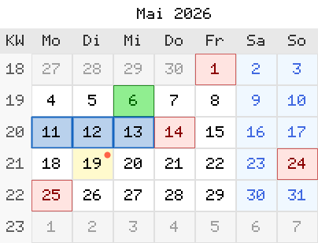

# Bilder ohne Tk: PNG, SVG, Farben

Die Module dieses Kapitels schreiben, lesen und untersuchen Bilder in
reinem Tcl. Sie brauchen weder Tk noch eine Erweiterung, nur den
Befehl `zlib` aus dem Kern und TclOO. Damit laufen sie auch auf einem
Server ohne Anzeige. Kästen und Pfeile aus einem Modell zeichnet
`tudiagram`, siehe [Diagramme](056-diagramme.md); es baut auf den
Zeichenflächen `tupngdraw` und `tusvg` aus diesem Kapitel auf.

| Modul | Version | Aufgabe |
|---|---|---|
| `tucolor` | 0.2 | Farbnamen, Hex, HSV, nächster Name |
| `tupng` | 0.5 | PNG kodieren und dekodieren |
| `tupngdraw` | 0.13 | Zeichenfläche, schreibt PNG |
| `tutablepng` | 0.2 | Tabelle als PNG |
| `tucodepng` | 0.1 | Zeichentabelle als PNG |
| `tumonthpng` | 0.5 | Monat, Quartal, Jahr als PNG |
| `tupngpad` | 0.2 | PNGs auf eine Größe bringen |
| `tusvg` | 0.3 | SVG-Zeichenfläche, SVG-Dokument, Symbole |
| `tuimage` | 0.1 | Format und Größe erkennen, `data:`-URI |
| `tuico` | 0.2 | Windows-`.ico` mit PNG-Inhalt |
| `tudhash` | 0.2 | Wahrnehmungs-Hash für ähnliche Bilder |

Ein Bild kommt in vier Datenformen vor. Welche ein Befehl erwartet,
steht bei jedem Modul.

| Form | Aufbau | Wo |
|---|---|---|
| Zeilenliste | Liste von Zeilen, jede Zeile eine Liste von Pixeln, alle Zeilen gleich lang | `tupng::encode*`, `write*` |
| RGBA-Bytes | Bytefolge der Länge Breite × Höhe × 4, zeilenweise, je Pixel R G B A mit 8 Bit | `tupng::decode`, `encodeRGBARaw`, `tupngdraw paste`, `tupngpad` |
| Zahlenliste | flach, zeilenweise: Breite × Höhe Grauwerte oder × 3 Farbwerte | `tudhash` |
| Zeichenfläche | TclOO-Objekt, der Befehlsname ist der Griff | `tupngdraw::new`, `tusvg::new` |

Farben schreiben die Module nicht einheitlich. Die Tabelle zeigt, was
jedes annimmt.

| Schreibweise | `tucolor` | `tupng` | `tupngdraw` | `tusvg` (Objekt) |
|---|---|---|---|---|
| Name | 148 CSS/X11-Namen | nein | 15 Namen | ungeprüft durchgereicht |
| `#rgb` | ja | nein | nein | ungeprüft durchgereicht |
| `#rrggbb` | ja | ja | ja | ungeprüft durchgereicht |
| `RRGGBB`, `RRGGBBAA`, `#rrggbbaa` | nein | ja | ja | ungeprüft durchgereicht |
| `{r g b}` | ja | ja | ja | `rgb(r,g,b)` |
| `{r g b a}` | nein | ja | ja | `rgba(r,g,b,a/255)` |

Die 15 Namen von `tupngdraw` sind `black`, `white`, `red`, `green`,
`lime`, `blue`, `yellow`, `cyan`, `magenta`, `gray`, `grey`, `silver`,
`orange`, `transparent` und `none`; die beiden letzten sind
`{0 0 0 0}`. Für alle anderen Namen liefert `tucolor::rgb` das Tripel.

---

## Farben: tucolor

[tucolor]{.index} löst eine Farbe in ein RGB-Tripel auf und rechnet nach Hex
und HSV. Die Namenstabelle ist im Modul eingebaut, sie stimmt mit den
Werten von Tk überein, braucht aber kein Tk.

```tcl
::tclutils::tucolor::rgb     farbe      ;# -> {r g b}, je 0..255
::tclutils::tucolor::hex     farbe      ;# -> #rrggbb
::tclutils::tucolor::names              ;# -> 148 Namen, sortiert
::tclutils::tucolor::exists  name       ;# -> 0 | 1
::tclutils::tucolor::nearest farbe      ;# -> nächster Name
::tclutils::tucolor::toHsv   farbe      ;# -> {h s v}
::tclutils::tucolor::fromHsv {h s v}    ;# -> {r g b}
```

`farbe` ist ein Name, `#rgb`, `#rrggbb` oder ein Tripel `{r g b}` aus
ganzen Dezimalzahlen 0 bis 255. Namen gelten ohne Rücksicht auf Groß- und
Kleinschreibung, Leerzeichen am Rand fallen weg. `#rgb` verdoppelt
jede Stelle (`#f80` ist `#ff8800`). `nearest` sucht den kleinsten
euklidischen Abstand im RGB-Raum; bei Gleichstand gewinnt der Name,
der in der Tabelle zuerst steht (`aqua` vor `cyan`, `gray` vor
`grey`). `toHsv` gibt `h` in Grad 0 bis 360, `s` und `v` in Prozent,
alle gerundet. Hin und zurück kann je Kanal eine Einheit abweichen.
`fromHsv` nimmt `h` von 0 bis 360 und `s`, `v` von 0 bis 100 als
Dezimalzahlen, auch mit Nachkommastellen; 360 ist dasselbe wie 0.

```tcl
package require tclutils::tucolor
::tclutils::tucolor::rgb SteelBlue           ;# -> 70 130 180
::tclutils::tucolor::rgb #f80                ;# -> 255 136 0
::tclutils::tucolor::hex {255 136 0}         ;# -> #ff8800
::tclutils::tucolor::hex navy                ;# -> #000080
::tclutils::tucolor::exists " Navy "         ;# -> 1
::tclutils::tucolor::nearest #fe0000         ;# -> red
::tclutils::tucolor::nearest {0 255 255}     ;# -> aqua
::tclutils::tucolor::toHsv steelblue         ;# -> 207 61 71
::tclutils::tucolor::fromHsv {207 61 71}     ;# -> 71 131 181
::tclutils::tucolor::fromHsv {300 100 100}   ;# -> 255 0 255
::tclutils::tucolor::fromHsv {120.5 50 50}   ;# -> 64 128 64
::tclutils::tucolor::rgb {010 20 30}         ;# -> 10 20 30
llength [::tclutils::tucolor::names]         ;# -> 148
```

Jede nicht erkannte Farbe wirft `{TCLUTILS TUCOLOR NAME}`, auch
`FF0000` ohne `#`, `{256 0 0}`, ein Quadrupel `{255 0 0 255}`,
`transparent` und ein Tripel mit Hexzahl, Vorzeichen oder
Nachkommastelle wie `{0x10 0 0}`. Eine führende Null im Tripel ist
keine Oktalzahl, unter Tcl 8.6 und 9.0 gleich: `{08 0 0}` ergibt
`8 0 0`. `fromHsv` wirft `{TCLUTILS TUCOLOR HSV}`, wenn die Liste
nicht drei Elemente hat, ein Wert keine Zahl ist oder außerhalb seines
Bereichs liegt, etwa `{0 150 100}` oder `{-60 100 100}`.

---

## PNG kodieren und dekodieren: tupng

[tupng]{.index} schreibt PNG-Dateien mit 8 Bit je Kanal in vier Farbtypen und
liest PNG-Dateien zurück in RGBA-Bytes. Grundlage ist allein `zlib`
aus dem Kern.

```tcl
::tclutils::tupng::encodeRGB     bild ?option wert ...?
::tclutils::tupng::encodeRGBA    bild ?option wert ...?
::tclutils::tupng::encodeGray    bild ?option wert ...?
::tclutils::tupng::encodeIndexed palette bild ?option wert ...?
::tclutils::tupng::encodeRGBARaw bytes breite hoehe ?option wert ...?
::tclutils::tupng::writeRGB      datei bild ?option wert ...?
::tclutils::tupng::writeRGBA     datei bild ?option wert ...?
::tclutils::tupng::writeGray     datei bild ?option wert ...?
::tclutils::tupng::writeIndexed  datei palette bild ?option wert ...?
::tclutils::tupng::writeRGBARaw  datei bytes breite hoehe ?opt w ...?
::tclutils::tupng::decode        bytes
::tclutils::tupng::readPNG       datei
```

| Befehl | Farbtyp | Pixel in der Zeilenliste |
|---|---|---|
| `encodeRGB` | 2, Truecolor | `RRGGBB`, `#rrggbb`, `{r g b}`; ein Alphawert fällt weg |
| `encodeRGBA` | 6, Truecolor mit Alpha | wie oben, dazu `RRGGBBAA`, `{r g b a}`; ohne Alpha gilt 255 |
| `encodeGray` | 0, Graustufen | ganze Zahl 0..255 |
| `encodeIndexed` | 3, Palette | Index in die Palette |

| Option | Vorgabe | Wirkung |
|---|---|---|
| `-compression` | 6 | `zlib`-Stufe 0..9 |
| `-filter` | `best` | `best`, `none`, `sub`, `up`, `average`, `paeth` |

`best` probiert je Zeile alle fünf PNG-Filter und nimmt den mit der
kleinsten Summe der Beträge. Das kostet Zeit; `up` ist deutlich
schneller (Zahlen am Ende dieses Abschnitts).

`encode*` geben die PNG-Bytes zurück, `write*` den Dateinamen.
`encodeRGBARaw` nimmt RGBA-Bytes statt einer Zeilenliste und schreibt
immer Farbtyp 6. Die Palette von `encodeIndexed` hat 1 bis 256 Einträge
in der Schreibweise von `encodeRGBA`. Hat ein Eintrag Alpha unter 255,
schreibt das Modul einen `tRNS`-Block, sonst nicht.

`decode` liefert ein Dict:

| Schlüssel | Inhalt |
|---|---|
| `width`, `height` | Größe in Pixeln |
| `colortype` | Farbtyp der Datei: 0, 2, 3, 4 oder 6 |
| `bitdepth` | immer 8 |
| `rgba` | RGBA-Bytes, Länge Breite × Höhe × 4 |

Jeder Farbtyp wird nach RGBA umgesetzt. Graustufen werden zu `g g g`.
Ein `tRNS`-Farbschlüssel macht bei Graustufen und bei Truecolor (Typ 2)
jedes Pixel mit genau diesem Wert durchsichtig (Alpha 0), alle anderen
bekommen 255. Bei einer Palette gilt der Alpha-Eintrag aus `tRNS`.
`decode` von `encodeRGBARaw` ergibt dieselben Bytes zurück. Vor dem
Auswerten prüft `decode` die CRC-Summe jedes Blocks.

```tcl
package require tclutils::tupng
set img {{FF0000 00FF00} {0000FF FFFFFF}}
set png [::tclutils::tupng::encodeRGB $img]
string range $png 1 3                        ;# -> PNG
set d [::tclutils::tupng::decode $png]
list [dict get $d width] [dict get $d colortype]  ;# -> 2 2
binary encode hex [dict get $d rgba]
                              ;# -> ff0000ff00ff00ff0000ffffffffffff
set pal {FF0000 0000FF00}
set png [::tclutils::tupng::encodeIndexed $pal {{0 1} {1 0}}]
binary encode hex [dict get [::tclutils::tupng::decode $png] rgba]
                              ;# -> ff0000ff0000ff000000ff00ff0000ff
set png [::tclutils::tupng::encodeGray {{0 128 255}}]
binary encode hex [dict get [::tclutils::tupng::decode $png] rgba]
                              ;# -> 000000ff808080ffffffffff
set raw [binary format cu* {255 0 0 255 0 0 255 128}]
set png [::tclutils::tupng::encodeRGBARaw $raw 2 1]
expr {[dict get [::tclutils::tupng::decode $png] rgba] eq $raw}
                              ;# -> 1
```

Fehler beim Kodieren:

| `-errorcode` | Ursache |
|---|---|
| `{TCLUTILS TUPNG DIM}` | keine Zeile, leere Zeile, Zeilen ungleich lang; bei `encodeRGBARaw` Breite oder Höhe nicht positiv oder falsche Bytezahl |
| `{TCLUTILS TUPNG COLOR}` | Pixel nicht lesbar, etwa `red` oder ein Grauwert 300 |
| `{TCLUTILS TUPNG PALETTE}` | Palette leer oder länger als 256 |
| `{TCLUTILS TUPNG INDEX}` | Index außerhalb der Palette |
| `{TCLUTILS TUPNG OPT}` | `-compression` nicht 0..9, `-filter` unbekannt |
| `{TCLUTILS COMMON OPTION -level}` | unbekannte Option, hier `-level` |

Fehler beim Dekodieren tragen `{TCLUTILS TUPNG DECODE grund}`:
`SIGNATURE` (keine PNG-Kennung), `IHDR` (Kopf fehlt), `BITDEPTH`
(nicht 8 Bit), `INTERLACE`, `COLORTYPE`, `IDAT` (keine Bilddaten),
`FILTER` (unbekannter Zeilenfilter). Ein Block, dessen CRC-Summe nicht
stimmt oder der vor seiner CRC-Summe abbricht, wirft
`{TCLUTILS TUPNG CRC}`. Stimmt die Summe, sind die komprimierten Daten
aber ungültig, meldet `zlib` selbst `{TCL ZLIB DATA}`.

Grenzen: Der Kodierer schreibt nur 8 Bit, kein Interlacing, keine
Zusatzblöcke wie `gAMA`, `pHYs` oder `tEXt`. Der Dekodierer weist
16-Bit-Bilder und Paletten oder Graustufen mit 1, 2 oder 4 Bit ab
(`BITDEPTH`), ebenso Interlacing (`INTERLACE`). Zusatzblöcke außer
`tRNS` übergeht er nach der CRC-Prüfung.

Laufzeit, gemessen auf einem Intel Xeon mit 2,8 GHz, Tcl 9.0.4 und
8.6.14 (Werte für 8.6 in Klammern):

| Vorgang | Bild | Zeit |
|---|---|---|
| `readPNG` | 1024 × 768 RGB, Rauschen | 1,48 s (1,45 s) |
| `encodeRGBARaw -filter up` | 1024 × 768 RGBA | 0,75 s (0,75 s) |
| `encodeRGBARaw` mit `best` | 1024 × 768 RGBA | 4,5 s (4,9 s) |
| `decode` | 256 × 256 RGBA, Zeichnung | 0,04 s (0,04 s) |

Für Symbole, Tabellen und Kalenderblätter reicht das; für Fotos in
voller Größe ist ein Werkzeug in C die bessere Wahl.

---

## Zeichnen: tupngdraw

[tupngdraw]{.index} ist eine Zeichenfläche als TclOO-Objekt. Sie hält die
Pixel als RGBA-Liste und gibt am Ende über
`tupng::encodeRGBARaw` ein PNG aus. Farben werden nach „source over“
gemischt: Eine halbdurchsichtige Füllung legt sich über das, was
darunter liegt.

```tcl
set p [::tclutils::tupngdraw::new ?option wert ...?]
```

| Option | Vorgabe | Wirkung |
|---|---|---|
| `-width` | 100 | Breite in Pixeln, ganze Zahl ab 1 |
| `-height` | 100 | Höhe in Pixeln, ganze Zahl ab 1 |
| `-background` | `white` | Farbe der leeren Fläche |

Nach `new` gelten Füllfarbe und Strichfarbe Schwarz, Strichbreite 1
und Kantenglättung an.

| Methode | Wirkung |
|---|---|
| `width`, `height` | Größe |
| `pixel x y` | `{r g b a}` an der Stelle; Koordinaten werden gerundet |
| `setfill farbe`, `setstroke farbe` | Füll- und Strichfarbe |
| `setlinewidth n` | Strichbreite, ganze Zahl ab 1 |
| `setantialias bool` | Kantenglättung für Striche und Füllungen |
| `clear ?farbe?` | ganze Fläche neu, ohne Farbe mit dem Hintergrund |
| `setpixel x y ?-color f?` | ein Pixel, gemischt |
| `line x1 y1 x2 y2 ?...?` | Strecke |
| `rect x1 y1 x2 y2 ?...?` | Rechteck, beide Ecken eingeschlossen |
| `circle cx cy r ?...?` | Kreis |
| `ellipse cx cy rx ry ?...?` | Ellipse |
| `polygon {x0 y0 x1 y1 ...} ?...?` | Vieleck, mindestens drei Punkte |
| `arc cx cy r a0 a1 ?...?` | Bogen, Tortenstück oder Sehne |
| `fillcontours {kontur ...} ?...?` | mehrere Konturen als eine Fläche |
| `text x y text ?...?` | Text in der eingebauten 6×8-Schrift |
| `textwidth text ?-scale n? ?-spacing s?` | Breite in Pixeln |
| `paste x y rgba b h ?-scale n?` | RGBA-Bytes einsetzen |
| `data ?-compression n? ?-filter f?` | PNG-Bytes |
| `write datei ?-compression n? ?-filter f?` | PNG-Datei, gibt den Namen zurück |
| `destroy` | Objekt freigeben |

Optionen der Figuren:

| Option | Vorgabe | Gilt für | Wirkung |
|---|---|---|---|
| `-fill` | 0 | `rect`, `circle`, `ellipse`, `polygon`, `arc` | Innenfläche mit der Füllfarbe |
| `-outline` | 1 | `rect`, `circle`, `ellipse`, `polygon` | Umriss mit der Strichfarbe |
| `-color` | Strichfarbe | alle Striche, `setpixel`, `text`, `fillcontours` | Farbe nur für diesen Aufruf |
| `-fillcolor` | Füllfarbe | Figuren mit `-fill` | Füllfarbe nur für diesen Aufruf |
| `-aa` | Flächenwert | Striche, Füllungen, `fillcontours` | Kantenglättung nur für diesen Aufruf |
| `-width` | Strichbreite | `line`, `arc` | Breite nur für diesen Aufruf |
| `-caps` | `round` | `line` | `round`, `butt`, `square` |
| `-join` | `round` | `rect`, `polygon`, `arc` | `round`, `bevel`, `mitre` |
| `-rx`, `-ry` | 0 | `rect` | Eckenradius; `-ry 0` übernimmt `-rx` |
| `-style` | `arc` | `arc` | `arc`, `pie`, `chord` |
| `-rule` | `nonzero` | `fillcontours` | `nonzero` oder `evenodd` |
| `-scale` | 1 | `text`, `textwidth`, `paste` | jedes Pixel als n × n |
| `-spacing` | 0 | `text`, `textwidth` | zusätzliche Pixel je Zeichen |

`arc` misst Winkel in Grad, 0 zeigt nach rechts, wachsende Winkel
laufen auf dem Bild im Uhrzeigersinn, weil y nach unten wächst.
`text` setzt die linke obere Ecke des ersten Zeichens. Die Schrift
kennt ASCII 32 bis 126 und `ä ö ü Ä Ö Ü ß`; andere Zeichen bleiben
leer. `textwidth` ist Länge × (6 + Abstand) × Maßstab, der Abstand
zählt auch nach dem letzten Zeichen. `data` und `write` filtern ohne
Angabe mit `-filter up`, nicht mit `best`.

```tcl
package require tclutils::tupngdraw
set p [::tclutils::tupngdraw::new -width 40 -height 20]
$p pixel 0 0                                 ;# -> 255 255 255 255
$p setfill {255 0 0 128}
$p rect 0 0 9 9 -fill 1 -outline 0
$p pixel 5 5                                 ;# -> 255 127 127 255
$p rect 20 2 23 5 -fill 1 -fillcolor black -outline 0
list [$p pixel 23 5] [$p pixel 24 6]
                              ;# -> {0 0 0 255} {255 255 255 255}
$p textwidth Hallo                           ;# -> 30
$p textwidth Hallo -scale 2 -spacing 1       ;# -> 70
string range [$p data] 1 3                   ;# -> PNG
$p destroy
```

`fillcontours` füllt eine Fläche aus mehreren Konturen. Mit
`evenodd` wird eine innere Kontur ein Loch; mit `nonzero` entscheidet
der Umlaufsinn, zwei gleich laufende Quadrate ergeben eine volle
Fläche.

```tcl
set p [::tclutils::tupngdraw::new -width 20 -height 20]
set aussen {2 2 18 2 18 18 2 18}
set innen  {6 6 14 6 14 14 6 14}
$p fillcontours [list $aussen $innen] -color black -rule evenodd
list [$p pixel 10 10] [$p pixel 4 10]
                              ;# -> {255 255 255 255} {0 0 0 255}
$p destroy
```

Das folgende Skript erzeugt das Bild darunter: ein Rechteck mit
runden Ecken, zwei halbdurchsichtige Kreise, ein Tortenstück, einen
Bogen, eine Linie und Text.

```tcl
package require tclutils::tupngdraw
set p [::tclutils::tupngdraw::new -width 320 -height 160]
$p setstroke {40 40 40}
$p setlinewidth 2
$p setfill {225 235 250}
$p rect 8 8 311 151 -fill 1 -rx 12
$p setfill {255 0 0 140}
$p circle 70 70 40 -fill 1 -outline 0
$p setfill {0 0 255 140}
$p circle 110 70 40 -fill 1 -outline 0
$p arc 230 75 45 -90 45 -style pie -fill 1 -fillcolor orange
$p arc 230 75 45 45 270 -style arc -width 4 -color {0 128 0}
$p line 24 130 180 130 -width 3 -caps butt
$p text 24 138 "tupngdraw: Flächen, Alpha, Text" -color black
$p write 058-zeichnung.png -compression 9
$p destroy
```


Unter Tcl 9.0 und unter Tcl 8.6 entsteht dieselbe Datei Byte für
Byte. Tcl 8.6 liest eine Skriptdatei in der Systemkodierung; steht
dort nicht UTF-8, wird aus `ä` ein falsches Zeichen. Abhilfe ist
`source -encoding utf-8` oder `\u00e4` im Text.

`paste` mischt nach derselben Regel wie alle anderen Befehle
(„source over“): Das Ergebnis-Alpha ist a_q + a_z × (1 − a_q), die
Farben werden entsprechend gewichtet (q Quelle, z Ziel, Alpha als
Anteil 0 bis 1). Auf einer deckenden Fläche entsteht eine deckende
Mischung, auf einer durchsichtigen bleibt das Pixel, wie es ist.
Pixel mit Alpha 0 lassen die Fläche unverändert.

```tcl
set p [::tclutils::tupngdraw::new -width 2 -height 1 \
    -background transparent]
$p paste 0 0 [binary format cu* {255 0 0 128}] 1 1
$p setpixel 1 0 -color {255 0 0 128}
list [$p pixel 0 0] [$p pixel 1 0]
                              ;# -> {255 0 0 128} {255 0 0 128}
$p clear white
$p paste 0 0 [binary format cu* {255 0 0 128}] 1 1
$p pixel 0 0                                 ;# -> 255 127 127 255
$p destroy
```

| `-errorcode` | Ursache |
|---|---|
| `{TCLUTILS TUPNGDRAW COLOR}` | Farbe nicht lesbar, auch ein Name außerhalb der 15, etwa `navy` |
| `{TCLUTILS TUPNGDRAW RANGE}` | `pixel` außerhalb der Fläche |
| `{TCLUTILS TUPNGDRAW CAPS}`, `JOIN`, `STYLE`, `RULE` | Wert von `-caps`, `-join`, `-style`, `-rule` unbekannt |
| `{TCLUTILS TUPNGDRAW POLY}` | `polygon` mit weniger als drei Punkten |
| `{TCLUTILS COMMON INTEGER name}` | Breite, Höhe, Radius, Strichbreite oder Maßstab nicht ab 1; `name` ist etwa `width`, `radius`, `-linewidth` |
| `{TCLUTILS COMMON BOOLEAN name}` | `-fill`, `-aa` oder `setantialias` kein Wahrheitswert |
| `{TCLUTILS COMMON OPTION name}` | unbekannte Option |

Jedes Pixel wird in Tcl gesetzt. Ein geglätteter gefüllter Kreis mit
Radius 100 auf 256 × 256 Pixeln braucht gemessen 0,14 s unter Tcl
9.0.4 und 0,10 s unter 8.6.14 (Xeon, 2,8 GHz); `data` mit `-filter up`
0,04 s, mit `-filter best` 0,33 s.

---

## Tabelle als Bild: tutablepng

[tutablepng]{.index} setzt eine Liste von Zeilen als Tabelle in ein PNG:
Kopfzeile, Ausrichtung je Spalte, wechselnde Zeilenfarbe, Gitter.
Gezeichnet wird mit `tupngdraw` in der 6×8-Schrift.

```tcl
::tclutils::tutablepng::render zeilen ?option wert ...?
::tclutils::tutablepng::write  datei zeilen ?option wert ...?
```

`zeilen` ist eine Liste von Zeilen, jede eine Liste von Zellen. Die
breiteste Zeile bestimmt die Spaltenzahl, kürzere Zeilen bekommen
leere Zellen. `render` gibt PNG-Bytes zurück (RGBA, Farbtyp 6),
`write` den Dateinamen.

| Option | Vorgabe | Wirkung |
|---|---|---|
| `-header` | 1 | erste Zeile als Kopf |
| `-align` | `l` | `l`, `c`, `r` für alle Spalten oder eine Liste je Spalte; fehlende Einträge übernehmen den letzten |
| `-scale` | 1 | Schriftmaßstab |
| `-padding` | 6 | Rand in der Zelle, Pixel, ganze Zahl ab 0 |
| `-spacing` | 1 | Pixel zwischen Zeichen, ganze Zahl ab 0 |
| `-background` | `white` | Hintergrund |
| `-gridcolor` | `{180 180 185}` | Gitter |
| `-textcolor` | `{25 25 25}` | Text |
| `-headerbg` | `{230 230 238}` | Kopfzeile, Hintergrund |
| `-headertext` | `{0 0 0}` | Kopfzeile, Text |
| `-zebra` | leer | Farbe jeder zweiten Datenzeile; leer heißt aus |
| `-border` | 1 | Gitterlinien |

Die Spaltenbreite ist die längste Zelle × (6 + `-spacing`) ×
`-scale` + 2 × `-padding`, die Zeilenhöhe 8 × `-scale` + 2 ×
`-padding`. Farben folgen `tupngdraw`. Jede Zelle erscheint genau so,
wie sie in der Liste steht; auch `4.80`, `1e3`, `0x1F` oder `010`
bleiben unverändert.

```tcl
package require tclutils::tutablepng
package require tclutils::tuimage
set rows {{Artikel Menge Preis} {Schrauben 120 4,80} {Muttern 80}}
set png [::tclutils::tutablepng::render $rows -align {l r r}]
::tclutils::tuimage::dimensions $png         ;# -> 169 60
set png [::tclutils::tutablepng::render {{4.80 010}} -header 0]
::tclutils::tuimage::dimensions $png         ;# -> 73 20
```

Das Bild darunter entsteht mit diesem Skript:

```tcl
package require tclutils::tutablepng
set rows {
    {Artikel     Lager  Menge  Preis}
    {Schrauben   Nord   120    4,80}
    {Muttern     Nord   80     2,10}
    {Scheiben    Süd    450    1,95}
    {Dübel       Süd    60     3,25}
}
::tclutils::tutablepng::write 058-tabelle.png $rows \
    -scale 2 -align {l l r r} -zebra {245 245 248}
```


`{}` als Zeilenliste und Zeilen ganz ohne Zellen werfen
`{TCLUTILS TUTABLEPNG EMPTY}`. Ein unbekannter `-align`-Wert wirft
`{TCLUTILS TUTABLEPNG ALIGN}`. `-header` und `-border` ohne
Wahrheitswert werfen `{TCLUTILS COMMON BOOLEAN ...}`, `-scale 0`
`{TCLUTILS COMMON INTEGER -scale}`, eine unlesbare Farbe
`{TCLUTILS TUPNGDRAW COLOR}`. Ist `-padding` oder `-spacing` keine
ganze Zahl ab 0, folgt `{TCLUTILS TUTABLEPNG PADDING}` bzw.
`{TCLUTILS TUTABLEPNG SPACING}`.

---

## Zeichentabelle als Bild: tucodepng

[tucodepng]{.index} zeichnet eine Codetabelle: je Zelle oben der Hexwert, in
der Mitte das Zeichen, auf Wunsch unten der Name. Die Daten stammen
aus `tucode`, siehe
[Binärdaten und Dateiinformationen](053-binaerdaten-und-dateiinfo.md).

```tcl
::tclutils::tucodepng::render von bis ?option wert ...?
::tclutils::tucodepng::write  datei von bis ?option wert ...?
::tclutils::tucodepng::ascii  ?option wert ...?   ;# 0..127
::tclutils::tucodepng::latin1 ?option wert ...?   ;# 128..255
::tclutils::tucodepng::all    ?option wert ...?   ;# 0..255
```

| Option | Vorgabe | Wirkung |
|---|---|---|
| `-columns` | 16 | Zellen je Reihe |
| `-scale` | 2 | Maßstab des Zeichens in der Mitte |
| `-theme` | `default` | `default`, `dark`, `light` |
| `-showcode` | 1 | Hexwert oben |
| `-shownames` | 0 | Name unten, etwa `NUL`, `auml` |
| `-title` | leer | Überschrift über der Tabelle |
| `-textcmd` | leer | eigener Befehl für das Zeichen in der Mitte |

Steuerzeichen 0 bis 31 und 127 zeigen ihre Abkürzung, 32 zeigt `SP`,
jeweils in Maßstab 1. Hexwert und Name stehen immer in der 6×8-Schrift.
Von 128 bis 255 kennt die Schrift nur `ä ö ü Ä Ö Ü ß`; die übrigen
Zellen bleiben in der Mitte leer, es sei denn, `-textcmd` zeichnet.
Der Befehl wird für jedes druckbare Zeichen als
`{*}$cmd bild x y b h zeichen farbe` gerufen; `bild` ist die
`tupngdraw`-Fläche.

Eine Zelle ist 28 × `-scale` breit, mit Namen mindestens 48 Pixel,
und 12 × `-scale` hoch, dazu 10 Pixel für den Hexwert und 10 für den
Namen. Die Überschrift ist 12 × `-scale` hoch.

```tcl
package require tclutils::tucodepng
package require tclutils::tuimage
set png [::tclutils::tucodepng::ascii]
::tclutils::tuimage::dimensions $png         ;# -> 896 272
set png [::tclutils::tucodepng::render 64 95 -columns 8 -scale 1]
::tclutils::tuimage::dimensions $png         ;# -> 224 88
```

`von` oder `bis` keine ganze Zahl, `von` größer als `bis` oder ein
Bereich außerhalb 0..255 werfen `{TCLUTILS TUCODEPNG RANGE}`. Ein
unbekanntes Thema wirft `{TCLUTILS TUCODEPNG THEME}`.

---

## Monatsblatt: tumonthpng

[tumonthpng]{.index} zeichnet einen Monat als Kalenderblatt: Titel,
Wochentagskopf, Spalte mit ISO-Kalenderwochen, sechs Wochen.
Hervorgehoben werden heute, Feiertage, Notizen, Wochenende und Tage
anderer Monate. Quartal und Jahr setzen mehrere Monate nebeneinander.

```tcl
::tclutils::tumonthpng::render        jahr monat ?opt wert ...?
::tclutils::tumonthpng::write         datei jahr monat ?opt wert ...?
::tclutils::tumonthpng::renderQuarter jahr monat ?opt wert ...?
::tclutils::tumonthpng::writeQuarter  datei jahr monat ?opt wert ...?
::tclutils::tumonthpng::renderYear    jahr ?opt wert ...?
::tclutils::tumonthpng::writeYear     datei jahr ?opt wert ...?
```

`render*` geben PNG-Bytes zurück, `write*` den Dateinamen. Daten sind
ISO-Daten `JJJJ-MM-TT`.

| Option | Vorgabe | Wirkung |
|---|---|---|
| `-theme` | `default` | `default`, `dark`, `light` |
| `-scale` | 2 | Maßstab |
| `-today` | leer | Tag „heute“; leer heißt Systemdatum |
| `-holidays` | leer | Dict Datum → Name |
| `-notes` | leer | Dict Datum → Text; der Tag bekommt einen Punkt |
| `-firstweekday` | 1 | erster Tag der Woche, 1 Montag bis 7 Sonntag; verschiebt Raster und Kopf |
| `-showweeks` | 1 | Spalte „KW“ |
| `-weekdays` | `{Mo Di Mi Do Fr Sa So}` | Namen für den Kopf, immer Montag bis Sonntag |
| `-monthnames` | `{Januar ... Dezember}` | Monatsnamen im Titel |
| `-title` | leer | `render`: Titel statt „Monat Jahr“; Quartal und Jahr: Überschrift über dem ganzen Blatt |
| `-select` | leer | Liste von Daten und Bereichen `von..bis` |
| `-selectstyle` | `outline` | `outline`, `fill`, `both` |
| `-selectcolor` | leer, dann `#1565C0` | Farbe der Auswahl |
| `-selectwidth` | leer, dann max(2, Maßstab) | Rahmenbreite der Auswahl |
| `-selectalpha` | 0.3 | Anteil der Auswahlfarbe bei `fill` |
| `-textcmd` | leer | eigener Befehl für jede Beschriftung |
| `-cols` | 3 | nur `renderYear`: Monate je Reihe |

Ein Tag bekommt genau eine Färbung, in dieser Reihenfolge: heute,
Feiertag, Notiz, anderer Monat, Wochenende, normal. Den Punkt einer
Notiz zeichnet das Modul in jedem Fall. Die Namen in `-holidays` und
die Texte in `-notes` erscheinen nicht im Bild, sie markieren nur den
Tag. Die Rechnung läuft in UTC über `clock`, das Ergebnis hängt nicht
von der Zeitzone ab.

Ein Monatsblock ist 7 × 26 × `-scale` breit, mit KW-Spalte
20 × `-scale` mehr, und 154 × `-scale` hoch. Quartal und Jahr setzen
zwischen die Blöcke 10 × `-scale`; ein `-title` kommt dort als Streifen
von 18 × `-scale` über alle Blöcke hinzu. Das Jahr ist eine ganze Zahl
von 1 bis 9999.

```tcl
package require tclutils::tumonthpng
package require tclutils::tuimage
proc dims {png} { ::tclutils::tuimage::dimensions $png }
dims [::tclutils::tumonthpng::render 2026 6 -today 2026-06-06]
                                             ;# -> 404 308
dims [::tclutils::tumonthpng::render 2026 6 -scale 1 -showweeks 0]
                                             ;# -> 182 154
dims [::tclutils::tumonthpng::renderQuarter 2026 11 -scale 1]
                                             ;# -> 626 154
dims [::tclutils::tumonthpng::renderYear 2026 -scale 1 -cols 4]
                                             ;# -> 838 482
dims [::tclutils::tumonthpng::renderQuarter 2026 11 -scale 1 \
    -title "Q4 2026"]                        ;# -> 626 172
```

Das Quartal ab November 2026 zeigt November, Dezember und Januar 2027.
Das Monatsblatt darunter verbindet `tumonthpng` mit den Feiertagen aus
`tuholiday` ([Notizen und Kalender](054-notizen-und-kalender.md)):

```tcl
package require tclutils::tumonthpng
package require tclutils::tuholiday
::tclutils::tumonthpng::write 058-monat.png 2026 5 \
    -today 2026-05-06 \
    -holidays [::tclutils::tuholiday::holidays 2026] \
    -notes {2026-05-19 Inventur} \
    -select {2026-05-11..2026-05-13} -selectstyle both
```



`-textcmd` wird als `{*}$cmd bild x y b h text farbe` für Titel,
Wochentage, „KW“, Wochennummern und Tageszahlen gerufen und zeichnet
den Text selbst, etwa mit echten Schriftumrissen über
`tupngdraw fillcontours`.

`-firstweekday` verschiebt Raster und Kopf gemeinsam: Mit
`-firstweekday 7` beginnt die erste Spalte am Sonntag, und der Kopf
zeigt `So Mo Di Mi Do Fr Sa`. `-weekdays` nennt die Namen immer von
Montag bis Sonntag; das Modul dreht die Liste selbst.

| `-errorcode` | Ursache |
|---|---|
| `{TCLUTILS TUMONTHPNG MONTH}` | Monat nicht 1..12 |
| `{TCLUTILS TUMONTHPNG YEAR}` | Jahr keine ganze Zahl 1..9999, etwa `abc` |
| `{TCLUTILS TUMONTHPNG FIRSTWEEKDAY}` | `-firstweekday` nicht 1..7 |
| `{TCLUTILS TUMONTHPNG THEME}` | Thema unbekannt |
| `{TCLUTILS TUMONTHPNG SELECT}` | Eintrag in `-select` nicht `JJJJ-MM-TT` oder Bereich |
| `{TCLUTILS TUMONTHPNG SELECTSTYLE}` | `-selectstyle` unbekannt |
| `{TCLUTILS COMMON BOOLEAN -showweeks}` | `-showweeks` kein Wahrheitswert |
| `{TCLUTILS COMMON INTEGER -scale}`, `-cols` | Maßstab oder Spalten nicht ab 1 |

Ein `-today` wie `morgen` ist kein Fehler, es trifft nur keinen Tag.

---

## Einheitliche Größe: tupngpad

[tupngpad]{.index} bringt mehrere PNG-Dateien auf eine gemeinsame Größe. Jedes
Bild wird auf seinen Inhalt zugeschnitten, mit Rand mittig gesetzt und
auf eine Hintergrundfarbe gelegt. Typisch sind freigestellte Bilder
mit durchsichtigem Hintergrund.

```tcl
::tclutils::tupngpad::bbox  rgba b h                ;# -> {x0 y0 x1 y1}
::tclutils::tupngpad::trim  rgba b h                ;# -> {rgba b h}
::tclutils::tupngpad::padTo rgba b h zb zh ?option wert ...?
::tclutils::tupngpad::batch dateien zielordner ?option wert ...?
```

`bbox` sucht alle Pixel mit Alpha über 0 und gibt die Ecken
einschließlich zurück, bei einem ganz durchsichtigen Bild die leere
Liste. `trim` schneidet auf diesen Kasten; ist nichts sichtbar, kommt
die Eingabe unverändert zurück. `padTo` setzt den Inhalt auf eine
Fläche `zb` × `zh` und gibt PNG-Bytes zurück.

| Option von `padTo` | Vorgabe | Wirkung |
|---|---|---|
| `-background` | `white` | Farbe der Fläche, Schreibweise wie `tupngdraw` |
| `-align` | `center` | `center`, `nw`, `n`, `ne`, `w`, `e`, `sw`, `s`, `se` |
| `-filter` | leer | PNG-Filter; leer heißt `up` |

| Option von `batch` | Vorgabe | Wirkung |
|---|---|---|
| `-margin` | 4 | Rand in Pixeln, ganze Zahl ab 0 |
| `-background` | `white` | wie oben |
| `-trim` | 1 | erst auf den Inhalt schneiden |
| `-align` | `center` | wie oben |
| `-square` | 0 | quadratische Ausgabe |
| `-size` | leer | `{B H}` für den Innenbereich, ganze Zahlen ab 1; leer heißt größtes Eingabebild |

`batch` liest jede Datei mit `tupng::readPNG`, schreibt sie unter
gleichem Namen in den Zielordner (der bei Bedarf angelegt wird) und
gibt ein Dict zurück: `size {b h}` und `files` mit abwechselnd
Eingabe- und Ausgabepfad. Alle Ausgaben haben Farbtyp 6. Ein zu kleines
`-size` schneidet den Inhalt ab. Halbdurchsichtige Pixel werden mit
dem Hintergrund gemischt, siehe `paste` bei `tupngdraw`: Auf einem
deckenden Hintergrund werden sie deckend, mit `-background
transparent` bleiben sie halbdurchsichtig.

```tcl
package require tclutils::tupngpad
set px {}
for {set y 0} {$y < 3} {incr y} {
    for {set x 0} {$x < 4} {incr x} {
        if {$y == 1 && $x in {1 2}} {
            lappend px 255 0 0 255
        } else {
            lappend px 0 0 0 0
        }
    }
}
set rgba [binary format cu* $px]
::tclutils::tupngpad::bbox $rgba 4 3          ;# -> 1 1 2 1
lassign [::tclutils::tupngpad::trim $rgba 4 3] r w h
list $w $h                                    ;# -> 2 1
set png [::tclutils::tupngpad::padTo $r $w $h 6 4 -align nw]
set d [::tclutils::tupng::decode $png]
binary encode hex [string range [dict get $d rgba] 0 11]
                              ;# -> ff0000ffff0000ffffffffff
::tclutils::tupng::writeRGBARaw in1.png $rgba 4 3
set img2 {{00000000 00FF00} {00FF00 00FF00}}
::tclutils::tupng::writeRGBA in2.png $img2
set res [::tclutils::tupngpad::batch {in1.png in2.png} aus -margin 2]
dict get $res size                            ;# -> 6 6
```

`batch` prüft alle Optionen, bevor es eine Datei liest.

| `-errorcode` | Ursache |
|---|---|
| `{TCLUTILS TUPNGPAD MARGIN}` | `-margin` unter 0 oder keine ganze Zahl |
| `{TCLUTILS TUPNGPAD TRIM}` | `-trim` kein Wahrheitswert |
| `{TCLUTILS TUPNGPAD SQUARE}` | `-square` kein Wahrheitswert |
| `{TCLUTILS TUPNGPAD SIZE}` | `-size` nicht leer und nicht `{B H}` mit ganzen Zahlen ab 1 |
| `{TCLUTILS COMMON VALUE -align}` | `-align` unbekannt; die Meldung nennt die erlaubten Werte |

Fehlende Dateien und kaputte PNGs melden `open`
(`{POSIX ENOENT ...}`) und `tupng::decode` mit ihren Codes.

---

## SVG: tusvg

[tusvg]{.index} erzeugt SVG-Text. Es hat zwei Zugänge: eine Zeichenfläche
`new`, deren Methoden denen von `tupngdraw` gleichen, und eine ältere
Prozedur-Schnittstelle mit einem Dokument als Dict, Verläufen,
Gruppen und 149 Symbolnamen. Die Bilder dieses Buchs sind PNG; SVG
steht hier nur als Text.

### Zeichenfläche

```tcl
set c [::tclutils::tusvg::new ?-width n? ?-height n? ?-background f?]
```

Vorgaben wie bei `tupngdraw`: 100 × 100, Hintergrund `white`. Mit
`-background none` oder leer entfällt das Hintergrundrechteck. Die
Methoden `width`, `height`, `setfill`, `setstroke`, `setlinewidth`,
`rect`, `line`, `polygon`, `circle`, `ellipse`, `text`, `textwidth`,
`data`, `write` und `destroy` nehmen dieselben Argumente wie bei
`tupngdraw` (`-fill`, `-outline`, `-color`, `-fillcolor`, `-rx`,
`-ry`, `-width`, `-caps`, `-scale`, `-spacing`). Dazu kommen:

| Methode | Wirkung |
|---|---|
| `text ... -anchor a` | `start` (Vorgabe), `middle`, `end` |
| `polyline punkte ?-color f? ?-width n?` | offener Linienzug |
| `path d ?-fill? ?-outline? ?-color? ?-fillcolor?` | SVG-Pfad |
| `addDef text` | Eintrag in `<defs>` |
| `icon name x y groesse ?...?` | Symbol einsetzen, siehe unten |

`data` gibt den SVG-Text zurück, `write` schreibt ihn in UTF-8 und
gibt den Dateinamen zurück. `textwidth` rechnet wie `tupngdraw`;
`text` setzt dazu `textLength`, damit der Text im Betrachter genau
diese Breite einnimmt. So bleibt ein Kasten, der nach `textwidth`
bemessen ist, in SVG und PNG gleich groß. Unterschiede zu
`tupngdraw`: Farben werden nicht geprüft (`nichtsda` und
`{999 0 0}` gehen durch); `-aa` und `-join` sind unbekannte Optionen;
`arc`, `pixel`, `setpixel`, `clear`, `setantialias`, `paste` und
`fillcontours` fehlen; `rect` hat die Breite `x2 − x1`,
während `tupngdraw` beide Eckpixel mitzählt, also ein Pixel mehr.

```tcl
package require tclutils::tusvg
set c [::tclutils::tusvg::new -width 120 -height 40]
$c setfill {200 220 255}
$c rect 4 4 115 35 -fill 1 -rx 6
$c text 10 16 "A<B" -color navy
$c textwidth "A<B"                           ;# -> 18
puts [$c data]
$c destroy
```

Ausgabe:

```text
<svg xmlns="http://www.w3.org/2000/svg" width="120" height="40"
 viewBox="0 0 120 40">
  <rect x="0" y="0" width="120" height="40" fill="white"/>
  <rect x="4" y="4" width="111" height="31" rx="6"
 fill="rgb(200,220,255)" stroke="black" stroke-width="1"/>
  <text x="10" y="23" font-family="monospace" font-size="8"
 textLength="18" lengthAdjust="spacingAndGlyphs"
 text-anchor="start" fill="navy">A&lt;B</text>
</svg>
```

Die langen Zeilen sind hier umbrochen; im Original steht jedes
Element auf einer Zeile.

| `-errorcode` | Ursache |
|---|---|
| `{TCLUTILS TUSVG COLOR}` | Farbe als Liste mit 2 oder mehr als 4 Elementen |
| `{TCLUTILS TUSVG CAPS}` | `-caps` unbekannt |
| `{TCLUTILS TUSVG ANCHOR}` | `-anchor` unbekannt |
| `{TCLUTILS TUSVG POLY}` | `polygon` mit weniger als drei Punkten |
| `{TCLUTILS COMMON ...}` | Optionen, Wahrheitswerte, Ganzzahlen wie bei `tupngdraw` |

Die Methode `icon` nimmt die Optionen der Prozedur `icon`
(`-color`, `-strokeWidth`). Sie setzt das Symbol als verschachteltes
`<svg>`-Element mit `x`, `y`, Breite und Höhe `groesse` und
`viewBox="0 0 24 24"` ein, ohne XML-Deklaration.

```tcl
set c [::tclutils::tusvg::new -width 40 -height 40]
$c icon save 4 4 16 -color navy
set d [$c data]
regexp -all {<svg} $d                        ;# -> 2
regexp {<svg x="4" y="4" width="16"} $d      ;# -> 1
$c destroy
```

### Dokument als Dict

```tcl
set svg [::tclutils::tusvg::create breite hoehe ?-viewBox v? ?-id i?]
::tclutils::tusvg::rect        svg x y b h ?option wert ...?
::tclutils::tusvg::circle      svg cx cy r ?...?
::tclutils::tusvg::ellipse     svg cx cy rx ry ?...?
::tclutils::tusvg::line        svg x1 y1 x2 y2 ?...?
::tclutils::tusvg::polyline    svg punkte ?...?
::tclutils::tusvg::polygon     svg punkte ?...?
::tclutils::tusvg::path        svg d ?...?
::tclutils::tusvg::textElement svg x y text ?...?
::tclutils::tusvg::linearGradient svg id x1 y1 x2 y2 stops
::tclutils::tusvg::radialGradient svg id cx cy r stops
set g [::tclutils::tusvg::group svg ?-transform t? ?-opacity o?]
::tclutils::tusvg::addToGroup g element
::tclutils::tusvg::addGroup   svg $g
::tclutils::tusvg::toString   $svg                ;# -> SVG-Text
::tclutils::tusvg::write      $svg datei          ;# -> datei
```

Hier ist `rect` anders als bei der Zeichenfläche: Ecke, Breite, Höhe.
Die Element-Prozeduren nehmen den Namen der Dict-Variablen und hängen
an. Ihre Optionen heißen wie SVG-Attribute in Kamelschreibweise:
`-fill`, `-stroke`, `-strokeWidth`, `-opacity`, `-id`, bei Linien
`-strokeLinecap` und `-strokeLinejoin`, bei Text `-fontSize`,
`-fontFamily`, `-fontWeight`, `-textAnchor`. Die Vorgabe für `-fill`
ist `#000000`, bei `line`, `polyline` und `path` `none` mit Strich
`#000000`. Unbekannte Optionen werden still übergangen, Werte nicht
geprüft. `punkte` steht als Text `"x,y x,y ..."` und geht
unverändert in die Ausgabe. Die Verläufe kommen in `<defs>` und geben `url(#id)` zurück, passend
für `-fill`. Ein Stopp ist `{offset farbe ?deckkraft?}`, Offset und
Koordinaten in Prozent. In
eine Gruppe kommen Elemente, indem die Element-Prozedur die
Gruppenvariable bekommt. `toString` beginnt mit der XML-Deklaration.

```tcl
set svg [::tclutils::tusvg::create 40 20 -viewBox "0 0 40 20"]
::tclutils::tusvg::rect svg 2 2 36 16 -fill "#eef" -stroke navy -rx 3
::tclutils::tusvg::textElement svg 20 14 "Lager & Co" \
    -fontSize 10 -textAnchor middle
set g [::tclutils::tusvg::group svg -transform "translate(5,5)"]
::tclutils::tusvg::rect g 0 0 4 4
::tclutils::tusvg::addGroup svg $g
puts [::tclutils::tusvg::toString $svg]
```

Ausgabe:

```text
<?xml version="1.0" encoding="UTF-8"?>
<svg xmlns="http://www.w3.org/2000/svg" width="40" height="20"
 viewBox="0 0 40 20">
  <rect x="2" y="2" width="36" height="16" rx="3" fill="#eef"
 stroke="navy" stroke-width="1"/>
  <text x="20" y="14" fill="#000000" font-size="10"
 font-family="sans-serif" text-anchor="middle">Lager &amp; Co</text>
  <g transform="translate(5,5)">
    <rect x="0" y="0" width="4" height="4" fill="#000000"/>
  </g>
</svg>
```

### Symbole

```tcl
::tclutils::tusvg::icons                        ;# -> Liste der Namen
::tclutils::tusvg::icon     name groesse ?-color f? ?-strokeWidth w?
::tclutils::tusvg::saveIcon name groesse datei ?-color f?
```

`icons` nennt alle 149 Namen, die `icon` kennt, darunter
Doppelnamen wie `trash` und `delete` oder `rotate-left` und
`rotate_left`. `icon` gibt ein Dokument-Dict mit `viewBox "0 0 24 24"`
zurück; `toString` macht daraus Text. Die Vorgabe für `-color` ist
`#333333`, die Strichbreite wächst ohne Angabe mit der Größe (1.5 bis
16, 1.75 bis 24, 2.0 bis 32, sonst 2.5). Ein unbekannter Name ergibt
ohne Fehler ein Ersatzsymbol mit Fragezeichen. Die Symbole bestehen
nur aus Linien und Flächen, ohne `<text>`.

```tcl
llength [::tclutils::tusvg::icons]            ;# -> 149
set ic [::tclutils::tusvg::icon save 16]
dict get $ic width                            ;# -> 16
dict get $ic viewBox                          ;# -> 0 0 24 24
```

---

## Bildformat erkennen: tuimage

[tuimage]{.index} liest Format, MIME-Typ und Größe aus den ersten Bytes eines
Bildes. Es dekodiert keine Pixel. Dazu kommen `data:`-URIs.

```tcl
::tclutils::tuimage::type        bytes   ;# -> png|jpeg|gif|bmp|webp|""
::tclutils::tuimage::mime        bytes   ;# -> image/png ... oder ""
::tclutils::tuimage::dimensions  bytes   ;# -> {breite hoehe} oder {}
::tclutils::tuimage::inspect     bytes   ;# -> Dict
::tclutils::tuimage::dataUri     mime bytes
::tclutils::tuimage::fromDataUri uri     ;# -> {mime m bytes b}
```

| Format | Kennung | Größe aus |
|---|---|---|
| PNG | `\x89PNG\r\n\x1a\n` | `IHDR` |
| JPEG | `\xff\xd8\xff` | erster SOF-Marker |
| GIF | `GIF87a`, `GIF89a` | Bildschirmbeschreibung |
| BMP | `BM` | Info-Kopf; negative Höhe wird positiv |
| WebP | `RIFF` … `WEBP` | `VP8 `, `VP8L` oder `VP8X` |

`inspect` gibt `type`, `mime`, `width` und `height`; bei unbekanntem
Format sind alle vier leer. Die Prüfung ist knapp: Jede Zeichenkette,
die mit `BM` beginnt, gilt als BMP. Ist die Datei zu kurz für den
Kopf, bleibt `dimensions` leer. Die Bytes müssen binär gelesen sein.

`dataUri` setzt `data:mime;base64,` vor die Base64-Form, ohne den
MIME-Typ zu prüfen. `fromDataUri` dekodiert Base64 nur, wenn `base64`
im Kopf steht; sonst kommt der Inhalt unverändert zurück, ohne
Prozent-Dekodierung. Ungültiges Base64 wie `!!!` ergibt leere Bytes,
keinen Fehler. Base64 übernimmt `tubase64`, siehe
[Kodierung, Hash, Vergleich](052-kodierung-hash-vergleich.md).

```tcl
package require tclutils::tuimage
package require tclutils::tupng
set png [::tclutils::tupng::encodeGray {{0 255}}]
::tclutils::tuimage::inspect $png
                        ;# -> type png mime image/png width 2 height 1
::tclutils::tuimage::type "BM irgendwas"     ;# -> bmp
::tclutils::tuimage::dimensions Hallo        ;# ->
set uri [::tclutils::tuimage::dataUri image/png $png]
string range $uri 0 21          ;# -> data:image/png;base64,
set r [::tclutils::tuimage::fromDataUri $uri]
expr {[dict get $r bytes] eq $png}           ;# -> 1
::tclutils::tuimage::fromDataUri "data:,Hallo%20Welt"
                              ;# -> mime {} bytes Hallo%20Welt
```

Eine Zeichenkette ohne `data:` am Anfang wirft
`{TCLUTILS TUIMAGE DATAURI}`. Die übrigen Befehle werfen nicht.

---

## Windows-Symbole: tuico

[tuico]{.index} schreibt und liest `.ico`-Dateien. Die Einträge sind PNG-Bilder,
die Windows seit Vista in Symbolen annimmt und die einen Alphakanal
tragen. Das Modul rechnet keine Pixel um; die PNGs kommen etwa aus
`tupngdraw`. Alle Befehle stehen auch als Ensemble
`tclutils::tuico write|info|extract` bereit.

```tcl
::tclutils::tuico::write   datei eintraege         ;# -> Anzahl Bytes
::tclutils::tuico::info    datei                   ;# -> Dicts
::tclutils::tuico::extract datei groesse ?ziel?    ;# -> PNG-Bytes
```

`eintraege` ist eine Liste von Paaren `{groesse png}`. Die Größe ist
die Kantenlänge 1 bis 256, das PNG muss genau so groß und quadratisch
sein. `write` prüft alle Einträge, bevor es schreibt; ein Fehler lässt
keine halbe Datei zurück. Die Einträge stehen in der gegebenen
Reihenfolge, je mit 1 Ebene und 32 Bit; 256 steht im Verzeichnis als
0. `info` gibt je Eintrag `width`, `height`, `bpp`, `format` (`png`
oder `bmp`), `offset` und `length`, mit 256 statt 0. `extract` sucht
den ersten Eintrag mit dieser Breite und schreibt ihn auf Wunsch
zusätzlich nach `ziel`. BMP-Einträge erkennt `info`, schreiben kann
das Modul sie nicht.

```tcl
package require tclutils::tuico
package require tclutils::tupngdraw
set entries {}
foreach s {32 16} {
    set p [::tclutils::tupngdraw::new -width $s -height $s \
        -background transparent]
    $p setfill {30 144 255}
    $p circle [expr {$s/2}] [expr {$s/2}] [expr {$s/2 - 1}] \
        -fill 1 -outline 0
    lappend entries [list $s [$p data]]
    $p destroy
}
::tclutils::tuico::write app.ico $entries    ;# -> 752
lmap e [::tclutils::tuico::info app.ico] {dict get $e width}
                                             ;# -> 32 16
dict get [lindex [::tclutils::tuico::info app.ico] 1] format
                                             ;# -> png
string length [::tclutils::tuico::extract app.ico 16 x16.png]
                                             ;# -> 247
```

| `-errorcode` | Ursache |
|---|---|
| `{TCLUTILS TUICO NOENTRIES}` | leere Liste |
| `{TCLUTILS TUICO TOOMANY}` | mehr als 65535 Einträge |
| `{TCLUTILS TUICO BADENTRY}` | Eintrag ist kein Paar |
| `{TCLUTILS TUICO BADSIZE}` | Größe nicht 1..256 |
| `{TCLUTILS TUICO BADPNG}` | Inhalt ist kein PNG |
| `{TCLUTILS TUICO SIZEMISMATCH}` | PNG-Größe passt nicht zur Angabe |
| `{TCLUTILS TUICO BADFILE}` | Datei zu kurz oder kein `.ico` |
| `{TCLUTILS TUICO TRUNCATED}` | Verzeichniseintrag abgeschnitten |
| `{TCLUTILS TUICO NOSUCHSIZE}` | `extract` findet die Größe nicht |
| `{TCLUTILS TUICO READFAILED}`, `WRITEFAILED` | Datei nicht zu öffnen |

`info` liest alle Felder des Verzeichnisses ohne Vorzeichen, wie das
Format sie festlegt. Kündigt der Kopf mehr Einträge an, als die Datei
enthält, wirft `info` `TRUNCATED`, auch bei mehr als 32767.

---

## Ähnliche Bilder: tudhash

[tudhash]{.index} rechnet einen Differenz-Hash (dHash) mit 64 Bit. Ähnliche
Bilder bekommen ähnliche Hashes; der Abstand ist die Zahl der
verschiedenen Bits. So fallen Bilder auf, die verkleinert, neu
gespeichert oder leicht verändert sind und deren Bytes sich deshalb
unterscheiden.

```tcl
::tclutils::tudhash::fromGray b h grauwerte    ;# -> 16 Hexzeichen
::tclutils::tudhash::fromRGB  b h rgbwerte     ;# -> 16 Hexzeichen
::tclutils::tudhash::distance hexA hexB        ;# -> 0..64
::tclutils::tudhash::similar  hexA hexB ?max?  ;# -> 0 | 1
```

`grauwerte` sind b × h Zahlen 0..255, `rgbwerte` b × h × 3, jeweils
zeilenweise. `fromRGB` rechnet Grau als `(77 R + 150 G + 29 B) >> 8`.
Das Bild wird auf 9 × 8 Felder gemittelt (Mittelwert über jedes Feld,
ganzzahlig); dann vergleicht jedes Feld seinen rechten Nachbarn, Bit
1 heißt „rechts heller“. `distance` nimmt Groß- und Kleinbuchstaben.
`similar` ist `distance <= max`, Vorgabe 10. Die Verkleinerung ist
ein einfacher Kastenfilter; Hashes anderer Werkzeuge mit derselben
Bitordnung, aber anderem Filter, können um einige Bits abweichen.

```tcl
package require tclutils::tudhash
set g {}
for {set y 0} {$y < 8} {incr y} {
    for {set x 0} {$x < 9} {incr x} { lappend g [expr {$x * 20}] }
}
::tclutils::tudhash::fromGray 9 8 $g         ;# -> ffffffffffffffff
set g2 [lmap v $g {expr {255 - $v}}]
::tclutils::tudhash::fromGray 9 8 $g2        ;# -> 0000000000000000
::tclutils::tudhash::distance FFFF000000000000 ffff000000000001
                                             ;# -> 1
::tclutils::tudhash::similar ffffffffffffffff fffffffffffffff0
                                             ;# -> 1
::tclutils::tudhash::similar ffffffffffffffff fffffffffffffff0 3
                                             ;# -> 0
```

Für PNG-Dateien liefert `tupng` die Pixel ohne Tk. Das folgende
Beispiel zeichnet dasselbe Motiv in zwei Größen und einmal verschoben
und vergleicht die Hashes.

```tcl
package require tclutils::tudhash
package require tclutils::tupngdraw
proc pngHash {png} {
    set d [::tclutils::tupng::decode $png]
    binary scan [dict get $d rgba] cu* px
    set rgb {}
    foreach {r g b a} $px { lappend rgb $r $g $b }
    ::tclutils::tudhash::fromRGB \
        [dict get $d width] [dict get $d height] $rgb
}
proc bild {w h dx} {
    set p [::tclutils::tupngdraw::new -width $w -height $h]
    $p setfill {0 0 160}
    $p circle [expr {$w/3 + $dx}] [expr {$h/2}] [expr {$h/3}] \
        -fill 1 -outline 0
    $p rect [expr {$w*2/3}] [expr {$h/4}] [expr {$w-4}] \
        [expr {$h*3/4}] -fill 1 -fillcolor orange -outline 0
    set png [$p data]
    $p destroy
    return $png
}
set a [pngHash [bild 90 60 0]]               ;# -> 0018191919191900
set b [pngHash [bild 45 30 0]]               ;# -> 0018191909191900
set c [pngHash [bild 90 60 25]]              ;# -> 0006050505050700
::tclutils::tudhash::distance $a $b          ;# -> 1
::tclutils::tudhash::distance $a $c          ;# -> 20
```

Die halbe Größe liegt einen Bit-Abstand entfernt, die Verschiebung
zwanzig. Ein Bild mit 256 × 256 Pixeln braucht für `fromRGB` gemessen
0,018 s unter Tcl 9.0.4 und 0,017 s unter 8.6.14 (Xeon, 2,8 GHz).

| `-errorcode` | Ursache |
|---|---|
| `{TCLUTILS TUDHASH DIM}` | Breite oder Höhe keine ganze Zahl ab 1 |
| `{TCLUTILS TUDHASH DATA}` | Liste hat die falsche Länge |
| `{TCLUTILS TUDHASH HASH}` | Hash nicht 16 Hexzeichen |

Beide Befehle prüfen Breite und Höhe zuerst, `a` als Breite wirft
also `DIM`. Die Werte selbst prüft keiner der beiden Befehle auf
0..255.

---

*Nächstes Kapitel: [Provider](060-provider.md)*
