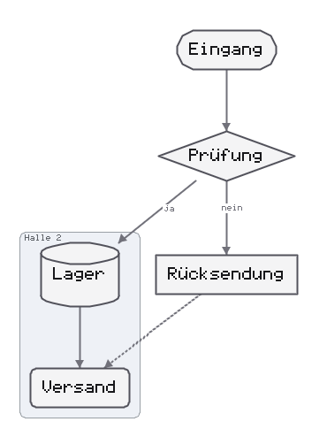
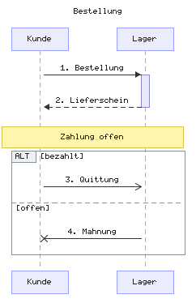
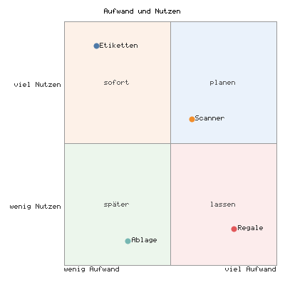

# Diagrams

Boxes, arrows, bars and circles are produced in pure Tcl, without a
browser and without Node. The input is text in a subset of the
Mermaid notation, the output is SVG or PNG. For node-and-edge graphs
the model is a dict of [tudiagram]{.index}: `layout` computes the
boxes in pixels, `toSvg` and `toPng` draw from them. Each of the other
kinds has a module of its own with its own model and its own drawing.

[tuflow]{.index} 0.3 is the entry point for all kinds. When loaded,
`tuflow` pulls in only `tudiagram` 0.5. The module for a kind is
loaded on the first call with its keyword. The list is also in the
chapter [Umbrella and Modules](030-umbrella-und-module.md).

| Kind | Keyword | Module | `parse` returns graph | PNG options |
|---|---|---|---|---|
| Flowchart | `flowchart`, `graph` | `tuflow` | yes | `-scale`, `-fontfile` |
| States | `stateDiagram`, `stateDiagram-v2` | `tustate` | yes | `-scale`, `-fontfile` |
| Classes | `classDiagram`, `classDiagram-v2` | `tuclass` | yes | `-scale`, `-fontfile` |
| Entities | `erDiagram` | `tuer` | yes | `-scale`, `-fontfile` |
| Requirements | `requirementDiagram` | `turequirement` | yes | `-scale`, `-fontfile` |
| Mind map | `mindmap` | `tumindmap` | yes | `-scale`, `-fontfile` |
| C4 | `C4Context`, `C4Container`, `C4Component`, `C4Dynamic`, `C4Deployment` | `tuc4` | yes | `-scale`, `-fontfile` |
| Blocks | `block-beta` | `tublock` | yes | `-scale`, `-fontfile` |
| Git history | `gitGraph` | `tugit` | yes | `-scale`, `-fontfile` |
| Architecture | `architecture`, `architecture-beta` | `tuarchitecture` | yes | `-scale`, `-fontfile` |
| Sequence | `sequenceDiagram` | `tusequence` | no, `UNSUPPORTED` | surface from the content |
| Gantt | `gantt` | `tugantt` | no | width 800, height from 400 by tasks |
| Pie | `pie` | `tupie` | no | 480 × 320, `-legend` |
| XY | `xychart-beta` | `tuxychart` | no | 520 × 340 |
| Quadrant | `quadrantChart` | `tuquadrant` | no | 420 × 420 |
| Journey | `journey` | `tujourney` | no | 600 × 360 |
| Timeline | `timeline` | `tutimeline` | no | 640 × 380 |
| Sankey | `sankey`, `sankey-beta` | `tusankey` | no | 700 × 400 |
| Radar | `radar`, `radar-beta` | `turadar` | no | 600 × 600 |
| Treemap | `treemap`, `treemap-beta` | `tutreemap` | no | 640 × 400 |
| Bit fields | `packet`, `packet-beta` | `tupacket` | no | width 640, height from the rows |
| Kanban | `kanban` | `tukanban` | no | surface from columns and cards |

The sizes in the last column are the defaults of `-width` and
`-height`; every kind without a graph also takes `-scale` and
`-fontfile`. Mermaid knows further kinds (`zenuml`, `xychart` without
`-beta`). Such a text passes as a flowchart, and its first word
becomes a node.

---

## From Text to File: tuflow

```tcl
::tclutils::tuflow::parse    text                ;# -> tudiagram-Modell
::tclutils::tuflow::toSvg    text ?opt wert ...? ;# -> SVG-Text
::tclutils::tuflow::toPng    text ?opt wert ...? ;# -> PNG-Bytes
::tclutils::tuflow::writeSvg text datei ?opt wert ...?  ;# -> datei
::tclutils::tuflow::writePng text datei ?opt wert ...?  ;# -> datei
```

`toSvg` and `toPng` read the first word of the first line that is
neither empty nor a `%%` comment, regardless of upper and lower
case. If it names a kind without a graph, the facade calls `parse`
and `toSvg` or `toPng` of that kind's module. Otherwise it calls its
own `parse` and draws the model with `tudiagram`. `writeSvg` writes
UTF-8 with LF, `writePng` writes binary; both return the file name.

```tcl
package require tclutils::tuflow
set t {flowchart LR
    A --> B
}
string range [::tclutils::tuflow::toSvg $t] 0 3   ;# -> <svg
string range [::tclutils::tuflow::toPng $t] 1 3   ;# -> PNG
::tclutils::tuflow::writePng $t fluss.png         ;# -> fluss.png
```

| Option | Default | Effect |
|---|---|---|
| `-scale` | 1 | integer from 1; PNG: surface and drawing times the factor |
| `-fontfile` | empty | TTF or OTF file for the PNG font |
| `-width` | per kind | width in pixels, only kinds without a graph |
| `-height` | per kind | height in pixels, only kinds without a graph |
| `-legend` | 1 | only `pie`: 0 omits the legend |

For a graph, `toPng` takes only `-scale` and `-fontfile`, and `toSvg`
takes no option at all. For the other kinds `-scale` also applies to
SVG: the surface stays at `-width` × `-height`, while text, lines and
spacing grow by the factor. An option the kind does not know is
dropped by the facade without an error; `-scale 0`, however, throws
the kind's `ARG` error, for a graph
`{TCLUTILS TUDIAGRAM ARG}`. `-width 0` with a fixed surface throws
`{TCLUTILS COMMON INTEGER width}` from the surface.

```tcl
set p "pie\n\"a\" : 1\n"
set a [::tclutils::tuflow::toPng $p -farbe rot]
string equal $a [::tclutils::tuflow::toPng $p]   ;# -> 1
catch {::tclutils::tuflow::toPng $p -scale 0} m o
dict get $o -errorcode                     ;# -> TCLUTILS TUPIE ARG
```

Calling a kind's module directly pays off in three cases: when the
model is needed (`parse` of every kind returns a dict), when an
unknown option should show up as an error (the modules check
strictly with `{TCLUTILS COMMON OPTION ...}`), and when a
`tudiagram` model is changed before drawing, for example with
`setMeta -theme`. Every module without a graph has the same five
commands: `parse text`, and `toSvg`, `toPng`, `writeSvg`, `writePng`
with the model instead of the text.

For a kind without a graph, `tuflow::parse` returns the error
`{TCLUTILS TUFLOW UNSUPPORTED}`, also for `sankey` without `-beta`.

```tcl
catch {::tclutils::tuflow::parse "pie\n\"a\" : 1\n"} m o
dict get $o -errorcode               ;# -> TCLUTILS TUFLOW UNSUPPORTED
catch {::tclutils::tuflow::parse "sankey\na,b,1\n"} m o
dict get $o -errorcode               ;# -> TCLUTILS TUFLOW UNSUPPORTED
```

---

## Model: tudiagram

```tcl
::tclutils::tudiagram::create   ?-title t? ?-direction d? ?-theme t?
                                ?-fontfile f?
::tclutils::tudiagram::addNode  d id ?-label t? ?-shape s?
                                ?-style dict?
::tclutils::tudiagram::addEdge  d von nach ?-label t? ?-style s?
                     ?-arrow a? ?-startMark m? ?-endMark m?
::tclutils::tudiagram::addGroup d id ?-label t? ?-members ids?
::tclutils::tudiagram::setMeta  d ?-schlüssel wert ...?
::tclutils::tudiagram::validate d           ;# -> Liste der Probleme
::tclutils::tudiagram::layout   d           ;# -> Dict mit Koordinaten
::tclutils::tudiagram::theme    name        ;# -> Farb-Dict
::tclutils::tudiagram::toSvg    d
::tclutils::tudiagram::toPng    d ?-scale n?
::tclutils::tudiagram::writeSvg d datei
::tclutils::tudiagram::writePng d datei ?-scale n?
```

`create` returns the dict with the keys `version`, `meta`,
`nodes`, `edges` and `groups`. `meta` holds `title`, `direction`,
`theme`, `fontfile`, `nodeGap` 30, `rankGap` 70 and `padding` 20.
The direction is `LR`, `TB`, `RL` or `BT`, default `LR`. The themes
are `default`, `pipeline` and `mono`. Instead of the name, a dict
with at least `fill` also works; missing colors come from `default`.
Any other value throws `{TCLUTILS TUDIAGRAM THEME}`, in `theme`,
`create` and `setMeta`. The title is centered above the graph:
`layout` moves all nodes and edges down by the title band
(`titleH` in `meta`, 26 pixels) and widens the surface when the
title is wider than the graph. `addNode`, `addEdge` and `addGroup`
return the extended dict; they do not change the one passed in.
`setMeta` sets any keys in `meta` and checks only
`-direction` and `-theme`.

| Shape | Names |
|---|---|
| Node `-shape` | `box` (default), `rounded`, `dot`, `circle`, `stadium`, `diamond`, `hexagon`, `cylinder` |
| Node `-style` | dict with `fill`, `stroke`, `text` as `#rrggbb`; missing keys come from the theme |
| Edge `-style` | `solid` (default), `dashed`, `dotted`, `thick` |
| Edge `-arrow` | `end` (default), `none`, `both`, `start` |
| Edge `-startMark`, `-endMark` | `none` (default), `exactlyOne`, `zeroOrOne`, `oneOrMany`, `zeroOrMany` |

A node without `-label` shows its id. A `dot` shows no label. The
marks at the edge ends are crow's feet as in an ER diagram.
`addEdge` checks neither the ends nor the values of `-style` and
`-arrow`.

`validate` does not throw. An empty list means: there are nodes, and
every edge names known ends. `layout` sets `x`, `y`, `width` and
`height` on every node, `points`, `arrowStart` and `back` on every
edge, and in `meta` the overall size `width` and `height` as well as
the height of the title band `titleH`. The font metrics are the fixed
6×8 grid, even without a surface. An
edge from a node to itself does not enter the ranking
and is not drawn. A cycle is broken at one edge,
which then runs backward (`back` 1).

```tcl
package require tclutils::tudiagram
set d [::tclutils::tudiagram::create -title Lager -direction LR]
set d [::tclutils::tudiagram::addNode $d A -label Eingang]
set d [::tclutils::tudiagram::addNode $d B -label Pruefung \
    -shape diamond]
set d [::tclutils::tudiagram::addEdge $d A B -label ja]
::tclutils::tudiagram::validate $d           ;# -> (leer)
set L [::tclutils::tudiagram::layout $d]
dict keys [lindex [dict get $L nodes] 0]
                         ;# -> id label shape style x y width height
dict get [dict get $L meta] width            ;# -> 394
dict get [dict get $L meta] titleH           ;# -> 26
```

After `layout`, `A` is at x 20, y 46, 112×44, and `B` at x 202,
y 46, 172×56; without a title both are at y 20. `toSvg` starts with
`<svg xmlns="http://www.w3.org/2000/svg"`.

Groups are labeled frames around the nodes in `-members`. A name in
`-members` that is not a node is dropped when drawing. If a group
lies entirely inside another, the outer one gets more spacing. With
groups, `layout` places the members of each group in a band of their
own so that the frames do not overlap.

A second id `A` throws `{TCLUTILS TUDIAGRAM DUPID}`. The direction
`XX` throws `{TCLUTILS TUDIAGRAM DIR}`, a shape `triangle`
`{TCLUTILS TUDIAGRAM ARG}`. A model without nodes yields the entry
`EMPTY no nodes` from `validate`, and `layout` then throws
`{TCLUTILS TUDIAGRAM EMPTY}`. An edge to `Z` and `Y` adds one
`NONODE` entry to `validate` for each of the two ends.

```tcl
catch {::tclutils::tudiagram::create -theme neon} m o
dict get $o -errorcode               ;# -> TCLUTILS TUDIAGRAM THEME
```

---

## Flowchart: tuflow parse

`parse` reads `graph` and `flowchart` and returns a
`tudiagram` model. The header line is optional, and upper and lower
case do not matter (`FLOWCHART td`, `Graph LR`); without a
direction `LR` applies, `TD` becomes `TB`. An id
is `[A-Za-z0-9_]+`. The shape is given by the brackets; quotation
marks around the label are removed.

| Notation | Shape |
|---|---|
| `A` alone | `box`, label `A` |
| `A[Text]` and `A[[Text]]` | `box` |
| `A(Text)` | `rounded` |
| `A([Text])` | `stadium` |
| `A((Text))` | `circle` |
| `A{Text}` | `diamond` |
| `A{{Text}}` | `hexagon` |
| `A[(Text)]` | `cylinder` |

| Arrow | `-style` | `-arrow` |
|---|---|---|
| `-->`, `--o`, `--x` | `solid` | `end` |
| `---` | `solid` | `none` |
| `-.->` | `dotted` | `end` |
| `-.-` | `dotted` | `none` |
| `==>` | `thick` | `end` |
| `===` | `thick` | `none` |

The label is written as `A -->|Text| B`, `A -- Text --> B`,
`A -. Text .-> B` or `A == Text ==> B`. Chains `A --> B --> C`
are accepted. `&` joins several nodes on one side:
`A & B --> C & D` yields one edge for each pair, here four. `%%`
is a comment, statements may be separated by `;`. If an id is given
twice with a shape, the last one applies.
`subgraph name [Beschriftung]` up to `end` becomes a group with the
nodes inside it, also nested; a `direction` inside it is dropped. An
edge to the group id is dropped.

Not read:

- `style`, `classDef`, `class`, `click` and `linkStyle`: skipped;
- `A:::klasse`: the class is dropped, the node stays;
- `A[/Text/]` and the other trapezoid and parallelogram shapes: `box`
  with the label `/Text/`;
- `--o` and `--x` draw an ordinary arrowhead, not a circle and
  not a cross.

```tcl
package require tclutils::tuflow
set src {flowchart TD
    A[Eingang] --> B{Pruefung}
    B -->|ja| C[(Lager)]
}
set m [::tclutils::tuflow::parse $src]
dict get [dict get $m meta] direction        ;# -> TB
set e [lindex [dict get $m edges] 1]
list [dict get $e label] [dict get $e style] ;# -> ja solid
set w [::tclutils::tuflow::parse "Graph RL\nA & B --> C\n"]
dict get [dict get $w meta] direction        ;# -> RL
lmap k [dict get $w edges] {dict get $k from}  ;# -> A B
```

The nodes are `A` as `box` "Eingang", `B` as `diamond`
"Pruefung" and `C` as `cylinder` "Lager". An edge is a dict
with `from`, `to`, `label`, `style`, `arrow`, `startMark` and
`endMark`.

```tcl
set g {flowchart LR
    subgraph kasten [Kasten]
        A[a] --> B[b]
    end
}
dict get [::tclutils::tuflow::parse $g] groups
                 ;# -> {id kasten label Kasten members {A B}}
```

`A-3` throws `{TCLUTILS TUFLOW BADID}`. A text without nodes throws
`{TCLUTILS TUFLOW EMPTY}`.

The following script produces the image below.

```tcl
set fluss {flowchart TB
    A([Eingang]) --> B{Prüfung}
    B -->|ja| C[(Lager)]
    B -->|nein| D[Rücksendung]
    subgraph halle [Halle 2]
        C --> E(Versand)
    end
    D -.-> E
}
::tclutils::tuflow::writePng $fluss 056-fluss.png  ;# -> 056-fluss.png
```



---

## State Diagram: tustate

[tustate]{.index} reads `stateDiagram` and `stateDiagram-v2`. A
state becomes a `rounded` node, a transition an edge with an
arrowhead. The direction is `TB`.

| Notation | Result |
|---|---|
| `A --> B` and `A --> B : Text` | edge, text as label |
| `[*] --> A` | start point `__start` as `dot` |
| `A --> [*]` | end point `__end` as `dot` |
| `A : Text` | label of state `A` |
| `A` alone | state without an edge |
| `state X <<fork>>`, `<<join>>` | state `X` as `rounded` |
| `direction LR` | `LR`; `RL` becomes `LR`, `BT` and `TD` become `TB` |

Not read:

- `state X { … }`: the frame is dropped, the transitions inside stay;
- `note … : Text` and `note … end note`: skipped;
- `state "Lang" as L`: skipped, `L` is only created with the first
  edge;
- an edge from `A` to `A`: in the model, not drawn.

```tcl
set st {stateDiagram-v2
    [*] --> Bereit
    Bereit --> Laeuft : start
    Laeuft --> [*]
    Bereit : wartet
}
set m [::tclutils::tuflow::parse $st]
lmap n [dict get $m nodes] {dict get $n label}
                                ;# -> __start wartet Laeuft __end
lmap n [dict get $m nodes] {dict get $n shape}
                                ;# -> dot rounded rounded dot
```

A text without a state throws `{TCLUTILS TUSTATE EMPTY}`.

---

## Class Diagram: tuclass

[tuclass]{.index} reads `classDiagram` and `classDiagram-v2`. Each
class becomes a `box` node with three parts: name, attributes,
methods. A line `----------` separates the parts. A member with
`(` is a method, all others are attributes. The direction is
`TB`.

| Notation | Result |
|---|---|
| `class X {` … `}` over several lines | class with one member per line |
| `class X { +a; +b() }` | block on one line, `;` separates the members |
| `class X`, `class X { }` | class without members |
| `X : +int alter`, `X : +laut()` | member of `X` |
| `A <\|-- B` | edge `B` to `A`, label `extends` |
| `A *-- B` | edge `A` to `B`, `composition` |
| `A o-- B` | `aggregation` |
| `A ..> B` | `dependency`, dashed |
| `A ..\|> B` | `extends`, dashed |
| `A --> B` | without label |
| `A --> B : Text` | text as label |
| `A "1" --> "*" B` | edge `A` to `B`; the cardinalities are dropped |

If the arrow starts with `<`, the edge points to the left class. Every
edge has a plain arrowhead; the module does not draw the UML heads
(triangle, diamond). A member before the closing brace
(`+b() }`) counts.

Not read:

- `class X~T~`, `class X:::k`, `<<interface>> X`: skipped.

```tcl
set cl {classDiagram
    class Tier {
        +String name
        +laut()
    }
    Tier <|-- Hund
}
set m [::tclutils::tuflow::parse $cl]
split [dict get [lindex [dict get $m nodes] 0] label] \n
           ;# -> Tier ---------- {+String name} ---------- +laut()
lrange [lindex [dict get $m edges] 0] 0 5
                           ;# -> from Hund to Tier label extends
set k [::tclutils::tuflow::parse \
    "classDiagram\nclass Ort { }\nKunde \"1\" --> \"*\" Ort : hat\n"]
lmap n [dict get $k nodes] {dict get $n label} ;# -> Ort Kunde
dict get [lindex [dict get $k edges] 0] label   ;# -> hat
```

A text without a class throws `{TCLUTILS TUCLASS EMPTY}`.

---

## ER Diagram: tuer

[tuer]{.index} 0.3 reads `erDiagram`. An entity becomes a
`box` node with the name on the first line and one attribute on each
further line. A relationship becomes an edge without an arrowhead,
with crow's feet at both ends. The direction is `TB`.

| Notation | Result |
|---|---|
| `NAME {` … `}` | entity; attribute line `typ name` |
| `typ name PK` | attribute `typ name (PK)`; further words are dropped |
| `A \|\|--o{ B : Text` | solid edge, label `Text` |
| `A }\|..\|\| B : Text` | dashed edge |
| `NAME` alone | entity without attributes |

Each side of the cardinality becomes a mark: `{` or `}` means
many, `o` means zero. `||` becomes `exactlyOne`, `|o` and `o|`
`zeroOrOne`, `}|` and `|{` `oneOrMany`, `}o` and `o{` `zeroOrMany`.
Quotation marks around the label are removed: `: "gibt auf"`
becomes the label `gibt auf`.

```tcl
set er "erDiagram
    KUNDE ||--o\{ AUFTRAG : gibt
    KUNDE \{
        string name PK
    \}
"
set m [::tclutils::tuflow::parse $er]
set e [lindex [dict get $m edges] 0]
dict get $e startMark                        ;# -> exactlyOne
dict get $e endMark                          ;# -> zeroOrMany
split [dict get [lindex [dict get $m nodes] 0] label] \n
                           ;# -> KUNDE {string name (PK)}
```

A text without an entity throws `{TCLUTILS TUER EMPTY}`.

---

## Requirements: turequirement

[turequirement]{.index} reads `requirementDiagram`. Each requirement
and each element becomes a `box` node. The first line names the
kind in `<<…>>`, the second the name, followed by the fields
`id`, `text`, `type`, `risk`, `verifymethod` and `docref` in this
order, as far as present. The direction is `TB`.

| Notation | Result |
|---|---|
| `requirement n {` … `}` | node `<<requirement>>` |
| `functionalRequirement`, `performanceRequirement`, `interfaceRequirement`, `physicalRequirement`, `designConstraint` | likewise, with this kind |
| `element n {` … `}` | node `<<element>>` |
| `feld: wert` in the block | field line; fields other than the six are dropped |
| `a - satisfies -> b` | edge `a` to `b`, label `satisfies` |
| `b <- derives - a` | edge `a` to `b` |

A relationship to an unknown name creates a node with that name.
Long field values are not wrapped; the box becomes wide. All kinds
draw the same shape.

```tcl
set rq {requirementDiagram
    requirement schnell {
        id: 1
        risk: high
    }
    element server {
        type: simulation
    }
    server - satisfies -> schnell
}
set m [::tclutils::tuflow::parse $rq]
split [dict get [lindex [dict get $m nodes] 0] label] \n
           ;# -> <<requirement>> schnell {id: 1} {risk: high}
dict get [lindex [dict get $m edges] 0] label  ;# -> satisfies
```

A text without a requirement and element throws
`{TCLUTILS TUREQUIREMENT EMPTY}`.

---

## Mind Map: tumindmap

[tumindmap]{.index} reads `mindmap`. Indentation determines the
level: a line indented deeper than the previous one is its child;
a shallower line attaches to the nearest ancestor with smaller
indentation. A tab counts as four spaces. The ids are
generated (`n1`, `n2`, …), the edges have no arrowhead. The result
is a top-down tree (`TB`), not a radial layout.

| Notation | Shape |
|---|---|
| `Text` | `rounded` |
| `id((Text))`, `((Text))` | `circle` |
| `id{{Text}}` | `hexagon` |
| `id[Text]` | `box` |
| `id(Text)` | `rounded` |
| `)Text(` and `))Text((` | `rounded` |

A bracket counts only if it encloses the whole text;
`API (REST)` stays text. Lines with `::icon(…)` or `class`
are dropped. A second line at the level of the root becomes a
second root.

```tcl
set mm {mindmap
    root((Lager))
        Eingang
        [Ausgang]
}
set m [::tclutils::tuflow::parse $mm]
lmap n [dict get $m nodes] {dict get $n shape}
                                ;# -> circle rounded box
lmap e [dict get $m edges] {dict get $e to}  ;# -> n2 n3
```

A text without a line after the header throws `{TCLUTILS TUMINDMAP EMPTY}`.

---

## C4: tuc4

[tuc4]{.index} reads `C4Context`, `C4Container`, `C4Component`,
`C4Dynamic` and `C4Deployment`. The direction is `TB`. An element
`Typ(id, "Name", …)` becomes a node with the id, and the first quoted
text as its label; technology and description
are dropped. The fill color comes from the type.

| Type | Shape | Color |
|---|---|---|
| `Person`, `Person_Ext` | `rounded` | violet |
| `System`, `Container`, `Component` | `box` | blue, green, orange |
| type with `Db`, such as `SystemDb`, `ContainerDb` | `cylinder` | by type |
| type with `_Ext` | as above | gray |
| `Rel(a, b, "Text")`, `BiRel`, `Rel_U`, `Rel_D`, `Rel_L`, `Rel_R` | edge `a` to `b` with arrowhead | |
| `title Text` | title, centered above the graph | |

Not read:

- boundaries such as `System_Boundary(…) {` … `}` and `Deployment_Node`:
  the frame is dropped, the elements inside stay;
- `BiRel` gets only one arrowhead; the direction in `Rel_U` to
  `Rel_R` is dropped;
- `UpdateElementStyle`, `UpdateRelStyle` and all lines starting with
  `Update`: skipped.

A relationship to an unknown id creates a `box` node without
color.

```tcl
set c4 {C4Context
    title Lager
    Person(kunde, "Kunde")
    System(lag, "Lager")
    Rel(kunde, lag, "holt")
}
set m [::tclutils::tuflow::parse $c4]
dict get [dict get $m meta] title            ;# -> Lager
dict get [lindex [dict get $m nodes] 0] style
                                ;# -> fill #e8def8 stroke #6a1b9a
```

A C4 text without elements throws `{TCLUTILS TUC4 EMPTY}`.

---

## Blocks: tublock

[tublock]{.index} reads `block-beta`. Each word of a line is a
block; brackets and quotation marks keep spaces together.
The shapes match the flowchart: `a["Text"]` `box`,
`a("Text")` `rounded`, `a(("Text"))` `circle`, `a{"Text"}`
`diamond`, `a{{"Text"}}` `hexagon`, `a(["Text"])` `stadium`,
`a[("Text")]` `cylinder`, `a[["Text"]]` `box`. The blocks are laid out
as a top-down graph (`TB`), not in a grid.

| Notation | Result |
|---|---|
| `a --> b`, `a ==> b`, `a -.-> b` | edge with arrowhead |
| `a --- b` | edge without arrowhead |
| `a -->\|Text\| b`, `a -- Text --> b` | edge with label |
| `a["Text"]:2` | the span `:2` is dropped |
| `columns N`, `space`, `space:N` | skipped |
| `block:id` … `end` | the frame is dropped, the blocks inside stay |
| `style`, `classDef`, `class`, `click` | skipped |

Arrow blocks such as `a<["Text"]>(right)` become a node with exactly
this character sequence as its id.

```tcl
set bl {block-beta
    columns 3
    a["Eingang"] b(("Prüfung")) c["Lager"]
    a --> b
    b -->|ok| c
}
set m [::tclutils::tuflow::parse $bl]
lmap n [dict get $m nodes] {dict get $n shape}
                                ;# -> box circle box
dict get [lindex [dict get $m edges] 1] label  ;# -> ok
```

A text without a block throws `{TCLUTILS TUBLOCK EMPTY}`.

---

## Git History: tugit

[tugit]{.index} reads `gitGraph`. Each commit becomes a node, each
parent relationship an edge from the parent to the child commit. The
first branch is called `main`. The direction is `LR`, with `gitGraph TB:` `TB`.
Each branch gets a fill color; the module does not draw lanes as
Mermaid does.

| Notation | Result |
|---|---|
| `commit` | node `c1`, `c2`, … as `rounded` |
| `commit id: "X"` | node `X` |
| `commit tag: "T"` | label with ` [T]` |
| `branch name` | new branch from the current state, becomes current |
| `checkout name` | switch branch |
| `merge name` | `box` "merge name" with two parents |
| `cherry-pick id: "X"` | `rounded` "pick X" |

`commit type: …` is skipped. A second `commit id: "X"`
does not create a second node.

```tcl
set gg {gitGraph
    commit
    branch dev
    commit
    checkout main
    merge dev
}
set m [::tclutils::tuflow::parse $gg]
lmap n [dict get $m nodes] {dict get $n label}
                                ;# -> c1 c2 {merge dev}
llength [dict get $m edges]                  ;# -> 3
```

A text without a commit throws `{TCLUTILS TUGIT EMPTY}`.

---

## Architecture: tuarchitecture

[tuarchitecture]{.index} reads `architecture-beta` and
`architecture`. Services become nodes, groups become frames. The
direction is `LR`.

| Notation | Result |
|---|---|
| `service id(icon)[Text]` | node, shape by icon |
| `service id(icon)[Text] in g` | node in group `g` |
| `group id(icon)[Text]` | frame around its members |
| `group id(icon)[Text] in g` | nested group |
| `junction id` | node `dot` |
| `a:R -- L:b` | edge without arrowhead |
| `a:R --> L:b`, `<--`, `<-->` | arrowhead at the target, at the start, at both |
| `a{group}:R -- L:b` | `{group}` is dropped, the edge stays |

The icon determines the shape: `database`, `db`, `disk`, `storage`
yield `cylinder`, `cloud` and `internet` `rounded`, all others
`box`. The sides `L`, `R`, `T`, `B` are read but not
used; `tudiagram` determines where edges attach. An end that is
not declared as a service becomes a `box`. The label is the text
in `[…]`, without it the id.

```tcl
set ar {architecture-beta
    group api(cloud)[API]
    service db(database)[Datenbank] in api
    service web(server)[Web] in api
    web:R --> L:db
}
set m [::tclutils::tuflow::parse $ar]
lmap n [dict get $m nodes] {dict get $n shape}  ;# -> cylinder box
dict get $m groups      ;# -> {id api label API members {db web}}
```

A text without a service throws `{TCLUTILS TUARCHITECTURE EMPTY}`.

---

## Sequence Diagram: tusequence

[tusequence]{.index} reads `sequenceDiagram` and draws on its own,
without `tudiagram`. The surface follows from the content
(`-width 0 -height 0`); a number above 0 fixes it.

| Notation | Result |
|---|---|
| `participant A`, `participant A as Text` | participant, in order of mention |
| `actor A as Text` | participant, drawn as a box |
| `A->>B: Text` | solid, filled arrowhead |
| `A-->>B: Text` | dotted, filled arrowhead |
| `A->B`, `A-->B` | open arrowhead |
| `A-)B`, `A--)B` | open arrowhead |
| `A-xB`, `A--xB` | cross |
| `A<<->>B`, `A<<-->>B` | filled arrowheads at both ends, solid or dotted |
| `A->>+B: Text`, `A->>-B: Text` | activates `B`, deactivates `A` |
| `activate A`, `deactivate A` | activation bar |
| `Note left of A: Text`, `right of`, `over A,B` | note |
| `loop`, `opt`, `alt`, `par`, `critical`, `break`, `rect` … `end` | frame across the full width |
| `else`, `and`, `option` | dividing line in the frame |
| `autonumber` | messages with `1.`, `2.`, … |
| `title Text` | title, centered above the participants |

A participant is also created by the first message or note that
names it. A message needs the colon; `A->>B` without `:`
is skipped.

Not read:

- `create`, `destroy`, `box`, `link`: skipped;
- stick figures for `actor`.

A title moves the drawing down by a band of 24 pixels;
if it is wider than the participants, the surface becomes wider.

`parse` returns a dict with `type sequence`, `participants` (ids in
order), `labels` (id to label), `isActor`, `steps`,
`autonumber` and `title`. Each step is a dict with `kind`
`message`, `note`, `activate`, `deactivate`, `blockStart`,
`blockElse` or `blockEnd`.

```tcl
package require tclutils::tusequence
set sq "sequenceDiagram\nK->>+L: bestellt\nL-->>-K: liefert\n"
set m [::tclutils::tusequence::parse $sq]
dict get $m participants                     ;# -> K L
lindex [dict get $m steps] 0
        ;# -> kind message from K to L op ->> act + text bestellt
set bi "sequenceDiagram\nK<<->>L: Abgleich\n"
set b [::tclutils::tusequence::parse $bi]
dict get $b participants                     ;# -> K L
```

| `-errorcode` | Cause |
|---|---|
| `{TCLUTILS TUSEQUENCE EMPTY}` | no participant |
| `{TCLUTILS TUSEQUENCE ARG}` | `-scale` not an integer from 1 |
| `{TCLUTILS TUSEQUENCE FONT}` | `-fontfile` names no file |

The following script produces the image below.

```tcl
set seq {sequenceDiagram
    title Bestellung
    autonumber
    actor K as Kunde
    participant L as Lager
    K->>+L: Bestellung
    L-->>-K: Lieferschein
    Note over K,L: Zahlung offen
    alt bezahlt
        K-)L: Quittung
    else offen
        L-xK: Mahnung
    end
}
::tclutils::tuflow::writePng $seq 056-sequenz.png
                                             ;# -> 056-sequenz.png
```



---

## Gantt: tugantt

[tugantt]{.index} reads `gantt`. Each task is a row with a
bar; the section is on the left, the name to the right of the bar.
The default width is 800. Without `-height` the surface is 400 pixels
high and grows when the tasks need more room: each row
takes 26 pixels, and at 400 pixels 13 rows fit with a title. With
`-height` the height stays fixed.

| Notation | Result |
|---|---|
| `title Text` | title, centered at the top |
| `dateFormat F` | input format, default `YYYY-MM-DD` |
| `axisFormat F` | axis format, default as `dateFormat` |
| `section Name` | section, alternating background |
| `Name : done, a1, 2026-03-02, 5d` | task with tag, id, start, duration |
| `Name : 2026-03-20, 2026-03-30` | start and end as dates |
| `Name : after a1, 3d` | start at the latest end of the given ids |
| `Name : 3d` | start at the end of the previous task |
| tags `active`, `done`, `crit` | light blue, gray, red |
| tag `milestone` | yellow diamond in the middle of the span |

`dateFormat` and `axisFormat` translate `YYYY`, `YY`, `MM`, `DD`,
`HH`, `mm` and `ss` into `clock` formats; `%` formats such as `%d.%m.`
stay as they are. `X` means seconds since 1970. Durations are a number
and a unit: `s`, `m` or `min`, `h`, `d`, `w`; any other unit
counts as 0. The first task needs a start: without a date and without
`after` referring to an earlier task, drawing throws
`{TCLUTILS TUGANTT DATE}`, just as Mermaid does not draw a chart
without a start date. The axis has up to six ticks, rounded to whole
units of the axis format: seconds if it shows seconds,
minutes for minutes, hours for hours, otherwise days. A tick with
the same label as a previous one is dropped, so each date
appears only once.

Not read: `excludes`, `todayMarker`, `tickInterval`,
`weekday`, `vert` (skipped), `until`, excluding weekends,
compact display.

`parse` does not check the dates yet. It returns `type gantt`, `title`,
`dateFormat`, `axisFormat`, `haveSection` and `tasks`; each task
is a dict with `title`, `section`, `tags`, `id`, `startTok` and
`endTok`. The times are computed only when drawing.

```tcl
package require tclutils::tugantt
set gt "gantt\nsection Bau\nRohbau :crit, b1, 2026-03-02, 2w\n"
set m [::tclutils::tugantt::parse $gt]
set a [lindex [dict get $m tasks] 0]
dict keys $a       ;# -> title section tags id startTok endTok
dict get $a startTok                         ;# -> 2026-03-02
dict get $a endTok                           ;# -> 2w
```

| `-errorcode` | Cause |
|---|---|
| `{TCLUTILS TUGANTT EMPTY}` | no line with `:` after the header |
| `{TCLUTILS TUGANTT DATE}` | date does not match `dateFormat` or does not exist, or the first task has no start; only when drawing |
| `{TCLUTILS TUGANTT ARG}` | `-scale` not an integer from 1 |
| `{TCLUTILS TUGANTT FONT}` | `-fontfile` names no file |

A date must exist: `tugantt` writes the parsed date back in the
same format and compares it with the input, ignoring leading
zeros. So `2026-13-45` and `2026-02-30` throw `DATE` alike under
Tcl 8.6 and 9.0, while `2026-3-2` is accepted.

```tcl
set g1 [::tclutils::tugantt::parse "gantt\nA : 3d\n"]
catch {::tclutils::tugantt::toSvg $g1} m o
dict get $o -errorcode                  ;# -> TCLUTILS TUGANTT DATE
set g2 [::tclutils::tugantt::parse "gantt\nA : 2026-13-45, 1d\n"]
catch {::tclutils::tugantt::toSvg $g2} m o
dict get $o -errorcode                  ;# -> TCLUTILS TUGANTT DATE
```

The following script produces the image below.

```tcl
set gantt {gantt
    title Umbau
    dateFormat YYYY-MM-DD
    axisFormat %d.%m.
    section Plan
    Entwurf  :done, e1, 2026-03-02, 5d
    Freigabe :milestone, m1, after e1, 0d
    section Bau
    Rohbau   :crit, b1, after e1, 10d
    Ausbau   :active, after b1, 6d
    Abnahme  : 1d
}
::tclutils::tuflow::writePng $gantt 056-gantt.png \
    -width 560 -height 200                   ;# -> 056-gantt.png
```


---

## Pie Chart: tupie

[tupie]{.index} reads `pie`. A line `"Beschriftung" : Zahl` becomes
a slice; the quotation marks may be omitted, the label
extends to the last colon. Each slice shows its share in
percent, and on the right is the legend with label and share.

| Notation | Result |
|---|---|
| `pie`, `pie title Text` | header, title optional |
| `pie showData` | legend also shows the value |
| `title Text` | title on a line of its own |
| `"Nord" : 42`, `Sued : 2.5` | slice |

A value is a decimal number, also with an exponent: `42`, `2.5`,
`1e3`. Leading zeros count as decimal, `010` is 10. A negative
value throws `{TCLUTILS TUPIE VALUE}` with the line number. A line
whose value is not a number is not a slice. A slice with 0 stays in
the model. The colors repeat after ten slices.

| Option | Default | Effect |
|---|---|---|
| `-width` | 480 | width in pixels |
| `-height` | 320 | height in pixels |
| `-legend` | 1 | 0 omits the legend |
| `-scale` | 1 | factor, integer from 1 |
| `-fontfile` | empty | TTF or OTF, PNG only |

```tcl
package require tclutils::tupie
set pt "pie title Lager\n\"Nord\" : 1\n\"Sued\" : 3\n"
::tclutils::tupie::parse $pt
             ;# -> title Lager showData 0 slices {{Nord 1} {Sued 3}}
dict get [::tclutils::tupie::parse "pie\nA : 1e3\n"] slices
                                             ;# -> {A 1e3}
catch {::tclutils::tupie::parse "pie\nA : 3\nB : -1\n"} m
set m              ;# -> line 3: negative pie slice value "-1"
```

| `-errorcode` | Cause |
|---|---|
| `{TCLUTILS TUPIE EMPTY}` | no slice |
| `{TCLUTILS TUPIE VALUE}` | negative value, or sum not positive |
| `{TCLUTILS TUPIE ARG}` | `-scale` not an integer from 1 |
| `{TCLUTILS TUPIE FONT}` | `-fontfile` names no file |

The following script produces the image below.

```tcl
set pie {pie showData title Lagerbestand
    "Nord" : 42
    "Süd" : 27
    "Ost" : 18
    "West" : 13
}
::tclutils::tuflow::writePng $pie 056-pie.png \
    -width 420 -height 240                   ;# -> 056-pie.png
```


---

## XY Chart: tuxychart

[tuxychart]{.index} reads `xychart-beta` with bar and
line series. The default surface is 520 × 340.

| Notation | Result |
|---|---|
| `xychart-beta` | header; an appended `horizontal` is kept in the model, the drawing is vertical |
| `title "Text"` | title |
| `x-axis "Titel" [a, b, c]` | axis with categories, title optional |
| `x-axis "Titel" 1 --> 5` | numeric axis from 1 to 5 |
| `y-axis "Titel" 0 --> 100` | title and range, both optional |
| `bar [1, 2, 3]` | bar series, several allowed |
| `line [1, 2, 3]` | line series, several allowed |

Without a range, `y-axis` chooses the scale itself. The title of the
y axis is horizontal above the axis. Several bar series stand side by
side per category. The facade does not recognize `xychart` without
`-beta`.

```tcl
package require tclutils::tuxychart
set xy {xychart-beta
    x-axis [Jan, Feb, Mar]
    y-axis "EUR" 0 --> 100
    bar [40, 65, 50]
}
set m [::tclutils::tuxychart::parse $xy]
dict get $m categories                       ;# -> Jan Feb Mar
list [dict get $m ymin] [dict get $m ymax]   ;# -> 0 100
dict get $m series             ;# -> {type bar values {40 65 50}}
```

| `-errorcode` | Cause |
|---|---|
| `{TCLUTILS TUXYCHART EMPTY}` | no series |
| `{TCLUTILS TUXYCHART VALUE}` | value in a series not a number |
| `{TCLUTILS TUXYCHART ARG}` | `-scale` not an integer from 1 |
| `{TCLUTILS TUXYCHART FONT}` | `-fontfile` names no file |

---

## Quadrant: tuquadrant

[tuquadrant]{.index} reads `quadrantChart`. Both axes run from
0 to 1. The default surface is 420 × 420.

| Notation | Result |
|---|---|
| `title Text` | title |
| `x-axis links --> rechts` | labels of the ends; without `-->` only the left one |
| `y-axis unten --> oben` | likewise |
| `quadrant-1 Text` to `quadrant-4 Text` | 1 top right, 2 top left, 3 bottom left, 4 bottom right |
| `Name: [0.3, 0.6]` | point; values outside 0..1 are clamped to the edge |

Settings after the point such as `radius: 9` or `color:` are dropped;
the points take colors from a fixed sequence. The label of the
y axis is horizontal on the left. The header is not required: any text
with at least one recognized line is valid.

```tcl
package require tclutils::tuquadrant
set q {quadrantChart
    x-axis wenig --> viel
    A: [0.3, 0.6]
    B: [1.4, -0.2]
}
set m [::tclutils::tuquadrant::parse $q]
list [dict get $m xleft] [dict get $m xright] ;# -> wenig viel
dict get $m points                ;# -> {A 0.3 0.6} {B 1.0 0.0}
```

| `-errorcode` | Cause |
|---|---|
| `{TCLUTILS TUQUADRANT EMPTY}` | no recognized line |
| `{TCLUTILS TUQUADRANT ARG}` | `-scale` not an integer from 1 |
| `{TCLUTILS TUQUADRANT FONT}` | `-fontfile` names no file |

The following script produces the image below.

```tcl
set quad {quadrantChart
    title Aufwand und Nutzen
    x-axis wenig Aufwand --> viel Aufwand
    y-axis wenig Nutzen --> viel Nutzen
    quadrant-1 planen
    quadrant-2 sofort
    quadrant-3 später
    quadrant-4 lassen
    Etiketten: [0.15, 0.9]
    Scanner: [0.6, 0.6]
    Regale: [0.8, 0.15]
    Ablage: [0.3, 0.1]
}
::tclutils::tuflow::writePng $quad 056-quadrant.png \
    -width 400 -height 400                   ;# -> 056-quadrant.png
```



---

## Journey: tujourney

[tujourney]{.index} reads `journey`. The tasks run from left
to right in the order of the text; a line connects their
scores. The sections are bands at the top, below each
task the actors appear as colored dots, plus a legend.
The default surface is 600 × 360.

| Notation | Result |
|---|---|
| `title Text` | title |
| `section Name` | section for the following tasks |
| `Aufgabe: 5: Ich, Du` | task, score, actors |
| `Aufgabe: 2` | task without actors |

The score is a number from 0 made of digits with an optional
fractional part; `2.5` is valid. Mermaid scores from 1 to 5; values
above 5 are valid, and the axis then extends to the next integer above
the largest value. Any other score (`gut`, `-1`) throws
`{TCLUTILS TUJOURNEY VALUE}` with the line number. Lines with
`accTitle` and `accDescr` are dropped. Long names are horizontal
and may overlap.

```tcl
package require tclutils::tujourney
set jo {journey
    title Tag
    section Morgen
        Kaffee: 5: Ich, Du
        Bus: 2
}
set m [::tclutils::tujourney::parse $jo]
dict get $m tasks
              ;# -> {Kaffee 5 {Ich Du} Morgen} {Bus 2 {} Morgen}
dict get $m actors                           ;# -> Ich Du
set j [::tclutils::tujourney::parse "journey\nTee: 2.5\n"]
lindex [dict get $j tasks] 0 1               ;# -> 2.5
```

| `-errorcode` | Cause |
|---|---|
| `{TCLUTILS TUJOURNEY EMPTY}` | no task |
| `{TCLUTILS TUJOURNEY VALUE}` | score not a number from 0 |
| `{TCLUTILS TUJOURNEY ARG}` | `-scale` not an integer from 1 |
| `{TCLUTILS TUJOURNEY FONT}` | `-fontfile` names no file |

---

## Timeline: tutimeline

[tutimeline]{.index} reads `timeline`. The time axis runs
horizontally, the time points are below it, and their events are boxes
above it. Sections are colored bands at the top. The default
surface is 640 × 380.

| Notation | Result |
|---|---|
| `title Text` | title |
| `section Name` | section for the following time points |
| `2022 : Muster : Alpha` | time point with two events |
| `: Beta` | another event for the previous time point |

The text is split at a colon followed by whitespace or the
end of the line. `12:30 : Mittag` is the time point `12:30` with the
event `Mittag`; `2020:Start` without a space stays a
time point without an event. Long texts are not wrapped.

```tcl
package require tclutils::tutimeline
set tl "timeline\n2021 : Idee\n2022 : Muster : Alpha\n     : Beta\n"
dict get [::tclutils::tutimeline::parse $tl] periods
               ;# -> {2021 Idee {}} {2022 {Muster Alpha Beta} {}}
set uhr "timeline\n12:30 : Mittag\n"
dict get [::tclutils::tutimeline::parse $uhr] periods
                                        ;# -> {12:30 Mittag {}}
```

| `-errorcode` | Cause |
|---|---|
| `{TCLUTILS TUTIMELINE EMPTY}` | no time point |
| `{TCLUTILS TUTIMELINE ARG}` | `-scale` not an integer from 1 |
| `{TCLUTILS TUTIMELINE FONT}` | `-fontfile` names no file |

---

## Sankey: tusankey

[tusankey]{.index} reads `sankey-beta` and `sankey`. The header is
followed by CSV lines `Quelle,Ziel,Wert`. A name with a comma is put in
quotation marks; a quotation mark inside it is doubled
(`""`). The default surface is 700 × 400.

The nodes are placed in columns by the longest path from a source.
The height of a node follows the larger value of inflow and outflow,
the width of a band follows its value. A band has the color of its
source.

A line with fewer than three fields, an empty name or a
value that is not a number above 0 is dropped without an error. Fields
after the third are skipped. A cycle in the flow does not abort;
the columns are then only approximate.

```tcl
package require tclutils::tusankey
set sk "sankey-beta\nQuelle,Werk,10\n\"A,B\",Werk,2\nWerk,X,0\n"
set m [::tclutils::tusankey::parse $sk]
dict get $m nodes                            ;# -> Quelle Werk A,B
dict get $m links          ;# -> {Quelle Werk 10} {A,B Werk 2}
```

| `-errorcode` | Cause |
|---|---|
| `{TCLUTILS TUSANKEY EMPTY}` | no valid line |
| `{TCLUTILS TUSANKEY ARG}` | `-scale` not an integer from 1 |
| `{TCLUTILS TUSANKEY FONT}` | `-fontfile` names no file |

The following script produces the image below.

```tcl
set sankey {sankey-beta
    Wareneingang,Prüfung,100
    Prüfung,Lager,80
    Prüfung,Rücksendung,20
    Lager,Versand,65
    Lager,Bestand,15
}
::tclutils::tuflow::writePng $sankey 056-sankey.png \
    -width 520 -height 260                   ;# -> 056-sankey.png
```


---

## Radar: turadar

[turadar]{.index} reads `radar-beta` and `radar`. Each axis starts
at the center, the first one pointing up. Each series becomes a
closed polygon with a semi-transparent fill. The default
surface is 600 × 600.

| Notation | Result |
|---|---|
| `radar-beta title Text`, `title Text` | title |
| `axis a, b, c` | axes; also over several lines |
| `axis m["Mathe"]` | axis with label |
| `curve id["Name"]{1, 2, 3}` | series, values in axis order |
| `curve id{ b: 3, a: 1 }` | series, values by axis id |
| `max N`, `min N` | scale; default `min` 0, `max` largest value |
| `ticks N` | number of rings, default 5 |
| `graticule circle`, `polygon` | shape of the rings, default `circle` |
| `showLegend true`, `false` | legend |

A missing axis in a series counts as 0. Without `["Name"]` the
series uses its id as its name. The legend appears when at least one
series has a name in `["…"]`; `showLegend` sets it
explicitly. Unknown lines are dropped. The first line
must be the header, otherwise `EMPTY`. The lines are straight, not
smoothed; `theme` and `config` are dropped.

```tcl
package require tclutils::turadar
set rd {radar-beta
    axis t["Tcl"], c["C"], p
    curve a["Anna"]{4, 3, 2}
    max 5
}
set m [::tclutils::turadar::parse $rd]
dict get $m axes                             ;# -> Tcl C p
dict get $m curves                           ;# -> {Anna {4.0 3.0 2.0}}
dict get $m showLegend                       ;# -> 1
set r2 "radar-beta\naxis a, b, c\ncurve x{1, 2, 3}\n"
dict get [::tclutils::turadar::parse $r2] showLegend  ;# -> 0
```

| `-errorcode` | Cause |
|---|---|
| `{TCLUTILS TURADAR EMPTY}` | header missing or no series |
| `{TCLUTILS TURADAR AXES}` | fewer than three axes |
| `{TCLUTILS TURADAR VALUE}` | value, `min` or `max` not a number |
| `{TCLUTILS TURADAR ARG}` | `-scale` not an integer from 1 |
| `{TCLUTILS TURADAR FONT}` | `-fontfile` names no file |

---

## Treemap: tutreemap

[tutreemap]{.index} reads `treemap-beta` and `treemap`. The
indentation determines the level; a tab counts as four spaces.
Each leaf gets an area according to its value, a branch the sum
of its leaves. The rectangles are as square as possible, using the
squarify method. A branch below the root gets a
header bar with its name, a leaf its name and value if there is room.
The default surface is 640 × 400.

| Notation | Result |
|---|---|
| `"Name"` | branch |
| `"Name": 30` | leaf with value |
| `Name: 30`, `Name` | likewise without quotation marks |
| `"Name": 5:::klasse`, `classDef`, `style` | style is dropped |

A node with a value and children is a branch; the value is dropped.
Texts are cut off, not wrapped. A leaf with a value
of 0 or less is removed from the model, as is a branch that
no longer has a leaf afterward. Sums and areas come only from the
remaining leaves: with `-5`, `10` and `5`, `10` and `5` share the area
in the ratio 2 to 1.

`parse` returns a tree of dicts with `name`, `value` and
`children`. The root has the name `""`.

```tcl
package require tclutils::tutreemap
set tm {treemap-beta
"Lager"
    "Nord": 30
    "Sued": 15
"Rest": 4
}
set m [::tclutils::tutreemap::parse $tm]
dict get $m value                            ;# -> 49.0
lmap k [dict get $m children] {dict get $k name}  ;# -> Lager Rest
set n [::tclutils::tutreemap::parse "treemap\nN: -5\nA: 10\nB: 5\n"]
dict get $n value                            ;# -> 15.0
```

| `-errorcode` | Cause |
|---|---|
| `{TCLUTILS TUTREEMAP EMPTY}` | first line not a header, or no node |
| `{TCLUTILS TUTREEMAP VALUE}` | line not readable or value not a number |
| `{TCLUTILS TUTREEMAP ARG}` | `-scale` not an integer from 1 |
| `{TCLUTILS TUTREEMAP FONT}` | `-fontfile` names no file |

---

## Bit Fields: tupacket

[tupacket]{.index} reads `packet-beta` and `packet`. Each line after
the header is a field of bits. A row has 32 bits; a field that crosses
the row boundary is split and keeps its color. The bit numbers appear
above each part. Bits between the fields that no field
covers appear in light gray. The width is 640, the height follows
from the number of rows (`-height 0`).

| Notation | Result |
|---|---|
| `packet-beta title Text`, `title Text` | title |
| `0-15: "Quellport"` | field bit 0 to 15 |
| `64: "F"` | field of one bit |
| `16-31: Zielport`, `'Text'` | label without or with single quotation marks |

The fields are sorted by their first bit. The module does not know the
relative notation `+16: "Text"` from newer Mermaid versions; it
throws `VALUE`. Long labels are
cut off.

```tcl
package require tclutils::tupacket
set pk "packet-beta\n0-15: \"Quellport\"\n16-31: Zielport\n32: F\n"
set m [::tclutils::tupacket::parse $pk]
dict keys $m                       ;# -> title bitsPerRow fields
lrange [dict get $m fields] 1 2    ;# -> {16 31 Zielport} {32 32 F}
```

| `-errorcode` | Cause |
|---|---|
| `{TCLUTILS TUPACKET EMPTY}` | first line not a header, or no field |
| `{TCLUTILS TUPACKET VALUE}` | line is not a field |
| `{TCLUTILS TUPACKET RANGE}` | end before start, or fields overlap |
| `{TCLUTILS TUPACKET ARG}` | `-scale` not an integer from 1 |
| `{TCLUTILS TUPACKET FONT}` | `-fontfile` names no file |

---

## Kanban: tukanban

[tukanban]{.index} reads `kanban`. The first line after the header sets
the indentation of the columns. Lines with this or smaller
indentation are column titles, deeper lines are cards of the current
column. Each column has a colored header, with the cards
below it. The surface follows from the number of columns and the
tallest stack of cards (`-width 0 -height 0`).

| Notation | Result |
|---|---|
| `Offen` | column |
| `    Spec schreiben` | card |
| `    API@{ ticket: T-1, priority: High }` | card with an extra line |

Of the settings in `@{ … }`, `priority` is drawn as a colored
marker (`High` red, `Medium` orange, `Low` green, `Critical` and
`Blocked` dark red, otherwise gray); all settings appear as a gray
line below the text. The Mermaid form `id[Text]` is not
split up: `todo[Erledigt]` appears as the title as is. Long texts are
cut off. With a fixed `-height`, cards that no longer fit
in the column are dropped.

```tcl
package require tclutils::tukanban
set kb {kanban
    Offen
        Spec schreiben
        API@{ ticket: T-1, priority: High }
    Fertig
}
set cols [dict get [::tclutils::tukanban::parse $kb] columns]
lmap c $cols {lindex $c 0}                   ;# -> Offen Fertig
lindex $cols 0 1 1         ;# -> API {ticket: T-1  priority: High}
```

| `-errorcode` | Cause |
|---|---|
| `{TCLUTILS TUKANBAN EMPTY}` | first line not a header, or no column |
| `{TCLUTILS TUKANBAN ARG}` | `-scale` not an integer from 1 |
| `{TCLUTILS TUKANBAN FONT}` | `-fontfile` names no file |

---

## PNG and Fonts

Without `-fontfile`, PNG renders the labels with a
6×8 bitmap font; it contains the German umlauts. [`-fontfile`]{.index}
names a TTF or OTF file; then `tupngdraw
fillcontours` draws real outlines. This requires the package *Glyphs*
(A. Buratti), which is not part of tclutils: put the directory with
its `pkgIndex.tcl` on `auto_path`. If Glyphs is missing, the bitmap
is used without an error. A font file that does not exist throws
`{TCLUTILS TUDIAGRAM FONT}`, and for the kinds without a graph the
module's `FONT` error. SVG ignores `-fontfile`; there the
viewer chooses the font (`monospace`). The layout dimensions stay on
the 6×8 grid in every case.

```tcl
package require tclutils::tuflow
set t "flowchart LR\n  A --> B"
catch {::tclutils::tuflow::toPng $t -fontfile /gibt/es/nicht.ttf} m o
dict get $o -errorcode           ;# -> TCLUTILS TUDIAGRAM FONT
```

Under Tcl 9.0 and 8.6 the images in this chapter come out byte for
byte identical. The models and errors match as well, including
the date check in `tugantt`.

---

## In short

- One entry point: `tuflow::toSvg`, `toPng`, `writeSvg`, `writePng`
  choose the kind by the first word.
- `tuflow::parse` returns only graphs, and `UNSUPPORTED` for every other
  kind.
- Graph PNG knows only `-scale` and `-fontfile`, graph SVG no
  option. The facade drops unknown options.
- Building returns a new dict. `validate` does not throw,
  `addEdge` does not check the ends.
- Titles in the `tudiagram` model and in `sequenceDiagram` are centered
  above the drawing.
- Unrecognized lines are mostly dropped without an error; `sankey`
  silently drops bad values, `pie` and `journey` throw `VALUE`.
- PNG font: without Glyphs the 6×8 bitmap stays, without an error.

---

*Next chapter: [Images without Tk: PNG, SVG, Colors](058-bilder-ohne-tk.md)*
