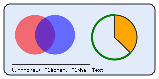
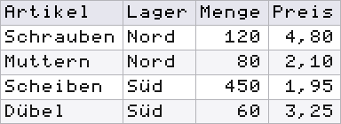

# Images without Tk: PNG, SVG, Colors

The modules in this chapter write, read and inspect images in pure
Tcl. They need neither Tk nor an extension, only the `zlib` command
from the core and TclOO. This lets them run on a server without a
display. Boxes and arrows from a model are drawn by `tudiagram`, see
[Diagrams](056-diagramme.md); it builds on the surfaces `tupngdraw`
and `tusvg` from this chapter.

| Module | Version | Purpose |
|---|---|---|
| `tucolor` | 0.2 | color names, hex, HSV, nearest name |
| `tupng` | 0.5 | encode and decode PNG |
| `tupngdraw` | 0.13 | surface, writes PNG |
| `tutablepng` | 0.2 | table as PNG |
| `tucodepng` | 0.1 | character table as PNG |
| `tumonthpng` | 0.5 | month, quarter, year as PNG |
| `tupngpad` | 0.2 | bring PNGs to one size |
| `tusvg` | 0.3 | SVG surface, SVG document, icons |
| `tuimage` | 0.1 | detect format and size, `data:` URI |
| `tuico` | 0.2 | Windows `.ico` with PNG content |
| `tudhash` | 0.2 | perceptual hash for similar images |

An image occurs in four data forms. Each module states which one a
command expects.

| Form | Structure | Where |
|---|---|---|
| row list | list of rows, each row a list of pixels, all rows of equal length | `tupng::encode*`, `write*` |
| RGBA bytes | byte sequence of length width × height × 4, row by row, per pixel R G B A with 8 bits | `tupng::decode`, `encodeRGBARaw`, `tupngdraw paste`, `tupngpad` |
| number list | flat, row by row: width × height gray values or × 3 color values | `tudhash` |
| surface | TclOO object, the command name is the handle | `tupngdraw::new`, `tusvg::new` |

The modules do not write colors uniformly. The table shows what each
one accepts.

| Notation | `tucolor` | `tupng` | `tupngdraw` | `tusvg` (object) |
|---|---|---|---|---|
| name | 148 CSS/X11 names | no | 15 names | passed through unchecked |
| `#rgb` | yes | no | no | passed through unchecked |
| `#rrggbb` | yes | yes | yes | passed through unchecked |
| `RRGGBB`, `RRGGBBAA`, `#rrggbbaa` | no | yes | yes | passed through unchecked |
| `{r g b}` | yes | yes | yes | `rgb(r,g,b)` |
| `{r g b a}` | no | yes | yes | `rgba(r,g,b,a/255)` |

The 15 names of `tupngdraw` are `black`, `white`, `red`, `green`,
`lime`, `blue`, `yellow`, `cyan`, `magenta`, `gray`, `grey`, `silver`,
`orange`, `transparent` and `none`; the last two are
`{0 0 0 0}`. For all other names, `tucolor::rgb` returns the triple.

---

## Colors: tucolor

[tucolor]{.index} resolves a color into an RGB triple and converts to hex
and HSV. The name table is built into the module; it matches the
values of Tk but does not need Tk.

```tcl
::tclutils::tucolor::rgb     farbe      ;# -> {r g b}, je 0..255
::tclutils::tucolor::hex     farbe      ;# -> #rrggbb
::tclutils::tucolor::names              ;# -> 148 Namen, sortiert
::tclutils::tucolor::exists  name       ;# -> 0 | 1
::tclutils::tucolor::nearest farbe      ;# -> nächster Name
::tclutils::tucolor::toHsv   farbe      ;# -> {h s v}
::tclutils::tucolor::fromHsv {h s v}    ;# -> {r g b}
```

`farbe` is a name, `#rgb`, `#rrggbb` or a triple `{r g b}` of
decimal integers 0 to 255. Names are case-insensitive; leading and
trailing spaces are dropped. `#rgb` doubles
each digit (`#f80` is `#ff8800`). `nearest` looks for the smallest
Euclidean distance in RGB space; on a tie, the name that comes first
in the table wins (`aqua` before `cyan`, `gray` before
`grey`). `toHsv` returns `h` in degrees 0 to 360, `s` and `v` in percent,
all rounded. A round trip can differ by one unit per channel.
`fromHsv` takes `h` from 0 to 360 and `s`, `v` from 0 to 100 as
decimal numbers, also with fractional digits; 360 is the same as 0.

```tcl
package require tclutils::tucolor
::tclutils::tucolor::rgb SteelBlue           ;# -> 70 130 180
::tclutils::tucolor::rgb #f80                ;# -> 255 136 0
::tclutils::tucolor::hex {255 136 0}         ;# -> #ff8800
::tclutils::tucolor::hex navy                ;# -> #000080
::tclutils::tucolor::exists " Navy "         ;# -> 1
::tclutils::tucolor::nearest #fe0000         ;# -> red
::tclutils::tucolor::nearest {0 255 255}     ;# -> aqua
::tclutils::tucolor::toHsv steelblue         ;# -> 207 61 71
::tclutils::tucolor::fromHsv {207 61 71}     ;# -> 71 131 181
::tclutils::tucolor::fromHsv {300 100 100}   ;# -> 255 0 255
::tclutils::tucolor::fromHsv {120.5 50 50}   ;# -> 64 128 64
::tclutils::tucolor::rgb {010 20 30}         ;# -> 10 20 30
llength [::tclutils::tucolor::names]         ;# -> 148
```

Every unrecognized color throws `{TCLUTILS TUCOLOR NAME}`, including
`FF0000` without `#`, `{256 0 0}`, a quadruple `{255 0 0 255}`,
`transparent` and a triple with a hex number, a sign or a
fractional part such as `{0x10 0 0}`. A leading zero in the triple is
not an octal number, the same under Tcl 8.6 and 9.0: `{08 0 0}` gives
`8 0 0`. `fromHsv` throws `{TCLUTILS TUCOLOR HSV}` if the list
does not have three elements, a value is not a number or lies outside its
range, for example `{0 150 100}` or `{-60 100 100}`.

---

## Encoding and Decoding PNG: tupng

[tupng]{.index} writes PNG files with 8 bits per channel in four color types and
reads PNG files back into RGBA bytes. It is based solely on `zlib`
from the core.

```tcl
::tclutils::tupng::encodeRGB     bild ?option wert ...?
::tclutils::tupng::encodeRGBA    bild ?option wert ...?
::tclutils::tupng::encodeGray    bild ?option wert ...?
::tclutils::tupng::encodeIndexed palette bild ?option wert ...?
::tclutils::tupng::encodeRGBARaw bytes breite hoehe ?option wert ...?
::tclutils::tupng::writeRGB      datei bild ?option wert ...?
::tclutils::tupng::writeRGBA     datei bild ?option wert ...?
::tclutils::tupng::writeGray     datei bild ?option wert ...?
::tclutils::tupng::writeIndexed  datei palette bild ?option wert ...?
::tclutils::tupng::writeRGBARaw  datei bytes breite hoehe ?opt w ...?
::tclutils::tupng::decode        bytes
::tclutils::tupng::readPNG       datei
```

| Command | Color type | Pixel in the row list |
|---|---|---|
| `encodeRGB` | 2, truecolor | `RRGGBB`, `#rrggbb`, `{r g b}`; an alpha value is dropped |
| `encodeRGBA` | 6, truecolor with alpha | as above, plus `RRGGBBAA`, `{r g b a}`; without alpha, 255 applies |
| `encodeGray` | 0, grayscale | integer 0..255 |
| `encodeIndexed` | 3, palette | index into the palette |

| Option | Default | Effect |
|---|---|---|
| `-compression` | 6 | `zlib` level 0..9 |
| `-filter` | `best` | `best`, `none`, `sub`, `up`, `average`, `paeth` |

`best` tries all five PNG filters per row and takes the one with the
smallest sum of absolute values. This costs time; `up` is considerably
faster (figures at the end of this section).

`encode*` return the PNG bytes, `write*` the file name.
`encodeRGBARaw` takes RGBA bytes instead of a row list and always writes
color type 6. The palette of `encodeIndexed` has 1 to 256 entries
in the notation of `encodeRGBA`. If an entry has alpha below 255,
the module writes a `tRNS` chunk, otherwise not.

`decode` returns a dict:

| Key | Content |
|---|---|
| `width`, `height` | size in pixels |
| `colortype` | color type of the file: 0, 2, 3, 4 or 6 |
| `bitdepth` | always 8 |
| `rgba` | RGBA bytes, length width × height × 4 |

Every color type is converted to RGBA. Grayscale becomes `g g g`.
A `tRNS` color key makes, for grayscale and truecolor (type 2),
every pixel with exactly this value transparent (alpha 0); all others
get 255. For a palette, the alpha entry from `tRNS` applies.
`decode` of `encodeRGBARaw` returns the same bytes. Before
evaluating, `decode` checks the CRC of every chunk.

```tcl
package require tclutils::tupng
set img {{FF0000 00FF00} {0000FF FFFFFF}}
set png [::tclutils::tupng::encodeRGB $img]
string range $png 1 3                        ;# -> PNG
set d [::tclutils::tupng::decode $png]
list [dict get $d width] [dict get $d colortype]  ;# -> 2 2
binary encode hex [dict get $d rgba]
                              ;# -> ff0000ff00ff00ff0000ffffffffffff
set pal {FF0000 0000FF00}
set png [::tclutils::tupng::encodeIndexed $pal {{0 1} {1 0}}]
binary encode hex [dict get [::tclutils::tupng::decode $png] rgba]
                              ;# -> ff0000ff0000ff000000ff00ff0000ff
set png [::tclutils::tupng::encodeGray {{0 128 255}}]
binary encode hex [dict get [::tclutils::tupng::decode $png] rgba]
                              ;# -> 000000ff808080ffffffffff
set raw [binary format cu* {255 0 0 255 0 0 255 128}]
set png [::tclutils::tupng::encodeRGBARaw $raw 2 1]
expr {[dict get [::tclutils::tupng::decode $png] rgba] eq $raw}
                              ;# -> 1
```

Errors when encoding:

| `-errorcode` | Cause |
|---|---|
| `{TCLUTILS TUPNG DIM}` | no row, empty row, rows of unequal length; for `encodeRGBARaw` width or height not positive or wrong byte count |
| `{TCLUTILS TUPNG COLOR}` | pixel not readable, for example `red` or a gray value 300 |
| `{TCLUTILS TUPNG PALETTE}` | palette empty or longer than 256 |
| `{TCLUTILS TUPNG INDEX}` | index outside the palette |
| `{TCLUTILS TUPNG OPT}` | `-compression` not 0..9, `-filter` unknown |
| `{TCLUTILS COMMON OPTION -level}` | unknown option, here `-level` |

Errors when decoding carry `{TCLUTILS TUPNG DECODE grund}`:
`SIGNATURE` (no PNG signature), `IHDR` (header missing), `BITDEPTH`
(not 8 bits), `INTERLACE`, `COLORTYPE`, `IDAT` (no image data),
`FILTER` (unknown row filter). A chunk whose CRC does not
match or that ends before its CRC throws
`{TCLUTILS TUPNG CRC}`. If the CRC matches but the compressed data
is invalid, `zlib` itself reports `{TCL ZLIB DATA}`.

Limits: the encoder writes only 8 bits, no interlacing, no
ancillary chunks such as `gAMA`, `pHYs` or `tEXt`. The decoder rejects
16-bit images and palettes or grayscale with 1, 2 or 4 bits
(`BITDEPTH`), as well as interlacing (`INTERLACE`). It skips ancillary
chunks other than `tRNS` after the CRC check.

Run time, measured on an Intel Xeon at 2.8 GHz, Tcl 9.0.4 and
8.6.14 (values for 8.6 in parentheses):

| Operation | Image | Time |
|---|---|---|
| `readPNG` | 1024 × 768 RGB, noise | 1.48 s (1.45 s) |
| `encodeRGBARaw -filter up` | 1024 × 768 RGBA | 0.75 s (0.75 s) |
| `encodeRGBARaw` with `best` | 1024 × 768 RGBA | 4.5 s (4.9 s) |
| `decode` | 256 × 256 RGBA, drawing | 0.04 s (0.04 s) |

This is enough for icons, tables and calendar sheets; for full-size
photos, a tool written in C is the better choice.

---

## Drawing: tupngdraw

[tupngdraw]{.index} is a surface as a TclOO object. It holds the
pixels as an RGBA list and at the end outputs a PNG via
`tupng::encodeRGBARaw`. Colors are blended by "source over":
a semi-transparent fill is laid over whatever lies
underneath.

```tcl
set p [::tclutils::tupngdraw::new ?option wert ...?]
```

| Option | Default | Effect |
|---|---|---|
| `-width` | 100 | width in pixels, integer from 1 |
| `-height` | 100 | height in pixels, integer from 1 |
| `-background` | `white` | color of the empty surface |

After `new`, fill color and stroke color are black, stroke width 1,
and antialiasing is on.

| Method | Effect |
|---|---|
| `width`, `height` | size |
| `pixel x y` | `{r g b a}` at the position; coordinates are rounded |
| `setfill farbe`, `setstroke farbe` | fill and stroke color |
| `setlinewidth n` | stroke width, integer from 1 |
| `setantialias bool` | antialiasing for strokes and fills |
| `clear ?farbe?` | whole surface anew, without a color using the background |
| `setpixel x y ?-color f?` | one pixel, blended |
| `line x1 y1 x2 y2 ?...?` | line segment |
| `rect x1 y1 x2 y2 ?...?` | rectangle, both corners included |
| `circle cx cy r ?...?` | circle |
| `ellipse cx cy rx ry ?...?` | ellipse |
| `polygon {x0 y0 x1 y1 ...} ?...?` | polygon, at least three points |
| `arc cx cy r a0 a1 ?...?` | arc, pie slice or chord |
| `fillcontours {kontur ...} ?...?` | several contours as one area |
| `text x y text ?...?` | text in the built-in 6×8 font |
| `textwidth text ?-scale n? ?-spacing s?` | width in pixels |
| `paste x y rgba b h ?-scale n?` | insert RGBA bytes |
| `data ?-compression n? ?-filter f?` | PNG bytes |
| `write datei ?-compression n? ?-filter f?` | PNG file, returns the name |
| `destroy` | release the object |

Options of the shapes:

| Option | Default | Applies to | Effect |
|---|---|---|---|
| `-fill` | 0 | `rect`, `circle`, `ellipse`, `polygon`, `arc` | interior with the fill color |
| `-outline` | 1 | `rect`, `circle`, `ellipse`, `polygon` | outline with the stroke color |
| `-color` | stroke color | all strokes, `setpixel`, `text`, `fillcontours` | color for this call only |
| `-fillcolor` | fill color | shapes with `-fill` | fill color for this call only |
| `-aa` | surface value | strokes, fills, `fillcontours` | antialiasing for this call only |
| `-width` | stroke width | `line`, `arc` | width for this call only |
| `-caps` | `round` | `line` | `round`, `butt`, `square` |
| `-join` | `round` | `rect`, `polygon`, `arc` | `round`, `bevel`, `mitre` |
| `-rx`, `-ry` | 0 | `rect` | corner radius; `-ry 0` takes over `-rx` |
| `-style` | `arc` | `arc` | `arc`, `pie`, `chord` |
| `-rule` | `nonzero` | `fillcontours` | `nonzero` or `evenodd` |
| `-scale` | 1 | `text`, `textwidth`, `paste` | each pixel as n × n |
| `-spacing` | 0 | `text`, `textwidth` | additional pixels per character |

`arc` measures angles in degrees; 0 points to the right, increasing angles
run clockwise on the image because y grows downward.
`text` places the top left corner of the first character. The font
knows ASCII 32 to 126 and `ä ö ü Ä Ö Ü ß`; other characters stay
empty. `textwidth` is length × (6 + spacing) × scale; the spacing
also counts after the last character. Without an argument, `data` and
`write` filter with `-filter up`, not with `best`.

```tcl
package require tclutils::tupngdraw
set p [::tclutils::tupngdraw::new -width 40 -height 20]
$p pixel 0 0                                 ;# -> 255 255 255 255
$p setfill {255 0 0 128}
$p rect 0 0 9 9 -fill 1 -outline 0
$p pixel 5 5                                 ;# -> 255 127 127 255
$p rect 20 2 23 5 -fill 1 -fillcolor black -outline 0
list [$p pixel 23 5] [$p pixel 24 6]
                              ;# -> {0 0 0 255} {255 255 255 255}
$p textwidth Hallo                           ;# -> 30
$p textwidth Hallo -scale 2 -spacing 1       ;# -> 70
string range [$p data] 1 3                   ;# -> PNG
$p destroy
```

`fillcontours` fills an area made of several contours. With
`evenodd`, an inner contour becomes a hole; with `nonzero`, the
winding direction decides, and two squares running the same way give a solid
area.

```tcl
set p [::tclutils::tupngdraw::new -width 20 -height 20]
set aussen {2 2 18 2 18 18 2 18}
set innen  {6 6 14 6 14 14 6 14}
$p fillcontours [list $aussen $innen] -color black -rule evenodd
list [$p pixel 10 10] [$p pixel 4 10]
                              ;# -> {255 255 255 255} {0 0 0 255}
$p destroy
```

The following script produces the image below it: a rectangle with
rounded corners, two semi-transparent circles, a pie slice, an
arc, a line and text.

```tcl
package require tclutils::tupngdraw
set p [::tclutils::tupngdraw::new -width 320 -height 160]
$p setstroke {40 40 40}
$p setlinewidth 2
$p setfill {225 235 250}
$p rect 8 8 311 151 -fill 1 -rx 12
$p setfill {255 0 0 140}
$p circle 70 70 40 -fill 1 -outline 0
$p setfill {0 0 255 140}
$p circle 110 70 40 -fill 1 -outline 0
$p arc 230 75 45 -90 45 -style pie -fill 1 -fillcolor orange
$p arc 230 75 45 45 270 -style arc -width 4 -color {0 128 0}
$p line 24 130 180 130 -width 3 -caps butt
$p text 24 138 "tupngdraw: Flächen, Alpha, Text" -color black
$p write 058-zeichnung.png -compression 9
$p destroy
```



Under Tcl 9.0 and under Tcl 8.6, the same file results byte for
byte. Tcl 8.6 reads a script file in the system encoding; if that
is not UTF-8, `ä` turns into a wrong character. The remedy is
`source -encoding utf-8` or `\u00e4` in the text.

`paste` blends by the same rule as all other commands
("source over"): the resulting alpha is a_s + a_d × (1 − a_s); the
colors are weighted accordingly (s source, d destination, alpha as a
fraction 0 to 1). On an opaque surface the result is an opaque
blend; on a transparent one the pixel stays as it is.
Pixels with alpha 0 leave the surface unchanged.

```tcl
set p [::tclutils::tupngdraw::new -width 2 -height 1 \
    -background transparent]
$p paste 0 0 [binary format cu* {255 0 0 128}] 1 1
$p setpixel 1 0 -color {255 0 0 128}
list [$p pixel 0 0] [$p pixel 1 0]
                              ;# -> {255 0 0 128} {255 0 0 128}
$p clear white
$p paste 0 0 [binary format cu* {255 0 0 128}] 1 1
$p pixel 0 0                                 ;# -> 255 127 127 255
$p destroy
```

| `-errorcode` | Cause |
|---|---|
| `{TCLUTILS TUPNGDRAW COLOR}` | color not readable, including a name outside the 15, for example `navy` |
| `{TCLUTILS TUPNGDRAW RANGE}` | `pixel` outside the surface |
| `{TCLUTILS TUPNGDRAW CAPS}`, `JOIN`, `STYLE`, `RULE` | value of `-caps`, `-join`, `-style`, `-rule` unknown |
| `{TCLUTILS TUPNGDRAW POLY}` | `polygon` with fewer than three points |
| `{TCLUTILS COMMON INTEGER name}` | width, height, radius, stroke width or scale not from 1; `name` is for example `width`, `radius`, `-linewidth` |
| `{TCLUTILS COMMON BOOLEAN name}` | `-fill`, `-aa` or `setantialias` not a boolean |
| `{TCLUTILS COMMON OPTION name}` | unknown option |

Every pixel is set in Tcl. An antialiased filled circle with
radius 100 on 256 × 256 pixels takes, as measured, 0.14 s under Tcl
9.0.4 and 0.10 s under 8.6.14 (Xeon, 2.8 GHz); `data` with `-filter up`
0.04 s, with `-filter best` 0.33 s.

---

## Table as an Image: tutablepng

[tutablepng]{.index} renders a list of rows as a table into a PNG:
header row, alignment per column, alternating row color, grid.
Drawing is done with `tupngdraw` in the 6×8 font.

```tcl
::tclutils::tutablepng::render zeilen ?option wert ...?
::tclutils::tutablepng::write  datei zeilen ?option wert ...?
```

`zeilen` is a list of rows, each a list of cells. The
widest row determines the number of columns; shorter rows get
empty cells. `render` returns PNG bytes (RGBA, color type 6),
`write` the file name.

| Option | Default | Effect |
|---|---|---|
| `-header` | 1 | first row as header |
| `-align` | `l` | `l`, `c`, `r` for all columns or a list per column; missing entries take over the last one |
| `-scale` | 1 | font scale |
| `-padding` | 6 | margin inside the cell, pixels, integer from 0 |
| `-spacing` | 1 | pixels between characters, integer from 0 |
| `-background` | `white` | background |
| `-gridcolor` | `{180 180 185}` | grid |
| `-textcolor` | `{25 25 25}` | text |
| `-headerbg` | `{230 230 238}` | header row, background |
| `-headertext` | `{0 0 0}` | header row, text |
| `-zebra` | empty | color of every second data row; empty means off |
| `-border` | 1 | grid lines |

The column width is the longest cell × (6 + `-spacing`) ×
`-scale` + 2 × `-padding`, the row height 8 × `-scale` + 2 ×
`-padding`. Colors follow `tupngdraw`. Each cell appears exactly
as it stands in the list; `4.80`, `1e3`, `0x1F` or `010` also
stay unchanged.

```tcl
package require tclutils::tutablepng
package require tclutils::tuimage
set rows {{Artikel Menge Preis} {Schrauben 120 4,80} {Muttern 80}}
set png [::tclutils::tutablepng::render $rows -align {l r r}]
::tclutils::tuimage::dimensions $png         ;# -> 169 60
set png [::tclutils::tutablepng::render {{4.80 010}} -header 0]
::tclutils::tuimage::dimensions $png         ;# -> 73 20
```

The image below is produced by this script:

```tcl
package require tclutils::tutablepng
set rows {
    {Artikel     Lager  Menge  Preis}
    {Schrauben   Nord   120    4,80}
    {Muttern     Nord   80     2,10}
    {Scheiben    Süd    450    1,95}
    {Dübel       Süd    60     3,25}
}
::tclutils::tutablepng::write 058-tabelle.png $rows \
    -scale 2 -align {l l r r} -zebra {245 245 248}
```



`{}` as the row list and rows without any cells throw
`{TCLUTILS TUTABLEPNG EMPTY}`. An unknown `-align` value throws
`{TCLUTILS TUTABLEPNG ALIGN}`. `-header` and `-border` without a
boolean throw `{TCLUTILS COMMON BOOLEAN ...}`, `-scale 0` throws
`{TCLUTILS COMMON INTEGER -scale}`, an unreadable color
`{TCLUTILS TUPNGDRAW COLOR}`. If `-padding` or `-spacing` is not an
integer from 0, the result is `{TCLUTILS TUTABLEPNG PADDING}` or
`{TCLUTILS TUTABLEPNG SPACING}`.

---

## Character Table as an Image: tucodepng

[tucodepng]{.index} draws a code table: in each cell the hex value at the top, the
character in the middle and, on request, the name at the bottom. The data come
from `tucode`, see
[Binary Data and File Information](053-binaerdaten-und-dateiinfo.md).

```tcl
::tclutils::tucodepng::render von bis ?option wert ...?
::tclutils::tucodepng::write  datei von bis ?option wert ...?
::tclutils::tucodepng::ascii  ?option wert ...?   ;# 0..127
::tclutils::tucodepng::latin1 ?option wert ...?   ;# 128..255
::tclutils::tucodepng::all    ?option wert ...?   ;# 0..255
```

| Option | Default | Effect |
|---|---|---|
| `-columns` | 16 | cells per row |
| `-scale` | 2 | scale of the character in the middle |
| `-theme` | `default` | `default`, `dark`, `light` |
| `-showcode` | 1 | hex value at the top |
| `-shownames` | 0 | name at the bottom, for example `NUL`, `auml` |
| `-title` | empty | heading above the table |
| `-textcmd` | empty | custom command for the character in the middle |

Control characters 0 to 31 and 127 show their abbreviation, 32 shows `SP`,
each at scale 1. Hex value and name always use the 6×8 font.
From 128 to 255 the font knows only `ä ö ü Ä Ö Ü ß`; the other
cells stay empty in the middle unless `-textcmd` draws.
The command is called for every printable character as
`{*}$cmd bild x y b h zeichen farbe`; `bild` is the
`tupngdraw` surface.

A cell is 28 × `-scale` wide, with names at least 48 pixels,
and 12 × `-scale` high, plus 10 pixels for the hex value and 10 for the
name. The heading is 12 × `-scale` high.

```tcl
package require tclutils::tucodepng
package require tclutils::tuimage
set png [::tclutils::tucodepng::ascii]
::tclutils::tuimage::dimensions $png         ;# -> 896 272
set png [::tclutils::tucodepng::render 64 95 -columns 8 -scale 1]
::tclutils::tuimage::dimensions $png         ;# -> 224 88
```

`von` or `bis` not an integer, `von` greater than `bis` or a
range outside 0..255 throw `{TCLUTILS TUCODEPNG RANGE}`. An
unknown theme throws `{TCLUTILS TUCODEPNG THEME}`.

---

## Month Sheet: tumonthpng

[tumonthpng]{.index} draws a month as a calendar sheet: title,
weekday header, column with ISO calendar weeks, six weeks.
Today, public holidays, notes, weekends and days of
other months are highlighted. Quarter and year place several months side by side.

```tcl
::tclutils::tumonthpng::render        jahr monat ?opt wert ...?
::tclutils::tumonthpng::write         datei jahr monat ?opt wert ...?
::tclutils::tumonthpng::renderQuarter jahr monat ?opt wert ...?
::tclutils::tumonthpng::writeQuarter  datei jahr monat ?opt wert ...?
::tclutils::tumonthpng::renderYear    jahr ?opt wert ...?
::tclutils::tumonthpng::writeYear     datei jahr ?opt wert ...?
```

`render*` return PNG bytes, `write*` the file name. Dates are
ISO dates `JJJJ-MM-TT`.

| Option | Default | Effect |
|---|---|---|
| `-theme` | `default` | `default`, `dark`, `light` |
| `-scale` | 2 | scale |
| `-today` | empty | the "today" day; empty means system date |
| `-holidays` | empty | dict date → name |
| `-notes` | empty | dict date → text; the day gets a dot |
| `-firstweekday` | 1 | first day of the week, 1 Monday to 7 Sunday; shifts grid and header |
| `-showweeks` | 1 | column "KW" (calendar week) |
| `-weekdays` | `{Mo Di Mi Do Fr Sa So}` | names for the header, always Monday to Sunday |
| `-monthnames` | `{Januar ... Dezember}` | month names in the title |
| `-title` | empty | `render`: title instead of "month year"; quarter and year: heading above the whole sheet |
| `-select` | empty | list of dates and ranges `von..bis` |
| `-selectstyle` | `outline` | `outline`, `fill`, `both` |
| `-selectcolor` | empty, then `#1565C0` | color of the selection |
| `-selectwidth` | empty, then max(2, scale) | frame width of the selection |
| `-selectalpha` | 0.3 | share of the selection color with `fill` |
| `-textcmd` | empty | custom command for every label |
| `-cols` | 3 | `renderYear` only: months per row |

A day gets exactly one coloring, in this order: today,
public holiday, note, other month, weekend, normal. The module draws
the dot of a note in any case. The names in `-holidays` and
the texts in `-notes` do not appear in the image; they only mark the
day. The calculation runs in UTC via `clock`; the result does not depend
on the time zone.

A month block is 7 × 26 × `-scale` wide, with the week column
20 × `-scale` more, and 154 × `-scale` high. Quarter and year put
10 × `-scale` between the blocks; a `-title` adds a strip
of 18 × `-scale` across all blocks there. The year is an integer
from 1 to 9999.

```tcl
package require tclutils::tumonthpng
package require tclutils::tuimage
proc dims {png} { ::tclutils::tuimage::dimensions $png }
dims [::tclutils::tumonthpng::render 2026 6 -today 2026-06-06]
                                             ;# -> 404 308
dims [::tclutils::tumonthpng::render 2026 6 -scale 1 -showweeks 0]
                                             ;# -> 182 154
dims [::tclutils::tumonthpng::renderQuarter 2026 11 -scale 1]
                                             ;# -> 626 154
dims [::tclutils::tumonthpng::renderYear 2026 -scale 1 -cols 4]
                                             ;# -> 838 482
dims [::tclutils::tumonthpng::renderQuarter 2026 11 -scale 1 \
    -title "Q4 2026"]                        ;# -> 626 172
```

The quarter starting November 2026 shows November, December and January 2027.
The month sheet below combines `tumonthpng` with the public holidays from
`tuholiday` ([Notes and Calendars](054-notizen-und-kalender.md)):

```tcl
package require tclutils::tumonthpng
package require tclutils::tuholiday
::tclutils::tumonthpng::write 058-monat.png 2026 5 \
    -today 2026-05-06 \
    -holidays [::tclutils::tuholiday::holidays 2026] \
    -notes {2026-05-19 Inventur} \
    -select {2026-05-11..2026-05-13} -selectstyle both
```


`-textcmd` is called as `{*}$cmd bild x y b h text farbe` for the title,
weekdays, "KW", week numbers and day numbers, and draws
the text itself, for example with real font outlines via
`tupngdraw fillcontours`.

`-firstweekday` shifts grid and header together: with
`-firstweekday 7`, the first column starts on Sunday, and the header
shows `So Mo Di Mi Do Fr Sa`. `-weekdays` always lists the names from
Monday to Sunday; the module rotates the list itself.

| `-errorcode` | Cause |
|---|---|
| `{TCLUTILS TUMONTHPNG MONTH}` | month not 1..12 |
| `{TCLUTILS TUMONTHPNG YEAR}` | year not an integer 1..9999, for example `abc` |
| `{TCLUTILS TUMONTHPNG FIRSTWEEKDAY}` | `-firstweekday` not 1..7 |
| `{TCLUTILS TUMONTHPNG THEME}` | theme unknown |
| `{TCLUTILS TUMONTHPNG SELECT}` | entry in `-select` not `JJJJ-MM-TT` or range |
| `{TCLUTILS TUMONTHPNG SELECTSTYLE}` | `-selectstyle` unknown |
| `{TCLUTILS COMMON BOOLEAN -showweeks}` | `-showweeks` not a boolean |
| `{TCLUTILS COMMON INTEGER -scale}`, `-cols` | scale or columns not from 1 |

A `-today` such as `morgen` is not an error; it just matches no day.

---

## Uniform Size: tupngpad

[tupngpad]{.index} brings several PNG files to a common size. Each
image is cropped to its content, centered with a margin and
laid on a background color. Typical input is cut-out images
with a transparent background.

```tcl
::tclutils::tupngpad::bbox  rgba b h                ;# -> {x0 y0 x1 y1}
::tclutils::tupngpad::trim  rgba b h                ;# -> {rgba b h}
::tclutils::tupngpad::padTo rgba b h zb zh ?option wert ...?
::tclutils::tupngpad::batch dateien zielordner ?option wert ...?
```

`bbox` finds all pixels with alpha above 0 and returns the corners
inclusive; for a fully transparent image it returns the empty
list. `trim` crops to this box; if nothing is visible, the
input comes back unchanged. `padTo` places the content on a
surface `zb` × `zh` and returns PNG bytes.

| Option of `padTo` | Default | Effect |
|---|---|---|
| `-background` | `white` | color of the surface, notation as in `tupngdraw` |
| `-align` | `center` | `center`, `nw`, `n`, `ne`, `w`, `e`, `sw`, `s`, `se` |
| `-filter` | empty | PNG filter; empty means `up` |

| Option of `batch` | Default | Effect |
|---|---|---|
| `-margin` | 4 | margin in pixels, integer from 0 |
| `-background` | `white` | as above |
| `-trim` | 1 | crop to the content first |
| `-align` | `center` | as above |
| `-square` | 0 | square output |
| `-size` | empty | `{B H}` for the inner area, integers from 1; empty means largest input image |

`batch` reads each file with `tupng::readPNG`, writes it under the
same name into the target directory (created if needed) and
returns a dict: `size {b h}` and `files` with alternating
input and output paths. All outputs have color type 6. A `-size`
that is too small cuts off the content. Semi-transparent pixels are blended with
the background, see `paste` under `tupngdraw`: on an
opaque background they become opaque; with `-background
transparent` they stay semi-transparent.

```tcl
package require tclutils::tupngpad
set px {}
for {set y 0} {$y < 3} {incr y} {
    for {set x 0} {$x < 4} {incr x} {
        if {$y == 1 && $x in {1 2}} {
            lappend px 255 0 0 255
        } else {
            lappend px 0 0 0 0
        }
    }
}
set rgba [binary format cu* $px]
::tclutils::tupngpad::bbox $rgba 4 3          ;# -> 1 1 2 1
lassign [::tclutils::tupngpad::trim $rgba 4 3] r w h
list $w $h                                    ;# -> 2 1
set png [::tclutils::tupngpad::padTo $r $w $h 6 4 -align nw]
set d [::tclutils::tupng::decode $png]
binary encode hex [string range [dict get $d rgba] 0 11]
                              ;# -> ff0000ffff0000ffffffffff
::tclutils::tupng::writeRGBARaw in1.png $rgba 4 3
set img2 {{00000000 00FF00} {00FF00 00FF00}}
::tclutils::tupng::writeRGBA in2.png $img2
set res [::tclutils::tupngpad::batch {in1.png in2.png} aus -margin 2]
dict get $res size                            ;# -> 6 6
```

`batch` checks all options before it reads a file.

| `-errorcode` | Cause |
|---|---|
| `{TCLUTILS TUPNGPAD MARGIN}` | `-margin` below 0 or not an integer |
| `{TCLUTILS TUPNGPAD TRIM}` | `-trim` not a boolean |
| `{TCLUTILS TUPNGPAD SQUARE}` | `-square` not a boolean |
| `{TCLUTILS TUPNGPAD SIZE}` | `-size` not empty and not `{B H}` with integers from 1 |
| `{TCLUTILS COMMON VALUE -align}` | `-align` unknown; the message names the allowed values |

Missing files and broken PNGs are reported by `open`
(`{POSIX ENOENT ...}`) and `tupng::decode` with their own codes.

---

## SVG: tusvg

[tusvg]{.index} generates SVG text. It has two interfaces: a surface
`new`, whose methods resemble those of `tupngdraw`, and an older
procedural interface with a document as a dict, gradients,
groups and 149 icon names. The images in this book are PNG; SVG
appears here only as text.

### Surface

```tcl
set c [::tclutils::tusvg::new ?-width n? ?-height n? ?-background f?]
```

Defaults as in `tupngdraw`: 100 × 100, background `white`. With
`-background none` or empty, the background rectangle is omitted. The
methods `width`, `height`, `setfill`, `setstroke`, `setlinewidth`,
`rect`, `line`, `polygon`, `circle`, `ellipse`, `text`, `textwidth`,
`data`, `write` and `destroy` take the same arguments as in
`tupngdraw` (`-fill`, `-outline`, `-color`, `-fillcolor`, `-rx`,
`-ry`, `-width`, `-caps`, `-scale`, `-spacing`). In addition:

| Method | Effect |
|---|---|
| `text ... -anchor a` | `start` (default), `middle`, `end` |
| `polyline punkte ?-color f? ?-width n?` | open polyline |
| `path d ?-fill? ?-outline? ?-color? ?-fillcolor?` | SVG path |
| `addDef text` | entry in `<defs>` |
| `icon name x y groesse ?...?` | insert an icon, see below |

`data` returns the SVG text; `write` writes it in UTF-8 and
returns the file name. `textwidth` calculates as in `tupngdraw`;
`text` also sets `textLength` so that the text takes exactly
this width in the viewer. A box sized by
`textwidth` thus stays the same size in SVG and PNG. Differences from
`tupngdraw`: colors are not checked (`nichtsda` and
`{999 0 0}` pass through); `-aa` and `-join` are unknown options;
`arc`, `pixel`, `setpixel`, `clear`, `setantialias`, `paste` and
`fillcontours` are missing; `rect` has the width `x2 − x1`,
while `tupngdraw` counts both corner pixels, that is, one pixel more.

```tcl
package require tclutils::tusvg
set c [::tclutils::tusvg::new -width 120 -height 40]
$c setfill {200 220 255}
$c rect 4 4 115 35 -fill 1 -rx 6
$c text 10 16 "A<B" -color navy
$c textwidth "A<B"                           ;# -> 18
puts [$c data]
$c destroy
```

Output:

```text
<svg xmlns="http://www.w3.org/2000/svg" width="120" height="40"
 viewBox="0 0 120 40">
  <rect x="0" y="0" width="120" height="40" fill="white"/>
  <rect x="4" y="4" width="111" height="31" rx="6"
 fill="rgb(200,220,255)" stroke="black" stroke-width="1"/>
  <text x="10" y="23" font-family="monospace" font-size="8"
 textLength="18" lengthAdjust="spacingAndGlyphs"
 text-anchor="start" fill="navy">A&lt;B</text>
</svg>
```

The long lines are wrapped here; in the original, each
element is on one line.

| `-errorcode` | Cause |
|---|---|
| `{TCLUTILS TUSVG COLOR}` | color as a list with 2 or more than 4 elements |
| `{TCLUTILS TUSVG CAPS}` | `-caps` unknown |
| `{TCLUTILS TUSVG ANCHOR}` | `-anchor` unknown |
| `{TCLUTILS TUSVG POLY}` | `polygon` with fewer than three points |
| `{TCLUTILS COMMON ...}` | options, booleans, integers as in `tupngdraw` |

The method `icon` takes the options of the procedure `icon`
(`-color`, `-strokeWidth`). It inserts the icon as a nested
`<svg>` element with `x`, `y`, width and height `groesse` and
`viewBox="0 0 24 24"`, without an XML declaration.

```tcl
set c [::tclutils::tusvg::new -width 40 -height 40]
$c icon save 4 4 16 -color navy
set d [$c data]
regexp -all {<svg} $d                        ;# -> 2
regexp {<svg x="4" y="4" width="16"} $d      ;# -> 1
$c destroy
```

### Document as a Dict

```tcl
set svg [::tclutils::tusvg::create breite hoehe ?-viewBox v? ?-id i?]
::tclutils::tusvg::rect        svg x y b h ?option wert ...?
::tclutils::tusvg::circle      svg cx cy r ?...?
::tclutils::tusvg::ellipse     svg cx cy rx ry ?...?
::tclutils::tusvg::line        svg x1 y1 x2 y2 ?...?
::tclutils::tusvg::polyline    svg punkte ?...?
::tclutils::tusvg::polygon     svg punkte ?...?
::tclutils::tusvg::path        svg d ?...?
::tclutils::tusvg::textElement svg x y text ?...?
::tclutils::tusvg::linearGradient svg id x1 y1 x2 y2 stops
::tclutils::tusvg::radialGradient svg id cx cy r stops
set g [::tclutils::tusvg::group svg ?-transform t? ?-opacity o?]
::tclutils::tusvg::addToGroup g element
::tclutils::tusvg::addGroup   svg $g
::tclutils::tusvg::toString   $svg                ;# -> SVG-Text
::tclutils::tusvg::write      $svg datei          ;# -> datei
```

Here `rect` differs from the surface: corner, width, height.
The element procedures take the name of the dict variable and
append to it. Their options are named like SVG attributes in camel case:
`-fill`, `-stroke`, `-strokeWidth`, `-opacity`, `-id`, for lines
`-strokeLinecap` and `-strokeLinejoin`, for text `-fontSize`,
`-fontFamily`, `-fontWeight`, `-textAnchor`. The default for `-fill`
is `#000000`; for `line`, `polyline` and `path` it is `none` with stroke
`#000000`. Unknown options are silently ignored; values are not
checked. `punkte` is given as text `"x,y x,y ..."` and goes
into the output unchanged. The gradients go into `<defs>` and return `url(#id)`, suitable
for `-fill`. A stop is `{offset farbe ?deckkraft?}`, offset and
coordinates in percent. Elements go
into a group when the element procedure is given the
group variable. `toString` starts with the XML declaration.

```tcl
set svg [::tclutils::tusvg::create 40 20 -viewBox "0 0 40 20"]
::tclutils::tusvg::rect svg 2 2 36 16 -fill "#eef" -stroke navy -rx 3
::tclutils::tusvg::textElement svg 20 14 "Lager & Co" \
    -fontSize 10 -textAnchor middle
set g [::tclutils::tusvg::group svg -transform "translate(5,5)"]
::tclutils::tusvg::rect g 0 0 4 4
::tclutils::tusvg::addGroup svg $g
puts [::tclutils::tusvg::toString $svg]
```

Output:

```text
<?xml version="1.0" encoding="UTF-8"?>
<svg xmlns="http://www.w3.org/2000/svg" width="40" height="20"
 viewBox="0 0 40 20">
  <rect x="2" y="2" width="36" height="16" rx="3" fill="#eef"
 stroke="navy" stroke-width="1"/>
  <text x="20" y="14" fill="#000000" font-size="10"
 font-family="sans-serif" text-anchor="middle">Lager &amp; Co</text>
  <g transform="translate(5,5)">
    <rect x="0" y="0" width="4" height="4" fill="#000000"/>
  </g>
</svg>
```

### Icons

```tcl
::tclutils::tusvg::icons                        ;# -> Liste der Namen
::tclutils::tusvg::icon     name groesse ?-color f? ?-strokeWidth w?
::tclutils::tusvg::saveIcon name groesse datei ?-color f?
```

`icons` lists all 149 names that `icon` knows, including
duplicate names such as `trash` and `delete` or `rotate-left` and
`rotate_left`. `icon` returns a document dict with `viewBox "0 0 24 24"`;
`toString` turns it into text. The default for `-color` is
`#333333`; without an argument, the stroke width grows with the size (1.5 up to
16, 1.75 up to 24, 2.0 up to 32, otherwise 2.5). An unknown name gives
a substitute icon with a question mark, without an error. The icons consist
only of lines and areas, without `<text>`.

```tcl
llength [::tclutils::tusvg::icons]            ;# -> 149
set ic [::tclutils::tusvg::icon save 16]
dict get $ic width                            ;# -> 16
dict get $ic viewBox                          ;# -> 0 0 24 24
```

---

## Detecting the Image Format: tuimage

[tuimage]{.index} reads format, MIME type and size from the first bytes of an
image. It does not decode any pixels. It also handles `data:` URIs.

```tcl
::tclutils::tuimage::type        bytes   ;# -> png|jpeg|gif|bmp|webp|""
::tclutils::tuimage::mime        bytes   ;# -> image/png ... oder ""
::tclutils::tuimage::dimensions  bytes   ;# -> {breite hoehe} oder {}
::tclutils::tuimage::inspect     bytes   ;# -> Dict
::tclutils::tuimage::dataUri     mime bytes
::tclutils::tuimage::fromDataUri uri     ;# -> {mime m bytes b}
```

| Format | Signature | Size from |
|---|---|---|
| PNG | `\x89PNG\r\n\x1a\n` | `IHDR` |
| JPEG | `\xff\xd8\xff` | first SOF marker |
| GIF | `GIF87a`, `GIF89a` | logical screen descriptor |
| BMP | `BM` | info header; negative height becomes positive |
| WebP | `RIFF` … `WEBP` | `VP8 `, `VP8L` or `VP8X` |

`inspect` returns `type`, `mime`, `width` and `height`; for an unknown
format all four are empty. The check is minimal: every string
that starts with `BM` counts as BMP. If the file is too short for the
header, `dimensions` stays empty. The bytes must have been read in binary mode.

`dataUri` puts `data:mime;base64,` in front of the Base64 form without
checking the MIME type. `fromDataUri` decodes Base64 only if `base64`
is in the header; otherwise the content comes back unchanged, without
percent decoding. Invalid Base64 such as `!!!` gives empty bytes,
not an error. Base64 is handled by `tubase64`, see
[Encoding, Hashing and Comparing](052-kodierung-hash-vergleich.md).

```tcl
package require tclutils::tuimage
package require tclutils::tupng
set png [::tclutils::tupng::encodeGray {{0 255}}]
::tclutils::tuimage::inspect $png
                        ;# -> type png mime image/png width 2 height 1
::tclutils::tuimage::type "BM irgendwas"     ;# -> bmp
::tclutils::tuimage::dimensions Hallo        ;# ->
set uri [::tclutils::tuimage::dataUri image/png $png]
string range $uri 0 21          ;# -> data:image/png;base64,
set r [::tclutils::tuimage::fromDataUri $uri]
expr {[dict get $r bytes] eq $png}           ;# -> 1
::tclutils::tuimage::fromDataUri "data:,Hallo%20Welt"
                              ;# -> mime {} bytes Hallo%20Welt
```

A string without `data:` at the start throws
`{TCLUTILS TUIMAGE DATAURI}`. The other commands do not throw.

---

## Windows Icons: tuico

[tuico]{.index} writes and reads `.ico` files. The entries are PNG images,
which Windows accepts in icons since Vista and which carry an
alpha channel. The module does not convert any pixels; the PNGs come, for example, from
`tupngdraw`. All commands are also available as the ensemble
`tclutils::tuico write|info|extract`.

```tcl
::tclutils::tuico::write   datei eintraege         ;# -> Anzahl Bytes
::tclutils::tuico::info    datei                   ;# -> Dicts
::tclutils::tuico::extract datei groesse ?ziel?    ;# -> PNG-Bytes
```

`eintraege` is a list of pairs `{groesse png}`. The size is
the edge length 1 to 256; the PNG must be exactly that size and square.
`write` checks all entries before it writes; an error leaves
no half-written file behind. The entries appear in the given
order, each with 1 plane and 32 bits; 256 is stored in the directory as
0. `info` returns per entry `width`, `height`, `bpp`, `format` (`png`
or `bmp`), `offset` and `length`, with 256 instead of 0. `extract` finds
the first entry with this width and, on request, also writes it
to `ziel`. `info` recognizes BMP entries, but the module
cannot write them.

```tcl
package require tclutils::tuico
package require tclutils::tupngdraw
set entries {}
foreach s {32 16} {
    set p [::tclutils::tupngdraw::new -width $s -height $s \
        -background transparent]
    $p setfill {30 144 255}
    $p circle [expr {$s/2}] [expr {$s/2}] [expr {$s/2 - 1}] \
        -fill 1 -outline 0
    lappend entries [list $s [$p data]]
    $p destroy
}
::tclutils::tuico::write app.ico $entries    ;# -> 752
lmap e [::tclutils::tuico::info app.ico] {dict get $e width}
                                             ;# -> 32 16
dict get [lindex [::tclutils::tuico::info app.ico] 1] format
                                             ;# -> png
string length [::tclutils::tuico::extract app.ico 16 x16.png]
                                             ;# -> 247
```

| `-errorcode` | Cause |
|---|---|
| `{TCLUTILS TUICO NOENTRIES}` | empty list |
| `{TCLUTILS TUICO TOOMANY}` | more than 65535 entries |
| `{TCLUTILS TUICO BADENTRY}` | entry is not a pair |
| `{TCLUTILS TUICO BADSIZE}` | size not 1..256 |
| `{TCLUTILS TUICO BADPNG}` | content is not a PNG |
| `{TCLUTILS TUICO SIZEMISMATCH}` | PNG size does not match the stated size |
| `{TCLUTILS TUICO BADFILE}` | file too short or not an `.ico` |
| `{TCLUTILS TUICO TRUNCATED}` | directory entry truncated |
| `{TCLUTILS TUICO NOSUCHSIZE}` | `extract` does not find the size |
| `{TCLUTILS TUICO READFAILED}`, `WRITEFAILED` | file cannot be opened |

`info` reads all fields of the directory as unsigned, as the
format specifies. If the header announces more entries than the file
contains, `info` throws `TRUNCATED`, also for more than 32767.

---

## Similar Images: tudhash

[tudhash]{.index} computes a 64-bit difference hash (dHash). Similar
images get similar hashes; the distance is the number of
differing bits. This reveals images that have been scaled down, saved
again or slightly changed and whose bytes therefore
differ.

```tcl
::tclutils::tudhash::fromGray b h grauwerte    ;# -> 16 Hexzeichen
::tclutils::tudhash::fromRGB  b h rgbwerte     ;# -> 16 Hexzeichen
::tclutils::tudhash::distance hexA hexB        ;# -> 0..64
::tclutils::tudhash::similar  hexA hexB ?max?  ;# -> 0 | 1
```

`grauwerte` are b × h numbers 0..255, `rgbwerte` b × h × 3, each
row by row. `fromRGB` computes gray as `(77 R + 150 G + 29 B) >> 8`.
The image is averaged down to 9 × 8 cells (mean over each cell,
integer); then each cell compares itself with its right neighbor, bit
1 means "right is brighter". `distance` accepts upper- and lowercase letters.
`similar` is `distance <= max`, default 10. The downscaling is
a simple box filter; hashes from other tools with the same
bit order but a different filter can differ by a few bits.

```tcl
package require tclutils::tudhash
set g {}
for {set y 0} {$y < 8} {incr y} {
    for {set x 0} {$x < 9} {incr x} { lappend g [expr {$x * 20}] }
}
::tclutils::tudhash::fromGray 9 8 $g         ;# -> ffffffffffffffff
set g2 [lmap v $g {expr {255 - $v}}]
::tclutils::tudhash::fromGray 9 8 $g2        ;# -> 0000000000000000
::tclutils::tudhash::distance FFFF000000000000 ffff000000000001
                                             ;# -> 1
::tclutils::tudhash::similar ffffffffffffffff fffffffffffffff0
                                             ;# -> 1
::tclutils::tudhash::similar ffffffffffffffff fffffffffffffff0 3
                                             ;# -> 0
```

For PNG files, `tupng` supplies the pixels without Tk. The following
example draws the same motif in two sizes and once shifted,
and compares the hashes.

```tcl
package require tclutils::tudhash
package require tclutils::tupngdraw
proc pngHash {png} {
    set d [::tclutils::tupng::decode $png]
    binary scan [dict get $d rgba] cu* px
    set rgb {}
    foreach {r g b a} $px { lappend rgb $r $g $b }
    ::tclutils::tudhash::fromRGB \
        [dict get $d width] [dict get $d height] $rgb
}
proc bild {w h dx} {
    set p [::tclutils::tupngdraw::new -width $w -height $h]
    $p setfill {0 0 160}
    $p circle [expr {$w/3 + $dx}] [expr {$h/2}] [expr {$h/3}] \
        -fill 1 -outline 0
    $p rect [expr {$w*2/3}] [expr {$h/4}] [expr {$w-4}] \
        [expr {$h*3/4}] -fill 1 -fillcolor orange -outline 0
    set png [$p data]
    $p destroy
    return $png
}
set a [pngHash [bild 90 60 0]]               ;# -> 0018191919191900
set b [pngHash [bild 45 30 0]]               ;# -> 0018191909191900
set c [pngHash [bild 90 60 25]]              ;# -> 0006050505050700
::tclutils::tudhash::distance $a $b          ;# -> 1
::tclutils::tudhash::distance $a $c          ;# -> 20
```

The half size lies one bit away, the shift
twenty. For an image with 256 × 256 pixels, `fromRGB` takes, as measured,
0.018 s under Tcl 9.0.4 and 0.017 s under 8.6.14 (Xeon, 2.8 GHz).

| `-errorcode` | Cause |
|---|---|
| `{TCLUTILS TUDHASH DIM}` | width or height not an integer from 1 |
| `{TCLUTILS TUDHASH DATA}` | list has the wrong length |
| `{TCLUTILS TUDHASH HASH}` | hash not 16 hex characters |

Both commands check width and height first, so `a` as the width
throws `DIM`. Neither command checks the values themselves for
0..255.

---

*Next chapter: [Providers](060-provider.md)*
