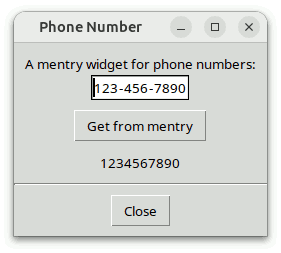
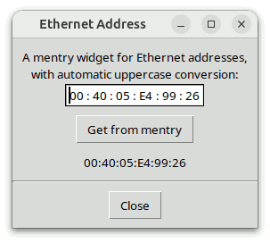
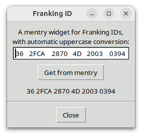
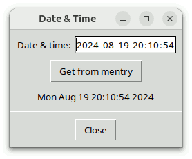

# Mentry-Programmierhandbuch

## Für Mentry Version 4.5.1

### von

## Csaba Nemethi

csaba.nemethi@t-online.de

---

## Inhalt

#### Überblick

- [Was ist Mentry?](#was-ist-mentry)
- [Woher bekomme ich es?](#woher-bekomme-ich-es)
- [Wie installiere ich es?](#wie-installiere-ich-es)
- [Wie verwende ich es?](#wie-verwende-ich-es)
- [Mehr zu Mentry_tile](#mehr-zu-mentry-tile)

#### Beispiele

- [Ein Mentry-Widget für Telefonnummern](#ein-mentry-widget-f-r-telefonnummern)
- [Ein Mentry-Widget für Ethernet-Adressen](#ein-mentry-widget-f-r-ethernet-adressen)
- [Ein Mentry-Widget für Franking-IDs](#ein-mentry-widget-f-r-franking-ids)
- [Verwendung von Mentry-Widgets für Datum und Uhrzeit](#verwendung-von-mentry-widgets-f-r-datum-und-uhrzeit)
- [Auf Tile aufbauende Demo-Skripte](#auf-tile-aufbauende-demo-skripte)

[Startseite](index.md)

---

## Überblick

### Was ist Mentry?

Mentry ist ein Paket für Tcl/Tk ab Version 8.4, das in reinem Tcl/Tk-Code geschrieben ist. Es enthält:

- die Implementierung des [Mehrfeld-Eingabe-Megawidgets mentry](mentryWidget.md), einschließlich eines allgemeinen Dienstprogrammmoduls für Megawidgets;
- Prozeduren, die die Verwendung von Mehrfeld-Eingabe-Widgets zur Anzeige und Bearbeitung von [Datum und Uhrzeit](mentryDateTime.md) in einer Vielzahl von Formaten, [reellen Zahlen im Festkommaformat](mentryFixedPoint.md), sowie [IP(v4)-Adressen](mentryIPAddr.md) und [IPv6-Adressen](mentryIPv6Addr.md);
- drei ausführlich kommentierte Demo-Skripte, die die typischen Schritte enthalten, die zur Erstellung und Handhabung eines Mentry-Widgets für einen bestimmten Zweck erforderlich sind;
- zwei Beispielskripte, die die Verwendung der Prozeduren für Datum und Uhrzeit veranschaulichen;
- auf Tile aufbauende Entsprechungen der oben genannten Demo-Skripte;
- dieses Tutorial;
- Referenzseiten im HTML-Format.

Ein Mehrfeld-Eingabe-Widget besteht aus einer beliebigen Anzahl von Eingabe-Widgets, die durch Beschriftungen voneinander getrennt und in einem Rahmen eingebettet sind. Durch entsprechend gewählte Konfigurationsoptionen wirkt dieses Gebilde wie ein einziges Eingabefeld, das vorgefertigte Textabschnitte enthält, deren Positionen innerhalb des Widgets unveränderlich sind.  Die anfängliche Breite einer Eingabekomponente bestimmt auch die maximale Anzahl an Zeichen, die in sie eingefügt werden können; wird diese Grenze in einer Eingabekomponente erreicht, die den Fokus besitzt, wird dieser automatisch auf die nächste aktivierte Eingabekomponente gesetzt.  Die gleiche Aktion wird ausgelöst, wenn ein Zeichen eingegeben wird, das in der Beschriftung hinter der aktuellen Eingabekomponente enthalten ist, sofern diese nicht leer ist.

Innerhalb eines Mentry-Widgets wirken die Tasten `Left`, `Right`, `Home`, `End` und `BackSpace` über die Grenzen der Eingabekomponenten hinweg, während `Control-Left` und `Control-Right` dieselbe Rolle spielen wie `Tab` und `Shift-Tab` bei gewöhnlichen Einträgen.

Einige der oben genannten Funktionen werden mithilfe des Widget-Rückruffunktions-Pakets Wcb implementiert, das ebenfalls in reinem Tcl/Tk-Code geschrieben ist.  **Das Mentry-Paket erfordert Version 3.1 oder höher von Wcb**, das unter folgender Adresse heruntergeladen werden kann:

https://www.nemethi.de

Es ist ganz einfach, ein Mehrfeld-Eingabe-Widget zu erstellen. Zum Beispiel der Befehl

```
mentry::mentry .me -body {3 - 3 - 4}
```

wird ein Mentry-Widget erstellt, das aus zwei Einträgen mit der Breite 3 und einem Eintrag mit der Breite 4 besteht, die durch die Zeichenfolge `"-"` voneinander getrennt sind. Mit dem Befehl

```
foreach w [.me entries] {
    wcb::cbappend $w before insert wcb::checkStrForNum
}
```

So können Sie sicherstellen, dass in den drei Eingabefeldern nur Ziffern eingegeben werden können, und bieten damit eine komfortable und sichere Benutzeroberfläche für die Bearbeitung von 10-stelligen Telefonnummern.

### Woher bekomme ich es?

Mentry kann unter derselben URL wie Wcb kostenlos heruntergeladen werden. Die Distributionsdatei lautet `mentry4.5.1.tar.gz` für UNIX und `mentry4_5_1.zip` für Windows.  Diese Dateien enthalten dieselben Informationen, mit Ausnahme des zusätzlichen Wagenrücklaufzeichens, das in den Textdateien für Windows dem Zeilenvorschub am Ende jeder Zeile vorangestellt ist.

Mentry ist ebenfalls in tklib enthalten, dessen Adresse lautet

https://core.tcl.tk/tklib

### Wie installiere ich es?

Installieren Sie das Paket als Unterverzeichnis eines der Verzeichnisse, die durch die Variable `auto_path` angegeben sind. Sie können es beispielsweise als Unterverzeichnis des Verzeichnisses `lib` innerhalb Ihrer Tcl/Tk-Installation installieren.

Um Mentry *unter UNIX* zu installieren, wechseln Sie mit `cd` in das gewünschte Verzeichnis und entpacken Sie die Distributionsdatei `mentry4.5.1.tar.gz`:

```
gunzip -c mentry4.5.1.tar.gz | tar -xf -
```

Auf den meisten UNIX-Systemen kann dies durch Folgendes ersetzt werden:

```
tar -zxf mentry4.5.1.tar.gz
```

Beide Befehle erstellen ein Verzeichnis namens `mentry4.5.1` mit den Unterverzeichnissen `demos`, `doc` und `scripts`.

*Unter Windows* verwenden Sie WinZip oder ein anderes Programm, mit dem Sie die Distributionsdatei `mentry4_5_1.zip` in das Verzeichnis `mentry4.5.1` entpacken können, einschließlich der Unterverzeichnisse `demos`, `doc` und `scripts`.

Die Datei `mentryThemes.tcl` im Verzeichnis `scripts` wird nur für Anwendungen benötigt, die das Paket „Mentry_tile“ verwenden (siehe nächster Abschnitt).

Beachten Sie, dass in tklib das Mentry-Verzeichnis `demos` durch das Unterverzeichnis `mentry` des Verzeichnisses `examples` ersetzt wird.  Bitte berücksichtigen Sie dies beim Lesen der folgenden [Beispiele](#beispiele).

### Wie verwende ich es?

Die Mentry-Distribution umfasst zwei Pakete: **Mentry** und **Mentry_tile**. Der Hauptunterschied zwischen den beiden besteht darin, dass Mentry_tile die auf Tile aufbauende, themenspezifische Darstellung von Mentry-Widgets ermöglicht; dieses Paket erfordert Tile 0.6 oder höher.  Es ist nicht möglich, beide Pakete in ein und derselben Anwendung zu verwenden, da beide im selben Namespace `mentry` implementiert sind und identische Befehle bereitstellen.

Um auf die Befehle und Variablen des Mentry-Pakets zugreifen zu können, müssen Ihre Skripte eine der folgenden Zeilen enthalten:

```
package require mentry ?version?
package require Mentry ?version?
```

Sie können eine der beiden oben genannten Anweisungen verwenden, da die Datei `mentry.tcl` beide Zeilen enthält.

```
package provide mentry ...
package provide Mentry ...
```

Um auf die Befehle und Variablen des Pakets „Mentry_tile“ zugreifen zu können, müssen Ihre Skripte ebenfalls eine der folgenden Zeilen enthalten:

```
package require mentry_tile ?version?
package require Mentry_tile ?version?
```

Auch hier können Sie eine der beiden oben genannten Anweisungen verwenden, da die Datei `mentry_tile.tcl` beide Zeilen enthält.

```
package provide mentry_tile ...
package provide Mentry_tile ...
```

Es steht Ihnen frei, jeweils eine der oben genannten Zeilen aus `mentry.tcl` bzw. `mentry_tile.tcl` zu entfernen, wenn Sie verhindern möchten, dass die entsprechenden Pakete jeweils unter zwei verschiedenen Beschreibungen angezeigt werden.  Dadurch beschränken Sie natürlich das Argument von ``package require`` auf einen einzigen Namen pro Paket.

Da die Pakete „Mentry“ und „Mentry_tile“ im Namespace `mentry` implementiert sind, müssen Sie entweder die

```
namespace import mentry::pattern ?mentry::pattern ...?
```

Befehl zum Importieren der benötigten *Prozeduren* oder verwenden Sie qualifizierte Namen wie `mentry::mentry`. In den folgenden Beispielen haben wir uns für den letzteren Ansatz entschieden.

Um auf Mentry-*Variablen* zuzugreifen, *müssen* Sie qualifizierte Namen verwenden. Es gibt nur drei Mentry-Variablen (und eine weitere bei Verwendung von Mentry_tile), die für den Zugriff außerhalb des Namespaces `mentry` vorgesehen sind:

- Die Variable `mentry::version` enthält die aktuelle Versionsnummer des Mentry-Pakets.
- Die Variable `mentry::library` enthält den Pfad zum Mentry-Installationsverzeichnis.
- Die schreibgeschützte Variable `mentry::usingTile` hat im Paket „Mentry“ den Wert `0` und in „Mentry_tile“ den Wert `1`.
- In „Mentry_tile“ enthält das Array `mentry::themeDefaults` die themenspezifischen Standardwerte einer Reihe von Mentry-Konfigurationsoptionen.

### Mehr zu Mentry_tile

Wie oben erwähnt, besteht ein Mentry-Widget aus Entry- und Label-Widgets, die in einen Frame eingebettet sind.  Während im Mentry-Paket alle diese Komponenten Tk-Widgets sind, verwendet das Mentry_tile-Paket sowohl Tk-Frame- und Tile-Entry- als auch Tk-Label-Widgets. Aufgrund mehrerer Inkompatibilitäten zwischen Tk und Tile ist es derzeit nicht möglich, alle Tk-Widgets, aus denen ein Mentry besteht, durch ihre Tile-Entsprechungen zu ersetzen.  Tatsächlich sind die „Entry“-Komponenten eines Tile-basierten Mentry in Tk-„Frame“-Widgets eingebettet, die wiederum zusammen mit den „Label“-Widgets in ein speziell konstruiertes „Tile-Entry“-Widget statt in einen „Frame“ gepackt sind. Dieses etwas komplizierte Layout ist erforderlich, da es in einigen Themen nicht möglich ist, flache, randlose „Tile-Entry“-Widgets zu zeichnen.

Daraus folgt, dass **das Mentry_tile-Paket nur dann wie erwartet funktioniert, wenn die Tk-Befehle „frame“ und „label“ nicht durch den Befehl Namespace import -force ttk::\* im globalen Geltungsbereich überschrieben wurden**.  Während in früheren Tile-Versionen empfohlen wurde, diesen Befehl im globalen Geltungsbereich zu verwenden – für die wirklich Abenteuerlustigen –, gilt dies in neueren Tile-Versionen als wirklich schlechte Idee, die zu zahlreichen Fehlfunktionen führt.  Stattdessen **sollten Sie explizit ttk::frame, ttk::label usw. aufrufen, wann immer Sie ein Tile-Widget verwenden möchten**.

Eine weitere Einschränkung, die zu berücksichtigen ist, ergibt sich daraus, dass in früheren Tile-Versionen der Befehl  `(ttk::)style theme use`  nur zum Festlegen des aktuellen Themas verwendet werden konnte, nicht jedoch zum Abrufen desselben.  Aus diesem Grund greift das Mentry_tile-Paket, wenn es das aktuelle Thema nicht mithilfe von  `ttk::style theme use`  abrufen kann, auf die Variable `ttk::currentTheme` oder `tile::currentTheme` (je nach Tile-Version) zurück, die durch den Befehl `ttk::setTheme` oder `tile::setTheme` gesetzt wird.  Daraus folgt, dass **, wenn die verwendete Tile-Version den Befehl ttk::style ohne Argument nicht unterstützt, die auf Tile aufbauenden Mentry-Widgets nur dann das erwartete Erscheinungsbild aufweisen, wenn das plattformspezifische Standardthema entweder unverändert bleibt oder durch Aufruf der Prozedur der Bibliothek ttk::setTheme oder tile::setTheme – je nach Tile-Version – durch ein anderes Thema ersetzt wird**.  (Siehe auch den Befehl `mentry::setTheme`.)

Nach diesen Hinweisen zur Verwendung von „tile“ werden im weiteren Verlauf dieses Abschnitts die Unterschiede zwischen den Paketen „Mentry“ und „Mentry_tile“ beschrieben.

Das Paket „Mentry_tile“ überprüft, ob die erforderlichen Tk- und Tile-Versionen vorhanden sind, indem es die folgenden Befehle ausführt:

```
package require Tk 8.4-
if {$::tk_version < 8.5 || [regexp {^8\.5a[1-5]$} $::tk_patchLevel]} {
    package require tile 0.6-
}
```

Der zweite Befehl oben spiegelt die Tatsache wider, dass „Tile“ ab Tk 8.5a6 in den Tk-Kern integriert ist und daher nur bei Verwendung einer früheren Tk-Version explizit geladen werden sollte.

Abgesehen davon und vom Suffix `_tile` im Befehl `package require` besteht der einzige Unterschied (aus Sicht des Programmierers) zwischen den Paketen „Mentry“ und „Mentry_tile“ in den unterstützten Konfigurationsoptionen:  Die folgenden Tk-(Entry-)Widget-Optionen, die im Mentry-Paket vorhanden sind, werden von Mentry_tile nicht unterstützt, da sie für Tile-(Entry-)Widgets nicht verfügbar sind: `-borderwidth`, `-disabledbackground`, `-disabledforeground`, `-highlightbackground`, `-highlightcolor`, `-highlightthickness`, `-insertbackground`, `-insertborderwidth`, `-insertofftime`, `-insertontime`, `-insertwidth`, `-readonlybackground`, `-relief`, `-selectbackground`, `-selectborderwidth` und `-selectforeground`.

Beachten Sie, dass die Option `-background` nicht wie erwartet funktioniert, wenn das aktuelle Thema `Arc`, `plastik`, `tileqt`, `vista` oder `xpnative` ist, da diese Themen jeden Versuch, die Farbe des Hintergrunds eines Tile-entry-Widgets zu ändern, stillschweigend ignorieren.

Beachten Sie abschließend, dass wenn das Thema `tileqt` verwendet wird, die Versionsnummer des Pakets `tile::theme::tileqt` mindestens 0.4 betragen muss, und dass `tileqt` selbst nicht mit Tile-Versionen vor 0.7 kompatibel ist.

[Inhalt](#inhalt)     [Startseite](index.md)

---

## Beispiele

### Ein Mentry-Widget für Telefonnummern

Lassen Sie uns das im Überblick erwähnte [Beispiel](#was-ist-mentry) etwas systematischer aufgreifen.  Zunächst schreiben wir eine Prozedur zum Erstellen eines „mentry“-Widgets, mit dem sich 10-stellige Telefonnummern anzeigen und bearbeiten lassen und das alle vom Befehl `mentry::mentry` unterstützten Konfigurationsoptionen akzeptiert:

```
#------------------------------------------------------------------------------
# phoneNumberMentry
#
# Creates a new mentry widget win that allows to display and edit 10-digit
# phone numbers.  Sets the type attribute of the widget to PhoneNumber and
# returns the name of the newly created widget.
#------------------------------------------------------------------------------
proc phoneNumberMentry {win args} {
    #
    # Create a mentry widget consisting of two entries of width 3 and one of
    # width 4, separated by "-" characters, and set its type to PhoneNumber
    #
    eval [list mentry::mentry $win] $args
    $win configure -body {3 - 3 - 4}
    $win attrib type PhoneNumber

    #
    # Allow only decimal digits in all entry components; use
    # wcb::cbappend (or wcb::cbprepend) instead of wcb::callback
    # in order to keep the wcb::checkEntryLen callback,
    # registered by mentry::mentry for all entry components
    #
    for {set n 0} {$n < 3} {incr n} {
        set w [$win entrypath $n]
        wcb::cbappend $w before insert wcb::checkStrForNum
        $win adjustentry $n "0123456789"
        bindtags $w [linsert [bindtags $w] 1 MentryPhoneNumber]
    }

    return $win
}
```

Das erste Argument `win` ist der Name des Widgets, und das Schlüsselwort `args` steht für eine Liste von Konfigurationsoptionen und deren Werten, genau wie bei den Standard-Tk-Widgets.  Der Wert  `{3 - 3 - 4}`  der Option `-body` legt fest, dass der mentry aus zwei Einträgen mit der Breite 3 und einem mit der Breite 4 bestehen soll, getrennt durch Beschriftungen, die das Zeichen `"-"` anzeigen.

Jedes Mentry-Widget kann eine beliebige Anzahl privater **Attribute** besitzen, die mithilfe des Unterbefehls `attrib` der dem Widget entsprechenden Tcl-Prozedur gesetzt und abgerufen werden können.  Wir verwenden diesen Unterbefehl, um das Attribut `type` des neu erstellten Widgets zu definieren und es auf den Wert `"PhoneNumber"` zu setzen.  Dies ist zwar nicht unbedingt erforderlich, ermöglicht es uns jedoch, ein „mentry“-Widget für Telefonnummern von anderen Mehrfeld-Eingabe-Widgets zu unterscheiden.

Der Befehl `mentry::mentry` registriert die Rückruffunktion `wcb::checkEntryLen` für jede Eingabekomponente des mentry-Widgets, um die Anzahl der Zeichen, die dort eingegeben werden können, auf die in der Option `-body` festgelegte Anfangsbreite zu beschränken. Neben dieser Einschränkung sollen unsere Eingabefelder nur Dezimalziffern akzeptieren; daher verwenden wir den Befehl `wcb::cbappend`, um die Prozedur `wcb::checkStrForNum` zur Rückruffunktion jeder Eingabekomponente *hinzuzufügen*.  Durch den Aufruf von `wcb::callback` anstelle von `wcb::cbappend` (oder `wcb::cbprepend`) würden wir die Liste der Rückruffunktionen durch diejenige *ersetzen*, die aus dem einzigen Element `wcb::checkStrForNum` besteht.

Nun wissen wir, dass jede Eingabekomponente des „mentry“-Widgets nur eine begrenzte Anzahl von Dezimalstellen akzeptiert.  Aber sind die Breiten der Eingabefelder groß genug, um die maximale Anzahl von jeweils 3 bzw. 4 Dezimalstellen aufzunehmen?  Bei einer Schriftart mit fester Zeichenbreite lautet die Antwort eindeutig „Ja“, und dasselbe gilt für die meisten proportionalen Schriftarten.  Es gibt jedoch Schriftarten, bei denen nicht alle Dezimalziffern die gleiche Breite haben.  Aus diesem Grund rufen wir für jede Eingabekomponente den Unterbefehl `adjustentry` auf und übergeben ihm als letztes Argument eine Zeichenkette, die aus den zulässigen Zeichen besteht – in diesem Beispiel sind das die Dezimalziffern.  Dieser Unterbefehl vergrößert bei Bedarf die Breite des Eingabe-Widgets, sodass es gerade groß genug für Texte der komponenten-spezifischen maximalen Länge ist, die aus den durch diese Zeichenkette festgelegten Zeichen bestehen.

Unsere zweite Prozedur gibt eine Telefonnummer an ein Mentry-Widget aus, dessen Attributwert `type` den Wert `"PhoneNumber"` hat:

```
#------------------------------------------------------------------------------
# putPhoneNumber
#
# Outputs the phone number num to the mentry widget win of type PhoneNumber.
# The phone number must be a string of length 10, consisting of decimal digits.
#------------------------------------------------------------------------------
proc putPhoneNumber {num win} {
    #
    # Check the syntax of num
    #
    if {[string length $num] != 10 || ![regexp {^[0-9]*$} $num]} {
        return -code error "expected 10 decimal digits but got \"$num\""
    } 

    #
    # Check the widget and display the properly formatted phone number
    #
    checkIfPhoneNumberMentry $win
    $win put 0 [string range $num 0 2] [string range $num 3 5] \
               [string range $num 6 9]
}
```

Wir verwenden den Unterbefehl `put` der Tcl-Prozedur, die dem „mentry“-Widget entspricht, um die drei Teilzeichenfolgen der angegebenen Telefonnummer in den entsprechenden Einträgen anzuzeigen, beginnend mit dem Eintrag, dessen Index als erstes Argument nach dem Wort `put` festgelegt ist.

Als Nächstes benötigen wir eine Prozedur, die die Telefonnummer gibt, die in einem „mentry“-Widget enthalten ist, dessen Attributwert `type` den Wert `"PhoneNumber"` hat:

```
#------------------------------------------------------------------------------
# getPhoneNumber
#
# Returns the phone number contained in the mentry widget win of type
# PhoneNumber.
#------------------------------------------------------------------------------
proc getPhoneNumber win {
    #
    # Check the widget
    #
    checkIfPhoneNumberMentry $win

    #
    # Generate an error if any entry component is empty or incomplete
    #
    for {set n 0} {$n < 3} {incr n} {
        if {[$win isempty $n]} {
            focus [$win entrypath $n]
            return -code error EMPTY
        }
        if {![$win isfull $n]} {
            focus [$win entrypath $n]
            return -code error INCOMPL
        }
    }

    #
    # Return the phone number built from the
    # values contained in the entry components
    #
    $win getarray strs
    return $strs(0)$strs(1)$strs(2)
}
```

Die Prozedur durchläuft die INDIZES der Eintragskomponenten des angegebenen „mentry“-Widgets und ruft die Unterbefehle `isempty` und `isfull` des Tcl-Befehls auf, der dem angegebenen „mentry“-Widget entspricht.  Wenn festgestellt wird, dass einer der Einträge leer oder unvollständig ist, ermittelt die Prozedur dessen Pfadnamen durch Aufruf des Unterbefehls `entrypath`, setzt den Fokus auf diesen Eintrag, löst einen Fehler aus und gibt den Wert `"EMPTY"` bzw. `"INCOMPL"` zurück.  Die Anwendung, die diese Prozedur aufruft, sollte dann eine dem Wert der Rückgabe entsprechende Fehlermeldung anzeigen.

Beachten Sie, dass die Nummer `3` in der obigen Schleife `for` nichts anderes ist als `[$win entrycount]`.  Außerdem würde es ausreichen, zu prüfen, ob alle Komponenten eines Eintrags vollständig sind, da ein leerer Eintrag gleichzeitig unvollständig ist. Die vorläufige Prüfung, ob ein Eintrag leer ist, dient lediglich der Benutzerfreundlichkeit.

Um aus den in den Eingabekomponenten enthaltenen Werten die Telefonnummer zu bilden, verwenden wir eine temporäre Array-Variable und rufen den Unterbefehl `getarray` auf, der den Inhalt der Einträge in die entsprechenden Array-Elemente kopiert.

Die beiden zuletzt vorgestellten Prozeduren enthalten einen Aufruf des Befehls `checkIfPhoneNumberMentry`, der wie folgt implementiert ist:

```
#------------------------------------------------------------------------------
# checkIfPhoneNumberMentry
#
# Generates an error if win is not a mentry widget of type PhoneNumber.
#------------------------------------------------------------------------------
proc checkIfPhoneNumberMentry win {
    if {![winfo exists $win]} {
        return -code error "bad window path name \"$win\""
    }

    if {[winfo class $win] ne "Mentry" ||
        [$win attrib type] ne "PhoneNumber"} {
        return -code error \
               "window \"$win\" is not a mentry widget for phone numbers"
    }
}
```

Diese Prozedur ruft den Wert des Attributs `type` ihres Arguments ab, um zu prüfen, ob es sich bei diesem um ein Mentry-Widget für Telefonnummern handelt (beachten Sie, dass dieses Attribut in der Prozedur `phoneNumberMentry` auf den Wert `"PhoneNumber"` gesetzt wurde).

Denken Sie abschließend daran, dass wir in der Prozedur `phoneNumberMentry` das Bindungs-Tag `MentryPhoneNumber` in die Liste der Bindungs-Tags der Eintragskomponenten des Mentrys eingefügt haben, und zwar direkt hinter deren Pfadnamen.  Das im folgenden Code gezeigte Skript für die Bindung dieses Tags verarbeitet die Ereignisse `<<Paste>>` (`<Control-v>` oder `<Command-v>`) bei diesen Widgets, indem er den aktuellen Inhalt der Zwischenablage in den Mentry einfügt, vorausgesetzt, es handelt sich um eine gültige 10-stellige Telefonnummer:

```
bind MentryPhoneNumber <<Paste>> { pastePhoneNumber %W }

#------------------------------------------------------------------------------
# pastePhoneNumber
#
# Handles <<Paste>> events in the entry component w of a mentry widget for
# 10-digit phone numbers by pasting the current contents of the clipboard into
# the mentry if it is a valid 10-digit phone number.
#------------------------------------------------------------------------------
proc pastePhoneNumber w {
    set res [catch {::tk::GetSelection $w CLIPBOARD} num]
    if {$res == 0} {
        set win [winfo parent $w]
        catch { putPhoneNumber $num $win }
    }

    return -code break ""
}
```

Die fünf oben beschriebenen Prozeduren sind in der Datei `phonenumber.tcl` implementiert, die sich im Verzeichnis `demos` befindet. Dieses Skript fasst sie zudem zu einer kleinen Anwendung zusammen, die die folgende Abbildung anzeigt:



Hier der maßgebliche Ausschnitt:

```
package require mentry

set title "Phone Number"
wm title . $title

#
# Add some entries to the Tk option database
#
source [file join [file dirname [info script]] option.tcl]

. . .

#
# Frame .f with a mentry displaying a phone number
#
frame .f
label .f.l -text "A mentry widget for phone numbers:"
phoneNumberMentry .f.me
pack .f.l .f.me

#
# Message strings corresponding to the values
# returned by getPhoneNumber on failure
#
array set msgs {
    EMPTY       "Field value missing"
    INCOMPL     "Incomplete field value"
}

#
# Button .get invoking the procedure getPhoneNumber
#
button .get -text "Get from mentry" -command {
    if {[catch {
        set num ""
        set num [getPhoneNumber .f.me]
    } result] != 0} {
        bell
        tk_messageBox -icon error -message $msgs($result) \
                      -title $title -type ok
    }
}

#
# Label .num displaying the result of getPhoneNumber
#
label .num -textvariable num

. . .

putPhoneNumber 1234567890 .f.me
focus [.f.me entrypath 0]
```

### Ein Mentry-Widget für Ethernet-Adressen

Ethernet-Adressen werden in der Regel in der Form `"XX:XX:XX:XX:XX:XX"` geschrieben, wobei jedes `"X"` eine hexadezimale Ziffer ist.  Die Datei `ethernetaddr.tcl` im Verzeichnis `demos` enthält die erforderlichen Schritte zum Erstellen und Verwenden eines Mehrfeld-Eingabe-Widgets zur Anzeige und Bearbeitung von Ethernet-Adressen.  Sie implementiert die Prozeduren `ethernetAddrMentry`, `putEthernetAddr` und `getEthernetAddr`; wobei die beiden letzten die Prozedur `checkIfEthernetAddrMentry` aufrufen, während die erste wie folgt implementiert ist:

```
#------------------------------------------------------------------------------
# ethernetAddrMentry
#   
# Creates a new mentry widget win that allows to display and edit Ethernet
# addresses.  Sets the type attribute of the widget to EthernetAddr and returns
# the name of the newly created widget.
#------------------------------------------------------------------------------
proc ethernetAddrMentry {win args} {
    #
    # Create a mentry widget consisting of 6 entries of width
    # 2, separated by colons, and set its type to EthernetAddr
    #
    eval [list mentry::mentry $win] $args
    $win configure -body {2 : 2 : 2 : 2 : 2 : 2}
    $win attrib type EthernetAddr

    #
    # Install automatic uppercase conversion and allow only hexadecimal
    # digits in all entry components; use wcb::cbappend (or wcb::cbprepend)
    # instead of wcb::callback in order to keep the wcb::checkEntryLen
    # callback, registered by mentry::mentry for all entry components
    #
    for {set n 0} {$n < 6} {incr n} {
        set w [$win entrypath $n]
        wcb::cbappend $w before insert wcb::convStrToUpper \
                      {wcb::checkStrForRegExp {^[0-9A-F]*$}}
        $win adjustentry $n "0123456789ABCDEF"
        bindtags $w [linsert [bindtags $w] 1 MentryEthernetAddr]
    }
    
    return $win
}
```

Beachten Sie erneut den Aufruf des Unterbefehls `adjustentry` des Tcl-Befehls, der dem Mentry-Widget zugeordnet ist, für jede seiner Eingabekomponenten. Dies ist notwendig, da bei einer Schriftart mit proportionalem Zeichenabstand die Zeichen `A` – `F` mehr Platz benötigen als die Ziffern `0` – `9` (und es ist nicht einmal garantiert, dass letztere die gleiche Breite haben).

Die Prozedur `putEthernetAddr` erwartet als erstes Argument eine Zeichenkette der Form `"XX:XX:XX:XX:XX:XX"`, wobei jedes `"XX"` eine hexadezimale Zeichenkette im Bereich von `0` bis `255` sein muss:

```
#------------------------------------------------------------------------------
# putEthernetAddr
#
# Outputs the Ethernet address addr to the mentry widget win of type
# EthernetAddr.  The address must be a string of the form XX:XX:XX:XX:XX:XX,
# where each XX must be a hexadecimal string in the range 0 - 255.  Leading
# zeros are allowed (but not required), hence the components may have more (but
# also less) than two characters; the procedure displays them with exactly two
# digits.
#------------------------------------------------------------------------------
proc putEthernetAddr {addr win} {
    set errorMsg "expected an Ethernet address but got \"$addr\""

    #
    # Check the syntax of addr
    #
    set lst [split $addr :]
    if {[llength $lst] != 6} {
        return -code error $errorMsg
    }

    #
    # Try to convert the 6 components of addr to hexadecimal
    # strings and check whether they are in the range 0 - 255
    #
    for {set n 0} {$n < 6} {incr n} {
        set val 0x[lindex $lst $n]
        if {[catch {format "%02X" $val} str$n] != 0 || $val < 0 || $val > 255} {
            return -code error $errorMsg
        }
    }

    #
    # Check the widget and display the properly formatted Ethernet address
    #
    checkIfEthernetAddrMentry $win
    $win put 0 $str0 $str1 $str2 $str3 $str4 $str5
}
```

Die Prozedur `getEthernetAddr` löst einen Fehler aus, wenn eine der Komponenten des angegebenen Mentry-Widgets leer ist. Sie akzeptiert zwar auch Eingabezeichenfolgen der Länge eins, im Rückgabewert haben jedoch alle Komponenten genau zwei Ziffern:

```
#------------------------------------------------------------------------------
# getEthernetAddr
#
# Returns the Ethernet address contained in the mentry widget win of type
# EthernetAddr.
#------------------------------------------------------------------------------
proc getEthernetAddr win {
    #
    # Check the widget
    #
    checkIfEthernetAddrMentry $win

    #
    # Generate an error if any entry component is empty
    #
    for {set n 0} {$n < 6} {incr n} {
        if {[$win isempty $n]} {
            focus [$win entrypath $n]
            return -code error EMPTY
        }
    }

    #
    # Return the properly formatted Ethernet address built
    # from the values contained in the entry components
    #
    $win getarray strs
    return [format "%02X:%02X:%02X:%02X:%02X:%02X" \
            0x$strs(0) 0x$strs(1) 0x$strs(2) 0x$strs(3) 0x$strs(4) 0x$strs(5)]
}
```

Den restlichen Code werden wir hier nicht zeigen, da er dem im vorangegangenen Abschnitt vorgestellten Code sehr ähnlich ist. Das Mentry-Widget für Ethernet-Adressen sieht wie im folgenden Screenshot aus:



### Ein Mentry-Widget für Franking-IDs

Die Deutsche Post verwendet 20-stellige Frankier-IDs zur Nachverfolgung und Sortierung von Postsendungen.  Frankier-IDs werden in der Regel als Zeichenfolgen der Form `"XX XXXX XXXX XX XXXX XXXX"` geschrieben, wobei jedes `"X"` eine hexadezimale Ziffer in Großbuchstaben ist und die letzte Ziffer eine CRC-Prüfsumme vom Typ CCITT (CRC-4) darstellt.  Die Datei `frankingid.tcl` im Verzeichnis `demos` enthält die erforderlichen Schritte zum Erstellen und Verwenden eines Mehrfeld-Eingabe-Widgets zur Anzeige und Bearbeitung von Frankier-IDs.  Sie implementiert die Hauptprozeduren `frankingIdMentry`, `putFrankingId` und `getFrankingId` sowie die Hilfsprozeduren `checkIfFrankingIdMentry`, `crc4` und `pasteFrankingId`.

Die Prozedur `frankingIdMentry`, die ein Mentry-Widget für Frankier-IDs anlegt, ist wie folgt implementiert:

```
#------------------------------------------------------------------------------
# frankingIdMentry
#
# Creates a new mentry widget win that allows to display and edit 20-character
# Franking IDs.  Sets the type attribute of the widget to FrankingId and
# returns the name of the newly created widget.
#------------------------------------------------------------------------------
proc frankingIdMentry {win args} {
    #
    # Create a mentry widget consisting of 6 entries of widths 2, 4, 4, 2, 4,
    # and 4, separated by " " characters, and set its type to FrankingId
    #
    eval [list mentry::mentry $win] $args
    $win configure -body {2 " " 4 " " 4 " " 2 " " 4 " " 4}
    $win attrib type FrankingId

    #
    # Install automatic uppercase conversion and allow only hexadecimal
    # digits in all entry components; use wcb::cbappend (or wcb::cbprepend)
    # instead of wcb::callback in order to keep the wcb::checkEntryLen
    # callback, registered by mentry::mentry for all entry components
    #
    for {set n 0} {$n < 6} {incr n} {
        set w [$win entrypath $n]
        wcb::cbappend $w before insert wcb::convStrToUpper \
                      {wcb::checkStrForRegExp {^[0-9A-F]*$}}
        $win adjustentry $n "0123456789ABCDEF"
        bindtags $w [linsert [bindtags $w] 1 MentryFrankingId]
    }

    return $win
}
```

Die Prozedur `putFrankingId` akzeptiert als erstes Argument sowohl eine unformatierte (20 Zeichen lange) Frankier-ID als auch eine im Format `"XX XXXX XXXX XX XXXX XXXX"`:

```
#------------------------------------------------------------------------------
# putFrankingId
#
# Outputs the Franking ID id to the mentry widget win of type FrankingId.  The
# Franking ID must be either a string consisting of 20 uppercase hexadecimal
# digits, or a string of the form "XX XXXX XXXX XX XXXX XXXX", where each X is
# an uppercase hexadecimal digit.
#------------------------------------------------------------------------------
proc putFrankingId {id win} {
    #
    # Check the syntax of num
    #
    set expr1 {^[0-9A-F]{20}$}
    set expr2 {^[0-9A-F]{2} [0-9A-F]{4} [0-9A-F]{4} [0-9A-F]{2} [0-9A-F]{4}\
                [0-9A-F]{4}$}
    if {[regexp $expr1 $id]} {
        set isFormatted 0
    } elseif {[regexp $expr2 $id]} {
        set isFormatted 1
    } else {
        return -code error "expected a Franking ID but got \"$id\""
    }

    #
    # Check the widget and display the properly formatted Franking ID
    #
    checkIfFrankingIdMentry $win
    if {$isFormatted} {
        foreach {str0 str1 str2 str3 str4 str5} [split $id " "] {}
        $win put 0 $str0 $str1 $str2 $str3 $str4 $str5
    } else {
        $win put 0 [string range $id 0 1] [string range $id 2 5] \
                   [string range $id 6 9] [string range $id 10 11] \
                   [string range $id 12 15] [string range $id 16 19]
    }
}
```

Ebenso kann die von der Prozedur `getFrankingId` zurückgegebene Frankierungs-ID je nach dem booleschen Wert ihres optionalen Arguments entweder formatiert oder unformatiert sein:

```
#------------------------------------------------------------------------------
# getFrankingId
#
# Returns the Franking ID contained in the mentry widget win of type
# FrankingId, per default formatted as a string of the form
# "XX XXXX XXXX XX XXXX XXXX", where each X is an uppercase hexadecimal digit.
#------------------------------------------------------------------------------
proc getFrankingId {win {formatted 1}} {
    #
    # Check the widget
    #
    checkIfFrankingIdMentry $win

    #
    # Generate an error if any entry component is empty or incomplete.
    # "Incomplete" means in case of the last entry that it has less than
    # 3 characters, and in case of the other entries that it is not full.
    #
    for {set n 0} {$n < 6} {incr n} {
        if {[$win isempty $n]} {
            focus [$win entrypath $n]
            return -code error EMPTY
        }

        if {$n == 5} {
            set w [$win entrypath $n]
            if {[string length [$w get]] < 3} {
                focus $w
                return -code error INCOMPL
            }
        } elseif {![$win isfull $n]} {
            focus [$win entrypath $n]
            return -code error INCOMPL
        }
    }

    #
    # Return the Franking ID built from the values contained in
    # the entry components and extended by the checksum if needed
    #
    set id [$win getstring]
    if {[string length $id] == 24} {  ;# i.e., last entry contains 3 characters
        append id [crc4 $id]
    } elseif {[string index $id end] ne [crc4 [string range $id 0 end-1]]} {
        focus $w
        return -code error BAD_CRC
    }
    return [expr {$formatted ? $id : [string map {" " ""} $id]}]
}
```

Wie im obigen Code zu sehen ist, berechnet die Prozedur die Prüfsumme und hängt sie an das Ergebnis an, wenn der letzte Eintrag nur 3 Zeichen enthält.  Andernfalls prüft sie, ob das letzte Zeichen mit der aus den ersten 24 Zeichen (von denen nur 19 aussagekräftig sind) gebildeten Prüfsumme übereinstimmt, und löst einen Fehler aus, wenn dies nicht der Fall ist.  (Beachten Sie, dass der Prüfsummenalgorithmus Leerzeichen ignoriert.)

Auch hier werden wir den restlichen Code nicht zeigen. Das Eingabe-Widget für Franking-IDs sieht wie im folgenden Screenshot aus:



### Verwendung von Mentry-Widgets für Datum und Uhrzeit

Mit Widgets für mehrere Einträge lassen sich Datum und Uhrzeit in einer Vielzahl von Formaten anzeigen und bearbeiten. Das Mentry-Paket enthält hierfür gebrauchsfertige Befehle:

- Die Prozedur `mentry::dateMentry` erstellt ein neues Mentry-Widget zur Anzeige und Bearbeitung eines Datums gemäß dem Format, das dem Befehl als dreistelliger String übergeben wird, bestehend aus den Felddeskriptorzeichen `"d"`, `"m"` sowie `"y"` oder `"Y"`, die aus dem Befehl `clock format` bekannt sind.  Ein weiteres Argument, das von der Prozedur erwartet wird, ist die Zeichenkette (in der Regel ein einzelnes Zeichen), die in den Trennzeichen zwischen den drei Komponenten des Datums angezeigt werden soll.
- Ebenso erstellt die Prozedur `mentry::timeMentry` ein neues Mentry-Widget zur Anzeige und Bearbeitung einer Uhrzeit gemäß dem Format, das dem Befehl als zwei- oder dreistelliger String übergeben wird, bestehend aus den folgenden Feldbeschreibungszeichen des Befehls `clock format`: `"H"` oder `"I"`, gefolgt von `"M"` und optional dem Buchstaben `"S"`.  Ein `"H"` als erstes Zeichen legt das Zeitformat `"%H:%M"` oder `"%H:%M:%S"` fest (d. h. mit einer Stunde zwischen `0` und `23`), während der Buchstabe `"I"` für `"%I:%M %p"` oder `"%I:%M:%S %p"` steht (d. h. mit AM/PM-Angabe).  Die Prozedur erwartet die Trennzeichenfolge (in der Regel das Zeichen `":"`) als weiteres Argument der Befehlszeile.
- Schließlich erstellt die Prozedur `mentry::dateTimeentry` ein neues Mentry-Widget zur Anzeige und Bearbeitung von Datum und Uhrzeit gemäß dem Format, das als 5- oder 6-stellige Zeichenkette an den Befehl übergeben wird, wobei die ersten drei Zeichen aus den Buchstaben `"d"` bestehen, `"m"`, und `"y"` oder `"Y"` bestehen, gefolgt von zwei oder drei weiteren Feldbeschreibungszeichen des Befehls `clock format`, die wie folgt lauten müssen: `"H"` oder `"I"`, dann `"M"` und optional der Buchstabe `"S"` lauten müssen.  Die Prozedur erwartet zwei weitere Argumente, die die Trennzeichen festlegen, die jeweils im Datums- und im Zeitteil des „mentry“-Widgets verwendet werden sollen.

Bevor wir die weiteren Befehle des Mentry-Pakets beschreiben, die sich auf Datum und Uhrzeit beziehen, wollen wir uns zunächst ansehen, wie die ersten beiden der oben genannten Befehle in der Datei `datetime1.tcl` im Verzeichnis `demos` aufgerufen werden:

```
package require mentry

set title "Date & Time"
wm title . $title 

#
# Add some entries to the Tk option database
#
source [file join [file dirname [info script]] option.tcl]
    
#   
# Date and time formats supported by this demo
# script and the corresponding field separators
#
array set dateFmts {0 mdy  1 dmy  2 Ymd}
array set dateSeps {0 /    1 .    2 -  }
array set timeFmts {0 IMS  1 HMS}
array set timeSeps {0 :    1 :  }

#
# Choose the date & time formats; don't use the %p field descriptor
# for displaying the AM/PM indicator, because it doesn't
# work on UNIX if Tcl/Tk is used in a non-default locale
#
wm withdraw .
set clockVal [clock seconds]
if {[clock format $clockVal -format "%H"] < 12} {
    set meridian AM
} else {
    set meridian PM
}
set dateIdx [tk_dialog .choice $title "Please choose a date format" {} -1 \
                       [clock format $clockVal -format "%m/%d/%y"] \ 
                       [clock format $clockVal -format "%d.%m.%y"] \ 
                       [clock format $clockVal -format "%Y-%m-%d"]]
set timeIdx [tk_dialog .choice $title "Please choose a time format" {} -1 \
                       [clock format $clockVal -format "%I:%M:%S $meridian"] \
                       [clock format $clockVal -format "%H:%M:%S"]]
wm deiconify .

#   
# Frame .f with mentries displaying the date & time
#   
frame .f
label .f.lDate -text "Date: "
mentry::dateMentry .f.date $dateFmts($dateIdx) $dateSeps($dateIdx) \ 
                   -justify center
frame .f.gap -width 10
label .f.lTime -text "Time: "
mentry::timeMentry .f.time $timeFmts($timeIdx) $timeSeps($timeIdx) \
                   -justify center
pack .f.lDate .f.date .f.gap .f.lTime .f.time -side left
```

Bevor das Hauptfenster angezeigt wird, lässt das Skript den Benutzer eines von drei Datums- und eines von zwei Zeitformaten auswählen.  Die entsprechenden Befehlszeilenargumente, die an `mentry::dateMentry` und `mentry::timeMentry` übergeben werden, stammen aus den Arrays `dateFmts`, `dateSeps`, `timeFmts` und `timeSeps` entnommen.

Die folgende Abbildung entspricht den Auswahlmöglichkeiten  `dateIdx = 2`  und  `timeIdx = 1`:


Das Demo-Skript `datetime2.tcl` zeigt mithilfe des oben beschriebenen dritten Befehls sowohl das Datum als auch die Uhrzeit im selben Widget an:

```
#
# Frame .f with a mentry displaying the date & time
#
frame .f
label .f.l -text "Date & time: "
mentry::dateTimeMentry .f.me $dateFmts($dateIdx)$timeFmts($timeIdx) \
                       $dateSeps($dateIdx) $timeSeps($timeIdx) \
                       -justify center
pack .f.l .f.me
```



Das Mentry-Paket stellt zwei weitere Befehle für Datums-, Zeit- sowie Datums- und Zeit-Mentrys bereit:

- Die Prozedur `mentry::putClockVal` gibt das Datum, die Uhrzeit oder Datum und Uhrzeit aus, die einem als erstes Argument festgelegten ganzzahligen Wert entsprechen, und übergibt diese Werte an ein Widget für Datum, Uhrzeit oder Datum und Uhrzeit, das als zweiter Parameter übergeben wird.  Wie der Befehl `clock format` akzeptiert die Prozedur das optionale Argumentpaar `-gmt boolean`.
- Die Prozedur `mentry::getClockVal` gibt den Wert der Uhrzeit zurück, der dem Datum, der Uhrzeit oder dem Datum und der Uhrzeit entspricht, die in dem als erstes Argument angegebenen Datums-, Uhrzeit- oder Datums- und Uhrzeiteintrag enthalten sind.  Wie der Befehl `clock scan` akzeptiert die Prozedur die optionalen Argumentpaare `-base clockValue` und `-gmt boolean`.  Im Fehlerfall setzt die Prozedur den Fokus auf die erste fehlerhafte Eintragskomponente, löst einen Fehler aus und gibt einen der Werte zurück, die im folgenden Codefragment aus den Skripten `datetime1.tcl` und `datetime2.tcl` enthalten sind:

  ```
  #
  # Message strings corresponding to the values
  # returned by mentry::getClockVal on failure
  #
  array set msgs {
      EMPTY       "Field value missing"
      BAD         "Invalid field value"
      BAD_DATE    "Invalid date"
      BAD_YEAR    "Unsupported year"
  }
  ```

  Die Zeichenfolge `"EMPTY"` wird gegeben, wenn eine der Eintragskomponenten (mit Ausnahme derjenigen, die die Sekunden enthält) leer war.  Der Wert `"BAD"` bedeutet, dass ein Tag-, Monats- oder Stundenwert von `0` vorliegt (die Stunde darf nicht `0` sein, wenn das AM/PM-Kennzeichen vorhanden ist).  Die Zeichenkette `"BAD_DATE"` wird zurückgegeben, wenn das Tripel \<JAHR, Monat, Tag> ungültig ist (beachten Sie, dass die Prozedur Schaltjahre berücksichtigt).  Selbst wenn dieses Tripel gültig ist, kann die Konvertierung (die mit Hilfe des Befehls `clock scan` erfolgt) aufgrund eines nicht unterstützten Werts für das Jahr (z. B. zwischen `38` und `70`) fehlschlagen; in diesem Fall gibt die Prozedur die Zeichenkette `"BAD_YEAR"` zurück.


Das Demo-Skript `datetime1.tcl` führt die letzten beiden Befehle wie folgt aus:

```
#
# Button .get invoking the procedure mentry::getClockVal
#
button .get -text "Get from mentries" -command {
    if {[catch {
        set dateTime ""
        set base [mentry::getClockVal .f.date]
        set clockVal [mentry::getClockVal .f.time -base $base]
        set dateTime [clock format $clockVal -format "%c"]
    } result] != 0} {
        bell
        tk_messageBox -icon error -message $msgs($result) \
                      -title $title -type ok
    }
}

#
# Label .dateTime displaying the result of mentry::getClockVal
#
label .dateTime -textvariable dateTime

. . .

set clockVal [clock seconds]
mentry::putClockVal $clockVal .f.date
mentry::putClockVal $clockVal .f.time
focus [.f.date entrypath 0]
```

Um den Wert der Uhrzeit aus den Mentry-Widgets `.f.date` und `.f.time` zu erhalten, übergeben wir zunächst den Namen des Datums-Mentrys an den Befehl `mentry::getClockVal` und verwenden dann das Ergebnis als Wert der Option `-base`, wenn wir den Namen des Zeit-Mentrys an dieselbe Prozedur übergeben.

Das Demo-Skript `datetime2.tcl` ist einfacher:

```
#
# Button .get invoking the procedure mentry::getClockVal
#
button .get -text "Get from mentry" -command {
    if {[catch {
        set dateTime ""
        set clockVal [mentry::getClockVal .f.me]
        set dateTime [clock format $clockVal -format "%c"]
    } result] != 0} {
        bell
        tk_messageBox -icon error -message $msgs($result) \
                      -title $title -type ok
    }
}

#
# Label .dateTime displaying the result of mentry::getClockVal
#
label .dateTime -textvariable dateTime

. . .

set clockVal [clock seconds]
mentry::putClockVal $clockVal .f.me
focus [.f.me entrypath 0]
```

### Auf Tile aufbauende Demo-Skripte

Die Mentry-Distribution enthält auch auf Tile aufbauende Entsprechungen der oben besprochenen Demo-Skripte. Wie im Abschnitt [Mehr zu Mentry_tile](#mehr-zu-mentry-tile) dieses Tutorials beschrieben, ist es recht einfach, eine Anwendung, die das Mentry-Paket verwendet, auf eine auf Mentry_tile aufbauende Anwendung umzustellen. Sehen Sie sich zum Beispiel an, wie Sie das Demo-Skript `phonenumber.tcl` in ein auf Tile aufbauendes Skript namens `phonenumber_tile.tcl` umwandeln.  Die Änderungen sind unten in der Farbe [red]{.red} dargestellt:

```
package require mentry_tile

set title "Phone Number"
wm title . $title

#
# Add some entries to the Tk option database
#
source [file join [file dirname [info script]] option_tile.tcl]

. . .

proc pastePhoneNumber w {

    . . .

    if {$res == 0} {
        set win [winfo parent [winfo parent $w]]
        . . .
    }
}

. . .

#
# Improve the window's appearance by using a tile
# frame as a container for the other widgets
#
ttk::frame .base

#
# Frame .base.f with a mentry displaying a phone number
#
ttk::frame .base.f
ttk::label .base.f.l -text "A mentry widget for phone numbers:"
phoneNumberMentry .base.f.me
pack .base.f.l .base.f.me

#
# Message strings corresponding to the values
# returned by getPhoneNumber on failure
#
array set msgs {
    EMPTY       "Field value missing"
    INCOMPL     "Incomplete field value"
}

#
# Button .base.get invoking the procedure getPhoneNumber
#
ttk::button .base.get -text "Get from mentry" -command {
    if {[catch {
        set num ""
        set num [getPhoneNumber .base.f.me]
    } result] != 0} {
        bell
        tk_messageBox -icon error -message $msgs($result) \
                      -title $title -type ok
    }
}

#
# Label .base.num displaying the result of getPhoneNumber
#
ttk::label .base.num -textvariable num

. . .

putPhoneNumber 1234567890 .base.f.me
focus [.base.f.me entrypath 0]
```

Das war's schon! Das daraufhin angezeigte Fenster hat ein ansprechendes, themenspezifisches Erscheinungsbild:


Die einzigen für Mentry spezifischen Änderungen im obigen Code bestehen in der Verwendung des Suffixes `_tile` in `mentry_tile` und einem zweiten Aufruf von `winfo parent` in der Prozedur `pastePhoneNumber` (aus technischen Gründen sind die Komponenten eines auf Tile aufbauenden Mentry-Widgets *Enkel* des Mentry).

[Inhalt](#inhalt)     [Startseite](index.md)
