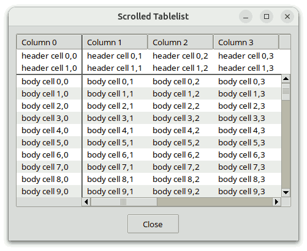
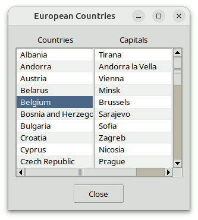
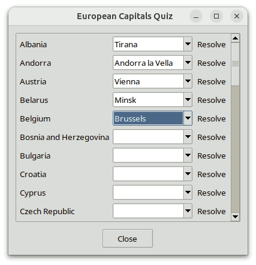
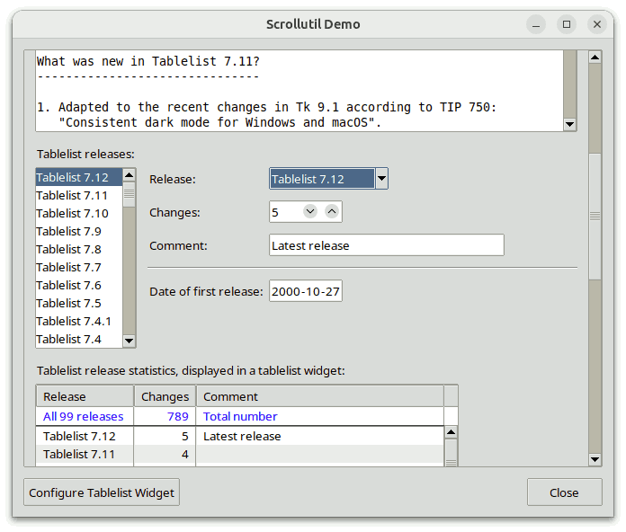
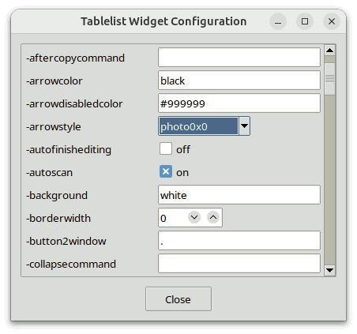
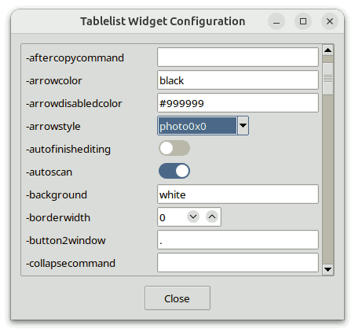
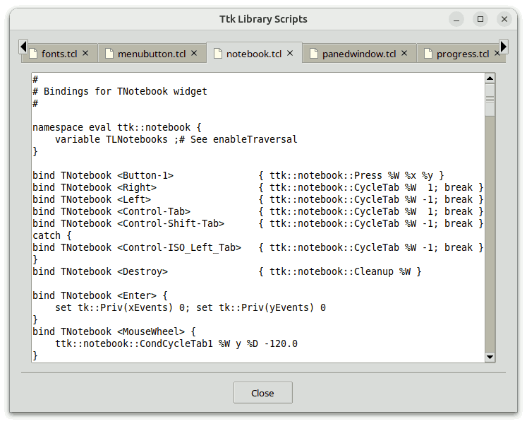

# Scrollutil-Programmierhandbuch

## Für Scrollutil Version 2.11

### von

## Csaba Nemethi

csaba.nemethi@t-online.de

---

## Inhalt

#### Übersicht

- [Was ist Scrollutil?](#was-ist-scrollutil)
- [So erhalten Sie es:](#wie-bekomme-ich-es)
- [Wie wird es installiert?](#wie-wird-es-installiert)
- [Anleitung](#wie-wird-es-angewendet)
- [Mehr zu scrollutil::scalingpct](#mehr-zu-scrollutil-scalingpct)
- [Die Prozedur scrollutil::getScalingPct und der Skalierungsfaktor von Tk](#die-prozedur-scrollutil-getscalingpct-und-der-skalierungsfaktor-von-tk)
- [Mehr zu scrollutil::svgfmt](#mehr-zu-scrollutil-svgfmt)

#### Beispiele

- [Das Hilfsskript styleUtil.tcl](#das-hilfsskript-styleutil-tcl)
- [Ein scrollbares Tablelist-Widget](#ein-scrollbares-tablelist-widget)
- [Ein scrollbares Text-Widget](#ein-scrollbares-text-widget)
- [Ein Widget mit scrollbarer Canvas](#ein-scrollbares-canvas-widget)
- [Synchronisierung von zwei listbox-Widgets](#zwei-listbox-widgets-synchronisieren)
- [Synchronisierung von drei Tablelist-Widgets](#synchronisierung-von-drei-tablelist-widgets)
- [Ein Skript, das das Widget scrollutil::scrollableframe verwendet](#ein-skript-das-ein-scrollutil-scrollableframe-widget-verwendet)
- [Ein Skript, das ein BWidget-ScrollableFrame-Widget verwendet](#ein-skript-das-das-bwidget-widget-scrollableframe-verwendet)
- [Ein Skript, das ein iwidgets::scrolledframe-Widget verwendet](#ein-skript-das-ein-iwidgets-scrolledframe-widget-verwendet)
- [Ein Skript, das zwei scrollutil::scrollableframe-Widgets verwendet:](#ein-skript-das-zwei-scrollutil-scrollableframe-widgets-verwendet)
- [Ein Skript, das zwei BWidget-ScrollableFrame-Widgets verwendet](#ein-skript-das-zwei-bwidget-scrollableframe-widgets-verwendet)
- [Ein Skript, das zwei iwidgets::scrolledframe-Widgets und ein](#ein-skript-das-zwei-iwidgets-scrolledframe-widgets-verwendet)-Widget verwendet]
- [A scrollutil::scrollednotebook Demo](#eine-demo-von-scrollutil-scrollednotebook)
- [A scrollutil::plainnotebook Demo](#eine-demo-von-scrollutil-plainnotebook)
- [A scrollutil::pagesman Demo](#eine-demo-von-scrollutil-pagesman)

[Startseite](index.md)

---

## Überblick

### Was ist Scrollutil?

Scrollutil ist ein Paket für Tcl/Tk ab Version 8.4, das vollständig in Tcl/Tk geschrieben ist. Es enthält:

- die Implementierung der Megawidgets **scrollarea**, **scrollsync**, **scrollableframe**, **scrollednotebook**, **plainnotebook** und **pagesman**, einschließlich eines allgemeinen Hilfsmoduls für Megawidgets.  Die Widgets **scrollednotebook** und **plainnotebook** erfordern Tile 0.8 oder höher;
- Der Befehl `scrollutil::addMouseWheelSupport`, der Mausrad-Ereignis-Bindungen für ein bestimmtes Tag erstellt;
- Befehle für die *benutzerfreundliche* Verarbeitung von Mausrad-Ereignissen in **scrollbaren Widget-Containern** wie scrollutil::scrollableframe, BWidget ScrollableFrame und iwidgets::scrolledframe.  Diese Befehle erfordern Tcl/Tk-Versionen 8.4 oder höher unter X11 und Mac OS X/11+ sowie Tk 8.6b2 oder höher unter Windows;
- Befehle für die *benutzerfreundliche* Ereignisbehandlung bei Betätigung der Maustaste 2 in scrollutil::scrollableframe-Widgets;
- Beispielskripte, die die Verwendung des Scrollutil-Pakets in Verbindung mit verschiedenen scrollbaren Widgets und den oben genannten Containern für scrollbare Widgets veranschaulichen;
- Demo-Skripte, die die Verwendung der Widgets „scrollednotebook“, „plainnotebook“ und „pagesman“ veranschaulichen;
- dieses Tutorial;
- Referenzseiten im HTML-Format.

**Das Megawidget scrollutil::scrollarea** vereinfacht die Erstellung beliebiger scrollbarer Widgets erheblich.  Es besteht aus einem scrollbaren Widget und zwei mit diesem Widget verbundenen Bildlaufleisten. Der Anzeigemodus jeder Bildlaufleiste kann `static`, `dynamic` oder `none` sein.  Diese Implementierung eines scrollbaren Fensters unterstützt auch Widgets, die nur in eine Richtung scrollbar sind (z. B. „entry“ und ttk::entry), und berücksichtigt die Kopfzeilenkomponente sowie die Titelspalten von [tablelist](https://www.nemethi.de/tablelist/)-Widgets (dies ist frei konfigurierbar).

Das Widget scrollutil::scrollarea ähnelt dem BWidget ScrolledWindow und dessen auf snit basierendem Äquivalent widget::scrolledwindow, das von Jeffrey Hobbs beigesteuert wurde und in tklib enthalten ist.  Das snit-basierte Paket [scrodget](http://web.tiscali.it/irrational/tcl/scrodget-2.1/) von Aldo Buratti und sein TclOO-basiertes Äquivalent [scrolledwidget](https://wiki.tcl-lang.org/page/A+Scrolled+Widget+implemented+with+TclOO), beigesteuert von Johann Oberdorfer, sind weitere Implementierungen von Bildlauf-Fenstern. Eine *vollständige* Tablelist-Unterstützung bietet jedoch nur das Scrollarea-Widget, das frei von externen Abhängigkeiten wie BWidget, snit oder (für Tcl 8.5) TclOO ist.  Es ist zudem frei von dem [Shimmering-Problem im Zusammenhang mit Text-Widgets](https://wiki.tcl-lang.org/page/Scroll+bars+that+appear+only+when+needed), das die oben genannten Implementierungen von Bildlauf-Fenstern entweder gemeinsam mit dem autoscroll-Paket (enthalten in tklib) aufweisen oder auf suboptimale Weise umgehen.

**Das Megawidget scrollutil::scrollsync** ist dafür ausgelegt, mehrere Widgets gleichzeitig zu scrollen.  Sobald sich die horizontale/vertikale Position der Ansicht im Fenster eines seiner Widgets ändert, wird die Ansicht in den Fenstern aller anderen Widgets automatisch entsprechend angepasst, wodurch sichergestellt wird, dass die Position der Ansicht in diesen Fenstern synchron bleibt.  Dieses Megawidget ist horizontal und vertikal scrollbar und kann daher über den Unterbefehl `setwidget` des scrollutil::scrollarea-Widgets in dieses eingebettet werden.

**Das Megawidget scrollutil::scrollableframe** ist ein scrollbarer Widget-Container. Es enthält einen Inhaltsrahmen, dessen Abmessungen in der Regel größer sind als die des Widgets selbst.  Beliebige Bereiche dieses Rahmens können durch Scrollen in den sichtbaren Bereich gebracht werden, und das Widget bietet zudem einen Befehl, mit dem einzelne, im Inhaltsrahmen enthaltene Widgets im Fenster des scrollbaren Rahmens sichtbar gemacht werden können.

Das Widget scrollutil::scrollableframe ähnelt den Widgets BWidget ScrollableFrame und iwidgets::scrolledframe. Im Gegensatz zu diesen Widgets, die ein canvas zum Scrollen des Inhaltsrahmens verwenden, passt es die Ansicht mithilfe des Geometriemanagers `place` an, genau wie der Befehl `scrolledframe::scrolledframe` aus dem Scrolledframe-Paket von Maurice Bredelet (ulis) und dessen von Keith Nash beigesteuerte optimierte und erweiterte Version.  Einzelheiten zu diesen Befehlen finden Sie auf der Wiki-Seite

https://wiki.tcl-lang.org/page/A+scrolled+frame

Der Ansatz ohne Canvas ist schlanker und lässt sich besser in Anwendungen integrieren, die Tile-Widgets verwenden.

**Das Megawidget scrollutil::scrollednotebook** enthält ein ttk::notebook in einem scrollbaren Rahmen und unterstützt eine beliebige Anzahl von nicht komprimierten Registerkarten.  Derzeit nicht sichtbare Registerkarten können durch Navigation mit dem Mausrad, dem Touchpad oder der Tastatur sowie durch Scrollen mithilfe der beiden Pfeiltasten, die je nach Stile des Notizbuchs auf Wunsch in den oberen linken und rechten bzw. unteren linken und rechten Ecken platziert werden, in den sichtbaren Bereich gebracht werden.  Das Widget bietet außerdem einen Befehl, um einzelne Registerkarten im „scrollednotebook“-Fenster sichtbar zu machen.  Im Gegensatz zum ttk::notebook-Widget, dessen `-width`-Option häufig durch die Gesamtbreite der Registerkarten überschrieben wird, beachtet das „scrollednotebook“-Widget den Wert seiner Option `-width`, unabhängig vom Platzbedarf der Registerkarten.

**Das Megawidget scrollutil::plainnotebook** erweitert ein ttk::notebook mit einer beliebigen Anzahl von Seiten und unsichtbaren Registerkarten um ein ttk::frame links oder rechts davon, das unter anderem einen scrollableframe, dessen Inhaltsrahmen der übergeordnete Rahmen einer Reihe von Widgets ist, die die Rolle vertikal angeordneter Notizbuchregisterkarten übernehmen. Derzeit nicht sichtbare „Registerkarten“ können durch Navigation mit dem Mausrad, dem Touchpad oder der Tastatur sowie durch Scrollen mit der vertikalen Bildlaufleiste des scrollarea, der den scrollableframe enthält, in den sichtbaren Bereich gebracht werden.  Das Widget bietet zudem einen Befehl, um einzelne „Registerkarten“ im PlainNotebook-Fenster sichtbar zu machen.  Im Gegensatz zu einem ttk::notebook-Widget mit vertikal ausgerichteten Registerkarten, das in den meisten Themen nicht optimal aussieht und dessen Option `-height` häufig durch die Gesamthöhe der Registerkarten überschrieben wird, beachtet das „plainnotebook“-Widget den Wert seiner Option `-height`, unabhängig vom Platzbedarf der „Registerkarten“.

**Das Megawidget scrollutil::pagesman** bietet die Grundfunktionalität eines Seitenmanagers, d. h., es verwaltet eine Liste von Fenstern, die als **Seiten** bezeichnet werden, von denen jeweils nur eine sichtbar ist.  Durch die Verwendung von „plainnotebook“-Widgets als Seiten ist es recht einfach, Anwendungen zu schreiben, in denen der Benutzer mit einem einzigen Mausklick von einem „plainnotebook“ zu einem anderen wechseln und auf dieselbe Weise wieder zum ursprünglichen zurückkehren kann.  Alles, was für diese Navigation benötigt wird, wird durch entsprechende Optionen und Unterbefehle des „plainnotebook“-Widgets bereitgestellt.

Aus Sicht der **Befehle im Zusammenhang mit dem Mausrad und der Ereignisbehandlung von \<TouchpadScroll>**, die vom Scrollutil-Paket bereitgestellt werden, bedeutet die Scrollbarkeit eines Widgets oder eines Widget-Container-Fensters, dass der zugehörige Tcl-Befehl die Unterbefehle  `xview scroll number units`  und  `yview scroll number units`  unterstützt.  Der Grund dafür, dass unter Windows mindestens Tk-Version 8.6b2 für die Befehle im Zusammenhang mit scrollbaren Widget-Containern erforderlich ist, liegt darin, dass in früheren Tk-Versionen auf dieser Plattform die Mausrad-Ereignisse an das Widget mit Fokus gesendet wurden und nicht an das Widget, das sich unter dem Mauszeiger befand.

Um das benutzerfreundliche Mausrad und die Ereignisbehandlung von `<TouchpadScroll>` in scrollbaren Widget-Containern mithilfe des Scrollutil-Pakets zu nutzen, führen Sie die folgenden Schritte aus:

- Erstellen Sie Mausrad- und `<TouchpadScroll>`-Ereigniszuordnungen für das Bindungs-Tag `"all"` oder für die Toplevel-Fenster (einschließlich `"."`), die scrollbare Widget-Container enthalten, indem Sie den Befehl `scrollutil::createWheelEventBindings` aufrufen.  Registrieren Sie außerdem Ihre scrollbaren Widget-Container mithilfe des Befehls `scrollutil::enableScrollingByWheel` für das Scrollen über diese Bindungen.  Beachten Sie, dass dieser Befehl für das Widget scrollutil::scrollableframe automatisch bei der Erstellung aufgerufen wird.  Die oben genannten Bindungen verarbeiten Mausrad- und `<TouchpadScroll>`-Ereignisse, indem sie den (innersten) registrierten scrollbaren Widget-Container scrollen, der ein Vorfahr des Widgets unter dem Mauszeiger ist und in dessen Toplevel-Fenster enthalten ist.
- Rufen Sie den Befehl `scrollutil::adaptWheelEventHandling` für jene Widgets auf, die in registrierten scrollbaren Widget-Containern enthalten sind und über Ereignis- (Klasse-)Bindungen für das Mausrad oder `<TouchpadScroll>` verfügen.  Dieser Schritt ändert die Ereignisbehandlung für das Mausrad und das Ereignis `<TouchpadScroll>` wie folgt:  Wenn der Fokus auf dem Widget unter dem Mauszeiger liegt, werden die oben genannten Ereignisse ausschließlich von den (Klassenbindungen des) Widgets verarbeitet, andernfalls von den mit dem Befehl `scrollutil::createWheelEventBindings` erstellten Bindungen.  Beachten Sie, dass dieser Befehl als optionales Argument den Schalter `-ignorefocus` akzeptiert, der festlegt, dass die oben genannten Ereignisse (ausschließlich) vom Widget unter dem Mauszeiger verarbeitet werden sollen, unabhängig davon, ob dieses Widget den Fokus hat oder nicht.
- Bei einigen Widgets kann es wünschenswert sein, die Prüfung des Fokus innerhalb dieser modifizierten Ereignisbehandlung weniger restriktiv zu gestalten. Wenn es sich bei dem Widget unter dem Mauszeiger beispielsweise um eine Eingabekomponente eines [mentry](https://www.nemethi.de/mentry/) vom Typ `"Date"`, `"Time"`, `"DateTime"`, `"IPAddr"`, oder `"IPv6Addr"` ist und der Fokus auf einem seiner Geschwisterelemente liegt, sollten die an dieses Eintrags-Widget gesendeten Mausrad- und `<TouchpadScroll>`-Ereignisse vom Eintrags-Widget selbst verarbeitet werden, anstatt den Widget-Container zu scrollen, der ein übergeordnetes Element des mentry ist.  Der Befehl `scrollutil::setFocusCheckWindow` deckt genau solche Fälle ab.

Die Funktionsweise des Mausrads und der Ereignisbehandlung von `<TouchpadScroll>` mithilfe des Scrollutil-Pakets wurde ebenfalls in Verbindung mit dem Befehl `scrolledframe::scrolledframe` aus dem Scrolledframe-Paket von Maurice Bredelet (ulis) und dessen optimierter und erweiterter Version, die von Keith Nash beigesteuert wurde, sowie mit dem von Paul Walton implementierten Befehl `sframe`.  Einzelheiten zu diesen Befehlen (die weitere Implementierungen von scrollbaren Widget-Containern bereitstellen) finden Sie auf der oben genannten Wiki-Seite.

**Die Befehle zur Ereignisbehandlung für Mausklick 2** sind auf das Widget scrollutil::scrollableframe beschränkt, das über die Befehle `scan mark` und `scan dragto` Unterstützung für das Scannen bietet.  Die Bindungen für die rechte Maustaste des von Scrollutil automatisch erstellten Bindungs-Tags `"all"` verarbeiten die Ereignisse `<Button-2>`, `<B2-Motion>` und `<ButtonRelease-2>`, indem sie den Inhalt des (innersten) „scrollableframe“-Widgets abtasten, das ein Vorfahr des angeklickten Widgets ist und in dessen Toplevel-Fenster enthalten ist.  Durch Aufrufen des Befehls `scrollutil::adaptBtn2EventHandling` für die Widgets, die in einem „scrollableframe“ enthalten sind und über Mausknopf-2-(Klassen-)Bindungen verfügen, wird die Behandlung dieser Ereignisse wie folgt geändert:  Wenn der Fokus auf dem angeklickten Widget liegt, werden die Ereignisse ausschließlich von den (Klassenbindungen des) Widgets verarbeitet, andernfalls von den für das `"all"`-Tag erstellten Bindungen.  Dies ist insbesondere auf Android nützlich, wo es eine benutzerfreundliche Scan-Unterstützung für „scrollableframe“-Widgets über Ein-Finger-Gesten bietet.

### Wie bekomme ich es?

Scrollutil steht auf der Seite zum kostenlosen Download bereit

https://www.nemethi.de

Die Distributionsdatei lautet `scrollutil2.11.tar.gz` für UNIX und `scrollutil2_11.zip` für Windows. Diese Dateien enthalten dieselben Informationen, mit Ausnahme des zusätzlichen Wagenrücklaufzeichens, das in den Textdateien für Windows am Ende jeder Zeile vor dem Zeilenvorschub steht.

Scrollutil ist ebenfalls in tklib enthalten, dessen Adresse lautet

https://core.tcl-lang.org/tklib

### Wie wird es installiert?

Installieren Sie das Paket als Unterverzeichnis eines der Verzeichnisse, die durch die Variable `auto_path` angegeben sind. Sie können es beispielsweise als Unterverzeichnis des Verzeichnisses `lib` innerhalb Ihrer Tcl/Tk-Installation installieren.

Um Scrollutil *unter UNIX* zu installieren, wechseln Sie mit `cd` in das gewünschte Verzeichnis und entpacken Sie die Distributionsdatei `scrollutil2.11.tar.gz`:

```
gunzip -c scrollutil2.11.tar.gz | tar -xf - 
```

Auf den meisten UNIX-Systemen kann dies durch Folgendes ersetzt werden:

```
tar -zxf scrollutil2.11.tar.gz 
```

Beide Befehle erstellen ein Verzeichnis namens `scrollutil2.11` mit den Unterverzeichnissen `demos`, `doc` und `scripts`.

*Unter Windows* verwenden Sie WinZip oder ein anderes Programm, mit dem Sie die Distributionsdatei `scrollutil2_11.zip` in das Verzeichnis `scrollutil2.11` entpacken können, einschließlich der Unterverzeichnisse `demos`, `doc` und `scripts`.

Beachten Sie, dass in tklib das Verzeichnis „Scrollutil `demos`“ durch das Unterverzeichnis `scrollutil` des Verzeichnisses `examples` ersetzt wird.  Bitte berücksichtigen Sie dies beim Lesen der folgenden [Beispiele](#beispiele).

### Wie wird es angewendet?

Die Scrollutil-Distribution enthält zwei Pakete: **Scrollutil** und **Scrollutil_tile**.  Der Hauptunterschied zwischen den beiden besteht darin, dass **Scrollutil_tile** die kachelbasierte, themenspezifische Darstellung der Widgets **scrollarea**, **scrollsync** und **scrollableframe** ermöglicht und die themenbezogenen Widgets **scrollednotebook** und **plainnotebook** bereitstellt; dieses Paket erfordert **tile** 0.8 oder höher.  Es ist nicht möglich, beide Pakete in ein und derselben Anwendung zu verwenden, da beide im selben Namespace `scrollutil` implementiert sind und identische Befehle bereitstellen (mit Ausnahme der Befehle `scrollutil::scrollednotebook`, `scrollutil::plainnotebook`, `scrollutil::addclosetab`, `scrollutil::removeclosetab` und `scrollutil::closetabstate`, die ausschließlich vom Paket „Scrollutil_tile“ bereitgestellt werden).

Um auf die Befehle und Variablen des Scrollutil-Pakets zugreifen zu können, müssen Ihre Skripte eine der folgenden Zeilen enthalten:

```
package require scrollutil ?version?
package require Scrollutil ?version?
```

Sie können eine der beiden oben genannten Anweisungen verwenden, da die Datei `scrollutil.tcl` beide Zeilen enthält.

```
package provide scrollutil ...
package provide Scrollutil ...
```

Um auf die Befehle und Variablen des Pakets „Scrollutil_tile“ zugreifen zu können, müssen Ihre Skripte ebenfalls eine der folgenden Zeilen enthalten:

```
package require scrollutil_tile ?version?
package require Scrollutil_tile ?version?
```

Auch hier können Sie eine der beiden oben genannten Anweisungen verwenden, da die Datei `scrollutil_tile.tcl` beide Zeilen enthält.

```
package provide scrollutil_tile ...
package provide Scrollutil_tile ...
```

Es steht Ihnen frei, jeweils eine dieser beiden Zeilen aus `scrollutil.tcl` bzw. `scrollutil_tile.tcl` zu entfernen, wenn Sie verhindern möchten, dass die entsprechenden Pakete jeweils unter zwei verschiedenen Namen angezeigt werden.  Dadurch beschränken Sie natürlich das Argument von ``package require`` auf einen einzigen Namen.

Da die Pakete „Scrollutil“ und „Scrollutil_tile“ im Namespace `scrollutil` implementiert sind, müssen Sie entweder die

```
namespace import scrollutil::pattern ?scrollutil::pattern ...?
```

Befehl zum Importieren der benötigten *Prozeduren* oder verwenden Sie qualifizierte Namen wie `scrollutil::scrollarea`.  Im folgenden Beispiel [examples](#beispiele) haben wir uns für den letzteren Ansatz entschieden.

Um auf Scrollutil-*Variablen* zuzugreifen, *müssen* Sie qualifizierte Namen verwenden. Es gibt nur 5 Scrollutil-Variablen, die für den Zugriff außerhalb des Namespaces `scrollutil` vorgesehen sind:

- Die Variable `scrollutil::version` enthält die aktuelle Versionsnummer des Scrollutil-Pakets.
- Die Variable `scrollutil::library` enthält den Pfad zum Verzeichnis der Scrollutil-Installation.
- Die schreibgeschützte Variable `scrollutil::scalingpct` wird beim Laden des Pakets „Scrollutil“ oder „Scrollutil_tile“ über `package require` auf den Skalierungsprozentsatz gesetzt, der der DPI-Skalierungsstufe des Bildschirms entspricht.  Scrollutil passt unter anderem die Standardbreite der Tk-Core-Bildlaufleisten unter X11 sowie die des Widgets ttk::scrollbar für die integrierten Themen `alt`, `clam`, `classic` und `default` an den Wert dieser Variable an. Die derzeit unterstützten Werte sind `100`, `125`, `150`, `175` und `200`.  Sie können diese Variable beispielsweise verwenden, wenn Sie je nach DPI-Skalierungsstufe Bilder unterschiedlicher Größe erstellen möchten.  Wenn Ihre Anwendung beispielsweise auf einem nicht skalierten Display Bilder der Größe 16 x 16 verwendet und `scrollutil::scalingpct` den Wert `150` hat, sollte die Bildgröße für dieses Display 24 x 24 betragen.
- Wenn die Tk-Version entweder mindestens 8.7 (mit integrierter SVG-Unterstützung) ist oder 8.6 und die Erweiterung „tksvg“ in den Interpreter geladen werden kann, dann wird die Variable `scrollutil::svgfmt` auf eine Tcl-Liste gesetzt, die Sie an die Befehle zur Erstellung oder Bearbeitung von SVG-Bildern als Wert ihrer Option `-format` übergeben können, um sicherzustellen, dass Ihre Bilder korrekt skaliert werden.
- Die schreibgeschützte Variable `scrollutil::usingTile` hat im Paket „Scrollutil“ den Wert `0` und im Paket „Scrollutil_tile“ den Wert `1`.

Das Paket „Scrollutil_tile“ prüft, ob die erforderlichen Tk- und Tile-Versionen vorhanden sind, indem es die folgenden Befehle ausführt:

```
package require Tk 8.4-
if {$::tk_version < 8.5 || [regexp {^8\.5a[1-5]$} $::tk_patchLevel]} {
    package require tile 0.8-
}
```

Der zweite Befehl oben spiegelt die Tatsache wider, dass „Tile“ ab Tk 8.5a6 in den Tk-Kern integriert ist und daher nur bei Verwendung einer früheren Tk-Version explizit geladen werden sollte.

### Mehr zu `scrollutil::scalingpct`

Der Scrollutil-Code setzt die Variable `scrollutil::scalingpct` auf den Wert, der von der öffentlichen Prozedur `scaleutil::scalingPercentage` des Pakets „scaleutil“ gegeben wird, das im Lieferumfang von Scrollutil enthalten ist. Die Art und Weise, wie dieser Wert berechnet wird, hängt vom Fenstersystem ab:

*Unter Windows und Mac OS X/11+* wird der Skalierungsprozentsatz anhand des von Tk vorgegebenen Skalierungsfaktors `[tk scaling]` berechnet.  HINWEIS: Unter Mac OS X/11+ ist das Ergebnis unabhängig von der Skalierungsstufe des Bildschirms immer `100`. Auf diesem System skaliert die Desktop-Engine alles automatisch nach Bedarf.

*Unter X11* erfolgt die Berechnung des Skalierungsprozentsatzes aus  `[tk scaling]`  nur als Ausweichmethode, da die Implementierung der Bildschirmskalierung stark von der Desktop-Umgebung abhängt und größtenteils Systemressourcen nutzt, die außerhalb von Xlib liegen, auf der Tk basiert.  (Auch herkömmliche X-Anwendungen wie `bitmap` und `xmag` sind davon betroffen.)  Mit der teilweisen Ausnahme von Xfce und MATE (siehe unten) berechnet die Prozedur den Skalierungsprozentsatz anhand des Werts der X-Ressource `Xft.dpi`, indem die Anwendung `xrdb` ausgeführt wird.  Auf GNOME-basierten Systemen, auf denen `xrdb` nicht standardmäßig installiert ist (z. B. Solus GNOME und Solus Budgie), werden stattdessen die Anwendung `xrandr` und die Datei `~/.config/monitors.xml` verwendet.

- Unter *Xfce* kann der Anzeigeskalierungsmodus, der als *Fensterskalierung* bezeichnet wird, auf „1x“ oder „2x“ eingestellt werden und im Dialogfeld *Darstellung* ausgewählt werden. Xfce-Versionen ab 4.16 unterstützen zudem eine fraktionierte Skalierung, deren Parameter im Dialogfeld *Anzeige* konfiguriert werden können.  Wenn der Modus „2x“ ausgewählt wurde, wird der Skalierungsprozentsatz durch die Prozedur `scaleutil::scalingPercentage` bis `200` festgelegt; ansonsten wird er anhand des Werts der Schriftart-DPI berechnet, der durch die X-Ressource `Xft.dpi` vorgegeben wird.  Der Wert der Schriftart-DPI kann auf der Registerkarte *Schriftarten* des Dialogs *Darstellung* oder (unter Linux Lite 5+) über den Dialog *HiDPI-Einstellungen* festgelegt werden.
- Unter *MATE* kann der Anzeigenskalierungsmodus, der als *Fenster-Skalierungsfaktor* bezeichnet wird, auf „Automatische Erkennung“, „Normal“ oder „HiDPI“ eingestellt werden und im Dialogfeld *MATE Tweak* ausgewählt werden.  Der gleiche Effekt lässt sich erzielen, indem Sie im Dialogfeld *Monitoreinstellungen* einen der möglichen Werte „Auto-Detect“, „100 %“ und „200 %“ auswählt.  Wenn Bedarf besteht, erkennt die Prozedur `scaleutil::scalingPercentage` automatisch, welcher der Modi „Normal“ („100 %“) und „HiDPI“ („200 %“) dem voreingestellten Modus „Auto-detect“ („Auto-Erkennung“) entspricht.  Wenn der Modus „HiDPI“ („200 %“) vom Benutzer ausgewählt wurde oder von der Prozedur automatisch erkannt wurde, wird der Skalierungsprozentsatz auf `200` gesetzt; andernfalls wird er anhand des Werts der Schriftart-DPI berechnet, der durch die X-Ressource `Xft.dpi` vorgegeben ist.  Der Wert der Schriftart-DPI kann über das Dialogfeld *Font Rendering Details* eingestellt werden, das wiederum über die Registerkarte *Schriftarten* im Dialogfeld *Darstellungseinstellungen* geöffnet werden kann.
- Bei *GNOME unter Xorg, Budgie und Cinnamon in Versionen vor 4.6* kann die Bildschirmskalierung entweder 100 % oder 200 % betragen, und die Prozedur legt den Skalierungsprozentsatz entsprechend auf `100` oder `200` fest.  In neueren GNOME- und Budgie-Versionen unter Ubuntu können Sie `x11-randr-fractional-scaling` als experimentelles Feature aktivieren, wodurch (mindestens) 125 %, 150 % und 175 % zur Liste der unterstützten Skalierungsprozentsätze hinzugefügt werden.  HINWEIS: Aufgrund der Art und Weise, wie diese fraktionierte Skalierung implementiert ist, gibt `scaleutil::scalingPercentage` einen Wert zurück, der unabhängig von der gewählten Bildschirmskalierung `200` lautet.  Cinnamon ab Version 4.6 unterstützt ebenfalls die fraktionierte Skalierung; ist diese aktiviert, lautet der von der Prozedur zurückgegebene Skalierungsprozentsatz `200`, unabhängig von der Auswahl der Bildschirmskalierung.
- *GNOME auf Wayland* unterstützt traditionell die Werte für die Bildschirmskalierung 100 % und 200 %, und der Skalierungsprozentsatz wird entsprechend auf `100` oder `200` festgelegt.  In neueren GNOME-Versionen können Sie die experimentelle Funktion `scale-monitor-framebuffer` aktivieren, die (mindestens) 125 %, 150 % und 175 % zur Liste der unterstützten Skalierungsprozentsätze hinzufügt.  Ist diese Funktion aktiviert, gibt `scaleutil::scalingPercentage` den Wert `100` bei älteren GNOME-Versionen zurück und `200` bei neueren Versionen, unabhängig vom Skalierungsgrad, da in diesem Fall nicht der Fensterinhalt, sondern die Monitor-Framebuffer in einem logischen Pixelkoordinatenraum skaliert werden.
- *KDE Plasma unter Xorg* bietet Unterstützung für die fraktionierte Skalierung. Auf diesem Desktop gibt die Prozedur je nach Skalierungsstufe des Bildschirms `100`, `125`, `150`, `175` oder `200` zurück.
- *KDE Plasma auf Wayland* unterstützt ebenfalls die fraktionelle Skalierung.  In diesem Fall gibt die Prozedur bei älteren KDE-Versionen immer den Wert `100` zurück, unabhängig vom Skalierungsgrad des Bildschirms, während sie bei neueren KDE-Versionen den Wert `100` gibt, `125`, `150`, `175` oder `200`.

Unter GNOME und Budgie lässt sich die Bildschirmskalierung auf der Seite *Bildschirme* des Dialogfelds *Einstellungen* einstellen, der Wert der X-Ressource `Xft.dpi`, die von der Prozedur `scaleutil::scalingPercentage` verwendet wird, kann jedoch auch durch die Einstellung des Skalierungsfaktors der Schriftarten über die Anwendung *Tweaks* angepasst werden.  Ebenso lässt sich unter Cinnamon die Bildschirmskalierung auf der Seite *Bildschirm* des Dialogfelds *Systemeinstellungen* einstellen, doch der Wert der X-Ressource `Xft.dpi` kann auch durch Einstellen des Textskalierungsfaktors über die Seite *Schriftartauswahl* des Dialogfelds *Systemeinstellungen* angepasst werden.  Schließlich kann unter KDE Plasma die Bildschirmskalierung auf der Seite *Bildschirmkonfiguration* des Dialogs *Systemeinstellungen* eingestellt werden, und unter KDE Plasma auf Xorg kann der Wert der Schriftart-DPI, der durch die X-Ressource `Xft.dpi` vorgegeben wird, ebenfalls über die Seite *Schriftarten* des Dialogs *Systemeinstellungen* eingestellt werden.

Neben der Berechnung des Skalierungsprozentsatzes führt die Prozedur `scaleutil::scalingPercentage` eine Reihe weiterer Aufgaben aus.  Unter anderem ändert es die Standardhöhe der ttk::treeview-Zeilen vom fest codierten Wert von 20 Pixeln auf einen sinnvolleren Wert, basierend auf den Schriftmetriken der vom `Treeview`-Stil verwendeten Schriftart (in der Regel `TkDefaultFont`), und stellt sicher, dass dieser Schritt jedes Mal wiederholt wird, wenn das virtuelle Ereignis `<<ThemeChanged>>` empfangen wird (z. B. weil sich der Wert der Option `-font` des Stils `Treeview` geändert hat), oder das virtuelle Ereignis `<<TkWorldChanged>>` empfangen wird, bei dem das Feld `user_data` (`%d`) auf `FontChanged` gesetzt ist.  Wenn die Tk-Version höher als 8.6.11 oder 8.7a5 ist, wird dieses virtuelle Ereignis von der Tk-Engine an alle Widgets gesendet, wenn eine Schriftart geändert wird, beispielsweise durch den Aufruf von `font configure`  (siehe [TIP 608](https://core.tcl-lang.org/tips/doc/trunk/tip/608.md)).

Die im weiteren Verlauf dieses Abschnitts beschriebenen zusätzlichen Schritte werden nur ausgeführt, wenn der Skalierungsprozentsatz größer ist als `100`.

Unter X11 synchronisiert die Prozedur den von Tk verwendeten Skalierungsfaktor für die Umrechnung zwischen physikalischen Einheiten und Pixeln mit dem Skalierungsprozentsatz, indem sie einen aus letzterem abgeleiteten Wert an den Befehl  `tk scaling`  übergibt.  Während dies in den allermeisten Anwendungen das gewünschte und empfohlene Verhalten ist, kann es Fälle geben, in denen Sie diesen Schritt unterdrücken möchten, da Ihre Anwendung möglicherweise über eine eigene Logik zur Bestimmung des Werts des Skalierungsfaktors von Tk verfügt. Dies können Sie erreichen, indem Sie die Zeile

```
namespace eval ::scaleutil { set keepTkScaling 1 }
```

bevor Scrollutil oder Scrollutil_tile über `package require` geladen wird.

Die Prozedur `scaleutil::scalingPercentage` korrigiert bei Bedarf auch die Größen der Standardschriften.  Diese Schriftarten (`TkDefaultFont`, `TkTextFont` usw.) sind in der Datei `$tk_library/ttk/fonts.tcl` definiert.  Lange Zeit waren die in dieser Datei angegebenen Schriftarten für X11 in Pixeln angegeben, was für die Verwendung auf HiDPI-Bildschirmen nicht geeignet war.  Dies führte dazu, dass mehrere Linux-Distributionen gepatchte Versionen dieser Datei mitlieferten, in denen die Größenangaben in Pixeln durch Größenangaben in Punkten ersetzt wurden.  Die gleiche Korrektur wurde im Februar 2020 in das Tk-Core-Repository Commit und ist nun in Tk 8.7a5 und späteren Versionen enthalten.  Um sicherzustellen, dass die Schriftgrößen unabhängig von der Tk-Version zum Skalierungsgrad des Bildschirms passen, überprüft die Prozedur diese Bibliotheksdatei und setzt, wenn diese Größen in Pixeln enthalten sind, die Option `-size` der Standardschriften auf entsprechende Größen in Punkten (ohne die Datei zu verändern).  Zudem verdoppelt die Prozedur für den „2x“-Modus unter Xfce die Größen (in Punkten) der Standardschriften (die Funktionsweise der Bildschirmskalierung auf diesem Desktop macht dies erforderlich).

Die Prozedur skaliert außerdem:

- die Standardparameter des Trenngriffs (sash) des Tk-Core-panedwindow;
- die Standardgröße des Tk-Core-Scale-Widgets und seines Schiebereglers;
- die Standardbreite der Tk-Core-Bildlaufleisten unter X11;
- die Standardlänge der Widgets ttk::scale und ttk::progressbar;
- für die eingebauten Themen `alt` und `default` einige Stiloptionen der Widgets ttk::scrollbar, ttk::scale, ttk::progressbar, ttk::combobox, ttk::spinbox, ttk::button, toolbutton, ttk::menubutton, ttk::checkbutton, ttk::radiobutton, ttk::notebook, ttk::panedwindow und ttk::treeview;
- für das eingebaute Thema `clam` einige Stiloptionen der Widgets ttk::scrollbar, ttk::scale, ttk::progressbar, ttk::combobox, ttk::spinbox, ttk::button, toolbutton, ttk::menubutton, ttk::checkbutton, ttk::radiobutton, ttk::notebook, ttk::panedwindow, ttk::treeview und ttk::labelframe;
- für das eingebaute Thema `classic` einige Stiloptionen der Widgets ttk::scrollbar, ttk::scale, ttk::progressbar, ttk::combobox, ttk::spinbox, ttk::button, toolbutton, ttk::menubutton, ttk::checkbutton, ttk::radiobutton, ttk::notebook, ttk::panedwindow und ttk::treeview;
- für das eingebaute Thema `vista` einige Stiloptionen der Widgets ttk::combobox, ttk::button, toolbutton, ttk::menubutton, ttk::checkbutton, ttk::radiobutton, ttk::notebook, ttk::panedwindow und ttk::treeview;
- für das eingebaute Thema `winnative` einige Stiloptionen der Widgets ttk::scale, ttk::progressbar, ttk::combobox, ttk::spinbox, toolbutton, ttk::menubutton, ttk::checkbutton, ttk::radiobutton, ttk::notebook, ttk::panedwindow und ttk::treeview;
- für das eingebaute Thema `xpnative` einige Stiloptionen der Widgets ttk::combobox, ttk::spinbox, ttk::button, toolbutton, ttk::menubutton, ttk::checkbutton, ttk::radiobutton, ttk::notebook, ttk::panedwindow und ttk::treeview.

Darüber hinaus stellt die Prozedur `scaleutil::scalingPercentage` sicher, dass in den Themen `vista` und `xpnative` die Indikatoren der Widgets ttk::checkbutton und ttk::radiobutton korrekt skaliert angezeigt werden, unabhängig von der verwendeten Tk-Version.  (Ein seit Langem bestehender Fehler in der Implementierung dieser Widgets wurde im Mai 2020 behoben und ist nun sowohl in Tk 8.6.11 und höher als auch in 8.7a5 und höher enthalten; die Prozedur bietet jedoch eine automatische Abhilfe für die Tk-Versionen, die noch von diesem Fehler betroffen sind.)

HINWEIS: In Tk-Versionen vor Version 9 sind die Tk-Core-Widgets „checkbutton“ und „radiobutton“ enthalten. sowie die Indikatoren der Widgets „ttk::checkbutton“ und „ttk::radiobutton“ der Themen `alt` und `winnative` nicht skalierbar sind (in Tk 9 und höher werden sie automatisch skaliert).  Das Gleiche gilt für das Widget „ttk::sizegrip“ in den integrierten Themen.

### Die Prozedur `scrollutil::getScalingPct` und der Skalierungsfaktor von Tk

Das Scrollutil-Paket stellt die Hilfsprozedur `scrollutil::getScalingPct` bereit, die keine Argumente erwartet und den Skalierungsprozentsatz der Anwendung gibt, der aus dem *aktuellen* Skalierungsfaktor von Tk abgeleitet wird, der durch `[tk scaling]` angegeben wird.  Der Wert, der von der Prozedur zurückgegeben wird, ist auf Vielfache von `25` beschränkt, beträgt mindestens `100` und kann größer als `200` sein, insbesondere wenn AndroWish auf einem Tablet oder Smartphone ausgeführt wird.  Scrollutil nutzt diese Prozedur, um sicherzustellen, dass die Größen seiner GUI-Komponenten dem aktuellen Skalierungsfaktor von Tk entsprechen (der möglicherweise über `tk scaling` geändert wurde), und es wird empfohlen, dies auch im Anwendungscode zu tun.

Wenn die Tk-Version 9 oder höher ist, ist die im vorherigen Abschnitt beschriebene Funktionalität der Prozedur `scaleutil::scalingPercentage` in den Kern integriert.  Als Teil dieser Funktionalität setzt Tk 9+ die Variable `tk::scalingPct` bei der Initialisierung auf den Skalierungsprozentsatz, der der DPI-Skalierungsstufe des Bildschirms entspricht, und die Prozedur `scaleutil::scalingPercentage` gibt lediglich das Minimum aus dem aktuellen Wert von `tk::scalingPct` und `200` zurück.  Zur Erinnerung: In Tk 9+ wird der Wert der Variablen `tk::scalingPct` automatisch aktualisiert, sobald der Skalierungsfaktor über `tk scaling` geändert wird.  Folglich gilt: Wenn die Anwendung den Skalierungsfaktor von Tk *vor dem Laden von Scrollutil oder Scrollutil_tile* über `package require` ändert,  wird die Variable `scrollutil::scalingpct` auf den kleinsten Wert aus dem automatisch aktualisierten Wert von `tk::scalingPct` und `200` gesetzt.  Dies führt zu folgendem Ergebnis

**Empfehlung:** Wenn Ihre Anwendung den Skalierungsfaktor von Tk durch Aufruf von `tk scaling` ändert, sollte dies *vor dem Laden von Scrollutil oder Scrollutil_tile* geschehen.

### Mehr zu `scrollutil::svgfmt`

Wenn die Tk-Version entweder mindestens 8.7 (mit integrierter SVG-Unterstützung) oder 8.6 ist und das Paket „tksvg“ in den Interpreter geladen werden kann, setzt Scrollutil die Variable `scrollutil::svgfmt` auf

```
[list svg -scale [expr {[scrollutil::getScalingPct] / 100.0}]]
```

Typische Werte sind `{svg -scale 1.0}`, `{svg -scale 1.25}`, `{svg -scale 2.0}` usw.

Es wird empfohlen, den Wert der Variablen `scrollutil::svgfmt` an die Befehle `image create photo`, `imageName configure`, `imageName put`  und `imageName read` als Wert für deren Option `-format` zu übergeben, um sicherzustellen, dass deren Größen dem aktuellen Skalierungsprozentsatz der Anwendung entsprechen.

[Inhalt](#inhalt)     [Startseite](index.md)

---

## Beispiele

### Das Hilfsskript `styleUtil.tcl`

Alle Beispiele im Verzeichnis `demos` verwenden Tile-Widgets (TTK) und enthalten die folgenden Zeilen

```
set dir [file dirname [info script]]
source [file join $dir styleUtil.tcl]
```

Das Skript `styleUtil.tcl` beginnt mit einem Kommentar zu den Konfigurationsoptionen „scrollarea“ für `-autohidescrollbars` und `-setfocus`:

```
#
# To set the "-autohidescrollbars" or "-setfocus" option of all scrollarea
# widgets in all demo scripts to true, uncomment the corresponding line below:
#
# option add *Scrollarea.autoHideScrollbars 1
# option add *Scrollarea.setFocus           1
```

Es steht Ihnen frei, diesen Hinweis zu befolgen oder die Demo-Skripte mit den Standardeinstellungen für die Bildlaufbereiche  `-autohidescrollbars 0`  und  `-setfocus 0`  auszuführen.

Das Skript passt einige TTK-Widget-Stile an und definiert den Stil `Small.Toolbutton`.

Der Patch für den Stil `TCombobox` stellt sicher, dass die (schreibgeschützten) ttk::combobox-Widgets der Themen `alt`, `clam`, `classic` und `default` anzeigen, ob sie den Fokus haben.  Diese grundlegende Anforderung, die die Tastaturnavigation benutzerfreundlicher macht, wird bereits von den Themen `vista`, `xpnative` und `aqua` erfüllt.

Die Widgets „ttk::button“ des Stils `Small.Toolbutton`, die durch die in diesem Skript implementierte Prozedur `styleutil::createToolbutton` erstellt wurden, werden hervorgehoben angezeigt, wenn sie den Fokus haben.  Auch dies trägt dazu bei, die Tastaturnavigation benutzerfreundlicher zu gestalten.

Eine weitere von diesem Skript bereitgestellte Prozedur ist `styleutil::getCurrentTheme`, die durch Aufruf des Befehls `ttk::style theme use` den Namen des aktuellen Themas gibt.  Wenn eine ältere Tile-Version verwendet wird, die diese Methode noch nicht unterstützt, gibt die Prozedur den Wert der Variablen `::ttk::currentTheme` zurück (die ausschließlich durch den Befehl `ttk::setTheme` gesetzt wird).  Diese Prozedur wird von fast allen in der Scrollutil-Distribution enthaltenen Demo-Skripten verwendet.

Das Skript passt außerdem das Thema `clam` an, indem es die öffentliche Prozedur `themepatch::patch` des Pakets „themepatch“ aufruft, das im Lieferumfang von Scrollutil enthalten ist (das jedoch – im Gegensatz zum „scaleutil“-Paket – vom Scrollutil-Code nicht verwendet wird und daher explizit über `package require themepatch` geladen werden muss):

```
package require scrollutil_tile

. . .

#
# Patch the clam theme's styles TButton, TMenubutton,
# Heading, TCheckbutton, and TRadiobutton
#
package require themepatch
themepatch::patch clam
```

Unter X11 legt das Skript das Thema auf diese gepatchte Variante des Themas `clam` fest, das über kleinere „ttk::button“-Widgets sowie „ttk::treeview“- und Tablelist-Kopfzeilen verfügt, und dessen skalierbare Widgets ttk::checkbutton und ttk::radiobutton weisen ein deutlich verbessertes Erscheinungsbild und Verhalten auf.

### Ein scrollbares Tablelist-Widget

Dieses Beispiel zeigt, wie Sie die Erstellung einer scrollbaren Tablelist mithilfe eines [scrollarea](scrollarea.md)-Widgets erheblich vereinfachen können.

Das Skript `ScrolledTablelist1.tcl` im Verzeichnis `demos` erstellt ein Widget vom Typ „Tablelist“ mit horizontalem und vertikalem Bildlauf, das über zwei Kopfzeilen und eine Titelspalte verfügt, und verwaltet die beiden Bildlaufleisten so, dass die vertikale Bildlaufleiste unterhalb der Kopfzeile der Tablelist erscheint und die horizontale Bildlaufleiste rechts neben dem Bereich der Spalten des Widgets beginnt:



Das Skript erfüllt diese Anforderungen mithilfe der herkömmlichen Verwaltung von Bildlaufleisten, die im Folgenden in der Farbe „[red]{.red}“ dargestellt ist:

```
package require Tk 8.5-
package require tablelist_tile 6.3-
set dir [file dirname [info script]]
source [file join $dir styleUtil.tcl]

wm title . "Scrolled Tablelist"

#
# Create the tablelist and the scrollbars as children
# of a frame having -borderwidth 1 and -relief sunken
#
set f   [ttk::frame .f]
set frm [ttk::frame $f.frm -borderwidth 1 -relief sunken]
set tbl $frm.tbl
set vsb $frm.vsb
set hsb $frm.hsb
tablelist::tablelist $tbl ... -borderwidth 0 \
    -xscrollcommand [list $hsb set] -yscrollcommand [list $vsb set]
. . .
ttk::scrollbar $vsb -orient vertical   -command [list $tbl yview]
ttk::scrollbar $hsb -orient horizontal -command [list $tbl xview]

. . .

#
# Manage the widgets within the frame
#
grid $tbl -row 0 -rowspan 2 -column 0 -columnspan 2 -sticky news
if {[tk windowingsystem] eq "win32"} {
    grid $vsb -row 0 -rowspan 2 -column 2 -sticky ns
} else {
    grid [$tbl cornerpath] -row 0 -column 2 -sticky ew
    grid $vsb              -row 1 -column 2 -sticky ns
}
grid [$tbl cornerpath -sw] -row 2 -column 0 -sticky ns
grid $hsb                  -row 2 -column 1 -sticky ew
grid rowconfigure    $frm 1 -weight 1
grid columnconfigure $frm 1 -weight 1

. . .

#
# Manage the frame
#
pack $frm -expand yes -fill both -padx 9p -pady 9p
pack $f   -expand yes -fill both
```

Das Skript `ScrolledTablelist2.tcl` im Verzeichnis `demos` ersetzt den oben genannten, recht technischen Code durch nur wenige Zeilen (unten in der Farbe [red]{.red} dargestellt), indem es die Tablelist in ein Scrollarea-Widget einbettet.  Dazu ist Tablelist Version 6.5 erforderlich, damit die „Scrollarea“-Optionen `-respectheader` und `-respecttitlecolumns` wie erwartet funktionieren (bei früheren Tablelist-Versionen werden diese Optionen stillschweigend ignoriert).  Ein weiterer Vorteil ist, dass die mit dieser Methode erstellten Bildlaufleisten den Standard-Anzeigemodus `dynamic` aufweisen.

```
package require Tk 8.5-
package require tablelist_tile 6.5-
package require scrollutil_tile
set dir [file dirname [info script]]
source [file join $dir styleUtil.tcl]

wm title . "Scrolled Tablelist"

#
# Create the tablelist within a scrollarea
#
set f  [ttk::frame .f]
set sa [scrollutil::scrollarea $f.sa]
set tbl $sa.tbl
tablelist::tablelist $tbl ...
. . .
$sa setwidget $tbl

. . .

#
# Manage the scrollarea
#
pack $sa -expand yes -fill both -padx 9p -pady 9p
pack $f  -expand yes -fill both
```

### Ein scrollbares Text-Widget

Das Skript `ScrolledText.tcl` im Verzeichnis `demos` zeigt, wie das Widget „[scrollarea](scrollarea.md)“ den möglichen Shimmering-Effekt in der Verbindung mit Text-Widgets umgeht.


Hier ist der entsprechende Code, in dem die Zeilen, die sich auf das „scrollarea“-Widget beziehen, in der Farbe „[red]{.red}“ dargestellt sind:

```
package require scrollutil_tile
set dir [file dirname [info script]]
source [file join $dir styleUtil.tcl]

wm title . "Scrolled Text"

#
# Create a text widget within a scrollarea
#
set f  [ttk::frame .f]
set sa [scrollutil::scrollarea $f.sa -lockinterval 10]
set txt [text $sa.txt -font TkFixedFont -width 49 -height 12 \
         -spacing1 1.5p -spacing3 1.5p -wrap none]
$sa setwidget $txt

#
# Populate the text widget and set the background color of line #25 to red
#
for {set i 1} {$i <= 30} {incr i} {
    set j [expr {2*$i}]
    $txt insert end [string repeat x $j]\n
}
$txt delete 30.end
$txt tag configure bgRed -background red
$txt tag add bgRed 25.0 25.end

. . .

#
# Manage the scrollarea
#
pack $sa -expand yes -fill both -padx 9p -pady 9p
pack $f  -expand yes -fill both

#
# Adjust the vertical view in the text window
# so that line #25 becomes the bottom line
#
tkwait visibility $txt
after 100 [list $txt yview 14.0]
```

Das Skript erstellt ein Text-Widget mit der Bezeichnung `$txt`, das in einen Scrollbereich eingebettet ist, füllt es mit 30 Zeilen und passt die vertikale Ansicht im Textfenster so an, dass Zeile 25 zur untersten Zeile wird.  Diese Zeile hat 50 Zeichen und passt daher nicht vollständig in das Fenster, dessen Breite 49 Zeichen beträgt.  Folglich gibt der Befehl  `$txt xview`  die Liste  `{0.0 0.98}`  zurück, wodurch die horizontale Bildlaufleiste des Scrollbereichs eingeblendet wird und den größten Teil der untersten Zeile verdeckt.  Da diese Zeile den Hintergrund `red` hat, lässt sich leicht erkennen, wie viel davon über den oberen Rand der Bildlaufleiste hinausragt.

Schauen wir uns einmal an, was passiert, wenn die Höhe des Text-Widgets durch Ziehen am oberen oder unteren Rand des Hauptfensters so weit verringert wird, dass die roten Pixel von der horizontalen Bildlaufleiste verdeckt werden.  Nach dieser Aktion ist Zeile Nr. 25 vollständig aus dem Sichtbereich verschwunden und die neue unterste Zeile ist Zeile Nr. 24, die 48 Zeichen enthält; daher gibt der Befehl  `$txt xview`  den Wert  `{0.0 1.0}`  zurück.  Normalerweise würde dies dazu führen, dass die horizontale Bildlaufleiste ausgeblendet wird. Dadurch würde jedoch Zeile Nr. 25 zur untersten Zeile werden, was wiederum dazu führen würde, dass die horizontale Bildlaufleiste erneut eingeblendet wird.  Diesmal würde die Bildlaufleiste diese Zeile vollständig verdecken, was dazu führen würde, dass Zeile Nr. 24 zur untersten Zeile wird, wodurch die Bildlaufleiste wieder ausgeblendet würde, und so weiter.  Mit anderen Worten: Die horizontale Bildlaufleiste würde in einer Endlosschleife ein- und ausgeblendet werden, was zu einem störenden Flackereffekt führen würde. Der integrierte Sperrmechanismus des „scrollarea“-Widgets schützt vor solchen potenziellen Endlosschleifen.  Um sicherzustellen, dass die Sperre wie erwartet funktioniert, haben wir die Scrollarea-Option `-lockinterval` auf `10` gesetzt (zur Erinnerung: Der Standardwert ist `1`).

### Ein scrollbares Canvas-Widget

Das Skript `ScrolledCanvas.tcl` im Verzeichnis `demos` zeigt, wie Sie das Scrollutil-Paket verwendet, um einem Canvas-Widget Bildlaufleisten sowie Unterstützung für Mausrad- und `<TouchpadScroll>`-Ereignisse hinzuzufügen.  Außerdem wird gezeigt, wie Sie ttk::scale-Widgets um Unterstützung für das Mausrad und `<TouchpadScroll>`-Ereignisse erweitert.


Hier ist der entsprechende Code, in dem die Zeilen, die sich auf das Scrollutil-Paket beziehen, in der Farbe [red]{.red} dargestellt sind:

```
package require scrollutil_tile
set dir [file dirname [info script]]
source [file join $dir styleUtil.tcl]

wm title . "Scrolled Canvas"

set scaleFactor [expr {[scrollutil::getScalingPct] / 100.0}]
set width  [expr {13 * 32 * $scaleFactor}]
set height [expr {10 * 32 * $scaleFactor}]
set scrlIncr [expr {16 * $scaleFactor}]

#
# Create a canvas widget within a scrollarea and add mouse wheel support to it
#
set f  [ttk::frame .f]
set sa [scrollutil::scrollarea $f.sa]
set c  [canvas $sa.c -background white -width $width -height $height \
        -xscrollincrement $scrlIncr -yscrollincrement $scrlIncr]
bind $c <Configure> { setScrollRegion %W %w %h }
scrollutil::addMouseWheelSupport $c
$sa setwidget $c

set rows 20
set cols 20

#
# Populate the canvas and then rescale the coordinates
# of all of the items by a factor of $scaleFactor
#
proc populate canv {
    $canv delete all
    global rows cols scaleFactor

    for {set row 0; set y 32} {$row < $rows} {incr row; incr y 96} {
        for {set col 0; set x 32} {$col < $cols} {incr col; incr x 96} {
            $canv create rectangle $x $y [expr {$x+63}] [expr {$y+63}] \
                -fill gray95
            $canv create text [expr {$x+32}] [expr {$y+32}] \
                -text "Box\n$row,$col" -anchor center -justify center
        }
    }

    $canv scale all 0 0 $scaleFactor $scaleFactor
}
populate $c

#
# Sets the scroll region of the canvas.
#
proc setScrollRegion {canv width height} {
    global cols rows scaleFactor
    set rightX [expr {($cols*96 + 32) * $scaleFactor}]
    set lowerY [expr {($rows*96 + 32) * $scaleFactor}]
    if {$rightX < $width}  { set rightX $width }
    if {$lowerY < $height} { set lowerY $height }
    $canv configure -scrollregion [list 0 0 $rightX $lowerY]
}

. . .

#
# Create a ttk::scale widget for setting the number of box rows
#
set fRows [ttk::frame $f.fRows]
pack [ttk::label $fRows.l1 -text "Rows:"] -side left -padx {0 3p}
pack [ttk::label $fRows.l2 -textvariable rows] -side left -padx {0 3p}
pack [ttk::scale $fRows.scl -from 5 -to 50 -value $rows -command \
      [list setBoxRows $fRows.scl]] -side left -expand yes -fill x

proc setBoxRows {scl val} {
    global rows c
    set val [expr {round($val)}]
    if {$val != $rows} {
        set rows $val
        populate $c
        setScrollRegion $c [winfo width $c] [winfo height $c]
    }
}

#
# Create a ttk::scale widget for setting the number of box columns
#

. . .

#
# Add mouse wheel support to the ttk::scale widgets
#
scrollutil::addMouseWheelSupport TScale

. . .
```

Das Skript erstellt ein canvas-Widget, füllt es mit den Elementen `rectangle` und `text`, und fügt ihm Unterstützung für Mausrad- und `<TouchpadScroll>`-Ereignisse hinzu, indem sein Name an den Befehl `scrollutil::addMouseWheelSupport` übergeben wird.  HINWEIS: Wir arbeiten im canvas mit Pixeln statt mit Punkten, die Benutzeroberfläche jedoch mithilfe der Variablen `scaleFactor` vollständig skalierbar machen, deren Wert (`1.0`, `1.25`, `1.5` usw.) von `[scrollutil::getScalingPct]` abgeleitet wird.

Das Skript erstellt außerdem zwei ttk::scale-Widgets, die zur Festlegung der Anzahl der Zeilen und Spalten der Felder auf dem Canvas dienen, und erweitert die ttk::scale-Widgets um die Unterstützung für Mausrad- und `<TouchpadScroll>`-Ereignisse, indem die Widget-Klasse `TScale` an den Befehl `scrollutil::addMouseWheelSupport` übergeben wird.

### Zwei listbox-Widgets synchronisieren

Das Skript `SyncListboxes.tcl` im Verzeichnis `demos` erstellt zwei listboxes innerhalb eines [scrollsync](scrollsync.md)-Widgets, das wiederum in ein [scrollarea](scrollarea.md) eingebettet ist.



Hier ist der entsprechende Code, in dem die Zeilen, die sich auf die Widgets „scrollarea“ und „scrollsync“ beziehen, in der Farbe [red]{.red} dargestellt sind:

```
package require scrollutil_tile
set dir [file dirname [info script]]
source [file join $dir styleUtil.tcl]

wm title . "European Countries"

. . .

set f  [ttk::frame .f]

. . .

#
# Create a scrollsync widget within a scrollarea
#
set sa [scrollutil::scrollarea $f.sa]
set ss [scrollutil::scrollsync $sa.ss]
$sa setwidget $ss

#
# Populate the scrollsync widget with two listboxes
#

. . .

set lb1 [listbox $ss.lb1 -activestyle none -highlightthickness 0 -width 16]
set lb2 [listbox $ss.lb2 -activestyle none -highlightthickness 0 -width 16]
$ss setwidgets [list $lb1 $lb2]

. . .

grid $lb1 $lb2 -sticky news -padx {0 1.5p}
grid rowconfigure    $ss 0 -weight 1
grid columnconfigure $ss 0 -weight 1
grid columnconfigure $ss 1 -weight 1

. . .

pack $sa -side top -expand yes -fill both -padx 9p -pady {1.5p 9p}
pack $f  -expand yes -fill both

. . .
```

### Synchronisierung von drei Tablelist-Widgets

Das Skript `SyncTablelists.tcl` im Verzeichnis `demos` erstellt drei Tablelistn innerhalb eines [scrollsync](scrollsync.md)-Widgets, das wiederum in ein [scrollarea](scrollarea.md) eingebettet ist.


Der entsprechende Code ähnelt dem im [vorherigen Beispiel](#zwei-listbox-widgets-synchronisieren) gezeigten:

```
package require tablelist_tile
package require scrollutil_tile
set dir [file dirname [info script]]
source [file join $dir styleUtil.tcl]

wm title . "Synchronized Tablelists"

. . .

set f  [ttk::frame .f]

. . .

#
# Create a scrollsync widget within a scrollarea
#
set sa [scrollutil::scrollarea $f.sa]
set ss [scrollutil::scrollsync $sa.ss]
$sa setwidget $ss

#
# Populate the scrollsync widget with three tablelists
#

tablelist::setThemeDefaults
if {$tablelist::themeDefaults(-stripebackground) eq ""} {
    option add *Tablelist.background            white
    option add *Tablelist.stripeBackground      #f0f0f0
}

for {set n 1; set colWidth 40} {$n <= 3} {incr n; incr colWidth 20} {
    set tbl [tablelist::tablelist $ss.tbl$n \
             -columns [list 0 "Column 0" left  $colWidth "Column 1" left]]
    set tbl$n $tbl

    for {set i 0} {$i < 40} {incr i} {
        $tbl insert end [list "cell $i,0" "cell $i,1"]
    }
}
$ss setwidgets [list $tbl1 $tbl2 $tbl3]

grid $tbl1 $tbl2 $tbl3 -sticky news -padx {0 1.5p}
grid rowconfigure    $ss 0 -weight 1
grid columnconfigure $ss 0 -weight 1
grid columnconfigure $ss 1 -weight 1
grid columnconfigure $ss 2 -weight 1

. . .

pack $sa -side top -expand yes -fill both -padx 9p -pady {1.5p 9p}
pack $f  -expand yes -fill both

. . .
```

Die oben genannten Datenbank-Einstellungen für die Konfigurationsoptionen der Tablelist-Konfiguration für `-background` und `-stripebackground` sind beim Thema `aqua` nicht vorhanden, da für dieses Thema die Standardwerte dieser Optionen nicht nur spezifisch für `aqua` sind, sondern unter Mac OS 10.14 (Mojave) und höher zudem vom aktuellen Systemdesign (Hellmodus oder Dunkelmodus) abhängen.

Beachten Sie, dass Spalte Nr. 1 der drei Tablelist-Widgets jeweils 40, 60 und 80 Zeichen breit ist.  Aus diesem Grund erreicht beim horizontalen Scrollen nach rechts zuerst die Ansicht der linken Tabelle ihre horizontale Endposition, dann die der mittleren Tabelle und zuletzt die der rechten Tabelle.

### Ein Skript, das ein scrollutil::scrollableframe-Widget verwendet

Das Skript `SuScrollableFrmDemo1.tcl` im Verzeichnis `demos` erstellt ein [scrollutil::scrollableframe](scrollableframe.md)-Widget, das in ein [scrollarea](scrollarea.md) eingebettet ist und mit Hilfe des Befehls `scrollutil::createWheelEventBindings` Mausrad- und `<TouchpadScroll>`-Ereignis-Bindungen für das Bindungs-Tag `"all"` erstellt.  Zur Erinnerung: Der „scrollableframe“ wurde bei seiner Erstellung durch diese Bindungen automatisch für das Scrollen registriert, daher ist es nicht erforderlich, den Befehl `scrollutil::enableScrollingByWheel` dafür erneut aufzurufen.  Anschließend füllt das Skript den Inhaltsrahmen des „scrollableframe“ mit „ttk::label“-Widgets, die die Namen der europäischen Länder anzeigen, „ttk::combobox“-Widgets zur Auswahl der entsprechenden Hauptstädte sowie „ttk::button“-Widgets im Stil `Small.Toolbutton` (erstellt mithilfe der Prozedur `styleutil::createToolbutton`, implementiert in der Datei `styleUtil.tcl`) für die weniger geduldigen Benutzer, die den Text „Resolve“ anzeigen.



Hier ist der entsprechende Code:

```
package require scrollutil_tile
set dir [file dirname [info script]]
source [file join $dir styleUtil.tcl]

wm title . "European Capitals Quiz"

#
# Create a scrollableframe within a scrollarea
#
set f  [ttk::frame .f]
set sa [scrollutil::scrollarea $f.sa]
set sf [scrollutil::scrollableframe $sa.sf]
$sa setwidget $sf

#
# Create mouse wheel event bindings for the binding tag "all"
#
scrollutil::createWheelEventBindings all

#
# Get the content frame and populate it
#

set cf [$sf contentframe]

set countryList {
    Albania Andorra Austria Belarus Belgium "Bosnia and Herzegovina" Bulgaria
    . . .
}
set capitalList {
    Tirana "Andorra la Vella" Vienna Minsk Brussels Sarajevo Sofia
    . . .
}

. . .

set capitalList [lsort $capitalList]

. . .

set row 0
foreach country $countryList {
    . . .

    set w [ttk::combobox $cf.cb$row -state readonly -width 14 \
           -values $capitalList]
    . . .

    #
    # Make the keyboard navigation more user-friendly
    #
    bind $w <<TraverseIn>> [list $sf see %W]

    #
    # Adapt the handling of the mouse wheel and mouse
    # button 2 events for the ttk::combobox widget
    #
    scrollutil::adaptWheelEventHandling $w
    scrollutil::adaptBtn2EventHandling $w

    . . .

    incr row
}

. . .
```

Die Tastaturnavigation gestalten wir mit dem Unterbefehl `see` des scrollableframe-Widgets benutzerfreundlicher, wenn das virtuelle Ereignis `<<TraverseIn>>` für die Widgets ttk::combobox und (oben nicht gezeigt) ttk::button behandelt wird. Zusätzlich rufen wir den Befehl `scrollutil::adaptWheelEventHandling` für jedes ttk::combobox-Widget auf. Das ist für eine benutzerfreundliche Ereignisbehandlung nötig, weil dieses Widget eingebaute Bindungen für das Mausrad und für `<TouchpadScroll>`-Ereignisse hat. Durch diesen Befehl wählen diese Ereignisse über einem der ttk::combobox-Widgets nur dann die nächste oder vorherige Hauptstadt, wenn das Widget den Fokus hat. Andernfalls scrollen sie den scrollableframe.

Für jedes ttk::combobox-Widget rufen wir zusätzlich den Befehl `scrollutil::adaptBtn2EventHandling` auf und stellen so sicher, dass die an das Widget gesendeten Ereignisse der Maustaste 2 nur dann vom Widget selbst verarbeitet werden, wenn es den Fokus hat; andernfalls führen sie dazu, dass der Inhalt des scrollbaren Rahmens gescannt wird.  Während des Scannens nimmt der Cursor die Form einer zeigenden Hand an, und durch Ziehen der Maus wird der Rahmen mit dem Inhalt mit hoher Geschwindigkeit in Richtung der Mausbewegung durch das Fenster gezogen.

### Ein Skript, das das BWidget-Widget „ScrollableFrame“ verwendet

Das Skript `BwScrollableFrmDemo1.tcl` im Verzeichnis `demos` erstellt ein BWidget „ScrollableFrame“, das in ein [scrollarea](scrollarea.md)-Widget eingebettet ist, erstellt mithilfe des Befehls `scrollutil::createWheelEventBindings` Mausrad- und `<TouchpadScroll>`-Ereigniszuordnungen für das Bindungs-Tag `"all"` und ruft den Befehl `scrollutil::enableScrollingByWheel` für diesen ScrollableFrame auf, wodurch dieser für das Scrollen über diese Bindungen registriert wird.  Anschließend füllt es den Inhaltsrahmen des „ScrollableFrame“ mit denselben Widgets wie `SuScrollableFrmDemo1.tcl` im [vorherigen Beispiel](#ein-skript-das-ein-scrollutil-scrollableframe-widget-verwendet).

Hier ist der entsprechende Code:

```
package require BWidget
Widget::theme yes
package require scrollutil_tile
set dir [file dirname [info script]]
source [file join $dir styleUtil.tcl]

wm title . "European Capitals Quiz"

#
# Create a ScrollableFrame within a scrollarea
#
set f  [ttk::frame .f]
set sa [scrollutil::scrollarea $f.sa]
set sf [ScrollableFrame $sa.sf]
$sa setwidget $sf

. . .

#
# Create mouse wheel event bindings for the binding tag "all" and
# register the ScrollableFrame for scrolling by these bindings
#
scrollutil::createWheelEventBindings all
scrollutil::enableScrollingByWheel $sf

#
# Get the content frame and populate it
#

set cf [$sf getframe]

set countryList {
    Albania Andorra Austria Belarus Belgium "Bosnia and Herzegovina" Bulgaria
    . . .
}
set capitalList {
    Tirana "Andorra la Vella" Vienna Minsk Brussels Sarajevo Sofia
    . . .
}

. . .

set capitalList [lsort $capitalList]

. . .

set row 0
foreach country $countryList {
    . . .

    set w [ttk::combobox $cf.cb$row -state readonly -width 14 \
           -values $capitalList]
    . . .

    #
    # Make the keyboard navigation more user-friendly
    #
    bind $w <<TraverseIn>> [list $sf see %W]

    #
    # Adapt the handling of the mouse wheel events for the ttk::combobox widget
    #
    scrollutil::adaptWheelEventHandling $w

    . . .

    incr row
}

. . .
```

### Ein Skript, das ein iwidgets::scrolledframe-Widget verwendet

Das Skript `ScrolledFrmDemo1.tcl` im Verzeichnis `demos` erstellt ein iwidgets::scrolledframe-Widget und legt mithilfe des Befehls `scrollutil::createWheelEventBindings` Mausrad- und `<TouchpadScroll>`-Ereigniszuordnungen für das Bindungs-Tag `"all"` an, und ruft den Befehl `scrollutil::enableScrollingByWheel` für diesen ScrolledFrame auf, wodurch dieser für das Scrollen über diese Bindungen registriert wird.  Anschließend füllt es den Inhaltsrahmen des Scrolledframes mit denselben Widgets wie `SuScrollableFrmDemo1.tcl` und `BwScrollableFrmDemo1.tcl` in den beiden vorherigen Beispielen.

Hier ist der entsprechende Code:

```
if {[catch {package require iwidgets} result1] != 0 &&
    [catch {package require Iwidgets} result2] != 0} {
    error "$result1; $result2"
}
set dir [file dirname [info script]]
source [file join $dir scrolledwidgetPatch.itk] ;# adds ttk::scrollbar widgets
package require scrollutil_tile
source [file join $dir styleUtil.tcl]

wm title . "European Capitals Quiz"

. . .

#
# Create a scrolledframe
#
set f  [ttk::frame .f]
set sf [iwidgets::scrolledframe $f.sf -borderwidth 1 -relief sunken \
        -scrollmargin 0]
. . .

#
# Create mouse wheel event bindings for the binding tag "all"
# and register the scrolledframe for scrolling by these bindings
#
scrollutil::createWheelEventBindings all
scrollutil::enableScrollingByWheel $sf

#
# Get the content frame and populate it
#

set cf [$sf childsite]
. . .

<exactly as in the previous example, except the stuff related to keyboard navigation>

. . .
```

Der Code für die Tastaturnavigation ist in diesem Beispiel nicht enthalten, da das Widget „iwidgets::scrolledframe“ keinen Unterbefehl `see` bereitstellt.

### Ein Skript, das zwei scrollutil::scrollableframe-Widgets verwendet

Das Skript `SuScrollableFrmDemo2.tcl` im Verzeichnis `demos` erzeugt ein [scrollutil::scrollableframe](scrollableframe.md)-Widget, das in einen [scrollarea](scrollarea.md) eingebettet ist, und führt dann mit `source` das Skript `SuScrollableFrmContent.tcl` aus, das den Inhaltsrahmen des scrollableframe mit den folgenden Widgets füllt:

- eine Reihe von ttk::label-Widgets;
- ein Widget mit scrollbarem Text `$txt` innerhalb eines Scrollbereichs;
- ein scrollbares listbox-Widget `$lb` innerhalb eines Scrollbereichs;
- ein ttk::combobox-Widget `$cb`;
- ein ttk::spinbox-Widget `$sb`;
- ein ttk::entry-Widget `$e`;
- ein ttk::separator-Widget;
- ein Mentry-Widget `$me` vom Typ `"Date"`;
- ein scrollbares Tablelistn-Widget `$tbl` innerhalb eines Scrollbereichs;
- Ein scrollbares ttk::treeview-Widget `$tv` innerhalb eines Scrollbereichs.

Mit Ausnahme von ttk::label und ttk::separator verfügen alle diese Widgets über integrierte Mausrad- und `<TouchpadScroll>`-Ereignis-Bindungen.  Und mit Ausnahme von ttk::label, ttk::separator und ttk::treeview verfügen alle diese Widgets über integrierte Bindungen für das Maustaste 2-Ereignis.



Hier ist der entsprechende Code:

```
package require Tk 8.5.9-                       ;# for ttk::spinbox
package require mentry_tile 3.2-                ;# for mouse wheel support
package require tablelist_tile 6.5-             ;# for -(x|y)mousewheelwindow
                                                ;# and scrollutil::scrollarea
package require scrollutil_tile
set dir [file dirname [info script]]
source [file join $dir styleUtil.tcl]

wm title . "Scrollutil Demo"

#
# Create a scrollableframe within a scrollarea
#
set tf [ttk::frame .tf]
set sa [scrollutil::scrollarea $tf.sa]
set sf [scrollutil::scrollableframe $sa.sf]
$sa setwidget $sf

#
# Get the content frame and populate it
#
set cf [$sf contentframe]
source [file join $dir SuScrollableFrmContent.tcl]

#
# Make the keyboard navigation more user-friendly
#
foreach w [list $cb $sb $e $me] {
    bind $w <<TraverseIn>> [list $sf see %W]
}
foreach w [list $txt $lb $tbl $tv] {
    bind $w <<TraverseIn>> [list seeScrollarea $sf %W]
}
proc seeScrollarea {sf w} { $sf see [scrollutil::getscrollarea $w] }
```

Immer wenn das virtuelle Ereignis `<<TraverseIn>>` an eines der vier Widgets gesendet wird, die innerhalb von Scrollbereichen erstellt wurden, fragen wir über `scrollutil::getscrollarea` den Pfadnamen des entsprechenden Scrollbereichs ab und bringen diesen Scrollbereich (einschließlich der Bildlaufleisten und des Rahmens) in den sichtbaren Bereich, anstatt nur das betreffende Widget anzuzeigen.  Zwar hätten wir *in diesem Skript* stattdessen auch `[winfo parent]` verwenden können, doch wird der Befehl `scrollutil::getscrollarea` empfohlen, da er auch für Widgets funktioniert, die keine untergeordneten Elemente der entsprechenden Scrollbereiche sind.

Hier finden Sie weitere Informationen zum Mausrad und zu den `<TouchpadScroll>`-Ereignissen unter Verwendung der Scrollutil-Befehle, die im Abschnitt [Was ist Scrollutil?](#was-ist-scrollutil) beschrieben sind:

```
#
# For the entry components of the mentry widget
# set the "focus check window" to the mentry
#
set entryList [$me entries]
scrollutil::setFocusCheckWindow {*}$entryList $me

#
# Create mouse wheel event bindings for the binding tag "all"
#
scrollutil::createWheelEventBindings all

#
# Adapt the handling of the mouse wheel events for the
# text, listbox, ttk::combobox, ttk::spinbox, ttk::entry,
# tablelist, and ttk::treeview widgets, as well as for
# the entry components of the mentry widget of type "Date"
#
### scrollutil::adaptWheelEventHandling $txt $lb $cb $sb $e {*}$entryList \
    $tbl $tv
$sf preparescroll
```

Beachten Sie, dass der Aufruf des Befehls `scrollutil::adaptWheelEventHandling` auskommentiert und durch den wesentlich einfacheren und sichereren Aufruf des Unterbefehls `preparescroll` „scrollableframe“ ersetzt wurde.

Außerdem gibt es noch weitere Informationen zu den Ereignissen der Maustaste 2:

```
#
# Adapt the handling of the mouse button 2 events for the text, listbox,
# ttk::combobox, ttk::spinbox, ttk::entry, and tablelist widgets, as
# well as for the entry components of the mentry widget of type "Date"
#
### scrollutil::adaptBtn2EventHandling $txt $lb $cb $sb $e {*}$entryList $tbl
$sf preparescan
```

Auch hier wurde der Aufruf des Befehls `scrollutil::adaptBtn2EventHandling` auskommentiert und durch den wesentlich einfacheren und sichereren Aufruf des Unterbefehls `preparescan` „scrollableframe“ ersetzt.

Wie bereits erwähnt, werden in der Datei `SuScrollableFrmContent.tcl` die Widgets „scrolled text“, „listbox“, „tablelist“ und „ttk::treeview“ innerhalb von [scrollarea](scrollarea.md) erstellt:

```
set _sa [scrollutil::scrollarea ...]
set txt [text $_sa.txt -font TkFixedFont -width 73]
scrollutil::addMouseWheelSupport $txt
$_sa setwidget $txt
grid $_sa ...

. . .

set _sa [scrollutil::scrollarea ...]
set lb [listbox $_sa.lb -width 0]
$_sa setwidget $lb
grid $_sa ...

. . .

set _sa [scrollutil::scrollarea ...]
set tbl [tablelist::tablelist $_sa.tbl ...]
. . .
$_sa setwidget $tbl
grid $_sa ...

. . .

set _sa [scrollutil::scrollarea ... -borderwidth 0]
set tv [ttk::treeview $_sa.tv ...]
. . .
$_sa setwidget $tv
grid $_sa ...
```

Bei den Widgets „text“, „listbox“ und „tablelist“ verwenden wir „scrollarea“-Widgets mit ihren Standardeinstellungen  `-borderwidth 1 -relief sunken`, was dazu führt, dass der Unterbefehl `setwidget` der zugehörigen Tcl-Befehle die Option `-borderwidth` der Text-, listbox- und Tablelist-Widgets auf `0` setzt.  Für das ttk::treeview hingegen verwenden wir ein Scrollarea-Widget mit  `-borderwidth 0`,  da das ttk::treeview einen Rahmen mit der Breite `1` hat und die Konfigurationsoption `-borderwidth` nicht unterstützt.

Für unser Text-Widget bevorzugen wir eine Mausrad- und `<TouchpadScroll>`-Ereignisbehandlung, die das Widget zeilenweise statt pixelweise scrollt, wie es bei den `Text`-Klassenbindungen in Tk 8.5 und höher der Fall ist; Dies erreichen wir, indem wir den Pfadnamen `$txt` an den Befehl `scrollutil::addMouseWheelSupport` übergeben.

Das etwas ungewöhnliche Erscheinungsbild des Widgets ttk::spinbox (`$sb`), das die Anzahl der Änderungen in einer Tablelist-Version anzeigt, ist darauf zurückzuführen, dass es in der Datei `SuScrollableFrmContent.tcl` mit der Option `-style`-Option auf `Wide.TSpinbox` statt auf `TSpinbox` gesetzt wurde:

```
catch {package require wsb}

. . .

set sb [ttk::spinbox $cf.sb -style Wide.TSpinbox -from 0 -to 20 \
        -state readonly -width 4]
```

Das kleine **w**ide **s**pin**b**ox-Paket „wsb“ ist im Lieferumfang der Scrollutil-Distribution enthalten, und der Versuch, es über  `package require wsb`  zu laden, ist erfolgreich, wenn die Tk-Version entweder mindestens 8.7 (mit integrierter SVG-Unterstützung) oder 8.6 ist und die Erweiterung „tksvg“ in den Interpreter geladen werden kann.  Wenn es geladen ist, erstellt das wsb-Paket automatisch das Layout `Wide.TSpinbox`.  Andernfalls hat die Einstellung  `-style Wide.TSpinbox`  für das Widget ttk::spinbox keine Wirkung.

Der Hauptvorteil des Layouts `Wide.TSpinbox` gegenüber dem Stil `TSpinbox` liegt in der benutzerfreundlichen Größe und Anordnung der skalierungsabhängigen Auf- und Ab-Pfeile, was sich insbesondere bei der Nutzung von AndroWish auf einem Tablet oder Smartphone als nützlich erweist:

Die Datei `SuScrollableFrmContent.tcl` realisiert lediglich eine minimale Interaktion zwischen fünf der bereits erwähnten Widgets innerhalb des Inhaltsrahmens: Durch Auswahl einer Tablelist-Version aus der ttk::combobox `$cb` wird die ttk::spinbox `$sb` auf die entsprechende Anzahl von Änderungen gesetzt, der zu dieser Version gehörende Kommentar wird in die ttk::entry `$e` eingefügt, und die entsprechenden Einträge der Tablelist `$tbl` und ttk::treeview `$tv` werden ausgewählt und angezeigt.

Die Datei `SuScrollableFrmContent.tcl` enthält außerdem die Implementierung der Prozedur `configTablelist`, die der Schaltfläche „Configure Tablelist Widget“ als Wert ihrer Option `-command` zugeordnet ist.  Diese Prozedur öffnet ein Toplevel-Fenster, das ein [scrollutil::scrollableframe](scrollableframe.md)-Widget enthält, das mit der Einstellung `-fitcontentwidth yes` innerhalb eines [scrollarea](scrollarea.md) erzeugt wurde. Anschließend füllt es den Inhaltsrahmen des „scrollableframe“ mit den Widgets ttk::label, ttk::combobox, ttk::spinbox, ttk::entry und ttk::checkbutton oder Kippschalter, die zur Anzeige und Bearbeitung der Konfigurationsoptionen des Tablelist-Widgets dienen.  Wenn das Widget „ttk::toggleswitch“ verfügbar ist (es wurde in Tk 9.1a1 zum Kern hinzugefügt), verwenden wir dieses Widget anstelle von „Checkbuttons“; ansonsten verwenden wir tsw::toggleswitch-Widgets, wenn das Kippschalter-Widget-Paket „Tsw“ in den Interpreter geladen werden kann. Die ttk::spinbox-Widgets werden mit der Einstellung `-style Wide.TSpinbox` erstellt.

Die Prozedur verarbeitet das virtuelle Ereignis `<<TraverseIn>>`, das an eines der oben genannten Widgets gesendet wird, mithilfe des Unterbefehls `see` des ScrollableFrame.  Immer wenn ein ttk::combobox, ttk::spinbox oder ttk::entry erstellt wird, wird dafür der Befehl `scrollutil::adaptWheelEventHandling` aufgerufen, da diese Widgets über eigene Bindungen für das Mausrad und `<TouchpadScroll>`-Ereignisse verfügen.  Ebenso übergeben wir die Widgets ttk::combobox, ttk::spinbox und ttk::entry an den Befehl `scrollutil::adaptBtn2EventHandling` weiter, da diese Widgets über integrierte Bindungen für Ereignisse der Maustaste 2 verfügen.

Die Widgets, die den Inhaltsrahmen füllen, werden über `grid` verwaltet.  Bei den ttk::entry-Widgets rufen wir `grid` zusammen mit `-sticky we` auf.  Aufgrund dessen und der Einstellung `-fitcontentwidth yes` für den scrollbaren Rahmen passen sich die Widgets vom Typ ttk::entry an, indem sie sich vergrößern oder verkleinern, sobald sich die Breite des scrollbaren Rahmens infolge einer Größenänderung des Toplevel-Fensters ändert.

|   |   |
| --- | --- |
|  |  |

### Ein Skript, das zwei „BWidget ScrollableFrame“-Widgets verwendet

Das Skript `BwScrollableFrmDemo2.tcl` im Verzeichnis `demos` erzeugt einen BWidget-ScrollableFrame, der in ein [scrollarea](scrollarea.md)-Widget eingebettet ist, und führt dann mit `source` das Skript `BwScrollableFrmContent.tcl` aus, das den Inhaltsrahmen des ScrollableFrame mit denselben Widgets füllt wie `SuScrollableFrmContent.tcl` im [vorherigen Beispiel](#ein-skript-das-zwei-scrollutil-scrollableframe-widgets-verwendet).

Hier ist der entsprechende Code:

```
package require Tk 8.5.9-                       ;# for ttk::spinbox
package require BWidget
Widget::theme yes
package require mentry_tile 3.2-                ;# for mouse wheel support
package require tablelist_tile 6.5-             ;# for -(x|y)mousewheelwindow
                                                ;# and scrollutil::scrollarea
package require scrollutil_tile
set dir [file dirname [info script]]
source [file join $dir styleUtil.tcl]

wm title . "Scrollutil Demo"

#
# Create a ScrollableFrame within a scrollarea
#
set tf [ttk::frame .tf]
set sa [scrollutil::scrollarea $tf.sa]
set sf [ScrollableFrame $sa.sf]
$sa setwidget $sf

. . .

#
# Get the content frame and populate it
#
set cf [$sf getframe]
source [file join $dir BwScrollableFrmContent.tcl]

#
# Make the keyboard navigation more user-friendly
#
foreach w [list $cb $sb $e $me] {
    bind $w <<TraverseIn>> [list $sf see %W]
}
foreach w [list $txt $lb $tbl $tv] {
    bind $w <<TraverseIn>> [list seeScrollarea $sf %W]
}
proc seeScrollarea {sf w} { $sf see [scrollutil::getscrollarea $w] }
```

Der zusätzliche Code bezüglich des Mausrads und der `<TouchpadScroll>`-Ereignisse enthält dieselben Scrollutil-Befehlsaufrufe wie im vorherigen Beispiel, mit dem Unterschied, dass hier zusätzlich der ScrollableFrame für das Scrollen mit dem Mausrad und dem Touchpad registriert und der Befehl ``scrollutil::prepareScrollingByWheel`` aufgerufen wird:

```
. . .

#
# Create mouse wheel event bindings for the binding tag "all" and
# register the ScrollableFrame for scrolling by these bindings
#
scrollutil::createWheelEventBindings all
scrollutil::enableScrollingByWheel $sf

#
# Adapt the handling of the mouse wheel events for the
# text, listbox, ttk::combobox, ttk::spinbox, ttk::entry,
# tablelist, and ttk::treeview widgets, as well as for
# the entry components of the mentry widget of type "Date"
#
### scrollutil::adaptWheelEventHandling $txt $lb $cb $sb $e {*}$entryList \
    $tbl $tv
scrollutil::prepareScrollingByWheel $sf
```

Die Datei `BwScrollableFrmContent.tcl` enthält außerdem die Implementierung der Prozedur `configTablelist`, die der Schaltfläche „Configure Tablelist Widget“ als Wert ihrer Option `-command` zugeordnet ist.  Diese Prozedur öffnet ein Toplevel-Fenster, das ein BWidget-ScrollableFrame enthält, das mit der Einstellung  `-constrainedwidth yes`  innerhalb eines [scrollarea](scrollarea.md)-Widgets erstellt wurde, und ruft den Befehl `scrollutil::enableScrollingByWheel` für dieses ScrollableFrame auf, wodurch dieser für das Scrollen über die bereits erstellten Mausrad- und `<TouchpadScroll>`-Ereignis-Bindungen für das Bindungs-Tag `"all"` registriert wird.  Anschließend füllt es den Inhaltsrahmen des ScrollableFrame mit den Widgets ttk::label, ttk::combobox, ttk::spinbox, ttk::entry und ttk::checkbutton oder Kippschalter, die zur Anzeige und Bearbeitung der Konfigurationsoptionen des Tablelist-Widgets dienen.  Die ttk::spinbox-Widgets werden mit der Einstellung `-style Wide.TSpinbox` erstellt.

Die Prozedur verarbeitet das virtuelle Ereignis `<<TraverseIn>>`, das an eines dieser Widgets gesendet wird, mithilfe des Unterbefehls `see` des ScrollableFrame.  Immer wenn ein ttk::combobox, ttk::spinbox oder ttk::entry erstellt wird, wird dafür der Befehl `scrollutil::adaptWheelEventHandling` aufgerufen, da diese Widgets über eigene Bindungen für das Mausrad und `<TouchpadScroll>`-Ereignisse verfügen.

Auch hier ist das Ganze fast identisch mit dem, was wir im vorherigen Beispiel gemacht haben.

### Ein Skript, das zwei iwidgets::scrolledframe-Widgets verwendet

Das Skript `ScrolledFrmDemo2.tcl` im Verzeichnis `demos` erstellt ein iwidgets::scrolledframe-Widget und führt anschließend `source` auf die Datei `ScrolledFrmContent.tcl`, wodurch der Inhaltsrahmen des „scrolledframe“ mit denselben Widgets gefüllt wird wie `SuScrollableFrmContent.tcl` und `BwScrollableFrmContent.tcl` in den beiden vorherigen Beispielen.

Hier ist der entsprechende Code:

```
package require Tk 8.5.9-                       ;# for ttk::spinbox
if {[catch {package require iwidgets} result1] != 0 &&
    [catch {package require Iwidgets} result2] != 0} {
    error "$result1; $result2"
}
set dir [file dirname [info script]]
source [file join $dir scrolledwidgetPatch.itk] ;# adds ttk::scrollbar widgets
package require mentry_tile 3.2-                ;# for mouse wheel support
package require tablelist_tile 6.5-             ;# for -(x|y)mousewheelwindow
                                                ;# and scrollutil::scrollarea
package require scrollutil_tile
source [file join $dir styleUtil.tcl]

wm title . "Scrollutil Demo"

. . .

#
# Create a scrolledframe
#
set tf [ttk::frame .tf]
set sf [iwidgets::scrolledframe $tf.sf -borderwidth 1 -relief sunken \
        -scrollmargin 0]
. . .

#
# Get the content frame and populate it
#
set cf [$sf childsite]
. . .
source [file join $dir ScrolledFrmContent.tcl]
```

Die zusätzlichen Angaben zum Mausrad und zu den `<TouchpadScroll>`-Ereignissen enthalten dieselben Scrollutil-Befehlsaufrufe wie im vorherigen Beispiel.

Die Datei `ScrolledFrmContent.tcl` enthält außerdem die Implementierung der Prozedur `configTablelist`, die der Schaltfläche „Configure Tablelist Widget“ als Wert ihrer Option `-command` zugeordnet ist.  Diese Prozedur öffnet ein Toplevel-Fenster, das ein iwidgets::scrolledframe-Widget mit einer manuell implementierten Entsprechung der  `-fitcontentwidth yes` enthält  [scrollutil::scrollableframe](scrollableframe.md) und  `-constrainedwidth yes`  BWidget-ScrollableFrame-Einstellungen und ruft den Befehl `scrollutil::enableScrollingByWheel` für diesen ScrollableFrame auf, wodurch dieser für das Scrollen über die bereits erstellten Mausrad- und `<TouchpadScroll>`-Ereignis-Bindungen für das Bindungs-Tag `"all"` registriert wird.  Danach füllt es den Inhaltsrahmen des ScrollableFrame mit den Widgets ttk::label, ttk::combobox, ttk::spinbox, ttk::entry und ttk::checkbutton oder Kippschalter, die zur Anzeige und Bearbeitung der Konfigurationsoptionen des Tablelist-Widgets dienen.  Die ttk::spinbox-Widgets werden mit der Einstellung `-style Wide.TSpinbox` erstellt.

Immer wenn ein ttk::combobox, ttk::spinbox, oder ttk::entry erstellt wird, wird dafür der Befehl `scrollutil::adaptWheelEventHandling` aufgerufen, da diese Widgets über eigene Bindungen für das Mausrad und `<TouchpadScroll>`-Ereignisse verfügen.

Auch hier ist das Ganze fast identisch mit dem, was wir in den beiden vorherigen Beispielen gemacht haben.

### Eine Demo von scrollutil::scrollednotebook

Das Skript `ScrolledNotebookDemo.tcl` im Verzeichnis `demos` erstellt ein [scrollutil::scrollednotebook](scrollednotebook.md)-Widget und füllt es mit Teilflächen, die [scrollarea](scrollarea.md)s, die Text-Widgets umschließen, welche den Inhalt der Ttk-Bibliothek anzeigen.  Anschließend stellt es Popup-Menüeinträge zum Verschieben nach links/rechts und zum Schließen der Teilflächen bereit und legt die Höhe und Breite des „scrollednotebook“ auf Werte fest, die aus der angeforderten Höhe und Breite der „scrollarea“-Widgets sowie dem auf die Teilflächen angewendeten Innenabstand berechnet werden.



Hier ist der entsprechende Code:

```
package require scrollutil_tile
set dir [file dirname [info script]]
source [file join $dir styleUtil.tcl]

wm title . "Ttk Library Scripts"

scrollutil::addclosetab My.TNotebook

#
# Create an image corresponding to the display's DPI scaling level
#
if {$tk_version >= 8.7 || [catch {package require tksvg}] == 0} {
    set fmt $scrollutil::svgfmt
    image create photo fileImg -file [file join $dir file.svg] -format $fmt
} else {
    set pct $scrollutil::scalingpct
    image create photo fileImg -file [file join $dir file$pct.gif] -format gif
}

#
# Create a scrollednotebook widget having closable (and, per default,
# movable) tabs and populate it with panes that contain scrolled
# text widgets displaying the contents of the Ttk library files
#
set f  [ttk::frame .f]
set nb [scrollutil::scrollednotebook $f.nb -style My.TNotebook \
        -forgetcommand condCopySel -leavecommand saveSel]
set currentTheme [styleutil::getCurrentTheme]
set panePadding [expr {$currentTheme eq "aqua" ? 0 : "9p"}]
cd [expr {[info exists ttk::library] ? $ttk::library : $tile::library}]
foreach fileName [lsort [glob *.tcl]] {
    set baseName [string range $fileName 0 end-4]
    set sa [scrollutil::scrollarea $nb.sa_$baseName -lockinterval 10]
    $sa configure -yscrollbarmode static        ;# temporarily, for adjustsize
    if {$currentTheme eq "vista"} {
        $sa configure -relief solid
    }
    set txt [text $sa.txt -font TkFixedFont -takefocus 1 -wrap none]
    catch {$txt configure -tabstyle wordprocessor}      ;# for Tk 8.5 and later
    scrollutil::addMouseWheelSupport $txt       ;# old-school wheel support
    $sa setwidget $txt

    set chan [open $fileName]
    $txt insert end [read -nonewline $chan]
    close $chan
    $txt configure -state disabled
    bind $txt <Button-1> { focus %W }   ;# for Tk versions < 8.6.11/8.7a4

    $nb add $sa -text $fileName -image fileImg -compound left \
                -padding $panePadding
}

proc condCopySel {nb widget} {
    set txt $widget.txt
    if {[llength [$txt tag nextrange sel 1.0 end]] == 0} {
        return 1
    }

    set btn [tk_messageBox -title "Copy Selection?" -icon question \
             -message "Do you want to copy the selection to the clipboard?" \
             -type yesnocancel]
    switch $btn {
        yes     { tk_textCopy $txt; return 1 }
        no      { return 1 }
        cancel  { return 0 }
    }
}

proc saveSel {nb widget} {
    set selRange [$widget.txt tag nextrange sel 1.0 end]
    if {[llength $selRange] == 0} {
        $nb unsettabattrib $widget "selRange"
    } else {
        $nb tabattrib $widget "selRange" $selRange
    }

    return 1
}

#
# Create bindings for moving and closing the tabs interactively,
# as well as for the virtual event <<NotebookTabChanged>>
#
bind $nb <<MenuItemsRequested>> { populateMenu %W %d }
bind $nb <<NotebookTabChanged>> { restoreSel %W }

proc populateMenu {nb data} {
    foreach {menu tabIdx} $data {}
    set tabCount [$nb index end]
    set prevIdx [expr {($tabIdx - 1) % $tabCount}]
    set nextIdx [expr {($tabIdx + 1) % $tabCount}]
    set widget [lindex [$nb tabs] $tabIdx]

    $menu add command -label "Move Tab Left"  -command \
        [list $nb insert $prevIdx $widget]
    $menu add command -label "Move Tab Right" -command \
        [list $nb insert $nextIdx $widget]
    $menu add separator
    $menu add command -label "Close Tab" -command \
        [list $nb forget $tabIdx]
}

proc restoreSel nb {
    set widget [$nb select]
    if {$widget ne "" && [$nb hastabattrib $widget "selRange"]} {
        set txt $widget.txt
        $txt tag remove sel 1.0 end
        $txt tag add sel {*}[$nb tabattrib $widget "selRange"]
    }
}

. . .

#
# Set the scrollednotebook's -height and -width options to the
# maximum requested height and width of all panes, respectively
#
after 50 [list resizeNb $nb]

proc resizeNb nb {
    $nb adjustsize
    foreach sa [$nb tabs] {
        $sa configure -yscrollbarmode dynamic                   ;# the default
    }
}
```

Wir fügen das Element `closetab` mithilfe des Befehls `scrollutil::addclosetab` zu den Registerkarten des Stils `My.TNotebook` hinzu und erstellen ein „scrollednotebook“-Widget dieses Stils.  HINWEIS: In diesem Beispiel hätten wir zwar stattdessen den Standardstil ttk::notebook `TNotebook` verwenden können, ist die Verwendung verschiedener ttk::notebook-Stile in Anwendungen erforderlich, die sowohl Notebooks mit dem Element `closetab` in ihren Registerkarten als auch Notebooks ohne dieses Element enthalten.

Wenn die Tk-Version mindestens 8.7 beträgt oder das Paket „tksvg“ in den Interpreter geladen werden kann, wird das Bild `fileImg` aus der Datei `file.svg` erstellt, unter Verwendung der öffentlichen Variablen `scrollutil::svgfmt`. Andernfalls wird es aus Dateien erstellt, deren Namen den DPI-Skalierungsprozentsatz des Bildschirms enthalten, der durch die öffentliche Variable `scrollutil::scalingpct` angegeben wird.  Die Datei `file100.gif` enthält ein Bild der Größe 16 × 16, die Datei `file125.gif` enthält ein Bild der Größe 20 × 20, die Datei `file150.gif` enthält ein Bild mit der Größe 24 × 24 und so weiter.  Im ersten Fall wird eine einzige `file.svg`-Datei benötigt, und das Bild wird automatisch skaliert, entsprechend dem tatsächlichen Skalierungsprozentsatz des Displays, der größer sein kann als der Maximalwert `200` der Variablen `scrollutil::scalingpct`.  Dieser Vorteil ist besonders nützlich, wenn AndroWish auf einem Tablet oder Smartphone ausgeführt wird.  Im zweiten Fall werden insgesamt 5 `file*.gif`- (oder `file*.png`-)Dateien benötigt, um sicherzustellen, dass die Größe des Bildes dem Wert der Variablen `scrollutil::scalingpct` entspricht.

Wir setzen die Option `-yscrollbarmode` der Scrollarea-Widgets, die wir mit `add` dem Scrollednotebook zugewiesen haben, auf `static`, um sicherzustellen, dass die vertikalen Bildlaufleisten sichtbar sind, wenn der Unterbefehl `adjustsize` des Widgets aufgerufen wird, um dessen Abmessungen festzulegen. Nach dem Aufruf dieses Unterbefehls (gegen Ende des Skripts) setzen wir den Standardwert `dynamic` wieder her.

Beachten Sie, dass der Status der Text-Widgets auf `disabled` gesetzt ist, der Benutzer jedoch einen Textbereich auswählen und die Auswahl dann über `Control-c` in die Zwischenablage kopieren kann (`Command-c` unter Mac OS X/11+).  Beim Versuch, eine Registerkarte zu schließen, wird der Pfadname des entsprechenden Scrollarea-Widgets automatisch an die Prozedur `condCopySel` übergeben, die als Wert der Option `-forgetcommand` festgelegt wurde.  Diese Prozedur überprüft das Text-Widget, das dem Scrollarea-Widget untergeordnet ist, auf das Vorhandensein einer Auswahl und ermöglicht es dem Benutzer, sicherzustellen, dass die Auswahl vor dem Schließen der Registerkarte in die Zwischenablage kopiert wird, oder den beabsichtigten Vorgang abzubrechen.  In einer realen Anwendung würde die als Wert der oben genannten Option angegebene Prozedur den Benutzer typischerweise fragen, ob er die Änderungen vor dem Schließen der Registerkarte speichern oder den beabsichtigten Vorgang abbrechen möchte.

Beim Versuch, das aktuell ausgewählte Fenster durch Auswahl eines anderen zu verlassen, wird der Pfadname des Scrollarea-Widgets automatisch an die Prozedur `saveSel` übergeben, die als Wert der Option `-leavecommand` angegeben wurde.  Diese Prozedur speichert die aus zwei Elementen bestehende Liste der Textindizes, die die Auswahl im Text-Widget-Kind des „scrollarea“ begrenzen, mithilfe des Unterbefehls `tabattrib` als Wert des Tab-Attributs `"selRange"` oder setzt dieses Tab-Attribut über `unsettabattrib` zurück, wenn das Text-Widget keine Auswahl enthält.  Wird diese Registerkarte später erneut ausgewählt, überprüft die Prozedur `restoreSel`, die an das virtuelle Ereignis `<<NotebookTabChanged>>` gebunden ist, überprüft mithilfe des Unterbefehls `hastabattrib` das Vorhandensein des Tab-Attributs `"selRange"` und stellt die durch den Wert dieses Tab-Attributs festgelegte Auswahl im Text-Widget wieder her, der mithilfe des Unterbefehls `tabattrib` abgerufen wurde.  Wir haben diesen Ansatz zum Speichern und Wiederherstellen der Textauswahl gewählt, anstatt die Text-Widgets mit  `-exportselection 0`  zu erstellen, um die Verwendung der Unterbefehle im Zusammenhang mit Registerkartenattributen zu veranschaulichen.

Außerdem nutzen wir die VIRTUELLEN EREIGNISSE `<<MenuItemsRequested>>`, um das Popup-Menü zu füllen, das angezeigt wird, wenn der Benutzer mit der dritten Maustaste auf eine Registerkarte klickt.

Beim Ausführen des Skripts wird das „scrollednotebook“-Widget mit der konfigurierten Breite angezeigt, wobei die Registerkarten die Dateinamen ohne Vorangestellte Zeichen anzeigen. Zum Vergleich:  Das sehr ähnliche Skript `TtkNotebookDemo.tcl` im Verzeichnis `demos` erstellt ein „ttk::notebook“-Widget und füllt es auf dieselbe Weise wie das oben beschriebene Skript `ScrolledNotebookDemo.tcl` . Obwohl das Skript auch die Option `-width` des Notebooks auf einen Wert setzt, der der gewünschten Breite der „scrollarea“-Widgets und dem auf die Teilflächen angewendeten Innenabstand entspricht, erscheint das ttk::notebook mit einer exorbitant großen Breite und (auf den meisten Bildschirmen) mit zusammengedrückten Registerkarten.  Wenn Sie die Breite auf ein vernünftiges Maß anpasst, werden die Registerkarten so klein, dass ihre Texte nicht mehr lesbar sind.

### Eine Demo von scrollutil::plainnotebook

Das Skript `PlainNotebookDemo.tcl` im Verzeichnis `demos` erstellt ein [scrollutil::plainnotebook](plainnotebook.md)-Widget und füllt es mit Teilflächen, die [scrollarea](scrollarea.md)s, die Text-Widgets umschließen, welche den Inhalt der Ttk-Bibliothek anzeigen.  Anschließend stellt es Popup-Menüeinträge zum Verschieben der Registerkarten nach oben/unten und zum Schließen derselben bereit.


Der entsprechende Code ist nahezu identisch mit dem im [vorherigen Beispiels](#eine-demo-von-scrollutil-scrollednotebook), mit dem Unterschied, dass wir hier die Registerkarten mithilfe der Option „plainnotebook“ von `-closabletabs` schließbar machen und die Breite des Widgets automatisch so angepasst wird, dass sie der Breite seiner Teilflächen entspricht:

```
package require scrollutil_tile
set dir [file dirname [info script]]
source [file join $dir styleUtil.tcl]

wm title . "Ttk Library Scripts"

#
# Create an image corresponding to the display's DPI scaling level
#
. . .

#
# Create a plainnotebook widget having closable (and, per default,
# movable) tabs and populate it with panes that contain scrolled
# text widgets displaying the contents of the Ttk library files
#
set f  [ttk::frame .f]
set nb [scrollutil::plainnotebook $f.nb -closabletabs 1 \
        -forgetcommand condCopySel -leavecommand saveSel]
. . .

proc condCopySel {nb widget} {
    . . .
}

proc saveSel {nb widget} {
    . . .
}

#
# Create bindings for moving and closing the tabs interactively,
# as well as for the virtual event <<NotebookTabChanged>>
#
bind $nb <<MenuItemsRequested>> { populateMenu %W %d }
bind $nb <<NotebookTabChanged>> { restoreSel %W }

proc populateMenu {nb data} {
    . . .
}

proc restoreSel nb {
    . . .
}

. . .
```

### Eine Demo von scrollutil::pagesman

Das Skript `PagesManDemo.tcl` im Verzeichnis `demos` veranschaulicht die Verwendung des Widgets [scrollutil::pagesman](pagesman.md), das Widgets vom Typ [scrollutil::plainnotebook](plainnotebook.md) als Seiten enthält.  Es erstellt ein „pagesman“-Widget und fügt diesem vier „plainnotebook“-Unterelemente als Seiten hinzu. Die Teilflächen der ersten Seite zeigen den Inhalt der Tk-Bibliotheken an, die sich im Verzeichnis `$tk_library` befinden.  Die Teilflächen der drei anderen Seiten zeigen den Inhalt der GIF-Bilddateien, der Nachrichtenkataloge und der Ttk-Skripte an, die sich in den Unterverzeichnissen `images`, `msgs` und (für Tk 8.5a5 und höher) `ttk` befinden.


Der Benutzer kann mithilfe der drei Schaltflächen, die ein Ordnersymbol und das Stilelement `descend` anzeigen, von der ersten Seite zu den drei anderen Seiten wechseln.  Um zurückzukehren, muss er oder sie die Schaltfläche `ascend` verwenden, die in der oberen linken Ecke des jeweiligen „plainnotebook“-Widgets angezeigt wird.


Hier ist der entsprechende Code:

```
package require scrollutil_tile
set dir [file dirname [info script]]
source [file join $dir styleUtil.tcl]

wm title . "Tk Library Files"
wm withdraw .

#
# Create two images corresponding to the display's DPI scaling level
#
if {$tk_version >= 8.7 || [catch {package require tksvg}] == 0} {
    set fmt $scrollutil::svgfmt
    image create photo fileImg   -file [file join $dir file.svg]   -format $fmt
    image create photo folderImg -file [file join $dir folder.svg] -format $fmt
} else {
    set pct $scrollutil::scalingpct
    image create photo fileImg   -file [file join $dir file$pct.gif]   \
        -format gif
    image create photo folderImg -file [file join $dir folder$pct.gif] \
        -format gif
}

#
# Populates a given plainnotebook widget with panes that display the contents
# of the files of the specified suffix within the current working directory
#
proc populateNotebook {nb sfx} {
    set currentTheme [styleutil::getCurrentTheme]
    set panePadding [expr {$currentTheme eq "aqua" ? 0 : "9p"}]
    foreach fileName [lsort -dictionary [glob *.$sfx]] {
        set baseName [string range $fileName 0 end-4]
        set sa [scrollutil::scrollarea $nb.sa_$baseName]
        $sa configure -xscrollbarmode none -yscrollbarmode static ;# temporarily
        if {$sfx eq "gif"} {
            set canv [canvas $sa.canv -background #c0c0c0]
            set img [image create photo -file $fileName -format gif]
            $canv create image 15p 15p -anchor nw -image $img
            bind $canv <Configure> [list setScrollRegion %W %w %h $img]
            scrollutil::addMouseWheelSupport $canv
            $sa setwidget $canv
        } else {
            $sa configure -lockinterval 10
            . . .
        }
        $nb add $sa -text $fileName -image fileImg -compound left \
                    -padding $panePadding
    }
}

#
# Create a pagesman widget
#
set f [ttk::frame .f]
set pm [scrollutil::pagesman $f.pm -leavecommand pmLeaveCmd]

#
# Add option database entries for the -closabletabs,
# -forgetcommand, and -leavecommand plainnotebook options
#
option add *Plainnotebook.closableTabs  1
option add *Plainnotebook.forgetCommand condCopySel
option add *Plainnotebook.leaveCommand  saveSel

#
# Create a plainnotebook child displaying the contents of the Tk library files
#
set nbTk [scrollutil::plainnotebook $pm.nbTk]
$pm add $nbTk
$nbTk addbutton 1 "Image Files"      folderImg
$nbTk addbutton 2 "Message Catalogs" folderImg
$nbTk addbutton 3 "Ttk Scripts"      folderImg
$nbTk addseparator
$nbTk addlabel "Tk Scripts"
cd $tk_library
populateNotebook $nbTk "tcl"

#
# Create a plainnotebook child displaying the images for the Tcl (Powered) Logo
#
set nbImgs [scrollutil::plainnotebook $pm.nbImgs -caller 0 -title "Image Files"]
$pm add $nbImgs
cd $tk_library/images
populateNotebook $nbImgs "gif"

#
# Create a plainnotebook child displaying the contents of the message catalogs
#
set nbMsgs [scrollutil::plainnotebook $pm.nbMsgs -caller 0 -title \
            "Message\nCatalogs"]
$pm add $nbMsgs
cd $tk_library/msgs
populateNotebook $nbMsgs "msg"

#
# Create a plainnotebook child displaying the contents of the Ttk library files
#
set nbTtk [scrollutil::plainnotebook $pm.nbTtk -caller 0 -title "Ttk Scripts"]
$pm add $nbTtk
### cd $tk_library/ttk          ;# works for Tk versions 8.5a5 and later only
cd [expr {[info exists ttk::library] ? $ttk::library : $tile::library}]
populateNotebook $nbTtk "tcl"

proc setScrollRegion {canv canvWidth canvHeight img} {
    #
    # Use a margin of 15p around the image
    #
    set pixels [expr {30 * [tk scaling]}]
    set rightX [expr {[image width  $img] + $pixels}]
    set lowerY [expr {[image height $img] + $pixels}]
    if {$rightX < $canvWidth}  { set rightX $canvWidth }
    if {$lowerY < $canvHeight} { set lowerY $canvHeight }
    $canv configure -scrollregion [list 0 0 $rightX $lowerY]
}

proc pmLeaveCmd {pm nb} {
    set widget [$nb select]
    if {$widget eq ""} {
        return 1
    } else {
        return [saveSel $nb $widget]
    }
}

proc condCopySel {nb widget} {
    global nbImgs
    if {$nb eq $nbImgs || [winfo class $widget] ne "Scrollarea"} {
        return 1
    }

    . . .
}

proc saveSel {nb widget} {
    global nbImgs
    if {$nb eq $nbImgs || [winfo class $widget] ne "Scrollarea"} {
        return 1
    }

    . . .
}


#
# For each plainnotebook create bindings for moving and closing its tabs
# interactively, as well as for the virtual event <<NotebookTabChanged>>
#
foreach nb [$pm pages] {
    bind $nb <<MenuItemsRequested>> { populateMenu %W %d }
    bind $nb <<NotebookTabChanged>> { restoreSel %W }
}

proc populateMenu {nb data} {
    . . .
}

proc restoreSel nb {
    . . .
}

. . .

wm deiconify .
after 400 [list configScrollareas $pm]

proc configScrollareas pm {
    wm geometry . [wm geometry .]
    foreach nb [$pm pages] {
        foreach w [$nb tabs] {
            if {[winfo class $w] eq "Scrollarea"} {
                $w configure -xscrollbarmode dynamic -yscrollbarmode dynamic
            }
        }
    }
}
```

Die vier Seiten des „pagesman“-Widgets, die mit dessen Unterbefehl `add` erstellt wurden, erhalten die numerischen Indizes `0`, …, `3`.  Wir übergeben die Seitenindizes `1`, `2` und `3` an den Unterbefehl `addbutton` des ersten „plainnotebook“-Widgets weiter, mit dem wir die drei Werkzeugschaltflächen erstellen, über die Sie von dieser Seite zu den anderen wechseln kann.  Wenn wir die drei anderen „plainnotebook“-Widgets erzeugen, setzen wir deren Option `-caller` auf `0`. Dadurch wird deren Schaltfläche „Nach oben“ sichtbar gemacht und sichergestellt, dass durch das Anklicken dieser Schaltfläche wieder zum ersten „plainnotebook“ zurückgekehrt wird.

Die Teilflächen aller vier „plainnotebook“-Widgets sind [scrollarea](scrollarea.md)s, die jeweils Text- und Canvas-Widgets umschließen.  Indem wir die Scrollarea-Widgets vorübergehend mit ``-xscrollbarmode none -yscrollbarmode static`` konfigurieren, schaffen wir Platz für bis zu 80 Zeichen in bis zu 30 Textzeilen sowie für die vertikale Bildlaufleiste.  400 Millisekunden nach dem Mappen des Hauptfensters rufen wir die Prozedur `configScrollareas` auf, die die Geometrie des Anwendungsfensters einfriert und die oben genannten Scrollarea-Optionen auf ihren Standardwert `dynamic` zurücksetzt.  Aufgrund der eingefrorenen Geometrie vergrößern die horizontalen Bildlaufleisten, wenn sie angezeigt werden, das Fenster nicht.

[Inhalt](#inhalt)     [Startseite](index.md)
