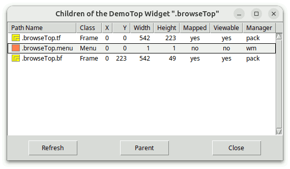
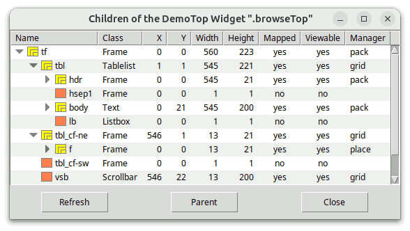
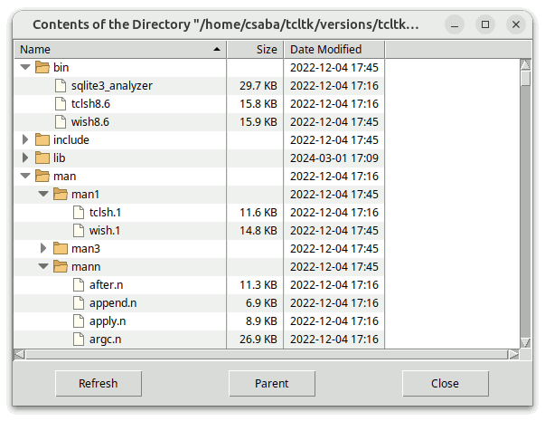
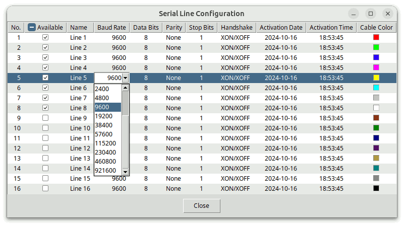
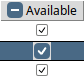
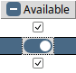

# Tablelist-Programmierhandbuch

## Für Tablelist Version 7.12

### von

## Csaba Nemethi

csaba.nemethi@t-online.de

---

## Inhalt

#### Übersicht

- [Was ist Tablelist?](#was-ist-tablelist)
- [So erhalten Sie es:](#wie-bekomme-ich-es)
- [Wie wird es installiert?](#wie-wird-es-installiert)
- [Anleitung](#wie-wird-es-angewendet)
- [Mehr zu tablelist::scalingpct](#mehr-zu-tablelist-scalingpct)
- [Die Prozedur tablelist::getScalingPct und der Skalierungsfaktor von Tk](#die-prozedur-tablelist-getscalingpct-und-der-skalierungsfaktor-von-tk)
- [Mehr zu tablelist::svgfmt](#weitere-informationen-zu-tablelist-svgfmt)
- [Mehr zu Tablelist_tile](#mehr-zu-tablelist-tile)

#### Beispiele

- [Ein Tablelist-Widget zum Anzeigen und Bearbeiten von Konfigurationsoptionen](#ein-tablelist-widget-zum-anzeigen-und-bearbeiten-von-konfigurationsoptionen)
- [Zwei skalierbare Widget-Browser auf Basis einer Tablelist](#zwei-skalierbare-widget-browser-auf-basis-einer-tablelist)
- [Ein skalierbarer Verzeichnis-Viewer auf Basis einer Tablelist](#ein-skalierbarer-verzeichnis-viewer-auf-basis-einer-tablelist)
- [Verbesserung des Erscheinungsbilds eines Tablelist-Widgets](#das-erscheinungsbild-eines-tablelist-widgets-verbessern)
- [Erweiterte, skalierbare, interaktive Tabellenbearbeitung](#erweiterte-skalierbare-und-interaktive-bearbeitung-von-tabellenzellen)
- [Ein Tablelist-Widget mit skalierbaren eingebetteten Fenstern](#ein-tablelist-widget-mit-skalierbaren-eingebetteten-fenstern)
- [Demo-Skripte auf Tile-Basis](#tile-basierte-demo-skripte)

[Startseite](index.md)

---

## Überblick

### Was ist Tablelist?

Tablelist ist ein Paket für Tcl/Tk ab Version 8.4, das in reinem Tcl/Tk-Code geschrieben ist. Es enthält:

- die Implementierung des [tablelist Megawidget](tablelistWidget.md), einschließlich eines allgemeinen Dienstprogrammmoduls für Megawidgets;
- ein Demo-Skript, das eine nützliche Prozedur enthält, welche die Konfigurationsoptionen eines beliebigen Widgets in einer Tablelist anzeigt und es Ihnen ermöglicht, deren Werte interaktiv zu bearbeiten;
- ein Demo-Skript zur Implementierung eines Widget-Browsers auf Basis einer Tablelist, die als mehrspaltige listbox verwendet wird;
- ein Demo-Skript zur Implementierung eines Widget-Browsers auf Basis einer Tablelist, die als mehrspaltiges Baum-Widget verwendet wird;
- ein Demo-Skript zur Implementierung eines Verzeichnis-Viewers auf Basis einer Tablelist, die als mehrspaltiges Baum-Widget verwendet wird;
- ein Demo-Skript, das verschiedene Möglichkeiten zur Verbesserung der Darstellung eines Tablelist-Widgets zeigt;
- fünf weitere Demo-Skripte, die die interaktive Bearbeitung von Zellen mithilfe verschiedener Widgets aus dem Tk-Kern sowie aus den Paketen „tile“, „BWidget“, „Iwidgets“, „combobox“ (von Bryan Oakley), „mentry“ und „Tsw“ veranschaulichen;
- ein weiteres Demo-Skript mit einem „Tablelist“-Widget, das eingebettete Fenster enthält;
- auf Tile aufbauende Entsprechungen der oben genannten Demo-Skripte;
- dieses Tutorial;
- Referenzseiten im HTML-Format.

Eine „Tablelist“ ist ein mehrspaltiges listbox- und Baum-Widget. Die Breite jeder Spalte kann dynamisch sein (d. h. gerade so breit, dass alle Elemente einschließlich der Kopfzeile Platz finden) oder statisch (in Zeichen oder Pixeln festgelegt).  Die Spalten sind standardmäßig in der Größe anpassbar. Die Ausrichtung jeder Spalte kann als `left`, `right` oder `center` festgelegt werden.

Die Spalten, Zeilen und Zellen lassen sich individuell konfigurieren. Mehrere der globalen und spaltenspezifischen Optionen beziehen sich auf die Kopfzeilen, die als Beschriftungs-Widgets implementiert sind. So legt beispielsweise die Option `-labelcommand` einen Tcl-Befehl fest, der aufgerufen wird, wenn die linke Maustaste über einer Kopfzeilenbeschriftung losgelassen wird.  Der häufigste Wert dieser Option sortiert die Elemente nach der jeweiligen Spalte.

Das „Tablelist“-Paket bietet eine große Auswahl an Baumstilen, mit denen sich das Erscheinungsbild der Spalte, in der die Baumhierarchie angezeigt wird, mithilfe von Einrückungen und Steuerelementen zum Ein- und Ausklappen anpassen lässt.

Die interaktive Bearbeitung der Elemente eines Tablelist-Widgets kann für einzelne Zellen und für ganze Spalten aktiviert werden.  Eine große Vielfalt an Widgets aus dem Tk-Kern sowie aus den Paketen „tile“, „BWidget“, „Iwidgets“, „combobox“, „ctext“ und „Mentry“ (bzw. „Mentry_tile“) wird zur Verwendung als eingebettetes Fenster zur Bearbeitung unterstützt.  Darüber hinaus steht eine umfangreiche Auswahl an Tastatur-Bindungen zur Verfügung, die eine komfortable Navigation zwischen den bearbeitbaren Zellen ermöglichen.

Der Tcl-Befehl für ein Tablelist-Widget ist dem für eine normale listbox sehr ähnlich.  Es gibt spalten-, zeilen- und zellenspezifische Entsprechungen der Unterbefehle `configure` und `cget` (`columnconfigure`, `rowconfigure`, `cellconfigure`, ...).  Sie können unter anderem dazu verwendet werden, Bilder und eingebettete Fenster in die Zellen und die Kopfzeilenbeschriftungen einzufügen.  Die Befehlsoptionen `index`, `nearest` und `see` beziehen sich auf die Zeilen, doch für die Spalten und Zellen stehen ähnliche Unterbefehle zur Verfügung (`columnindex`, `cellindex`, ...).  Die Elemente können mit den Optionen `sort`, `sortbycolumn` und `sortbycolumnlist` sortiert werden.

Durch die für den Hauptteil eines Tablelist-Widgets definierten Bindungen verhält sich dieses genau wie eine normale listbox. Dazu gehört auch die Unterstützung des virtuellen Ereignisses `<<ListboxSelect>>` (das dem Ereignis `<<TablelistSelect>>` entspricht).  Darüber hinaus können Versionen 2.3 oder höher des Widget-Callback-Pakets Wcb (ebenfalls in reinem Tcl/Tk-Code geschrieben) verwendet werden, um Callbacks für die Befehle `activate`,  `selection set` und `selection clear` zu definieren; Wcb-Versionen ab 3.0 unterstützen zudem Rückruffunktionen für die Befehle `activatecell`,  `cellselection set` und `cellselection clear`. Der Download-Ort von Wcb ist

https://www.nemethi.de

### Wie bekomme ich es?

Tablelist steht unter derselben URL wie Wcb zum kostenlosen Download bereit. Die Distributionsdatei lautet `tablelist7.12.tar.gz` für UNIX und `tablelist7_12.zip` für Windows.  Diese Dateien enthalten dieselben Informationen, mit Ausnahme des zusätzlichen Wagenrücklaufzeichens, das in den Textdateien für Windows dem Zeilenvorschub am Ende jeder Zeile vorangestellt ist.

„Tablelist“ ist ebenfalls in „tklib“ enthalten, dessen Adresse lautet

https://core.tcl-lang.org/tklib

### Wie wird es installiert?

Installieren Sie das Paket als Unterverzeichnis eines der Verzeichnisse, die durch die Variable `auto_path` angegeben sind. Sie können es beispielsweise als Unterverzeichnis des Verzeichnisses `lib` innerhalb Ihrer Tcl/Tk-Installation installieren.

Um Tablelist *unter UNIX* zu installieren, kopieren Sie `cd` in das gewünschte Verzeichnis und entpacken Sie die Distributionsdatei `tablelist7.12.tar.gz`:

```
gunzip -c tablelist7.12.tar.gz | tar -xf -
```

Auf den meisten UNIX-Systemen kann dies durch Folgendes ersetzt werden:

```
tar -zxf tablelist7.12.tar.gz
```

Beide Befehle erstellen ein Verzeichnis mit dem Namen `tablelist7.12`, das die Unterverzeichnisse `demos`, `doc` und `scripts` enthält.

*Unter Windows* verwenden Sie WinZip oder ein anderes Programm, mit dem Sie die Distributionsdatei `tablelist7_12.zip` in das Verzeichnis `tablelist7.12` entpacken können, einschließlich der Unterverzeichnisse `demos`, `doc` und `scripts`.

Die Datei `tablelistEdit.tcl` im Verzeichnis `scripts` wird nur für Anwendungen benötigt, die die interaktive Zellbearbeitung nutzen.  Ebenso wird die Datei `tablelistMove.tcl` im selben Verzeichnis nur für Skripte benötigt, die den Befehl `move` oder `movecolumn` aufrufen.  Schließlich wird die Datei `tablelistThemes.tcl` nur für Anwendungen benötigt, die das Paket „Tablelist_tile“ verwenden (siehe nächster Abschnitt).

Beachten Sie, dass in tklib das Verzeichnis „Tablelist `demos`“ durch das Unterverzeichnis `tablelist` des Verzeichnisses `examples` ersetzt wird.  Bitte berücksichtigen Sie dies, wenn Sie die folgenden [Beispiele](#beispiele) lesen.

### Wie wird es angewendet?

Die Tablelist-Distribution enthält zwei Pakete: **Tablelist** und **Tablelist_tile**. Der Hauptunterschied zwischen den beiden besteht darin, dass Tablelist_tile die tilebasierte, themenspezifische Darstellung von Tablelist-Widgets ermöglicht; dieses Paket erfordert Tile 0.6 oder höher.  Es ist nicht möglich, beide Pakete in ein und derselben Anwendung zu verwenden, da beide im selben Namespace `tablelist` implementiert sind und identische Befehle bereitstellen.

Um auf die Befehle und Variablen des Tablelist-Pakets zugreifen zu können, müssen Ihre Skripte eine der folgenden Zeilen enthalten:

```
package require tablelist ?version?
package require Tablelist ?version?
```

Sie können eine der beiden oben genannten Anweisungen verwenden, da die Datei `tablelist.tcl` beide Zeilen enthält.

```
package provide tablelist ...
package provide Tablelist ...
```

Um auf die Befehle und Variablen des Pakets „Tablelist_tile“ zugreifen zu können, müssen Ihre Skripte ebenfalls eine der folgenden Zeilen enthalten:

```
package require tablelist_tile ?version?
package require Tablelist_tile ?version?
```

Auch hier können Sie eine der beiden oben genannten Anweisungen verwenden, da die Datei `tablelist_tile.tcl` beide Zeilen enthält.

```
package provide tablelist_tile ...
package provide Tablelist_tile ...
```

Es steht Ihnen frei, jeweils eine der oben genannten Zeilen aus `tablelist.tcl` bzw. `tablelist_tile.tcl` zu entfernen, wenn Sie verhindern möchten, dass die entsprechenden Pakete jeweils unter zwei verschiedenen Namen erscheinen.  Dadurch beschränken Sie natürlich das Argument von `package require` auf einen einzigen Namen pro Paket.

Da die Pakete „Tablelist“ und „Tablelist_tile“ im Namespace `tablelist` implementiert sind, müssen Sie entweder die

```
namespace import tablelist::pattern ?tablelist::pattern ...?
```

Befehl zum Importieren der benötigten *Prozeduren* oder verwenden Sie qualifizierte Namen wie `tablelist::tablelist`. In den folgenden Beispielen haben wir uns für den letzteren Ansatz entschieden.

Um auf Tablelist-*Variablen* zuzugreifen, *müssen* Sie qualifizierte Namen verwenden. Es gibt nur 6 Tablelist-Variablen (und eine weitere bei Verwendung von Tablelist_tile), die für den Zugriff außerhalb des Namespaces `tablelist` vorgesehen sind:

- Die Variable `tablelist::version` enthält die aktuelle Versionsnummer der Pakete „Tablelist“ und „Tablelist_tile“.
- Die Variable `tablelist::library` enthält den Pfad zum Verzeichnis der Tablelist-Installation.
- Die schreibgeschützte Variable `tablelist::scalingpct` wird beim Laden des Pakets „Tablelist“ oder „Tablelist_tile“ über `package require` auf den Skalierungsprozentsatz gesetzt, der der DPI-Skalierungsstufe des Bildschirms entspricht.  Tablelist passt unter anderem den Standardstil der Sortierpfeile unter X11 und Windows Vista, 7, 8 und 10+ sowie die Größen der Baumstile `vistaAero`, `vistaClassic`, `win7Aero`, `win7Classic` und `win10` an den Wert dieser Variablen an.  Die derzeit unterstützten Werte sind `100`, `125`, `150`, `175` und `200`.  Sie können diese Variable beispielsweise verwenden, wenn Sie je nach DPI-Skalierungsstufe Bilder unterschiedlicher Größe erstellen möchten.  Wenn Ihre Anwendung beispielsweise auf einem nicht skalierten Display Bilder mit der Größe 16 x 16 verwendet und `tablelist::scalingpct` den Wert `150` hat, sollte die Bildgröße für dieses Display 24 x 24 betragen.
- Wenn die Tk-Version entweder mindestens 8.7 (mit integrierter SVG-Unterstützung) ist oder 8.6 und die Erweiterung „tksvg“ in den Interpreter geladen werden kann, dann wird die Variable `tablelist::svgfmt` auf eine Tcl-Liste gesetzt, die Sie an die Befehle übergeben können, die SVG-Bilder erstellen oder bearbeiten, und zwar als Wert ihrer Option `-format`, um sicherzustellen, dass Ihre Bilder korrekt skaliert werden.
- Die boolesche Variable `tablelist::strictTk` (mit dem Wert `0`) steuert die strikte Listbox-Kompatibilität der VORGABEBINDUNGEN.
- Die schreibgeschützte boolesche Variable `tablelist::usingTile` hat im Paket „Tablelist“ den Wert `0` und in „Tablelist_tile“ den Wert `1`.
- In „Tablelist_tile“ enthält das Array `tablelist::themeDefaults` die themenspezifischen Standardwerte für eine Reihe von Tablelist-Konfigurationsoptionen.

### Mehr zu `tablelist::scalingpct`

Der Tablelist-Code setzt die Variable `tablelist::scalingpct` auf den Wert, der von der öffentlichen Prozedur `scaleutil::scalingPercentage` des Pakets „scaleutil“ gegeben wird, das im Lieferumfang von Tablelist enthalten ist. Die Art und Weise, wie dieser Wert berechnet wird, hängt vom Fenstersystem ab:

*Unter Windows und Mac OS X/11+* wird der Skalierungsprozentsatz anhand des von Tk vorgegebenen Skalierungsfaktors `[tk scaling]` berechnet.  HINWEIS: Unter Mac OS X/11+ ist das Ergebnis unabhängig von der Skalierungsstufe des Bildschirms immer `100`. Auf diesem System skaliert die Desktop-Engine alles automatisch nach Bedarf.

*Unter X11* erfolgt die Berechnung des Skalierungsprozentsatzes aus  `[tk scaling]`  nur als Ausweichmethode, da die Implementierung der Bildschirmskalierung stark von der Desktop-Umgebung abhängt und größtenteils Systemressourcen nutzt, die außerhalb von Xlib liegen, auf der Tk basiert.  (Auch herkömmliche X-Anwendungen wie `bitmap` und `xmag` sind davon betroffen.)  Mit der teilweisen Ausnahme von Xfce und MATE (siehe unten) berechnet die Prozedur den Skalierungsprozentsatz anhand des Werts der X-Ressource `Xft.dpi`, indem die Anwendung `xrdb` ausgeführt wird.  Auf GNOME-basierten Systemen, auf denen `xrdb` nicht standardmäßig installiert ist (z. B. Solus GNOME und Solus Budgie), werden stattdessen die Anwendung `xrandr` und die Datei `~/.config/monitors.xml` verwendet.

- Unter *Xfce* kann der Anzeigenskalierungsmodus, der als *Fensterskalierung* bezeichnet wird, auf „1x“ oder „2x“ eingestellt werden und im Dialogfeld *Darstellung* ausgewählt werden. Xfce-Versionen ab 4.16 unterstützen zudem eine fraktionierte Skalierung, deren Parameter im Dialogfeld *Anzeige* konfiguriert werden können.  Wenn der Modus „2x“ ausgewählt wurde, wird der Skalierungsprozentsatz durch die Prozedur `scaleutil::scalingPercentage` bis `200` festgelegt; ansonsten wird er anhand des Werts der Schriftart-DPI berechnet, der durch die X-Ressource `Xft.dpi` vorgegeben wird.  Der Wert der Schriftart-DPI kann auf der Registerkarte *Schriftarten* des Dialogs *Darstellung* oder (unter Linux Lite 5+) über den Dialog *HiDPI-Einstellungen* festgelegt werden.
- Unter *MATE* kann der Anzeigenskalierungsmodus, der als *Fenster-Skalierungsfaktor* bezeichnet wird, auf „Automatische Erkennung“, „Normal“ oder „HiDPI“ eingestellt werden und im Dialogfeld *MATE Tweak* ausgewählt werden.  Der gleiche Effekt lässt sich erzielen, indem Sie im Dialogfeld *Monitor-Einstellungen* einen der möglichen Skalierungswerte „Auto-Detect“, „100 %“ und „200 %“ auswählt.  Wenn Bedarf besteht, erkennt die Prozedur `scaleutil::scalingPercentage` automatisch, welcher der Modi „Normal“ („100 %“) und „HiDPI“ („200 %“) dem voreingestellten Modus „Auto-detect“ („automatische Erkennung“) entspricht.  Wenn der Modus „HiDPI“ („200 %“) vom Benutzer ausgewählt wurde oder von der Prozedur automatisch erkannt wurde, wird der Skalierungsprozentsatz auf `200` gesetzt; andernfalls wird er anhand des Werts der Schriftart-DPI berechnet, der durch die X-Ressource `Xft.dpi` vorgegeben ist.  Der Wert der Schriftart-DPI kann über das Dialogfeld *Font Rendering Details* eingestellt werden, das wiederum über die Registerkarte *Schriftarten* im Dialogfeld *Darstellungseinstellungen* geöffnet werden kann.
- Bei *GNOME unter Xorg, Budgie und Cinnamon in Versionen vor 4.6* kann die Bildschirmskalierung entweder 100 % oder 200 % betragen, und die Prozedur legt den Skalierungsprozentsatz entsprechend auf `100` oder `200` fest.  In neueren GNOME- und Budgie-Versionen unter Ubuntu können Sie `x11-randr-fractional-scaling` als experimentelles Feature aktivieren, wodurch (mindestens) 125 %, 150 % und 175 % zur Liste der unterstützten Skalierungsprozentsätze hinzugefügt werden.  HINWEIS: Aufgrund der Art und Weise, wie diese fraktionierte Skalierung implementiert ist, gibt `scaleutil::scalingPercentage` einen Wert zurück, der unabhängig von der gewählten Bildschirmskalierung `200` lautet.  Cinnamon ab Version 4.6 unterstützt ebenfalls die fraktionierte Skalierung; ist diese aktiviert, lautet der von der Prozedur zurückgegebene Skalierungsprozentsatz `200`, unabhängig von der Auswahl der Bildschirmskalierung.
- *GNOME auf Wayland* unterstützt traditionell die Werte für die Bildschirmskalierung 100 % und 200 %, und der Skalierungsprozentsatz wird entsprechend auf `100` oder `200` festgelegt.  In neueren GNOME-Versionen können Sie die experimentelle Funktion `scale-monitor-framebuffer` aktivieren, die (mindestens) 125 %, 150 % und 175 % zur Liste der unterstützten Skalierungsprozentsätze hinzufügt.  Ist diese Funktion aktiviert, gibt `scaleutil::scalingPercentage` den Wert `100` bei älteren GNOME-Versionen zurück und `200` bei neueren Versionen, unabhängig vom Skalierungsgrad, da in diesem Fall nicht der Fensterinhalt, sondern die Monitor-Framebuffer in einem logischen Pixelkoordinatenraum skaliert werden.
- *KDE Plasma unter Xorg* bietet Unterstützung für die fraktionierte Skalierung. Auf diesem Desktop gibt die Prozedur je nach Skalierungsstufe des Bildschirms `100`, `125`, `150`, `175` oder `200` zurück.
- *KDE Plasma auf Wayland* unterstützt ebenfalls die fraktionelle Skalierung.  In diesem Fall gibt die Prozedur bei älteren KDE-Versionen immer den Wert `100` zurück, unabhängig vom Skalierungsgrad des Bildschirms, während sie bei neueren KDE-Versionen den Wert `100` gibt, `125`, `150`, `175` oder `200`.

Unter GNOME und Budgie lässt sich die Bildschirmskalierung auf der Seite *Bildschirme* des Dialogfelds *Einstellungen* einstellen, der Wert der X-Ressource `Xft.dpi`, die von der Prozedur `scaleutil::scalingPercentage` verwendet wird, kann jedoch auch durch Einstellen des Skalierungsfaktors der Schriftarten über die Anwendung *Tweaks* angepasst werden.  Ebenso lässt sich unter Cinnamon die Bildschirmskalierung auf der Seite *Bildschirm* des Dialogfelds *Systemeinstellungen* einstellen, doch der Wert der X-Ressource `Xft.dpi` kann auch durch Einstellen des Textskalierungsfaktors über die Seite *Schriftartauswahl* des Dialogfelds *Systemeinstellungen* angepasst werden.  Schließlich lässt sich unter KDE Plasma die Bildschirmskalierung auf der Seite *Bildschirmkonfiguration* des Dialogs *Systemeinstellungen* einstellen, und unter KDE Plasma auf Xorg kann der Wert der Schriftart-DPI, der durch die X-Ressource `Xft.dpi` vorgegeben wird, ebenfalls über die Seite *Schriftarten* im Dialog *Systemeinstellungen* eingestellt werden.

Neben der Berechnung des Skalierungsprozentsatzes führt die Prozedur `scaleutil::scalingPercentage` eine Reihe weiterer Aufgaben aus.  Unter anderem ändert es die Standardhöhe der ttk::treeview-Zeilen vom fest codierten Wert von 20 Pixeln auf einen sinnvolleren Wert, basierend auf den Schriftmetriken der vom `Treeview`-Stil verwendeten Schriftart (in der Regel `TkDefaultFont`), und stellt sicher, dass dieser Schritt jedes Mal wiederholt wird, wenn das virtuelle Ereignis `<<ThemeChanged>>` empfangen wird (z. B. weil sich der Wert der Option `-font` des Stils `Treeview` geändert hat), oder das virtuelle Ereignis `<<TkWorldChanged>>` empfangen wird, bei dem das Feld `user_data` (`%d`) auf `FontChanged` gesetzt ist.  Wenn die Tk-Version höher als 8.6.11 oder 8.7a5 ist, wird dieses virtuelle Ereignis von der Tk-Engine an alle Widgets gesendet, wenn eine Schriftart geändert wird, beispielsweise durch den Aufruf von `font configure`  (siehe [TIP 608](https://core.tcl-lang.org/tips/doc/trunk/tip/608.md)).

Die im weiteren Verlauf dieses Abschnitts beschriebenen zusätzlichen Schritte werden nur ausgeführt, wenn der Skalierungsprozentsatz größer ist als `100`.

Unter X11 synchronisiert die Prozedur den von Tk verwendeten Skalierungsfaktor für die Umrechnung zwischen physikalischen Einheiten und Pixeln mit dem Skalierungsprozentsatz, indem sie einen aus letzterem abgeleiteten Wert an den Befehl  `tk scaling`  übergibt.  Während dies in den allermeisten Anwendungen das gewünschte und empfohlene Verhalten ist, kann es Fälle geben, in denen Sie diesen Schritt unterdrücken möchten, da Ihre Anwendung möglicherweise über eine eigene Logik zur Bestimmung des Werts des Skalierungsfaktors von Tk verfügt. Dies können Sie erreichen, indem Sie die Zeile

```
namespace eval ::scaleutil { set keepTkScaling 1 }
```

bevor „Tablelist“ oder „Tablelist_tile“ über `package require` geladen wird.

Die Prozedur `scaleutil::scalingPercentage` korrigiert bei Bedarf auch die Größen der Standardschriften.  Diese Schriftarten (`TkDefaultFont`, `TkTextFont` usw.) sind in der Datei `$tk_library/ttk/fonts.tcl` definiert.  Lange Zeit waren die in dieser Datei angegebenen Schriftarten für X11 in Pixeln angegeben, was für die Verwendung auf HiDPI-Bildschirmen nicht geeignet war.  Dies führte dazu, dass mehrere Linux-Distributionen gepatchte Versionen dieser Datei mitlieferten, in denen die Größenangaben in Pixeln durch Größenangaben in Punkten ersetzt wurden.  Die gleiche Korrektur wurde im Februar 2020 in das Tk-Core-Repository Commit und ist nun in Tk 8.7a5 und späteren Versionen enthalten.  Um sicherzustellen, dass die Schriftgrößen unabhängig von der Tk-Version zum Skalierungsgrad des Bildschirms passen, überprüft die Prozedur diese Bibliotheksdatei und setzt, wenn diese Größen in Pixeln enthalten sind, die Option `-size` der Standardschriften auf entsprechende Größen in Punkten (ohne die Datei zu verändern).  Zudem verdoppelt die Prozedur für den „2x“-Modus unter Xfce die Größen (in Punkten) der Standardschriften (die Funktionsweise der Bildschirmskalierung auf diesem Desktop macht dies erforderlich).

Die Prozedur skaliert außerdem:

- die Standardparameter des Trenngriffs (sash) des Tk-Core-panedwindow;
- die Standardgröße des Tk-Core-Scale-Widgets und seines Schiebereglers;
- die Standardbreite der Tk-Core-Bildlaufleisten unter X11;
- die Standardlänge der Widgets ttk::scale und ttk::progressbar;
- für die eingebauten Themen `alt` und `default` einige Stiloptionen der Widgets ttk::scrollbar, ttk::scale, ttk::progressbar, ttk::combobox, ttk::spinbox, ttk::button, toolbutton, ttk::menubutton, ttk::checkbutton, ttk::radiobutton, ttk::notebook, ttk::panedwindow und ttk::treeview;
- für das eingebaute Thema `clam` einige Stiloptionen der Widgets ttk::scrollbar, ttk::scale, ttk::progressbar, ttk::combobox, ttk::spinbox, ttk::button, toolbutton, ttk::menubutton, ttk::checkbutton, ttk::radiobutton, ttk::notebook, ttk::panedwindow, ttk::treeview und ttk::labelframe;
- für das eingebaute Thema `classic` einige Stiloptionen der Widgets ttk::scrollbar, ttk::scale, ttk::progressbar, ttk::combobox, ttk::spinbox, ttk::button, toolbutton, ttk::menubutton, ttk::checkbutton, ttk::radiobutton, ttk::notebook, ttk::panedwindow und ttk::treeview;
- für das eingebaute Thema `vista` einige Stiloptionen der Widgets ttk::combobox, ttk::button, toolbutton, ttk::menubutton, ttk::checkbutton, ttk::radiobutton, ttk::notebook, ttk::panedwindow und ttk::treeview;
- für das eingebaute Thema `winnative` einige Stiloptionen der Widgets ttk::scale, ttk::progressbar, ttk::combobox, ttk::spinbox, toolbutton, ttk::menubutton, ttk::checkbutton, ttk::radiobutton, ttk::notebook, ttk::panedwindow und ttk::treeview;
- für das eingebaute Thema `xpnative` einige Stiloptionen der Widgets ttk::combobox, ttk::spinbox, ttk::button, toolbutton, ttk::menubutton, ttk::checkbutton, ttk::radiobutton, ttk::notebook, ttk::panedwindow und ttk::treeview.

Darüber hinaus stellt die Prozedur `scaleutil::scalingPercentage` sicher, dass in den Themen `vista` und `xpnative` die Indikatoren der Widgets ttk::checkbutton und ttk::radiobutton korrekt skaliert angezeigt werden, unabhängig von der verwendeten Tk-Version.  (Ein seit Langem bestehender Fehler in der Implementierung dieser Widgets wurde im Mai 2020 behoben und ist nun sowohl in Tk 8.6.11 und höher als auch in 8.7a5 und höher enthalten; die Prozedur bietet jedoch eine automatische Abhilfe für die Tk-Versionen, die noch von diesem Fehler betroffen sind.)

HINWEIS: In Tk-Versionen vor Version 9 sind die Tk-Core-Widgets „checkbutton“ und „radiobutton“ enthalten. sowie die Indikatoren der Widgets „ttk::checkbutton“ und „ttk::radiobutton“ der Themen `alt` und `winnative` nicht skalierbar sind (in Tk 9 und höher werden sie automatisch skaliert).  Das Gleiche gilt für das Widget „ttk::sizegrip“ in den integrierten Themen.

### Die Prozedur `tablelist::getScalingPct` und der Skalierungsfaktor von Tk

Das Paket „Tablelist“ stellt die Hilfsprozedur `tablelist::getScalingPct` bereit, die keine Argumente erwartet und den Skalierungsprozentsatz der Anwendung gibt, der aus dem *aktuellen* Skalierungsfaktor von Tk abgeleitet wird, der durch `[tk scaling]` angegeben wird.  Der Wert, den die Prozedur zurückgibt, ist auf Vielfache von `25` beschränkt, beträgt mindestens `100` und kann größer als `200` sein, insbesondere wenn AndroWish auf einem Tablet oder Smartphone ausgeführt wird.  Tablelist nutzt diese Prozedur, um sicherzustellen, dass die Größen seiner GUI-Komponenten dem aktuellen Skalierungsfaktor von Tk entsprechen (der möglicherweise über `tk scaling` geändert wurde), und es wird empfohlen, dies auch im Anwendungscode zu tun.

Wenn die Tk-Version 9 oder höher ist, ist die im vorherigen Abschnitt beschriebene Funktionalität der Prozedur `scaleutil::scalingPercentage` in den Kern integriert.  Als Teil dieser Funktionalität setzt Tk 9+ die Variable `tk::scalingPct` bei der Initialisierung auf den Skalierungsprozentsatz, der der DPI-Skalierungsstufe des Bildschirms entspricht, und die Prozedur `scaleutil::scalingPercentage` gibt lediglich das Minimum aus dem aktuellen Wert von `tk::scalingPct` und `200` zurück.  Zur Erinnerung: In Tk 9+ wird der Wert der Variablen `tk::scalingPct` automatisch aktualisiert, sobald der Skalierungsfaktor über `tk scaling` geändert wird.  Folglich wird, wenn die Anwendung den Skalierungsfaktor von Tk *vor dem Laden von „Tablelist“ oder „Tablelist_tile“* über `package require` ändert,  wird die Variable `tablelist::scalingpct` auf den kleinsten Wert aus dem automatisch aktualisierten Wert von `tk::scalingPct` und `200` gesetzt.  Diese Tatsachen führen zu Folgendem

**Empfehlung:** Wenn Ihre Anwendung den Skalierungsfaktor von Tk durch den Aufruf von `tk scaling` ändert, sollte dies *vor dem Laden von Tablelist oder Tablelist_tile* geschehen.

### Weitere Informationen zu `tablelist::svgfmt`

Wenn die Tk-Version entweder mindestens 8.7 (mit integrierter SVG-Unterstützung) oder 8.6 ist und das Paket „tksvg“ in den Interpreter geladen werden kann, setzt „Tablelist“ die Variable `tablelist::svgfmt` auf

```
[list svg -scale [expr {[tablelist::getScalingPct] / 100.0}]]
```

Typische Werte sind `{svg -scale 1.0}`, `{svg -scale 1.25}`, `{svg -scale 2.0}` usw.

Es wird empfohlen, den Wert der Variablen `tablelist::svgfmt` an die Befehle `image create photo`, `imageName configure`, `imageName put`  und `imageName read` als Wert für deren Option `-format` zu übergeben, um sicherzustellen, dass deren Größen dem aktuellen Skalierungsprozentsatz der Anwendung entsprechen.

### Mehr zu Tablelist_tile

Ein Tablelist-Widget besteht aus einem Hauptteil (der die Elemente enthält) und einer Kopfzeile (in der die Spaltentitel und optionale Kopfzeilenelemente angezeigt werden). Beide Komponenten sind in einem Rahmen enthalten, der als Frame implementiert ist. Die Kopfzeile weist eine recht komplexe Struktur auf und besteht unter anderem aus Frame- und Label-Widgets.  Während im Tablelist-Paket alle diese Komponenten-Widgets Tk-Widgets sind, verwendet das Tablelist_tile-Paket sowohl Tk- als auch Tile-Frame- und Label-Widgets. Aufgrund mehrerer Inkompatibilitäten zwischen Tk und Tile ist es derzeit nicht möglich, alle Tk-Widgets, aus denen eine Tablelist besteht, durch ihre Tile-Entsprechungen zu ersetzen.

Daraus folgt, dass **das Paket „Tablelist_tile“ nur dann wie erwartet funktioniert, wenn die Tk-Befehle „frame“ und „label“ nicht durch den Befehl  namespace import -force ttk::\*  im globalen Geltungsbereich überschrieben wurden**.  Während in früheren Tile-Versionen empfohlen wurde, diesen Befehl im globalen Geltungsbereich zu verwenden – für die wirklich Abenteuerlustigen –, gilt dies in neueren Tile-Versionen als wirklich schlechte Idee, die zu zahlreichen Fehlfunktionen führt.  Stattdessen **sollten Sie ttk::frame, ttk::label usw. explizit aufrufen, wann immer Sie ein Tile-Widget verwenden möchten**.

**Das Überschreiben einiger anderer Tk-Widgets im globalen Bereich kann ebenso gefährlich sein, wenn verschiedene Widgets aus dem Tk-Kern sowie aus den Paketen BWidget, Iwidgets, combobox (von Bryan Oakley), ctext und Mentry für die interaktive Zellenbearbeitung**, da diese Pakete Tk-Widgets erwarten, die möglicherweise nicht immer durch ihre „Tile“-Entsprechungen ersetzt werden können.

Eine weitere Einschränkung, die zu berücksichtigen ist, ergibt sich daraus, dass in früheren Tile-Versionen der Befehl  `(ttk::)style theme use`  nur zum Festlegen des aktuellen Themas verwendet werden konnte, nicht jedoch zum Abrufen desselben.  Aus diesem Grund greift das Tablelist_tile-Paket, wenn es das aktuelle Thema nicht mithilfe von  `ttk::style theme use`  abrufen kann, auf die Variable `ttk::currentTheme` oder `tile::currentTheme` (je nach Tile-Version), die durch den Befehl `ttk::setTheme` oder `tile::setTheme` gesetzt wird.  Daraus folgt: **Wenn die verwendete Tile-Version den Befehl ttk::style theme use ohne Argument nicht unterstützt, haben die Tile-basierten Tablelist-Widgets nur dann das erwartete Erscheinungsbild, wenn das plattformspezifische Vorgabethema entweder unverändert bleibt oder durch Aufruf der Prozedur ttk::setTheme oder tile::setTheme – je nach Tile-Version – durch ein anderes Thema ersetzt wird**.  (Siehe auch den Befehl `tablelist::setTheme`.)

Nach diesen Hinweisen zur Verwendung von „Tile“ werden im weiteren Verlauf dieses Abschnitts die Unterschiede zwischen den Paketen „Tablelist“ und „Tablelist_tile“ beschrieben.

Das Paket „Tablelist_tile“ überprüft, ob die erforderlichen Tk- und Tile-Versionen vorhanden sind, indem es die folgenden Befehle ausführt:

```
package require Tk 8.4-
if {$::tk_version < 8.5 || [regexp {^8\.5a[1-5]$} $::tk_patchLevel]} {
    package require tile 0.6-
}
```

Der zweite Befehl oben spiegelt die Tatsache wider, dass „Tile“ ab Tk 8.5a6 in den Tk-Kern integriert ist und daher nur bei Verwendung einer früheren Tk-Version explizit geladen werden sollte.

Abgesehen davon und vom Suffix `_tile` im Befehl `package require` besteht der einzige Unterschied (aus Sicht des Programmierers) zwischen den Paketen „Tablelist“ und „Tablelist_tile“ in den unterstützten Konfigurationsoptionen:  `-highlightbackground`, `-highlightcolor`, `-highlightthickness`, `-labelbackground`, `-labelactivebackground`, `-labelactiveforeground`, `-labeldisabledforeground` und `-labelheight` (letztere sowie `-labelbackground` sowohl auf Widget- als auch auf Ebene der Spalten), die im Tablelist-Paket enthalten sind, werden von Tablelist_tile nicht unterstützt.  Die ersten drei sind Standard-Tk-Widget-Optionen, die für Tile-Widgets nicht verfügbar sind.  Die Option `-labelbackground` entspricht der Option `-background` für die Spaltenbeschriftungen, und aktuelle Versionen der Tile-Engine unterstützen keine Einstellung der Hintergrundfarbe für diese Widgets mit einem speziellen Header-Layout.  Die übrigen Optionen entsprechen den Optionen `-activebackground`, `-activeforeground`, `-disabledforeground` und `-height` der Spaltenbeschriftungen, und diese Konfigurationsoptionen werden für Tile-Widgets nicht unterstützt.

Beachten Sie außerdem, dass bei einigen Themen die Einstellung der Option `-labelborderwidth` (auf Widget- oder Spaltenebene) auf einen anderen Wert als den Standardwert von Tile möglicherweise ignoriert wird und somit zu Problemen bei der Ausrichtung führen kann.  Dies liegt daran, dass der Rahmen von Tile-Widgets mit themenspezifischen Methoden gezeichnet wird, die nicht immer zu den aus Tk-Widgets bekannten Ergebnissen führen.

Beachten Sie abschließend, dass wenn das Thema `tileqt` verwendet wird, die Versionsnummer des Pakets `tile::theme::tileqt` mindestens 0.4 betragen muss, und dass `tileqt` selbst nicht mit Tile-Versionen vor 0.7 kompatibel ist.

[Inhalt](#inhalt)     [Startseite](index.md)

---

## Beispiele

### Ein Tablelist-Widget zum Anzeigen und Bearbeiten von Konfigurationsoptionen

Die Datei `config.tcl` im Verzeichnis `demos` enthält eine Prozedur `demo::displayConfig`, die die Konfigurationsoptionen eines beliebigen Widgets in einer Tablelist anzeigt, die in einem neu erstellten Toplevel-Fenster enthalten ist, und es Ihnen ermöglicht, diese Optionen zu bearbeiten. Diese Prozedur kann sich bei der interaktiven GUI-Entwicklung als sehr nützlich erweisen. Um sie zu testen, starten Sie `wish` und führen Sie die Auswertung der Datei mit dem Befehl `source` wie folgt durch:

- Wenn `wish` im Verzeichnis `demos` gestartet wurde, reicht es aus, Folgendes einzugeben:

  ```
  source config.tcl
  ```

- Wenn `wish` in einem anderen Verzeichnis gestartet wurde, können Sie die Variable `tablelist::library` verwenden, um den Speicherort der Datei zu ermitteln.  Angenommen, Ihre Tablelist-Installation weist die im Abschnitt [Wie wird es installiert?](#wie-wird-es-installiert) beschriebene Verzeichnisstruktur auf, lauten die erforderlichen Befehle wie folgt:

  ```
  package require tablelist
  source [file join $tablelist::library demos config.tcl]
  ```


In beiden Fällen gibt das Skript die folgende Meldung in `stdout` aus:

```
To display the configuration options of an arbitrary widget, enter

        demo::displayConfig <widgetName>
```

`<widgetName>` kann der Pfadname eines beliebigen bereits vorhandenen Widgets sein. Wenn Sie beispielsweise Folgendes eingeben:

```
demo::displayConfig .
```

Dann werden Sie sehen, dass ein Tablelist-Widget mit der Bezeichnung `.configTop.tf.tbl` in einem neuen Toplevel-Fenster erstellt wird und dessen Name als `stdout` ausgegeben wird. Wenn Sie dann Folgendes eingeben

```
demo::displayConfig .configTop.tf.tbl
```

Dann erscheint ein weiteres Toplevel-Fenster, das das Tablelist-Widget `.configTop2.tf.tbl` enthält. Letzteres sieht wie in der folgenden Abbildung aus:


Es wird davon ausgegangen, dass der Tcl-Befehl, der dem durch `<widgetName>` angegebenen Widget zugeordnet ist, über einen Unterbefehl `configure` verfügt, der, wenn er ohne Argumente aufgerufen wird, eine Liste gibt, die alle verfügbaren Konfigurationsoptionen für das Widget beschreibt, und zwar in dem von den Standard-Tk-Widgets bekannten Format. Die Prozedur `demo::displayConfig` fügt die Elemente dieser Liste in eine scrollbare Tablelist mit 5 Spalten dynamischer Breite und interaktiver Sortierfunktion ein und gibt den Namen des neu erstellten Tablelist-Widgets zurück:

```
package require tablelist

namespace eval demo {
    #
    # Add some entries to the Tk option database for the following
    # widget hierarchy within a toplevel widget of the class DemoTop:
    #
    # Name              Class
    # -----------------------------
    # tf                Frame
    #   tbl               Tabellist
    #   vsb, hsb          Scrollbar
    # bf                Frame
    #   b1, b2, b3        Button
    #
    if {[tk windowingsystem] eq "x11"} {
        #
        # Create the font TkDefaultFont if not yet present
        #
        catch {font create TkDefaultFont -family Helvetica -size 9}

        option add *DemoTop*Font                        TkDefaultFont
        option add *DemoTop*selectBackground            #5294e2
        option add *DemoTop*selectForeground            white
    }
    option add *DemoTop.tf.borderWidth                  1
    option add *DemoTop.tf.relief                       sunken
    option add *DemoTop.tf.tbl.borderWidth              0
    option add *DemoTop.tf.tbl.highlightThickness       0
    option add *DemoTop.tf.tbl.background               white
    option add *DemoTop.tf.tbl.stripeBackground         #f0f0f0
    option add *DemoTop.tf.tbl*Entry.background         white
    option add *DemoTop.bf.Button.width                 10
}

#------------------------------------------------------------------------------
# demo::displayConfig
#
# Displays the configuration options of the widget w in a tablelist widget
# contained in a newly created toplevel widget.  Returns the name of the
# tablelist widget.
#------------------------------------------------------------------------------
proc demo::displayConfig w {
    if {![winfo exists $w]} {
        bell
        tk_messageBox -title "Error" -icon error -message \
            "Bad window path name \"$w\""
        return ""
    }

    #
    # Create a toplevel widget of the class DemoTop
    #
    set top .configTop
    for {set n 2} {[winfo exists $top]} {incr n} {
        set top .configTop$n
    }
    toplevel $top -class DemoTop
    wm title $top "Configuration Options of the [winfo class $w] Widget \"$w\""

    #
    # Create a scrolled tablelist widget with 5 dynamic-width
    # columns and interactive sort capability within the toplevel
    #
    set tf $top.tf
    frame $tf
    set tbl $tf.tbl
    set vsb $tf.vsb
    set hsb $tf.hsb
    tablelist::tablelist $tbl \
        -columns {0 "Command-Line Name"
                  0 "Database/Alias Name"
                  0 "Database Class"
                  0 "Default Value"
                  0 "Current Value"} \
        -labelcommand tablelist::sortByColumn -sortcommand demo::compareAsSet \
        -editendcommand demo::applyValue -height 15 -width 100 -stretch all \
        -xscrollcommand [list $hsb set] -yscrollcommand [list $vsb set]
    if {[$tbl cget -selectborderwidth] == 0} {
        $tbl configure -spacing 1
    }
    $tbl columnconfigure 3 -maxwidth 30
    $tbl columnconfigure 4 -maxwidth 30 -editable yes
    scrollbar $vsb -orient vertical   -command [list $tbl yview]
    scrollbar $hsb -orient horizontal -command [list $tbl xview]

    #
    # Create three buttons within a frame child of the toplevel widget
    #
    set bf $top.bf
    frame $bf
    set b1 $bf.b1
    set b2 $bf.b2
    set b3 $bf.b3
    button $b1 -text "Refresh"     -command [list demo::putConfig $w $tbl]
    button $b2 -text "Sort as Set" -command [list $tbl sort]
    button $b3 -text "Close"       -command [list destroy $top]

    #
    # Manage the widgets
    #
    grid $tbl -row 0 -rowspan 2 -column 0 -sticky news
    if {[tk windowingsystem] eq "win32"} {
        grid $vsb -row 0 -rowspan 2 -column 1 -sticky ns
    } else {
        grid [$tbl cornerpath] -row 0 -column 1 -sticky ew
        grid $vsb              -row 1 -column 1 -sticky ns
    }
    grid $hsb -row 2 -column 0 -sticky ew
    grid rowconfigure    $tf 1 -weight 1
    grid columnconfigure $tf 0 -weight 1
    pack $b1 $b2 $b3 -side left -expand yes -pady 7p
    pack $bf -side bottom -fill x
    pack $tf -side top -expand yes -fill both

    #
    # Populate the tablelist with the configuration options of the given widget
    #
    putConfig $w $tbl
    return $tbl
}
```

Die Prozedur ruft den Befehl `tablelist::tablelist` auf, um ein Tablelist-Widget zu erstellen. Der an diesen Befehl übergebene Wert der Option `-columns` legt die Breiten, Titel und Ausrichtungen der 5 Spalten fest.  Die Breite jeder Spalte wird als `0` angegeben, was festlegt, dass die Spaltenbreite gerade so groß sein soll, dass alle Elemente der Spalte Platz finden, einschließlich ihres Titels, der als Zeichenfolge auf die Breitenangabe folgt.  Wir haben die Angaben zur Ausrichtung (die optional auf die Titel folgen können) weggelassen, da alle Spalten linksbündig ausgerichtet werden sollen.

Da alle Spalten eine dynamische Breite haben und linksbündig ausgerichtet sind, hätten wir anstelle von `-columns` auch die Option `-columntitles` wie folgt verwenden können:

```
    tablelist::tablelist $tbl \
        -columntitles {"Command-Line Name"
                       "Database/Alias Name"
                       "Database Class"
                       "Default Value"
                       "Current Value"} \
        . . .
```

Der Befehl `tablelist::sortByColumn`, der als Wert der Option `-labelcommand` festgelegt wird, wird immer dann aufgerufen, wenn die Maustaste 1 über einer der Beschriftungen losgelassen wird.  Dieser Befehl sortiert die Elemente anhand der Spalte, die dieser Beschriftung entspricht, in der richtigen Reihenfolge, indem er den Unterbefehl `sortbycolumn` des Tcl-Befehls aufruft, der dem Tablelist-Widget zugeordnet ist.

Wie aus der Erstellung der Schaltfläche mit dem Text  `"Sort as Set"` ersichtlich ist, werden die Elemente auch durch Aufruf des Unterbefehls `sort` sortiert.  Daher muss als Wert der Option `-sortcommand` ein Befehl angegeben werden, der für den Vergleich der Elemente verwendet werden soll. In unserem Beispiel ist dies die unten gezeigte Prozedur `demo::compareAsSet`.

Die Option `-editendcommand` legt den Befehl fest, der automatisch aufgerufen werden soll, sobald die interaktive Bearbeitung des Inhalts einer Zelle abgeschlossen ist und sich der endgültige Inhalt des für die Bearbeitung verwendeten temporären eingebetteten Eingabe-Widgets vom ursprünglichen Inhalt unterscheidet.  Standardmäßig können die Elemente eines „Tablelist“-Widgets nur programmgesteuert bearbeitet werden, doch wir aktivieren die interaktive Bearbeitung für die Zellen der letzten Spalte mithilfe der Konfigurationsoptionen `-editable`.

Indem wir für die Konfigurationsoption `-stretch` den Wert `all` festlegen, stellen wir sicher, dass alle Spalten gestreckt werden, um den Leerraum zu beseitigen, der möglicherweise rechts neben der Tabelle erscheint.

Wenn der Wert der Option `-selectborderwidth` `0` ist (dies ist auf Windows- und Macintosh-Plattformen sowie in einer X11-Umgebung mit Tk 8.5 oder höher der Fall), dann verwenden wir die Option `-spacing`, um oben und unten an den Zeilen etwas zusätzlichen Abstand zu schaffen.

Für die letzten beiden Spalten der Tablelist verwenden wir die Spaltenkonfigurationsoption `-maxwidth`, um sicherzustellen, dass die dynamischen Breiten dieser Spalten 30 Zeichen (Durchschnittsbreite) nicht überschreiten.

Neben den in der Befehlszeile angegebenen Optionen übernimmt unser Tablelist-Widget automatisch die Optionen, die in den Einträgen der Tk-Optionsdatenbank enthalten sind, die bei der Namespace-Initialisierung vor der Prozedur `demo::displayConfig` festgelegt wurden.  Der Datenbankname `stripeBackground` entspricht der Konfigurationsoption `-stripebackground`.  Gemäß diesem Eintrag wird jede zweite Zeile des Tablelist-Widgets in der Hintergrundfarbe `#f0f0f0` angezeigt, was die Lesbarkeit der Einträge verbessert und dem Widget ein ansprechendes Erscheinungsbild verleiht.

Die Einträge in der Datenbank für Optionen für `*DemoTop.tf.borderWidth`, `*DemoTop.tf.relief`, `*DemoTop.tf.tbl.borderWidth` und `*DemoTop.tf.tbl.highlightThickness` werden implizit verwendet, wenn das Tablelist-Widget und die beiden Bildlaufleisten mithilfe von `grid` verwaltet werden.  Beachten Sie, wie der Unterbefehl `cornerpath` es uns ermöglicht, ein natives Look & Feel in Bezug auf die vertikale Bildlaufleiste auf anderen Fenstersystemen als `win32` (d. h. `aqua` und `x11`).

Wir füllen die Tablelist, indem wir die im Folgenden beschriebene Prozedur `demo::putConfig` aufrufen. Das gleiche Skript ist der Schaltfläche „Aktualisieren“ zugeordnet, und zwar als Wert der Konfigurationsoption `-command`. Diese Prozedur ist wie folgt implementiert:

```
#------------------------------------------------------------------------------
# demo::putConfig
#
# Outputs the configuration options of the widget w into the tablelist widget
# tbl.
#------------------------------------------------------------------------------
proc demo::putConfig {w tbl} {
    if {![winfo exists $w]} {
        bell
        tk_messageBox -title "Error" -icon error -message \
            "Bad window path name \"$w\"" -parent [winfo toplevel $tbl]
        return ""
    }

    #
    # Display the configuration options of w in the tablelist widget tbl
    #
    $tbl delete 0 end
    foreach configSet [$w configure] {
        #
        # Insert the list configSet into the tablelist widget
        #
        $tbl insert end $configSet

        if {[llength $configSet] == 2} {
            $tbl rowconfigure end -foreground gray50 -selectforeground gray75
            $tbl cellconfigure end -editable no
        } else {
            #
            # Change the colors of the first and last cell of the row
            # if the current value is different from the default one
            #
            set default [lindex $configSet 3]
            set current [lindex $configSet 4]
            if {$default ne $current} {
                foreach col {0 4} {
                    $tbl cellconfigure end,$col \
                         -foreground red -selectforeground yellow
                }
            }
        }
    }

    $tbl sortbycolumn 0
    $tbl activate 0
    $tbl attrib widget $w
}
```

Nach dem Löschen der aktuellen Elemente des Tabellisten-Widgets `tbl` fügt die Prozedur die Einträge der Liste ein, die vom Unterbefehl `configure` des Tcl-Befehls zurückgegeben wird, der dem Widget `w` zugeordnet ist.  Für jede Option, die lediglich eine abgekürzte Form einer anderen Option ist, verwenden wir den Tablelist-Unterbefehl `rowconfigure`, um die normalen und die Auswahl-Vordergrundfarben des gerade angehängten Eintrags zu ändern, und deaktivieren die interaktive Bearbeitung in der zuletzt eingefügten Zelle mithilfe der Konfigurationsoptionen `-editable`.  Die „tablelist“-Operation `cellconfigure` wird ebenfalls für jede echte Option aufgerufen, deren aktueller Wert vom Standardwert abweicht, um die Werte der Optionen `-foreground` und `-selectforeground` der Zellen Nr. 0 und 4 zu ändern, die den Namen der Option und ihren aktuellen Wert enthalten.

Jedes Tablelist-Widget kann eine beliebige Anzahl privater **Attribute** besitzen, die mithilfe des Unterbefehls `attrib` des dem Widget entsprechenden Tcl-Befehls gesetzt und abgerufen werden können.  Die Prozedur `demo::putConfig` setzt das Attribut `widget` auf den Namen des Widgets, dessen Optionen in der Tablelist angezeigt werden.

Die Implementierung des oben erwähnten Vergleichsbefehls `demo::compareAsSet` ist recht einfach:

```
#------------------------------------------------------------------------------
# demo::compareAsSet
#
# Compares two items of a tablelist widget used to display the configuration
# options of an arbitrary widget.  The item in which the current value is
# different from the default one is considered to be less than the other; if
# both items fulfil this condition or its negation then string comparison is
# applied to the two option names.
#------------------------------------------------------------------------------
proc demo::compareAsSet {item1 item2} {
    foreach {opt1 dbName1 dbClass1 default1 current1} $item1 \
            {opt2 dbName2 dbClass2 default2 current2} $item2 {
        set changed1 [expr {$default1 ne $current1}]
        set changed2 [expr {$default2 ne $current2}]
        if {$changed1 == $changed2} {
            return [string compare $opt1 $opt2]
        } elseif {$changed1} {
            return -1
        } else {
            return 1
        }
    }
}
```

Abschließend folgt hier die Implementierung der Prozedur `demo::applyValue`, die als Wert der Option `-editendcommand` festgelegt ist:

```
#------------------------------------------------------------------------------
# demo::applyValue
#
# Applies the new value of the configuraton option contained in the given row
# of the tablelist widget tbl to the widget whose options are displayed in it,
# and updates the colors of the first and last cell of the row.
#------------------------------------------------------------------------------
proc demo::applyValue {tbl row col text} {
    #
    # Try to apply the new value of the option contained in
    # the given row to the widget whose options are displayed
    # in the tablelist; reject the value if the attempt fails
    #
    set w [$tbl attrib widget]
    set opt [$tbl cellcget $row,0 -text]
    if {[catch {$w configure $opt $text} result] != 0} {
        bell
        tk_messageBox -title "Error" -icon error -message $result \
            -parent [winfo toplevel $tbl]
        $tbl rejectinput
        return ""
    }

    #
    # Replace the new option value with its canonical form and
    # update the colors of the first and last cell of the row
    #
    set text [$w cget $opt]
    set default [$tbl cellcget $row,3 -text]
    if {$default eq $text} {
        foreach col {0 4} {
            $tbl cellconfigure $row,$col \
                 -foreground "" -selectforeground ""
        }
    } else {
        foreach col {0 4} {
            $tbl cellconfigure $row,$col \
                 -foreground red -selectforeground yellow
        }
    }

    return $text
}
```

Die Prozedur ruft den Namen des Widgets ab, dessen Optionen in der Tablelist angezeigt werden, und zwar als Wert seines Attributs `widget`, und ruft den Tablelist-Unterbefehl `cellcget` auf, um den Namen der Option abzurufen, die in der ersten Zelle der Zeile angegeben ist, deren letztes Element gerade bearbeitet wurde.  Anschließend versucht es, den neuen Wert der Option auf das Widget anzuwenden, und ruft den Unterbefehl `rejectinput` auf, wenn der Versuch fehlschlägt.  Andernfalls ersetzt es den neuen Optionswert durch seine kanonische Form und aktualisiert die normalen und die Auswahl-Vordergrundfarben der Zellen Nr. 0 und 4. Die kanonische Form des Optionswerts wird durch den Unterbefehl `cget` des diesem Widget zugeordneten Tcl-Befehls vorgegeben.  Beispielsweise wird ein boolescher Wert immer durch `1` oder `0` ersetzt, selbst wenn die Eingabe die Zeichenfolge `yes` oder `no` enthält. Die Prozedur gibt diesen kanonischen Wert für die Option zurück und stellt so sicher, dass dieser zum neuen Inhalt der soeben bearbeiteten Zelle wird.

### Zwei skalierbare Widget-Browser auf Basis einer Tablelist

Die Dateien `browse.tcl` und `browseTree.tcl` im Verzeichnis `demos` enthalten eine Prozedur `demo::displayChildren`, die Informationen über die untergeordneten Elemente eines beliebigen Widgets in einer Tabelle, das in einem neu erstellten Toplevel-Fenster enthalten ist.  Um dies zu testen, starten Sie `wish` und führen Sie die Auswertung der ausgewählten Datei mit dem Befehl `source` durch, ähnlich wie im Fall des [vorherigen Beispiels](#ein-tablelist-widget-zum-anzeigen-und-bearbeiten-von-konfigurationsoptionen).

Beide Skripte geben die folgende Meldung in `stdout` aus:

```
To display information about the children of an arbitrary widget, enter

        demo::displayChildren <widgetName>
```

`<widgetName>` kann der Pfadname eines beliebigen bereits vorhandenen Widgets sein. Wenn Sie beispielsweise Folgendes eingeben:

```
demo::displayChildren .
```

Dann werden Sie feststellen, dass ein Tablelist-Widget mit der Bezeichnung `.browseTop.tf.tbl` in einem neuen Toplevel-Fenster erstellt wird und dessen Name als `stdout` ausgegeben wird.

Die von der Prozedur `demo::displayChildren` in der Datei `browse.tcl` erstellte Tablelist ist eine mehrspaltige listbox:



Die Tabelle, die von der gleichnamigen Prozedur in der Datei `browseTree.tcl` erstellt wurde, ist ein mehrspaltiges Baum-Widget:



Der Befehl `demo::displayChildren` fügt einige Daten der untergeordneten Elemente des durch `<widgetName>` festgelegten Widgets in eine vertikal scrollbare Tablelist mit 9 Spalten dynamischer Breite und interaktiver Sortierfunktion ein und gibt den Namen des neu erstellten Tablelist-Widgets zurück.  Durch Doppelklick auf ein Element (z. B. der Container, der den Pfadnamen `.browseTop` in `browse.tcl` und den Namen `browseTop` in `browseTree.tcl` enthält) oder durch Aufrufen des ersten Eintrags eines Popup-Menüs im Hauptbereich der Tablelist können Sie die Daten der untergeordneten Elemente des Widgets anzeigen, die dem aktiven Eintrag entsprechen, und mit dem zweiten Menüeintrag können Sie dessen Konfigurationsoptionen anzeigen (Einzelheiten finden Sie im [vorherigen Beispiel](#ein-tablelist-widget-zum-anzeigen-und-bearbeiten-von-konfigurationsoptionen)).  Um eine Ebene höher zu gelangen, klicken Sie auf die Schaltfläche „Übergeordnet“.

Die Skripte `browse.tcl` und `browseTree.tcl` weisen viele gemeinsame Codeabschnitte auf. Wir beschränken uns in der folgenden BESCHREIBUNG auf das zweite Skript.

```
package require tablelist

namespace eval demo {
    variable dir [file dirname [info script]]

    #
    # Create two images corresponding to the display's DPI scaling level
    #
    variable leafImg [image create photo]
    variable compImg [image create photo]
    variable pct ""
    if {$::tk_version >= 8.7 || [catch {package require tksvg}] == 0} {
        variable fmt $::tablelist::svgfmt
        $leafImg read [file join $dir leaf.svg] -format $fmt
        $compImg read [file join $dir comp.svg] -format $fmt
    } else {
        set pct $::tablelist::scalingpct
        $leafImg read [file join $dir leaf$pct.gif] -format gif
        $compImg read [file join $dir comp$pct.gif] -format gif
    } 
}

source [file join $demo::dir config.tcl]
```

Wenn die Tk-Version mindestens 8.7 ist oder das Paket „tksvg“ in den Interpreter geladen werden kann, werden die beiden Bilder, die ein „Compound“-Widget (mit untergeordneten Elementen) und ein „Leaf“-Widget (ohne untergeordnete Elemente) darstellen, unter Verwendung der öffentlichen Variablen `::tablelist::svgfmt` aus den Dateien `comp.svg` bzw. `leaf.svg` erstellt.  Andernfalls werden sie aus Dateien erstellt, deren Namen den DPI-Skalierungsprozentsatz des Bildschirms enthalten, der durch die öffentliche Variable `::tablelist::scalingpct` angegeben wird.  Die Dateien `comp100.gif` und `leaf100.gif` enthalten Bilder der Größe 16 x 14, die Dateien `*125.gif` enthalten Bilder der Größe 20 x 18, die Dateien `*150.gif` enthalten Bilder mit einer Größe von 24 x 21 und so weiter. Im ersten Fall werden nur zwei `*.svg`-Dateien benötigt, und die Bilder werden automatisch skaliert, entsprechend dem tatsächlichen Skalierungsprozentsatz des Displays, der größer sein kann als der Maximalwert `200` der Variablen `::tablelist::scalingpct`.  Dieser Vorteil ist besonders praktisch, wenn AndroWish auf einem Tablet oder Smartphone ausgeführt wird.  Im zweiten Fall werden insgesamt 10 `*.gif` (oder `*.png` oder `*.xbm`) Dateien benötigt, um sicherzustellen, dass die Größen der Bilder dem Wert der Variablen `::tablelist::scalingpct` entsprechen.

```
#------------------------------------------------------------------------------
# demo::displayChildren
#
# Displays information on the children of the widget w in a tablelist widget
# contained in a newly created toplevel widget.  Returns the name of the
# tablelist widget.
#------------------------------------------------------------------------------
proc demo::displayChildren w {
    if {![winfo exists $w]} {
        bell
        tk_messageBox -title "Error" -icon error -message \
            "Bad window path name \"$w\""
        return ""
    }

    #
    # Create a toplevel widget of the class DemoTop
    #
    set top .browseTop
    for {set n 2} {[winfo exists $top]} {incr n} {
        set top .browseTop$n
    }
    toplevel $top -class DemoTop

    #
    # Create a vertically scrolled tablelist widget with 9 dynamic-width
    # columns and interactive sort capability within the toplevel
    #
    set tf $top.tf
    frame $tf
    set tbl $tf.tbl
    set vsb $tf.vsb
    tablelist::tablelist $tbl \
        -columns {0 "Name"      left
                  0 "Class"     left
                  0 "X"         right
                  0 "Y"         right
                  0 "Width"     right
                  0 "Height"    right
                  0 "Mapped"    center
                  0 "Viewable"  center
                  0 "Manager"   left} \
        -expandcommand demo::expandCmd -labelcommand demo::labelCmd \
        -yscrollcommand [list $vsb set] -width 0
    if {[$tbl cget -selectborderwidth] == 0} {
        $tbl configure -spacing 1
    }
    foreach col {2 3 4 5} {
        $tbl columnconfigure $col -sortmode integer
    }
    foreach col {6 7} {
        $tbl columnconfigure $col -formatcommand demo::formatBoolean
    }
    scrollbar $vsb -orient vertical -command [list $tbl yview]

    #
    # On X11 configure the tablelist according
    # to the display's DPI scaling level
    #
    variable winSys                                     ;# see config.tcl
    if {[tk windowingsystem] eq "x11"} {
        variable pct                                    ;# ""|100|125|...|200
        $tbl configure -treestyle bicolor$pct
    }

    #
    # When displaying the information about the children of any
    # ancestor of the label widgets, the widths of some of the
    # labels and thus also the widths and x coordinates of some
    # children may change.  For this reason, make sure the items
    # will be updated after any change in the sizes of the labels
    #
    foreach l [$tbl labels] {
        bind $l <Configure> [list demo::updateItemsDelayed $tbl]
    }
    bind $tbl <Configure> [list demo::updateItemsDelayed $tbl]

    #
    # Create a pop-up menu with two command entries; bind the script
    # associated with its first entry to the <Double-1> event, too
    #
    set menu $top.menu
    menu $menu -tearoff no
    $menu add command -label "Display Children" \
                      -command [list demo::putChildrenOfActiveWidget $tbl]
    $menu add command -label "Display Config" \
                      -command [list demo::dispConfigOfActiveWidget $tbl]
    set bodyTag [$tbl bodytag]
    bind $bodyTag <Double-1>   [list demo::putChildrenOfActiveWidget $tbl]
    bind $bodyTag <<Button3>>  [bind TablelistBody <Button-1>]
    bind $bodyTag <<Button3>> +[bind TablelistBody <ButtonRelease-1>]
    bind $bodyTag <<Button3>> +[list demo::postPopupMenu $top %X %Y]

    #
    # Create three buttons within a frame child of the toplevel widget
    #
    set bf $top.bf
    frame $bf
    set b1 $bf.b1
    set b2 $bf.b2
    set b3 $bf.b3
    button $b1 -text "Refresh"
    button $b2 -text "Parent"
    button $b3 -text "Close" -command [list destroy $top]

    #
    # Manage the widgets
    #
    . . .

    #
    # Populate the tablelist with the data of the given widget's children
    #
    putChildren $w $tbl root
    return $tbl
}
```

Die Prozedur ruft den Befehl `tablelist::tablelist` auf, um ein Tablelist-Widget zu erstellen. Der an diesen Befehl übergebene Wert der Option `-columns` legt die Breiten, Titel und Ausrichtungen der 9 Spalten fest.  Die Breite jeder Spalte wird als `0` angegeben, was festlegt, dass die Breite der Spalte gerade so groß sein soll, dass alle Elemente der Spalte darin Platz finden, einschließlich ihres Titels, der als Zeichenfolge auf die Breitenangabe folgt.  Auf jeden Titel folgt eine Ausrichtung, die angibt, wie sowohl die Elemente als auch der Titel der jeweiligen Spalte ausgerichtet werden sollen.

Wir möchten nicht nur die Daten der untergeordneten Elemente des angegebenen Widgets anzeigen, sondern auch die seiner weiteren Nachkommen. Zu diesem Zweck benötigen wir einen Befehl, der immer dann aufgerufen wird, wenn ein Element, das einem Widget mit untergeordneten Elementen entspricht, erweitert wird. Dieser Befehl wird als Wert der Option `-expandcommand` angegeben.  Wie später erläutert wird, fügt die Prozedur `demo::expandCmd` die untergeordneten Elemente der Zeile ein, die gerade erweitert werden soll, sofern diese noch keine untergeordneten Elemente hat.

Der Befehl `demo::labelCmd`, der als Wert der Option `-labelcommand` festgelegt wird, wird immer dann aufgerufen, wenn die linke Maustaste über einer der Beschriftungen losgelassen wird. Wir werden diese Prozedur später näher erläutern.

Wir legen für die Option `-width` des Widgets den Wert `0` fest, was bedeutet, dass die Breite der Tablelist gerade so groß sein soll, dass alle Spalten darin Platz finden.

Nachdem wir das Tablelist-Widget erstellt haben, stellen wir sicher, dass die Elemente der Spalten 2, 3, 4 und 5 (in denen die x- und y-Koordinaten sowie die Breiten und Höhen der untergeordneten Elemente angezeigt werden) beim Sortieren der Elemente nach einer dieser Spalten als Ganzzahlen verglichen werden.  Dies erreichen wir mithilfe der Tablelist-Operation `columnconfigure`.

Mit demselben Unterbefehl `columnconfigure` können wir festlegen, dass bei der Anzeige der Elemente der Spalten 6 und 7 (mit den Titeln `"Mapped"` bzw. `"Viewable"`, ) die booleschen Werte `1` und `0` durch die Zeichenfolgen `"yes"` und `"no"` ersetzt werden, Der unten gezeigte Befehl `demo::formatBoolean` gibt die folgenden Informationen zurück.

In einer skalierungsfähigen Anwendung sollte der Wert der Tablelistoption `-treestyle` den DPI-Skalierungsgrad des Bildschirms widerspiegeln.  Unter Windows Vista, 7, 8 und 10+ erfüllt der Standardwert dieser Option diese Anforderung bereits, und unter Mac OS X/11+ skaliert die Desktop-Engine alles automatisch nach Bedarf.  Unter X11 setzen wir die Option `-treestyle` bei vorhandener SVG-Unterstützung auf `bicolor` und andernfalls auf einen der Werte `bicolor100`, ..., `bicolor200` (abhängig vom Wert der Variablen `::tablelist::scalingpct`).

Nachdem wir die Option `-treestyle` unter X11 konfiguriert haben, durchlaufen wir die Elemente der Liste, die die Pfadnamen aller Kopfzeilenbeschriftungen des Tablelist-Widgets enthält und vom Unterbefehl `labels` des dem Widget entsprechenden Tcl-Befehls zurückgegeben wird.  Für jedes Element der Liste binden wir die Prozedur `demo::updateItemsDelayed` an das Ereignis `<Configure>`. Auf diese Weise stellen wir sicher, dass die Prozedur immer dann aufgerufen wird, wenn sich die Größe der durch dieses Listenelement angegebenen Kopfzeile ändert.

Die vier Aufrufe des Befehls `bind` im Anschluss an die Erstellung des Pop-up-Menüs verwenden ein Bindungs-Tag, dessen Name vom Pfadnamen des Tablelist-Widgets abhängt und vom Unterbefehl `bodytag` des mit dem Tablelist-Widget verknüpften Tcl-Befehls zurückgegeben wird.  Der Vorteil der Verwendung dieses Tags anstelle des Pfadnamens des Hauptteils der Tablelist besteht darin, dass dieses Bindungs-Tag nicht nur mit dem Hauptteil, sondern auch mit den Trennrahmen und den Beschriftungen, die eingebettete Bilder anzeigen, verknüpft ist.  Dies ist in unserem Beispiel wichtig, da wir sicherstellen möchten, dass die Ereignisse `<<Button3>>` und `<Double-1>` innerhalb einer Beschriftung, die eingebettete Bilder enthält, auf dieselbe Weise behandelt werden wie im restlichen Hauptteil der Tablelist.  Sowohl das virtuelle Ereignis `<<Button3>>` (verwendet in den ersten drei `bind`-Befehlen) als auch das Bindungs-Tag `TablelistBody` (verwendet im ersten Bindungsskript) werden vom Tablelist-Paket erstellt.  Die ersten drei `bind`-Befehle stellen sicher, dass ein virtuelles Ereignis `<<Button3>>` das nächstgelegene Element auswählt und aktiviert und ein Popup-Menü mit zwei Befehlseinträgen anzeigt, die sich auf das durch dieses Element beschriebene Widget beziehen.

Wir füllen die Tablelist, indem wir die Prozedur `demo::putChildren` aufrufen, die wie folgt implementiert ist:

```
#------------------------------------------------------------------------------
# demo::putChildren
#
# Outputs the data of the children of the widget w into the tablelist widget
# tbl, as child items of the one identified by nodeIdx.
#------------------------------------------------------------------------------
proc demo::putChildren {w tbl nodeIdx} {
    . . .

    if {$nodeIdx eq "root"} {
        set top [winfo toplevel $tbl]
        wm title $top "Children of the [winfo class $w] Widget \"$w\""

        $tbl resetsortinfo
        $tbl delete 0 end
        set row 0
    } else {
        set row [expr {$nodeIdx + 1}]
    }

    #
    # Display the data of the children of the
    # widget w in the tablelist widget tbl
    #
    variable leafImg
    variable compImg
    foreach c [winfo children $w] {
        #
        # Insert the data of the current child into the tablelist widget
        #
        set item {}
        lappend item \
                [winfo name $c] [winfo class $c] [winfo x $c] [winfo y $c] \
                [winfo width $c] [winfo height $c] [winfo ismapped $c] \
                [winfo viewable $c] [winfo manager $c]
        $tbl insertchild $nodeIdx end $item

        #
        # Embed an image into the first cell of the row; mark the
        # row as collapsed if the child widget has children itself
        #
        if {[llength [winfo children $c]] == 0} {
            $tbl cellconfigure end,0 -image $leafImg
        } else {
            $tbl cellconfigure end,0 -image $compImg
            $tbl collapse $row
        }

        $tbl rowattrib $row pathName $c
        incr row
    }

    if {$nodeIdx eq "root"} {
        #
        # Configure the "Refresh" and "Parent" buttons
        #
        $top.bf.b1 configure -command [list demo::refreshView $w $tbl]
        set b2 $top.bf.b2
        set p [winfo parent $w]
        if {$p eq ""} {
            $b2 configure -state disabled
        } else {
            $b2 configure -state normal -command \
                [list demo::putChildren $p $tbl root]
        }
    }
}
```

Das letzte Argument dieser Prozedur gibt den Baumknoten an, der zum übergeordneten Knoten der Elemente werden soll, die die Daten der als erstes Argument übergebenen Widget-Kinder anzeigen.  Wenn dieser übergeordnete Knoten der unsichtbare Knoten `root` ist, setzen wir zunächst die Sortierinformationen zurück, indem wir den Unterbefehl `resetsortinfo` für die Tablelist aufrufen, und löschen die aktuellen Elemente des Tablelist-Widgets `tbl`.  Anschließend durchläuft die Prozedur die Kinder des angegebenen Widgets und fügt die Elemente ein, die aus Daten erstellt wurden, die mithilfe des Befehls `winfo` abgerufen wurden.  Jedes neue Element wird mithilfe des Unterbefehls `insertchild(ren)` am Ende der Liste der untergeordneten Elemente des übergeordneten Knotens angefügt.

Für jedes untergeordnete Widget rufen wir die Tablelistoperation `cellconfigure` auf, um den Wert der Option `-image` in der ersten Zelle der entsprechenden Zeile festzulegen, die den Namen des untergeordneten Elements enthält.  Auf diese Weise bettet die Prozedur das Bild `$leafImg` oder `$compImg` in die erste Zelle ein, je nachdem, ob es sich bei dem betreffenden untergeordneten Widget um ein Blatt- oder ein zusammengesetztes Widget handelt.  (Zur Erinnerung: Beide Bilder wurden außerhalb dieser Prozedur im Rahmen der Initialisierung des Namespaces `demo` erstellt.)

Wir kennzeichnen jede neu erstellte Zeile, die einem untergeordneten Widget entspricht, das selbst untergeordnete Elemente hat, als „zusammengeklappt“, indem wir den Unterbefehl `collapse` aufrufen.  Dadurch wird dem Inhalt der ersten Spalte ein Steuerelement zum Ein- und Ausblenden vorangestellt, dessen Spaltenindex `0` dem Standardwert der Konfigurationsoptionen `-treecolumn` entspricht.

Wir verwenden den Unterbefehl `rowattrib` von „tablelist“, um den vollständigen Pfadnamen jedes untergeordneten Widgets als privates Attribut zu speichern, das der entsprechenden Zeile in der Tablelist zugeordnet ist, da dieser später an mehreren Stellen benötigt wird.

Wie oben erwähnt, wird die Prozedur `demo::expandCmd` automatisch aufgerufen, wenn eine Zeile erweitert wird, die ein Steuerelement zum Erweitern/Reduzieren enthält:

```
#------------------------------------------------------------------------------
# demo::expandCmd
#
# Outputs the data of the children of the widget whose leaf name is displayed
# in the first cell of the specified row of the tablelist widget tbl, as child
# items of the one identified by row.
#------------------------------------------------------------------------------
proc demo::expandCmd {tbl row} {
    if {[$tbl childcount $row] == 0} {
        set w [$tbl rowattrib $row pathName]
        putChildren $w $tbl $row

        #
        # Apply the last sorting (if any) to the new items
        #
        $tbl refreshsorting $row
    }
}
```

Die Prozedur ruft den Unterbefehl `childcount` auf, um zu prüfen, ob die untergeordneten Elemente der Zeile, die gerade erweitert werden soll, bereits in das Tablelist-Widget eingefügt wurden, und fügt sie ein, falls dies nicht der Fall ist.  Außerdem stellt es mithilfe des Tablelist-Unterbefehls `refreshsorting` sicher, dass die untergeordneten Elemente in der Reihenfolge angezeigt werden, die der letzten Sortierung (falls vorhanden) entspricht. Eine etwaige Sortierung (falls erforderlich) wird ausschließlich auf die untergeordneten Elemente angewendet, die gerade in das Tablelist-Widget eingefügt wurden.

Die oben erwähnten Prozeduren `demo::formatBoolean` und `demo::labelCmd` sind trivial:

```
#------------------------------------------------------------------------------
# demo::formatBoolean
#
# Returns "yes" or "no", according to the specified boolean value.
#------------------------------------------------------------------------------
proc demo::formatBoolean val {
    return [expr {$val ? "yes" : "no"}]
}

#------------------------------------------------------------------------------
# demo::labelCmd
#
# Sorts the content of the tablelist widget tbl by its col'th column and makes
# sure the items will be updated 500 ms later (because one of the items might
# refer to a canvas containing the arrow that displays the sorting order).
#------------------------------------------------------------------------------
proc demo::labelCmd {tbl col} {
    tablelist::sortByColumn $tbl $col
    updateItemsDelayed $tbl
}
```

Der Befehl `tablelist::sortByColumn` sortiert die Elemente des Tablelist-Widgets nach der angegebenen Spalte in der richtigen Reihenfolge, indem er den Unterbefehl `sortbycolumn` des dem Tablelist-Widget zugeordneten Tcl-Befehls aufruft.

Die Umsetzung des Befehls `demo::updateItemsDelayed`, der in dieser Prozedur aufgerufen wird und bereits in der oben genannten Prozedur `demo::displayChildren` vorkam, ist recht einfach:

```
#------------------------------------------------------------------------------
# demo::updateItemsDelayed
#
# Arranges for the items of the tablelist widget tbl to be updated 500 ms later.
#------------------------------------------------------------------------------
proc demo::updateItemsDelayed tbl {
    #
    # Schedule the demo::updateItems command for execution
    # 500 ms later, but only if it is not yet pending
    #
    if {[$tbl attrib afterId] eq ""} {
        $tbl attrib afterId [after 500 [list demo::updateItems $tbl]]
    }
}

#------------------------------------------------------------------------------
# demo::updateItems
#
# Updates the items of the tablelist widget tbl.
#------------------------------------------------------------------------------
proc demo::updateItems tbl {
    #
    # Reset the tablelist's "afterId" attribute
    #
    $tbl attrib afterId ""

    #
    # Update the items
    #
    set rowCount [$tbl size]
    for {set row 0} {$row < $rowCount} {incr row} {
        set c [$tbl cellcget $row,0 -text]
        if {![winfo exists $c]} {
            continue
        }

        set item {}
        lappend item \
                [winfo name $c] [winfo class $c] [winfo x $c] [winfo y $c] \
                [winfo width $c] [winfo height $c] [winfo ismapped $c] \
                [winfo viewable $c] [winfo manager $c]
        $tbl rowconfigure $row -text $item
    }

    #
    # Repeat the last sort operation (if any)
    #
    $tbl refreshsorting
}
```

Wie bereits im [vorherigen Beispiel](#ein-tablelist-widget-zum-anzeigen-und-bearbeiten-von-konfigurationsoptionen) erwähnt, kann jedes Tablelist-Widget eine beliebige Anzahl privater Attribute besitzen, die mithilfe des Unterbefehls `attrib` des dem Widget entsprechenden Tcl-Befehls gesetzt und abgerufen werden können.  Das Attribut `afterId` wird von der Prozedur `demo::updateItemsDelayed` gesetzt, wenn der Befehl `demo::updateItems` für die Ausführung 500 ms später eingeplant wird, jedoch nur, wenn sein Wert eine leere Zeichenkette ist.  Aus diesem Grund setzt die Prozedur `demo::updateItems` dieses Attribut zurück.  Außerdem nutzt sie den Tablelist-Unterbefehl `cellcget`, um die in der ersten Zelle jeder Zeile enthaltenen Pfadnamen abzurufen, und aktualisiert die Daten der untergeordneten Elemente mithilfe des Unterbefehls `rowconfigure`.  Nach der Aktualisierung der Elemente wiederholt die Prozedur die zuletzt durchgeführte Sortierung nach einer Spalte (wenn vorhanden) mithilfe des Unterbefehls `refreshsorting`.

Die Prozeduren `demo::putChildrenOfActiveWidget`, `demo::dispConfigOfActiveWidget` und `demo::postPopupMenu` (siehe `demo::displayChildren`) sind ebenfalls unkompliziert.  Der unten gezeigte Befehl `demo::putChildrenOfActiveWidget` nutzt beispielsweise den Index der aktiven Zeile `active`, um die aktive Zeile zu identifizieren.

```
#------------------------------------------------------------------------------
# demo::putChildrenOfActiveWidget
#
# Outputs the data of the children of the active widget into the tablelist
# widget tbl.
#------------------------------------------------------------------------------
proc demo::putChildrenOfActiveWidget tbl {
    set w [$tbl rowattrib active pathName]
    if {![winfo exists $w]} {
        bell
        tk_messageBox -title "Error" -icon error -message \
            "Bad window path name \"$w\"" -parent [winfo toplevel $tbl]
        return ""
    }

    if {[llength [winfo children $w]] == 0} {
        bell
    } else {
        putChildren $w $tbl
    }
}
```

Die Prozedur `demo::refreshView`, die der Schaltfläche „Aktualisieren“ zugeordnet ist, ist wie folgt implementiert:

```
#------------------------------------------------------------------------------
# demo::refreshView
#
# Redisplays the data of the children of the widget w in the tablelist widget
# tbl and restores the expanded states of the items as well as the vertical
# view.
#------------------------------------------------------------------------------
proc demo::refreshView {w tbl} {
    #
    # Save the vertical view and get the path names of
    # the child widgets displayed in the expanded rows
    #
    set yView [$tbl yview]
    foreach key [$tbl expandedkeys] {
        set pathName [$tbl rowattrib $key pathName]
        set expandedWidgets($pathName) 1
    }

    #
    # Redisplay the data of the widget's (possibly changed) children and
    # restore the expanded states of the children, along with the vertical view
    #
    putChildren $w $tbl root
    restoreExpandedStates $tbl root expandedWidgets
    $tbl yview moveto [lindex $yView 0]
}
```

Bevor der Inhalt der Tablelist über `demo::putChildren` erneut angezeigt wird, holen wir mithilfe des Tablelist-Unterbefehls `expandedkeys` die vollständigen Schlüssel der aktuell erweiterten Elemente und fügen die entsprechenden Widget-Pfade in das Array `expandedWidgets` ein.  Nachdem die Daten der (möglicherweise geänderten) untergeordneten Elemente des als erstes Argument angegebenen Widgets neu angezeigt wurden, übergeben wir dieses Array an die unten gezeigte Prozedur `demo::restoreExpandedStates`:

```
#------------------------------------------------------------------------------
# restoreExpandedStates
#
# Expands those children of the parent identified by nodeIdx that display the
# data of child widgets whose path names are the names of the elements of the
# array specified by the last argument.
#------------------------------------------------------------------------------
proc demo::restoreExpandedStates {tbl nodeIdx expandedWidgetsName} {
    upvar $expandedWidgetsName expandedWidgets

    foreach key [$tbl childkeys $nodeIdx] {
        set pathName [$tbl rowattrib $key pathName]
        if {[info exists expandedWidgets($pathName)]} {
            $tbl expand $key -partly
            restoreExpandedStates $tbl $key expandedWidgets
        }
    }
}
```

Die Prozedur ruft mithilfe des Unterbefehls `childkeys` die Liste der vollständigen Schlüssel der untergeordneten Knoten des durch `nodeIdx` angegebenen übergeordneten Knotens ab.  Anschließend durchläuft es diese Liste schrittweise und ruft für jeden Schlüssel, dessen entsprechende Zeile zuvor erweitert wurde, den Unterbefehl `expand` der Tablelist auf; anschließend ruft es sich selbst rekursiv auf, um den erweiterten Zustand der untergeordneten Elemente dieser Zeile wiederherzustellen.

### Ein skalierbarer Verzeichnis-Viewer auf Basis einer Tablelist

Das Skript `dirViewer.tcl` im Verzeichnis `demos` zeigt den Inhalt der im System eingebundenen Volumes an (z. B. das Stammverzeichnis `/` unter UNIX und die lokalen Laufwerke unter Windows) in einer Tablelist an, die als mehrspaltiges Baum-Widget verwendet wird:



Durch Doppelklicken auf einen Eintrag oder durch Aufrufen des entsprechenden Menüpunkts im Popup-Menü innerhalb der Tablelist können Sie den Inhalt des Ordners anzeigen, der dem aktiven Eintrag entspricht. Um eine Ebene höher zu gelangen, klicken Sie auf die Schaltfläche „Übergeordneter Ordner“.

Es gibt viele Ähnlichkeiten zwischen diesem Skript und dem im [vorherigen Abschnitt](#zwei-skalierbare-widget-browser-auf-basis-einer-tablelist) behandelten Skript. Im Folgenden werden wir nur einige wenige Prozeduren vorstellen, die Tablelist-Befehle aufrufen, die in den obigen Beispielen nicht vorkommen:

```
package require tablelist

#
# Add some entries to the Tk option database
#
set dir [file dirname [info script]]
source [file join $dir option.tcl]

#
# Create three images corresponding to the display's DPI scaling level
#
if {$tk_version >= 8.7 || [catch {package require tksvg}] == 0} {
    set pct ""; set sfx "svg"; set fmt $tablelist::svgfmt
} else {
    set pct $tablelist::scalingpct; set sfx "gif"; set fmt "gif"
}
foreach name {clsdFolder openFolder file} {
    set imgFile $name$pct.$sfx          ;# e.g., "file.svg" or "file150.gif"
    image create photo ${name}Img -file [file join $dir $imgFile] -format $fmt
}

#
# Helper procedures needed to work around the fact that
# on Android the directory "/" is normally not readable
#
set onAndroid [expr {[info exists ::tk::android] && $::tk::android}]
proc isReadable name {
    return [expr {$::onAndroid && $name eq "/" ? 1 : [file readable $name]}]
}
proc dirContent dir {
    return [expr {$::onAndroid && $dir eq "/" ? [list /sdcard] :
            [glob -nocomplain -types {d f} -directory $dir *]}]
}
```

Wenn die Tk-Version mindestens 8.7 ist oder das Paket „tksvg“ in den Interpreter geladen werden kann, werden die drei Bilder, die jeweils einen geschlossenen Ordner, einen offenen Ordner und eine Datei darstellen, aus den Dateien `clsdFolder.svg`, `openFolder.svg` und `file.svg` unter Verwendung der öffentlichen Variablen `tablelist::svgfmt` erstellt.  Andernfalls werden sie aus Dateien erstellt, deren Namen den DPI-Skalierungsprozentsatz des Bildschirms enthalten, der durch die öffentliche Variable `tablelist::scalingpct` vorgegeben ist.  Die Dateien `clsdFolder100.gif`, `openFolder100.gif` und `file100.gif` enthalten Bilder der Größe 16 × 16, die Dateien `*125.gif` enthalten Bilder mit einer Größe von 20 x 20, die Dateien `*150.gif` enthalten Bilder mit einer Größe von 24 x 24 und so weiter.  Im ersten Fall werden nur drei `*.svg`-Dateien benötigt, und die Bilder werden automatisch skaliert, entsprechend dem tatsächlichen Skalierungsprozentsatz des Displays, der größer sein kann als der Maximalwert `200` der Variablen `tablelist::scalingpct`.  Dieser Vorteil ist besonders praktisch, wenn AndroWish auf einem Tablet oder Smartphone ausgeführt wird.  Im zweiten Fall werden insgesamt 15 `*.gif` (oder `*.png`) Dateien benötigt, um sicherzustellen, dass die Größen der Bilder dem Wert der Variablen `tablelist::scalingpct` entsprechen.

```
#------------------------------------------------------------------------------
# displayContents
#
# Displays the content of the directory dir in a tablelist widget.
#------------------------------------------------------------------------------
proc displayContents dir {
    #
    # Create a scrolled tablelist widget with 3 dynamic-
    # width columns and interactive sort capability
    #
    set tf .tf
    frame $tf -class ScrollArea
    set tbl $tf.tbl
    set vsb $tf.vsb
    set hsb $tf.hsb
    tablelist::tablelist $tbl \
        -columns {0 "Name"          left
                  0 "Size"          right
                  0 "Date Modified" left} \
        -height 16 -width 80 -movablecolumns no -showseparators yes \
        -expandcommand expandCmd -xscrollcommand [list $hsb set] \
        -yscrollcommand [list $vsb set]
    if {[$tbl cget -selectborderwidth] == 0} {
        $tbl configure -spacing 1
    }
    $tbl columnconfigure 0 -formatcommand formatString -sortmode dictionary
    $tbl columnconfigure 1 -formatcommand formatSize -sortmode integer
    $tbl columnconfigure 2 -formatcommand formatString
    scrollbar $vsb -orient vertical   -command [list $tbl yview]
    scrollbar $hsb -orient horizontal -command [list $tbl xview]

    #
    # On X11 configure the tablelist according
    # to the display's DPI scaling level
    #
    if {[tk windowingsystem] eq "x11"} {
        global pct                                      ;# ""|100|125|...|200
        $tbl configure -treestyle bicolor$pct
    }

    bind $tbl <<TablelistYViewChanged>> [list addImages $tbl]

    . . .

    #
    # Populate the tablelist with the content of the given directory
    #
    $tbl sortbycolumn 0
    putContents $dir $tbl root
}
```

Die Prozedur `displayContents` erstellt das Tablelist-Widget und die beiden Bildlaufleisten als untergeordnete Elemente eines Frames der Klasse `ScrollArea`.  Für diese Klasse enthält die Datei `option.tcl`, die in das Hauptskript `source`d eingebunden ist, einige Einstellungen zum Look & Feel, die denen in unserem [ersten Beispiel](#ein-tablelist-widget-zum-anzeigen-und-bearbeiten-von-konfigurationsoptionen) ähneln:

```
option add *ScrollArea.borderWidth                      1
option add *ScrollArea.relief                           sunken
option add *ScrollArea.Tablelist.borderWidth            0
option add *ScrollArea.Tablelist.highlightThickness     0
```

In einer skalierungsfähigen Anwendung sollte der Wert der Tablelistoption `-treestyle` den DPI-Skalierungsgrad des Bildschirms widerspiegeln.  Unter Windows Vista, 7, 8 und 10+ erfüllt der Standardwert dieser Option diese Anforderung bereits, und unter Mac OS X/11+ skaliert die Desktop-Engine alles automatisch nach Bedarf.  Unter X11 setzen wir die Option `-treestyle` bei vorhandener SVG-Unterstützung auf `bicolor` und andernfalls auf einen der Werte `bicolor100`, ..., `bicolor200` (abhängig vom Wert der Variablen `tablelist::scalingpct`).

Immer wenn sich die vertikale Ansicht im Fenster der Tablelist ändert, erhält das Widget ein virtuelles Ereignis vom Typ `<<TablelistYViewChanged>>`. Unsere Bindung für dieses Ereignis ruft die Prozedur `addImages` auf, die wir gegen Ende dieses Abschnitts vorstellen und erläutern.

Schauen wir uns einmal an, wie das Skript die Tablelist mit dem Inhalt des angegebenen Verzeichnisses füllt:

```
#------------------------------------------------------------------------------
# putContents
#
# Outputs the content of the directory dir into the tablelist widget tbl, as
# child items of the one identified by nodeIdx.
#------------------------------------------------------------------------------
proc putContents {dir tbl nodeIdx} {
    . . .

    if {$nodeIdx eq "root"} {
        if {$dir eq ""} {
            if {[llength [file volumes]] == 1} {
                wm title . "Contents of the File System"
            } else {
                wm title . "Contents of the File Systems"
            }
        } else {
            wm title . "Contents of the Directory \"[file nativename $dir]\""
        }

        $tbl delete 0 end
        set row 0
    } else {
        set row [expr {$nodeIdx + 1}]
    }

    #
    # Build a list from the data of the subdirectories and
    # files of the directory dir.  Prepend a "D" or "F" to
    # each entry's name and modification date & time, for
    # sorting purposes (it will be removed by formatString).
    #
    set itemList {}
    if {$dir eq ""} {
        foreach volume [file volumes] {
            lappend itemList [list D[file nativename $volume] -1 D $volume]
        }
    } else {
        foreach entry [dirContent $dir] {
            if {[catch {file mtime $entry} modTime] != 0} {
                continue
            }

            if {[file isdirectory $entry]} {
                lappend itemList [list D[file tail $entry] -1 \
                    D[clock format $modTime -format "%Y-%m-%d %H:%M"] $entry]
            } else {
                lappend itemList [list F[file tail $entry] [file size $entry] \
                    F[clock format $modTime -format "%Y-%m-%d %H:%M"] ""]
            }
        }
    }

    #
    # Sort the above list and insert it into the tablelist widget
    # tbl as list of children of the row identified by nodeIdx
    #
    set itemList [$tbl applysorting $itemList]
    $tbl insertchildlist $nodeIdx end $itemList

    foreach item $itemList {
        set name [lindex $item end]
        if {$name ne ""} {                                      ;# directory
            $tbl rowattrib $row pathName $name

            #
            # Mark the row as collapsed if the directory is non-empty
            #
            if {[isReadable $name] && [llength [dirContent $name]] != 0} {
                $tbl collapse $row
            }
        }

        incr row
    }

    . . .
}
```

Der Hauptunterschied zwischen der oben beschriebenen Prozedur `putContents` und der im [vorherigen Abschnitt]](#zwei-skalierbare-widget-browser-auf-basis-einer-tablelist) beschriebenen Prozedur `demo::putChildren` betrifft die Art und Weise, wie untergeordnete Elemente in das Tablelist-Widget eingefügt werden.  Anstatt sie einzeln mit Hilfe des Tablelist-Unterbefehls `insertchild(ren)` einzufügen, fügen wir hier die entsprechenden Daten zu einer Liste von Elementen hinzu und rufen dann den wesentlich leistungsfähigeren Unterbefehl `insertchildlist` auf.  Anstatt die Elemente zunächst einzufügen und sie dann über `refreshsorting` zu sortieren, führen wir außerdem zunächst die erforderlichen Sortierungen an der oben genannten Liste von Elementen durch, indem wir den Unterbefehl `applysorting` aufrufen.  Auch dies ist wesentlich schneller als das Sortieren der bereits eingefügten untergeordneten Elemente.

Diese Prozedur veranschaulicht zudem eine effektive Technik, die auf der Spaltenkonfigurationsoption `-formatcommand` basiert:  In der internen Liste des Tablelist-Widgets werden den Namen und Änderungszeiten der Verzeichnisse und Dateien jeweils ein `D` bzw. `F` vorangestellt.  Dadurch wird sichergestellt, dass die Verzeichnisse vor den Dateien sortiert werden (bei aufsteigender Sortierung). Bei der Anzeige der Elemente ruft der Tablelist-Code automatisch die Prozedur `formatString` auf, die das erste Zeichen entfernt.  Ebenso wird in der internen Liste des Widgets die Größe eines Verzeichnisses auf `-1` gesetzt, wodurch es vor den Größen der Dateien sortiert wird. Die Prozedur `formatSize`, die bei der Anzeige der Elemente automatisch aufgerufen wird, ersetzt diesen Wert durch eine leere Zeichenkette:

```
#------------------------------------------------------------------------------
# formatString
#
# Returns the substring obtained from the specified value by removing its first
# character.
#------------------------------------------------------------------------------
proc formatString val {
    return [string range $val 1 end]
}

#------------------------------------------------------------------------------
# formatSize
#
# Returns an empty string if the specified value is negative and the value
# itself in user-friendly format otherwise.
#------------------------------------------------------------------------------
proc formatSize val {
    if {$val < 0} {
        return ""
    } elseif {$val < 1024} {
        return "$val bytes"
    } elseif {$val < 1048576} {
        return [format "%.1f KB" [expr {$val / 1024.0}]]
    } elseif {$val < 1073741824} {
        return [format "%.1f MB" [expr {$val / 1048576.0}]]
    } else {
        return [format "%.1f GB" [expr {$val / 1073741824.0}]]
    }
}

#------------------------------------------------------------------------------
# expandCmd
#
# Outputs the content of the directory whose leaf name is displayed in the
# first cell of the specified row of the tablelist widget tbl, as child items
# of the one identified by row.
#------------------------------------------------------------------------------
proc expandCmd {tbl row} {
    if {[$tbl childcount $row] == 0} {
        set dir [$tbl rowattrib $row pathName]
        putContents $dir $tbl $row
    }
}

#------------------------------------------------------------------------------
# addImages
#
# Embeds an image into the first cell of each row in the current view.
#------------------------------------------------------------------------------
proc addImages tbl {
    set topRow [$tbl index top]
    set btmRow [$tbl index bottom]
    for {set row $topRow} {$row <= $btmRow} {incr row} {
        if {[$tbl hasrowattrib $row pathName]} {        ;# directory item
            set img [expr {[$tbl isexpanded $row] ?
                    "openFolderImg" : "clsdFolderImg"}]
        } else {                                        ;# file item
            set img fileImg
        }
        $tbl cellconfigure $row,0 -image $img
    }
}

. . .

displayContents ""
```

Wie bereits erwähnt, wird die Prozedur `addImages` immer dann aufgerufen, wenn sich die vertikale Ansicht im Fenster der Tablelist ändert. Sie fügt in die erste Zelle jeder Zeile der aktuellen Ansicht ein Bild ein, das einen geöffneten oder geschlossenen Ordner bzw. eine Datei darstellt.  Anders als im vorherigen Beispiel fügen wir hier die Bilder nur zu den Elementen hinzu, die in der aktuellen Ansicht enthalten sind, und sparen so erheblich Zeit und Speicherplatz.

Die letzte Zeile des Skripts ruft die Prozedur `displayContents` mit einer leeren Zeichenkette als Argument auf, d. h., sie zeigt die auf dem System eingebundenen Volumes an.

### Das Erscheinungsbild eines Tablelist-Widgets verbessern

Das Skript `styles.tcl` im Verzeichnis `demos` veranschaulicht einige Möglichkeiten, wie Sie Tablelist-Widgets intelligenter gestalten und die Lesbarkeit ihrer Einträge verbessern kann. Es erstellt 8 Tablelist-Widgets, die in der folgenden Abbildung dargestellt sind:


Hier ist der entsprechende Codeausschnitt:

```
#
# Create, configure, and populate 8 tablelist widgets
#
frame .f
for {set n 0} { $n < 8} {incr n} {
    set tbl .f.tbl$n
    tablelist::tablelist $tbl \
        -columntitles {"Label 0" "Label 1" "Label 2" "Label 3"} \
        -background white -height 4 -width 40 -stretch all
    if {[$tbl cget -selectborderwidth] == 0} {
        $tbl configure -spacing 1
    }

    switch $n {
        1 {
            $tbl configure -showseparators yes
        }
        2 {
            $tbl configure -stripebackground #f0f0f0
        }
        3 {
            $tbl configure -stripebackground #f0f0f0 -showseparators yes
        }
        4 {
            $tbl columnconfigure 1 -background LightYellow
            $tbl columnconfigure 3 -background LightCyan
        }
        5 {
            $tbl configure -showseparators yes
            $tbl columnconfigure 1 -background LightYellow
            $tbl columnconfigure 3 -background LightCyan
        }
        6 {
            $tbl configure -stripebackground #f0f0f0
            $tbl columnconfigure 1 -background LightYellow \
                -stripebackground #f0f0d2
            $tbl columnconfigure 3 -background LightCyan \
                -stripebackground #d2f0f0
        }
        7 {
            $tbl configure -stripebackground #f0f0f0 -showseparators yes
            $tbl columnconfigure 1 -background LightYellow \
                -stripebackground #f0f0d2
            $tbl columnconfigure 3 -background LightCyan \
                -stripebackground #d2f0f0
        }
    }

    foreach row {0 1 2 3} {
        $tbl insert end \
             [list "Cell $row,0" "Cell $row,1" "Cell $row,2" "Cell $row,3"]
    }
}
```

Die einzige Konfigurationsoption, die hier verwendet wird, aber in den ersten drei Beispielen nicht behandelt wurde (obwohl sie bereits im [vorherigen Beispiel](#ein-skalierbarer-verzeichnis-viewer-auf-basis-einer-tablelist) vorkam), ist `-showseparators`.  Der dadurch erzielte visuelle Effekt sieht sowohl für sich allein als auch in Kombination mit horizontalen oder vertikalen Streifen ansprechend aus, die mithilfe der Option `-stripebackground` bzw. des Unterbefehls `columnconfigure` erzeugt werden.

### Erweiterte, skalierbare und interaktive Bearbeitung von Tabellenzellen

Die Skripte `tileWidgets.tcl`, `bwidget.tcl`, `iwidgets.tcl`, sowie `miscWidgets.tcl` im Verzeichnis `demos` erstellen ein Tablelist-Widget, das einige Parameter von 16 seriellen Leitungen anzeigt, und veranschaulichen die Verwendung verschiedener Widgets aus dem Tk-Kern sowie aus den Paketen „tile“, BWidget, Iwidgets, combobox (von Bryan Oakley), ctext und Mentry (oder Mentry_tile) für die interaktive Bearbeitung von Zellen.  Die folgende Abbildung zeigt das Tablelist-Widget zusammen mit einer BWidget-ComboBox, die zur Bearbeitung des Inhalts einer seiner Zellen verwendet wird:


Hier ist der relevante Codeausschnitt aus dem Skript `bwidget.tcl` (die Skripte `tileWidgets.tcl`, `iwidgets.tcl` und `miscWidgets.tcl` sind ähnlich).  Einige Teile des Codes sind in der Farbe „[red]{.red}“ dargestellt – darauf werden wir gegen Ende dieses Abschnitts noch einmal zurückkommen.

```
package require tablelist
package require BWidget

wm title . "Serial Line Configuration"

#
# Add some entries to the Tk option database
#
set dir [file dirname [info script]]
source [file join $dir option.tcl]
option add *Tablelist*Entry.background white

#
# Create the images "checkedImg" and "uncheckedImg", as well as 16 images of
# names like "img#FF0000", displaying colors identified by names like "red"
#
source [file join $dir images.tcl]

#
# Register some widgets from the BWidget package for interactive cell editing
#
tablelist::addBWidgetEntry
tablelist::addBWidgetSpinBox
tablelist::addBWidgetComboBox

#
# Create a tablelist widget with editable columns (except the first one)
#
set tbl .tbl
tablelist::tablelist $tbl \
    -columns {0 "No."             right
              0 "Available"       center
              0 "Name"            left
              0 "Baud Rate"       right
              0 "Data Bits"       center
              0 "Parity"          left
              0 "Stop Bits"       center
              0 "Handshake"       left
              0 "Activation Date" center
              0 "Activation Time" center
              0 "Cable Color"     center} \
    -editstartcommand editStartCmd -editendcommand editEndCmd \
    -aftercopycommand afterCopyCmd -height 0 -width 0
if {[$tbl cget -selectborderwidth] == 0} {
    $tbl configure -spacing 1
}
$tbl columnconfigure 0 -sortmode integer
$tbl columnconfigure 1 -name available -editable yes -editwindow checkbutton \
    -formatcommand emptyStr -labelwindow checkbutton
$tbl columnconfigure 2 -name lineName  -editable yes -editwindow Entry \
    -allowduplicates 0 -sortmode dictionary
$tbl columnconfigure 3 -name baudRate  -editable yes -editwindow ComboBox \
    -sortmode integer
$tbl columnconfigure 4 -name dataBits  -editable yes -editwindow SpinBox
$tbl columnconfigure 5 -name parity    -editable yes -editwindow ComboBox
$tbl columnconfigure 6 -name stopBits  -editable yes -editwindow ComboBox
$tbl columnconfigure 7 -name handshake -editable yes -editwindow ComboBox
$tbl columnconfigure 8 -name actDate   -editable yes -editwindow Entry \
    -formatcommand formatDate -sortmode integer
$tbl columnconfigure 9 -name actTime   -editable yes -editwindow Entry \
    -formatcommand formatTime -sortmode integer
$tbl columnconfigure 10 -name color    -editable yes -editwindow menubutton \
    -formatcommand emptyStr

proc emptyStr   val { return "" }
proc formatDate val { return [clock format $val -format "%Y-%m-%d"] }
proc formatTime val { return [clock format $val -format "%H:%M:%S"] }

#
# Populate the tablelist widget and configure the checkbutton
# embedded into the header label of the column "available"
#
source [file join $dir serialParams.tcl]

. . .
```

Die Größe der Bilder, die in der Datei `images.tcl` erstellt werden – die im Hauptskript als „`source`d“ bezeichnet wird –, hängt vom Skalierungsgrad des Bildschirms ab.  Beispiel:

```
if {$tk_version >= 8.7 || [catch {package require tksvg}] == 0} {
    set fmt $tablelist::svgfmt
    image create photo checkedImg   -file [file join $dir checked.svg] \
        -format $fmt
    image create photo uncheckedImg -file [file join $dir unchecked.svg] \
        -format $fmt
} else {
    set pct $tablelist::scalingpct
    image create photo checkedImg   -file [file join $dir checked$pct.gif] \
        -format gif
    image create photo uncheckedImg -file [file join $dir unchecked$pct.gif] \
        -format gif
}
```

Wir rufen die Befehle `tablelist::addBWidgetEntry`, `tablelist::addBWidgetSpinBox` und `tablelist::addBWidgetComboBox` auf, um die Widgets „Entry“, „SpinBox“ und „ComboBox“ aus dem BWidget-Paket für die interaktive Zellbearbeitung zu registrieren.  Diese Befehle geben die Werte `"Entry"`, `"SpinBox"` und `"ComboBox"` zurück, die wir anschließend in der Konfigurationsoption `-editwindow` verwenden, um das Bearbeitungsfenster für die Spalten Nr. 2, …, 10 festzulegen.  In den Spalten Nr. 1 und 10 verwenden wir die Tk-Core-Widgets „checkbutton“ und „menubutton“, die automatisch für die interaktive Zellbearbeitung registriert werden.

Beachten Sie die Verwendung der Konfigurationsoption `-name`, die es uns ermöglicht, auf die Spalten anhand ihrer Namen statt anhand numerischer Spaltenindizes zuzugreifen.  Dies ist wichtig, da die Datei `option.tcl`, die im Hauptskript als „`source`d“ bezeichnet wird, die folgende Zeile enthält:

```
option add *Tablelist.movableColumns    yes
```

Die unten aufgeführten Prozeduren `editStartCmd` und `editEndCmd` verwenden den Unterbefehl `columncget`, um den Namen der Spalte anhand des numerischen Spaltenindex abzurufen.

Übrigens sind in der Datei `option.tcl` zwei weitere Optionen für die Datenbank enthalten:

```
option add *Tablelist.labelCommand      tablelist::sortByColumn
option add *Tablelist.labelCommand2     tablelist::addToSortColumns
```

Die in diesen Einstellungen festgelegten Befehle `tablelist::sortByColumn` und `tablelist::addToSortColumns` ermöglichen es dem Benutzer, die Elemente mithilfe der linken Maustaste und der Taste `Shift` nach einer oder mehreren Spalten zu sortieren.

Beachten Sie außerdem, dass wir die Option `-allowduplicates` der Spalte, die die Namen der seriellen Leitungen enthält, auf „false“ gesetzt haben, um sicherzustellen, dass diese Namen bei der interaktiven Bearbeitung eindeutig bleiben.

Die Datei `serialParams.tcl`, die im Hauptskript als „`source`d“ bezeichnet wird, enthält den folgenden Code, der sich hauptsächlich auf die Einstellung `-labelwindow checkbutton` für Spalte Nr. 1 sowie die Konfigurationsoption `-aftercopycommand`:

```
#
# Populate the tablelist widget; set the activation
# date & time to 10 minutes past the current clock value
#
set clock [expr {[clock seconds] + 600}]
for {set row 0; set line 1} {$row < 16} {set row $line; incr line} {
    $tbl insert end [list $line [expr {$row < 8}] "Line $line" 9600 8 None 1 \
                     XON/XOFF $clock $clock [lindex $colorNames $row]]

    set availImg [expr {($row < 8) ? "checkedImg" : "uncheckedImg"}]
    $tbl cellconfigure $row,available -image $availImg
    $tbl cellconfigure $row,color -image img[lindex $colorValues $row]
}

#
# Configure the "-command" option of the checkbutton embedded into the
# header label of the column "available", and make sure that it will be
# reconfigured whenever any column is moved interactively to a new position
#
proc configCkbtn {tbl col} {
    set ckbtn [$tbl labelwindowpath $col]
    $ckbtn configure -command [list onCkbtnToggle $tbl $col $ckbtn]
}
proc onCkbtnToggle {tbl col ckbtn} {
    upvar #0 [$ckbtn cget -variable] var
    $tbl fillcolumn $col -text $var
    $tbl fillcolumn $col -image [expr {$var ? "checkedImg" : "uncheckedImg"}]
}
configCkbtn $tbl available
bind $tbl <<TablelistColumnMoved>> { configCkbtn %W available }
bind $tbl <<ThemeChanged>>         { configCkbtn %W available }

#
# Make sure that the checkbutton will appear in tri-state mode
#
set ckbtn [$tbl labelwindowpath available]
set varName [$ckbtn cget -variable]
if {[winfo class $ckbtn] eq "Checkbutton"} {
    set $varName ""
} else {
    unset $varName
}

#
# Selects/deselects the checkbutton embedded into the header label
# of the specified column or sets it into the tri-state mode.
#
proc updateHdrCkbtn {tbl col} {
    set lst [$tbl getcolumns $col]
    set ckbtn [$tbl labelwindowpath $col]
    upvar #0 [$ckbtn cget -variable] var

    if {[lsearch -exact $lst 1] < 0} {                  ;# all 0
        set var 0                                       ;# deselect
    } elseif {[lsearch -exact $lst 0] < 0} {            ;# all 1
        set var 1                                       ;# select
    } elseif {[winfo class $ckbtn] eq "Checkbutton"} {
        set var ""                                      ;# tri-state mode
    } else {
        unset -nocomplain var                           ;# tri-state mode
    }
}

#
# For the columns "available" and "color", updates
# the images contained in the column's cells.
#
proc afterCopyCmd {tbl col} {
    switch [$tbl columncget $col -name] {
        available {
            #
            # Update the images contained in the column's cells and
            # the checkbutton embedded into the column's header label
            #
            for {set row 0} {$row < 16} {incr row} {
                set text [$tbl cellcget $row,$col -text]
                set img [expr {$text ? "checkedImg" : "uncheckedImg"}]
                $tbl cellconfigure $row,$col -image $img
            }
            updateHdrCkbtn $tbl $col
        }

        color {
            #
            # Update the images contained in the column's cells
            #
            for {set row 0} {$row < 16} {incr row} {
                set text [$tbl cellcget $row,$col -text]
                $tbl cellconfigure $row,$col -image img$::colors($text)
            }
        }
    }
}
```

Zu der oben genannten Prozedur `configCkbtn` siehe ANMERKUNG 2 in der BESCHREIBUNG der Konfigurationsoptionen `-labelwindow`.

Die Prozedur `editStartCmd`, die als Wert der Konfigurationsoption `-editstartcommand` festgelegt wird, benötigt den Pfadnamen des Bearbeitungsfensters, um das Widget auf verschiedene Weise konfigurieren zu können.  Dies ist ein häufiger Fall, und Tablelist stellt zu diesem Zweck den Unterbefehl `editwinpath` bereit:

```
#------------------------------------------------------------------------------
# editStartCmd
#
# Applies some configuration options to the edit window; if the latter is a
# ComboBox, the procedure populates it.
#------------------------------------------------------------------------------
proc editStartCmd {tbl row col text} {
    set w [$tbl editwinpath]

    switch [$tbl columncget $col -name] {
        lineName {
            #
            # Set an upper limit of 20 for the number of characters
            #
            $w configure -invalidcommand bell -validate key \
                         -validatecommand {expr {[string length %P] <= 20}}
        }

        baudRate {
            #
            # Populate the ComboBox and allow no more
            # than 6 digits in its Entry component
            #
            $w configure -values {50 75 110 300 1200 2400 4800 9600 19200 38400
                                  57600 115200 230400 460800 921600}
            $w configure -invalidcommand bell -validate key -validatecommand \
                {expr {[string length %P] <= 6 && [regexp {^[0-9]*$} %S]}}
        }

        dataBits {
            #
            # Configure the SpinBox
            #
            $w configure -range {5 8 1} -editable no
        }

        parity {
            #
            # Populate the ComboBox and make it non-editable
            #
            $w configure -values {None Even Odd Mark Space} -editable no
        }

        . . .

        color {
            #
            # Populate the menu and make sure the menubutton will display the
            # color name rather than $text, which is "", due to -formatcommand
            #
            set menu [$w cget -menu]
            foreach name $::colorNames {
                $menu add radiobutton -compound left \
                    -image img$::colors($name) -label $name
            }
            $menu entryconfigure 8 -columnbreak 1
            return [$tbl cellcget $row,$col -text]
        }
    }

    return $text
}
```

Die Prozedur `editEndCmd`, die als Wert der Konfigurationsoption `-editendcommand` festgelegt wird, ist für eine abschließende Validierung des Textes im Bearbeitungsfenster zuständig.  Ein weiterer Zweck dieses Befehls besteht darin, den im Bearbeitungsfenster enthaltenen Text in den neuen *internen* Inhalt der Zelle umzuwandeln, was notwendig ist, da der interne Wert des Aktivierungsdatums und der Aktivierungszeit ein Zeitwert in Sekunden ist:

```
#------------------------------------------------------------------------------
# editEndCmd
#
# Performs a final validation of the text contained in the edit window and gets
# the cell's internal content.
#------------------------------------------------------------------------------
proc editEndCmd {tbl row col text} {
    switch [$tbl columncget $col -name] {
        available {
            #
            # Update the image contained in the cell and the checkbutton
            # embedded into the header label of the column "available"
            #
            set img [expr {$text ? "checkedImg" : "uncheckedImg"}]
            $tbl cellconfigure $row,$col -image $img
            after idle [list updateHdrCkbtn $tbl $col]
        }

        baudRate {
            #
            # Check whether the baud rate is an integer in the range 50..921600
            #
            if {![regexp {^[0-9]+$} $text] || $text < 50 || $text > 921600} {
                bell
                tk_messageBox -title "Error" -icon error -message \
                    "The baud rate must be an integer in the range 50..921600"
                $tbl rejectinput
            }
        }

        actDate {
            #
            # Get the activation date in seconds from the last argument
            #
            if {[catch {clock scan $text} actDate] != 0} {
                bell
                tk_messageBox -title "Error" -icon error -message "Invalid date"
                $tbl rejectinput
                return ""
            }

            #
            # Check whether the activation clock value is later than the
            # current one; if this is the case then make sure the cells
            # "actDate" and "actTime" will have the same internal value
            #
            set actTime [$tbl cellcget $row,actTime -text]
            set actClock [clock scan [formatTime $actTime] -base $actDate]
            if {$actClock <= [clock seconds]} {
                bell
                tk_messageBox -title "Error" -icon error -message \
                    "The activation date & time must be in the future"
                $tbl rejectinput
            } else {
                $tbl cellconfigure $row,actTime -text $actClock
                return $actClock
            }
        }

        . . .

        color {
            #
            # Update the image contained in the cell
            #
            $tbl cellconfigure $row,$col -image img$::colors($text)
        }
    }

    return $text
}
```

Anstatt die Spalte „Verfügbar“ über ein *temporäres* checkbutton bearbeitbar zu machen und die Bilder `"checkedImg"` und `"uncheckedImg"` in ihren Zellen anzuzeigen, können wir den Unterbefehl `embedcheckbuttons` verwenden, um die Spalten mit *dauerhaft* eingebetteten checkbuttons zu füllen. Die erforderlichen Änderungen lauten wie folgt:

- Entfernen Sie die Teile des obigen Codes, die in der Farbe „[red]{.red}“ dargestellt sind.
- Führen Sie die Prozedur `ckbtnCmd` wie folgt aus:

  ```
  proc ckbtnCmd {tbl row col} { return [updateHdrCkbtn $tbl $col] }
  ```

- Nachdem Sie das „tablelist“-Widget gefüllt haben, rufen Sie Folgendes auf:

  ```
  $tbl embedcheckbuttons 1 ckbtnCmd
  ```

- Fügen Sie anstelle der beiden gelöschten Zeilen der Prozedur `onCkbtnToggle` die folgende Schleife ein:

  ```
      for {set row 0} {$row < 16} {incr row} {
          set ckbtn2 [$tbl windowpath $row,available].ckbtn
          set [$ckbtn2 cget -variable] $var
      }
  ```


Wie oben erwähnt, ähneln die Skripte `tileWidgets.tcl`, `iwidgets.tcl` und `miscWidgets.tcl` dem Skript `bwidget.tcl`.  Das erste Skript nutzt die Widgets „Tile-Entry“, „Spinbox“, „Combobox“, „Checkbutton“ und „Menubutton“.  Das zweite Skript verwendet (neben dem checkbutton und dem Menubutton aus dem Tk-Kern) die Widgets „entryfield“, „spinint“, „combobox“, „dateentry“ und „timeentry“ aus dem Iwidgets-Paket sowie die für diese Bibliothek spezifischen Validierungsfunktionen.  Das dritte Skript nutzt die Widgets „entry“, „spinbox“, „checkbutton“ und „menubutton“ aus dem Tk-Kern, Bryan Oakleys „combobox“ sowie die „mentry“-Widgets vom Typ `"Date"` und `"Time"`, und führt die Validierung der Eingaben mit Hilfe des Wcb-Pakets durch (das ohnehin für die Mentry-Bibliothek erforderlich ist).

### Ein Tablelist-Widget mit skalierbaren eingebetteten Fenstern

Das Skript `embeddedWindows.tcl` im Verzeichnis `demos` erstellt ein Tablelist-Widget, dessen Elemente den Skripten der Tk-Bibliothek entsprechen.  Die Größe jeder Datei (in Byte) wird nicht nur als Zahl angezeigt, sondern auch mithilfe eines Rahmens mit rotem Hintergrund veranschaulicht, der als untergeordnetes Element eines eingebetteten Rahmens mit elfenbeinfarbenem Hintergrund erstellt wird. Die Dateien können durch Klicken auf die entsprechenden eingebetteten Widgets angezeigt werden.

Der folgende Screenshot zeigt das Tablelist-Widget, wobei sich der Mauszeiger über der ersten Kopfzeile befindet, wodurch diese Kopfzeile im Zustand `active` angezeigt wird:


Zunächst erstellen wir das „tablelist“-Widget und füllen es mit Daten:

```
package require tablelist

wm title . "Tk Library Scripts"

#
# Add some entries to the Tk option database
#
set dir [file dirname [info script]]
source [file join $dir option.tcl]

#
# Create the font TkFixedFont if not yet present
#
catch {font create TkFixedFont -family Courier -size 9}

#
# Create an image corresponding to the display's DPI scaling
# level, to be displayed in buttons embedded in a tablelist widget
#
if {$tk_version >= 8.7 || [catch {package require tksvg}] == 0} {
    set fmt $tablelist::svgfmt
    image create photo viewImg -file [file join $dir view.svg] -format $fmt
} else {
    set pct $tablelist::scalingpct
    image create photo viewImg -file [file join $dir view$pct.gif] -format gif
}

#
# Create a vertically scrolled tablelist widget with 5
# dynamic-width columns and interactive sort capability
#
set tf .tf
frame $tf -class ScrollArea
set tbl $tf.tbl
set vsb $tf.vsb
tablelist::tablelist $tbl \
    -columns {0 "File Name" left
              0 "Bar Chart" center
              0 "File Size" right
              0 "View"      center
              0 "Seen"      center} \
    -yscrollcommand [list $vsb set] -width 0
if {[$tbl cget -selectborderwidth] == 0} {
    $tbl configure -spacing 1
}
$tbl columnconfigure 0 -name fileName
$tbl columnconfigure 1 -formatcommand emptyStr -sortmode integer \
    -stretchwindow yes
$tbl columnconfigure 2 -name fileSize -sortmode integer
$tbl columnconfigure 4 -name seen
scrollbar $vsb -orient vertical -command [list $tbl yview]

proc emptyStr val { return "" }

#
# Create a bold font
#
set tblFont [$tbl cget -font]
set size [font actual $tblFont -size]
if {$size == 0} {                                       ;# e.g., on Ubuntu
    set size 9
}
eval font create BoldFont [font actual $tblFont] -size $size -weight bold

#
# Populate the tablelist widget
#
cd $tk_library
set totalSize 0
set maxSize 0
foreach fileName [lsort [glob *.tcl]] {
    set fileSize [file size $fileName]
    $tbl insert end [list $fileName $fileSize $fileSize "" no]

    incr totalSize $fileSize
    if {$fileSize > $maxSize} {
        set maxSize $fileSize
    }
}
if {$tk_version >= 8.5} {
    $tbl header insert 0 [list "[$tbl size] *.tcl files" "" $totalSize "" ""]
    $tbl header rowconfigure 0 -foreground blue
}
```

Das Bild, das die Aktion „Anzeigen“ darstellt, wird entweder aus der Datei `view.svg` oder aus einer GIF-Bilddatei erstellt, deren Name den DPI-Skalierungsprozentsatz des Bildschirms enthält, der durch die öffentliche Variable `tablelist::scalingpct` vorgegeben ist.

Wir fügen die Größe jeder Datei nicht nur in die Spalte mit dem Titel  `"File Size"`,  sondern auch in die Spalte  `"Bar Chart"` ein.  Da wir diese Spalte mit `-formatcommand emptyStr` konfiguriert haben, bleibt der Text darin verborgen. Er wird jedoch benötigt, wenn die Einträge nach dieser Spalte sortiert werden.

Nachdem wir den Hauptteil der Tablelist gefüllt haben, erstellen wir ein Kopfzeilenelement, das die Gesamtanzahl und die Größe der Dateien der Bibliothek anzeigt, indem wir den Unterbefehl  `header insert`  aufrufen, und ändern dessen Farbe mithilfe des Unterbefehls  `header rowconfigure` .

Um die eingebetteten Fenster erstellen zu können, müssen wir zunächst die entsprechenden Erstellungsskripte implementieren, wie in der BESCHREIBUNG der Konfigurationsoptionen `-window` angegeben. Hier ist das Skript, das einen Rahmen erstellt, der in die Spalten mit dem Balkendiagramm eingebettet werden soll:

```
#------------------------------------------------------------------------------
# createFrame
#
# Creates a frame widget w to be embedded into the specified cell of the
# tablelist widget tbl, as well as a child frame representing the size of the
# file whose name is diplayed in the first column of the cell's row.
#------------------------------------------------------------------------------
proc createFrame {tbl row col w} {
    #
    # Create the frame and replace the binding tag "Frame"
    # with "TablelistBody" in the list of its binding tags
    #
    set height [expr {[font metrics $::tblFont -linespace] * 9 / 10}]
    frame $w -width 72p -height $height -background ivory -borderwidth 1 \
             -relief solid
    bindtags $w [lreplace [bindtags $w] 1 1 TablelistBody]

    #
    # Create the child frame and replace the binding tag "Frame"
    # with "TablelistBody" in the list of its binding tags
    #
    frame $w.f -background red -borderwidth 1 -relief raised
    bindtags $w.f [lreplace [bindtags $w] 1 1 TablelistBody]

    #
    # Manage the child frame
    #
    set fileSize [$tbl cellcget $row,fileSize -text]
    place $w.f -relheight 1.0 -relwidth [expr {double($fileSize) / $::maxSize}]
}
```

Beachten Sie, dass wir die Werte der Optionen `-width` und `-height` für den Rahmen skalierungsbewusst festlegen.

Da der Frame in den Hauptbereich der Tablelist eingebettet wird, möchten wir, dass Mausereignisse im Frame und in dessen untergeordneten Frames genauso behandelt werden wie im restlichen Hauptbereich der Tablelist.  Zu diesem Zweck ersetzen wir das Bindungs-Tag `Frame` (das ohnehin keine eigenen Bindungen enthält) durch `TablelistBody` und stellen so sicher, dass die diesem Tag zugeordneten Standard-Bindungsskripte auch für den übergeordneten Frame und dessen untergeordneten Frame gültig sind.

Den roten untergeordneten Rahmen platzieren wir mit `place` in seinem Elternrahmen, und zwar mit den Optionen `-relheight` und `-relwidth`, damit er die Fläche innerhalb des Rahmens seines Elternteils vertikal ausfüllt und seine Breite beim Ändern der Größe des Elternrahmens proportional zur Größe der zugehörigen Datei bleibt (das geschieht beim Ändern der Spaltenbreite, wie unten zu sehen).

Das Skript zur Erstellung der Schaltflächen, mit denen die Dateien der Tk-Bibliothek angezeigt werden können, ist recht einfach:

```
#------------------------------------------------------------------------------
# createButton
#
# Creates a button widget w to be embedded into the specified cell of the
# tablelist widget tbl.
#------------------------------------------------------------------------------
proc createButton {tbl row col w} {
    set key [$tbl getkeys $row]
    button $w -image viewImg -highlightthickness 0 -takefocus 0 \
              -command [list viewFile $tbl $key]
}

#------------------------------------------------------------------------------
# viewFile
#
# Displays the content of the file whose name is contained in the row with the
# given key of the tablelist widget tbl.
#------------------------------------------------------------------------------
proc viewFile {tbl key} {
    set top .top$key
    if {[winfo exists $top]} {
        raise $top
        focus $top
        return ""
    }

    toplevel $top
    set fileName [$tbl cellcget k$key,fileName -text]
    wm title $top "File \"$fileName\""

    #
    # Create a vertically scrolled text widget as a grandchild of the toplevel
    #
    set tf $top.tf
    frame $tf -class ScrollArea
    set txt $tf.txt
    set vsb $tf.vsb
    text $txt -background white -font TkFixedFont \
              -yscrollcommand [list $vsb set]
    catch {$txt configure -tabstyle wordprocessor}
    scrollbar $vsb -orient vertical -command [list $txt yview]

    #
    # Insert the file's content into the text widget
    #
    set chan [open $fileName]
    $txt insert end [read -nonewline $chan]
    close $chan

    . . .

    #
    # Mark the file as seen
    #
    $tbl rowconfigure k$key -font BoldFont
    $tbl cellconfigure k$key,seen -text yes
}
```

Jede Datei wird in einem Text-Widget angezeigt, das sich in einem Toplevel-Fenster mit dem Namen `.top$key` befindet, wobei `$key` mithilfe des Unterbefehls `getkeys` ermittelt wird.  Durch die Verwendung des Schlüssels anstelle der Zeilennummer erhalten wir einen eindeutigen Namen für das Toplevel-Fenster, selbst wenn sich die Reihenfolge der Elemente aufgrund einer interaktiven Sortierung nach einer Spalte ändert. (Beachten Sie, dass die eingebetteten Fenster beim Sortieren der Elemente oder beim Verschieben der Spalten gelöscht und automatisch neu erstellt werden.)

Nachdem wir die Skripte zum Erstellen der Rahmen und Schaltflächen implementiert haben, können wir nun den Unterbefehl `cellconfigure` verwenden, um diese Widgets effektiv als eingebettete Fenster zu erstellen:

```
#
# Create embedded windows in the columns no. 1 and 3
#
set rowCount [$tbl size]
for {set row 0} {$row < $rowCount} {incr row} {
    $tbl cellconfigure $row,1 -window createFrame
    $tbl cellconfigure $row,3 -window createButton
}
```

Tatsächlich erzielt das Skript dasselbe Ergebnis mit weniger Code, indem es den etwas effizienteren Unterbefehl `fillcolumn` verwendet:

```
#
# Create embedded windows in the columns no. 1 and 3
#
$tbl fillcolumn 1 -window createFrame
$tbl fillcolumn 3 -window createButton
```

Beachten Sie, dass aufgrund der Einstellung  `-stretchwindow yes`  für Spalte Nr. 1 die Breite der eingebetteten Rahmen an die Breite der Spalte angepasst wird, wenn deren Größe interaktiv geändert wird.

### Tile-basierte Demo-Skripte

Die Tablelist-Distribution enthält auch tilebasierte Entsprechungen der oben besprochenen Demo-Skripte. Wie im Abschnitt [Mehr zu Tablelist_tile](#mehr-zu-tablelist-tile) dieses Tutorials beschrieben, ist es recht einfach, eine Anwendung, die das Tablelist-Paket verwendet, auf eine auf Tablelist_tile basierende Anwendung zu portieren.  Schauen wir uns zum Beispiel an, wie Sie das Demo-Skript `bwidget.tcl` in ein tilebasiertes Skript namens `bwidget_tile.tcl` durch eine Transformation umwandelt. Die Änderungen sind unten in der Farbe [red]{.red} dargestellt:

Zunächst ersetzen wir die Startlinie

```
package require tablelist
```

mit

```
package require tablelist_tile
```

und der Befehl

```
source [file join $dir option.tcl]
```

mit

```
source [file join $dir option_tile.tcl]
```

Um sicherzustellen, dass das Gesamterscheinungsbild der Benutzeroberfläche dem aktuell verwendeten Thema entspricht, erstellen wir einen Themen-spezifischen Container für unsere Widgets:

```
#
# Improve the window's appearance by using a tile
# frame as a container for the other widgets
#
set f [ttk::frame .f]
```

Das bedeutet, dass wir die Anweisung ersetzen müssen

```
set tbl .tbl
```

Festlegen des Pfadnamens unseres Tablelist-Widgets mit

```
set tbl $f.tbl
```

Ebenso könnten Sie anstelle einer mit dem Befehl erstellten Tk-Schaltfläche

```
set btn [button .btn -text "Close" -command exit]
```

Wir verwenden eine Tile-Schaltfläche, die ein untergeordnetes Element des oben genannten Tile-Rahmens ist:

```
set btn [ttk::button $f.btn -text "Close" -command exit]
```

Wir verwalten diesen Frame wie gewohnt:

```
pack $f -expand yes -fill both
```

Das Skript `option_tile.tcl` ist nahezu identisch mit `option.tcl`.  Sein tilespezifischer Teil verwendet die Werte, die der Befehl `tablelist::setThemeDefaults` in das Array `tablelist::themeDefaults` schreibt, um sicherzustellen, dass die Body-Elemente mit Streifen angezeigt werden, und in `X11` erhält die Auswahl in allen von der Anwendung erstellten Widgets das gleiche themenspezifische Erscheinungsbild:

```
set currentTheme [tablelist::getCurrentTheme]
if {$tablelist::themeDefaults(-stripebackground) eq "" &&
    $currentTheme ne "black"} {
    option add *Tablelist.background            white
    option add *Tablelist.stripeBackground      #f0f0f0
}
if {[tk windowingsystem] eq "x11"} {
    option add *Font              TkDefaultFont
    option add *selectBackground  $tablelist::themeDefaults(-selectbackground)
    option add *selectForeground  $tablelist::themeDefaults(-selectforeground)
}
option add *selectBorderWidth     $tablelist::themeDefaults(-selectborderwidth)
```

Das Demo-Skript `tileWidgets.tcl` nutzt nicht nur das Paket „Tablelist_tile“ zur Erstellung eines Tablelist-Widgets mit einem modernen, themenspezifischen Erscheinungsbild, sondern auch die Widgets „Tile Entry“, „Spinbox“, „Combobox“, „Checkbutton“ und „Menubutoon“ für die interaktive Bearbeitung von Zellen.  Das resultierende Fenster hat ein ansprechendes, themenspezifisches Erscheinungsbild:



Das Skript `tileWidgets.tcl` beginnt damit, das Thema `default` unter X11 bei Bedarf anzupassen, indem es die öffentliche Prozedur `themepatch::patch` des Pakets „themepatch“ aufruft, das im Lieferumfang von Tablelist enthalten ist (im Gegensatz zum Paket „scaleutil“ wird es jedoch nicht vom Tablelist-Code verwendet und muss daher explizit über `package require themepatch` geladen werden):

```
if {[tk windowingsystem] eq "x11" &&
    ($::tk_version < 8.7 || [package vcompare $::tk_patchLevel "8.7a5"] <= 0)} {
    #
    # Patch the default theme's styles TCheckbutton and TRadiobutton
    #
    package require themepatch
    themepatch::patch default
}
```

Aufgrund dieses (optionalen) Schritts haben die skalierungsfähigen ttk::checkbutton-Widgets, die in der Spalte „Verfügbar“ verwendet werden, ein modernes Erscheinungsbild und Verhalten, genau wie die der Themen `aqua` und `vista`:



Das Demo-Skript `tileWidgets2.tcl` unterscheidet sich von `tileWidgets.tcl` vor allem dadurch, dass es das Widget ttk::toggleswitch oder tsw::toggleswitch anstelle von ttk::checkbutton verwendet, um die Elemente der Spalte „Verfügbar“ zu bearbeiten.  (Das Widget ttk::toggleswitch wurde in Tk 9.1a1 zum Kern hinzugefügt.)  Hier ist der entsprechende Code:

```
if {[llength [info commands ::ttk::toggleswitch]] == 1} {
    set tglswEditWin ttk::toggleswitch
} else {
    #
    # Register the tsw::toggleswitch widget for interactive cell editing
    #
    package require tsw
    tablelist::addToggleswitch
    set tglswEditWin toggleswitch
}

. . .

$tbl columnconfigure 1 -name available -editable yes -editwindow $tglswEditWin \
    -formatcommand emptyStr -labelwindow ttk::checkbutton
```



Außerdem weist in `tileWidgets2.tcl` das Widget ttk::spinbox, das zur Bearbeitung der Elemente der Spalte „Data Bits“ verwendet wird, den Stil `Wide.TSpinbox` statt `TSpinbox` auf:

```
catch {package require wsb}

. . .

proc editStartCmd {tbl row col text} {
    set w [$tbl editwinpath]

    switch [$tbl columncget $col -name] {

        . . .

        dataBits {
            #
            # Configure the spinbox
            #
            $w configure -style Wide.TSpinbox -from 5 -to 8 -state readonly
        }
```

Das kleine **w**ide **s**pin**b**ox-Paket „wsb“ ist im Lieferumfang der Tablelist-Distribution enthalten, und der Versuch, es über  `package require wsb`  zu laden, ist erfolgreich, wenn die Tk-Version entweder mindestens 8.7 (mit integrierter SVG-Unterstützung) oder 8.6 ist und die Erweiterung „tksvg“ in den Interpreter geladen werden kann.  Wenn es geladen ist, erstellt das wsb-Paket automatisch das Layout `Wide.TSpinbox`.  Andernfalls hat die Einstellung  `-style Wide.TSpinbox`  für ein ttk::spinbox-Widget keine Wirkung.

Der Hauptvorteil des Layouts `Wide.TSpinbox` gegenüber dem Stil `TSpinbox` liegt in der benutzerfreundlichen Größe und Anordnung der skalierungsabhängigen Auf- und Ab-Pfeile, was sich insbesondere bei der Nutzung von AndroWish auf einem Tablet oder Smartphone als nützlich erweist:


Die tilebasierte Version des Demo-Skripts `embeddedWindows.tcl` enthält etwas mehr Änderungen, von denen die meisten jedoch nicht spezifisch für Tablelist sind.  Einzelheiten finden Sie in der Datei `embeddedWindows_tile.tcl` im Verzeichnis `demos`.  Hier ist ein Screenshot des resultierenden Fensters:


Beachten Sie abschließend, dass die folgenden tilebasierten Demo-Skripte *vollständige* Unterstützung für den Dark-Mode-Modus unter macOS 10.14 (Mojave) und höher mit Tk 8.6.10 oder höher sowie für die Themen `awdark`, `awlight` sowie die sechs weiteren Themen, die im plattformübergreifenden Paket [awthemes](https://sourceforge.net/projects/tcl-awthemes/) 10.3 oder höher von Brad Lanam] enthalten sind: `browse_tile.tcl`, `browseTree_tile.tcl`, `config_tile.tcl`, `dirViewer_tile.tcl`, `embeddedWindows_tile.tcl`, `tileWidgets.tcl` und `tileWidgets2.tcl`.  Zwar ist die Unterstützung für den Aqua-Dark-Mode bereits seit Version 8.6.10 in Tk vorhanden, doch für ein optimales Benutzererlebnis auf dem Mac wird empfohlen, diese Skripte mit Tk 8.6.11 oder höher auszuführen, da in Tk 8.6.11 einige Verbesserungen hinsichtlich der Darstellung vorgenommen wurden.

[Inhalt](#inhalt)     [Startseite](index.md)
