# Der Befehl `tablelist::tablelist`

## Für Tablelist Version 7.12

### von

## Csaba Nemethi

csaba.nemethi@t-online.de

---

## Inhalt

- [Kurzanleitung](#kurzreferenz)
- [Ausführliche Referenz](#ausf-hrliche-referenz)

[Startseite](index.md)

---

## Kurzreferenz

[NAME](#ausf-hrliche-referenz)
: `tablelist::tablelist` – Tablelist-Widgets erstellen und bearbeiten

[ÜBERSICHT](#ausf-hrliche-referenz)
: 

```
tablelist::tablelist pathName ?options?
```

[STANDARDOPTIONEN](#ausf-hrliche-referenz)
: 

```
-borderwidth          -highlightthickness  -setgrid
-cursor               -relief              -xscrollcommand
-exportselection      -selectbackground    -yscrollcommand
-highlightbackground  -selectborderwidth
-highlightcolor       -selectforeground
```

[Optionen FÜR DATENBEREICH UND KOPFBEREICH](#ausf-hrliche-referenz)
: 

```
-background  -disabledforeground  -font  -foreground
```

[WIDGET-SPEZIFISCHE OPTIONEN](#ausf-hrliche-referenz)
: `-acceptchildcommand command`

: `-acceptdropcommand command`

: `-activestyle frame|none|underline`

: `-aftercopycommand command`

: `-arrowcolor color`

: `-arrowdisabledcolor color`


|   |   |
| --- | --- |
| `-arrowstyle` | `flat7x4\|flat7x7\|flat8x4\|flat8x5\|flat9x5\|flat10x5\|` |
|  | `flat11x6\|flat12x6\|flat13x7\|flat14x7\|flat15x8\|flat16x8\|` |
|  | `flatAngle7x4\|flatAngle7x5\|flatAngle9x5\|flatAngle9x6\|` |
|  | `flatAngle10x6\|flatAngle11x6\|flatAngle13x7\|flatAngle15x8\|` |
|  | `photo0x0\|photo7x4\|photo7x7\|photo9x5\|photo11x6\|` |
|  | `photo13x7\|photo15x8\|sunken8x7\|sunken10x9\|sunken12x11` |

: `-autofinishediting boolean`

: `-autoscan boolean`

: `-button2window window`

: `-collapsecommand command`

: `-colorizecommand command`

: `-columns {width title ?left|right|center? width title ?left|right|center? ...}`

: `-columntitles {title title ...}`

: `-customdragsource boolean`

: `-displayondemand boolean`

: `-editendcommand command`

: `-editendonfocusout boolean`

: `-editendonmodclick boolean`

: `-editselectedonly boolean`

: `-editstartcommand command`

: `-expandcommand command`

: `-forceeditendcommand boolean`

: `-fullseparators boolean`

: `-height units`

: `-inactiveselectbackground color`

: `-inactiveselectforeground color`

: `-incrarrowtype up|down`

: `-instanttoggle boolean`

: `-itembackground color`  or  `-itembg color`

: `-labelactivebackground color`

: `-labelactiveforeground color`

: `-labelbackground color`  or  `-labelbg color`

: `-labelborderwidth screenDistance`  or  `-labelbd screenDistance`

: `-labelcommand command`

: `-labelcommand2 command`

: `-labeldisabledforeground color`

: `-labelfont font`

: `-labelforeground color`  or  `-labelfg color`

: `-labelheight lines`

: `-labelpady screenDistance`

: `-labelrelief raised|sunken|flat|ridge|solid|groove`

: `-listvariable variable`

: `-movablecolumns boolean`

: `-movablerows boolean`

: `-movecolumncursor cursor`

: `-movecursor cursor`

: `-populatecommand command`

: `-protecttitlecolumns boolean`

: `-resizablecolumns boolean`

: `-resizecursor cursor`

: `-selectfiltercommand command`

: `-selectmode single|browse|multiple|extended`

: `-selecttype row|cell`

: `-setfocus boolean`

: `-showarrow boolean`

: `-showbusycursor boolean`

: `-showeditcursor boolean`

: `-showhorizseparator boolean`

: `-showlabels boolean`

: `-showseparators boolean`

: `-snipstring string`

: `-sortcommand command`

: `-spacing screenDistance`

: `-state normal|disabled`

: `-stretch all|columnIndexList`

: `-stripebackground color`  or  `-stripebg color`

: `-stripeforeground color`  or  `-stripefg color`

: `-stripeheight lines`

: `-takefocus 0|1|""|command`

: `-targetcolor color`

: `-tight boolean`

: `-titlecolumns number`

: `-tooltipaddcommand command`

: `-tooltipdelcommand command`

: `-treecolumn columnIndex`


|   |   |
| --- | --- |
| `-treestyle` | `adwaita\|ambiance\|aqua\|aqua11\|arc\|baghira\|bicolor\|bicolor100\|` |
|  | `bicolor125\|bicolor150\|bicolor175\|bicolor200\|blueMenta\|classic\|` |
|  | `classic100\|classic125\|classic150\|classic175\|classic200\|dust\|dustSand\|` |
|  | `gtk\|klearlooks\|mate\|menta\|mint\|mint2\|newWave\|oxygen1\|oxygen2\|phase\|` |
|  | `plain100\|plain125\|plain150\|plain175\|plain200\|plastik\|plastique\|` |
|  | `radiance\|ubuntu\|ubuntu2\|ubuntu3\|ubuntuMate\|vistaAero\|vistaClassic\|` |
|  | `white\|white100\|white125\|white150\|white175\|white200\|win7Aero\|` |
|  | `win7Classic\|win10\|winnative\|winxpBlue\|winxpOlive\|winxpSilver\|yuyo` |

: `-width characters`

: `-xmousewheelwindow window`

: `-ymousewheelwindow window`

[Optionen ZUR KONFIGURATION DER SPALTEN](#ausf-hrliche-referenz)
: `-align left|right|center`

: `-allowduplicates boolean`

: `-background color`  or  `-bg color`

: `-changesnipside boolean`

: `-changetitlesnipside boolean`

: `-editable boolean`

: `-editwindow name`

: `-font font`

: `-foreground color`  or  `-fg color`

: `-formatcommand command`

: `-hide boolean`

: `-labelalign left|right|center`

: `-labelbackground color`  or  `-labelbg color`

: `-labelborderwidth screenDistance`  or  `-labelbd screenDistance`

: `-labelcommand command`

: `-labelcommand2 command`

: `-labelfont font`

: `-labelforeground color`  or  `-labelfg color`

: `-labelheight lines`

: `-labelimage image`

: `-labelpady screenDistance`

: `-labelrelief raised|sunken|flat|ridge|solid|groove`

: `-labelvalign center|top|bottom`

: `-labelwindow checkbutton|ttk::checkbutton`

: `-maxwidth width`

: `-name name`

: `-resizable boolean`

: `-selectbackground color`

: `-selectfiltercommand command`

: `-selectforeground color`

: `-showarrow boolean`

: `-showlinenumbers boolean`

: `-sortcommand command`

: `-sortmode ascii|asciinocase|command|dictionary|integer|real`

: `-stretchable boolean`

: `-stretchwindow boolean`

: `-stripebackground color`

: `-stripeforeground color`

: `-text list`

: `-title title`

: `-valign center|top|bottom`

: `-width width`

: `-windowdestroy command`

: `-windowupdate command`

: `-wrap boolean`

[ZEILENKONFIGURATIONSOPTIONEN IM DATENBEREICH](#ausf-hrliche-referenz)
: `-background color`  or  `-bg color`

: `-font font`

: `-foreground color`  or  `-fg color`

: `-hide boolean`

: `-name name`

: `-selectable boolean`

: `-selectbackground color`

: `-selectforeground color`

: `-text list`

[ZEILENKONFIGURATIONSOPTIONEN IM KOPFBEREICH](#ausf-hrliche-referenz)
: `-background color`  or  `-bg color`

: `-font font`

: `-foreground color`  or  `-fg color`

: `-name name`

: `-text list`

[Konfigurationsoptionen zur Zellenkonfiguration im Datenbereich](#ausf-hrliche-referenz)
: `-background color`  or  `-bg color`

: `-editable boolean`

: `-editwindow name`

: `-font font`

: `-foreground color`  or  `-fg color`

: `-image image`

: `-imagebackground color`

: `-selectbackground color`

: `-selectforeground color`

: `-stretchwindow boolean`

: `-text text`

: `-valign center|top|bottom`

: `-window command`

: `-windowdestroy command`

: `-windowupdate command`

[ZELLENKONFIGURATIONSOPTIONEN IM KOPFBEREICH](#ausf-hrliche-referenz)
: `-background color`  or  `-bg color`

: `-font font`

: `-foreground color`  or  `-fg color`

: `-image image`

: `-imagebackground color`

: `-stretchwindow boolean`

: `-text text`

: `-valign center|top|bottom`

: `-window command`

: `-windowdestroy command`

: `-windowupdate command`

[ZEILENINDIZES](#ausf-hrliche-referenz)
: 

```
number  knumber  active  anchor  end  last  top  bottom  @x,y  name
```

[KNOTENINDIZES](#ausf-hrliche-referenz)
: 

```
root  number  knumber  active  anchor  end  last  top  bottom  @x,y  name
```

[SPALTENINDIZES](#ausf-hrliche-referenz)
: 

```
number  active  anchor  end  last  left  right  @x,y  name
```

[ZELLENINDIZES](#ausf-hrliche-referenz)
: 

```
row,col  active  anchor  end  last  @x,y

    row: number  knumber  active  anchor  end  last  top  bottom  name
    col: number  active  anchor  end  last  left  right  name
```

[ZEILENINDEXE](#ausf-hrliche-referenz)
: 

```
number  hknumber  end  last  @x,y  name
```

[Kopfzellenindizes](#ausf-hrliche-referenz)
: 

```
headerRow,col  end  last  @x,y

    headerRow: number  hknumber  end  last  name
    col:       number  active  anchor  end  last  left  right  name
```

[Widget COMMAND](#ausf-hrliche-referenz)
: `pathName activate index`

: `pathName activatecell cellIndex`

: `pathName applysorting itemList`

: `pathName attrib ?name? ?value name value ...?`

: `pathName autoscrolltarget event x y`

: `pathName bbox index`

: `pathName bodypath`

: `pathName bodytag`

: `pathName canceledediting`

: `pathName cancelediting`

: `pathName cellattrib cellIndex ?name? ?value name value ...?`

: `pathName cellbbox cellIndex`

: `pathName cellcget cellIndex option`

: `pathName cellconfigure cellIndex ?option? ?value option value ...?`

: `pathName cellindex cellIndex`

: `pathName cellselection option args`

: `pathName cellselection anchor cellIndex`

: `pathName cellselection clear firstCell lastCell`

: `pathName cellselection clear cellIndexList`

: `pathName cellselection includes cellIndex`

: `pathName cellselection set firstCell lastCell`

: `pathName cellselection set cellIndexList`


: `pathName cget option`

: `pathName childcount nodeIndex`

: `pathName childindex index`

: `pathName childkeys nodeIndex`

: `pathName collapse indexList ?-fully|-partly?`

: `pathName collapseall ?-fully|-partly?`

: `pathName columnattrib columnIndex ?name? ?value name value ...?`

: `pathName columncget columnIndex option`

: `pathName columnconfigure columnIndex ?option? ?value option value ...?`

: `pathName columncount`

: `pathName columnindex columnIndex`

: `pathName columnwidth columnIndex ?-requested|-stretched|-total?`

: `pathName configcelllist {cellIndex option value cellIndex option value ...}`

: `pathName configcells ?cellIndex option value cellIndex option value ...?`

: `pathName configcolumnlist {columnIndex option value columnIndex option value ...}`

: `pathName configcolumns ?columnIndex option value columnIndex option value ...?`

: `pathName configrowlist {index option value index option value ...}`

: `pathName configrows ?index option value index option value ...?`

: `pathName configure ?option? ?value option value ...?`

: `pathName containing y`

: `pathName containingcell x y`

: `pathName containingcolumn x`

: `pathName cornerlabelpath`

: `pathName cornerpath ?-ne|-sw?`

: `pathName curcellselection ?-all|-nonhidden|-viewable?`

: `pathName curselection ?-all|-nonhidden|-viewable?`

: `pathName delete firstIndex lastIndex`

: `pathName delete indexList`

: `pathName deletecolumns firstColumn lastColumn`

: `pathName deletecolumns columnIndexList`

: `pathName depth nodeIndex`

: `pathName descendantcount nodeIndex`

: `pathName dicttoitem dictionary`

: `pathName dumptofile fileName`

: `pathName dumptostring`

: `pathName editcell cellIndex`

: `pathName editinfo`

: `pathName editwinpath`

: `pathName editwintag`

: `pathName embedcheckbutton cellIndex ?command?`

: `pathName embedcheckbuttons columnIndex ?command?`

: `pathName embedttkcheckbutton cellIndex ?command?`

: `pathName embedttkcheckbuttons columnIndex ?command?`

: `pathName entrypath`

: `pathName expand indexList ?-fully|-partly?`

: `pathName expandall ?-fully|-partly?`

: `pathName expandedkeys`

: `pathName fillcolumn columnIndex ?-text|-image|-window? value`

: `pathName findcolumnname name`

: `pathName findrowname name ?-descend? ?-parent nodeIndex?`

: `pathName finishediting`

: `pathName formatinfo`

: `pathName get firstIndex lastIndex ?-all|-nonhidden|-viewable?`

: `pathName get indexList`

: `pathName getcells firstCell lastCell ?-all|-nonhidden|-viewable?`

: `pathName getcells cellIndexList`

: `pathName getcolumns firstColumn lastColumn`

: `pathName getcolumns columnIndexList`

: `pathName getformatted firstIndex lastIndex ?-all|-nonhidden|-viewable?`

: `pathName getformatted indexList`

: `pathName getformattedcells firstCell lastCell ?-all|-nonhidden|-viewable?`

: `pathName getformattedcells cellIndexList`

: `pathName getformattedcolumns firstColumn lastColumn`

: `pathName getformattedcolumns columnIndexList`

: `pathName getfullkeys firstIndex lastIndex ?-all|-nonhidden|-viewable?`

: `pathName getfullkeys indexList`

: `pathName getkeys firstIndex lastIndex ?-all|-nonhidden|-viewable?`

: `pathName getkeys indexList`

: `pathName hasattrib name`

: `pathName hascellattrib cellIndex name`

: `pathName hascolumnattrib columnIndex name`

: `pathName hasrowattrib index name`

: `pathName header option ?arg arg ...?`

: `pathName headerpath`

: `pathName headertag`

: `pathName hidetargetmark`

: `pathName imagelabelpath cellIndex`

: `pathName index index`

: `pathName insert index ?item item ...?`

: `pathName insertchildlist parentNodeIndex childIndex itemList`

: `pathName insertchild(ren) parentNodeIndex childIndex ?item item ...?`

: `pathName insertcolumnlist columnIndex {width title ?left|right|center? width title ?left|right|center? ...}`

: `pathName insertcolumns columnIndex ?width title ?left|right|center? width title ?left|right|center? ...?`

: `pathName insertlist index itemList`

: `pathName iselemsnipped cellIndex fullTextName`

: `pathName isexpanded index`

: `pathName istitlesnipped columnIndex fullTextName`

: `pathName isviewable index`

: `pathName itemlistvar`

: `pathName itemtodict item ?excludedColumnIndexList?`

: `pathName labelpath columnIndex`

: `pathName labels`

: `pathName labeltag`

: `pathName labelwindowpath columnIndex`

: `pathName loadfromfile fileName ?-fully|-partly?`

: `pathName loadfromstring string ?-fully|-partly?`

: `pathName move sourceIndex targetIndex`

: `pathName move sourceIndex targetParentNodeIndex targetChildIndex`

: `pathName movecolumn sourceColumn targetColumn`

: `pathName nearest y`

: `pathName nearestcell x y`

: `pathName nearestcolumn x`

: `pathName noderow parentNodeIndex childIndex`

: `pathName parentkey nodeIndex`

: `pathName refreshsorting ?parentNodeIndex?`

: `pathName rejectinput`

: `pathName resetsortinfo`

: `pathName restorecursor`

: `pathName rowattrib index ?name? ?value name value ...?`

: `pathName rowcget index option`

: `pathName rowconfigure index ?option? ?value option value ...?`

: `pathName rowcount`

: `pathName scan mark|dragto x y`

: `pathName searchcolumn columnIndex pattern ?options?`

: `pathName see index`

: `pathName seecell cellIndex`

: `pathName seecolumn columnIndex`

: `pathName selection option args`

: `pathName selection anchor index`

: `pathName selection clear firstIndex lastIndex`

: `pathName selection clear indexList`

: `pathName selection includes index`

: `pathName selection set firstIndex lastIndex`

: `pathName selection set indexList`


: `pathName separatorpath ?columnIndex?`

: `pathName separators`

: `pathName setbusycursor`

: `pathName showtargetmark before|inside index`

: `pathName size`

: `pathName sort ?-increasing|-decreasing?`

: `pathName sortbycolumn columnIndex ?-increasing|-decreasing?`

: `pathName sortbycolumnlist columnIndexList ?sortOrderList?`

: `pathName sortcolumn`

: `pathName sortcolumnlist`

: `pathName sortorder`

: `pathName sortorderlist`

: `pathName stopautoscroll`

: `pathName targetmarkpath`

: `pathName targetmarkpos y ?-any|-horizontal|-vertical?`

: `pathName togglecolumnhide firstColumn lastColumn`

: `pathName togglecolumnhide columnIndexList`

: `pathName togglerowhide firstIndex lastIndex`

: `pathName togglerowhide indexList`

: `pathName toplevelkey index`

: `pathName unsetattrib name`

: `pathName unsetcellattrib cellIndex name`

: `pathName unsetcolumnattrib columnIndex name`

: `pathName unsetrowattrib index name`

: `pathName viewablerowcount ?firstIndex lastIndex?`

: `pathName windowpath cellIndex`

: `pathName xview ?args?`

: `pathName xview`

: `pathName xview units`

: `pathName xview moveto fraction`

: `pathName xview scroll number units|pages`


: `pathName yview ?args?`

: `pathName yview`

: `pathName yview units`

: `pathName yview moveto fraction`

: `pathName yview scroll number units|pages`


[Kopfbereich-BEZOGENE UNTERBEFEHLE](#ausf-hrliche-referenz)
: `pathName header bbox headerIndex`

: `pathName header cellattrib headerCellIndex ?name? ?value name value ...?`

: `pathName header cellbbox headerCellIndex`

: `pathName header cellcget headerCellIndex option`

: `pathName header cellconfigure headerCellIndex ?option? ?value option value ...?`

: `pathName header cellindex headerCellIndex`

: `pathName header configcelllist {headerCellIndex option value headerCellIndex option value ...}`

: `pathName header configcells ?headerCellIndex option value headerCellIndex option value ...?`

: `pathName header configrowlist {headerIndex option value headerIndex option value ...}`

: `pathName header configrows ?headerIndex option value headerIndex option value ...?`

: `pathName header containing y`

: `pathName header containingcell x y`

: `pathName header delete firstHeaderIndex lastHeaderIndex`

: `pathName header delete headerIndexList`

: `pathName header embedcheckbutton headerCellIndex ?command?`

: `pathName header embedcheckbuttons columnIndex ?command?`

: `pathName header embedttkcheckbutton headerCellIndex ?command?`

: `pathName header embedttkcheckbuttons columnIndex ?command?`

: `pathName header fillcolumn columnIndex ?-text|-image|-window? value`

: `pathName header findrowname name`

: `pathName header get firstHeaderIndex lastHeaderIndex`

: `pathName header get headerIndexList`

: `pathName header getcells firstHeaderCell lastHeaderCell`

: `pathName header getcells headerCellIndexList`

: `pathName header getcolumns firstColumn lastColumn`

: `pathName header getcolumns columnIndexList`

: `pathName header getformatted firstHeaderIndex lastHeaderIndex`

: `pathName header getformatted headerIndexList`

: `pathName header getformattedcells firstHeaderCell lastHeaderCell`

: `pathName header getformattedcells headerCellIndexList`

: `pathName header getformattedcolumns firstColumn lastColumn`

: `pathName header getformattedcolumns columnIndexList`

: `pathName header getfullkeys firstHeaderIndex lastHeaderIndex`

: `pathName header getfullkeys headerIndexList`

: `pathName header getkeys firstHeaderIndex lastHeaderIndex`

: `pathName header getkeys headerIndexList`

: `pathName header hascellattrib headerCellIndex name`

: `pathName header hasrowattrib headerIndex name`

: `pathName header imagelabelpath headerCellIndex`

: `pathName header index headerIndex`

: `pathName header insert headerIndex ?item item ...?`

: `pathName header insertlist headerIndex itemList`

: `pathName header iselemsnipped headerCellIndex fullTextName`

: `pathName header itemlistvar`

: `pathName header nearest y`

: `pathName header nearestcell x y`

: `pathName header rowattrib headerIndex ?name? ?value name value ...?`

: `pathName header rowcget headerIndex option`

: `pathName header rowconfigure headerIndex ?option? ?value option value ...?`

: `pathName header rowcount`

: `pathName header size`

: `pathName header unsetcellattrib headerCellIndex name`

: `pathName header unsetrowattrib headerIndex name`

: `pathName header windowpath headerCellIndex`

[SCHLÜSSELWÖRTER](#ausf-hrliche-referenz)
: Tablelist, mehrspaltig, listbox, Baumstruktur, Widget


[Inhalt](#inhalt)     [Startseite](index.md)

---

## Ausführliche Referenz

**NAME**
: `tablelist::tablelist` – Tablelist-Widgets erstellen und bearbeiten

**ÜBERSICHT**
: 

```
tablelist::tablelist pathName ?options?
```

**BESCHREIBUNG**
: Der Befehl `tablelist::tablelist` erstellt ein neues Fenster mit dem Namen `pathName` und der Klasse `Tablelist` und wandelt es in ein **tablelist**-Widget um.  Zusätzliche Optionen, die im Folgenden beschrieben werden, können über die Befehlszeile oder in der Optionsdatenbank festgelegt werden, um Aspekte der Tablelist wie Farben, Schriftart und Spalten zu konfigurieren. Der Befehl `tablelist::tablelist` gibt sein Argument `pathName` zurück.  Zum Zeitpunkt des Aufrufs dieses Befehls darf kein Fenster mit dem Namen `pathName` vorhanden sein, das übergeordnete Fenster von `pathName` muss jedoch vorhanden sein.

: Eine Tablelist ist ein mehrspaltiges listbox- und Baum-Widget, das als Megawidget implementiert ist und aus einem **Hauptteil** und einer **Kopfzeile** besteht.  Der Hauptbereich zeigt eine Liste von **Einträgen** an, einen pro Zeile. Jeder Eintrag ist eine Liste von **Elementen**, die in Spalten ausgerichtet sind. Mit anderen Worten: Ein Eintrag ist der Inhalt einer Zeile, und ein Element ist der in einer Zelle enthaltene Text. Die Kopfzeile besteht aus Label-Widgets, die die Spaltentitel anzeigen.  Sie können unter anderem für die interaktive Anpassung der Spaltengrößen und die spaltenbasierte Sortierung der Body-Elemente verwendet werden, wie im Folgenden beschrieben. Bei Tk-Versionen 8.5 und höher kann die Kopfzeilen-Komponente ebenso wie der Body (in der Regel eine geringe Anzahl von) Elementen enthalten.  Die Reihenfolge der Kopfzeilenelemente wird durch sortierbezogene Befehle oder Bindungen nicht beeinflusst. Das Ende des Kopfzeilenbereichs wird mithilfe eines horizontalen Trennstrichs visualisiert, der direkt unterhalb der letzten Kopfzeile (sofern vorhanden) platziert ist.

: Der Grund dafür, dass die Unterstützung für Kopfzeilenelemente auf Tk-Versionen ab 8.5 beschränkt ist, liegt darin, dass die Höhe der Kopfzeile so festgelegt ist, dass sie gerade groß genug ist, um alle Elemente aufzunehmen.  Dies geschieht mithilfe des Befehls `count -ypixels` für Text-Widgets, der in Tk 8.5 eingeführt wurde.

: Jede Zelle (sowohl im Hauptbereich als auch in der Kopfzeile) und jede Kopfzeilenbeschriftung eines Tabellisten-Widgets kann zudem ein Bild oder ein eingebettetes Fenster enthalten, das je nach Ausrichtung der Spalten links oder rechts vom Text platziert wird.  Das in eine Kopfzeilenbezeichnung eingebettete Fenster kann nur ein Tk-Core-Checkbutton oder ein ttk::checkbutton-Widget sein.

: Wenn eine Tablelist als Baum-Widget verwendet wird, zeigt eine ihrer Spalten die Baumhierarchie mithilfe von Einrückungen und Steuerelementen zum Ein- und Ausklappen an.  Das Tablelist-Paket bietet eine große Auswahl an Baumstilen, die das Erscheinungsbild dieser Spalte steuern, und wählt je nach Fenstersystem, Betriebssystemversion und Tile-Thema den passenden Standardstil aus.  In einer Tablelist, die als mehrspaltiges Baum-Widget verwendet wird, ist jede Zeile ihres Hauptbereichs (nicht jedoch der Kopfzeile) gleichzeitig ein **Baumknoten**, der genau einen **übergeordneten** Knoten und eine beliebige Anzahl von **untergeordneten** Knoten besitzt.  Der Ursprung der Baumstruktur ist der unsichtbare **Stammknoten**, der selbst keinen übergeordneten Knoten hat und dessen untergeordnete Knoten die Knoten der **obersten Ebene** sind.

: Die Elemente eines Tablelist-Widgets können standardmäßig nur programmgesteuert bearbeitet werden. Die interaktive Bearbeitung kann jedoch für einzelne Zellen und für ganze Spalten des Datenbereichs aktiviert werden.  Standardmäßig nutzt die interaktive Zellenbearbeitung ein temporär eingebettetes „Entry“-Widget, wodurch sichergestellt wird, dass alle für „Entry“-Widgets verfügbaren Validierung-FUNKTIONEN während des Bearbeitungsvorgangs genutzt werden können. Eine große Vielfalt an Widgets aus den Paketen „BWidget“, „Iwidgets“, „combobox“ (von Bryan Oakley), „ctext“, Mentry (oder Mentry_tile) und Tsw sowie die Tk-Kern-Widgets „text“, „spinbox“, „checkbutton“ und „menubutton“ werden ebenfalls als temporäre eingebettete Widgets für die Zellenbearbeitung unterstützt.  Darüber hinaus steht eine umfangreiche Auswahl an Tastatur-Bindungen zur Verfügung, die eine komfortable Navigation zwischen den bearbeitbaren Zellen ermöglichen.

: Bei seiner Erstellung enthält ein neues Tablelist-Widget keine Elemente. Elemente (sowohl im Hauptteil als auch in der Kopfzeile) können mithilfe der unten beschriebenen WIDGET-BEFEHLE hinzugefügt, gelöscht oder aktualisiert werden.  Zudem können ein oder mehrere Einträge oder Elemente des Hauptteils des Widgets ausgewählt werden. Wenn ein Tablelist-Widget seine Auswahl exportiert (siehe die Option `-exportselection`), befolgt es die Standard-X11-Protokolle für die Behandlung der Auswahl.  Auswahlen aus Tablelist-Widgets stehen als Typen `STRING` und `UTF8_STRING` zur Verfügung; der Wert der Auswahl ist ein Text, der gebildet wird, indem alle Zeilen mit mindestens einem [viewable](#ausf-hrliche-referenz) ausgewählten Element genommen, diese Elemente durch Tabulatoren miteinander verbunden und die resultierenden Zeichenfolgen wiederum durch Zeilenumbrüche verbunden werden.  Wenn ein Tablelist-Widget, das seine Auswahl exportiert, der Eigentümer der Auswahl ist und ein anderes Fenster die Eigentumsrechte an der Auswahl beansprucht, wird das virtuelle Ereignis `<<TablelistSelectionLost>>` ausgelöst.

: Es ist nicht erforderlich, dass alle Elemente gleichzeitig im Tablelist-Widget angezeigt werden; mit den unten beschriebenen Befehlen lassen sich die horizontale Ansicht im Fenster und die vertikale Ansicht im Hauptbereich (jedoch nicht in der Kopfzeile) ändern.  Tablelist-Widgets ermöglichen das Scrollen in beide Richtungen (jedoch kein vertikales Scrollen in der Kopfzeilenkomponente) unter Verwendung der STANDARDOPTIONEN `-xscrollcommand` und `-yscrollcommand`.  Sie unterstützen außerdem das Scannen im Hauptbereich des Widgets (jedoch nicht in der Kopfzeile), wie im Folgenden beschrieben.

: Jedes Tablelist-Widget sowie jede Spalte, Zeile und Zelle der Tablelist (sowohl im Hauptteil als auch in der Kopfzeile) kann eine beliebige Anzahl von **Attributen** aufweisen, die in Befehlen verwendet werden können, mit denen Tablelist-Widgets für bestimmte Zwecke erstellt oder bearbeitet werden.

**STANDARDOPTIONEN**
: 

```
-borderwidth          -highlightthickness  -setgrid
-cursor               -relief              -xscrollcommand
-exportselection      -selectbackground    -yscrollcommand
-highlightbackground  -selectborderwidth
-highlightcolor       -selectforeground
```

: Weitere Informationen zu den STANDARD-Optionen finden Sie im Handbucheintrag zu den **Optionen**.  Die Optionen `-highlightbackground`, `-highlightcolor` und `-highlightthickness` werden nur vom Paket „Tablelist“ unterstützt, nicht jedoch von „Tablelist_tile“.  Wenn das Paket „Tablelist_tile“ verwendet wird, haben die Optionen `-selectbackground`, `-selectborderwidth` und `-selectforeground` themenspezifische Standardwerte.

: **ANMERKUNG 1:**  Wenn der Wert der Konfigurationsoption `-width` null oder kleiner ist und die Tablelist stretchable Spalten enthält, wird die Option `-setgrid` ignoriert.  Diese geringfügige Einschränkung hat technische Gründe und ist nur unter X11 relevant.

: **ANMERKUNG 2:**  Anstatt die Bildlaufleiste(n) manuell zu erstellen und die Optionen `-xscrollcommand` und/oder `-yscrollcommand` entsprechend einzustellen, könnten Sie die Verwendung des [scrollarea](https://www.nemethi.de/scrollutil/scrollarea.html)-Widget aus dem [Scrollutil](https://www.nemethi.de/scrollutil/)-Paket in Betracht zu ziehen, das die Erstellung beliebiger scrollbarer Widgets erheblich vereinfacht, sowohl statische als auch dynamische Bildlaufleisten unterstützt und die Kopfzeilenkomponente sowie die Titelspalten von Tablelist-Widgets berücksichtigt.

**Optionen FÜR DATENBEREICH UND KOPFBEREICH**
: 

```
-background  -disabledforeground  -font  -foreground
```

: Diese Optionen (beschrieben im Handbucheintrag **options**) gelten nur für die Komponenten „body“ und „header“ des Tablelist-Widgets. Wie weiter unten erläutert, können sich die Farben und Schriftarten, die beim Zeichnen der *Beschriftungen* der Kopfzeile verwendet werden, von denen unterscheiden, die für die *Elemente* des Hauptbereichs und der Kopfzeile festgelegt wurden.  Wenn das Paket „Tablelist_tile“ verwendet wird, haben diese Optionen themenspezifische Standardwerte.

**WIDGET-SPEZIFISCHE OPTIONEN**
: 

|   |   |
| --- | --- |
| Befehlszeilenname:  | `-acceptchildcommand` |
| Name der Datenbank: | ` acceptChildCommand` |
| Datenbankklasse: | ` AcceptChildCommand` |

Legt einen Tcl-Befehl fest, mit dem entschieden wird, ob ein bestimmter Knoten der Tablelist ein angegebenes Element, das interaktiv verschoben wird, als untergeordnetes Element akzeptieren darf. Der angegebene Befehl wird automatisch mit dem Pfadnamen des Tablelist-Widgets, dem Knotenindex des potenziellen neuen übergeordneten Knotens und dem Zeilenindex des gezogenen Elements verkettet. Das resultierende Skript wird im globalen Geltungsbereich ausgewertet, und der Rückgabewert (der ein Boolescher Wert sein muss) bestimmt, ob das Quellelement als untergeordnetes Element des angegebenen übergeordneten Knotens an die aktuelle Mausposition verschoben werden darf.

Beispielsweise könnte bei einem Tablelist-Widget, das als Dateimanager verwendet wird und bei dem die Elemente der obersten Ebene die im System eingebundenen Volumes darstellen, der durch diese Option angegebene Befehl wie im folgenden (Pseudo-)Code aussehen:

```
proc acceptChildCmd {tbl targetParentNodeIdx sourceRow} {
    if {[string compare $targetParentNodeIdx "root"] == 0} {
        # Allow only volumes as top-level items
        return [expr {[$tbl depth $sourceRow] == 1}]
    } else {
        # Allow only directories as parent items
        return [$targetParentNodeIdx represents a directory]
    }
}
```


|   |   |
| --- | --- |
| Befehlszeilenname:  | `-acceptdropcommand` |
| Name der Datenbank: | ` acceptDropCommand` |
| Datenbankklasse: | ` AcceptDropCommand` |

Legt einen Tcl-Befehl fest, mit dem entschieden wird, ob eine bestimmte Zeile der Tablelist ein angegebenes Element akzeptieren darf, das interaktiv verschoben wird, um direkt vor dieser Zeile als gleichrangiges Element abgelegt zu werden. Der angegebene Befehl wird automatisch mit dem Pfadnamen des Tablelist-Widgets, dem Zeilenindex des potenziellen neuen Ziels und dem Zeilenindex des gezogenen Elements verkettet. Das resultierende Skript wird im globalen Geltungsbereich ausgewertet, und der Rückgabewert (der ein Boolescher Wert sein muss) bestimmt, ob das Quellelement an die aktuelle Mausposition direkt vor die angegebene Zeile verschoben werden darf.

Um beispielsweise sicherzustellen, dass die Position der letzten Zeile eines Tablelist-Widgets durch das interaktive Verschieben von Zeilen nicht beeinflusst wird, könnte der durch diese Option festgelegte Befehl wie im folgenden Code aussehen:

```
proc acceptDropCmd {tbl targetRow sourceRow} {
    set rowCount [[$tbl size]
    return [expr {$sourceRow != $rowCount - 1 && $targetRow < $rowCount}]
}
```


|   |   |
| --- | --- |
| Befehlszeilenname:  | `-activestyle` |
| Name der Datenbank: | ` activeStyle` |
| Datenbankklasse: | ` ActiveStyle` |

Legt fest, wie das aktive Element (abhängig vom Wert der Konfigurationsoption `-selecttype`) angezeigt wird, wenn die Tablelist den Tastaturfokus hat.  Die zulässigen Werte sind `frame`, `none` und `underline`.  Der Standardwert `frame` zeigt einen dünnen Rahmen um das aktive Elemente an, was in den meisten Fällen gut aussieht.  Es sieht weniger ansprechend aus, wenn es auf das aktive Element angewendet wird, sofern die Farbe einiger seiner Zellen mithilfe des WIDGET-BEFEHLS `columnconfigure` oder `cellconfigure` geändert wurde und keine Spaltentrennzeichen angezeigt werden.  Der Wert `none` legt fest, dass keine besondere Hervorhebung des aktiven Eintrags oder Elements erfolgen soll. Der Wert `underline` erzeugt denselben visuellen Effekt wie bei der Tk-Core-Listbox.


|   |   |
| --- | --- |
| Befehlszeilenname:  | `-aftercopycommand` |
| Name der Datenbank: | ` afterCopyCommand` |
| Datenbankklasse: | ` AfterCopyCommand` |

Legt einen Tcl-Befehl fest, der aufgerufen werden soll, wenn die interaktive Bearbeitung des Inhalts einer Zelle mit einer der Tastenkombinationen `Alt-Return`, `Alt-KP_Enter`, `Alt-a`, `Alt-d` oder `Alt-u` beendet wurde und das Kopieren des neuen Werts in andere Zellen der Spalte abgeschlossen ist.  Unter Mac OS X/11+ Aqua wird die Tastenkombination `Alt-a` durch `Control-Command-a` ersetzt, und in den anderen Tastenfolgen erfolgt die Ersetzung des Modifikators `Alt` durch `Command`.  Der Befehl wird automatisch mit dem Pfadnamen des Tablelist-Widgets und dem Index der gerade bearbeiteten Spalte verkettet, und das resultierende Skript wird im globalen Geltungsbereich ausgewertet.  Diese Option ist beispielsweise nützlich, wenn die in die Zellen der Spalte eingebetteten Bilder an die aktualisierten Werte der Zellen angepasst werden sollen. Einzelheiten zum Bearbeitungsprozess finden Sie im Abschnitt [INTERACTIVE Zelle EDITING](#ausf-hrliche-referenz).


|   |   |
| --- | --- |
| Befehlszeilenname:  | `-arrowcolor` |
| Name der Datenbank: | ` arrowColor` |
| Datenbankklasse: | ` ArrowColor` |

Legt die Farbe fest, die für den Aufwärts- oder Abwärtspfeil verwendet werden soll, der durch den Unterbefehl `sortbycolumn` oder `sortbycolumnlist` des mit dem Widget verknüpften Tcl-Befehls in eine Spaltenbezeichnung eingefügt wird.  Diese Option ist nur relevant, wenn der Wert der Option `-showarrow` „true“ ist.  Der Standardwert hängt vom Fenstersystem im Tablelist-Paket und vom aktuellen Thema in Tablelist_tile ab.  Wenn das Fenstersystem beispielsweise `x11` ist, lautet die Standardfarbe für den Pfeil `black`.  Das Gleiche gilt für einige Tile-Themen wie `alt`, `clam` und `default`.  Beim Fenstersystem `win32` ist die Standardfarbe für Pfeile `#595959` für Windows 10 und höher, `#569bc0` für Windows Vista, 7 und 8, `#aca899` für Windows XP und eine leere Zeichenkette für ältere Windows-Versionen.  Schließlich hängt beim Fenstersystem `aqua` auf dem Macintosh und beim Thema `aqua` die Standardfarbe der Pfeile von der Version des Betriebssystems ab:  Ab Version 10.10 (Yosemite) von Mac OS X ist die Standardfarbe der Pfeile `#404040` unter Mac OS X und `#878787` unter macOS 11+, während bei früheren Betriebssystemversionen die Standardfarbe `#777777` ist.

**HINWEIS:** Wenn die Pfeilfarbe als leere Zeichenfolge angegeben ist, übernimmt der Sortierpfeil die Hintergrundfarbe der Kopfzeile, in der er platziert ist.  In diesem Fall sollte die Option `-arrowstyle` auf einen der Werte `sunken8x7`, `sunken10x9` oder `sunken12x11` gesetzt werden, wodurch Sortierpfeile mit 3D-Rahmen und vertieftem Relief erzeugt werden.


|   |   |
| --- | --- |
| Befehlszeilenname:  | `-arrowdisabledcolor` |
| Name der Datenbank: | ` arrowDisabledColor` |
| Datenbankklasse: | ` ArrowDisabledColor` |

Legt die Farbe fest, die für den Aufwärts- oder Abwärtspfeil verwendet werden soll, der durch den Unterbefehl `sortbycolumn` oder `sortbycolumnlist` des mit dem Widget verknüpften Tcl-Befehls in eine Spaltenbezeichnung eingefügt wird, wenn der `state` der Tablelist auf `disabled` gesetzt ist. Diese Option ist nur relevant, wenn der Wert der Option `-showarrow` „true“ ist.  Wenn der Wert der Option `-arrowcolor` eine leere Zeichenkette ist, gilt dies auch als Wert für die Option `-arrowdisabledcolor`; ansonsten entspricht der Standardwert der letzteren der Standard-Vordergrundfarbe der Kopfzeilenbeschriftungen im Zustand `disabled`.


|   |   |
| --- | --- |
| Befehlszeilenname:  | `-arrowstyle` |
| Name der Datenbank: | ` arrowStyle` |
| Datenbankklasse: | ` ArrowStyle` |

Legt das Relief, die Form, die Breite und die Höhe des Aufwärts- oder Abwärtspfeils fest, der durch den Unterbefehl `sortbycolumn` oder `sortbycolumnlist` des mit dem Widget verknüpften Tcl-Befehls in eine Spaltenbezeichnung eingefügt wird.  Diese Option ist nur relevant, wenn der Wert der Option `-showarrow` „true“ ist.  Die derzeit unterstützten Werte sind `flat7x4`, `flat7x7`, `flat8x4`, `flat8x5`, `flat9x5`, `flat10x5`, `flat11x6`, `flat12x6`, `flat13x7`, `flat14x7`, `flat15x8`, `flat16x8`, `flatAngle7x4`, `flatAngle7x5`, `flatAngle9x5`, `flatAngle9x6`, `flatAngle10x6`, `flatAngle11x6`, `flatAngle13x7`, `flatAngle15x8`, `photo0x0`, `photo7x4`, `photo7x7`, `photo9x5`, `photo11x6`, `photo13x7`, `photo15x8`, `sunken8x7`, `sunken10x9` und `sunken12x11`, wie in der folgenden Abbildung dargestellt:

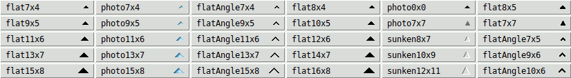

Während die Sortierpfeile der Stile `flat*` und `sunken*` aus Bitmaps erstellt werden, verwenden die Pfeilstile `photo7x4`, `photo9x5`, `photo11x6`, `photo13x7` und `photo15x8` GIF-Bilder, die den nativen Sortierpfeilen unter Windows Vista, 7 und 8 sehr ähnlich sehen.  Wenn ein dieser Stile verwendet wird, haben die Optionen `-arrowcolor` und `-arrowdisabledcolor` keine Wirkung.

Der Pfeilstil `photo0x0` verwendet SVG-Bilder, die sich *automatisch* entsprechend der DPI-Skalierung des Displays und dem durch `[tk scaling]` vorgegebenen Skalierungsfaktor von Tk anpassen.  Dies ist besonders praktisch, wenn Androwish auf einem Tablet oder Smartphone ausgeführt wird. Dieser Pfeilstil wird nur unterstützt, wenn die Tk-Version entweder mindestens 8.7 (mit integrierter SVG-Unterstützung) beträgt oder 8.6 und die Erweiterung „tksvg“ im Interpreter geladen werden kann.  Die Sortierpfeile dieses Pfeilstils ähneln stark denen der Stile `flat8x4`, `flat10x5`, `flat12x6`, `flat14x7` und `flat16x8`, mit dem Unterschied, dass sie mit Anti-Aliasing gerendert werden und unbegrenzt skalierbar sind.

Schließlich verwendet der Pfeilstil `photo7x7` PNG-Bilder, die in Aussehen und Verhalten den nativen Sortierpfeilen in Mac OS X Aqua-Versionen vor 10.10 (Yosemite) sehr ähnlich sind.  Dieser Pfeilstil wird nur unterstützt, wenn die Tk-Version entweder mindestens 8.6 (mit integrierter PNG-Unterstützung) ist oder 8.5 und das Paket `img::png` in den Interpreter geladen werden kann. Bei Verwendung dieses Pfeilstils haben die Optionen `-arrowcolor` und `-arrowdisabledcolor` keine Wirkung, doch aufgrund der in den PNG-Bildern enthaltenen Transparenzinformationen passen die Pfeile ihre Farbe automatisch an die verschiedenen Zustände der Kopfzeilenbeschriftungen an, genau wie die nativen Sortierpfeile.

Der Standardwert hängt vom Fenstersystem im Tablelist-Paket und vom aktuellen Thema in Tablelist_tile ab.  Unter X11 und in einigen Tile-Themen ist der Standard-Pfeilstil `photo0x0`, sofern SVG-Unterstützung vorhanden ist, und (abhängig vom Skalierungsgrad des Bildschirms) einer der folgenden: `flat8x4`, `flat10x5`, `flat12x6`, `flat14x7` oder `flat16x8` (siehe die 4. Spalte der obigen Abbildung).  Unter Windows 10 und höher ist die Standardeinstellung `flatAngle7x4`, `flatAngle9x5`, `flatAngle11x6`, `flatAngle13x7`, oder `flatAngle15x8` (dargestellt in der dritten Spalte), und unter Windows Vista, 7 und 8 wählt Tablelist standardmäßig `photo7x4`, `photo9x5`, `photo11x6`, `photo13x7` oder `photo15x8` (siehe zweite Spalte der Abbildung), je nach Skalierungsstufe des Bildschirms.  Im Classic-Thema von Windows Vista, 7 und 8 ist der Standard-Pfeilstil einer der in der ersten Spalte der Abbildung gezeigten Werte.  Schließlich hängt beim Fenstersystem `aqua` auf dem Macintosh und beim Thema `aqua` der Standardpfeilstil von der Version des Betriebssystems ab:  Ab Version 10.10 (Yosemite) von Mac OS X ist der Standard-Pfeilstil `flatAngle7x4`, während bei früheren Betriebssystemversionen der Standard `photo7x7` ist, sofern PNG-Unterstützung vorhanden ist, und andernfalls `flat7x7`.

Unter Windows Vista, 7, 8 und 10+ werden die Sortierpfeile horizontal zentriert in den Kopfzeilen angezeigt, direkt unter deren oberem Rand:


|   |   |
| --- | --- |
| Befehlszeilenname:  | `-autofinishediting` |
| Name der Datenbank: | ` autoFinishEditing` |
| Datenbankklasse: | ` AutoFinishEditing` |

Legt einen booleschen Wert fest, der steuert, ob die interaktive Zellbearbeitung mithilfe einer Tile-Combobox, eines BWidget-ComboBox-Widgets, eines IWidgets-Combobox-Widgets, eines Oakley-Kombinationsfelds, eines Tk-Core-Menüknopfs oder eines Tile-Menüknopf-Widgets automatisch durch die Auswahl eines Eintrags aus dem Kombinationsfeld oder aus dem mit dem Menüknopf verknüpften Menü beendet wird.  Der Standardwert ist `0`.


|   |   |
| --- | --- |
| Befehlszeilenname:  | `-autoscan` |
| Name der Datenbank: | ` autoScan` |
| Datenbankklasse: | ` AutoScan` |

Legt einen booleschen Wert fest, der steuert, ob das automatische Scrollen ausgelöst wird, wenn die Maus das Tablelist-Fenster verlässt, während die erste Maustaste gedrückt ist. Der Standardwert ist `1`, was bedeutet, dass das automatische Scrollen aktiviert ist, genau wie beim Tk-Listbox-Widget.  Wenn Sie das TkDND-Paket oder eine andere Implementierung des Ziehen und Ablegen verwenden, empfiehlt es sich jedoch, diese Option auf `0` zu setzen, um Konflikte zwischen der Drag-Operation und dem automatischen Scrollen zu vermeiden.

**HINWEIS:**  Ab Tablelist-Version 5.12 ist diese Option obsolet geworden, da die VORGABEBINDUNGEN nun das obenautomatische Bildlauffunktion unterdrücken, wenn die Body-Komponente der Tablelist über den Befehl  `tkdnd::drag_source register`  oder den BWidget-Befehl `DragSite::register` als Ziehquelle für Maustaste 1 registriert wurde oder die Option `-customdragsource` der Tablelist auf „true“ gesetzt wurde.


|   |   |
| --- | --- |
| Befehlszeilenname:  | `-button2window` |
| Name der Datenbank: | ` button2Window` |
| Datenbankklasse: | ` Button2Window` |

Legt den Pfadnamen des Fensters fest, zu dem die VORGABEBINDUNGEN für die Bindungs-Tags `TablelistBody` und `TablelistEdit` die Ereignisse `<Button-2>`, `<B2-Motion>` und `<ButtonRelease-2>` über `event generate` umleiten sollen, wenn sich das Fokusfenster auf dem Bildschirm, das das Tablelist-Widget enthält, außerhalb der Tablelist befindet.  Die Standardeinstellung ist eine leere Zeichenkette, was bedeutet, dass Mausklick-2-Ereignisse, die von einem Widget mit einem der beiden oben genannten Bindungs-Tags empfangen werden, zu einem Durchlauf innerhalb der Tablelist oder ihres Bearbeitungsfensters führen, unabhängig davon, ob sich der Fokus innerhalb oder außerhalb des Tablelist-Widgets befindet.

**ANMERKUNG 1:**  Wenn sich die Tablelist in einem [scrollutil::scrollableframe](https://www.nemethi.de/scrollutil/scrollableframe.html) befindet und Sie diese Option auf den Pfadnamen des Toplevel-Fensters setzen, werden die oben genannten Ereignisse bei Betätigung der rechten Maustaste über dem Körper der Tablelist wie folgt behandelt:

  - Wenn der Fokus innerhalb des „tablelist“-Widgets liegt, lösen die Ereignisse eine Überprüfung des Inhalts der „tablelist“ oder ihres Bearbeitungsfensters aus, und es erfolgt keine weitere Verarbeitung der Ereignisse.
  - Wenn der Fokus außerhalb des Tablelist-Widgets liegt, findet kein Scannen innerhalb des Tablelist-Körpers oder des Bearbeitungsfensters statt.  Stattdessen wird das Ereignis mithilfe des Befehls ``event generate`` an das Toplevel-Fenster weitergeleitet. Dies führt wiederum dazu, dass der Inhalt des „ScrollableFrame“ gescannt wird.

**ANMERKUNG 2:**  Wenn Sie das „tablelist“-Widget an den Befehl `scrollutil::adaptBtn2EventHandling` übergeben, setzt dieser Befehl diese Option auf den Pfadnamen des Toplevel-Fensters.


|   |   |
| --- | --- |
| Befehlszeilenname:  | `-collapsecommand` |
| Name der Datenbank: | ` collapseCommand` |
| Datenbankklasse: | ` CollapseCommand` |

Legt einen Tcl-Befehl fest, der beim Ausblenden einer Zeile einer als Baum-Widget verwendeten Tablelist (mithilfe des Unterbefehls `collapse` oder `collapseall`) aufgerufen werden soll.  Der angegebene Befehl wird automatisch mit dem Pfadnamen des Tablelist-Widgets und dem Zeilenindex verkettet, und das resultierende Skript wird im globalen Geltungsbereich ausgewertet, bevor die untergeordneten Elemente der betreffenden Zeile ausgeblendet werden.


|   |   |
| --- | --- |
| Befehlszeilenname:  | `-colorizecommand` |
| Name der Datenbank: | ` colorizeCommand` |
| Datenbankklasse: | ` ColorizeCommand` |

Legt einen Tcl-Befehl fest, mit dem die Farben beliebiger Zeichenbereiche innerhalb der Zellen der aktuell sichtbaren Zeilen geändert werden können.  Immer wenn das Tablelist-Paket die verschiedenen Vorder- und Hintergrundfarben (einschließlich der streifen- und auswahlspezifischen) anzeigen muss, durchläuft es die Zellen der Haupt- und Kopfzeilen, die derzeit im Tablelist-Fenster sichtbar sind, und stellt die Farben dar, indem es den Text-Widget-Bereichen von Haupt- und Kopfzeilen, aus denen sich der formatierte Inhalt der Zellen zusammensetzt, entsprechende Tags hinzufügt.  Nach der Aktivierung der Farben für eine Zelle ruft der Tablelist-Code den als Wert dieser Konfigurationsoption angegebenen Befehl (vorausgesetzt, es handelt sich um eine nicht leere Zeichenkette) im globalen Geltungsbereich und mit den folgenden, für die gerade verarbeitete Haupt- oder Kopfzeilenzelle spezifischen Argumenten auf:

  - der Pfadname des Tablelist-Widgets;
  - der Pfadname des Text-Widgets für den Hauptteil oder die Kopfzeile der Tablelist;
  - der vollständige Schlüssel des Eintrags, der das gerade verarbeitete Elemente enthält (beachten Sie, dass dieser bei einem Container mit dem Präfix `k` und bei einem Kopfcontainer mit `hk` beginnt);
  - den numerischen Index der Zeile oder der Kopfzeile dieses Elements;
  - der numerische Index der Spalte der Zelle;
  - der Text-Index (in der Form `line.char`) des ersten Zeichens `\t`, das die Zelle im zugrunde liegenden Text-Widget abgrenzt;
  - der Textindex (in der Form `line.char`) des zweiten Zeichens `\t`, das die Zelle im zugrunde liegenden Text-Widget abgrenzt;
  - der boolesche Wert `0` oder `1`, der angibt, ob die gerade verarbeitete Zelle in einem Stripe enthalten ist (siehe z. B. die BESCHREIBUNG der Option `-stripebackground`);
  - Der Boolesche Wert `0` oder `1`, der angibt, ob die gerade bearbeitete Zelle derzeit ausgewählt ist.

Daraus folgt, dass der Wert dieser Konfigurationsoption in der Regel der Name einer Prozedur ist, wie im folgenden Beispiel gezeigt:

```
proc myColorizeCmd {tbl textWidget key row col tabIdx1 tabIdx2 inStripe selected} { ... }
```

**ANMERKUNG 1:**  Um die Farben bestimmter Teile des angezeigten Inhalts einer Zelle zu ändern, muss der als Wert dieser Konfigurationsoption angegebene Befehl Text-Widget-Tags verwenden, die die gewünschten Hintergrund- und/oder Vordergrundfarben haben.  Neben `-background` und `-foreground` kann der Befehl auch einige andere Tag-Konfigurationsoptionen verwenden, wie beispielsweise `-overstrike` und `-underline`.  Andererseits beachten Sie, dass die Verwendung einiger anderer Tag-Konfigurationsoptionen (insbesondere `-elide` und `-font`) zu Konflikten mit der Art und Weise führen kann, wie Tablelist die Elemente darstellt, was wiederum verschiedene Layoutprobleme im Hauptteil oder in der Kopfzeile Ihres Tablelist-Widgets zur Folge haben kann!

**ANMERKUNG 2:** Da die mehrzeiligen Elemente mithilfe eingebetteter Nachrichten-Widgets angezeigt werden, gibt es derzeit keine Möglichkeit, die Farben der Textbereiche innerhalb mehrzeiliger Zellen zu ändern.


|   |   |
| --- | --- |
| Befehlszeilenname:  | `-columns` |
| Name der Datenbank: | ` columns` |
| Datenbankklasse: | ` Columns` |

Legt die Breiten, Überschriften und Ausrichtungen der Spalten fest. Der Wert der Option muss eine Liste in folgender Form sein:

```
width title ?alignment? width title ?alignment? ...
```

Jeder `width`-Wert muss eine Zahl sein. Ein positiver Wert legt die Spaltenbreite in Zeichen durchschnittlicher Größe der Widget-Schriftart fest. Wenn `width` negativ ist, wird sein Absolutwert als Spaltenbreite in Pixeln interpretiert.  Schließlich legt der Wert Null fest, dass die Spaltenbreite gerade so groß sein soll, dass alle Elemente der Spalte, einschließlich der Spaltenüberschrift, Platz finden (jedoch nicht größer als die durch die Konfigurationsoptionen `-maxwidth` angegebene maximale Breite).  In allen drei Fällen ist die effektive Breite des Spalts etwas größer, da links und rechts des Spalts automatisch Außenabstände erstellt werden.

Jedes `title` legt den Text fest, der in der Überschrift der Spalte angezeigt werden soll, und kann optional im nächsten Listenelement von einem `alignment` gefolgt werden, das festlegt, wie die Elemente der Spalten ausgerichtet werden sollen.  Jedes `alignment` muss einer der folgenden Werte sein: `left`, `right` oder `center`.  Der Standardwert ist `left`.  Das `alignment` bezieht sich ebenfalls auf den Titel der Spalte, wenn für diese Spalten nicht die Option `-labelalign` festgelegt wurde oder deren Wert eine leere Zeichenkette ist.

Der Standardwert dieser Option ist eine leere Liste, was festlegt, dass das Widget anfangs keine Spalten hat.

**HINWEIS:** Spalten, die eine Breite von Null aufweisen, werden als Spalten mit **dynamischer Breite** bezeichnet.  Im Allgemeinen sind sie benutzerfreundlicher als ihre Gegenstücke mit **statischer Breite**, da ihre Breite automatisch an den Inhalt angepasst wird.  Wenn die Option `-displayondemand` auf „true“ gesetzt ist (was die Standardeinstellung ist), schneiden die Spalten mit statischer Breite beim Einfügen und Sortieren von Elementen deutlich besser ab als die Spalten mit dynamischer Breite.


|   |   |
| --- | --- |
| Befehlszeilenname:  | `-columntitles` |
| Name der Datenbank: | ` columnTitles` |
| Datenbankklasse: | ` ColumnTitles` |

Diese Option bietet eine vereinfachte Möglichkeit, Spalten in einer Tablelist mit dynamischer Breite und linksbündiger Ausrichtung festzulegen. Ihr Wert wird als Liste von Spaltenüberschriften interpretiert. Standardmäßig ist dies eine leere Liste.

Im einfachsten Fall, in dem noch keine Spalten angegeben wurden, wird diese Option auf den in der Liste angegebenen Wert gesetzt

```
title title ...
```

entspricht der Einstellung der Option `-columns` auf den in der Liste angegebenen Wert

```
0 title left 0 title left ...
```

Wenn die Spalten bereits festgelegt wurden, aktualisiert diese Option deren Titel (so viele wie möglich), und wenn die Anzahl der Elemente ihres Werts größer ist als die Anzahl der Spalten, werden die verbleibenden Elemente als Titel für zusätzliche Spalten mit dynamischer Breite und linksbündiger Ausrichtung verwendet.  Wenn das Widget beispielsweise 3 Spalten hat und der Wert der Option eine Liste der Länge 5 ist, aktualisiert die Option die Überschriften der 3 Spalten und fügt 2 neue Spalten mit dynamischer Breite und linksbündiger Ausrichtung an, deren Überschriften die letzten 2 Elemente der Liste sind.  Wenn das Widget über 3 Spalten verfügt und die Option nur 2 Texte legt fest, werden lediglich die Titel der ersten beiden Spalten aktualisiert.


|   |   |
| --- | --- |
| Befehlszeilenname:  | `-customdragsource` |
| Name der Datenbank: | ` customDragSource` |
| Datenbankklasse: | ` CustomDragSource` |

Legt einen booleschen Wert fest, der angibt, ob das Tablelist-Widget eine Ziehquelle für eine andere Implementierung des Ziehen-und-Ablegen-Verfahrens ist, die nicht TkDND ist und der in BWidget enthaltene Rahmen für das Ziehen-und-Ablegen-Verfahren.  Ist der Wert „true“, führen die VORGABEBINDUNGEN eine automatische drag-freundliche Verarbeitung der Auswahl durch und unterdrücken das automatische Scrollen, wenn die Maus bei gedrückter Taste 1 das Tablelist-Fenster verlässt. Der Standardwert ist `0`.


|   |   |
| --- | --- |
| Befehlszeilenname:  | `-displayondemand` |
| Name der Datenbank: | ` displayOnDemand` |
| Datenbankklasse: | ` DisplayOnDemand` |

Legt einen booleschen Wert fest, der steuert, wie die Texte neu eingefügter Zeilen im Hauptbereich der Tablelist im zugrunde liegenden Text-Widget angezeigt werden.  Wenn der Wert „true“ ist, werden die Texte der neuen Zeilen erst dann in das Text-Widget des Hauptbereichs eingefügt, wenn die entsprechenden Zellen sichtbar werden (z. B. infolge von horizontalem oder vertikalem Scrollen).  Andernfalls werden die Texte der neuen Zeilen unmittelbar nach dem Einfügen der Zeilen im zugrunde liegenden Text-Widget angezeigt.  Der Standardwert ist `1`.

**ANMERKUNG 1:** Der Standardwert „true“ dieser Option beschleunigt das Einfügen und Sortieren von Elementen erheblich, insbesondere bei Spalten mit fester Breite, da das Abschneiden von Elementen, die nicht in ihre Zellen passen, auf den Zeitpunkt verschoben wird, zu dem sie im Fließtext-Widget angezeigt werden.  Andererseits führt diese bedarfsgesteuerte Anzeige zu gewissen Leistungseinbußen beim Scrollen, insbesondere wenn das Tablelist-Widget viele Spalten enthält.  Um das Scrollen zu beschleunigen, sollten Sie in Erwägung ziehen, diese Option auf „false“ zu setzen.

**ANMERKUNG 2:**  Neu eingefügte Kopfzeilen werden unabhängig vom Wert dieser Option sofort im zugrunde liegenden Text-Widget angezeigt.


|   |   |
| --- | --- |
| Befehlszeilenname:  | `-editendcommand` |
| Name der Datenbank: | ` editEndCommand` |
| Datenbankklasse: | ` EditEndCommand` |

Legt einen Tcl-Befehl fest, der bei normalem Abschluss der interaktiven Bearbeitung des Zellinhalts aufgerufen werden soll, wenn sich der endgültige Text des für die Bearbeitung verwendeten temporären eingebetteten Widgets von seinem ursprünglichen Text unterscheidet.  Der Befehl wird automatisch mit dem Pfadnamen des Tablelist-Widgets, den Zeilen- und Spaltenindizes der Zelle sowie dem endgültigen Inhalt des Bearbeitungsfensters verkettet; das resultierende Skript wird im globalen Geltungsbereich ausgewertet, und der Rückgabewert wird nach dem Löschen des temporären eingebetteten Fensters zum neuen Inhalt der Zelle.  Der Hauptzweck dieses Skripts besteht darin, eine abschließende Validierung des Inhalts des Bearbeitungsfensters durchzuführen.  Weitere Informationen zum Aufruf des oben genannten Befehls finden Sie in der BESCHREIBUNG der Option `-forceeditendcommand` sowie im Abschnitt [INTERACTIVE Zelle EDITING](#ausf-hrliche-referenz), der Einzelheiten zum Bearbeitungsprozess enthält.


|   |   |
| --- | --- |
| Befehlszeilenname:  | `-editendonfocusout` |
| Name der Datenbank: | ` editEndOnFocusOut` |
| Datenbankklasse: | ` EditEndOnFocusOut` |

Legt einen booleschen Wert fest, der steuert, ob die interaktive Zellbearbeitung automatisch beendet wird, wenn das Tablelist-Widget den Fokus verliert.  Wenn diese Option auf „true“ gesetzt ist, löst der Verlust des Fokuses während der interaktiven Zellenbearbeitung automatisch die Ausführung des Unterbefehls `finishediting` aus. Die Standardeinstellung ist `0`.


|   |   |
| --- | --- |
| Befehlszeilenname:  | `-editendonmodclick` |
| Name der Datenbank: | ` editEndOnModClick` |
| Datenbankklasse: | ` EditEndOnModClick` |

Legt einen booleschen Wert fest, der steuert, ob im Zusammenhang mit dem Beenden der interaktiven Zellenbearbeitung die Ereignisse `<Shift-Button-1>` und `<Control-Button-1>` (die üblicherweise zum Erweitern bzw. Umschalten der AUSWAHL verwendet werden) genauso behandelt werden wie `<Button-1>`.  Der Standardwert ist `1`, was bedeutet, dass die interaktive Zellbearbeitung automatisch beendet wird, wenn mit der linken Maustaste an einer beliebigen Stelle im Hauptbereich der Tablelist außerhalb der gerade bearbeiteten Zelle geklickt wird, unabhängig davon, ob die Taste `Shift` oder `Control` gedrückt ist oder nicht.


|   |   |
| --- | --- |
| Befehlszeilenname:  | `-editselectedonly` |
| Name der Datenbank: | ` editSelectedOnly` |
| Datenbankklasse: | ` EditSelectedOnly` |

Legt einen booleschen Wert fest, der steuert, ob die interaktive Zellbearbeitung gestartet wird, wenn die linke Maustaste in einer bearbeitbaren Zelle gedrückt wird. Ist dieser Wert „true“, wird die Bearbeitung nur gestartet, wenn die Zelle zuvor (interaktiv oder programmgesteuert) ausgewählt wurde.  In diesem Fall wird durch einen ersten Linksklick in der Regel zunächst nur die Zelle (oder deren Zeile, abhängig vom Wert der Option `-selecttype`) ausgewählt, und ein zweiter Mausklick startet die Bearbeitungssitzung.  Der Standardwert ist `0`, was bedeutet, dass die Bearbeitung unabhängig davon gestartet wird, ob die Zelle ausgewählt ist oder nicht.


|   |   |
| --- | --- |
| Befehlszeilenname:  | `-editstartcommand` |
| Name der Datenbank: | ` editStartCommand` |
| Datenbankklasse: | ` EditStartCommand` |

Legt einen Tcl-Befehl fest, der aufgerufen werden soll, wenn die interaktive Bearbeitung des Inhalts einer Zelle gestartet wird.  Der Befehl wird automatisch mit dem Pfadnamen des Tablelist-Widgets, den Zeilen- und Spaltenindizes der Zelle sowie dem in der Zelle angezeigten Text verkettet; das resultierende Skript wird im globalen Geltungsbereich ausgewertet, und der Rückgabewert wird zum Anfangsinhalt des temporären eingebetteten Widgets, das für die Bearbeitung verwendet wird.  Der Hauptzweck dieses Skripts besteht darin, VALIDIERUNGEN für den Inhalt des Bearbeitungsfensters zu definieren.  Einzelheiten zum Bearbeitungsprozess finden Sie im Abschnitt [INTERACTIVE Zelle EDITING](#ausf-hrliche-referenz).


|   |   |
| --- | --- |
| Befehlszeilenname:  | `-expandcommand` |
| Name der Datenbank: | ` expandCommand` |
| Datenbankklasse: | ` ExpandCommand` |

Legt einen Tcl-Befehl fest, der beim Erweitern einer Zeile einer als Baum-Widget verwendeten Tablelist (mithilfe des Unterbefehls `expand` oder `expandall`) aufgerufen werden soll.  Der angegebene Befehl wird automatisch mit dem Pfadnamen des Tablelist-Widgets und dem Index der betreffenden Zeile verkettet, und das resultierende Skript wird im globalen Geltungsbereich ausgewertet, bevor die untergeordneten Elemente der betreffenden Zeile angezeigt werden.

**HINWEIS:** Es ist gängige Praxis, den als Wert dieser Option angegebenen Befehl zu verwenden, um die untergeordneten Elemente der Zeile einzufügen, die gerade erweitert werden soll, sofern diese noch keine untergeordneten Elemente enthält.  Beispielsweise verwendet das Demo-Skript [Directory Viewer](tablelist.md#ein-skalierbarer-verzeichnis-viewer-auf-basis-einer-tablelist) den folgenden Befehl:

```
proc expandCmd {tbl row} {
    if {[$tbl childcount $row] == 0} {
        # Get the name of the directory whose leaf name is
        # displayed in the first cell of the specified row
        set dir [$tbl rowattrib $row pathName]

        # Display the content of the directory $dir
        # as child items of the one identified by $row
        putContents $dir $tbl $row
    }

    # The rest is just eye candy:
    if {[$tbl childcount $row] != 0} {
        # Update the image displayed in the row's first cell
        $tbl cellconfigure $row,0 -image openFolderImg
    }
}
```


|   |   |
| --- | --- |
| Befehlszeilenname:  | `-forceeditendcommand` |
| Name der Datenbank: | ` forceEditEndCommand` |
| Datenbankklasse: | ` ForceEditEndCommand` |

Legt einen booleschen Wert fest, der den Aufruf des durch die Option `-editendcommand` angegebenen Befehls steuert.  Ist dieser Wert „true“, wird der Befehl bei normalem Beenden des Bearbeitungsvorgangs aufgerufen, selbst wenn der endgültige Text des für die Bearbeitung verwendeten temporären eingebetteten Widgets mit seinem ursprünglichen Text übereinstimmt, und er wird auch aufgerufen, wenn die interaktive Zellbearbeitung abgebrochen wird (im letzteren Fall ist der als letztes Argument an den Befehl übergebene Text der ursprüngliche Inhalt des Bearbeitungsfensters und nicht dessen endgültiger Inhalt).  Der Standardwert dieser Option ist `0`, was bedeutet, dass der Befehl bei normalem Abschluss des Bearbeitungsvorgangs nur dann aufgerufen wird, wenn sich der endgültige Text des temporären eingebetteten Widgets von seinem ursprünglichen Text unterscheidet.  Einzelheiten zum Bearbeitungsprozess finden Sie im Abschnitt [INTERACTIVE Zelle EDITING](#ausf-hrliche-referenz).

Wenn der Wert der Option „true“ ist und kein Wert für die Option `-editendcommand` angegeben wurde, wird bei normalem Beenden des Bearbeitungsvorgangs der neue Inhalt der Zelle auf den im Bearbeitungsfenster enthaltenen Text gesetzt, auch wenn dieser nicht interaktiv geändert wurde (sondern möglicherweise durch den Befehl zurückgegeben wurde, der durch die Option `-editstartcommand` vorgegeben wurde).

Wenn Sie diese Option auf „true“ setzen, können Sie eine beliebige Aktion ausführen, sobald die interaktive Zellbearbeitung abgeschlossen ist. Es reicht nicht aus, einfach ein Skript an das Ereignis `<Destroy>` des temporären, für die Bearbeitung verwendeten eingebetteten Widgets zu binden, da dieses Widget unter verschiedenen Umständen automatisch gelöscht und neu erstellt werden kann.  Alternativ können Sie die virtuellen Ereignisse `<<TablelistCellUpdated>>` und `<<TablelistCellRestored>>` verwenden, die jeweils von den Unterbefehlen `finishediting` und `cancelediting` generiert werden.


|   |   |
| --- | --- |
| Befehlszeilenname:  | `-fullseparators` |
| Name der Datenbank: | ` fullSeparators` |
| Datenbankklasse: | ` FullSeparators` |

Legt einen booleschen Wert fest, der bestimmt, ob sich die Trennlinien (sofern vorhanden) bis zum unteren Rand des Datenbereichs erstrecken sollen.  Der Standardwert ist `0`. Das bedeutet, dass die Höhe der Trennlinien an den Inhalt des Widgets angepasst wird, d. h., sie reichen nicht bis zum unteren Rand des Datenbereichs, wenn unterhalb der letzten Zeile des Widgets noch vertikaler Freiraum vorhanden ist.


|   |   |
| --- | --- |
| Befehlszeilenname:  | `-height` |
| Name der Datenbank: | ` height` |
| Datenbankklasse: | ` Height` |

Legt die gewünschte Höhe für den Hauptteil der Tablelist fest, gemessen in Zeichen der Schriftart, die durch die Option `-font` vorgegeben ist.  Dies entspricht gleichzeitig der gewünschten Höhe in Zeilen, vorausgesetzt, dass keine spalten-, zeilen- oder zellspezifischen Schriftarten, mehrzeilige Elemente oder eingebettete Bilder oder Fenster dazu führen, dass die Höhe eines der Hauptinhaltselemente von der Höhe abweicht, die der oben genannten Schriftart entspricht.  Wenn der Wert der Option null oder kleiner ist, wird die gewünschte Höhe des Hauptbereichs in Zeichen der Widget-Schriftart mit der Anzahl der [viewable](#ausf-hrliche-referenz) Körperelementen; auch hier gilt: Wenn alle Elemente im Körper der Tablelist die der Schriftart des Widgets entsprechende Höhe haben, bedeutet dies, dass die gewünschte Höhe des Körpers gerade so groß gemacht wird, dass alle sichtbaren Körperelemente Platz finden.

**HINWEIS:** eingebettete Bilder und FENSTER führen häufig dazu, dass die Zeilen der Tablelist höher werden, was zu einer Diskrepanz zwischen dem Wert dieser Option und der Anzahl der im Hauptfenster sichtbaren Zeilen führt.  In den meisten Fällen können Sie dieses Problem umgehen, indem Sie den Wert der Option `-font` des Widgets speichern, diese Option auf eine ausreichend große Schriftart einstellen und anschließend die Zeilenkonfigurationsoption `-font` jedes Haupt- und Kopfzeilenelements auf den gespeicherten Wert der Schriftart des Widgets einzustellen.


|   |   |
| --- | --- |
| Befehlszeilenname:  | `-inactiveselectbackground` |
| Name der Datenbank: | ` inactiveSelectBackground` |
| Datenbankklasse: | ` Foreground` |

Legt die Farbe fest, die für die Auswahl im Hauptbereich der Tablelist verwendet werden soll, wenn diese keinen Fokus hat. Ist das Feld leer, wird der Wert der Option **-selectbackground** auf der Ebene [widget](#ausf-hrliche-referenz), [column](#ausf-hrliche-referenz), [row](#ausf-hrliche-referenz) oder [cell](#ausf-hrliche-referenz) verwendet, wenn der Hauptbereich des Widgets keinen Fokus hat.

Der Standardwert hängt vom Fenstersystem im Tablelist-Paket und vom aktuellen Thema in Tablelist_tile ab:  Im Tablelist-Paket ist er bei den Fenstersystemen `aqua` und `win32` nicht leer und bei `x11` eine leere Zeichenkette; in Tablelist_tile ist er für die Themen `aqua`, `clam`, `vista`, `winnative` und `xpnative` nicht leer, bei allen anderen Themen hingegen eine leere Zeichenkette.  Die Wahl des Standardwerts stellt sicher, dass die Auswahl auch dann in den nativen Farben angezeigt wird, wenn der Fokus nicht auf dem Datenbereich liegt.


|   |   |
| --- | --- |
| Befehlszeilenname:  | `-inactiveselectforeground` |
| Name der Datenbank: | ` inactiveSelectForeground` |
| Datenbankklasse: | ` Background` |

Legt die Vordergrundfarbe fest, die für die Auswahl im Hauptbereich der Tablelist verwendet werden soll, wenn diese keinen Fokus hat.  Diese Option ist nur relevant, wenn der Wert der Option **`-inactiveselectbackground`** nicht leer ist; in diesem Fall wird, wenn der Wert dieser Option eine leere Zeichenkette ist, die Option **-selectforeground** auf der Ebene [widget](#ausf-hrliche-referenz) (und nur dort) verwendet, wenn der Hauptbereich der Tablelist keinen Fokus hat.

Der Standardwert hängt vom Fenstersystem im Tablelist-Paket und vom aktuellen Thema in Tablelist_tile ab:  Im Tablelist-Paket ist er bei den Fenstersystemen `aqua` und `win32` nicht leer und bei `x11` eine leere Zeichenkette; in Tablelist_tile ist er für die Themen `aqua`, `clam`, `vista`, `winnative` und `xpnative` nicht leer, bei allen anderen Themen hingegen eine leere Zeichenkette.  Die Wahl des Standardwerts stellt sicher, dass die Auswahl auch dann in den nativen Farben angezeigt wird, wenn der Fokus nicht auf dem Datenbereich liegt.


|   |   |
| --- | --- |
| Befehlszeilenname:  | `-incrarrowtype` |
| Name der Datenbank: | ` incrArrowType` |
| Datenbankklasse: | ` IncrArrowType` |

Legt den Typ des Pfeils fest, der in eine Spaltenbezeichnung eingefügt wird, wenn die Elemente anhand dieser Spalte in aufsteigender Reihenfolge sortiert werden, und zwar mithilfe des Unterbefehls `sortbycolumn` oder `sortbycolumnlist` des Tcl-Befehls, der dem Widget zugeordnet ist.  Der Wert dieser Option muss entweder `up` oder `down` lauten.  Der Standardwert ist `up`. Diese Option ist nur relevant, wenn der Wert der Option `-showarrow` „true“ ist.


|   |   |
| --- | --- |
| Befehlszeilenname:  | `-instanttoggle` |
| Name der Datenbank: | ` instantToggle` |
| Datenbankklasse: | ` InstantToggle` |

Legt einen booleschen Wert fest, der steuert, ob die interaktive Zellbearbeitung mithilfe eines Tk- oder Tile-Checkbuttons oder eines Toggleswitch-Widgets – sofern sie mit der linken Maustaste gestartet wurde – unmittelbar nach dem automatischen Umschalten des Kontrollzustands des temporär eingebetteten Checkbuttons oder des Schaltzustands des temporär eingebetteten Toggleswitches beendet wird.  Der Standardwert ist `0`, was bedeutet, dass ein Mausklick in die Zelle lediglich die Bearbeitungssitzung startet (und dabei automatisch den Markierungsstatus des checkbuttons oder den Schaltzustand des Toggleswitch-Widgets umschaltet), diese jedoch nicht beendet.


|   |   |
| --- | --- |
| Befehlszeilenname:  | `-itembackground` or `-itembg` |
| Name der Datenbank: | ` itemBackground` |
| Datenbankklasse: | ` Background` |

Legt die Farbe fest, die bei der Anzeige der Haupt- und Kopfzeilenelemente verwendet werden soll, d. h. die Farbe des Hauptbereichs, der mit den Hauptelementen gefüllt ist, und die der Kopfzeilenbereiche, die mit den Kopfzeilenelementen gefüllt sind (wenn vorhanden).  Der Standardwert ist eine leere Zeichenkette, was bedeutet, dass diese Bereiche die durch die Konfigurationsoption `-background` festgelegte Hintergrundfarbe übernehmen.  Beachten Sie, dass unabhängig vom Wert dieser Option der Leerraum, der möglicherweise rechts neben den Haupt- und Kopfzeilenelementen sowie unterhalb des letzten Hauptelements erscheint, immer die durch die Option `-background` festgelegte Farbe aufweist.


|   |   |
| --- | --- |
| Befehlszeilenname:  | `-labelactivebackground` |
| Name der Datenbank: | ` labelActiveBackground` |
| Datenbankklasse: | ` Foreground` |

Legt die Option `-activebackground` für die Kopfzeilenbeschriftungen fest, d. h. die Hintergrundfarbe, die verwendet wird, wenn der Mauszeiger über einer Kopfzeilenbeschriftung positioniert ist und der Wert von `tk_strictMotif` „false“ ist.  Das Paket „Tablelist_tile“ unterstützt die Option `-labelactivebackground` nicht.


|   |   |
| --- | --- |
| Befehlszeilenname:  | `-labelactiveforeground` |
| Name der Datenbank: | ` labelActiveForeground` |
| Datenbankklasse: | ` Background` |

Legt die Option `-activeforeground` für die Kopfzeilenbeschriftungen fest, d. h. die Vordergrundfarbe, die verwendet wird, wenn sich der Mauszeiger über einer Kopfzeilenbeschriftung befindet und der Wert von `tk_strictMotif` „false“ ist.  Das Paket „Tablelist_tile“ unterstützt die Option `-labelactiveforeground` nicht.


|   |   |
| --- | --- |
| Befehlszeilenname:  | `-labelbackground` or `-labelbg` |
| Name der Datenbank: | ` labelBackground` |
| Datenbankklasse: | ` Background` |

Legt die Option `-background` für die Kopfzeilenbeschriftungen fest. Diese Option wird nur vom Tablelist-Paket unterstützt, nicht jedoch von Tablelist_tile.


|   |   |
| --- | --- |
| Befehlszeilenname:  | `-labelborderwidth` or `-labelbd` |
| Name der Datenbank: | ` labelBorderWidth` |
| Datenbankklasse: | ` BorderWidth` |

Legt die Option `-borderwidth` für die Kopfzeilenbeschriftungen fest. Diese Option unterscheidet sich von der Standardoption `-borderwidth`, die für das Tablelist-Widget selbst definiert ist. Im Paket „Tablelist_tile“ hat diese Option einen themenspezifischen Standardwert.

**HINWEIS:**  Bitte beachten Sie, dass bei einigen Themen die Einstellung dieser Option auf einen anderen Wert als den Standardwert von „tile“ möglicherweise ignoriert wird und somit zu Problemen bei der Ausrichtung führen kann.  Dies liegt daran, dass der Rahmen von „tile“-Widgets mit Themen-Spezifischen Methoden gezeichnet wird, die nicht immer zu den aus Tk-Widgets bekannten Ergebnissen führen.


|   |   |
| --- | --- |
| Befehlszeilenname:  | `-labelcommand` |
| Name der Datenbank: | ` labelCommand` |
| Datenbankklasse: | ` LabelCommand` |

Legt einen Tcl-Befehl fest, der aufgerufen werden soll, wenn die Maustaste 1 über einer der Kopfzeilenbeschriftungen gedrückt und später über derselben Beschriftung wieder losgelassen wird.  Sofern der Wert der Option eine nicht leere Zeichenkette ist, wird bei Eintreten des Ereignisses `<ButtonRelease-1>` der Befehl automatisch mit dem Pfadnamen des Tablelist-Widgets und dem Index der jeweiligen Beschriftung verkettet, und das resultierende Skript wird im globalen Geltungsbereich ausgewertet.  Wenn auf Spaltenebene als Wert der gleichnamigen Option ein anderer nicht leerer Befehl festgelegt wird, wird dieser spaltenspezifische Befehl anstelle des globalen Befehls verwendet.  Wenn der Wert von `state` der Tablelist `disabled` lautet, findet diese Aktion nicht statt.  Der häufigste Wert dieser Option ist `tablelist::sortByColumn`; dieser Befehl sortiert die Elemente anhand der Spalten, deren Index ihm als zweites Argument übergeben wurde.


|   |   |
| --- | --- |
| Befehlszeilenname:  | `-labelcommand2` |
| Name der Datenbank: | ` labelCommand2` |
| Datenbankklasse: | ` LabelCommand2` |

Legt einen Tcl-Befehl fest, der aufgerufen werden soll, wenn die Maustaste 1 zusammen mit der Taste `Shift` über einer der Kopfzeilenbeschriftungen gedrückt und später über derselben Beschriftung wieder losgelassen wird.  Sofern der Wert der Option eine nicht leere Zeichenkette ist, wird wenn das Ereignis `<ButtonRelease-1>` eintritt, der Befehl automatisch mit dem Pfadnamen des Tablelist-Widgets und dem Index der jeweiligen Beschriftung verkettet, und das resultierende Skript wird im globalen Geltungsbereich ausgewertet.  Wenn auf Spaltenebene ein anderer nicht leerer Befehl als Wert der gleichnamigen Option angegeben wird, wird dieser spaltenspezifische Befehl anstelle des globalen Befehls verwendet.  Wenn der Wert von `state` der Tablelist `disabled` lautet, findet diese Aktion nicht statt.  Der häufigste Wert dieser Option ist `tablelist::addToSortColumns`; dieser Befehl fügt den als zweites Argument übergebenen Spaltenindex zur Liste der Sortierspalten hinzu und sortiert die Elemente anhand der durch die geänderte Liste angegebenen Spalten.


|   |   |
| --- | --- |
| Befehlszeilenname:  | `-labeldisabledforeground` |
| Name der Datenbank: | ` labelDisabledForeground` |
| Datenbankklasse: | ` DisabledForeground` |

Legt die Option `-disabledforeground` für die Kopfzeilenbeschriftungen fest, d. h. die Vordergrundfarbe, die für die Beschriftungen verwendet werden soll, wenn die Option `state` der Tablelist auf `disabled` gesetzt ist.  Das Paket „Tablelist_tile“ unterstützt die Option `-labeldisabledforeground` nicht.


|   |   |
| --- | --- |
| Befehlszeilenname:  | `-labelfont` |
| Name der Datenbank: | ` labelFont` |
| Datenbankklasse: | ` Font` |

Legt die Option `-font` für die Kopfzeilenbeschriftungen fest. Im Paket „Tablelist_tile“ hat diese Option einen themenspezifischen Standardwert.


|   |   |
| --- | --- |
| Befehlszeilenname:  | `-labelforeground` or `-labelfg` |
| Name der Datenbank: | ` labelForeground` |
| Datenbankklasse: | ` Foreground` |

Legt die Option `-foreground` für die Kopfzeilenbeschriftungen fest. Im Paket „Tablelist_tile“ hat diese Option einen themenspezifischen Standardwert.


|   |   |
| --- | --- |
| Befehlszeilenname:  | `-labelheight` |
| Name der Datenbank: | ` labelHeight` |
| Datenbankklasse: | ` Height` |

Legt die Option `-height` für die Kopfzeilenbeschriftungen fest. Diese Option wird nur vom Tablelist-Paket unterstützt, nicht jedoch von Tablelist_tile.


|   |   |
| --- | --- |
| Befehlszeilenname:  | `-labelpady` |
| Name der Datenbank: | ` labelPadY` |
| Datenbankklasse: | ` Pad` |

Im Tablelist-Paket legt diese Option die Konfigurationsoption `-pady` für die Kopfzeilenbeschriftungen fest.  Im Tablelist_tile-Paket wird der Wert der Option `-labelpady` den entsprechenden Komponenten des Werts der Konfigurationsoption `-padding` für die Kopfzeilenbeschriftungen zugeordnet, und die Option `-labelpady` hat einen themenspezifischen Standardwert.


|   |   |
| --- | --- |
| Befehlszeilenname:  | `-labelrelief` |
| Name der Datenbank: | ` labelRelief` |
| Datenbankklasse: | ` Relief` |

Legt die Option `-relief` für die Kopfzeilenbeschriftungen fest. Diese Option unterscheidet sich von der Standardoption `-relief`, die für das Tablelist-Widget selbst definiert ist. Der Standardwert ist `raised`.


|   |   |
| --- | --- |
| Befehlszeilenname:  | `-listvariable` |
| Name der Datenbank: | ` listVariable` |
| Datenbankklasse: | ` Variable` |

Legt den Namen einer globalen Variablen oder den qualifizierten Namen einer Namespace-Variablen fest. Der Wert der Variablen ist eine Liste, die im Hauptbereich des Widgets angezeigt werden soll; ändert sich der Wert der Variablen, aktualisiert sich das Widget automatisch, um den neuen Wert widerzuspiegeln. Der Wert der Variablen muss eine gültige Liste sein.  Jedes Listenelement entspricht einer Zeile im Hauptteil des Widgets und muss selbst eine gültige Liste sein; ihre Elemente entsprechen den Zellen innerhalb der jeweiligen Zeile.  Versuche, eine Variable, deren Wert diese Bedingungen nicht erfüllt, der Variablen `-listvariable` zuzuweisen, führen zu einem Fehler.  Versuche, eine als `-listvariable` verwendete Variable zurückzusetzen, schlagen fehl, führen jedoch nicht zu einer Fehlermeldung.

**ANMERKUNG 1:**  Um die Effizienz zu steigern, erfolgt die Aktualisierung des Widgets entsprechend einem geänderten Wert der mit dieser Option angegebenen Variablen, wann immer möglich, in einer Leerlaufphase (d. h. wenn keine Ereignisse zu verarbeiten sind).  Andererseits erfordern die meisten „tablelist“-Unterbefehle eine *sofortige* Aktualisierung der internen Liste des Widgets entsprechend dem Wert dieser Variable, bevor der betreffende Unterbefehl ausgeführt wird.  Wird dies wiederholt durchgeführt, kann dies zu erheblichen Effizienzverlusten führen.  Um Leistungsprobleme zu vermeiden, sollten Sie stets versuchen, die Operationen, die den Wert der durch diese Option festgelegten Variablen aufbauen, von anderen Befehlen zu trennen.  Anstelle von

```
tablelist::tablelist .tbl ... -listvariable var
set var {}
for {set row 0} {$row < 1000} {incr row} {
    lappend var ...
    .tbl cellconfigure $row,3 -image ...
}
```

Du solltest schreiben

```
tablelist::tablelist .tbl ... -listvariable var
set var {}
for {set row 0} {$row < 1000} {incr row} {
    lappend var ...
}
for {set row 0} {$row < 1000} {incr row} {
    .tbl cellconfigure $row,3 -image ...
}
```

Die erste der oben genannten Methoden ist ziemlich ineffizient, da sie 1000 Aktualisierungen der internen Liste des Widgets erfordert. Die zweite Methode läuft unvergleichlich schneller, da sie nur eine Synchronisation benötigt (zu Beginn der zweiten Schleife).

**ANMERKUNG 2:** Es wird nicht empfohlen, diese Option für eine Tablelist zu setzen, die als Baum-Widget verwendet wird, da das Hinzufügen neuer Elemente zu dem als Wert angegebenen Wert dazu führt, dass diese Listenelemente in das Widget eingefügt werden, ohne die interne Struktur des Baums zu berücksichtigen.  Es ist kein Problem, wenn Sie die Variable nur zum Lesen aufrufen; für diesen Zweck ist es jedoch effizienter, den Unterbefehl `itemlistvar` anstelle der Option `-listvariable` zu verwenden.


|   |   |
| --- | --- |
| Befehlszeilenname:  | `-movablecolumns` |
| Name der Datenbank: | ` movableColumns` |
| Datenbankklasse: | ` MovableColumns` |

Legt einen booleschen Wert fest, der festlegt, ob die Spalten interaktiv verschoben werden können.  Weitere Informationen zum Abschnitt [VORGABEBINDUNGEN UND INDIVIDUELLE BINDUNGEN FÜR DIE KOPFBESCHRIFTUNGEN](#ausf-hrliche-referenz) weiter unten für Informationen zum interaktiven Verschieben einer Spalte.  Der Wert ist `0`.


|   |   |
| --- | --- |
| Befehlszeilenname:  | `-movablerows` |
| Name der Datenbank: | ` movableRows` |
| Datenbankklasse: | ` MovableRows` |

Legt einen booleschen Wert fest, der festlegt, ob die im Hauptbereich der Tablelist angezeigten Zeilen interaktiv verschoben werden können.  Weitere Informationen zum interaktiven Verschieben einer Zeile finden Sie im Unterabschnitt LOCAL DRAG & DROP des Abschnitt [VORGABEBINDUNGEN UND INDIVIDUALEN BINDUNGEN FÜR DIE Tablelist-Datenbereich](#ausf-hrliche-referenz) weiter unten, um Informationen zum interaktiven Verschieben einer Zeile zu erhalten. Der Wert ist `0`.

**HINWEIS:** Die Möglichkeit, eine Zeile zu verschieben, ist auf die Body-Komponente des Widgets beschränkt.  Das Verschieben von Kopfzeilen wird nicht unterstützt.


|   |   |
| --- | --- |
| Befehlszeilenname:  | `-movecolumncursor` |
| Name der Datenbank: | ` moveColumnCursor` |
| Datenbankklasse: | ` MoveColumnCursor` |

Legt den Mauszeiger fest, der beim interaktiven Verschieben einer Spalte verwendet werden soll. Der Standardwert lautet `icon` auf den Fenstersystemen `x11` und `win32` und der native Cursor `closedhand` im Macintosh-Fenstersystem `aqua`.


|   |   |
| --- | --- |
| Befehlszeilenname:  | `-movecursor` |
| Name der Datenbank: | ` moveCursor` |
| Datenbankklasse: | ` MoveCursor` |

Legt den Mauszeiger fest, der beim interaktiven Verschieben einer Zeile verwendet werden soll. Der Standardwert lautet `hand2` auf den Fenstersystemen `x11` und `win32`, und der native Cursor `pointinghand` im Macintosh-Fenstersystem `aqua`.


|   |   |
| --- | --- |
| Befehlszeilenname:  | `-populatecommand` |
| Name der Datenbank: | ` populateCommand` |
| Datenbankklasse: | ` PopulateCommand` |

Legt einen Tcl-Befehl fest, der vom Unterbefehl `searchcolumn` aufgerufen werden soll, bevor die untergeordneten Elemente (oder Nachkommen, bei Verwendung der Option `-descend`) einer Zeile der Tablelist überprüft werden, deren untergeordnete Elemente noch nicht eingefügt wurden.  Der angegebene Befehl wird automatisch mit dem Pfadnamen des Tablelist-Widgets und dem Zeilenindex verkettet, und das resultierende Skript wird im globalen Geltungsbereich ausgewertet. Es wird erwartet, dass dieses Skript die untergeordneten Elemente der betreffenden Zeile einfügt, ohne den Knoten zu erweitern oder dessen Darstellung in irgendeiner anderen Weise zu verändern.

**HINWEIS:**  Es gibt viele Ähnlichkeiten zwischen dieser Option und `-expandcommand`.  Beide Optionen dienen in erster Linie dazu, untergeordnete Elemente nach Bedarf einzufügen.  Die wichtigsten Unterschiede zwischen ihnen sind folgende:

  1. Der durch die Option `-populatecommand` festgelegte Befehl wird nur für Zeilen aufgerufen, deren untergeordnete Elemente noch nicht eingefügt wurden, während der durch die Option `-expandcommand` festgelegte Befehl immer vor dem Erweitern einer Zeile aufgerufen wird, unabhängig davon, ob die untergeordneten Elemente dieser Zeile bereits im Widget vorhanden sind oder nicht.
  2. Der durch die Option `-expandcommand` festgelegte Befehl kann visuelle Änderungen am betreffenden Knoten vornehmen, während die Funktion des durch `-populatecommand` festgelegten Befehls darauf beschränkt ist, die untergeordneten Elemente einzufügen, ohne das Erscheinungsbild des Knotens in irgendeiner Weise zu verändern.

Eine logische Folge des Vorstehenden ist, dass der Wert von `-populatecommand` in der Regel lediglich eine vereinfachte Version des Befehls ist, der durch die Option `-expandcommand` festgelegt wird.  Beispielsweise könnte das Demo-Skript [Directory Viewer](tablelist.md#ein-skalierbarer-verzeichnis-viewer-auf-basis-einer-tablelist) einen Befehl verwenden, der wie folgt implementiert ist:

```
proc populateCmd {tbl row} {
    # Get the name of the directory whose leaf name is
    # displayed in the first cell of the specified row
    set dir [$tbl rowattrib $row pathName]

    # Display the content of the directory $dir
    # as child items of the one identified by $row
    putContents $dir $tbl $row
}
```

Zudem kann die Option `-expandcommand` auf einen Befehl gesetzt werden, der den durch die Option `-populatecommand` angegebenen Befehl aufruft:

```
proc expandCmd {tbl row} {
    if {[$tbl childcount $row] == 0} {
        populateCmd $tbl $row
    }

    # The rest is just eye candy:
    if {[$tbl childcount $row] != 0} {
        # Update the image displayed in the row's first cell
        $tbl cellconfigure $row,0 -image openFolderImg
    }
}
```


|   |   |
| --- | --- |
| Befehlszeilenname:  | `-protecttitlecolumns` |
| Name der Datenbank: | ` protectTitleColumns` |
| Datenbankklasse: | ` ProtectTitleColumns` |

Legt einen booleschen Wert fest, der bestimmt, ob die Begrenzung des Titel-Spaltenbereichs beim interaktiven Verschieben einer Spalte vor dem Überschreiten geschützt werden soll. Siehe den Abschnitt [VORGABEBINDUNGEN UND INDIVIDUELLE BINDUNGEN FÜR DIE KOPFZEILENBEZEICHNUNGEN](#ausf-hrliche-referenz) weiter unten für Informationen zum interaktiven Verschieben einer Spalte.  Der Standardwert ist `0`; dies legt fest, dass Nicht-Titel-Spalten in den Titel-Spaltenbereich verschoben werden können und umgekehrt.


|   |   |
| --- | --- |
| Befehlszeilenname:  | `-resizablecolumns` |
| Name der Datenbank: | ` resizableColumns` |
| Datenbankklasse: | ` ResizableColumns` |

Legt einen booleschen Wert fest, der festlegt, ob die Spalten interaktiv in der Größe angepasst werden können.  Weitere Informationen zur Abschnitt [VORGABEBINDUNGEN UND INDIVIDUELLE BINDUNGEN FÜR DIE KOPFBESCHRIFTUNGEN](#ausf-hrliche-referenz) weiter unten für Informationen zur interaktiven Spaltengrößenanpassung. Der Wert ist `1`.


|   |   |
| --- | --- |
| Befehlszeilenname:  | `-resizecursor` |
| Name der Datenbank: | ` resizeCursor` |
| Datenbankklasse: | ` ResizeCursor` |

Legt den Mauszeiger fest, der bei der interaktiven Anpassung der Spaltengrößen verwendet werden soll. Der Standardwert lautet `sb_h_double_arrow` auf den Fenstersystemen `x11` und `win32`, und der native Cursor `resizeleftright` im Macintosh-Fenstersystem `aqua`.


|   |   |
| --- | --- |
| Befehlszeilenname:  | `-selectfiltercommand` |
| Name der Datenbank: | ` selectFilterCommand` |
| Datenbankklasse: | ` SelectFilterCommand` |

Legt einen Tcl-Befehl fest, der zum Filtern der Zellen verwendet werden kann, die ausgewählt werden, wenn die VORGABEBINDUNGEN für die Kopfzeilenbezeichnungen eine spaltenweise Zellenauswahl durchführen.  Wenn der Wert der Option eine nicht leere Zeichenkette ist, wird dieser Befehl mit dem Pfadnamen des Tablelist-Widgets und dem numerischen Index der jeweiligen Spalte verkettet, und das resultierende Skript wird im globalen Geltungsbereich ausgewertet.  Wenn auf Spaltenebene ein anderer nicht leerer Befehl als Wert der gleichnamigen Option angegeben wird, wird dieser spaltenspezifische Befehl anstelle des globalen Befehls verwendet.  In beiden Fällen wird erwartet, dass das resultierende Skript eine Liste gibt, die aus den Zeilennummern jener Zellen besteht, die in der betreffenden Spalte enthalten sind und durch die spaltenweise Auswahl der Zellen ausgewählt werden sollen.


|   |   |
| --- | --- |
| Befehlszeilenname:  | `-selectmode` |
| Name der Datenbank: | ` selectMode` |
| Datenbankklasse: | ` SelectMode` |

Legt einen von mehreren Stilen für die Bearbeitung der Auswahl fest. Der Wert der Option kann beliebig sein, die VORGABEBINDUNGEN erwarten jedoch, dass er entweder `single`, `browse`, `multiple` oder `extended`.  Der Standardwert ist `browse`.


|   |   |
| --- | --- |
| Befehlszeilenname:  | `-selecttype` |
| Name der Datenbank: | ` selectType` |
| Datenbankklasse: | ` SelectType` |

Legt einen von zwei Auswahltypen für das Tablelist-Widget fest: `row` oder `cell`.  Wenn der Auswahltyp `row` ist, wählen die VORGABEBINDUNGEN ganze Elemente aus bzw. heben deren Auswahl auf, und die gesamte Zeile, in der sich der Positionscursor befindet, wird als aktiv angezeigt, wenn die Tablelist den Tastaturfokus hat.  Wenn der Auswahltyp `cell` ist, wählen die VORGABEBINDUNGEN einzelne Elemente aus bzw. heben deren Auswahl auf, und die einzelne Zelle, in der sich der Positionscursor befindet, wird als aktiv angezeigt, wenn die Tablelist den Tastaturfokus hat. Der Wert ist `row`.


|   |   |
| --- | --- |
| Befehlszeilenname:  | `-setfocus` |
| Name der Datenbank: | ` setFocus` |
| Datenbankklasse: | ` SetFocus` |

Legt einen booleschen Wert fest, der bestimmt, ob ein Klick mit der linken Maustaste an einer beliebigen Stelle im Hauptbereich der Tablelist – einschließlich der Trennzeichen und der EINGEBETTETEN Bilder (genauer gesagt, alle untergeordneten Elemente des Tablelist-Widgets, die das Bindung-Tag `TablelistBody` tragen), den Fokus auf den Hauptbereich des Tablelist-Widgets setzen soll, wenn dessen `state` den Wert `normal` hat.  Der Standardwert ist `1`.


|   |   |
| --- | --- |
| Befehlszeilenname:  | `-showarrow` |
| Name der Datenbank: | ` showArrow` |
| Datenbankklasse: | ` ShowArrow` |

Legt einen booleschen Wert fest, der festlegt, ob die Unterbefehle `sortbycolumn` und `sortbycolumnlist` des mit dem Widget verknüpften Tcl-Befehls einen Pfeil, der die Sortierreihenfolge angibt, in die Kopfzeilenbeschriftung(en) der Spalte platzieren(s), die durch ihr erstes Argument festgelegt sind. Der Standardwert ist `1`.


|   |   |
| --- | --- |
| Befehlszeilenname:  | `-showbusycursor` |
| Name der Datenbank: | ` showBusyCursor` |
| Datenbankklasse: | ` ShowBusyCursor` |

Legt einen booleschen Wert fest, der angibt, ob die VORGABEBINDUNGEN bei Vorgängen, deren Ausführung längere Zeit in Anspruch nehmen kann, mithilfe der Unterbefehle `setbusycursor` und `restorecursor` einen für das Fenstersystem spezifischen „Beschäftigt“-Cursor anzeigen sollen.  Der Standardwert ist `1`.

Die möglicherweise länger andauernden Vorgänge, die bei aktivierter Option den Mauszeiger vorübergehend verändern, sind folgende:

  - die Größe einer Spalte ändern oder eine Spalte verschieben;
  - Aufruf des durch die Option `-labelcommand` oder `-labelcommand2` auf Widget- oder Spaltenebene angegebenen Befehls (z. B. Sortieren der Elemente nach einer oder mehreren Spalten);
  - eine Zeile ein- oder ausblenden;
  - Erweitern, Umschalten oder Aufheben der (Zellen-)Auswahl, wenn die Option `-selectmode` auf `extended` gesetzt wurde;
  - Erweiterung der spaltenweisen Auswahl der Zellen.

**HINWEIS:**  Wenn Sie nicht möchten, dass bei potenziell lang andauernden Vorgängen standardmäßig der Lade-Cursor angezeigt wird, können Sie die Standardeinstellung für alle Tablelist-Instanzen überschreiben, indem Sie folgende Zeile einfügen:

```
option add *Tablelist.showBusyCursor 0
```

irgendwo am Anfang Ihres Skripts (bevor Sie irgendwelche Tablelist-Widgets erstellen).


|   |   |
| --- | --- |
| Befehlszeilenname:  | `-showeditcursor` |
| Name der Datenbank: | ` showEditCursor` |
| Datenbankklasse: | ` ShowEditCursor` |

Legt einen booleschen Wert fest, der angibt, ob der Mauszeiger automatisch in die Form eines Bleistifts wechseln soll, sobald ein Klick mit Maustaste 1 eine Bearbeitungssitzung startet. Der Standardwert lautet `1`.

Unter X11 und Mac OS X/11+ ist der von Tablelist festgelegte Cursor, der bei einem Mausklick die interaktive Zellbearbeitung auslöst, der in Tk integrierte Cursor `pencil`.  Da dieser Cursor unter Windows unansehnlich und nicht wirklich brauchbar ist, wird auf dieser Plattform der von Tablelist angezeigte Bearbeitungscursor aus der Datei `pencil.cur` geladen, die sich im Verzeichnis `scripts` des Tablelist-Installationsverzeichnisses befindet.  Wenn die Anwendung als Container gestartet wurde, das das Tablelist-Paket enthält, wird der Bearbeitungscursor aus einer Kopie dieser Datei geladen, die automatisch von Tablelist im Verzeichnis `Temp` des Benutzers erstellt wurde.  Die Datei `pencil.cur` ist eine Kopie der Datei `Ubuntu Handwriting.cur`, die von der Adresse

http://www.rw-designer.com/cursor-detail/46922

**HINWEIS:**  Wenn Sie nicht möchten, dass standardmäßig der Bearbeitungscursor angezeigt wird, sobald ein Klick mit Maustaste 1 die Bearbeitung auslöst, können Sie die Standardeinstellung für alle Tablelist-Instanzen überschreiben, indem Sie folgende Zeile einfügen:

```
option add *Tablelist.showEditCursor 0
```

irgendwo am Anfang Ihres Skripts (bevor Sie irgendwelche Tablelist-Widgets erstellen).


|   |   |
| --- | --- |
| Befehlszeilenname:  | `-showhorizseparator` |
| Name der Datenbank: | ` showHorizSeparator` |
| Datenbankklasse: | ` ShowHorizSeparator` |

Legt einen booleschen Wert fest, der steuert, ob direkt unterhalb der letzten Zeile ein horizontaler Trennstrich eingefügt wird, wenn der Wert der Option `-showseparators` „true“ und der Wert der Option `-fullseparators` „false“ ist, und zwischen der letzten Zeile und dem unteren Rand des Tablelist-Fensters noch freier Platz vorhanden ist. Der Standardwert ist `1`.

**HINWEIS:**  Wenn Sie unter den oben genannten Umständen nicht möchten, dass standardmäßig ein horizontaler Trennstrich angezeigt wird, können Sie die Standardeinstellung für alle Tablelist-Instanzen überschreiben, indem Sie folgende Zeile einfügen:

```
option add *Tablelist.showHorizSeparator 0
```

irgendwo am Anfang Ihres Skripts (bevor Sie irgendwelche Tablelist-Widgets erstellen).


|   |   |
| --- | --- |
| Befehlszeilenname:  | `-showlabels` |
| Name der Datenbank: | ` showLabels` |
| Datenbankklasse: | ` ShowLabels` |

Legt einen booleschen Wert fest, der festlegt, ob die Kopfzeilenbeschriftungen angezeigt werden sollen oder nicht. Der Standardwert lautet `1`.


|   |   |
| --- | --- |
| Befehlszeilenname:  | `-showseparators` |
| Name der Datenbank: | ` showSeparators` |
| Datenbankklasse: | ` ShowSeparators` |

Legt einen booleschen Wert fest, der bestimmt, ob die Spalten durch Rahmen voneinander getrennt werden sollen. Der Standardwert lautet `0`.  Die Trennlinien sind im Paket „Tablelist“ als dünne Rahmen mit vertiefter Prägung und im Paket „Tablelist_tile“ als Tile-Trennlinien-Widgets implementiert. Sie werden an den rechten Rändern der Kopfzeilenbeschriftungen angebracht und nur erstellt, wenn der Wert dieser Option „true“ ist.  In diesem Fall wird zudem ein horizontaler Trennbalken erstellt und direkt unterhalb der letzten Zeile platziert, vorausgesetzt, der Wert der Option `-showhorizseparator` ist „true“, der der Option `-fullseparators` ist „false“ und zwischen der letzten Zeile und dem unteren Rand des Tablelist-Fensters noch freier Platz vorhanden ist.

**HINWEIS:**  Tablelist unterstützt keine horizontalen Trennlinien (mit Ausnahme der oben genannten und einer weiteren, die direkt unterhalb der letzten Kopfzeile platziert ist), aber mit Hilfe der unten beschriebenen Option `-stripebackground` lässt sich ein ansprechender Effekt zur Unterscheidung der Zeilen im Hauptteil des Widgets erzielen.


|   |   |
| --- | --- |
| Befehlszeilenname:  | `-snipstring` |
| Name der Datenbank: | ` snipString` |
| Datenbankklasse: | ` SnipString` |

Legt die Zeichenfolge fest, die als Ausschnittanzeige verwendet werden soll, wenn Elemente angezeigt werden, die nicht in ihre Zellen passen. Standardmäßig wird eine Ellipse verwendet (`"..."`).


|   |   |
| --- | --- |
| Befehlszeilenname:  | `-sortcommand` |
| Name der Datenbank: | ` sortCommand` |
| Datenbankklasse: | ` SortCommand` |

Legt einen Befehl fest, der beim Aufruf des Unterbefehls `sort` des mit dem Tablelist-Widget verknüpften Tcl-Befehls zum Vergleich der Elemente verwendet werden soll.  Um zwei Elemente (die jeweils als Listen von Zelleninhalten innerhalb einer Zeile betrachtet werden) während der Operation `sort` zu vergleichen, wird der Befehl automatisch mit den beiden Elementen verkettet und das resultierende Skript ausgewertet.  Das Skript sollte eine ganze Zahl geben, die kleiner als, gleich oder größer als Null ist, je nachdem, ob das erste Element als kleiner als, gleich oder größer als das zweite angesehen werden soll.


|   |   |
| --- | --- |
| Befehlszeilenname:  | `-spacing` |
| Name der Datenbank: | ` spacing` |
| Datenbankklasse: | ` Spacing` |

Legt den zusätzlichen Abstand fest, der oberhalb und unterhalb jeder Zeile des Widgets sowohl im Hauptbereich als auch in der Kopfzeile bereitgestellt werden soll. Der Wert dieser Option kann eine der Standardangaben für Bildschirmabstände sein. Der Standardwert ist `0`.  Siehe auch die Option `-tight`.


|   |   |
| --- | --- |
| Befehlszeilenname:  | `-state` |
| Name der Datenbank: | ` state` |
| Datenbankklasse: | ` State` |

Legt einen von zwei Zuständen für das Tablelist-Widget fest: `normal` oder `disabled`.  Wenn das Widget deaktiviert ist, dürfen weder Elemente noch Spalten eingefügt, gelöscht, aktualisiert oder verschoben werden; die Elemente, die Kopfzeilenbeschriftungen sowie die Aufwärts- und Abwärtspfeile werden jeweils in den Farben `-disabledforeground`, `-labeldisabledforeground` bzw. `-arrowdisabledcolor` in Farbe dargestellt; die Auswahl kann nicht geändert werden und wird nicht angezeigt (die Auswahlinformationen bleiben jedoch erhalten); die Kopfzeilenbeschriftungen sind vollständig unempfindlich, und es kann keine interaktive Zellenbearbeitung durchgeführt werden.  Zudem werden im deaktivierten Zustand alle auf Spalten-, Zeilen- oder Zellenebene festgelegten Farboptionen ignoriert.


|   |   |
| --- | --- |
| Befehlszeilenname:  | `-stretch` |
| Name der Datenbank: | ` stretch` |
| Datenbankklasse: | ` Stretch` |

Legt die **dehnbaren** Spalten fest, d. h. die Spalten, die bei Bedarf gedehnt werden sollen, um das Tablelist-Fenster auszufüllen. Der Wert der Option kann `all` oder eine Liste von Spaltenindizes in einer der im Abschnitt [Spalte Indizes](#ausf-hrliche-referenz) unten beschriebenen Formen.  Im zweiten Fall werden die angegebenen Spalte durch ihre numerischen Entsprechungen ersetzt, mit Ausnahme von `end` und `last`, die als dynamische Spaltenindizes betrachtet werden, deren numerisches Äquivalent (d. h. der Index der letzten Spalte der Tablelist) sich während der Programmausführung ändern kann und daher bei jeder Streckung der Spalten neu berechnet wird.  Die Liste wird automatisch aktualisiert, sobald Spalten eingefügt, gelöscht oder verschoben werden.  Die Anzahl der Pixel, um die eine Spalte gestreckt wird, ist proportional zu ihrer Breite in Pixeln.  Der Wert dieser Option ist eine leere Liste, was bedeutet, dass keine Spalten gestreckt wird, um den Leerraum zu beseitigen, der möglicherweise rechts neben der Tabelle erscheint.  (HINWEIS: Der Leerraum hinter den Kopfzeilenbeschriftungen wird mit einer Dummy-Beschriftung gefüllt, die nicht groß-/kleinschreibungsempfindlich ist und denselben Hintergrund, dieselbe Rahmenbreite und denselben Relief-Effekt wie die „normalen“ Kopfzeilenbeschriftungen aufweist.)

**HINWEIS:** Wenn der Wert der Konfigurationsoption `-width` null oder kleiner ist und die Tablelist dehnbare Spalten enthält, wird die Option `-setgrid` ignoriert.  Diese geringfügige Einschränkung hat technische Gründe und ist nur unter X11 relevant.


|   |   |
| --- | --- |
| Befehlszeilenname:  | `-stripebackground` or `-stripebg` |
| Name der Datenbank: | ` stripeBackground` |
| Datenbankklasse: | ` Background` |

Legt die Farbe des Hintergrundes fest, die bei der Anzeige der zu einem Streifen gehörenden Hauptelemente verwendet werden soll.  Jeder Streifen besteht aus der gleichen Anzahl `stripeHeight` aufeinanderfolgender [viewable](#ausf-hrliche-referenz) Elemente, entsprechend dem Wert der Konfigurationsoptionen `-stripeheight`.  Die ersten `stripeHeight` sichtbaren Elemente sind „normale“ Elemente; darauf folgt ein Streifen, der aus den nächsten `stripeHeight` sichtbaren Elementen besteht, worauf wiederum die gleiche Anzahl „normaler“ sichtbarer Elemente folgt, und so weiter.  Im Tablelist-Paket und in den meisten von Tablelist_tile unterstützten Themen ist der Standardwert eine leere Zeichenkette, was bedeutet, dass die Streifen die durch die Konfigurationsoption `-background` festgelegte Hintergrundfarbe übernehmen.  Wenn Sie Tablelist_tile mit dem `tileqt`-Thema verwendet, wird der Standardwert durch die globale KDE-Option `alternateBackground` vorgegeben, die wiederum vom aktuellen Farbschema abhängt.  In diesem Fall wird empfohlen, entweder diesen von KDE übernommenen Standardwert beizubehalten oder explizit einen leeren Wert festzulegen, wenn keine Streifen angezeigt werden sollen.  Die Option `-stripebackground` hat eine höhere Priorität als die Konfigurationsoption für Spalten `-background`, jedoch eine niedrigere Priorität als die auf Zeilen- oder Zellenebene festgelegte Option `-background`.


|   |   |
| --- | --- |
| Befehlszeilenname:  | `-stripeforeground` or `-stripefg` |
| Name der Datenbank: | ` stripeForeground` |
| Datenbankklasse: | ` Foreground` |

Legt die Vordergrundfarbe fest, die bei der Anzeige der zu einem Streifen gehörenden Hauptelemente verwendet werden soll.  Jeder Streifen besteht aus der gleichen Anzahl `stripeHeight` aufeinanderfolgender [viewable](#ausf-hrliche-referenz) Elemente, entsprechend dem Wert der Konfigurationsoptionen `-stripeheight`.  Die ersten `stripeHeight` sichtbaren Elemente sind „normale“ Elemente; darauf folgt ein Streifen, der aus den nächsten `stripeHeight` sichtbaren Elementen besteht, worauf wiederum die gleiche Anzahl „normaler“ sichtbarer Elemente folgt, und so weiter.  Der Standardwert ist eine leere Zeichenkette, was bedeutet, dass die Streifen die durch die Konfigurationsoption `-foreground` festgelegte Vordergrundfarbe übernehmen.  Die Option `-stripeforeground` hat eine höhere Priorität als die Konfigurationsoption `-foreground`, jedoch eine niedrigere Priorität als die auf Zeilen- oder Zellenebene festgelegte Option `-foreground`.


|   |   |
| --- | --- |
| Befehlszeilenname:  | `-stripeheight` |
| Name der Datenbank: | ` stripeHeight` |
| Datenbankklasse: | ` StripeHeight` |

Legt die Anzahl der Elemente in jedem Streifen fest. Wenn der Wert Null oder weniger ist, werden keine Streifen angezeigt. Der Standardwert lautet `1`.


|   |   |
| --- | --- |
| Befehlszeilenname:  | `-takefocus` |
| Name der Datenbank: | ` takeFocus` |
| Datenbankklasse: | ` TakeFocus` |

Diese Option legt fest, ob das Widget während der TASTATUR-NAVIGATION den Fokus annimmt. Sie ist nahezu identisch mit der gleichnamigen Standardoption (Einzelheiten finden Sie im Handbucheintrag **options**).  Der einzige Unterschied besteht darin, dass nicht das Widget selbst, sondern sein „body“-Kind den Fokus erhält, wenn die Standardtasten (`Tab` und `Shift-Tab`) bei der TASTATUR-NAVIGATION gedrückt werden.


|   |   |
| --- | --- |
| Befehlszeilenname:  | `-targetcolor` |
| Name der Datenbank: | ` targetColor` |
| Datenbankklasse: | ` TargetColor` |

Legt die Farbe des Abstands fest, der im Hauptteil oder im Kopfbereich der Tablelist angezeigt wird, um die Zielposition beim interaktiven Verschieben einer Zeile oder eines Spalts anzuzeigen.  Die Zielanzeige für den Hauptbereich der Tablelist kann auch explizit mithilfe des Unterbefehls `showtargetmark` angezeigt werden, und ihr Pfadname kann über `targetmarkpath` abgerufen werden.  Der Standardwert ist `black`.


|   |   |
| --- | --- |
| Befehlszeilenname:  | `-tight` |
| Name der Datenbank: | ` tight` |
| Datenbankklasse: | ` Tight` |

Legt einen booleschen Wert fest, der bestimmt, ob der zusätzliche Abstand von einem Pixel, der aus Gründen der Kompatibilität mit Tk-Listboxen unter jeder Zeile der Tablelist verbleibt, sowohl im Hauptteil als auch in der Kopfzeile entfernt werden soll.  Der Standardwert ist `0`, wodurch unter jeder Zeile ein zusätzlicher Abstand von einem Pixel eingezeichnet wird, genau wie bei einer Tk-Core-Listbox.

**HINWEIS:**  Sie können diese Option auf „true“ setzen und gleichzeitig mithilfe der Konfigurationsoption `-spacing` zusätzlichen Abstand oberhalb und unterhalb jeder Zeile festlegen.  Dadurch entspricht der Abstand unter jeder Zeile dem Abstand über der Zeile (und ist nicht einen Pixel höher).


|   |   |
| --- | --- |
| Befehlszeilenname:  | `-titlecolumns` |
| Name der Datenbank: | ` titleColumns` |
| Datenbankklasse: | ` TitleColumns` |

Legt die Anzahl der nicht scrollbaren Spalten am linken Rand des Fensters fest, die auch als **Titelspalten** bezeichnet werden. Die Positionen dieser Spalten ändern sich nicht, wenn die horizontale Ansicht durch Aufruf des Unterbefehls `scan`, `seecell`, `seecolumn` oder `xview`.  Der Standardwert ist `0`.  Der Wert dieser Option bestimmt außerdem die von den oben genannten Befehlen beim Verschieben der horizontalen Ansicht verwendete Scrolleinheit: Ist er positiv, erfolgt der horizontale Bildlauf spaltenweise, andernfalls zeichenweise (entsprechend der Breite des Zeichens `0`).

Das Ende des Titel-Spaltenbereichs wird mithilfe eines Trennzeichens dargestellt, das am rechten Rand der Kopfzeilenbezeichnung der letzten nicht ausgeblendeten Titelspalte angebracht ist.  Dieses spezielle Trennzeichen wird immer angezeigt, um das Ende der Titelspalten (sofern vorhanden) zu markieren, unabhängig vom Wert der Option `-showseparators`. Der Benutzer kann es anhand seiner Farbe, die sich von der der anderen Trennzeichen unterscheidet, leicht von diesen unterscheiden.


|   |   |
| --- | --- |
| Befehlszeilenname:  | `-tooltipaddcommand` |
| Name der Datenbank: | ` tooltipAddCommand` |
| Datenbankklasse: | ` TooltipAddCommand` |

Legt einen Tcl-Befehl fest, der zur Anzeige von zellen- und spaltenbezeichnerspezifischen Tooltip-Hilfen verwendet werden soll.  Wenn der Mauszeiger in eine Zelle im Hauptbereich der Tablelist gelangt, wird der Befehl automatisch mit dem Pfadnamen des Tablelist-Widgets sowie den Zeilen- und Spaltenindizes der Zelle verkettet, und das resultierende Skript wird im globalen Geltungsbereich ausgewertet.  Ähnlich wird, wenn der Mauszeiger in eine Kopfzeilenbezeichnung gelangt, der Befehl automatisch mit dem Pfadnamen des Tablelist-Widgets, der Nummer `-1` und dem Index der jeweiligen Bezeichnung verkettet, und das resultierende Skript wird im globalen Geltungsbereich ausgewertet.  Wenn schließlich der Mauszeiger in eine Zelle in der Kopfzeile der Tablelist gelangt, wird der Befehl automatisch mit dem Pfadnamen des Tablelist-Widgets, dem Index der Zeile der Kopfzeilenzelle, dem der Buchstabe `h` vorangestellt ist, sowie dem Index des Spaltes der Zelle, und das resultierende Skript wird im globalen Geltungsbereich ausgewertet.  In allen drei Fällen wird die oben beschriebene Aktion nur ausgelöst, wenn sowohl der Wert dieser Option als auch der von `-tooltipdelcommand` nichtleere Zeichenketten sind.

Betrachten Sie beispielsweise die unten gezeigte Prozedur `tooltipAddCmd`, die den Befehl `DynamicHelp::add` aus dem Paket BWidget verwendet, um die vollständigen Zell- und Beschriftungstexte als Tooltips für die Zellen und Kopfzeilenbeschriftungen mit gekürztem Inhalt anzuzeigen.

```
proc tooltipAddCmd {tbl row col} {
    if {($row >= 0 && [$tbl iselemsnipped $row,$col fullText]) ||
        ($row <  0 && [$tbl istitlesnipped $col fullText])} {
        DynamicHelp::add $tbl -text $fullText
    }
}
```

Wenn das Widget auch Kopfzeilenelemente enthalten kann, ist eine etwas kompliziertere Prozedur erforderlich:

```
proc tooltipAddCmd {tbl row col} {
    if {[string is integer $row]} {
        if {($row >= 0 && [$tbl iselemsnipped $row,$col fullText]) ||
            ($row <  0 && [$tbl istitlesnipped $col fullText])} {
            DynamicHelp::add $tbl -text $fullText
        }
    } else {
        set row [string range $row 1 end]
        if {[$tbl header iselemsnipped $row,$col fullText]} {
            DynamicHelp::add $tbl -text $fullText
        }
    }
}
```

Ein „Tablelist“-Widget kann diese Prozedur nutzen, indem es Folgendes festlegt:

```
... -tooltipaddcommand tooltipAddCmd -tooltipdelcommand DynamicHelp::delete
```

Wenn Sie den Befehl `tooltip::tooltip` aus dem in tklib enthaltenen Tooltip-Paket anstelle von `DynamicHelp::add` verwenden möchten, müssen Sie die oben aufgeführten Aufrufe des letzteren durch Folgendes ersetzen: 

```
        tooltip::tooltip $tbl $fullText
```

und die resultierende Prozedur durch Angabe von

```
... -tooltipaddcommand tooltipAddCmd -tooltipdelcommand "tooltip::tooltip clear"
```

Bitte beachten Sie, dass in dem eher seltenen Fall, dass der Name Ihres Tablelist-Widgets Leerzeichen enthält, der Befehl  `tooltip::tooltip clear`  nicht wie erwartet funktioniert, wenn die Version des Tooltip-Pakets 1.4.6 oder älter ist.  Als Workaround für dieses Tooltip-Problem (behoben in Version 1.4.7) können Sie den unten gezeigten, leicht abgewandelten Ansatz verwenden:

```
proc tooltipDelCmd tbl { tooltip::tooltip $tbl "" }

... -tooltipaddcommand tooltipAddCmd -tooltipdelcommand tooltipDelCmd
```

Eine weitere Alternative zu `DynamicHelp::add` ist der Befehl `baltip::tip` aus dem baltip-Paket von Alex Plotnikov, der unter folgender Adresse heruntergeladen werden kann:

https://chiselapp.com/user/aplsimple/repository/baltip/download/

Ersetzen Sie einfach die Aufrufe von `DynamicHelp::add` in der oben genannten Prozedur `tooltipAddCmd` durch 

```
        baltip::tip $tbl $fullText
```

und verwenden Sie die daraus resultierende Prozedur, indem Sie Folgendes angeben:

```
... -tooltipaddcommand tooltipAddCmd -tooltipdelcommand baltip::clear
```

Es gibt einen HINWEIS, dass die Version des baltip-Pakets 1.3 oder höher sein muss.

In den obigen Beispielen werden die Unterbefehle `iselemsnipped`,  `header iselemsnipped` und `istitlesnipped` als Unterbefehle verwendet, um sicherzustellen, dass die vollständigen Zell- und Beschriftungstexte nur für jene Zellen und Kopfzeilenbeschriftungen angezeigt werden, deren Inhalt abgeschnitten ist.


|   |   |
| --- | --- |
| Befehlszeilenname:  | `-tooltipdelcommand` |
| Name der Datenbank: | ` tooltipDelCommand` |
| Datenbankklasse: | ` TooltipDelCommand` |

Legt einen Tcl-Befehl fest, der zum Entfernen der zellen- oder spaltenüberschriftenspezifischen Tooltip-Hilfe verwendet werden soll. Wenn der Mauszeiger eine Zelle oder eine Überschrift verlässt, wird der durch diese Option angegebene Befehl automatisch mit dem Pfadnamen des Tablelist-Widgets verkettet, und das resultierende Skript wird im globalen Geltungsbereich ausgewertet.  Diese Aktion wird nur ausgelöst, wenn sowohl der Wert dieser Option als auch der von `-tooltipaddcommand` nichtleere Zeichenketten sind.  Gängige Werte für diese Option sind `DynamicHelp::delete` (wofür das BWidget-Paket erforderlich ist), `"tooltip::tooltip clear"`  (wofür das in tklib enthaltene tooltip-Paket erforderlich ist) und `baltip::clear` (das baltip-Paket von Alex Plotnikov erfordert).  Ihre Verwendung wird in den obigen Beispielen gezeigt.


|   |   |
| --- | --- |
| Befehlszeilenname:  | `-treecolumn` |
| Name der Datenbank: | ` treeColumn` |
| Datenbankklasse: | ` TreeColumn` |

Legt die Spalten fest, in denen die Einrückungen und die Steuerelemente zum Ein- und Ausblenden im Hauptteil einer Tablelist, die als Baum-Widget verwendet wird, angezeigt werden sollen. Der Wert der Option kann ein Index der Spalte in einer der im Abschnitt [SPALTENINDIZES](#ausf-hrliche-referenz) Abschnitt unten beschriebenen Form. Der angegebene Index für Spalten wird durch sein numerisches Äquivalent ersetzt und automatisch aktualisiert, sobald Spalten eingefügt, gelöscht oder verschoben werden. Der Standardwert ist `0`.

**HINWEIS:**  Bitte beachten Sie, dass die Baumstruktur nur dann wie erwartet angezeigt wird, wenn die durch diese Option angegebene Spalte linksbündig ausgerichtet ist.  Es liegt in Ihrer Verantwortung, sicherzustellen, dass diese Einschränkung eingehalten wird, wenn Sie eine Tablelist als Baum-Widget verwenden.


|   |   |
| --- | --- |
| Befehlszeilenname:  | `-treestyle` |
| Name der Datenbank: | ` treeStyle` |
| Datenbankklasse: | ` TreeStyle` |

Legt das Erscheinungsbild der Spalte fest, die die Einrückungen und die Steuerelemente zum Ein- und Ausblenden im Hauptteil einer als Baum-Widget verwendeten Tablelist enthält.  Dazu gehören unter anderem die zur Darstellung der Steuerelemente zum Ein- und Ausblenden verwendeten Bilder, die Einrückungsbreite sowie die Angabe, ob die Steuerelemente zum Ein- und Ausblenden und die Einrückungen bei der Auswahl einer Zeile oder Zelle geschützt werden sollen. Die derzeit unterstützten Werte sind in den beiden folgenden Tabellen auf einen Blick dargestellt:

Baumstile für ein natives Erscheinungsbild:

| 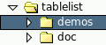 | 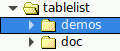 |  | 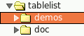 |  |  |
| --- | --- | --- | --- | --- | --- |
| `gtk` | `adwaita` | `blueMenta` | `ubuntu` | `ubuntu2` | `ubuntu3` |
| 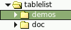 |  | 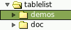 |  |  | 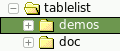 |
| `mint` | `mint2` | `mate` | `menta` | `ubuntuMate` | `yuyo` |
|  | 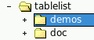 |  | 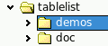 | 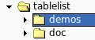 |  |
| `arc` | `oxygen1` | `oxygen2` | `klearlooks` | `baghira` | `phase` |
| 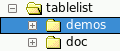 | 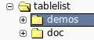 |  | 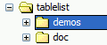 |  |  |
| `plastique` | `plastik` | `winnative` | `winxpBlue` | `winxpOlive` | `winxpSilver` |
|  | 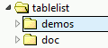 | 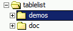 | 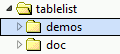 | 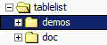 | 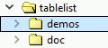 |
| `aqua` | `vistaAero` | `vistaClassic` | `win7Aero` | `win7Classic` | `win10` |
|  |  |  |  | 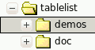 |  |
| `aqua11` | `ambiance` | `dust` | `dustSand` | `radiance` | `newWave` |

Die von den Baumstilen `vistaAero`, `vistaClassic`, `win7Aero`, `win7Classic` und `win10` werden *automatisch* an den Skalierungsprozentsatz des Bildschirms angepasst.  Das Gleiche gilt für `aqua11`, sofern SVG-Unterstützung vorhanden ist.

Für die folgenden Baumstile wird eine plattformunabhängige *manuelle* Skalierung unterstützt:

| 100 % | 125 % | 150 % | 175 % | 200 % |
| --- | --- | --- | --- | --- |
| 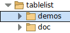 | 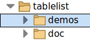 | 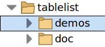 | 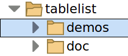 |  |
| `plain100` | `plain125` | `plain150` | `plain175` | `plain200` |
| 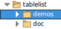 | 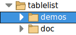 | 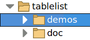 |  |  |
| `bicolor100` | `bicolor125` | `bicolor150` | `bicolor175` | `bicolor200` |
|  | 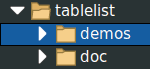 |  | 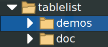 | 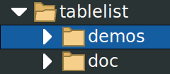 |
| `white100` | `white125` | `white150` | `white175` | `white200` |

Wenn der Baumstil `gtk`, `adwaita`, `blueMenta`, `ubuntu`, `ubuntu2`, `ubuntu3`, `mint`, `mint2`, `mate`, `menta`, `ubuntuMate`, `arc`, `oxygen2`, `aqua`, `vistaAero`, `win7Aero`, `win10`, `newWave`, `plain*`, `bicolor*`, `white*` oder `classic*`, und die Tk-Version mindestens 8.6 (mit integrierter PNG-Unterstützung) oder 8.5 beträgt und das Paket `img::png` in den Interpreter geladen werden kann, dann sind die zur Darstellung der Steuerelemente zum Ein- und Ausblenden verwendeten Bilder PNG-Bilder mit Alphakanal.  Andernfalls (d. h. bei den anderen in der ersten Tabelle oben gezeigten Baumstilen oder bei fehlender PNG-Unterstützung) werden GIF-Bilder für die Steuerelemente zum Ein- und Ausblenden verwendet.

Wenn die Tk-Version entweder mindestens 8.7 (mit integrierter SVG-Unterstützung) oder 8.6 ist und die Erweiterung „tksvg“ im Interpreter geladen werden kann, unterstützt Tablelist die zusätzlichen Baumstile `plain`, `bicolor`, `white` und `classic`, die den Stile `plain*`, `bicolor*`, `white*` und `classic*` sehr ähnlich sind, mit dem Unterschied, dass sie SVG-Bilder verwenden, deren Größe *automatisch* an die DPI-Skalierungsstufe des Displays und den durch `[tk scaling]` vorgegebenen Skalierungsfaktor von Tk angepasst wird.  Diese unbegrenzt skalierbaren Baumstyles erweisen sich insbesondere dann als nützlich, wenn Androwish auf einem Tablet oder Smartphone ausgeführt wird.

Die folgende Tabelle enthält eine detaillierte BESCHREIBUNG der Baumstile in alphabetischer Reihenfolge:

| Wert | Screenshot | Kommentare |
| --- | --- | --- |
| `adwaita` |  | Inspiriert vom GTK-3-Thema „Adwaita“. |
| `ambiance` |  | Inspiriert vom GTK-2-Thema „Ambiance“.  Empfohlen für die Verwendung mit großen Schriftarten und Bildern. |
| `aqua` |  |   Tablelist:  Standard für das Fenstersystem „Aqua“ unter Mac OS X. Tablelist_tile:  Standard für die Themen „Aqua“ unter Mac OS X und „Aquativo“.   |
| `aqua11` |  |  Verwendet nach Möglichkeit SVG-Bilder, die sich automatisch entsprechend dem tatsächlichen Skalierungsprozentsatz des Bildschirms anpassen.     Tablelist:  Standard für das Aqua-Fenstersystem unter macOS 11+. Tablelist_tile:  Standard für das Aqua-Thema unter macOS 11+.   |
| `arc` |  | Inspiriert vom Arc-Icon-Thema (des GTK 2/3-Themas „Arc“). |
| `baghira` |  |   Tablelist_tile: Standard für die Qt-Stile „baghira“, „cde“ und „motif“ innerhalb des „tileqt“-Themas. Wird auch von einigen Varianten von „qtcurve“ verwendet.   |
| `bicolor` | 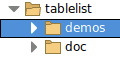 |  Verwendet SVG-Bilder, die sich automatisch entsprechend dem tatsächlichen Skalierungsprozentsatz des Bildschirms anpassen.     Tablelist_tile:  Standard für die Themen „breeze“, „awbreeze“, „awlight“, „awwinxpblue“ und „sun-valley-light“, wenn SVG-Unterstützung verfügbar ist.   |
| `bicolor100`,    . . .    `bicolor200` |  |  Während der Baumstil `bicolor100` „normale“ Größen verwendet, eignen sich die vier anderen Stile für die Verwendung mit großen Schriftarten und Bildern (erforderlich auf hochauflösenden Bildschirmen).     Tablelist_tile:  Standard für die Themen „breeze“, „awbreeze“, „awlight“, „awwinxpblue“ und „sun-valley-light“, sofern keine SVG-Unterstützung vorhanden ist.   |
| `classic` | 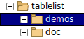 |  Verwendet SVG-Bilder, die sich automatisch entsprechend dem tatsächlichen Skalierungsprozentsatz des Bildschirms anpassen.     Tablelist_tile:  Standard für die Themen „arc“, „awarc“ und „droid“, wenn SVG-Unterstützung verfügbar ist.   |
| `classic100`,    . . .    `classic200` |  |  Während der Baumstil `classic100` „normale“ Größen verwendet, eignen sich die vier anderen Stile für die Verwendung mit großen Schriftarten und Bildern (die auf hochauflösenden Bildschirmen benötigt werden).     Tablelist_tile:  Standard für die Themen „arc“, „awarc“ und „droid“, sofern keine SVG-Unterstützung vorhanden ist.   |
| `blueMenta` |  | Inspiriert vom GTK-3-Thema „BlueMenta“ der Versionen 1.14 und höher des MATE-Desktops. |
| `dust` |  | Inspiriert vom GTK-2-Thema „Dust“.  Empfohlen für die Verwendung mit großen Schriftarten und Bildern. |
| `dust` |  | Inspiriert vom GTK-2-Thema „Dust“.  Empfohlen für die Verwendung mit großen Schriftarten und Bildern. |
| `dustSand` |  | Inspiriert vom GTK-2-Thema „Dust Sand“.  Empfohlen für die Verwendung mit großen Schriftarten und Bildern. |
| `gtk` |  |   Tablelist:  Standard für das Fenstersystem X11. Tablelist_tile:  Standard für die Themen „alt“, „blue“, „clam“, „classic“, „clearlooks“, „default“, „kroc“, „sriv“, „srivlg“ und „step“ sowie für den Qt-Stil „gtk+“ innerhalb des Themas „tileqt“.   |
| `klearlooks` |  |  Inspiriert vom KDE-4-Stil „Klearlooks“.     Tablelist_tile:  Standard für den Qt-Stil „qtcurve“ im Thema „tileqt“.   |
| `mate` |  | Inspiriert von einigen GTK-2-Themen aus Versionen des MATE-Desktops, die älter sind als 1.14. |
| `menta` |  | Inspiriert vom GTK-3-Thema „Menta“ der Versionen 1.14 und höher des MATE-Desktops. |
| `mint` |  | Inspiriert von einigen GTK-3-Themen, die in Versionen der Linux-Mint-Distribution vor Version 18 enthalten waren. |
| `mint2` |  | Inspiriert von einigen GTK-3-Themen, die in den Versionen 18 und höher der Distribution Linux Mint enthalten sind. |
| `newWave` |  | Inspiriert vom GTK-2-Thema „New Wave“.  Empfohlen für die Verwendung mit großen Schriftarten und Bildern. |
| `oxygen1` |  | Inspiriert vom KDE-4-Stil „Oxygen“. |
| `oxygen2` |  |   Tablelist_tile: Standard für den Qt-Stil „Oxygen“ im Thema „tileqt“.   |
| `phase` |  |   Tablelist_tile: Standard für die Qt-Stilphase innerhalb des „tileqt“-Themas.   |
| `plain` |  |  Verwendet SVG-Bilder, die sich automatisch entsprechend dem tatsächlichen Skalierungsprozentsatz des Bildschirms anpassen.     Tablelist_tile:  Standard für das „awclearlooks“-Thema, wenn SVG-Unterstützung verfügbar ist.   |
| `plain100`,    . . .    `plain200` |  |  Während der Baumstil `plain100` „normale“ Größen verwendet, eignen sich die vier anderen Stile für die Verwendung mit großen Schriftarten und Bildern (die auf hochauflösenden Bildschirmen benötigt werden).     Tablelist_tile:  Standard für das „awclearlooks“-Thema, sofern keine SVG-Unterstützung vorhanden ist.   |
| `plastik` |  |   Tablelist_tile: Standard für das „plastik“-Thema und den Qt-Stil „plastik“ innerhalb des „tileqt“-Themes.   |
| `plastique` |  |   Tablelist_tile: Standard für den Qt-Stil „plastique“ im Thema „tileqt“.   |
| `radiance` |  | Inspiriert vom GTK-2-Thema „Radiance“.  Empfohlen für die Verwendung mit großen Schriftarten und Bildern. |
| `ubuntu` |  | Inspiriert von einigen GTK-3-Themen, die in Versionen der Ubuntu-Linux-Distribution vor 15.04 enthalten waren. |
| `ubuntu2` |  | Inspiriert von einigen GTK-3-Themen, die in den Versionen 15.04 bis 16.04 der Linux-Distribution Ubuntu enthalten sind. |
| `ubuntu3` |  | Inspiriert von einigen GTK-3-Themen, die in den Versionen 16.10 und höher der Linux-Distribution Ubuntu enthalten sind. |
| `ubuntuMate` |  | Inspiriert von den Themen „Ambiant-MATE“ und „Radiant-MATE“, die ab Version 16.10 der Ubuntu-MATE-Distribution enthalten sind und in Ubuntu MATE 20.04 deutlich verbessert wurden. |
| `vistaAero` |  |   Tablelist:  Standard für das Fenstersystem Win32 unter Windows Vista. Tablelist_tile:  Standard für das Vista-Thema unter Windows Vista mit dem Aero-Stil.   |
| `vistaClassic` |  |   Tablelist:  Standard für das Fenstersystem Win32 unter Windows Vista mit dem Windows-Classic-Stil. Tablelist_tile:  Standard für das Vista-Thema unter Windows Vista mit dem Windows-Classic-Stil.   |
| `white` | 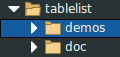 |  Verwendet SVG-Bilder, die sich automatisch entsprechend dem tatsächlichen Skalierungsprozentsatz des Bildschirms anpassen.     Tablelist_tile:  Standard für die Themen „black“, „awblack“, „breeze-dark“, „awbreezedark“, „awdark“ und „sun-valley-dark“, wenn SVG-Unterstützung verfügbar ist.   |
| `white100`,    . . .    `white200` |  |  Während der Baumstil `white100` „normale“ Größen verwendet, eignen sich die vier anderen Stile für die Verwendung mit großen Schriftarten und Bildern (die auf hochauflösenden Bildschirmen benötigt werden).     Tablelist_tile:  Standard für die Themen „black“, „awblack“, „breeze-dark“, „awbreezedark“, „awdark“ und „sun-valley-dark“, sofern keine SVG-Unterstützung vorhanden ist.   |
| `win7Aero` |  |   Tablelist:  Standard für das Fenstersystem Win32 unter Windows 7 und 8. Tablelist_tile:  Standard für das Vista-Thema unter Windows 7 und 8 mit dem Aero-Stil.   |
| `win7Classic` |  |   Tablelist:  Standard für das Fenstersystem Win32 unter Windows 7 und 8 mit dem Windows-Classic-Thema. Tablelist_tile:  Standard für das Vista-Thema unter Windows 7 und 8 mit dem Windows-Classic-Thema.   |
| `win10` |  |   Tablelist:  Standard für das Fenstersystem Win32 unter Windows 10 und höher. Tablelist_tile:  Standard für das Vista-Thema unter Windows 10 und höher.   |
| `winnative` |  |   Tablelist:  Standard für das Fenstersystem Win32 unter Windows 2000 und Windows XP mit dem Windows-Classic-Stil. Tablelist_tile:  Standard für die Themen „keramik“, „keramik_alt“, „winnative“ und „xpnative“ mit dem Windows-Classic-Stil sowie für die meisten Qt-Stile innerhalb des Themas „tileqt“.   |
| `winxpBlue` |  |   Tablelist:  Standard für das Fenstersystem win32 unter Windows XP mit dem Farbschema „Blau“. Tablelist_tile:  Standard für das ursprüngliche Thema „winxpblue“ und das Thema „xpnative“ unter Windows XP mit dem Farbschema „Blau“.   |
| `winxpOlive` |  |   Tablelist:  Standard für das Fenstersystem win32 unter Windows XP mit dem Farbschema „Olive Green“. Tablelist_tile:  Standard für das Thema „xpnative“ unter Windows XP mit dem Farbschema „Olive Green“.   |
| `winxpSilver` |  |   Tablelist:  Standard für das Fenstersystem Win32 unter Windows XP mit dem Farbschema „Silver“. Tablelist_tile:  Standard für das Thema „xpnative“ unter Windows XP mit dem Farbschema „Silver“.   |
| `yuyo` |  | Inspiriert vom GTK-2-Thema „Yuyo“ unter Ubuntu MATE. |


|   |   |
| --- | --- |
| Befehlszeilenname:  | `-width` |
| Name der Datenbank: | ` width` |
| Datenbankklasse: | ` Width` |

Legt die gewünschte Breite des Fensters in Zeichen durchschnittlicher Größe der Schriftart des Widgets fest. Wenn der Wert null oder kleiner ist, wird die gewünschte Breite des Fensters so gewählt, dass alle Spalten des Tabellisten-Widgets darin Platz finden.

**HINWEIS:**  Wenn der Wert dieser Konfigurationsoption null oder kleiner ist und die Tablelist stretchable Spalten enthält, wird die Option `-setgrid` ignoriert.  Diese geringfügige Einschränkung hat technische Gründe und ist nur unter X11 relevant.


|   |   |
| --- | --- |
| Befehlszeilenname:  | `-xmousewheelwindow` |
| Name der Datenbank: | ` xMouseWheelWindow` |
| Datenbankklasse: | ` MouseWheelWindow` |

Diese Option ist nur dann relevant, wenn die Ereignisse des Mausrads und von `<TouchpadScroll>` an das Widget unter dem Mauszeiger gemeldet werden und nicht an das Widget, das den Fokus hat.  Diese Bedingung ist unter X11 (für die Ereignisse des Mausrads) und unter Mac OS X/11+ erfüllt, ebenso wie unter Windows ab Tk 8.6b2 (in früheren Tk-Versionen wurden die Ereignisse des Mausrads unter Windows an das Widget mit Fokus gesendet).

Die Option `-xmousewheelwindow` legt den Pfadnamen des Fensters fest, in das die Bindungen für die Zuordnungs-Tags `TablelistBody` und `TablelistEdit` das Mausrad und die `<TouchpadScroll>`-Ereignisse entlang der x-Achse über  `event generate`  umleiten sollen, wenn sich das Fokusfenster auf dem Bildschirm, das das Tablelist-Widget enthält, außerhalb der Tablelist befindet.  Der Standardwert ist eine leere Zeichenkette, was bedeutet, dass Mausrad- und `<TouchpadScroll>`-Ereignisse entlang der x-Achse, die von einem Widget mit einem der beiden oben genannten Tags empfangen werden, ein horizontales Scrollen der Tablelist oder ihres Bearbeitungsfensters auslösen, unabhängig davon, ob sich der Fokus innerhalb oder außerhalb des Tablelist-Widgets befindet.

**ANMERKUNG 1:** Die Reihe der Ereignisse des Mausrads entlang der horizontalen Achse hängt von der Tk-Version und teilweise vom Fenstersystem ab:

  - *In Tk-Versionen vor 8.7a4* lauten die Ereignisse des Mausrads entlang der horizontalen Achse unter Windows `<Shift-MouseWheel>`, unter Mac OS X/11+ `<Shift-MouseWheel>` und `<Shift-Option-MouseWheel>`, sowie `<Shift-MouseWheel>`, `<Shift-Button-4>` und `<Shift-Button-5>` unter X11 (wobei `<Shift-MouseWheel>` vom X-Server nicht ausgelöst wird, aber mithilfe von `event generate` erzeugt werden kann).  Unter X11 treten bei Verwendung von Tk 8.7a3 zwei weitere Mausrad-Ereignisse entlang der horizontalen Achse auf: `<Button-6>` und `<Button-7>`, die jeweils genauso behandelt werden wie `<Shift-Button-4>` bzw. `<Shift-Button-5>`.  Diese Ereignisse werden üblicherweise durch das Neigen des Scrollrads nach links oder rechts bei einer Maus mit einer oder zwei zusätzlichen (Daumen-)Tasten ausgelöst.  (In Tk-Versionen 8.6.x, wobei x >= 10 ist, löst das Neigen des Scrollrads einer solchen Maus nach links oder rechts unter Windows und Mac OS X/11+ die Ereignisse `<Shift-MouseWheel>` aus und unter X11 die Ereignisse `<Shift-Button-4>` und `<Shift-Button-5>`.)
  - *In den Tk-Versionen 8.7a4 und höher* sind die Ereignisse des Mausrads entlang der horizontalen Achse auf allen Fenstersystemen `<Shift-MouseWheel>` und `<Shift-Option-MouseWheel>`, wobei der Modifikator `Option` unter Mac OS X/11+ an die Taste `Option` und unter Windows sowie X11 an die Taste `Alt` gebunden ist.  In diesen Tk-Versionen löst das Neigen des Scrollrads einer Maus mit einer oder zwei zusätzlichen (Daumen-)Tasten nach links oder rechts auf allen Fenstersystemen die Ereignisse `<Shift-MouseWheel>` (und `<Shift-Option-MouseWheel>`) aus.

**ANMERKUNG 2:** Wenn sich die Tablelist in einem scrollbaren Container für Widgets befindet, wie beispielsweise einem [scrollutil::scrollableframe](https://www.nemethi.de/scrollutil/scrollableframe.html), BWidget ScrollableFrame oder iwidgets::scrolledframe, und Sie setzen diese Option auf den Pfadnamen des Toplevel-Fensters, dann wird ein horizontales Mausrad- oder `<TouchpadScroll>`-Ereignis über dem Körper der Tablelist wie folgt behandelt:

  - Wenn der Fokus innerhalb des „Tablelist“-Widgets liegt, wird durch das Ereignis die „Tablelist“ oder deren Bearbeitungsfenster horizontal gescrollt, und es erfolgt keine weitere Verarbeitung des Ereignisses.
  - Wenn der Fokus außerhalb des Tablelist-Widgets liegt, findet kein Scrollen des Tablelist-Hauptbereichs oder des Bearbeitungsfensters statt. Stattdessen wird das Ereignis mithilfe des Befehls `event generate` an das Toplevel-Fenster weitergeleitet.  Dies führt wiederum zu einem horizontalen Scrollen des Widget-Containers, vorausgesetzt, das Toplevel-Fenster oder das Bindungs-Tag `all` verfügt über die erforderlichen Ereignisbindungen für das Mausrad oder das Ereignis `<TouchpadScroll>`.

**ANMERKUNG 3:**  Wenn Sie das „tablelist“-Widget ohne den Schalter `-ignorefocus` an den Befehl `scrollutil::adaptWheelEventHandling` übergeben, setzt dieser Befehl diese Option auf den Pfadnamen des Toplevel-Fensters.


|   |   |
| --- | --- |
| Befehlszeilenname:  | `-ymousewheelwindow` |
| Name der Datenbank: | ` yMouseWheelWindow` |
| Datenbankklasse: | ` MouseWheelWindow` |

Diese Option ist nur dann relevant, wenn die Ereignisse des Mausrads und von `<TouchpadScroll>` an das Widget unter dem Mauszeiger gemeldet werden und nicht an das Widget, das den Fokus hat.  Diese Bedingung ist unter X11 (für die Ereignisse des Mausrads) und unter Mac OS X/11+ erfüllt, ebenso wie unter Windows ab Tk 8.6b2 (in früheren Tk-Versionen wurden die Ereignisse des Mausrads unter Windows an das Widget mit Fokus gesendet).

Die Option `-ymousewheelwindow` legt den Pfadnamen des Fensters fest, in das die VORGABEBINDUNGEN für die Zuordnungs-Tags `TablelistBody` und `TablelistEdit` das Mausrad und die `<TouchpadScroll>`-Ereignisse entlang der y-Achse über  `event generate`  umleiten sollen, wenn sich das Fokusfenster auf dem Bildschirm, das das Tablelist-Widget enthält, außerhalb der Tablelist befindet.  Der Standardwert ist eine leere Zeichenkette, was bedeutet, dass Mausrad- und `<TouchpadScroll>`-Ereignisse entlang der y-Achse, die von einem Widget mit einem der beiden oben genannten Tags empfangen werden, ein vertikales Scrollen der Tablelist oder ihres Bearbeitungsfensters auslösen, unabhängig davon, ob sich der Fokus innerhalb oder außerhalb des Tablelist-Widgets befindet.

**ANMERKUNG 1:** Die Reihe der Ereignisse des Mausrads entlang der vertikalen Achse hängt von der Tk-Version und teilweise vom Fenstersystem ab:

  - *In Tk-Versionen vor 8.7a4* lauten die Ereignisse des Mausrads entlang der vertikalen Achse unter Windows `<MouseWheel>`, unter Mac OS X/11+ `<MouseWheel>` und `<Option-MouseWheel>`, sowie `<MouseWheel>`, `<Button-4>` und `<Button-5>` unter X11 (wobei `<MouseWheel>` nicht vom X-Server ausgelöst wird, sondern mithilfe von `event generate` erzeugt werden kann).
  - *In den Tk-Versionen 8.7a4 und höher* sind die Ereignisse des Mausrads entlang der vertikalen Achse auf allen Fenstersystemen `<MouseWheel>` und `<Option-MouseWheel>`, wobei der Modifikator `Option` unter Mac OS X/11+ an die Taste `Option` und unter Windows sowie X11 an die Taste `Alt` gebunden ist.

**ANMERKUNG 2:** Wenn sich die Tablelist in einem scrollbaren Container für Widgets wie einem [scrollutil::scrollableframe](https://www.nemethi.de/scrollutil/scrollableframe.html), BWidget ScrollableFrame oder iwidgets::scrolledframe, und Sie setzen diese Option auf den Pfadnamen des Toplevel-Fensters, dann wird ein vertikales Mausrad- oder `<TouchpadScroll>`-Ereignis über dem Hauptbereich der Tablelist wie folgt behandelt:

  - Wenn der Fokus innerhalb des „Tablelist“-Widgets liegt, wird durch das Ereignis die „Tablelist“ oder deren Bearbeitungsfenster vertikal gescrollt, und es erfolgt keine weitere Verarbeitung des Ereignisses.
  - Wenn der Fokus außerhalb des Tablelist-Widgets liegt, erfolgt kein Bildlauf im Hauptbereich oder im Bearbeitungsfenster der Tablelist. Stattdessen wird das Ereignis mithilfe des Befehls `event generate` an das Toplevel-Fenster weitergeleitet.  Dies führt wiederum zu vertikalem Scrollen des Widget-Containers, vorausgesetzt, das Toplevel-Fenster oder das Binding-Tag `all` verfügt über die erforderlichen Bindungen für das Mausrad oder `<TouchpadScroll>`.

**ANMERKUNG 3:**  Wenn Sie das „tablelist“-Widget ohne den Schalter `-ignorefocus` an den Befehl `scrollutil::adaptWheelEventHandling` übergeben, setzt dieser Befehl diese Option auf den Pfadnamen des Toplevel-Fensters.

**SPALTENKONFIGURATIONSOPTIONEN**
: Die folgenden Optionen werden derzeit von den Befehlen `columncget`, `columnconfigure`, `configcolumnlist` und `configcolumns` unterstützt:


`-align alignment`
: Legt fest, wie die Body- und Header-Elemente der Spalte ausgerichtet werden sollen. Der Wert muss einer der folgenden sein: `left`, `right` oder `center`.  Diese Option bezieht sich auch auf den Titel der Spalte, wenn die Option `-labelalign` für die jeweilige Spalte nicht angegeben wurde oder wenn ihr Wert eine leere Zeichenkette ist.  Die Option `-align` ist mit dem Element `alignment` verknüpft, das diesem Spalte in der Liste entspricht, in der der Wert der Option `-columns` für das Tablelist-Widget festgelegt ist; Änderungen an einem der beiden Elemente werden automatisch im anderen übernommen.

`-allowduplicates boolean`
: Legt fest, ob der Benutzer bei der interaktiven Zellbearbeitung den Text einer Zelle in dieser Spalte auf den Text einer anderen Zelle derselben Spalte setzen kann. Der Standardwert ist `1`.  Der Wert dieser Option wirkt sich auch auf die Bindungen aus, die zum Beenden der Bearbeitung und zum Kopieren des neuen Zellwerts in andere Zellen der Spalte vorgesehen sind: Wenn der Wert der Option „false“ ist, wird keine dieser Aktionen ausgeführt.

`-background color` or `-bg color`
: Legt die normale Hintergrundfarbe fest, die bei der Anzeige des Inhalts des Spaltes sowohl im Hauptteil als auch in der Kopfzeile verwendet werden soll.

`-changesnipside boolean`
: Legt fest, ob die ausrichtungsspezifische Standardposition des snip-Indikators bei der Anzeige der Haupt- und Kopfzeilenelemente der Spalte (mit Ausnahme ihres Titels) überschrieben werden soll. Der Wert ist `0`, was bedeutet, dass die Snip-Zeichenkette an die Elemente angehängt wird, wenn die Ausrichtung der Spalte `left` oder `center` ist, und ihnen vorangestellt wird, falls die Ausrichtung `right` ist.

 `-changetitlesnipside boolean`
: Legt fest, ob die ausrichtungsspezifische Standardposition des snip-Indikators bei der Anzeige des Titels des Spalts überschrieben werden soll. Der Wert ist `0`, was bedeutet, dass die Snip-Zeichenkette an den Titel angehängt wird, wenn die Ausrichtung der Spalte `left` oder `center` ist, und ihm vorangestellt wird, falls die Ausrichtung `right` ist.

`-editable boolean`
: Legt fest, ob die Elemente der Spalte im Hauptteil der Tablelist interaktiv bearbeitet werden können. Der Standardwert lautet `0`.  Der Wert dieser Option kann für einzelne Zellen mithilfe der gleichnamigen [Konfigurationsoption](#ausf-hrliche-referenz) überschrieben werden.

: **HINWEIS:**  Die Unterstützung für die interaktive Bearbeitung ist auf die Body-Komponente des Widgets beschränkt.

`-editwindow name`
: Legt den Typ des temporären eingebetteten Widgets fest, das für die interaktive Bearbeitung des Inhalts der Hauptzellen der angegebenen Spalte verwendet werden soll.  `name` kann einer der folgenden Werte sein: `entry` (Standard), `text`, `spinbox`, `checkbutton`, `menubutton`, `ttk::entry`, `ttk::spinbox`, `ttk::combobox`, `ttk::checkbutton` oder `ttk::menubutton` (die letzten fünf nur bei Vorhandensein der Tile-Widget-Engine) oder der Wert, der von einem der Registrierungsbefehle für Widgets aus den Paketen gegeben wird [BWidget](tablelistBWidget.md), [Iwidgets](tablelistIwidgets.md), [combobox](tablelistCombobox.md) (von Bryan Oakley), [ctext](tablelistCtext.md), [Mentry (oder Mentry_tile)](tablelistMentry.md) und [Tsw](tablelistTsw.md).  Beispielsweise können Sie  `-editwindow ComboBox`  *nach* der Registrierung des ComboBox-Widgets für die interaktive Zellbearbeitung mithilfe des Befehls `tablelist::addBWidgetComboBox` verwenden.  Ebenso können Sie `-editwindow combobox` *nach* der Registrierung des Combobox-Widgets von Bryan Oakley für die interaktive Zellbearbeitung verwenden, indem Sie den Befehl `tablelist::addOakleyCombobox` aufrufen.  Der Wert dieser Option kann für einzelne Zellen mithilfe der gleichnamigen [Konfigurationsoption](#ausf-hrliche-referenz) überschrieben werden.

`-font font`
: Legt die Schriftart fest, die bei der Anzeige des Inhalts des Spalts sowohl im Hauptteil als auch in der Kopfzeile verwendet werden soll.

`-foreground color` or `-fg color`
: Legt die normale Vordergrundfarbe fest, die bei der Anzeige des Inhalts des Spalts sowohl im Hauptteil als auch in der Kopfzeile verwendet werden soll.

`-formatcommand command`
: Legt einen Tcl-Befehl fest, der aufgerufen werden soll, wenn der Inhalt einer Haupt- oder Kopfzelle innerhalb dieser Spalte angezeigt wird oder wenn der Inhalt einer Hauptzelle der Auswahl hinzugefügt wird, während diese exportiert wird.  Wenn `command` eine nicht leere Zeichenkette ist, wird sie automatisch mit dem Text der Zelle verkettet, das resultierende Skript wird im globalen Geltungsbereich ausgewertet und der Wert wird in der Zelle angezeigt oder anstelle der ursprünglichen Daten in die Auswahl hinzugefügt.

: Wenn beispielsweise ein Wert in Sekunden in die Zelle eingefügt wird und `command` die Prozedur `formatDate` ist, die wie folgt definiert ist:


```
proc formatDate clockVal {
    return [clock format $clockVal -format "%Y-%m-%d"]
}
```

: Dann wird in der Zelle das Datum im angegebenen Format angezeigt und nicht der Wert der Zeit in Sekunden.

: Diese Option wird auch von Tablelist verwendet, wenn die Werte der Unterbefehle `getformatted`, `getformattedcolumns`, und `getformattedcells` sowie deren headerbezogenen Entsprechungen erstellt wird oder bei der Suche nach einem Textmuster, das mit der Option `-formatted` an den Unterbefehl `searchcolumn` übergeben wird.  Alle anderen Unterbefehle, insbesondere `get`, `getcolumns`, `getcells`, `rowcget` sowie deren Entsprechungen für die Kopfzeile, `columncget`, `cellcget`, zusammen mit deren Entsprechung für die Kopfzeile, `sort`, `sortbycolumn`, `sortbycolumnlist` und `refreshsorting` wirken auf den ursprünglichen Zelltext ein, der in der internen Liste des Widgets enthalten ist.  Im oben genannten Beispiel ermöglicht dies eine recht einfache Sortierung der Elemente nach Zeit mit einer Genauigkeit von einer Sekunde, selbst wenn ihre visuelle Darstellung nur das Jahr, den Monat und den Tag enthält.

: Die Option `-formatcommand` ist nützlich, wenn in einer Spalte nur Bilder oder eingebettete Fenster angezeigt werden sollen, die den Zellen zugeordneten Texte jedoch nicht einfach leere Zeichenfolgen sein dürfen, da sie für andere Zwecke (wie Sortieren oder Bearbeiten) benötigt werden.  In solchen Fällen kann eine Prozedur, die eine leere Zeichenkette gibt, als Wert für die Option verwendet werden, wodurch sichergestellt wird, dass die in dieser Spalte enthaltenen Textinformationen verborgen bleiben:


```
proc emptyStr val { return "" }
```

: Ein weiterer wichtiger Anwendungsfall betrifft Spalten in Tablelist, deren Option `-sortmode` auf `integer` oder `real` gesetzt wurde.  Wenn einige der Zellen einer solchen Spalte leer sind, würde ein Versuch, die Einträge über `sortbycolumn` oder `sortbycolumnlist` nach dieser Spalte zu sortieren, einen Fehler auslösen, da der von Tablelist durchgeführte Aufruf von `lsort -integer` oder `lsort -real` eine Fehlermeldung ausgeben würde, weil anstelle einer Ganzzahl oder einer Gleitkommazahl eine unerwartete leere Zeichenkette erhalten wurde.  Um dies zu vermeiden, stellen Sie sicher, dass die Zellen, in denen eine leere Zeichenkette angezeigt werden soll, als internen Wert eine Zahl enthalten, die entweder streng kleiner oder streng größer ist als alle anderen ganzzahligen oder reellen Zahlen in den Spalten, und verwenden Sie die Option `-formatcommand`, um zu steuern, was in den Zellen der Spalten angezeigt wird.  Wenn beispielsweise alle Elemente der Spalte nicht-negative Werte sind, können Sie die Zahl `-1` als internen Wert für die Zellen verwenden, die eine leere Zeichenkette anzeigen sollen, und den Wert der Option `-formatcommand` auf `formatNumber` setzen, wobei `formatNumber` die wie folgt implementierte Prozedur ist:


```
proc formatNumber val { return [expr {$val == -1 ? "" : $val}] }
```

: Dadurch werden die Zellen, die eine leere Zeichenfolge enthalten, bei der Sortierung der Spalte in aufsteigender Reihenfolge vor allen anderen angezeigt. Um den gegenteiligen Effekt zu erzielen, müssen Sie den Wert `-1` durch einen anwendungsspezifischen Wert ersetzen, der streng größer ist als alle anderen Zahlen in der betreffenden Spalte.

: Die in der Tablelist-Distribution enthaltenen Demo-Skripte enthalten weitere Beispiele, die die Verwendung dieser Option veranschaulichen. Die interessantesten davon werden auch im [Tablelist Programmer's Guide](tablelist.md) beschrieben.

: In dem etwas komplexeren Fall, dass das Ergebnis der Formatierung auch von der Zeile der Zelle abhängen soll, müssen Sie den Unterbefehl `formatinfo` aufrufen, der die erforderlichen Informationen über die Zelle liefert, deren Inhalt formatiert wird.

: Aufgrund der Konfigurationsoption `-formatcommand` unterscheiden wir zwischen dem internen Wert eines „tablelist“-ELEMENTES und dessen **formatierter** Version.  Letztere ist das Ergebnis des Aufrufs des Skripts, das der Option `-formatcommand` der Spalte des Elements entspricht, oder des Elements selbst, wenn diese Option für diese Spalten nicht gesetzt wurde.  Folglich ist die formatierte Version eines „tablelist“-Elements eine Liste, die sich aus den formatierten ELEMENTEN des ursprünglichen Elements zusammensetzt.

`-hide boolean`
: Legt fest, ob die Spalten bei der Anzeige des Widgets oder beim Exportieren der Auswahl ausgeblendet werden sollen. Der Standardwert lautet `0`.  Nach dem Umschalten des Ausblendstatus einer Spalte wird das virtuelle Ereignis `<<TablelistColHiddenStateChanged>>` generiert, dessen Option `-data` bei Tk-Versionen 8.5 und höher auf den numerischen Index der Spalte gesetzt ist.

`-labelalign alignment`
: Legt fest, wie der Titel des Spalts ausgerichtet werden soll. Der Wert muss entweder `left`, `right` oder `center` lauten oder eine leere Zeichenkette sein.  Wenn diese Option für die angegebene Spalte nicht angegeben wurde oder wenn ihr Wert eine leere Zeichenkette ist, wird der Spaltentitel genauso ausgerichtet wie die Elemente der Spalte, wie durch die Konfigurationsoption für die Spalten `-align` oder durch das dieser Spalten entsprechende Element `alignment` in der Liste, die den Wert der globalen Option `-columns` legt.

`-labelbackground color` or `-labelbg color`  
 `-labelborderwidth screenDistance` or `-labelbd screenDistance`  
 `-labelcommand command`  
 `-labelcommand2 command`  
 `-labelfont fontName`  
 `-labelforeground color` or `-labelfg color`  
 `-labelheight lines`  
 `-labelpady screenDistance`  
 `-labelrelief relief`  
 `-selectfiltercommand command`
: Der Wert jeder dieser Optionen kann auch eine leere Zeichenkette sein. Diese Optionen entsprechen den spaltenspezifischen Entsprechungen der globalen Optionen mit denselben Namen, die im Abschnitt [WIDGET-SPEZIFISCHE OPTIONEN](#ausf-hrliche-referenz) beschrieben sind.  Sie überschreiben die auf Widget-Ebene festgelegten gleichnamigen Optionen, wenn der angegebene Wert nicht leer ist.  Wurde eine dieser Optionen für die jeweilige Spalte nicht angegeben oder ist ihr Wert eine leere Zeichenkette, wird diese Option auf Spaltenebene nicht verwendet; stattdessen kommt die gleichnamige globale Option zum Einsatz.  Die Optionen `-labelactivebackground`, `-labelactiveforeground` und `-labeldisabledforeground` sind nur auf Widget-Ebene definiert; es gibt keine Konfigurationsoptionen mit diesen Namen.  Die Optionen `-labelbackground` und `-labelheight` werden nur vom Tablelist-Paket unterstützt, nicht jedoch von Tablelist_tile.

`-labelimage image`
: Legt den Namen des Tk-Bildes fest, das in der Kopfzeile angezeigt werden soll.  `image` muss das Ergebnis eines Aufrufs des Befehls  `image create`  sein oder eine leere Zeichenkette, die angibt, dass kein Bild angezeigt werden soll.  Wenn der Text der Beschriftung rechtsbündig ausgerichtet ist, wird das Bild rechts vom Text angezeigt, andernfalls links davon. Der Text und das Bild sind durch einen Abstand voneinander getrennt, der der Breite eines Leerzeichens in der Schriftart der jeweiligen Beschriftung entspricht.  Wenn für dieselbe Spalte die Option `-labelwindow` mit einem nicht leeren Wert festgelegt wird, hat diese Vorrang vor der Option `-labelimage`.

`-labelvalign verticalAlignment`
: Legt die vertikale Ausrichtung des Tk-Bildes oder -Fensters (falls vorhanden) fest, das in der Kopfzeile angezeigt wird.  `verticalAlignment` muss einer der folgenden Werte sein: `center` (Standardeinstellung), `top` oder `bottom`.  Insbesondere wenn die Beschriftung mehrzeiligen Text enthält, ist das eingebettete Bild oder der (ttk::)checkbutton oft nicht so hoch wie der Text; in solchen Fällen ermöglicht diese Option die spaltenabhängige vertikale Ausrichtung des eingebetteten Objekts.

`-labelwindow windowType`
: Legt den Typ des Fensters fest, das in die Kopfzeile eingebettet werden soll.  `windowType` muss `checkbutton` oder `ttk::checkbutton` lauten oder eine leere Zeichenkette sein, was festlegt, dass kein eingebettetes Fenster angezeigt werden soll.  Wenn der Text des Labels rechtsbündig ausgerichtet ist, wird das (ttk::)checkbutton-Widget rechts vom Text angezeigt, andernfalls links davon.  Der Text und das (ttk::)checkbutton-Widget sind durch einen Abstand voneinander getrennt, der der Breite eines Leerzeichens in der Schriftart der jeweiligen Beschriftung entspricht.  Wenn diese Option mit einem nicht leeren Wert festgelegt wurde, überschreibt sie die Konfigurationsoption `-labelimage` für die Spalte.

: **ANMERKUNG 1:**  Die Option `-variable` des (ttk::)Checkbuttons ist auf eine globale Variable gesetzt, deren Name nur innerhalb von Tablelist bekannt ist und deren Wert beibehalten wird, wenn sich der numerische Index der Spalten ändert (aufgrund des Einfügens, Löschens oder Verschiebens von Spalten).  Genauer gesagt: Wenn sich der numerische Index des Spalts ändert, wird das (ttk::)Checkbutton zerstört und automatisch an der neuen Position neu erstellt, wobei eine andere Variable als Wert für die Option `-variable` verwendet wird; die neue Variable übernimmt jedoch den letzten Wert der alten, sodass der Markierungsstatus des (ttk::)Checkbuttons unverändert bleibt.

: **ANMERKUNG 2:**  Eine Anwendung, die diese Konfigurationsoption für Spalten nutzt, ruft in der Regel den Pfadnamen des (ttk::)Checkbuttons mithilfe des Unterbefehls `labelwindowpath` ab und setzt dessen Option `-command` auf ein Skript, das die Elemente der betreffenden Spalten in Abhängigkeit vom Wert der mit dem (ttk::)Checkbutton verknüpften Variablen bearbeitet.  Da der Pfad des (ttk::)Checkbuttons und die zugehörige Variable vom numerischen Index der Spalten abhängen, wird dringend empfohlen, mit Spaltennamen statt mit numerischen Indizes zu arbeiten und diesen Schritt jedes Mal zu wiederholen, wenn das virtuelle Ereignis `<<TablelistColumnMoved>>` an das Tablelist-Widget gesendet wird.  Das folgende Beispiel stammt aus den Demo-Skripten zur interaktiven Zellenbearbeitung:


```
# Configure the "-command" option of the checkbutton embedded into the
# header label of the column "available", and make sure that it will be
# reconfigured whenever any column is moved interactively to a new position
proc configCkbtn {tbl col} {
    set ckbtn [$tbl labelwindowpath $col]
    $ckbtn configure -command [list onCkbtnToggle $tbl $col $ckbtn]
}
proc onCkbtnToggle {tbl col ckbtn} {
    upvar #0 [$ckbtn cget -variable] var
    $tbl fillcolumn $col -text $var
    $tbl fillcolumn $col -image [expr {$var ? "checkedImg" : "uncheckedImg"}]
}
configCkbtn $tbl available
bind $tbl <<TablelistColumnMoved>> { configCkbtn %W available }
```

`-maxwidth width`
: `width` muss eine Zahl sein. Ein positiver Wert legt die maximale Breite der Spalten in Zeichen durchschnittlicher Größe der Widget-Schriftart fest. Wenn `width` negativ ist, wird sein Absolutwert als maximale Breite der Spalten in Pixeln interpretiert.  Schließlich legt der Wert Null (der Standardwert) fest, dass die maximale Breite der Spalten gerade so groß sein soll, dass alle Elemente der Spalten, einschließlich der Spaltenüberschrift, darin Platz finden.  Diese Option ist nur relevant, wenn die angegebene Spalte eine dynamische Breite hat, d. h., wenn ihre Breite auf `0` festgelegt wurde.

`-name name`
: Legt einen Namen fest, der der Spalte zugeordnet ist. Während sich der numerische Index einer Spalte durch das Einfügen, Löschen oder Verschieben von Spalten ändern kann, bleibt ihr Name unverändert und kann als sichere Alternative zum Spaltenindex verwendet werden (weitere Informationen finden Sie im Abschnitt [SPALTENINDIZES](#ausf-hrliche-referenz)).  Ebenso kann er als zweite Komponente eines Hauptzellenindexes der Form `row,col` oder eines Kopfzellenindexes der Form `headerRow,col` verwendet werden, wie in den Abschnitten [ZELLENINDIZES](#ausf-hrliche-referenz) und [Kopfbereich Zelle Indizes](#ausf-hrliche-referenz) beschrieben. Um Mehrdeutigkeiten zu vermeiden, sollten Spaltennamen von allen anderen Formen von SpaltenINDIZES (wie Zahlen, `active`, `anchor`, `end`, `last`, `left`, `right` oder deren Abkürzungen) unterscheiden.  Sie sollten sich außerdem von der Zeichenkette `all` (und deren Abkürzungen) unterscheiden, die als Wert der Konfigurationsoption `-stretch` angegeben werden kann. Der Standardwert ist eine leere Zeichenkette.

`-resizable boolean`
: Legt fest, ob die Spalten interaktiv in der Größe angepasst werden können.  Informationen zur interaktiven Größenanpassung von Spalten finden Sie im Abschnitt [VORGABEBINDUNGEN FÜR DIE KOPFZEILENBEZEICHNUNGEN](#ausf-hrliche-referenz).  Der Wert ist `1`.  Diese Option ist nur relevant, wenn der Wert der Widget-Konfigurationsoption `-resizablecolumns` auf „true“ gesetzt ist.

`-selectbackground color`
: Legt die Farbe des Hintergrundes fest, die bei der Anzeige des Inhalts einer Zelle im Hauptbereich der angegebenen Spalte verwendet werden soll, solange die Zelle ausgewählt ist.

`-selectforeground color`
: Legt die Vordergrundfarbe fest, die bei der Anzeige des Inhalts einer Body-Zelle in der angegebenen Spalte verwendet werden soll, solange die Zelle ausgewählt ist.

`-showarrow boolean`
: Legt fest, ob der Befehl `sortbycolumn` mit dem angegebenen Spaltenindex als erstem Argument und der Befehl `sortbycolumnlist`, bei dem der angegebene Spaltenindex Bestandteil des ersten Arguments ist, einen Pfeil in die Spaltenbezeichnung einfügen sollen, der die Sortierreihenfolge angibt.  Der Standardwert ist `1`. Diese Option ist nur relevant, wenn der Wert der Widget-Konfigurationsoption `-showarrow` auf „true“ gesetzt ist.

`-showlinenumbers boolean`
: Legt fest, ob im Hauptteil der angegebenen Spalte die Zeilennummern angezeigt werden sollen (beginnend mit 1 und endend mit der Nummer der nicht ausgeblendeten Zeilen). Der Wert lautet `0`.

: Die folgenden Angaben gehen davon aus, dass die Option `-showlinenumbers` der angegebenen Spalte auf „true“ gesetzt wurde:  Die Zuordnung der Zeilennummern zu den nicht ausgeblendeten Zeilen erfolgt automatisch, sobald Elemente des Hauptbereichs eingefügt, gelöscht, aktualisiert, verschoben oder sortiert werden oder ihre Option `-hide` umgeschaltet wird. Aus Gründen der Effizienz geschieht dies in einer Leerlaufphase.  Werden beispielsweise mehrere Elemente in den Hauptteil eines Tablelist-Widgets eingefügt oder daraus gelöscht, erfolgt die erforderliche Neunummerierung der nicht ausgeblendeten Zeilen als Idle-Rückruffunktion, sobald die Ereignisschleife das nächste Mal durchlaufen wird und keine Ereignisse zur Verarbeitung anstehen.  Die Zeilennummern überschreiben alle bisherigen Inhalte der Zellen der Spalte. Sie werden standardmäßig ohne führende Nullen angezeigt, dies (und das Anzeigeformat im Allgemeinen) kann jedoch mithilfe der Konfigurationsoptionen `-formatcommand` geändert werden.

: Die Unterbefehle `sortbycolumn` und `sortbycolumnlist` sowie die Befehle `tablelist::sortByColumn` und `tablelist::addToSortColumns` überprüfen die Spaltenindizes, die ihnen als Argumente übergeben werden, und führenführen keine Sortierung nach den Spalten durch, die für die Anzeige der Zeilennummern konfiguriert wurden (Einzelheiten finden Sie in den entsprechenden BESCHREIBUNGEN).

: **HINWEIS:**  Bitte beachten Sie, dass sich die Zeilennummern auf die *nicht ausgeblendeten* Zeilen beziehen, die im Falle einer als Baum-Widget verwendeten Tablelist von den [viewable](#ausf-hrliche-referenz).  Folglich führt das Ausblenden einer Zeile im Allgemeinen nicht zu einer Neunummerierung der Zeilen (stattdessen wird lediglich der entsprechende Bereich der Zeilennummern ausgelassen).

`-sortcommand command`
: Diese Option ist nur relevant, wenn der Wert der Option `-sortmode` für die angegebene Spalte `command` lautet.  Sie legt einen Befehl fest, der für den Vergleich der Elemente der Spalte verwendet werden soll, wenn der Befehl `sortbycolumn` mit dem angegebenen Spaltenindex als erstem Argument oder der Befehl `sortbycolumnlist` mit dem angegebenen Spaltenindex als Element seines ersten Arguments aufgerufen wird.  Um zwei Elemente während der Operation `sortbycolumn` oder `sortbycolumnlist` zu vergleichen, wird `command` automatisch mit den beiden ELEMENTEN verkettet und das resultierende Skript ausgewertet.  Das Skript sollte eine ganze Zahl geben, die kleiner als, gleich oder größer als Null ist, wenn das erste Elemente als kleiner als, gleich oder größer als das zweite angesehen werden soll.

`-sortmode mode`
: Legt fest, wie die Elemente der Spalte verglichen werden sollen, wenn der Befehl `sortbycolumn` mit dem angegebenen Spaltenindex als erstem Argument oder der Befehl `sortbycolumnlist` mit dem angegebenen Spaltenindex als Bestandteil seines ersten Arguments aufgerufen wird.  `mode` kann einen der folgenden Werte annehmen:


|   |   |
| --- | --- |
| `ascii` | Verwende den Zeichenfolgenvergleich mit der Sortierreihenfolge nach Unicode-Codepunkten (der Name dient der Kompatibilität). Dies ist die Standardeinstellung. |
| `asciinocase  ` | Dies entspricht `ascii`, mit dem Unterschied, dass bei den Vergleichen die Groß-/Kleinschreibung nicht berücksichtigt wird. |
| `command` | Verwenden Sie den Befehl, der durch die Konfigurationsoption `-sortcommand` festgelegt ist, um die Elemente der Spalten zu vergleichen. |
| `dictionary` | Verwenden Sie den Vergleich im Dictionary-Stil. Dies entspricht `ascii`, mit folgenden Ausnahmen: (a) Die Groß-/Kleinschreibung wird ignoriert, außer bei Gleichstand; (b) wenn zwei Zeichenfolgen eingebettete Zahlen enthalten, werden die Zahlen als Ganzzahlen und nicht als Zeichen verglichen.  Beispielsweise wird `bigBoy` zwischen `bigbang` und `bigboy` sortiert, und `x10y` wird zwischen `x9y` und `x11y` eingeordnet. |
| `integer` | Wandeln Sie die Elemente in Ganzzahlen um und verwenden Sie den Ganzzahlvergleich.  Wenn eines der Elemente nicht in eine Ganzzahl konvertiert werden kann (z. B. weil es sich um eine leere Zeichenkette handelt), führt ein Sortierversuch zu einem Fehler.  Informationen zur empfohlenen Vorgehensweise zur Vermeidung dieses Problems finden Sie in der BESCHREIBUNG der Option `-formatcommand`. |
| `real` | Konvertieren Sie die Elemente in Gleitkomma-Werte und verwenden Sie Gleitkomma-Vergleiche.  Wenn eines der Elemente nicht in einen Gleitkomma-Wert konvertiert werden kann (z. B. weil es sich um eine leere Zeichenkette handelt), führt ein Sortierversuch zu einem Fehler. Informationen zur empfohlenen Vorgehensweise zur Vermeidung dieses Problems finden Sie in der BESCHREIBUNG der Option `-formatcommand`. |

`-stretchable boolean`
: Legt fest, ob die Spalten bei Bedarf gestreckt werden sollen, um das Tablelist-Fenster auszufüllen. Der Wert dieser Option ist an den Wert der Option `-stretch` für das Tablelist-Widget gekoppelt; Änderungen an einer der beiden Optionen werden automatisch auf die andere übertragen.

`-stretchwindow boolean`
: Legt fest, ob die Breiten der in die Haupt- und Kopfzellen der Spalte eingebetteten Fenster dynamisch an die Spaltenbreite angepasst werden sollen, wenn diese ungleich Null (d. h. statisch) ist. Der Standardwert ist `0`.  Wenn der Wert dieser Option „true“ ist und die Spalte mit einer Breite ungleich Null festgelegt wurden oder interaktiv in der Größe angepasst wurden, werden die Breiten der eingebetteten Fenster (sofern vorhanden) automatisch so angepasst, dass die Fenster den gesamten horizontalen Raum der Spalte ausfüllen (mit Ausnahme des linken und rechten Außenabstands).  Bitte beachten Sie, dass in diesem Fall die Texte der Zellen der Spalte ausgeblendet bleiben. Wenn die Spalte hingegen eine dynamische Breite haben, wird diese Option ignoriert, und sowohl ihre Texte als auch ihre eingebetteten Fenster (sofern vorhanden) werden wie gewohnt angezeigt.  Der einfachste Weg, diese Diskrepanz zu vermeiden, besteht darin, die Texte der Spalten auf leere Zeichenfolgen zu setzen oder sicherzustellen, dass ihre Elemente mithilfe der Konfigurationsoptionen `-formatcommand` stets als leere Zeichenfolgen angezeigt werden.  Der Wert dieser Option kann für einzelne Zellen mithilfe der gleichnamigen [Zellenkonfigurationsoption](#ausf-hrliche-referenz) überschrieben werden.

`-stripebackground color`
: Legt die Farbe des Hintergrundes fest, die bei der Anzeige des Inhalts einer Body-Zelle in der angegebenen Spalte verwendet werden soll, wenn die Zeile der Zelle zu einem Streifen gehört.

`-stripeforeground color`
: Legt die Vordergrundfarbe fest, die bei der Anzeige des Inhalts einer Body-Zelle in der angegebenen Spalte verwendet werden soll, wenn die Zeile der Zelle zu einem Streifen gehört.

`-text list`
: Legt fest, welche Zeichenfolgen in den Hauptzellen der angegebenen Spalte angezeigt werden sollen, d. h., aktualisiert die Elemente im Hauptteil der Spalte.  Wenn der Wert `state` der Tabelliste `disabled` ist, wird keine Aktualisierung durchgeführt.

`-title title`
: Legt den Text fest, der in der Überschrift der Spalte angezeigt werden soll.  Diese Option ist mit dem Element `title` verknüpft, das der angegebenen Spalte in der Liste entspricht und den Wert der Option `-columns` für das Tabellisten-Widget festlegt; Änderungen an einer der beiden Optionen werden automatisch in der anderen übernommen.

`-valign verticalAlignment`
: Legt die vertikale Ausrichtung von eingebetteten Bildern und Fenstern fest, die in den Haupt- und Kopfzellen der angegebenen Spalte angezeigt werden.  Der Wert `verticalAlignment` muss einer der folgenden Werte sein: `center` (Standard), `top` oder `bottom`.  Insbesondere in Zeilen, die mehrzeilige Elemente enthalten, sind eingebettete Bilder oder Fenster oft nicht so hoch wie die Zeilen selbst; in solchen Fällen können Sie mit dieser Option die spaltenabhängige vertikale Ausrichtung dieser eingebetteten Objekte steuern.  Der Wert dieser Option kann für einzelne Zellen mithilfe der gleichnamigen [Zellenkonfigurationsoption](#ausf-hrliche-referenz) überschrieben werden.

`-width width`
: `width` muss eine Zahl sein. Ein positiver Wert legt die Spaltenbreite in Zeichen durchschnittlicher Größe der Schriftart des Widgets fest. Wenn `width` negativ ist, wird sein Absolutwert als Spaltenbreite in Pixeln interpretiert.  Schließlich legt der Wert Null fest, dass die Breite der Spalten gerade so groß sein soll, dass alle Elemente der Spalten, einschließlich der Spaltenüberschrift, Platz finden (jedoch nicht größer als die durch die Konfigurationsoptionen `-maxwidth` angegebene maximale Breite).  Diese Option ist mit dem Element `width` verknüpft, das der jeweiligen Spalte in der Liste entspricht und den Wert der Option `-columns` für das Tabellisten-Widget festlegt; Änderungen an einer der beiden Optionen werden automatisch auf die andere übertragen.

`-windowdestroy command`
: Legt einen Tcl-Befehl fest, der aufgerufen werden soll, wenn ein in eine Body- oder Header-Zelle der Spalte eingebettetes Fenster zerstört wird.  Sofern `command` eine nicht leere Zeichenkette ist, wird sie automatisch mit dem Pfadnamen des Tablelist-Widgets, den Indizes für Zeilen und Spalten der Zelle sowie dem Pfadnamen des eingebetteten Fensters verkettet, und das resultierende Skript wird im globalen Geltungsbereich ausgewertet.  Diese Option bietet eine benutzerfreundliche Alternative zur Bindung eines Skripts an das Ereignis `<Destroy>` der eingebetteten Fenster der Spalte aus deren Erstellungsskripten heraus, die als Wert der Konfigurationsoption `-window` angegeben werden.  Der Wert dieser Option kann für einzelne Zellen mithilfe der gleichnamigen [Zellkonfigurationsoption](#ausf-hrliche-referenz) überschrieben werden.

`-windowupdate command`
: Legt einen Tcl-Befehl fest, der dafür zuständig ist, die Hintergrund- und Vordergrundfarben eines Fensters, das in eine Körper- oder Kopfzeilenzelle der Spalte eingebettet ist, an die aktuellen Hintergrund- und Vordergrundfarben der Zelle selbst anzupassen.  Die aktuellen Farben der Zellen hängen davon ab, ob der Wert von `state` des Tablelist-Widgets `normal` oder `disabled` ist, ob die Zelle ausgewählt ist und ob ihre Zeile mit den Farben angezeigt wird, die durch die Widget- oder Spaltenkonfigurationsoptionen `-stripebackground` und `-stripeforeground` festgelegt sind.  Sofern `command` eine nicht leere Zeichenkette ist, wird sie automatisch mit dem Pfadnamen des Tablelist-Widgets, den Indexen für Zeilen und Spalten der Zelle, dem Pfadnamen des eingebetteten Fensters, dem Namen der Option `-background` und der aktuellen Hintergrundfarbe der Zelle sowie dem Namen der Option `-foreground` und der aktuellen Vordergrundfarbe der Zelle.  Das resultierende Skript wird anschließend im globalen Geltungsbereich ausgewertet.  Der angegebene Befehl kann die ihm als Argumente übergebenen Farben verwenden, um die entsprechenden Farben des eingebetteten Fensters auf dieselben Werte zu setzen.

: Beispielsweise wenn es sich bei dem eingebetteten Fenster um ein Text- oder Ctext-Widget handelt und Sie möchten, dass dessen Hintergrund- und Vordergrundfarben automatisch an die aktuellen Hintergrund- und Vordergrundfarben der Zelle angepasst werden, können Sie dies erreichen, indem Sie die Option `-windowupdate` auf `updateWindow` setzen, wobei letzteres die wie folgt implementierte Prozedur ist:


```
proc updateWindow {tbl row col w args} {
    eval [list $w configure] $args
}
```

: Ab Tcl/Tk 8.5 können Sie die kompaktere Form verwenden


```
proc updateWindow {tbl row col w args} {
    $w configure {*}$args
}
```

: In diesem Beispiel ist `args` eine Liste in folgender Form:


```
-background backgroundColor -foreground foregroundColor
```

: Der Wert dieser Option kann für einzelne Zellen mithilfe der gleichnamigen [Zellenkonfigurationsoption](#ausf-hrliche-referenz) überschrieben werden.

`-wrap boolean`
: Legt fest, ob die Text- und Kopfzeilenelemente der angegebenen Spalte, die nicht in ihre Zellen passen, mit Zeilenumbruch mehrzeilig statt abgeschnitten angezeigt werden sollen. Der Wert ist `0`.  Wenn die angegebene Spalte eine statische Breite oder einen von Null verschiedenen `-maxwidth`-Wert hat und der Wert dieser Option „true“ ist, werden Elemente der Spalte, die zu lang sind, um in einer einzigen Zeile angezeigt zu werden, in mehrere Zeilen aufgeteilt.  Das Gleiche gilt für die einzelnen Zeilen der mehrzeiligen Elemente (d. h. Elemente, die Zeilenumbruchzeichen enthalten): Auch diese werden bei Bedarf umgebrochen, wodurch zusätzliche Zeilenumbrüche entstehen.  In beiden Fällen werden die Zeilenumbrüche nach Möglichkeit an Wortgrenzen gesetzt und dienen ausschließlich der äußeren Darstellung der in den angegebenen Spalten enthaltenen Zeichenfolgen, ohne den internen Inhalt der Zellen zu beeinflussen.


: Die Spaltenkonfigurationsoptionen `-background`, `-font`, `-foreground`, `-selectbackground`, `-selectforeground`, `-stripebackground` und `-stripeforeground` überschreiben die gleichnamigen Konfigurationsoptionen, die auf Widget-Ebene festgelegt wurden (jedoch nicht diejenigen, die auf Zellen- oder Zeilenebene festgelegt wurden), wenn der angegebene Wert keine leere Zeichenfolge ist.  Weitere Informationen zu diesen Optionen finden Sie im Abschnitt [FARBEN UND SCHRIFTARTEN](#ausf-hrliche-referenz).

**ZEILENKONFIGURATIONSOPTIONEN IM DATENBEREICH**
: Die folgenden Optionen werden derzeit von den Befehlen `rowcget`, `rowconfigure`, `configrowlist` und `configrows` unterstützt:


`-background color` or `-bg color`
: Legt die normale Hintergrundfarbe fest, die bei der Anzeige des Inhalts der Zeile verwendet werden soll.

`-font font`
: Legt die Schriftart fest, die bei der Anzeige des Inhalts der Zeile verwendet werden soll.

`-foreground color` or `-fg color`
: Legt die normale Vordergrundfarbe fest, die bei der Anzeige des Inhalts der Zeile verwendet werden soll.

`-hide boolean`
: Legt fest, ob die Zeile bei der Anzeige des Widgets oder beim Exportieren der Auswahl ausgeblendet werden soll. Der Standardwert lautet `0`.  Nach dem Umschalten des Ausblendstatus einer Zeile wird das virtuelle Ereignis `<<TablelistRowHiddenStateChanged>>` generiert, dessen Option `-data` bei Tk-Versionen 8.5 und höher auf den numerischen Index der Zeile gesetzt ist.

: **ACHTUNG:**  Die Tk-Versionen 8.3 bis 8.4.12 wiesen einen Fehler auf, der zu einem Segmentierungsfehler führte, wenn der gesamte Inhalt eines Text-Widgets gekürzt wurde.  Dieser Fehler war auch in Tk 8.5a1 – 8.5a3 vorhanden. Bei Verwendung einer dieser früheren Tk-Versionen führt dieser Fehler zu einem Absturz, wenn alle Zeilen eines Tablelist-Widgets ausgeblendet werden. Es liegt in Ihrer Verantwortung, solche Situationen bei der Verwendung einer Tk-Version mit diesem Fehler zu vermeiden!

`-name name`
: Legt einen Namen fest, der der Zeile zugeordnet ist.  Während sich der numerische Index einer Zeile durch Einfügen, Löschen oder Verschieben von Zeilen oder durch Sortieren der Elemente ändern kann, bleibt ihr Name konstant und kann als sichere Alternative zum Index der Zeile verwendet werden (Einzelheiten finden Sie im Abschnitt [ZEILENINDIZES](#ausf-hrliche-referenz)).  Ebenso kann er als erste Komponente eines Zellenindexes der Form `row,col` verwendet werden, wie im Abschnitt [ZELLENINDIZES](#ausf-hrliche-referenz) beschrieben.  Um Mehrdeutigkeiten zu vermeiden, sollten Zeilenamen sich von allen anderen Formen von Zeilenindizes unterscheiden (wie Zahlen, vollständige Schlüssel, `active`, `anchor`, `end`, `last`, `top`, `bottom` oder deren Abkürzungen) unterscheiden. Der Standardwert ist eine leere Zeichenkette.

`-selectable boolean`
: Legt fest, ob die in der angegebenen Zeile angezeigten Elemente ausgewählt werden können. Der Standardwert lautet `1`.  Wenn der Wert `0` angegeben ist, wird jeder Versuch, das in dieser Zeile enthaltene Element mithilfe des WIDGET-BEFEHLS `selection set` oder eines seiner Elemente mithilfe des WIDGET-BEFEHLS `cellselection set` durchgeführt.  Der Befehl wird ignoriert; außerdem wird eine eventuell vorhandene alte (Zellen-)Auswahl aus der Zeile entfernt.

`-selectbackground color`
: Legt die Farbe des Hintergrundes fest, die bei der Anzeige des Inhalts einer Zelle in der angegebenen Zeile verwendet werden soll, solange die Zelle ausgewählt ist.

`-selectforeground color`
: Legt die Vordergrundfarbe fest, die bei der Anzeige des Inhalts einer Zelle in der angegebenen Zeile verwendet werden soll, solange die Zelle ausgewählt ist.

`-text list`
: Legt fest, welche Zeichenfolgen in den Zellen der angegebenen Zeile angezeigt werden sollen, d. h., aktualisiert das in der Zeile enthaltene Element.  Wenn der Wert `state` der Tablelist `disabled` lautet oder das neue Element mit dem alten übereinstimmt, wird keine Aktualisierung durchgeführt.


: Die Zeilenkonfigurationsoptionen `-background`, `-font`, `-foreground`, `-selectbackground`, sowie `-selectforeground` überschreiben die gleichnamigen Konfigurationsoptionen, die auf Spalte- oder Widget-Ebene festgelegt wurden (nicht jedoch diejenigen auf Zellenebene), wenn der angegebene Wert keine leere Zeichenfolge ist.  Weitere Informationen zu diesen Optionen finden Sie im Abschnitt [FARBEN UND SCHRIFTARTEN](#ausf-hrliche-referenz).

**ZEILENKONFIGURATIONSOPTIONEN IM KOPFBEREICH**
: Die folgenden Optionen werden derzeit von den Befehlen `header rowcget`, `header rowconfigure`, `header configrowlist` und `header configrows` unterstützt:


`-background color` or `-bg color`
: Legt die Hintergrundfarbe fest, die bei der Anzeige des Inhalts der Kopfzeile verwendet werden soll.

`-font font`
: Legt die Schriftart fest, die bei der Anzeige des Inhalts der Kopfzeile verwendet werden soll.

`-foreground color` or `-fg color`
: Legt die Vordergrundfarbe fest, die bei der Anzeige des Inhalts der Kopfzeile verwendet werden soll.

`-name name`
: Legt einen Namen fest, der der Kopfzeile zugeordnet ist. Während sich der numerische Index einer Kopfzeile durch das Einfügen oder Löschen von Kopfzeilen ändern kann, bleibt ihr Name konstant und kann als zuverlässiger alternativer Kopfzeilenindex verwendet werden (Einzelheiten finden Sie im Abschnitt [KOPFZEILENINDIZES](#ausf-hrliche-referenz)).  Ebenso kann er als erste Komponente eines Kopfzell-Indexes der Form `headerRow,col` verwendet werden, wie im Abschnitt [KOPFZELLENINDIZES](#ausf-hrliche-referenz) beschrieben.  Um Mehrdeutigkeiten zu vermeiden, sollten die Namen der Kopfzeilen von allen anderen Formen von Kopfzeilen-Indizes (wie Zahlen, vollständigen Schlüsseln, `end`, `last` oder deren Abkürzungen) unterscheiden. Der Standardwert ist eine leere Zeichenkette.

`-text list`
: Legt eine Liste von Zeichenfolgen fest, die in den Zellen der angegebenen Kopfzeile angezeigt werden sollen, d. h., aktualisiert die in der Kopfzeile enthaltenen Einträge.  Wenn der Wert `state` der Tablelist `disabled` lautet oder der neue Eintrag mit dem alten übereinstimmt, wird keine Aktualisierung durchgeführt.


: Die Konfigurationsoptionen für die Kopfzeile von `-background`, `-font` und `-foreground` überschreiben die gleichnamigen Konfigurationsoptionen, die auf Spalte- oder Widget-Ebene festgelegt wurden (jedoch nicht diejenigen, die auf Kopfzellenebene festgelegt wurden), wenn der angegebene Wert keine leere Zeichenfolge ist.  Weitere Informationen zu diesen Optionen finden Sie im Abschnitt [FARBEN UND SCHRIFTARTEN](#ausf-hrliche-referenz).

**ZELLENKONFIGURATIONSOPTIONEN IM DATENBEREICH**
: Die folgenden Optionen werden derzeit von den Befehlen `cellcget`, `cellconfigure`, `configcelllist` und `configcells` unterstützt:


`-background color` or `-bg color`
: Legt die normale Hintergrundfarbe fest, die bei der Anzeige des Inhalts der Zellinie verwendet werden soll.

`-editable boolean`
: Legt fest, ob der Inhalt der Zelle interaktiv bearbeitet werden kann. Der Standardwert ist `0`.  Diese Option überschreibt [die gleichnamige Option](#ausf-hrliche-referenz) für die Spalte, die die angegebene Zelle enthält, wenn der angegebene Wert keine leere Zeichenfolge ist (was ausdrücklich zulässig ist).

`-editwindow name`
: Legt den Typ des temporären eingebetteten Widgets fest, das für die interaktive Bearbeitung des Zellinhalts verwendet werden soll. Der Standardwert lautet `entry`.  Diese Option überschreibt [die gleichnamige Option](#ausf-hrliche-referenz) für die Spalte, die die angegebene Zelle enthält, wenn der angegebene Wert keine leere Zeichenkette ist (was ausdrücklich zulässig ist).

`-font font`
: Legt die Schriftart fest, die bei der Anzeige des Inhalts der Zellinie verwendet werden soll.

`-foreground color` or `-fg color`
: Legt die normale Vordergrundfarbe fest, die bei der Anzeige des Inhalts der Zellinie verwendet werden soll.

`-image image`
: Legt den Namen des Tk-Bildes fest, das in der Zelle angezeigt werden soll. `image` muss das Ergebnis eines Aufrufs des Befehls `image create` sein oder eine leere Zeichenkette, die angibt, dass kein Bild angezeigt werden soll.  Wenn die Spalte, in der sich die Zelle befindet, rechtsbündig ausgerichtet sind, wird das Bild rechts neben dem Text der Zelle angezeigt, andernfalls links davon. Der Text und das Bild sind durch einen Abstand von 4 Pixeln voneinander getrennt, der entsprechend dem tatsächlichen Skalierungsprozentsatz des Bildschirms skaliert wird.  Wenn für dieselbe Zelle die Option `-window` mit einem nicht leeren Wert festgelegt wird, hat diese Vorrang vor der Option `-image`.  Wenn der Wert von `state` in der Tablelist `disabled` lautet oder der neue Name mit dem alten übereinstimmt, wird das Bild der Zelle nicht aktualisiert.

: Um ein Bild in einer Zelle anzuzeigen, nutzt Tablelist ein eingebettetes Label-Widget (das bei Bedarf erstellt wird).  Dies hat den wesentlichen Vorteil, dass die Breite des Labels, das das Bild enthält, so angepasst werden kann, dass es in die Spalte passt.  Dies hat den visuellen Effekt, dass ein Teil des Bildes auf der rechten Seite abgeschnitten wird.  Der oben erwähnte Abstand links oder rechts vom Bild ist ebenfalls Teil dieses Labels.  Um sicherzustellen, dass ein Bild mit vollständig oder teilweise transparenter Transparenz korrekt angezeigt wird, wird die Farbe des Hintergrunds des Label-Widgets, das das eingebettete Bild enthält, bei Bedarf automatisch an die Farbe des Hintergrunds der Zelle angepasst (z. B. beim Auswählen oder Aufheben der Auswahl des Zellinhalts oder beim Ändern der Farbe des Hintergrunds der Zelle), vorausgesetzt, die Option `-imagebackground` wurde nicht gesetzt oder ihr Wert ist eine leere Zeichenkette. Diese automatische Farbsynchronisation stellt zudem sicher, dass der Abstand zwischen Text und Bild in der richtigen Farbe angezeigt wird.

 `-imagebackground color`
: Legt die Hintergrundfarbe des Label-Widgets fest, das das eingebettete Bild enthält (wenn vorhanden). Wenn der Wert dieser Option eine gültige, nicht leere Farbanweisung ist, werden die vollständig transparenten Pixel des eingebetteten Bildes in der angegebenen Farbe angezeigt, während die teilweise transparenten Pixel entsprechend ihrem Alpha-Wert und der Hintergrundfarbe des Bildes angepasst dargestellt werden.  Der Standardwert ist eine leere Zeichenkette, was bedeutet, dass die Farbe des Hintergrunds des Label-Widgets, das das EINGEBETTETE BILD enthält, bei Bedarf automatisch aktualisiert wird.

: **HINWEIS:** Diese Option funktioniert einwandfrei, wenn der Text der Zelle (oder zumindest dessen formatted-Version]) eine leere Zeichenkette ist.  Andernfalls entsteht ein Abstand zwischen dem Text und dem Bild, und dieser Abstand wird in der festgelegten Farbe des Bildes angezeigt, wenn es sich dabei um eine nicht leere Zeichenfolge handelt.

 `-selectbackground color`
: Legt die Hintergrundfarbe fest, die bei der Anzeige des Inhalts der Zelle verwendet werden soll, solange die Zelle ausgewählt ist.

 `-selectforeground color`
: Legt die Vordergrundfarbe fest, die bei der Anzeige des Zellinhalts verwendet werden soll, wenn die Zelle ausgewählt ist.

`-stretchwindow boolean`
: Legt fest, ob die Breite des in die Zelle eingebetteten Fensters dynamisch an die Breite der Spalte der Zelle angepasst werden soll, wenn diese nicht Null ist (d. h. statisch). Der Standardwert ist `0`.  Wenn der Wert dieser Option „true“ ist und die Spalte mit einer Breite ungleich Null festgelegt wurden oder interaktiv in der Größe angepasst wurden, wird die Breite des eingebetteten Fensters (sofern vorhanden) automatisch so angepasst, dass das Fenster den gesamten horizontalen Platz dieser Spalte ausfüllt (mit Ausnahme des linken und rechten Außenabstands).  Bitte beachten Sie, dass in diesem Fall der Text der Zelle ausgeblendet bleibt. Wenn die Spalte hingegen eine dynamische Breite haben, wird diese Option ignoriert, und sowohl der Text der Zelle als auch ihr eingebettetes Fenster (falls vorhanden) werden wie gewohnt angezeigt.  Der einfachste Weg, diese Diskrepanz zu vermeiden, besteht darin, den Text der Zelle auf eine leere Zeichenkette zu setzen oder sicherzustellen, dass die Elemente der Spalten stets als leere Zeichenketten angezeigt werden, indem Sie die Konfigurationsoption `-formatcommand` verwenden.  Diese Option überschreibt die gleichnamige Option [](#ausf-hrliche-referenz) für die Spalte, die die betreffende Zelle enthält, wenn der angegebene Wert keine leere Zeichenkette ist (was ausdrücklich zulässig ist).

`-text text`
: Legt die Zeichenfolge fest, die in der angegebenen Zelle angezeigt werden soll, d. h., aktualisiert das in der Zelle enthaltene Element.  Wenn der Wert `state` der Tablelist `disabled` lautet oder der neue Zelltext mit dem alten übereinstimmt, wird keine Aktualisierung durchgeführt.

`-valign verticalAlignment`
: Legt die vertikale Ausrichtung des in der Zelle angezeigten eingebetteten Bildes oder Fensters fest (wenn vorhanden). Der Standardwert lautet `center`.  Diese Option überschreibt [die gleichnamige Option](#ausf-hrliche-referenz) für die Spalte, die die angegebene Zelle enthält, wenn der angegebene Wert keine leere Zeichenkette ist (was ausdrücklich zulässig ist).

`-window command`
: Legt einen Tcl-Befehl fest, mit dem das in die Zelle einzubettende Fenster erstellt wird. Der Befehl wird automatisch mit dem Pfadnamen des Tablelist-Widgets, den Zeilen- und Spaltenindizes der Zelle sowie dem Pfadnamen des zu erstellenden eingebetteten Fensters verkettet, und das resultierende Skript wird im globalen Geltungsbereich ausgewertet.  `command` kann auch eine leere Zeichenkette sein, die festlegt, dass kein eingebettetes Fenster angezeigt werden soll. Wenn die Spalte, in der sich die Zelle befindet, rechtsbündig ausgerichtet ist, wird das Fenster rechts neben dem Text der Zelle angezeigt, andernfalls links davon.  Der Text und das Fenster sind durch einen Abstand von 4 Pixeln voneinander getrennt, der entsprechend dem tatsächlichen Skalierungsprozentsatz des Bildschirms skaliert wird.  Wenn diese Option mit einem nicht leeren Wert festgelegt wurde, überschreibt sie die Konfigurationsoption `-image`.  Wenn der Wert `state` der Tablelist `disabled` lautet, wird diese Option ignoriert.

: **HINWEIS:** Es gibt verschiedene Situationen, in denen das eingebettete Fenster zerstört und später durch Aufruf des oben genannten Skripts neu erstellt wird.  Beispielsweise beim Ändern des Werts einiger Konfigurationsoptionen des Tablelist-Widgets oder der Spalten, beim Sortieren der Elemente oder beim Verschieben einer Zeile oder Spalte wird der Inhalt des Widgets neu angezeigt, wodurch die eingebetteten Fenster neu erstellt werden müssen.  Bei diesem Vorgang bleiben die Änderungen, die nach der Erstellung an den eingebetteten Fenstern vorgenommen wurden, nicht erhalten.  Aus diesem Grund sollten Sie jegliche Änderungen an eingebetteten Fenstern außerhalb ihrer Erstellungsskripte vermeiden.

`-windowdestroy command`
: Legt einen Tcl-Befehl fest, der aufgerufen werden soll, wenn ein in die Zelle eingebettetes Fenster geschlossen wird.  Sofern `command` eine nicht leere Zeichenkette ist, wird sie automatisch mit dem Pfadnamen des Tablelist-Widgets, den Zeilen- und Spaltenindizes der Zelle sowie dem Pfadnamen des eingebetteten Fensters verkettet, und das resultierende Skript wird im globalen Geltungsbereich ausgewertet.  Diese Option bietet eine benutzerfreundliche Alternative zur Bindung eines Skripts an das `<Destroy>`-Ereignis des eingebetteten Fensters aus dessen Erstellungsskript heraus, das als Wert der Zellkonfigurationsoption `-window` festgelegt wird.  Diese Option überschreibt [die gleichnamige Option](#ausf-hrliche-referenz) für die Spalte, die die angegebene Zelle enthält, wenn der angegebene Wert keine leere Zeichenkette ist.

`-windowupdate command`
: Legt einen Tcl-Befehl fest, der dafür zuständig ist, die Hintergrund- und Vordergrundfarben eines in die Zelle eingebetteten Fensters an die aktuellen Hintergrund- und Vordergrundfarben der Zelle selbst anzupassen.  Die aktuellen Farben der Zellen hängen davon ab, ob der Wert von `state` des Tablelist-Widgets auf `normal` oder `disabled` gesetzt ist, ob die Zelle ausgewählt ist und ob ihre Zeile mit den Farben angezeigt wird, die durch die Widget- oder Spaltenkonfigurationsoptionen `-stripebackground` und `-stripeforeground` festgelegt sind.  Sofern `command` eine nicht leere Zeichenkette ist, wird sie automatisch mit dem Pfadnamen des Tablelist-Widgets, den Indexen für Zeilen und Spalten der Zelle, dem Pfadnamen des eingebetteten Fensters, dem Namen der Option `-background` und der aktuellen Farbe des Hintergrundes der Zelle sowie dem Namen der Option `-foreground` und der aktuellen Farbe des Vordergrundes der Zelle verkettet. Das resultierende Skript wird dann im globalen Geltungsbereich ausgewertet.  Der angegebene Befehl kann die ihm als Argumente übergebenen Farben verwenden, um die entsprechenden Farben des eingebetteten Fensters auf dieselben Werte zu setzen.  Diese Option überschreibt [die gleichnamige Option](#ausf-hrliche-referenz) für die Spalten, in der sich die angegebene Zelle befindet, sofern der angegebene Wert keine leere Zeichenkette ist.


: Die Zellkonfigurationsoptionen `-background`, `-font`, `-foreground`, `-selectbackground` und `-selectforeground` überschreiben die gleichnamigen Konfigurationsoptionen, die auf Zeilen-, Spalten- oder Widget-Ebene festgelegt wurden, wenn der angegebene Wert keine leere Zeichenkette ist.  Weitere Informationen zu diesen Optionen finden Sie im Abschnitt [COLORS AND FONTS](#ausf-hrliche-referenz).

**ZELLENKONFIGURATIONSOPTIONEN IM KOPFBEREICH**
: Die folgenden Optionen werden derzeit von den Befehlen  `header cellcget`,  `header cellconfigure`,  `header configcelllist` und  `header configcells`  unterstützt:


`-background color` or `-bg color`
: Legt die normale Hintergrundfarbe fest, die bei der Anzeige des Inhalts der Kopfzeilenzelle verwendet werden soll.

`-font font`
: Legt die Schriftart fest, die bei der Anzeige des Inhalts der Kopfzeilenzelle verwendet werden soll.

`-foreground color` or `-fg color`
: Legt die Vordergrundfarbe fest, die bei der Anzeige des Inhalts der Kopfzeilenzelle verwendet werden soll.

`-image image`
: Legt den Namen des Tk-Bildes fest, das in der Kopfzeilenzelle angezeigt werden soll. Die Details entsprechen denen [für eine Zelle im Hauptteil der Tablelist](#ausf-hrliche-referenz).

 `-imagebackground color`
: Legt die Farbe des Hintergrunds des Beschriftungs-Widgets fest, das das EINGEBETTETE BILD enthält (falls vorhanden). Die Details entsprechen denen [für eine Zelle im Datenbereich](#ausf-hrliche-referenz).

`-stretchwindow boolean`
: Legt fest, ob die Breite des in die Kopfzelle eingebetteten Fensters dynamisch an die Breite der Spalte der Zelle angepasst werden soll, wenn diese nicht Null ist (d. h. statisch ist).  Die Details entsprechen denen [für eine Zelle im Hauptteil der Tablelist](#ausf-hrliche-referenz).

`-text text`
: Legt die Zeichenfolge fest, die in der angegebenen Kopfzelle angezeigt werden soll, d. h., aktualisiert das in der Zelle enthaltene Element.  Wenn der Wert `state` der Tablelist `disabled` lautet oder der neue Zelltext mit dem alten übereinstimmt, wird keine Aktualisierung durchgeführt.

`-valign verticalAlignment`
: Legt die vertikale Ausrichtung des eingebetteten Bildes oder Fensters fest, das in der Kopfzeilenzelle angezeigt wird (falls vorhanden). Der Standardwert lautet `center`.  Diese Option überschreibt die gleichnamige Option [](#ausf-hrliche-referenz) für die Spalte, die die angegebene Zelle enthält, und kann dieselben Werte wie ihr spaltenbezogenes Pendant annehmen.

`-window command`
: Legt einen Tcl-Befehl fest, mit dem das in die Kopfzeilenzelle einzubettende Fenster erstellt wird. Die Details entsprechen denen [für eine Zelle im Hauptteil der Tablelist](#ausf-hrliche-referenz).

`-windowdestroy command`
: Legt einen Tcl-Befehl fest, der aufgerufen werden soll, wenn ein in die Kopfzeilenzelle eingebettetes Fenster gelöscht wird. Die Details entsprechen denen [für eine Zelle im Datenbereich](#ausf-hrliche-referenz).

`-windowupdate command`
: Legt einen Tcl-Befehl fest, der dafür zuständig ist, die Hintergrund- und Vordergrundfarben eines in die Kopfzeilenzelle eingebetteten Fensters an die aktuellen Hintergrund- und Vordergrundfarben der Zelle selbst anzupassen.  Die aktuellen Farben der Kopfzeilenzelle hängen davon ab, ob der Wert von `state` des Tablelist-Widgets auf `normal` oder `disabled` gesetzt ist.  Die übrigen Details entsprechen denen [einer Zelle im Hauptteil der Tablelist](#ausf-hrliche-referenz).


: Die Konfigurationsoptionen für Kopfzellen `-background`, `-font` und `-foreground` überschreiben die gleichnamigen Optionen, die auf Zeilen-, Spalten- oder Widget-Ebene festgelegt wurden, wenn der angegebene Wert keine leere Zeichenkette ist.  Weitere Informationen zu diesen Optionen finden Sie im Abschnitt [COLORS AND FONTS](#ausf-hrliche-referenz).

**FARBEN UND SCHRIFTEN**
: Die Optionen `-background`, `-font`, `-foreground`, `-selectbackground` und `-selectforeground` können ebenfalls auf Spalte-, Zeilen- und Zellenebene festgelegt werden, indem die Optionen `columnconfigure` (oder `configcolumnlist`, oder `configcolumns`), `rowconfigure` (oder `configrowlist` oder `configrows`), und `cellconfigure` (oder `configcelllist` oder `configcells`) des Tcl-Befehls, der dem Tablelist-Widget zugeordnet ist.  Ebenso können die ersten drei dieser Optionen mithilfe von  `header rowconfigure`  (oder  `header configrowlist` , oder `header configrows`) sowie `header cellconfigure` (oder `header configcelllist` oder `header configcells`).  Ebenso können die Optionen `-stripebackground` und `-stripeforeground` auch auf Spaltenebene festgelegt werden. Aus diesem Grund kann eine bestimmte Zelle bis zu vier Werte für eine und dieselbe Farbe oder Schriftart aufweisen.  Wenn diese Werte miteinander in Konflikt stehen, wird die Option verwendet, die auf der höchsten Prioritätsstufe angegeben ist. Die absteigende Prioritätsreihenfolge lautet: Zelle, Zeile, Spalte, Widget.

: Wenn eine dieser Optionen auf Zellen-, Zeilen- oder Spaltenebene nicht angegeben wurde oder wenn ihr Wert auf dieser Ebene eine leere Zeichenkette ist (was ausdrücklich zulässig ist), wird diese Option auf dieser jeweiligen Ebene nicht verwendet.

**Tablelist ALS MEHRSPALTIGES BAUM-WIDGET**
: Wenn ein Tablelist-Widget zur Darstellung einer Baumstruktur verwendet wird, sind einige Regeln zu beachten:


  1. Verwenden Sie die Option `-listvariable` des Widgets nicht, oder fügen Sie zumindest keine neuen Elemente zu der Variable hinzu, die als ihr Wert angegeben ist, da das Hinzufügen neuer Elemente zu dieser Liste dazu führt, dass diese Listenelemente in das Widget eingefügt werden, ohne die interne Struktur des Baums zu berücksichtigen.
  2. Stellen Sie sicher, dass die durch die Option `-treecolumn` festgelegte Spalte linksbündig ausgerichtet ist, damit die Baumstruktur wie erwartet angezeigt werden kann.
  3. Verwenden Sie zum Einfügen neuer Elemente in den Hauptteil des Widgets den Unterbefehl `insertchild(ren)` oder `insertchildlist` anstelle von `insert` oder `insertlist`.

**INTERAKTIVE ZELLENBEARBEITUNG**
: Ob der Inhalt einer Zelle im Hauptteil eines Tabellisten-Widgets interaktiv bearbeitet werden kann oder nicht, hängt von der Option `-editable` sowohl auf der Ebene [cell](#ausf-hrliche-referenz) als auch [column](#ausf-hrliche-referenz)-Ebene. Wenn die Option auf Zellenebene explizit gesetzt wurde, bestimmt ihr Wert die Bearbeitbarkeit des Zellinhalts. Andernfalls wird der Wert der Option auf Spaltenebene herangezogen, um zu entscheiden, ob die Zelle interaktiv bearbeitet werden kann.  Aus dieser Regel folgt, dass Sie die interaktive Zellenbearbeitung für eine gesamte Spalte aktivieren können, indem Sie deren Option `-editable` auf „true“ setzen. Um einige Zellen der Spalte von der interaktiven Bearbeitung auszuschließen, setzen Sie einfach deren Option `-editable` auf „false“.

: Die interaktive Zellbearbeitung wird durch den Unterbefehl `editcell` gestartet, der implizit durch einen Klick mit der linken Maustaste in eine bearbeitbare Zelle aufgerufen wird (Einzelheiten finden Sie unter der Option `-editselectedonly`) oder durch die Navigation mit der Tastatur von einer bearbeitbaren Zelle in eine andere.  Wenn der Auswahltyp `cell` ist und sich der Positionscursor in einer bearbeitbaren Zelle befindet, kann die interaktive Bearbeitung des aktiven ELEMENTES auch durch Drücken von `Return` oder `KP_Enter` gestartet werden.  Standardmäßig erstellt der Unterbefehl `editcell` ein temporäres Widget und bettet es in die Zelle ein, deren Index ihm als Argument übergeben wurde.  Sie können jedoch die Konfigurationsoption `-editwindow` [column](#ausf-hrliche-referenz) oder [cell](#ausf-hrliche-referenz) verwenden, um anstelle eines Eingabe-Widgets ein anderes Widget anzugeben, wie beispielsweise ein Tk-Core-Text-, Spinbox-, Checkbutton oder Menubutton-Widget, ein Tile-Entry, eine Spinbox, eine Combobox, ein Checkbutton oder ein Menubutton sowie eines der 20 derzeit unterstützten Widgets aus den Paketen [BWidget](tablelistBWidget.md), [Iwidgets](tablelistIwidgets.md), [combobox](tablelistCombobox.md) (von Bryan Oakley), [ctext](tablelistCtext.md), [Mentry (oder Mentry_tile)](tablelistMentry.md) sowie [Tsw](tablelistTsw.md).  Bevor Sie ein Widget aus einem dieser Bibliothekspakete als Wert der Spalten- oder Zellenkonfigurationsoption `-editwindow` angeben, müssen Sie es durch Aufruf des entsprechenden Befehls `tablelist::add*` für die interaktive Zellenbearbeitung registrieren.  Die oben genannten Tk-Core- und Tile-Widgets werden automatisch für die Zellenbearbeitung registriert.

: Im einfachsten Fall entspricht der automatisch in das temporäre eingebettete Widget eingefügte Text dem in der Zelle angezeigten Text, bei dem es sich wiederum um den Inhalt der Zelle oder um die Zeichenkette handeln kann, die mithilfe der Option `-formatcommand` der Spalte der Zelle aus diesem Inhalt gewonnen wird.  Wenn der Wert der Konfigurationsoption `-editstartcommand` jedoch eine nicht leere Zeichenkette ist, wird der in der Zelle angezeigte Text als letztes Argument an diesen Befehl übergeben (nach dem Pfadnamen der Tablelist sowie den Zeilen- und Spaltenindizes der Zelle), das resultierende Skript wird im globalen Geltungsbereich ausgewertet, und der Rückgabewert wird zum Inhalt des Bearbeitungsfensters.  Innerhalb dieses Skripts können Sie den Unterbefehl `cancelediting` aufrufen, der das temporäre eingebettete Widget löscht und die Bearbeitung seines Inhalts abbricht.  Das Hauptziel dieses Skripts besteht jedoch darin, Ihnen die Definition von VALIDIERUNGEN für den Bearbeitungsprozess zu ermöglichen.  Dies kann entweder mithilfe der Optionen zur Eingabevalidierung (siehe die Referenzseite **entry**) oder durch Verwendung des Widget-Callback-Pakets [Wcb](https://www.nemethi.de). Das Iwidgets-Paket stellt eigene Funktionen für die Validierung bereit, die ebenfalls verwendet werden können, wenn es sich bei dem Bearbeitungsfenster um ein Widget dieser Erweiterung handelt.  In beiden Fällen benötigen Sie den Pfadnamen des temporär eingebetteten Widgets oder den seines Eintrags bzw. seiner eintragsähnlichen Komponente; verwenden Sie die Unterbefehle `editwinpath` und `entrypath`, um diese Pfadnamen zu ermitteln.  Ein weiterer Zweck des durch die Option `-editstartcommand` angegebenen Befehls besteht darin, Ihnen die Möglichkeit zu geben, das Bearbeitungsfenster auf verschiedene andere Weisen vorzubereiten.  Wenn es sich bei letzterem beispielsweise um ein Combobox-Widget handelt, können Sie dessen Option `-editable` auf „false“ setzen oder (bei einer Tile-Combobox) dessen Zustand auf `readonly` festlegen; in diesem Fall müssen Sie dessen listbox-Komponente füllen.  Im selben Skript können Sie einige der visuellen Attribute des eingebetteten Widgets ändern (wie z. B. dessen Hintergrundfarbe, die Hintergrundfarbe der Auswahl oder die Vordergrundfarbe der Auswahl). (Beachten Sie, dass dies auch mithilfe der Tk-Optionen-Datenbank möglich ist.)

: Die Bearbeitung des in das Bearbeitungsfenster eingefügten Textes erfolgt über die widgetspezifischen Bindungen für Maus- und Tastaturereignisse, mit einigen Erweiterungen und Änderungen, wie im Abschnitt [VORGABEBINDUNGEN FÜR INTERACTIVE Zelle EDITING](#ausf-hrliche-referenz) beschrieben.  Beispielsweise fügt `Control-i` in Eingabekomponenten oder eingabeähnlichen Komponenten des Bearbeitungsfensters ein Tabulatorzeichen ein, `Control-j` fügt einen Zeilenumbruch ein, und wenn es sich bei dem Bearbeitungsfenster um ein Text- oder Ctext-Widget handelt, fügen `Return` und `KP_Enter` ebenfalls ein Zeilenumbruchzeichen ein.  `Tab` und `Shift-Tab` dienen zur Navigation zwischen den bearbeitbaren Zellen, genau wie `Alt-Left`, `Alt-Right`, `Alt-Up`, `Alt-Down`, `Alt-Prior`, `Alt-Next`, `Alt-Home` und `Alt-End` (sowie `Control-Home` und `Control-End`, außer im Fall eines Text- oder Ctext-Widgets).  Unter Mac OS X/11+ Aqua wird anstelle von `Alt` der Schlüssel `Command` verwendet.  Die Bearbeitung kann mit dem Schlüssel `Escape` (oder durch Aufruf des Unterbefehls `cancelediting`) abgebrochen werden und normal mit `Return` oder `KP_Enter` beendet (zusammen mit `Control` bei einem Text- oder ctext-Widget).  Die Bindungen für die Tasten, die zur normalen Beendigung der Bearbeitung verwendet werden, rufen lediglich den Unterbefehl `finishediting` auf; dieser kann auch explizit aufgerufen werden, um die Bearbeitung programmgesteuert zu beenden.  Ein normales Beenden wird auch ausgelöst, wenn Sie mit der linken Maustaste an einer beliebigen Stelle im Hauptbereich der Tablelist außerhalb der gerade bearbeiteten Zelle klickt oder durch Tastaturnavigation in eine andere bearbeitbare Zelle wechselt.  Wenn die Bearbeitung mit der linken Maustaste gestartet wurde, handelt es sich bei dem Bearbeitungsfenster um ein Tk- oder Tile-Checkbutton- oder ein Toggleswitch-Widget und ist der Wert der Option `-instanttoggle` auf „true“ gesetzt, erfolgt die normale Beendigung der Bearbeitung automatisch, ohne jegliche Benutzerinteraktion.  Ebenso wird die Bearbeitungssitzung automatisch beendet, wenn das Bearbeitungsfenster eines der vier von Tablelist unterstützten Combobox-Widgets oder ein (ttk::)menubutton-Widget ist und der Wert der Option `-autofinishediting` „true“ ist, sobald eine Auswahl eines Combobox- oder Menüeintrags erfolgt.  Schließlich wird, wenn der Wert der Option `-editendonfocusout` „true“ ist, der normale Abbruch auch ausgelöst, wenn das Tablelist-Widget den Fokus verliert.

: Tablelist unterstützt außerdem Bindungen, die die Bearbeitung beenden und den neuen Zellenwert in andere Zellen der Spalte kopieren:  Vorausgesetzt, der Wert der Option `-allowduplicates` der Spalte ist „true“ (Standardeinstellung), beenden `Alt-Return` und `Alt-KP_Enter` die Bearbeitung und füllen die ausgewählten Zellen der Spalte mit dem neuen Wert (dies ist besonders nützlich, wenn die Option `-selectmode` auf `extended` gesetzt wurde und nach dem Klicken in eine bearbeitbare Zelle durch vertikales Ziehen des Mauszeigers weitere Zellen dieser Spalte ausgewählt wurden);  `Alt-a` („Alle füllen“) beendet die Bearbeitung und füllt alle Zellen der Spalte mit dem neuen Wert;  `Alt-d` („Nach unten füllen“) beendet die Bearbeitung und füllt die Zellen der Spalte unterhalb der gerade bearbeiteten Zelle mit dem neuen Wert;  `Alt-u` („Nach oben füllen“) beendet die Bearbeitung und füllt die Zellen der Spalte oberhalb der gerade bearbeiteten Zelle mit dem neuen Wert.  Unter Mac OS X/11+ Aqua wird die Tastenkombination `Alt-a` durch `Control-Command-a` ersetzt, und in den anderen Tastenkombinationen erfolgt die Ersetzung des Modifikators `Alt` durch `Command`.

: Bei normalem Abschluss des Bearbeitungsvorgangs vergleicht der dem Tablelist-Widget zugeordnete Tcl-Befehl den endgültigen Inhalt des Bearbeitungsfensters mit dessen ursprünglichem Inhalt. Sind diese identisch, wird das eingebettete Widget gelöscht und der ursprüngliche Wert der Zelle wiederhergestellt.  Wenn die beiden Zeichenketten unterschiedlich sind und der Wert der Konfigurationsoptionen `-editendcommand` eine nicht leere Zeichenkette ist, wird der endgültige Text des Bearbeitungsfensters als letztes Argument an diesen Befehl übergeben (nach dem Pfadnamen der Tablelist sowie den Zeilen- und Spaltenindizes der Zelle), das resultierende Skript wird im globalen Geltungsbereich ausgewertet, und der Rückgabewert wird nach dem Löschen des temporären eingebetteten Widgets zum neuen internen Inhalt der Zelle.  Das Hauptziel dieses Skripts besteht darin, Ihnen eine abschließende Validierung des Inhalts des Bearbeitungsfensters zu ermöglichen.  Innerhalb dieses Skripts können Sie den Unterbefehl `rejectinput` aufrufen, der verhindert, dass der Wert des Skripts zum neuen Inhalt der Zelle wird; dieser Unterbefehl verhindert zudem die Löschung des temporären eingebetteten Widgets.  Ein weiterer Zweck des durch die Option `-editendcommand` angegebenen Befehls besteht darin, den Text des Bearbeitungsfensters in den neuen *internen* Inhalt der Zelle umzuwandeln, was erforderlich ist, wenn aufgrund der Konfigurationsoption `-formatcommand` der interne Wert der Zelle von ihrer externen Darstellung abweicht.  Weitere Informationen zur Aufrufweise des oben genannten Befehls finden Sie in der BESCHREIBUNG der Option `-forceeditendcommand`.

**UNTERSTÜTZUNG FÜR ZIEHEN UND ABLEGEN**
: Wie ausführlich beschrieben in im Abschnitt [VORGABEBINDUNGEN UND INDIVIDUELLE BINDUNGEN FÜR DEN Tablelist-KÖRPER](#ausf-hrliche-referenz) beschrieben, sorgen die Standard-Skripte für eine automatische, drag-freundliche Verarbeitung der Auswahl und der Mauszeiger-Bewegungen bei gedrückter Maustaste 1, wenn die Option des Tablelist-WidgetsOption `-customdragsource` auf „true“ gesetzt wurde oder seine Body-Komponente über den Befehl `tkdnd::drag_source register` oder den BWidget-Befehl `DragSite::register` als Ziehquelle für Maustaste 1 registriert wurde.

: Andererseits können Sie ein Tablelist-Widget auch als TkDND-Ablegeziel registrieren, indem Sie den Befehl `tkdnd::drop_target register` aufrufen.  Ebenso können Sie die Body-Komponente eines Tablelist-Widgets mithilfe des Befehls `DropSite::register` als Ablegeziel für das in BWidget enthaltene Framework zum Ziehen und Ablegen registrieren.  (Beachten Sie, dass bei BWidget der *Body* der Tablelist und nicht das Widget selbst registriert werden muss.)

: Bevor der Benutzer das gezogene Objekt in den Hauptbereich des Tablelist-Widgets ablegt, benötigt er möglicherweise eine Möglichkeit, die gewünschte Stelle für den Ablegevorgang in den sichtbaren Bereich zu bringen.  Durch Aufruf des Unterbefehls `autoscrolltarget` können Sie sicherstellen, dass, wenn der Mauszeiger den Bereich verlässt, der durch Abzug einiger Pixel von beiden Seiten des scrollbaren Teils des Tablelist-Körpers entsteht, ein automatisches Wegscrollen von der Maus aus gestartet wird, das so lange andauert, bis es durch den Unterbefehl `stopautoscroll` abgebrochen wird, der Mauszeiger diesen Bereich wieder betritt oder kein weiteres Scrollen in diese Richtung mehr möglich ist.

: Die Aktion, die durch ein „Drop“-Ereignis über einem Tablelist-Widget ausgelöst wird, kann von der Zeile unter dem Mauszeiger und der vertikalen Position des Mauszeigers innerhalb des Containers (falls vorhanden) abhängen.  Beispielsweise könnte Ihre Anwendung je nach vertikaler Position des Mauszeigers innerhalb der umschließenden Zeile ein oder mehrere neue gleichrangige Elemente vor oder hinter der betreffenden Zeile einfügen oder ein untergeordnetes Element, dessen übergeordnetes Element diese Zeile ist.  Alternativ könnte das Drop-Ereignis das Element unter dem Mauszeiger unter Verwendung der mit der Ziehquelle verknüpften Daten aktualisieren oder eine andere, anwendungsspezifische Aktion ausführen.  In jedem Fall können Sie die Benutzerfreundlichkeit Ihrer Anwendung erheblich steigern, indem Sie vor oder innerhalb der von der Ablage betroffenen Zeile eine Zielanzeige (einen horizontalen Abstand oder einen vertikalen Balken) anzeigen.  Die folgenden Beispiele zeigen, wie dies für ein Tablelist-Widget `$tbl` mithilfe der Unterbefehle `showtargetmark`, `hidetargetmark`, `targetmarkpos` und `targetmarkpath`.

: **TkDND-BEISPIEL:** Eine EINLEITUNG in TkDND finden Sie im Online- [TkDND-Tutorial](https://wiki.tcl.tk/36708) von Georgios Petasis.  Für das folgende Beispiel wird dringend empfohlen, TkDND Version 2.7 oder höher zu verwenden, die unter folgender Adresse heruntergeladen werden kann:

https://sourceforge.net/projects/tkdnd/files/

```
package require tkdnd 2.7

tkdnd::drop_target register $tbl DND_Text

bind $tbl <<DropEnter>>    { onTblDropEnterOrPos %W %e %X %Y %a %b }
bind $tbl <<DropPosition>> { onTblDropEnterOrPos %W %e %X %Y %a %b }
bind $tbl <<DropLeave>>    { %W hidetargetmark }
bind $tbl <<Drop>>         { onTblDrop %W %A %D }

proc onTblDropEnterOrPos {tbl event rootX rootY actions buttons} {
    # Scroll the target if the mouse is about to leave its scrollable part
    set x [expr {$rootX - [winfo rootx $tbl]}]
    set y [expr {$rootY - [winfo rooty $tbl]}]
    $tbl autoscrolltarget $event $x $y

    global place row
    foreach {place row} [$tbl targetmarkpos $y] {}

    if {some_optional_excluding_condition} {
        $tbl hidetargetmark
        return refuse_drop
    } else {
        $tbl showtargetmark $place $row
        return copy ;# for example
    }
}

proc onTblDrop {tbl action data} {
    # Cancel the automatic scrolling of the target
    $tbl stopautoscroll

    handleTblDrop $tbl $data
    return $action
}
```

: **BWidget-BEISPIEL:** Eine EINLEITUNG zum Ziehen und Ablegen mit BWidget finden Sie im Online-Tutorial [BWidget-Beispiel: Drag-and-Drop-Demo](https://wiki.tcl.tk/16126) von Kevin Walzer.  Die im folgenden Beispiel verwendeten `DropSite::*`-Befehle werden auf der Referenzseite „DropSite“ beschrieben, die im BWidget-Paket enthalten ist.  Bei der Verwendung dieses Frameworks für Ziehen und Ablegen müssen Sie nicht nur den Hauptteil der Tablelist, sondern auch deren Zielindikator als Ablegeorte registrieren, um sicherzustellen, dass die Zielmarkierung nicht verdeckt wird, wenn der Mauszeiger bei gedrückter Maustaste 1 darüber bewegt wird:

```
package require BWidget

foreach w [list [$tbl bodypath] [$tbl targetmarkpath]] {
    DropSite::register $w -dropovercmd tblDropOverCmd -dropcmd tblDropCmd \
        -droptypes ...
}

proc tblDropOverCmd {dropTarget dragSrc event rootX rootY op dataType data} {
    # Scroll the target if the mouse is about to leave its scrollable part
    set tbl [tablelist::getTablelistPath $dropTarget]
    set x [expr {$rootX - [winfo rooty $tbl]}]
    set y [expr {$rootY - [winfo rooty $tbl]}]
    $tbl autoscrolltarget $event $x $y

    # $event may be "enter", "motion", or "leave"
    if {[string equal $event "leave"]} {
        set newWidget [winfo containing -displayof $dropTarget $rootX $rootY]
        if {![string equal $newWidget [$tbl targetmarkpath]] &&
            ![string equal $newWidget [$tbl bodypath]]} {
            $tbl hidetargetmark
            return 2 ;# refuse the drop and re-invoke the callback on motion events
        }
    }

    global place row
    foreach {place row} [$tbl targetmarkpos $y] {}

    if {some_optional_excluding_condition} {
        $tbl hidetargetmark
        DropSite::setcursor dot
        return 2 ;# refuse the drop and re-invoke the callback on motion events
    } else {
        $tbl showtargetmark $place $row
        DropSite::setcursor based_arrow_down
        return 3 ;# accept the drop and re-invoke the callback on motion events
    }
}

proc tblDropCmd {dropTarget dragSrc rootX rootY op dataType data} {
    # Cancel the automatic scrolling of the target
    set tbl [tablelist::getTablelistPath $dropTarget]
    $tbl stopautoscroll

    handleTblDrop $tbl $data
    return 1 ;# accept the drop
}
```

: In beiden oben genannten Beispielen können Sie den Typ des unterstützten Ablegeziel-Indikators einschränken, indem Sie dem Aufruf von `targetmarkpos` das Argument `-horizontal` oder `-vertical` anhängen.  Wenn Sie die Option `-vertical` übergeben, müssen Sie die Anweisung `if`, die auf diesen Unterbefehlsaufruf folgt, wie folgt erweitern:

```
    if {$row < 0 || some_optional_excluding_condition} {
```

: In beiden oben genannten Beispielen wird die Prozedur `handleTblDrop` aufgerufen, die wie folgt implementiert ist:

```
proc handleTblDrop {tbl data} {
    $tbl hidetargetmark
    global place row

    if {[string equal $place "before"]}
        if {$row < [$tbl size]} {
            # Insert a sibling of the item indicated by $row, built from $data
            # (For a flat tablelist replace the following 2 lines with
            # "set key [$tbl insert $row ...]")
            set key [$tbl insertchild [$tbl parentkey $row] \
                     [$tbl childindex $row] ...]
        } else {
            # Append a top-level item built from $data
            # (For a flat tablelist replace the following line with
            # "set key [$tbl insert end ...]")
            set key [$tbl insertchild root end ...]
        }
    } else { ;# "inside"
        # Insert a child of the item indicated by $row, built from $data
        # Alternatively, update the item indicated by $row, using $data
        set key [$tbl insertchild $row end ...]
        $tbl expand $row -partly
    }

    . . .
}
```

**VIRTUELLE EREIGNISSE**
: „Tablelist“ definiert einige virtuelle Ereignisse zu Benachrichtigungszwecken und nutzt den Befehl  `event generate`, um diese an das betreffende „Tablelist“-Widget zu senden (dessen Pfadname dem Wert der Ersetzung `%W` in Ereignis-Skripten entspricht).  Bei Verwendung von Tk 8.5 oder höher werden die meisten dieser VIRTUELLEN EREIGNISSE so generiert, dass ihre Option `-data` auf einen geeigneten ereignisspezifischen Wert gesetzt ist. Bindungsskripte können auf diese Benutzerdaten als Wert der Ersetzung `%d` zugreifen.  Leider wurde die Option `-data` für `event generate` von Tk-Versionen vor 8.5 nicht unterstützt.  Bei diesen Tk-Versionen wird der Befehl `event generate` ohne die Option `-data` aufgerufen.

: Die von Tablelist definierten und an die Tablelist-Widgets gesendeten VIRTUELLEN EREIGNISSE lauten wie folgt:


| VIRTUELLE EREIGNISSE | BESCHREIBUNG | Benutzerdaten (für Tk 8.5 oder höher) |
| --- | --- | --- |
| `<<TablelistActivate>>` | Wird von den VORGABEBINDUNGEN generiert, sobald sich die aktive Zeile oder Zelle im Tabellisten-Widget aufgrund einer Benutzeraktion ändert. | Wird nicht verwendet. |
| `<<TablelistCellRestored>>` | Erstellt durch den Unterbefehl `cancelediting`. | Eine Liste, die aus den numerischen Zeilen- und Spalte-Indizes der Zelle besteht, deren Inhalt gerade bearbeitet wird. |
| `<<TablelistCellUpdated>>` | Wird vom Unterbefehl `finishediting` generiert, wenn der Inhalt der Zelle während der Bearbeitungssitzung tatsächlich geändert wurde. | Eine Liste, die aus den numerischen Zeilen- und Spalte-Indizes der Zelle besteht, deren Inhalt gerade bearbeitet wird. |
|  `<<TablelistColHiddenStateChanged>>` | Wird immer dann generiert, wenn der ausgeblendete Status einer oder mehrerer Spalten mithilfe des Unterbefehls `columnconfigure`, `configcolumnlist`, `configcolumns` oder `togglecolumnhide` als Unterbefehl ausgeführt. | Eine Liste, die aus den numerischen Indizes der Spalten besteht, deren Ausblendstatus sich geändert hat. |
| `<<TablelistColumnMoved>>` | Wird von den VORGABEBINDUNGEN generiert, sobald eine Spalte interaktiv an eine neue Position verschoben wird. | Eine Liste der Länge 4, deren erste beiden Elemente mit den beiden Argumenten identisch sind, die an den Unterbefehl `movecolumn` übergeben wurden, der zum Verschieben der Quellspalte an die Zielposition aufgerufen wurde, und deren letzte beiden Elemente die entsprechenden Spaltennamen sind, die mit Hilfe des Unterbefehls `columncget ... -name` abgerufen wurden. |
| `<<TablelistColumnResized>>` | Wird von den VORGABEBINDUNGEN generiert, sobald die Größe einer Spalte interaktiv geändert wird. | Der numerische Index der Spalte, deren Breite geändert wurde. |
| `<<TablelistColumnSorted>>` | Erstellt mit dem Befehl `tablelist::sortByColumn`. | Eine Liste, bestehend aus dem numerischen Index für die Spalten und der Sortierreihenfolge (`decreasing` oder `increasing`). |
| `<<TablelistColumnsSorted>>` | Erstellt mit dem Befehl `tablelist::addToSortColumns`. | Eine Liste, die aus den beiden Listen besteht, die an den Unterbefehl `sortbycolumnlist` übergeben wurden, der zur Durchführung der mehrspaltigen Sortierung aufgerufen wurde. |
| `<<TablelistCopyFinished>>` | Erzeugt durch die VORGABEBINDUNGEN für die Tastenfolgen `Alt-Return`, `Alt-KP_Enter`, `Alt-a`, `Alt-d` und `Alt-u` im Bearbeitungsfenster, wenn das Kopieren des neuen Werts in andere Zellen der Spalte abgeschlossen ist.  Unter Mac OS X/11+ Aqua wird die Tastenkombination `Alt-a` durch `Control-Command-a` ersetzt, und in den anderen Tastenfolgen erfolgt die Ersetzung des Modifikators `Alt` durch `Command`. | Der numerische Index des Spalts der Zelle, deren Inhalt bearbeitet wurde. |
|  `<<TablelistHeaderHeightChanged>>` | Wird immer dann generiert, wenn sich die (angeforderte) Höhe der Kopfzeile der Tablelist ändert. Wird vom Widget [scrollarea](https://www.nemethi.de/scrollutil/scrollarea.html) des Pakets [Scrollutil](https://www.nemethi.de/scrollutil/) verwendet. | Die (gewünschte) Höhe der Kopfzeile der Tablelist. |
|  `<<TablelistRowHiddenStateChanged>>` | Wird immer dann generiert, wenn der Ausblendstatus einer oder mehrerer Zeilen mithilfe der Unterbefehle `rowconfigure`, `configrowlist`, `configrows` oder `togglerowhide` ist ein Unterbefehl. | Eine Liste, die aus den numerischen Indizes der Zeilen besteht, deren versteckter Status sich geändert hat. |
| `<<TablelistRowMoved>>` | Wird von den VORGABEBINDUNGEN generiert, sobald eine Zeile interaktiv an eine neue Position verschoben wird. | Eine Liste der Länge 3, deren Elemente aus den Argumenten abgeleitet werden, die an die zweite Form des Unterbefehls `move` übergeben wurden, der zum Verschieben der Quellzeile an die Zielposition aufgerufen wurde.  Das erste Listenelement ist der vollständige Schlüssel, der dem ersten Argument entspricht, das zweite ist entweder `root` oder der vollständige Schlüssel, der dem zweiten Argument entspricht, und das dritte Listenelement ist identisch mit dem dritten Argument, das an den Unterbefehl `move` übergeben wurde. |
| `<<TablelistSelect>>`, `<<ListboxSelect>>` | Wird von den VORGABEBINDUNGEN generiert, sobald sich die Auswahl im Tablelist-Widget aufgrund einer Benutzeraktion ändert. | Wird nicht verwendet. |
| `<<TablelistSelectionLost>>` | Wird an das „tablelist“-Widget gesendet, sobald es die Eigentümerschaft an der PRIMARY-Auswahl verliert. | Wird nicht verwendet. |
| `<<TablelistTitleColsWidthChanged>>` | Wird immer dann generiert, wenn sich die Gesamtbreite der nicht ausgeblendeten Titelspalten ändert. Wird vom Widget [scrollarea](https://www.nemethi.de/scrollutil/scrollarea.html) des Pakets [Scrollutil](https://www.nemethi.de/scrollutil/) verwendet. | Die Gesamtbreite der nicht ausgeblendeten Titelspalten. |
| `<<TablelistViewUpdated>>` | Wird immer dann generiert, wenn das „tablelist“-Widget die Aktualisierung seiner Ansicht abgeschlossen hat (was aus Leistungsgründen in Zeiten ohne Benutzeraktivität erfolgt). | Wird nicht verwendet. |
| `<<TablelistXViewChanged>>` | Wird immer dann generiert, wenn sich die horizontale Ansicht im Fenster des Tablelist-Widgets ändert (und die horizontale Bildlaufleiste, falls vorhanden, aktualisiert wird). | Eine Liste, die aus den numerischen Indizes der Spalten ganz links und ganz rechts besteht, die im Tablelist-Fenster sichtbar sind, d. h. aus den numerischen Entsprechungen der [Spaltenindizes](#ausf-hrliche-referenz), `left` und `right`. |
| `<<TablelistYViewChanged>>` | Wird immer dann generiert, wenn sich die vertikale Ansicht im Fenster des Tablelist-Widgets ändert (und die vertikale Bildlaufleiste, falls vorhanden, aktualisiert wird). | Eine Liste, die aus den numerischen Indizes der obersten und untersten im Tablelist-Fenster sichtbaren Körperelemente besteht, d. h. aus den numerischen Entsprechungen der [Zeilenindizes](#ausf-hrliche-referenz), `top` und `bottom`. |

: Darüber hinaus definiert „Tablelist_tile“ das virtuelle Ereignis `<<TablelistThemeDefaultsChanged>>` und sendet es (ohne Benutzerdaten) *an das Hauptfenster* (!), nachdem der Befehl `tablelist::setThemeDefaults` bei der Verarbeitung der VIRTUELLEN EREIGNISSE `<<ThemeChanged>>`, `<<LightAppearance>>` (früher: `<<LightAqua>>`) und `<<DarkAppearance>>` (früher: `<<DarkAqua>>`).  Verwenden Sie zur Behandlung das Bindung-Tag `TablelistMain`, das von Tablelist_tile dem Hauptfenster zugewiesen wird.

**ZEILENINDIZES**
: Viele der Widget-Befehle für Tablelist-Widgets nehmen einen oder mehrere Zeilenindizes als Argumente entgegen. Ein Zeilenindex legt ein bestimmtes Element der Body-Komponente der Tablelist fest auf eine der folgenden Weisen:


|   |   |
| --- | --- |
| `number` | Legt das Element als numerischen Index fest, wobei `0` dem ersten Element im Hauptteil der Tablelist entspricht. |
| `knumber` | Legt fest, welches Element es ist, anhand seines vollständigen Schlüssels, der sich aus dem Präfix `k` und der dem Element zugeordneten Sequenznummer zusammensetzt.  Sie können den WIDGET-BEFEHL `getkeys` verwenden, um diese Sequenznummer abzurufen, oder den WIDGET-BEFEHL `getfullkeys`, um den vollständigen Schlüssel abzurufen.  Darüber hinaus geben die Unterbefehle `insert`, `insertlist`, `insertchildren` und `insertchildlist` die Liste der vollständigen Schlüssel zurück, die den gerade eingefügten Elementen zugeordnet sind. |
| `active   ` | Gibt das Element an, das das Element enthält, auf dem sich der Positionscursor befindet. Je nach Auswahltyp wird dieses Element als Ganzes oder nur das Element, auf dem sich der Positionscursor befindet, entsprechend dem Wert der Konfigurationsoption `-activestyle` angezeigt, wenn die Tablelist den Tastaturfokus hat.  Dieses Element wird mit dem WIDGET-BEFEHL `activate` oder als die Zeile festgelegt, die das mit dem WIDGET-BEFEHL `activatecell` angegebene Element enthält. |
| `anchor` | Gibt den Ankerpunkt für die Zeilenauswahl an, der mit dem WIDGET-BEFEHL  `selection anchor`  festgelegt wird, oder die Zeile, die den Ankerpunkt für die Zellenauswahl enthält, der mit dem WIDGET-BEFEHL  `cellselection anchor`  festgelegt wird. |
| `end` | Zeigt das Ende der Tablelist an. Bei den meisten Befehlen bezieht sich dies auf den letzten Eintrag in der Tablelist, bei einigen wenigen Befehlen wie `index`, `insert`, `insertlist` und  `showtargetmark before` sowie für das Ziel des Befehls `move` bezieht es sich auf den Eintrag unmittelbar nach dem letzten. |
| `last` | Bezeichnet das letzte Element der Tablelist. |
| `top` | Gibt das oberste, im Tablelist-Fenster sichtbare Element an. |
| `bottom` | Gibt das unterste, im Tablelist-Fenster sichtbare Element an. |
| `@x,y` | Gibt das Body-Element an, das den durch `x` und `y` (in Pixelkoordinaten) angegebenen Punkt im Tablelist-Fenster abdeckt.  Wenn kein Element diesen Punkt überdeckt, wird das diesem Punkt am nächsten liegende Element verwendet. Die Koordinaten `x` und `y` beziehen sich auf das Tablelist-Fenster selbst (nicht auf dessen Komponente). |
| `name` | Legt die Zeile anhand des Werts der Konfigurationsoption `-name` fest.  `name` muss sich von allen oben genannten Zeilenindizes unterscheiden und sollte eindeutig sein (wenn mehrere Zeilen denselben Namen haben, wird dieser Wert als Hinweis auf die erste übereinstimmende Zeile angesehen). |

: In den nachstehenden Beschreibungen der WIDGET-BEFEHLE enthalten die Argumente mit den Namen `index`, `firstIndex`, `lastIndex`, `sourceIndex` und `targetIndex` immer Zeilenindizes in einer der oben genannten Formen.

**KNOTENINDIZES**
: Viele der WIDGET-BEFEHLE für Tablelist-Widgets nehmen einen Knotenindex als Argument entgegen.  Ein Knotenindex ist entweder das Wort `root`, das den unsichtbaren Stammknoten einer als Baum-Widget verwendeten Tablelist bezeichnet, oder ein regulärer Index in einer der oben genannten Formen, der ein bestimmtes Element der Tablelist legt.

: In den nachstehenden Beschreibungen der WIDGET-BEFEHLE enthalten die Argumente mit den Namen `nodeIndex`, `parentNodeIndex` und `targetParentNodeIndex` stets Knotenindizes.

**SPALTENINDIZES**
: Viele der WIDGET-BEFEHLE für Tablelist-Widgets nehmen einen oder mehrere Spaltenindizes als Argumente entgegen. Ein Spaltenindex legt eine bestimmte Spalte der Tablelist fest auf eine der folgenden Weisen:


|   |   |
| --- | --- |
| `number` | Legt die Spalten als numerische Indizes fest, wobei `0` die erste Spalte in der Tablelist entspricht. |
| `active   ` | Gibt die Spalten an, in der sich das Element befindet, auf dem der Positionscursor steht. Wenn der Auswahltyp `cell` lautet, wird dieses Element entsprechend dem Wert der Konfigurationsoption `-activestyle` angezeigt, wenn die Tablelist den Tastaturfokus erhält.  Dieses Element wird mit dem WIDGET-BEFEHL `activatecell` festgelegt. |
| `anchor` | Gibt die Spalten an, die den Anker für die Auswahl der Zellen enthalten, der mit dem WIDGET-BEFEHL  `cellselection anchor`  festgelegt wird. |
| `end` | Bezeichnet die letzte Spalte der Tablelist, mit Ausnahme der Befehle `insertcolumns` und `insertcolumnlist`, sowie für das Ziel des Befehls `movecolumn`; in diesen Fällen bezieht es sich auf die Spalte unmittelbar nach der letzten. |
| `last` | Bezeichnet die letzte Spalte der Tablelist. |
| `left` | Gibt die Spalten ganz links an, die im Tablelist-Fenster sichtbar sind. |
| `right` | Gibt die Spalten ganz rechts an, die im Tablelist-Fenster sichtbar sind. |
| `@x,y` | Gibt die Spalten an, die den durch `x` und `y` (in Pixelkoordinaten) angegebenen Punkt im Tablelist-Fenster abdeckt.  Wenn keine Spalten diesen Punkt abdecken, wird die diesem Punkt am nächsten gelegene Spalte verwendet. Die Koordinaten `x` und `y` beziehen sich auf das Tablelist-Fenster selbst (nicht auf dessen Body-Komponente). |
| `name` | Legt die Spalten anhand des Werts ihrer Konfigurationsoption `-name` fest.  `name` muss sich von allen oben genannten Spaltenindizes unterscheiden und sollte eindeutig sein (wenn mehrere Spalten denselben Namen haben, wird dieser Wert so interpretiert, dass er auf die erste übereinstimmende Spalte verweist). |

: In den folgenden Beschreibungen der WIDGET-BEFEHLE enthalten die Argumente mit den Namen `columnIndex`, `firstColumn`, `lastColumn`, `sourceColumn` und `targetColumn` enthalten immer Spaltenindizes in einer der oben genannten Formen.

**ZELLENINDIZES**
: Viele der Widget-Befehle für Tablelist-Widgets nehmen einen oder mehrere Zellenindizes als Argumente entgegen. Ein Zellenindex legt eine bestimmte Zelle der Body-Komponente der Tablelist fest auf eine der folgenden Weisen:


|   |   |
| --- | --- |
| `row,col` | Bezeichnet die Zelle mit dem Index für die Zeile `row` und dem Index für den Spalte `col`.  `row` kann eine Zahl, ein vollständiger Schlüssel (in der Form `knumber`), `active`, `anchor`, `end` (wobei letzteres die letzte Zeile in der Tablelist bezeichnet), `last`, `top`, `bottom` oder ein Name der Zeile.  `col` kann eine Zahl sein, `active`, `anchor`, `end`, `last`, `left`, `right` oder ein Name für einen Spalte. |
| `active   ` | Gibt das Element an, auf dem sich der Positionscursor befindet. Wenn der Auswahltyp `cell` lautet, wird dieses Element entsprechend dem Wert der Konfigurationsoption `-activestyle` angezeigt, wenn die Tablelist den Tastaturfokus erhält.  Dieses Element wird mit dem WIDGET-BEFEHL `activatecell` festgelegt. |
| `anchor` | Gibt den Anker für die Zellenauswahl an, der mit dem WIDGET-BEFEHL  `cellselection anchor`  festgelegt wird. |
| `end` | Bezeichnet die letzte Zelle in der letzten Zeile der Tablelist. |
| `last` | Bezeichnet die letzte Zelle in der letzten Zeile der Tablelist (entspricht `end`). |
| `@x,y` | Gibt die Körperzelle an, die den durch `x` und `y` (in Pixelkoordinaten) angegebenen Punkt im Tablelist-Fenster abdeckt.  Wenn keine Körperzelle diesen Punkt abdeckt, wird die diesem Punkt am nächsten gelegene Körperzelle verwendet. Die KOORDINATEN `x` und `y` beziehen sich auf das Tablelist-Fenster selbst (nicht auf dessen Komponente). |

: In den nachstehenden Beschreibungen der WIDGET-BEFEHLE enthalten die Argumente mit den Namen `cellIndex`, `firstCell` und `lastCell` stets Zellenindizes in einer der oben genannten Formen.

**KOPFZEILENINDIZES**
: Viele der Unterbefehle des Befehls `header` für das Widget „tablelist“ nehmen einen oder mehrere Indizes der Kopfzeile als Argumente entgegen. Ein Index der Kopfzeile legt ein bestimmtes Element der Kopfzeilenkomponente der Tablelist fest auf eine der folgenden Weisen:


|   |   |
| --- | --- |
| `number` | Legt den Kopfposten als numerischen Index fest, wobei `0` dem ersten Posten im Kopf der Tablelist entspricht. |
| `hknumber` | Legt den Header-Eintrag anhand seines vollständigen Schlüssels fest, der sich aus dem Präfix `hk` und der dem Eintrag zugeordneten Sequenznummer zusammensetzt.  Sie können den WIDGET-BEFEHL  `header getkeys`  verwenden, um diese Sequenznummer abzurufen, oder den WIDGET-BEFEHL  `header getfullkeys` , um den vollständigen Schlüssel abzurufen.  Darüber hinaus geben die Unterbefehle  `header insert`  und  `header insertlist`  die Liste der vollständigen Schlüssel zurück, die den gerade eingefügten Kopfposten zugeordnet sind. |
| `end` | Zeigt das Ende der Kopfzeile der Tablelist an. Bei den meisten Befehlen bezieht sich dies auf den letzten Eintrag in der Kopfzeilenkomponente, bei einigen wenigen Befehlen wie beispielsweise `header index`,  `header insert` und `header insertlist` bezieht es sich auf den Kopfzeilenpunkt unmittelbar nach dem letzten. |
| `last` | Bezeichnet den letzten Kopfzeilenposten der Tablelist. |
| `@x,y` | Gibt den Kopfpunkt an, der den durch `x` und `y` (in Pixelkoordinaten) angegebenen Punkt im Tablelist-Fenster abdeckt.  Wenn kein Kopfzeilenelement diesen Punkt abdeckt, wird das diesem Punkt am nächsten liegende Kopfzeilenelement verwendet. Die Koordinaten `x` und `y` beziehen sich auf das Tablelist-Fenster selbst (nicht auf dessen Kopfzeilenkomponente). |
| `name` | Legt die Kopfzeile anhand des Werts der Konfigurationsoption `-name` fest.  `name` muss sich von allen oben genannten Indizes der Kopfzeilen unterscheiden und sollte eindeutig sein (wenn mehrere Kopfzeilen denselben Namen haben, wird dieser Wert so interpretiert, dass er auf die erste übereinstimmende Kopfzeile verweist). |

: In den nachstehenden Beschreibungen der WIDGET-BEFEHLE enthalten die Argumente mit den Namen `headerIndex`, `firstHeaderIndex` und `lastHeaderIndex` stets Indizes für Kopfzeilen in einer der oben genannten Formen.

**KOPFZELLENINDIZES**
: Viele der Unterbefehle des Befehls `header` für das Widget „Tablelist“ nehmen einen oder mehrere Indizes von Kopfzellen als Argumente entgegen. Ein INDIZ einer Kopfzelle legt eine bestimmte Zelle der Kopfzeilenkomponente der Tablelist fest auf eine der folgenden Weisen:


|   |   |
| --- | --- |
| `headerRow,col` | Bezeichnet die Zelle mit dem Index für die erste Zeile `headerRow` und dem Index für den ersten Spalte `col`.  `headerRow` kann eine Zahl, ein vollständiger Schlüssel (in der Form `hknumber`), `end` (wobei Letzteres die letzte Zeile in der Tablelist bezeichnet), `last` oder ein Name einer Zeile im Kopfbereich.  `col` kann eine Zahl, `active`, `anchor`, `end`, `last`, `left`, `right` oder ein Name für einen Spalte. |
| `end` | Bezeichnet die letzte Zelle in der letzten Zeile der Kopfzeile der Tablelist. |
| `last` | Bezeichnet die letzte Zelle in der letzten Zeile der Kopfzeile der Tablelist (entspricht `end`). |
| `@x,y` | Gibt die Kopfzelle an, die den durch `x` und `y` festgelegten Punkt im Tablelist-Fenster abdeckt (in Pixelkoordinaten).  Wenn keine Kopfzeilenzelle diesen Punkt abdeckt, wird die diesem Punkt am nächsten gelegene Kopfzeilenzelle verwendet. Die Koordinaten `x` und `y` beziehen sich auf das Tablelist-Fenster selbst (nicht auf dessen Hauptkomponente). |

: In den nachstehenden Beschreibungen der WIDGET-BEFEHLE enthalten die Argumente mit den Namen `headerCellIndex`, `firstHeaderCell` und `lastHeaderCell` stets Kopfzellenindizes in einer der oben genannten Formen.

**WIDGET-BEFEHL**
: Der Befehl `tablelist::tablelist` erstellt einen neuen Tcl-Befehl mit dem Namen `pathName`. Dieser Befehl kann verwendet werden, um verschiedene Operationen auf dem Widget auszuführen. Er hat die folgende allgemeine Form:

```
pathName option ?arg arg ...?
```

: `option` und `arg` legen das genaue Verhalten des Befehls fest. Für Tablelist-Widgets sind die folgenden Befehle möglich:


`pathName activate index`
: Setzt das aktive Element auf das durch `index` angegebene Element, wenn `state` der Tablelist nicht `disabled` ist.  Wenn `index` außerhalb des Bereichs der Elemente in der Tablelist liegt oder es sich um ein nicht [viewable](#ausf-hrliche-referenz)-Element handelt, wird das nächstgelegene sichtbare Element aktiviert.  Das aktive Element wird gemäß der Konfigurationsoption `-activestyle` gezeichnet, wenn das Widget den Fokus hat und die Auswahl `row` ist. Sein Index kann mit dem Index `active` abgerufen werden.  Gibt eine leere Zeichenkette zurück.

`pathName activatecell cellIndex`
: Setzt das aktive Element auf das durch `cellIndex` angegebene Element, wenn `state` der Tablelist nicht `disabled` ist.  Wenn `cellIndex` außerhalb des Bereichs der Elemente in der Tablelist liegt oder es sich um ein nicht [viewable](#ausf-hrliche-referenz)-Element handelt, wird das nächstgelegene sichtbare Element aktiviert.  Das aktive Element wird gemäß der Konfigurationsoption `-activestyle` gezeichnet, wenn das Widget den Fokus hat und die Auswahl `cell` ist.  Sein Index kann mit dem Zellenindex `active` abgerufen werden.  Gibt eine leere Zeichenkette zurück.

`pathName applysorting itemList`
: Sortiert die Elemente von `itemList` gemäß den Parametern des aktuellsten `sort`, `sortbycolumn` oder `sortbycolumnlist` und gibt eine neue, sortierte Liste zurück.  Das Argument `itemList` soll eine wohlgeformte Liste von Listen sein, wobei die Länge jeder Unterliste mindestens der Anzahl der Spalten des Tabellisten-Widgets entsprechen muss.  Wenn die Elemente noch gar nicht sortiert wurden oder die Sortierinformationen durch den Aufruf von `resetsortinfo` zurückgesetzt wurden, findet keine Sortierung statt und der Wert entspricht dem von `itemList`.

: **HINWEIS:** Dieser Unterbefehl wird in der Regel aus dem Befehl heraus aufgerufen, der als Wert der Konfigurationsoption `-expandcommand` angegeben ist, und zwar für eine Zeile der Tablelist, deren untergeordnete Elemente noch nicht in das Widget eingefügt wurden.  Die effizienteste Methode, die untergeordneten Elemente in der richtigen Reihenfolge einzufügen, besteht darin, sie einer Liste hinzuzufügen, diese Liste mit `applysorting` zu sortieren und anschließend die Elemente der sortierten Liste durch Aufruf des Unterbefehls `insertchildlist` einzufügen.

`pathName attrib ?name? ?value name value ...?`
: Fragt die Attribute des Widgets ab oder ändert sie. Ist kein `name` angegeben, gibt der Befehl eine Liste von Paaren zurück, von denen jedes den Namen und den Wert eines Attributs für `pathName` enthält. Ist `name` ohne `value` angegeben, gibt der Befehl den Wert des genannten Attributs zurück, oder eine leere Zeichenkette, wenn kein entsprechender Wert existiert (mit dem Unterbefehl `hasattrib` unterscheiden Sie diesen Fall von dem, in dem der Wert eines *vorhandenen* Attributs eine leere Zeichenkette ist). Sind ein oder mehrere Paare aus `name` und `value` angegeben, setzt der Befehl die genannten Widget-Attribute auf die genannten Werte; in diesem Fall ist der Rückgabewert eine leere Zeichenkette. `name` kann eine beliebige Zeichenkette sein.

`pathName autoscrolltarget event x y`
: Dieser Befehl ist für die Verwendung während eines Vorgangs des Ziehens und Ablegens vorgesehen, bei dem das Tabellisten-Widget (oder dessen Body-Komponente) als Ablegeziel für TkDND oder das in BWidget enthaltene Drag-&-Drop-Framework registriert wurde.  Im ersten Fall (TkDND) wird davon ausgegangen, dass der Befehl aus den Bindungsskripten aufgerufen wurde, die den VIRTUELLEN EREIGNISSEN `<<DropEnter>>` und `<<DropPosition>>` zugeordnet sind, und dass seine Argumente wie folgt lauten: Das Ereignis ist der Wert des Feldes `%e`, während *x* und *y* durch Transformation der durch die Felder `%X` und `%Y` angegebenen Stammkoordinaten in Koordinaten relativ zum Tablelist-Fenster ermittelt wurden.  Im zweiten Fall (BWidget) wird davon ausgegangen, dass der Befehl aus dem Befehl heraus aufgerufen wurde, der als Wert der Option `-dropovercmd` von `DropSite::register` angegeben ist, und seine Argumente lauten wie folgt: *event* ist der Wert des dritten Arguments, das an diesen Befehl übergeben wurde, während *x* und *y* durch Transformation der Stammkoordinaten ermittelt wurden, die als viertes und fünftes Argument an diesen Befehl übergeben wurden.

: Ein Aufruf dieses Unterbefehls wie oben beschrieben bewirkt, dass, wenn der Mauszeiger den Bereich verlässt, der sich ergibt, wenn Sie auf jeder Seite einige Pixel vom scrollbaren Teil des Hauptkörpers der Tablelist abzieht, ein automatisches Scrollen weg von der Maus gestartet wird, das so lange fortgesetzt wird, bis es durch den Unterbefehl `stopautoscroll` abgebrochen wird, der Mauszeiger diesen Bereich wieder betritt oder kein weiteres Scrollen in diese Richtung mehr möglich ist.  Der scrollbare Teil des Hauptbereichs der Tablelist ist der Hauptbereich selbst oder der Bereich rechts von den Titelspalten, wenn der Wert der Option `-titlecolumns` positiv ist.

: Beispiele für die Verwendung dieses Unterbefehls beim Ziehen und Ablegen finden Sie im Abschnitt [DRAG & DROP SUPPORT](#ausf-hrliche-referenz).

`pathName bbox index`
: Gibt eine Liste mit vier Zahlen zurück, die den Begrenzungsrahmen der durch `index` angegebenen Zeile beschreiben.  Die ersten beiden Elemente der Liste geben die x- und y-Koordinaten der oberen linken Ecke des von der Zeile eingenommenen Bildschirmbereichs an (angegeben in Pixeln relativ zum Widget), und die letzten beiden Elemente geben die Breite und Höhe des Bereichs in Pixeln an.  Wenn kein Teil der durch `index` angegebenen Zeile auf dem Bildschirm sichtbar ist oder wenn `index` auf eine nicht vorhandene Zeile verweist, dann ist das Ergebnis eine leere Zeichenkette; Wenn die Zeile teilweise sichtbar ist, gibt das Ergebnis den gesamten Bereich der Zeile an, einschließlich aller nicht sichtbaren Teile.

`pathName bodypath`
: Gibt den Pfadnamen der Body-Komponente des Widgets zurück.

`pathName bodytag`
: Gibt den Namen eines Bindungstags zurück, dessen Name vom Pfadnamen des Tablelist-Widgets abhängt und das dem Hauptteil der Tablelist, den Trennzeichen sowie den Message- und Label-Widgets zugeordnet ist, die jeweils zur Anzeige mehrzeiliger Elemente und Bilder verwendet werden.  Dieses Bindungs-Tag steht in der Liste der Bindungs-Tags der oben genannten „Tablelist“-Nachkommen vor dem Tag `TablelistBody` und ist für die Verwendung bei der Definition individueller Bindungs-Skripte für „Tablelist“-Widgets vorgesehen.  Der Hauptvorteil der Verwendung dieses Tags anstelle des Pfadnamens des Hauptteils der Tablelist besteht darin, dass Sie damit Skripte zur Ereignisbehandlung schreiben können, die nicht nur für den Hauptteil der Tablelist, sondern auch für die Trennzeichen, mehrzeiligen Zellen und eingebettete Bilder gültig sind.

: Um beispielsweise den Hauptbereich eines Tablelist-Widgets mit der ID `$tbl` als Ziehquelle für Maustaste 1 so zu registrieren, dass das Ziehen auch für Trennzeichen, mehrzeilige Zellen und eingebettete Bilder funktioniert, können Sie wie in den folgenden Code-Beispielen vorgehen:

: **TkDND EXAMPLE:**

```
package require tkdnd 2.7

bind [$tbl bodytag] <Button-1> { registerDragSrc %W }

proc registerDragSrc w {
    # $w can be the tablelist's body, a separator, a message widget
    # displaying a multi-line element, or a label widget displaying an
    # image.  Register this widget as a drag source for mouse button 1
    tkdnd::drag_source register $w DND_Text 1
    bind $w <<DragInitCmd>> { onTblDragInit %W }
    bind $w <<DragEndCmd>>  { onTblDragEnd %W %A }
}

proc onTblDragInit w {
    set tbl [tablelist::getTablelistPath $w]
    . . .
}

proc onTblDragEnd {w action} {
    if {![string equal $action "refuse_drop"]} {        ;# drop accepted
        set tbl [tablelist::getTablelistPath $w]
        . . .
    }
}

# Make sure to register the tablelist's body explicitly as a drag source:
registerDragSrc [$tbl bodypath]
```

: **BWidget EXAMPLE:**

```
package require BWidget

bind [$tbl bodytag] <Button-1> { registerDragSrc %W }

proc registerDragSrc w {
    # $w can be the tablelist's body, a separator, a message widget
    # displaying a multi-line element, or a label widget displaying an
    # image.  Register this widget as a drag source for mouse button 1
    DragSite::register $w -dragevent 1 \
        -draginitcmd tblDragInitCmd -dragendcmd tblDragEndCmd
}

proc tblDragInitCmd {dragSrc rootX rootY top} {
    set tbl [tablelist::getTablelistPath $dragSrc]
    . . .
}

proc tblDragEndCmd {dragSrc dropTarget op dataType data result} {
    if {$result != 0} {                                 ;# drop accepted
        set tbl [tablelist::getTablelistPath $dragSrc]
        . . .
    }
}

# Make sure to register the tablelist's body explicitly as a drag source:
registerDragSrc [$tbl bodypath]
```

: In beiden oben genannten Beispielen rufen wir die Prozedur `registerDragSrc` auch explizit für den Hauptteil der Tablelist auf, da das Widget, das durch den Aufruf bei einem `<Button-1>`-Ereignis als Ziehquelle registriert wurde, sich von der Hauptkomponente unterscheiden kann, und die VORGABEBINDUNGEN benötigen die Information, ob *der Hauptteil der Tablelist* als Ziehquelle registriert wurde.

`pathName canceledediting`
: Gibt den Wert `1` zurück, wenn die letzte interaktive Zellbearbeitung abgebrochen wurde (durch den Benutzer oder programmgesteuert mithilfe des Unterbefehls `cancelediting`), andernfalls `0`.

: **HINWEIS:**  Durch Aufruf dieses Unterbefehls innerhalb des durch die Konfigurationsoption `-editendcommand` festgelegten Tcl-Befehls können Sie feststellen, ob die Bearbeitungssitzung abgebrochen oder normal beendet wurde.  Dies könnte von Interesse sein, wenn die Option `-forceeditendcommand` auf „true“ gesetzt wurde, da in diesem Fall der Tcl-Befehl auch dann aufgerufen wird, wenn die Bearbeitung abgebrochen wird (in diesem Fall ist der als letztes Argument übergebene Text der ursprüngliche Inhalt des Bearbeitungsfensters und nicht dessen endgültiger Inhalt).

`pathName cancelediting`
: Dieser Unterbefehl bricht die interaktive Bearbeitung des Inhalts der Zelle ab, deren Index an den Unterbefehl `editcell` übergeben wurde, löscht das in die Zelle eingebettete temporäre Widget und stellt den ursprünglichen Zellinhalt wieder her.  Dieser Befehl / Der Befehl ermöglicht es Ihnen, die interaktive Zellenbearbeitung aus dem durch die Konfigurationsoption `-editstartcommand` festgelegten Tcl-Befehl heraus abbrechen, wenn bei der Rückruffunktion vor der Bearbeitung ein Fehler bei der Vorbereitung des in das Bearbeitungsfenster einzufügenden Textes auftritt.  Der Befehl wird außerdem implizit durch Drücken der Taste `Escape` aufgerufen, wenn eine Zelle bearbeitet wird.  Der Rückgabewert ist eine leere Zeichenkette. Bevor dieser Wert zurückgegeben wird, stellt der Befehl den ursprünglichen Wert der Option `-exportselection` des Tablelist-Widgets wieder her und generiert das virtuelle Ereignis `<<TablelistCellRestored>>`.  Bei Tk-Versionen 8.5 und höher wird dieses virtuelle Ereignis so generiert, dass seine Option `-data` auf eine Liste gesetzt ist, die aus den numerischen Zeilen- und Spalten-Indizes der Zelle besteht, deren Inhalt gerade bearbeitet wird.  Wurde zum Zeitpunkt der Ausführung des Befehls keine Zelle bearbeitet, gibt der Befehl eine leere Zeichenkette zurück, ohne dass ein virtuelles Ereignis generiert wird.

`pathName cellattrib cellIndex ?name? ?value name value ...?`
: Fragt die Attribute der durch `cellIndex` angegebenen Zelle ab oder ändert sie. Wenn kein `name` gelegt ist, gibt der Befehl eine Liste von Paaren zurück, von denen jedes den Namen und den Wert eines Attributs der Zelle enthält.  Wenn `name` festgelegt wird, ohne `value`, gibt der Befehl den Wert des einen benannten Zellenattributs zurück oder eine leere Zeichenkette, falls kein entsprechender Wert vorhanden ist (Sie können den Unterbefehl `hascellattrib` verwenden, um diesen Fall von dem zu unterscheiden, bei dem der Wert eines *vorhandenen* Zellenattributs eine leere Zeichenkette ist).  Wenn ein oder mehrere Paare aus `name` und `value` angegeben werden, legt der Befehl das/die angegebene(n) Zellattribut(e) auf den/die angegebenen Wert(e) fest; in diesem Fall ist der Rückgabewert eine leere Zeichenkette.  `name` kann eine beliebige Zeichenkette sein.

`pathName cellbbox cellIndex`
: Gibt eine Liste mit vier Zahlen zurück, die den Begrenzungsrahmen der durch `cellIndex` angegebenen Zelle beschreiben.  Die ersten beiden Elemente der Liste geben die x- und y-Koordinaten der oberen linken Ecke des von der Zelle abgedeckten Bildschirmbereichs an (angegeben in Pixeln relativ zum Widget), und die letzten beiden Elemente geben die Breite und Höhe des Bereichs in Pixeln an.  Wenn kein Teil der durch `cellIndex` angegebenen Zelle auf dem Bildschirm sichtbar ist oder wenn `cellIndex` auf eine nicht vorhandene Zelle verweist, dann ist das Ergebnis eine leere Zeichenkette; Wenn die Zelle teilweise sichtbar ist, gibt das Ergebnis den gesamten Bereich der Zelle an, einschließlich aller nicht sichtbaren Teile.

`pathName cellcget cellIndex option`
: Gibt den aktuellen Wert der durch `option` angegebenen Zellenkonfigurationsoption für die durch `cellIndex` angegebene Zelle zurück.  `option` kann einen beliebigen Wert annehmen, der vom Befehl `cellconfigure` akzeptiert wird.

`pathName cellconfigure cellIndex ?option? value option value ...?`
: Ruft die Konfigurationsoptionen der durch `cellIndex` angegebenen Zelle ab oder ändert sie.  Wenn kein `option` angegeben ist, gibt der Befehl eine Liste zurück, die alle für die Zelle verfügbaren Optionen beschreibt (Informationen zum Format dieser Liste finden Sie unter `Tk_ConfigureInfo`).  Wenn `option` ohne `value` festgelegt wird, gibt der Befehl eine Liste zurück, die die eine benannte Option beschreibt (diese Liste ist identisch mit der entsprechenden Unterliste des gegebenen Werts, wenn kein `option` angegeben wurde).  Wenn ein oder mehrere Paare aus `option` und `value` festgelegt werden, ändert der Befehl die festgelegten Zellenoptionen so, dass sie die festgelegten Werte annehmen; in diesem Fall gibt der Befehl eine leere Zeichenkette zurück.  `option` kann einen beliebigen der im Abschnitt [Konfigurationsoptionen IM Tablelist-KÖRPER](#ausf-hrliche-referenz) beschriebenen Werte annehmen.

`pathName cellindex cellIndex`
: Gibt den kanonischen Zellenindex-Wert zurück, der `cellIndex` entspricht, und zwar in der Form `row,col`, wobei `row` und `col` Ganzzahlen sind.

`pathName cellselection option args`
: Dieser Befehl dient dazu, die Auswahl der Zellen innerhalb des Hauptbereichs eines Tablelist-Widgets anzupassen. Je nach `option` gibt es verschiedene Formen dieses Befehls:


`pathName cellselection anchor cellIndex`
: Setzt den Anker der Auswahl auf das durch `cellIndex` angegebene Element. Wenn `cellIndex` auf ein nicht vorhandenes oder nicht [viewable](#ausf-hrliche-referenz) Element verweist, wird das nächstgelegene sichtbare Element verwendet.  Der Zellauswahl-Anker ist das Ende der Zellauswahl, das beim Ziehen einer Zellauswahl mit der Maus fixiert bleibt, wenn der Auswahltyp `cell` ist. Der Zellindex `anchor` kann verwendet werden, um auf den Anker zu verweisen.

`pathName cellselection clear firstCell lastCell`  
 `pathName cellselection clear cellIndexList`
: Wenn eines der Elemente zwischen `firstCell` und `lastCell` (einschließlich) oder eines der Elemente, die den in der Liste `cellIndexList` angegebenen Zellenindizes entsprechen, ausgewählt ist, wird die Auswahl aufgehoben.  Die Auswahl der Elemente, die außerhalb des in der ersten Form des Befehls angegebenen Bereichs liegen oder sich von den in der zweiten Form des Befehls angegebenen Zellenindexen unterscheiden, wird nicht geändert.

`pathName cellselection includes cellIndex`
: Gibt `1` zurück, wenn das durch `cellIndex` angegebene Element derzeit ausgewählt ist, andernfalls `0`.

`pathName cellselection set firstCell lastCell`  
 `pathName cellselection set cellIndexList`  

: Wählt alle auswählbaren Elemente im Bereich zwischen `firstCell` und `lastCell` (einschließlich) aus oder diejenigen, die die in der Liste `cellIndexList` festgelegten Indizes entsprechen, ohne die Auswahl anderer Elemente zu beeinflussen.  Ein Element gilt genau dann als auswählbar, wenn der Wert der Option `-selectable` der Zeile, in der es enthalten ist, „true“ ist.


: Wenn der Wert `state` der Tablelist `disabled` entspricht und sich `option` von `includes` unterscheidet, gibt der Befehl lediglich eine leere Zeichenkette zurück, ohne eine der oben genannten Aktionen auszuführen.

`pathName cget option`
: Gibt den aktuellen Wert der durch `option` angegebenen Konfigurationsoption zurück, die einen der vom Befehl `tablelist::tablelist` akzeptierten Werte annehmen kann.

`pathName childcount nodeIndex`
: Gibt die Anzahl der untergeordneten Elemente des durch `nodeIndex` angegebenen Baumknotens zurück. Wird dieses Argument als `root` festgelegt, entspricht der Rückgabewert der Anzahl der Elemente der obersten Ebene des Tablelist-Widgets.

`pathName childindex index`
: Gibt den numerischen Index der Zeile zurück, die durch `index` in der Liste der untergeordneten Elemente ihres übergeordneten Knotens angegeben ist.

`pathName childkeys nodeIndex`
: Gibt die Liste der vollständigen Schlüssel der untergeordneten Elemente des durch `nodeIndex` angegebenen Baumknotens zurück. Wenn dieses Argument als `root` gelegt wird, ist der Rückgabewert die Liste der vollständigen Schlüssel der Elemente der obersten Ebene, die im Tabellisten-Widget enthalten sind.

`pathName collapse indexList ?-fully|-partly?`
: Dieser Unterbefehl blendet die angegebenen Zeilen einer als Baum-Widget verwendeten Tablelist aus, d. h., er blendet alle deren untergeordneten Elemente aus.  Das optionale Argument `-fully` (das standardmäßig verwendet wird) gibt an, dass der Befehl rekursiv ausgeführt wird, d. h., alle Nachkommen der durch `indexList` angegebenen Knoten werden ausgeblendet, sodass bei einem nachfolgenden Aufruf der nicht-rekursiven Version des Unterbefehls `expand(all)` nur deren Kinder, aber keine weiteren Nachkommen davon angezeigt werden. Die Option `-partly` beschränkt die Operation auf nur eine Hierarchieebene, was bedeutet, dass bei einem nachfolgenden Aufruf der nicht-rekursiven Version des Unterbefehls `expand(all)` genau dieselben Nachkommen wieder angezeigt werden, die vor dem Ausblenden der Zeilen sichtbar waren.

: Bevor die Nachkommen einer Zeile ausgeblendet werden, wird der als Wert der Option `-collapsecommand` angegebene Befehl (sofern vorhanden) automatisch mit dem Pfadnamen des Tablelist-Widgets und dem Zeilenindex verkettet, und das daraus resultierende Skript wird im globalen Geltungsbereich ausgewertet.

: **HINWEIS:**  Wenn Sie mehrere Zeilen zusammenklappen möchten, ist es wesentlich effizienter, diesen Unterbefehl für die Liste ihrer Indizes aufzurufen, als ihn in einer Schleife für die einzelnen Zeilen auszuführen.

`pathName collapseall ?-fully|-partly?`
: Dieser Unterbefehl blendet alle Zeilen der obersten Ebene einer als Baum-Widget verwendeten Tablelist aus, d. h., er blendet alle deren untergeordneten Elemente aus.  Das optionale Argument `-fully` (das standardmäßig verwendet wird) gibt an, dass der Befehl rekursiv ausgeführt wird, d. h., alle Nachkommen der Knoten der obersten Ebene werden ausgeblendet, sodass bei einem anschließenden Aufruf der nicht-rekursiven Version des Unterbefehls `expandall` nur deren Kinder, aber keine weiteren Nachkommen mehr angezeigt werden. Die Option `-partly` beschränkt die Operation auf nur eine Hierarchieebene, was bedeutet, dass bei einem nachfolgenden Aufruf der nicht-rekursiven Version des Unterbefehls `expandall` genau dieselben Elemente erneut angezeigt werden, die vor dem Ausblenden der obersten Knoten sichtbar waren.

: Bevor die Nachkommen einer Zeile ausgeblendet werden, wird der als Wert der Option `-collapsecommand` angegebene Befehl (sofern vorhanden) automatisch mit dem Pfadnamen des Tablelist-Widgets und dem Zeilenindex verkettet, und das daraus resultierende Skript wird im globalen Geltungsbereich ausgewertet.

`pathName columnattrib columnIndex ?name? ?value name value ...?`
: Fragt die Attribute der durch `columnIndex` angegebenen Spalte ab oder ändert sie. Wenn kein `name` festgelegt ist, gibt der Befehl eine Liste von Paaren zurück, von denen jedes den Namen und den Wert eines Attributs für die Spalte enthält.  Wenn `name` ohne `value` festgelegt wird, Der Befehl gibt den Wert des einen benannten Spaltenattributs zurück oder eine leere Zeichenkette, falls kein entsprechender Wert vorhanden ist (Sie können den Unterbefehl `hascolumnattrib` verwenden, um diesen Fall von dem zu unterscheiden, bei dem der Wert eines *vorhandenen* Spaltenattributs eine leere Zeichenkette ist).  Wenn ein oder mehrere Paare aus `name` und `value` gelegt werden, setzt der Befehl das/die angegebene(n) Spaltenattribut(e) auf den/die angegebenen Wert(e); in diesem Fall gibt der Befehl eine leere Zeichenkette zurück.  `name` kann eine beliebige Zeichenkette sein.

`pathName columncget columnIndex option`
: Gibt den aktuellen Wert der durch `option` angegebenen Konfigurationsoption für den durch `columnIndex` angegebenen Spalte zurück.  `option` kann einen beliebigen Wert annehmen, der vom Befehl `columnconfigure` akzeptiert wird.

`pathName columnconfigure columnIndex ?option? ?value option value ...?`
: Ruft die Konfigurationsoptionen der durch `columnIndex` angegebenen Spalte ab oder ändert sie.  Wenn kein `option` festgelegt ist, gibt der Befehl eine Liste zurück, die alle für die Spalten verfügbaren Optionen beschreibt (Informationen zum Format dieser Liste finden Sie unter `Tk_ConfigureInfo`).  Wenn `option` ohne `value` festgelegt wird, gibt der Befehl eine Liste zurück, die die eine benannte Option beschreibt (diese Liste entspricht der entsprechenden Unterliste des Werts, der zurückgegeben wird, wenn kein `option` festgelegt wurde).  Wenn ein oder mehrere Paare aus `option` und `value` festgelegt werden, ändert der Befehl die festgelegten Spaltenoptionen so, dass sie die festgelegten Werte annehmen; in diesem Fall gibt der Befehl eine leere Zeichenkette zurück.  `option` kann einen beliebigen der im Abschnitt [SPALTENKONFIGURATIONSOPTIONEN](#ausf-hrliche-referenz) beschriebenen Werte annehmen.

`pathName columncount`
: Gibt die Anzahl der Spalten im Tabellisten-Widget zurück.

`pathName columnindex columnIndex`
: Gibt den ganzzahligen Index-Wert für den Spalte zurück, der `columnIndex` entspricht.

: **HINWEIS:**  Wenn `columnIndex` gleich `end` ist, gibt der Wert den numerischen Index der letzten Spalten (nicht die Anzahl der Spalten) zurück.  Dieses Verhalten unterscheidet sich von dem des Unterbefehls `index`, der (aus Gründen der Kompatibilität mit der Tk-Core-Listbox) für das Argument `end` die Anzahl der Elemente gibt (nicht den Index des letzten Elements).

`pathName columnwidth columnIndex ?-requested|-stretched|-total?`
: Gibt die aktuelle Breite in Pixeln der durch `columnIndex` angegebenen Spalte zurück. Wenn das optionale Argument `-requested` (was der Standardwert ist), dann ist der Rückgabewert die Anzahl der Pixel, die der Spaltenbreite entspricht, die durch das Widget `-columns` oder die Spaltenkonfigurationsoption `-width` festgelegt wurde (möglicherweise überschrieben durch interaktive Spaltenanpassung); Wenn die Spaltenbreite als `0` festgelegt wurde (und nicht durch interaktive Spaltenanpassung geändert wurde), dann gibt der Wert die tatsächliche Anzahl an Pixeln zurück, die dem breitesten [viewable](#ausf-hrliche-referenz)-Element der Spalte entspricht, einschließlich ihrer Kopfzeile.  Bei Verwendung der Option `-stretched` gibt der Befehl die Spaltenbreite zurück, die sich ergibt, wenn der oben beschriebene Wert um die Anzahl der zusätzlichen Pixel erhöht wird, die möglicherweise durch eine Streckoperation zur angeforderten Spaltenbreite hinzugefügt wurden (siehe das Widget `-stretch` und die Konfigurationsoptionen `-stretchable`).  Wenn das optionale Argument schließlich `-total` ist, so ist der Rückgabewert die gestreckte Spaltenbreite, erhöht um die Anzahl der Pixel, die den linken und rechten Außenabständen innerhalb der Spalten entsprechen; dieser Wert entspricht der Breite der Kopfzeilenbeschriftung, wenn das „tablelist“-Widget abgebildet ist.  HINWEIS: Die Breite des linken und rechten Außenabstands innerhalb der Spalte entspricht der Breite des Zeichens `0` in der Schriftart des Widgets.

`pathName configcelllist cellConfigSpecList`
: Für jeden Zellindex, jede Option und jeden Wert, die durch die Liste `cellConfigSpecList` angegeben sind, ändert der Befehl die angegebene Option der angegebenen Zelle so, dass sie den angegebenen Wert annimmt. Das Argument `cellConfigSpecList` muss eine Liste der folgenden Form sein:

```
cellIndex option value cellIndex option value ...
```

: wobei jedes `option` einen der im Abschnitt [Konfigurationsoptionen IM Tablelist-KÖRPER](#ausf-hrliche-referenz) beschriebenen Werte annehmen kann. Der Rückgabewert ist eine leere Zeichenkette.

: Dieser Befehl hat dieselbe Wirkung wie

```
eval [list pathName configcells] cellConfigSpecList
```

: aber es ist effizienter und einfacher zu bedienen.

`pathName configcells ?cellIndex option value cellIndex option value ...?`
: Für jedes `cellIndex`, `option` und `value` ändert der Befehl die angegebene Option der angegebenen Zelle so, dass sie den angegebenen Wert annimmt.  Jedes `option` kann einen der im Abschnitt [ZELLKONFIGURATIONSOPTIONEN IM Tablelist-KÖRPER](#ausf-hrliche-referenz) beschriebenen Werte annehmen. Der Rückgabewert ist eine leere Zeichenkette.

`pathName configcolumnlist columnConfigSpecList`
: Für jeden Spaltenindex, jede Option und jeden Wert, die in der Liste `columnConfigSpecList` angegeben sind, ändert der Befehl die angegebene Option der angegebenen Spalte so, dass sie den angegebenen Wert annimmt. Das Argument `columnConfigSpecList` muss eine Liste der folgenden Form sein:

```
columnIndex option value columnIndex option value ...
```

: wobei jedes `option` einen der im Abschnitt [SPALTENKONFIGURATIONSOPTIONEN](#ausf-hrliche-referenz) beschriebenen Werte annehmen kann. Der Rückgabewert ist eine leere Zeichenkette.

: Dieser Befehl hat dieselbe Wirkung wie

```
eval [list pathName configcolumns] columnConfigSpecList
```

: aber es ist effizienter und einfacher zu bedienen.

`pathName configcolumns ?columnIndex option value columnIndex option value ...?`
: Für jedes `columnIndex`, `option` und `value` ändert der Befehl die angegebene Option der angegebenen Spalte so, dass sie den angegebenen Wert annimmt.  Jedes `option` kann einen der im Abschnitt [SPALTENKONFIGURATIONSOPTIONEN](#ausf-hrliche-referenz) beschriebenen Werte annehmen. Der Rückgabewert ist eine leere Zeichenkette.

`pathName configrowlist rowConfigSpecList`
: Für jeden Zeilenindex, jede Option und jeden Wert, die durch die Liste `rowConfigSpecList` angegeben sind, ändert der Befehl die angegebene Option der angegebenen Zeile so, dass sie den angegebenen Wert annimmt. Das Argument `rowConfigSpecList` muss eine Liste der folgenden Form sein:

```
index option value index option value ...
```

: wobei jedes `option` einen der im Abschnitt [ROW CONFIGURATIONS IN THE Tablelist Datenbereich](#ausf-hrliche-referenz) beschriebenen Werte annehmen kann. Der Rückgabewert ist eine leere Zeichenkette.

: Dieser Befehl hat dieselbe Wirkung wie

```
eval [list pathName configrows] rowConfigSpecList
```

: aber es ist effizienter und einfacher zu bedienen.

`pathName configrows ?index option value index option value ...?`
: Für jedes `index`, `option` und `value` ändert der Befehl die angegebene Option der angegebenen Zeile so, dass sie den angegebenen Wert annimmt.  Jedes `option` kann einen der im Abschnitt [ZEILENKONFIGURATIONSOPTIONEN IM DATENBEREICH](#ausf-hrliche-referenz) beschriebenen Werte annehmen. Der Rückgabewert ist eine leere Zeichenkette.

`pathName configure ?option? ?value option value ...?`
: Ruft die Konfigurationsoptionen des Widgets ab oder ändert sie.  Wenn kein `option` angegeben ist, gibt der Befehl eine Liste zurück, die alle verfügbaren Optionen für `pathName` beschreibt (Informationen zum Format dieser Liste finden Sie unter `Tk_ConfigureInfo`).  Wenn `option` ohne `value` festgelegt wird, gibt der Befehl eine Liste zurück, die die eine benannte Option beschreibt (diese Liste entspricht der entsprechenden Unterliste des gegebenen Werts, wenn kein `option` gelegt wurde).  Wenn ein oder mehrere Paare aus `option` und `value` gelegt werden, ändert der Befehl die angegebenen Widget-Optionen so, dass sie die angegebenen Werte annehmen; in diesem Fall gibt der Befehl eine leere Zeichenkette zurück.  `option` kann jeden der vom Befehl `tablelist::tablelist` akzeptierten Werte annehmen.

`pathName containing y`
: Bei Angabe einer y-Koordinate innerhalb des Tablelist-Fensters gibt dieser Befehl den Index des Tablelist-Elements zurück, das diese y-Koordinate enthält. Wird kein entsprechendes Element gefunden, lautet der Wert `-1`.  Die Koordinate `y` muss relativ zum Tablelist-Fenster selbst (nicht zu dessen Hauptkomponente) angegeben werden.

`pathName containingcell x y`
: Bei Angabe einer x- und einer y-Koordinate innerhalb des Tablelist-Fensters gibt dieser Befehl den Index der Zelle im Datenbereich zurück, die den Punkt mit diesen Koordinaten enthält. Wird keine entsprechende Zelle gefunden, ist die Zeilen- oder Spaltenkomponente (oder beide) des Rückgabewerts `-1`.  Die KOORDINATEN `x` und `y` beziehen sich auf das Tablelist-Fenster selbst (nicht auf dessen Hauptkomponente).

`pathName containingcolumn x`
: Bei Angabe einer x-Koordinate innerhalb des Tablelist-Fensters gibt dieser Befehl den Index der Spalte in der Tablelist zurück, die diese x-Koordinate enthält. Wird keine entsprechende Spalte gefunden, lautet der Rückgabewert `-1`.  Die Koordinate `x` muss relativ zum Tablelist-Fenster selbst (nicht zu dessen Hauptkomponente) sein.

`pathName cornerlabelpath`
: Gibt den Pfadnamen des Beschriftungs-Widgets zurück, das sich im Container der nordöstlichen Ecke befindet (siehe den Unterbefehl `cornerpath`).  Bei Tablelist_tile ist der Rückgabewert ein ttk::label-Widget im gleichen Stil wie die Kopfzeilenbeschriftungen. Die für die Kopfzeilenbeschriftungen festgelegten globalen visuellen Optionen werden automatisch auch auf dieses (ttk::)label-Widget angewendet.

`pathName cornerpath ?-ne|-sw?`
: Gibt den Pfadnamen eines von zwei Frame-Widgets zurück, die Geschwisterelemente der Tablelist sind und automatisch zusammen mit dieser erstellt und gelöscht werden. Eines der beiden Frames entspricht der nordöstlichen Ecke der Tablelist, das andere ihrer südwestlichen Ecke.  Die Ecke wird über das optionale Argument festgelegt: `-ne` (das ist der Standardwert) steht für Nordosten und `-sw` für Südwesten.

: Wenn die Eckspezifikation den Wert `-ne` hat, gibt der Befehl den Pfadnamen des **nordöstlichen Eckrahmens** zurück, der so ausgelegt ist, dass er bei der Verwaltung der vertikalen Bildlaufleiste unter Mac OS X/11+ oder X11 rechts neben der oberen rechten Ecke des Tablelist-Widgets angezeigt wird (siehe Anmerkung 1 unten).  Dieser Eckrahmen enthält ein Label oder ein ttk::label-Widget, je nachdem, ob das Paket „Tablelist“ oder „Tablelist_tile“ verwendet wird (siehe den Unterbefehl `cornerlabelpath`).  Die Höhe dieses Eckrahmens wird automatisch an die Höhe der Kopfzeilen-Komponente der Tablelist angepasst, und die Höhe des oben genannten (ttk::)label-Widgets wird automatisch an die Höhe der Kopfzeilenbeschriftungen angepasst.  Immer wenn sich die (angeforderte) Höhe der Kopfzeile der Tablelist (und damit die des nordöstlichen Eckrahmens) ändert, wird das virtuelle Ereignis `<<TablelistHeaderHeightChanged>>` ausgelöst, dessen Option `-data` bei Tk-Versionen 8.5 und höher auf die (angeforderte) Höhe der Kopfzeile gesetzt ist.

: Wenn die Ecke als `-sw` festgelegt wurde, gibt der Wert zurück den Pfadname des **südwestlichen Eckrahmens**, der so ausgelegt ist, dass er bei der Verwaltung der horizontalen Bildlaufleiste direkt unterhalb der unteren linken Ecke der Tablelist angezeigt wird, sofern der Wert der Option `-titlecolumns` positiv ist (siehe Anmerkung 2 unten).  Die Breite dieses Eckrahmens wird automatisch an die Gesamtbreite der nicht ausgeblendeten Titelspalten angepasst. Bei Tablelist_tile ist der südwestliche Eckrahmen ein ttk::frame-Widget.  Immer wenn sich die Gesamtbreite der nicht ausgeblendeten Titelspalten (und damit die erforderliche Breite des südwestlichen Eckrahmens) ändert, wird das virtuelle Ereignis `<<TablelistTitleColsWidthChanged>>` generiert, dessen Option `-data` bei Tk-Versionen 8.5 und höher auf die Gesamtbreite der nicht ausgeblendeten Titelspalten gesetzt ist.

: **ANMERKUNG 1:** Mit diesem Unterbefehl können Sie festlegen, dass die vertikale Bildlaufleiste (wenn vorhanden) unterhalb der Kopfzeile des Tablelist-Widgets angezeigt wird, wodurch das native Look & Feel unter Mac OS X/11+ und auf vielen modernen Linux-Systemen beibehalten wird.  Wie im folgenden Beispiel gezeigt, wird empfohlen, eine scrollbare Tablelist zusammen mit der/den Bildlaufleiste(n) stets als untergeordnete Elemente eines (ttk::)frame-Widgets zu erstellen:

```
# Add some entries to the Tk option database
option add *ScrollArea.borderWidth                      1
option add *ScrollArea.relief                           sunken
option add *ScrollArea.Tablelist.borderWidth            0
option add *ScrollArea.Tablelist.highlightThickness     0

. . .

# Create the tablelist and the scrollbars as
# children of a frame of the class ScrollArea
set frm [(ttk::)frame ... -class ScrollArea]
set tbl $frm.tbl
set vsb $frm.vsb
set hsb $frm.hsb
tablelist::tablelist $tbl ... \
    -xscrollcommand [list $hsb set] -yscrollcommand [list $vsb set]
(ttk::)scrollbar $vsb -orient vertical   -command [list $tbl yview]
(ttk::)scrollbar $hsb -orient horizontal -command [list $tbl xview]

. . .

# Manage the widgets within the frame
grid $tbl -row 0 -rowspan 2 -column 0 -sticky news
if {[string compare [tk windowingsystem] "win32"] == 0} {
    grid $vsb -row 0 -rowspan 2 -column 1 -sticky ns
} else {
    grid [$tbl cornerpath] -row 0 -column 1 -sticky ew
    grid $vsb              -row 1 -column 1 -sticky ns
}
grid $hsb -row 2 -column 0 -sticky ew
grid rowconfigure    $frm 1 -weight 1
grid columnconfigure $frm 0 -weight 1

# Manage the frame
pack $frm -expand yes -fill both -padx 10 -pady 10
```

: **ANMERKUNG 2:** Mit diesem Unterbefehl können Sie außerdem festlegen, dass die horizontale Bildlaufleiste (wenn vorhanden) rechts neben der nicht scrollbaren Spalte des Titelbereichs des Tablelist-Widgets beginnt, wenn der Wert der Option `-titlecolumns` positiv ist.  Im obigen Beispiel lässt sich dies erreichen, indem die zweite Hälfte wie folgt geändert wird:

```
. . .

# Manage the widgets within the frame
grid $tbl -row 0 -rowspan 2 -column 0 -columnspan 2 -sticky news
if {[string compare [tk windowingsystem] "win32"] == 0} {
    grid $vsb -row 0 -rowspan 2 -column 2 -sticky ns
} else {
    grid [$tbl cornerpath] -row 0 -column 2 -sticky ew
    grid $vsb              -row 1 -column 2 -sticky ns
}
grid [$tbl cornerpath -sw] -row 2 -column 0 -sticky ns
grid $hsb                  -row 2 -column 1 -sticky ew
grid rowconfigure    $frm 1 -weight 1
grid columnconfigure $frm 1 -weight 1

# Manage the frame
pack $frm -expand yes -fill both -padx 10 -pady 10
```

Bei einem Tablelist-Widget mit zwei Kopfzeilen und einer Titelspalte sehen die Bildlaufleisten des angepassten Beispiels wie im folgenden Screenshot aus (unter Windows gilt dies nur für die horizontale Bildlaufleiste):

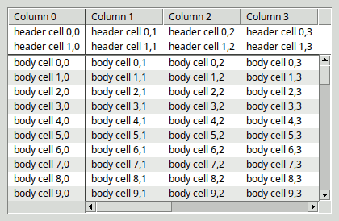

: **ANMERKUNG 3:**  Sie können die Erstellung von scrollbaren Tablelist (und anderen scrollbaren Widgets) erheblich vereinfachen, indem Sie ein [scrollarea](https://www.nemethi.de/scrollutil/scrollarea.html)-Widget verwenden, das Teil des [Scrollutil](https://www.nemethi.de/scrollutil/)-Paket ist. Es unterstützt sowohl statische als auch dynamische Bildlaufleisten und berücksichtigt die Kopfzeilen-Komponente sowie die Titelspalten von Tablelist-Widgets. Mithilfe des scrollarea-Widgets lässt sich der recht technische Code aus dem obigen Beispiel durch nur wenige Zeilen ersetzen:

```
package require scrollutil(_tile)

. . .

# Create the tablelist within a scrollarea
set sa [scrollutil::scrollarea ...]
set tbl $sa.tbl
tablelist::tablelist $tbl ...
$sa setwidget $tbl

. . .

# Manage the scrollarea
pack $sa -expand yes -fill both -padx 10 -pady 10
```

`pathName curcellselection ?-all|-nonhidden|-viewable?`
: Gibt eine Liste zurück, die die kanonischen Indizes (in der Form `row,col`, wobei `row` und `col` Zahlen sind) aller derzeit ausgewählten Elemente in der Tablelist enthält.  Wenn keine solchen Elemente in der Tablelist vorhanden sind, gibt es eine leere Zeichenkette zurück.

: Das optionale Argument kann verwendet werden, um die Menge der aktuell ausgewählten Elemente beim Erstellen der Ergebnisliste einzuschränken.  Der Standardwert `-all` bedeutet: keine Einschränkung. Der Wert `-nonhidden` filtert die Elemente heraus, bei denen die Option `-hide` in der entsprechenden Zeile oder im entsprechenden Spalte auf „true“ gesetzt ist.  Schließlich beschränkt der Wert `-viewable` die Menge der aktuell ausgewählten Elemente auf die [viewable](#ausf-hrliche-referenz) Elemente.

`pathName curselection ?-all|-nonhidden|-viewable?`
: Gibt eine Liste zurück, die die numerischen Indizes aller Elemente in der Tablelist enthält, die mindestens ein ausgewähltes Element enthalten.  Wenn es in der Tablelist keine solchen Elemente gibt, wird eine leere Zeichenkette zurückgegeben.

: Das optionale Argument kann verwendet werden, um die Menge der derzeit (teilweise) ausgewählten Elemente beim Erstellen der Ergebnisliste einzuschränken.  Der Standardwert `-all` bedeutet: keine Einschränkung. Der Wert `-nonhidden` filtert die Elemente heraus, bei denen die Option `-hide` in der jeweiligen Zeile auf „true“ gesetzt ist.  Schließlich beschränkt der Wert `-viewable` die Menge der aktuell (teilweise) ausgewählten Elemente auf die [viewable](#ausf-hrliche-referenz) Elemente.

`pathName delete firstIndex lastIndex`  
 `pathName delete indexList`
: Löscht ein oder mehrere Elemente der Tablelist, wenn deren `state` nicht `disabled` ist.  In der ersten Form des Befehls sind `firstIndex` und `lastIndex` Indizes, die das erste bzw. letzte Element des zu löschenden Bereichs festlegen.  Die zweite Form des Befehls akzeptiert eine Liste `indexList` mit Indizes, die die zu löschenden Elemente festlegen. In beiden Fällen werden auch alle untergeordneten Elemente der angegebenen Elemente gelöscht. Der Rückgabewert ist eine leere Zeichenkette.

: **HINWEIS:** Wenn das Tablelist-Widget keine Elemente enthält, geben beide Formen des Befehls sofort zurück, ohne dass weitere Aktionen (wie die Validierung der Indizes) durchgeführt werden.  Beispielsweise gibt  `pathName delete 0 end`  sofort zurück, ohne einen Fehler auszulösen, obwohl in diesem Fall beide Indizes ungültig sind.

`pathName deletecolumns firstColumn lastColumn`  
 `pathName deletecolumns columnIndexList`
: Löscht eine oder mehrere Spalten der Tablelist, wenn deren `state` nicht `disabled` ist.  In der ersten Form des Befehls sind `firstColumn` und `lastColumn` Indizes, die die erste und letzte Spalte des zu löschenden Bereichs festlegen.  Der Befehl akzeptiert eine Liste `columnIndexList` mit Indizes, die die zu löschenden Spalten festlegen. Gibt eine leere Zeichenkette zurück.

: **HINWEIS:** Wenn das Tablelist-Widget keine Spalten enthält, geben beide Formen des Befehls sofort zurück, ohne dass weitere Aktionen (wie die Validierung der Spaltenindizes) durchgeführt werden.  Beispielsweise gibt  `pathName deletecolumns 0 end`  sofort zurück, ohne einen Fehler auszulösen, obwohl in diesem Fall beide Spaltenindizes ungültig sind.

`pathName depth nodeIndex`
: Gibt die Anzahl der Schritte vom durch `nodeIndex` angegebenen Baumknoten zum Knoten `root` zurück. Die Tiefe des letzteren beträgt 0, die der Zeilen auf oberster Ebene 1 und so weiter.

`pathName descendantcount nodeIndex`
: Gibt die Anzahl der Nachkommen des durch `nodeIndex` angegebenen Baumknotens zurück. Wenn dieses Argument als `root` gelegt wird, entspricht der Wert der Anzahl der Elemente des Tablelist-Widgets.

`pathName dicttoitem dictionary`
: Gibt ein Tablelist-Element zurück, das dem durch `dictionary` angegebenen Dictionary entspricht.  Die Werte, die den Schlüsseln im angegebenen Dictionary entsprechen und gültige Spaltenindizes in einer der im Abschnitt [SPALTENINDIZES](#ausf-hrliche-referenz) beschriebenen Formen sind, werden als Elemente des resultierenden Tablelist-Eintrags interpretiert. Schlüssel, die keine gültigen Spaltenindizes sind, werden stillschweigend ignoriert.  Wenn die Anzahl der unterschiedlichen numerischen Entsprechungen der Schlüssel, die gültige Spaltenindizes sind (siehe den Unterbefehl `columnindex`), kleiner ist als die Anzahl der Spalten, werden die Elemente, die den fehlenden Spaltenindizes entsprechen, auf leere Zeichenketten gesetzt.

: Wenn Ihr Tablelist-Widget beispielsweise 3 Spalten hat, von denen die ersten beiden mit  `-name forename`  bzw.  `-name surname`  und Sie das Dictionary  `{forename Joe  surname Black}`  an den Unterbefehl `dicttoitem` übergeben, dann gibt der Befehl den Wert der Liste  `{Joe Black {}}` zurück.  Wenn der Benutzer die ersten beiden Spalten vertauscht, gibt der Unterbefehl für dasselbe Dictionary die Liste `{Black Joe {}}` zurück.

: Dieser Unterbefehl ist nur verfügbar, wenn der Befehl `dict` vorhanden ist. Dies ist der Fall, wenn Tcl Version 8.5 oder höher verwendet wird oder eine der alternativen [Tcl-spezifischen Dict-Implementierungen](](https://wiki.tcl.tk/10609)).

`pathName dumptofile fileName`
: Schreibt die in der internen Liste des Widgets enthaltenen Kopf- und Hauptelemente sowie Informationen zu den Spalten, der Sortierung und der Baumstruktur in die Datei, deren Pfadname durch `fileName` angegeben wird.  Bevor die Daten in die Datei geschrieben werden, erweitert der Unterbefehl alle Zeilen der Tablelist durch Aufruf von `expandall -fully`. Den Inhalt der Datei können Sie später mit Hilfe des Unterbefehls `loadfromfile` laden.

: **HINWEIS:**  Da die Ausführung des Unterbefehls `expandall` recht lange dauern kann (mehrere Sekunden oder sogar Minuten), wird empfohlen, den Aufruf von `dumptofile` zwischen `setbusycursor` und `restorecursor` einzufügen.

`pathName dumptostring`
: Gibt eine Zeichenkette zurück, die aus den in der internen Liste des Widgets enthaltenen Header- und Body-Elementen sowie aus Informationen zu den Spalten, der Sortierung und der Baumstruktur besteht. Vor der Erstellung dieser Zeichenkette erweitert der Unterbefehl alle Zeilen der Tablelist durch Aufruf von `expandall -fully`.  Sie können die zurückgegebene Zeichenkette später mit Hilfe des Unterbefehls `loadfromstring` laden.

: **HINWEIS:**  Da die Ausführung des Unterbefehls `expandall` recht lange dauern kann (mehrere Sekunden oder sogar Minuten), wird empfohlen, den Aufruf von `dumptostring` zwischen `setbusycursor` und `restorecursor` einzufügen.

`pathName editcell cellIndex`
: Startet die interaktive Bearbeitung des Inhalts der Zelle, wenn die Option `state` der Tablelist nicht auf `disabled` gesetzt ist und die Zelle sowohl [viewable](#ausf-hrliche-referenz) als auch editable ist.  Gibt eine leere Zeichenkette zurück. Bevor dieser Wert zurückgegeben wird, setzt der Befehl die Option `-exportselection` des Tablelist-Widgets auf `0` und stellt so sicher, dass das Widget die Auswahl nicht verliert, während der Inhalt der Zelle bearbeitet wird.  (HINWEIS: Nach Beendigung der Bearbeitungssitzung wird der ursprüngliche Wert der Option wiederhergestellt.) Weitere Informationen zur Bearbeitbarkeit und zum Bearbeitungsprozess finden Sie im Abschnitt [INTERACTIVE Zelle EDITING](#ausf-hrliche-referenz).

`pathName editinfo`
: Gibt eine Liste mit drei Elementen zurück, die Informationen über die Tabellistenzelle enthält, deren Inhalt gerade bearbeitet wird. Das erste Element der Liste ist der vollständige Schlüssel (in der Form `knumber`), der dem Element zugeordnet ist, das das gerade bearbeitete Tabellistenelement enthält.  Das zweite und dritte Element sind die Zeilen- und Spalten-Indizes der Zelle.  Wird derzeit keine Zelle bearbeitet, gibt das Programm den Wert  `{"" -1 -1}` zurück.

`pathName editwinpath`
: Gibt den Pfadnamen des temporären eingebetteten Widgets zurück, das für die interaktive Zellbearbeitung verwendet wird und durch den Unterbefehl `editcell` erstellt wurde.  Wenn derzeit keine Zelle bearbeitet wird, gibt der Rückgabewert eine leere Zeichenkette zurück. Mit diesem Unterbefehl können Sie innerhalb der durch die Konfigurationsoptionen `-editstartcommand` und `-editendcommand` festgelegten Befehle auf das Bearbeitungsfenster zugreifen.

`pathName editwintag`
: Gibt den Namen eines Bindungs-Tags zurück, dessen Name vom Pfadnamen des Tablelist-Widgets abhängt und das einigen Komponenten des temporären eingebetteten Widgets zugeordnet ist, das für die interaktive Zellenbearbeitung verwendet wird.  Diese Komponenten hängen vom Bearbeitungsfenster ab: das Widget selbst im Falle eines Tk-, Tile-, Checkbutton- oder Menubutton-Widgets; die „Entry“-Unterelemente des Bearbeitungsfensters im Falle eines „Mentry“-Widgets; das in einem als Bearbeitungsfenster verwendeten Toggle-Switch enthaltene ttk::scale-Widget; in allen anderen Fällen die einzige „Entry“-Eingabekomponente oder eine „Entry“-ähnliche Komponente des Bearbeitungsfensters (siehe auch den Unterbefehl `entrypath`).  Dieses Bindungs-Tag steht in der Liste der Bindungs-Tags der oben genannten Komponenten des Bearbeitungsfensters vor dem Tag `TablelistEdit` und ist für die Verwendung bei der Definition individueller Bindungs-Skripte zur Steuerung der interaktiven Zellbearbeitung vorgesehen.

: Der folgende Befehl ersetzt beispielsweise das Standardverhalten des Schlüssels `Return` bei der Bearbeitung von Zellen im Tablelist-Widget `.tbl` durch das des Schlüssels `Tab`:

```
bind [.tbl editwintag] <Return> "[bind TablelistEdit <Tab>]; break"
```

`pathName embedcheckbutton cellIndex ?command?`
: Setzt die Option `-window` der durch `cellIndex` angegebenen Zelle auf eine Prozedur, die einen Frame mit einem untergeordneten checkbutton erstellt, dessen Option `-variable` auf eine globale Variable gesetzt ist, deren Name privat für Tablelist und mit dem internen Wert der Zelle initialisiert wird (der der boolesche Wert `0` oder `1` sein sollte).  Jede Änderung des Auswahlzustands des checkbutton setzt den internen Wert der Zelle automatisch auf den entsprechenden booleschen Wert `0` oder `1`.  Wenn das optionale Argument `command` eine nicht leere Zeichenkette ist, wird die Option `-command` des checkbutton-Widgets auf ein Skript gesetzt, das dieses Argument mit dem Pfadnamen des Tablelist-Widgets und denaktuellen Zeilen- und Spaltenindizes der Zelle (die sich von denen zum Zeitpunkt der Erstellung des checkbutton unterscheiden können) verknüpft und ruft das resultierende Skript dann im Leerlauf auf, wodurch sichergestellt wird, dass zum Zeitpunkt des Aufrufs der interne Wert der Zelle bereits aktualisiert wurde, um den Auswahlzustand des checkbutton widerzuspiegeln.

: **ANMERKUNG 1:**  Beachten Sie, dass der Unterbefehl `windowpath` den Pfadnamen des eingebetteten Fensters gibt, bei dem es sich um einen Frame handelt; um den Pfadnamen des checkbuttons zu erhalten, fügen Sie `.ckbtn` an den Pfadnamen des Frames an.

: **ANMERKUNG 2:**  Wie oben beschrieben, spiegelt der *anfängliche* Auswahlzustand des checkbutton den internen Wert der Zelle wider, und jede Änderung des Auswahlzustands des checkbutton führt automatisch zu einer Aktualisierung der Zelle.  Wenn Sie hingegen den internen Wert der Zelle programmgesteuert ändern, liegt es in Ihrer Verantwortung, den Markierungszustand des checkbutton zu synchronisieren.  Zu diesem Zweck müssen Sie den Pfadnamen des checkbuttons wie oben beschrieben abrufen, den Namen der zugehörigen Variable über  `cget -variable`  ermitteln und diese Variable auf den internen Wert der Zelle setzen.

`pathName embedcheckbuttons columnIndex ?command?`
: Dieser Befehl entspricht logisch dem Aufruf von `embedcheckbutton` für alle Hauptzellen der durch `columnIndex` angegebenen Spalte.

`pathName embedttkcheckbutton cellIndex ?command?`
: Ähnlich wie `embedcheckbutton`, mit dem einzigen Unterschied, dass der in die Zelle eingebettete Rahmen ein untergeordnetes Element vom Typ ttk::checkbutton enthält.

`pathName embedttkcheckbuttons columnIndex ?command?`
: Dieser Befehl entspricht logisch gesehen dem Aufruf von `embedttkcheckbutton` für alle Hauptzellen der durch `columnIndex` angegebenen Spalte.

`pathName entrypath`
: Gibt den Pfadnamen des Eintrags oder der eintragsähnlichen Komponente des temporären eingebetteten Widgets zurück, das für die interaktive Zellenbearbeitung verwendet wird und durch den Unterbefehl `editcell` erstellt wurde.  Wenn derzeit keine Zelle bearbeitet wird oder die Bearbeitung mithilfe eines Tk- oder Tile-Checkbuttons, eines Tk- oder Tile-Menübuttons, eines Mentry oder eines Toggleswitch-Widgets erfolgt, ist der Wert eine leere Zeichenkette; ansonsten ist es der Pfadname eines Tk- oder Tile-„Entry“-Widgets, eines „text“- oder „ctext“-Widgets, eines Tk- oder Tile-„spinbox“-Widgets oder eines BWidget-„Entry“-Widgets, bei dem es sich um das Bearbeitungsfenster selbst oder eines seiner untergeordneten Elemente handeln kann.  Mit diesem Unterbefehl können Sie innerhalb der durch die Konfigurationsoptionen `-editstartcommand` und `-editendcommand` festgelegten Befehle auf das „Entry“-Widget oder eine „Entry“-ähnliche Eingabekomponente des temporär eingebetteten Widgets zugreifen.

`pathName expand indexList ?-fully|-partly?`
: Dieser Unterbefehl erweitert die angegebenen Zeilen einer Tablelist, die als Baum-Widget verwendet wird, d. h., er macht alle deren untergeordneten Elemente sichtbar.  Das optionale Argument `-fully` (das standardmäßig verwendet wird) gibt an, dass der Befehl rekursiv ausgeführt wird, d. h., alle Nachkommen der durch `indexList` angegebenen Knoten werden angezeigt.  Die Option `-partly` beschränkt die Operation auf nur eine Hierarchieebene und gibt an, dass nur die untergeordneten Elemente der angegebenen Knoten angezeigt werden, ohne den Ein- bzw. Ausklappzustand der untergeordneten Knoten zu ändern.

: Bevor die untergeordneten Elemente einer Zeile angezeigt werden, wird der als Wert der Option `-expandcommand` angegebene Befehl (sofern vorhanden) automatisch mit dem Pfadnamen des Tablelist-Widgets und dem Zeilenindex verkettet, und das daraus resultierende Skript wird im globalen Geltungsbereich ausgewertet.  Auf diese Weise können Sie die untergeordneten Elemente eines Baumknotens bei Bedarf einfügen, unmittelbar bevor dieser erweitert wird.

: **HINWEIS:**  Wenn Sie mehrere Zeilen aufklappen möchten, ist es wesentlich effizienter, diesen Unterbefehl für die Liste ihrer Indizes aufzurufen, als ihn in einer Schleife für die einzelnen Zeilen auszuführen.

`pathName expandall ?-fully|-partly?`
: Dieser Unterbefehl erweitert alle Zeilen der obersten Ebene einer Tablelist, die als Baum-Widget verwendet wird, d. h., er macht alle ihre untergeordneten Elemente sichtbar.  Das optionale Argument `-fully` (das standardmäßig verwendet wird) gibt an, dass der Befehl rekursiv ausgeführt wird, d. h., alle Nachkommen der Knoten der obersten Ebene werden angezeigt.  Die Option `-partly` beschränkt den Vorgang auf nur eine Hierarchieebene und gibt an, dass nur die untergeordneten Elemente der Knoten der obersten Ebene angezeigt werden, ohne den Ein- oder Ausklappzustand der untergeordneten Knoten zu ändern.

: Bevor die untergeordneten Elemente einer Zeile angezeigt werden, wird der als Wert der Option `-expandcommand` angegebene Befehl (sofern vorhanden) automatisch mit dem Pfadnamen des Tablelist-Widgets und dem Zeilenindex verkettet, und das daraus resultierende Skript wird im globalen Geltungsbereich ausgewertet.  Auf diese Weise können Sie die untergeordneten Elemente eines Baumknotens bei Bedarf einfügen, unmittelbar bevor dieser erweitert wird.

`pathName expandedkeys`
: Gibt die Liste der vollständigen Schlüssel der erweiterten Elemente zurück.

`pathName fillcolumn columnIndex ?-text|-image|-window? value`
: Dieser Unterbefehl entspricht logisch dem Aufruf des Unterbefehls `cellconfigure` für alle Hauptzellen der angegebenen Spalte, wobei `-text` (die Standardeinstellung), `-image` oder `-window` sowie `value` als Argumente.

`pathName findcolumnname name`
: Gibt den Index der ersten Spalte zurück, deren Name (gemäß den Konfigurationsoptionen `-name`) dem Wert `name` entspricht. Wenn keine Spalten den angegebenen Namen haben, lautet der Rückgabewert `-1`.

`pathName findrowname name ?-descend? ?-parent nodeIndex?`
: Gibt den Index der ersten untergeordneten Zeile des durch `nodeIndex` angegebenen Baumknotens zurück, dessen Name (der durch die Konfigurationsoption `-name` festgelegt wird) dem Wert `name` entspricht.  Die Option `-descend` erweitert die Suche auf alle Nachkommen des durch die Option `-parent` angegebenen Baumknotens. Standardmäßig ist die Suche auf die Kinder des übergeordneten Knotens beschränkt.  Der Standard-Überknoten ist `root`. Bei der Suche nach dem angegebenen Namen werden die Elemente in der Reihenfolge ihrer Zeilenindizes durchlaufen. Wenn keine der relevanten Zeilen den angegebenen Namen enthält, gibt der Server den Wert `-1` zurück.

`pathName finishediting`
: Dieser Unterbefehl versucht, die interaktive Bearbeitung des Inhalts der Zelle zu beenden, deren Index an den Unterbefehl `editcell` übergeben wurde, indem er das in die Zelle eingebettete temporäre Widget löscht und den Inhalt der Zelle aktualisiert.  Die genauen Schritte sind wie folgt: Zunächst wird der endgültige Text des Widgets mit seinem ursprünglichen Text verglichen. Wenn diese identisch sind, wird das Bearbeitungsfenster gelöscht und der ursprüngliche Inhalt der Zelle wiederhergestellt.  Wenn die beiden Zeichenketten unterschiedlich sind und der Wert der Konfigurationsoption `-editendcommand` eine nicht leere Zeichenkette ist, wird der endgültige Text des Widgets als letztes Argument an diesen Befehl übergeben (nach dem Pfadnamen der Tablelist sowie den Zeilen- und Spaltenindizes der Zelle), das resultierende Skript wird im globalen Geltungsbereich ausgewertet, und der Rückgabewert wird nach dem Schließen des Bearbeitungsfensters zum neuen Inhalt der Zelle.  Wurde jedoch innerhalb dieses Skripts der Unterbefehl `rejectinput` aufgerufen, wird der Wert der Zelle nicht geändert und das eingebettete Widget bleibt in der Zelle angezeigt; in diesem Fall gibt der Befehl den booleschen Wert `0` zurück.  In allen anderen Fällen lautet der Wert `1`. Bevor der Wert `1` gegeben wird, stellt der Befehl den ursprünglichen Wert der Option `-exportselection` des Tablelist-Widgets wieder her und generiert das virtuelle Ereignis `<<TablelistCellUpdated>>`, wenn der Bearbeitungsvorgang den Inhalt der Zelle tatsächlich verändert hat.  Bei Tk-Versionen 8.5 und höher wird dieses virtuelle Ereignis so generiert, dass seine Option `-data` auf eine Liste gesetzt ist, die aus den numerischen Zeilen- und Spalten-Indizes der Zelle besteht, deren Inhalt gerade bearbeitet wird.  Wurde zum Zeitpunkt des Aufrufs des Befehls keine Zelle bearbeitet, gibt der Befehl den selben Wert `1` zurück, es wird jedoch kein virtuelles Ereignis generiert.  Ebenso gibt der Unterbefehl, wenn der Zustand des Widgets `disabled` ist, sofort den Wert `1` zurück, ohne die Bearbeitung zu beenden und ein virtuelles Ereignis zu erzeugen.

: Dieser Unterbefehl wird *implizit* durch Drücken von `Return` oder `KP_Enter` (zusammen mit `Control`, wenn es sich bei dem Bearbeitungsfenster um ein Text- oder Ctext-Widget handelt) beim Bearbeiten einer Zelle, oder durch Klicken mit der linken Maustaste an einer beliebigen Stelle im Hauptbereich der Tablelist außerhalb der gerade bearbeiteten Zelle oder durch Wechseln in eine andere bearbeitbare Zelle mittels Tastaturnavigation.  Wenn die Bearbeitung mit der linken Maustaste gestartet wurde, handelt es sich bei dem Bearbeitungsfenster um ein Tk-, Tile-Checkbutton- oder Toggleswitch-Widget und ist der Wert der Option `-instanttoggle` „true“, dann wird dieser Unterbefehl automatisch und ohne jegliche Benutzerinteraktion aufgerufen.  Ähnlich verhält es sich, wenn das Bearbeitungsfenster eines der vier von Tablelist unterstützten Combobox-Widgets oder ein (ttk::)Menüknopf-Widget ist und der Wert der Option `-autofinishediting` „true“ ist, wird durch die Auswahl eines Combobox- oder Menüeintrags automatisch dieser Unterbefehl aufgerufen und damit die Bearbeitungssitzung beendet.  Schließlich wird dieser Unterbefehl auch automatisch aufgerufen, wenn der Wert der Option `-editendonfocusout` „true“ ist und das Tablelist-Widget den Fokus verliert.

: Wenn der Wert der Option `-allowduplicates` des Spalts der Zelle „true“ ist (Standardeinstellung), dann sind weitere Tastenkombinationen im Bearbeitungsfenster, die einen Aufruf dieses Unterbefehls auslösen, `Alt-Return`, `Alt-KP_Enter`, `Alt-a`, `Alt-d` und `Alt-u`, die zusätzlich den neuen Wert in einige andere Zellen der Spalte kopieren.  Anschließend erzeugen die Bindungen für diese Tastenfolgen das virtuelle Ereignis `<<TablelistCopyFinished>>`.  Bei Tk-Versionen 8.5 und höher wird dieses virtuelle Ereignis so erzeugt, dass seine Option `-data` auf den numerischen Index der Spalte der Zelle gesetzt ist, deren Inhalt bearbeitet wurde.  Wenn der Wert der Konfigurationsoption `-aftercopycommand` eine nicht leere Zeichenkette ist, übergeben die oben genannten Bindungen nach der Erzeugung dieses virtuellen Ereignisses den Pfadnamen der Tablelist und den Index der Spalten der Zelle an diesen Befehl und führen die Auswertung des resultierenden Skripts im globalen Geltungsbereich aus.  Unter Mac OS X/11+ Aqua wird die Tastenfolge `Alt-a` durch `Control-Command-a` ersetzt, und in den anderen Tastenfolgen erfolgt die Ersetzung des Modifikators `Alt` durch `Command`.

: **HINWEIS:**  Es gibt auch Situationen, in denen ein *expliziter* Aufruf dieses Unterbefehls erforderlich ist, um sicherzustellen, dass die gerade bearbeitete Zelle mit dem vom Benutzer eingegebenen Text aktualisiert wird.  Wenn beispielsweise ein Tablelist-Widget Teil eines Dialogfelds ist, das zur Bearbeitung von Daten dient, sollte der Befehl, der der Schaltfläche zum Übernehmen der Daten zugeordnet ist, diesen Unterbefehl aufrufen; andernfalls geht der im Bearbeitungsfenster eingegebene Text verloren, wenn die Schaltfläche während der interaktiven Zellenbearbeitung gedrückt wird (es sei denn, es handelt sich bei dieser Schaltfläche um ein „ttk::button“-Widget; in diesem Fall verliert die „Tablelist“ durch das Drücken der Schaltfläche den Fokus, was wiederum diesen Unterbefehl aufruft, sofern die Option `-editendonfocusout` auf „true“ gesetzt wurde).

`pathName formatinfo`
: Dieser Befehl ist dafür vorgesehen, aus einem Tcl-Befehl heraus aufgerufen zu werden, der als Wert der Konfigurationsoption `-formatcommand` angegeben ist. Er gibt eine Liste mit drei Elementen zurück, die Informationen über die Text- oder Kopfzeilenzelle enthält, deren Inhalt mithilfe dieses Befehls formatiert wird.  Das erste Element der Liste ist der vollständige Schlüssel (in der Form `knumber` oder `hknumber`), der dem Haupt- oder Kopfelement zugeordnet ist, das das zu formatierende Tablelist-Element enthält.  Das zweite und dritte Element der Liste sind die Zeilen- (bzw. Kopfzeilen-) und Spaltenindizes der Zelle.

: **HINWEIS:**  Dieser Unterbefehl wird benötigt, wenn das Ergebnis der Formatierung von der Zeile der Zelle abhängen soll.  Um ihn verwenden zu können, legen Sie den Wert der Konfigurationsoptionen für die Spalte `-formatcommand` auf `[list formatCommand pathName]` fest, wie im folgenden Beispiel gezeigt:

```
.tbl columnconfigure 1 -formatcommand [list formatValue .tbl]

proc formatValue {tbl val} {
    # Get information about the cell whose content is being formatted
    foreach {key row col} [$tbl formatinfo] {}

    # Return a string depending on $val and $row (or $key)
    . . .
}
```

`pathName get firstIndex lastIndex ?-all|-nonhidden|-viewable?`  
 `pathName get indexList`
: Die erste Form des Befehls gibt eine Liste zurück, deren Elemente alle Elemente der Tablelist (d. h. Zeileninhalte) zwischen `firstIndex` und `lastIndex` (einschließlich) sind.  Das optionale Argument kann verwendet werden, um die Einträge beim Erstellen der Ergebnisliste einzuschränken.  Der Standardwert `-all` bedeutet: keine Einschränkung. Der Wert `-nonhidden` filtert die Elemente heraus, bei denen die Option `-hide` der jeweiligen Zeile auf „true“ gesetzt ist.  Schließlich beschränkt der Wert `-viewable` die Elemente auf die [viewable](#ausf-hrliche-referenz) Elemente.

: Der von der zweiten Form zurückgegebene Wert hängt von der Anzahl der Elemente in der Liste `indexList` ab: Enthält diese genau einen Index, so ist der Rückgabewert das durch diesen Index angegebene Element der Tablelist (oder eine leere Zeichenkette, wenn der Index auf ein nicht vorhandenes Element verweist); ansonsten gibt der Befehl die Liste aller Tablelist-Elemente zurück, die den durch `indexList` angegebenen Indizes entsprechen.

`pathName getcells firstCell lastCell ?-all|-nonhidden|-viewable?`  
 `pathName getcells cellIndexList`
: Die erste Form des Befehls gibt eine Liste zurück, deren Elemente alle Elemente der Tablelist (d. h. Zellinhalte) zwischen `firstCell` und `lastCell` (einschließlich) sind.  Das optionale Argument kann verwendet werden, um die Elemente beim Erstellen der Ergebnisliste einzuschränken.  Der Standardwert `-all` bedeutet: keine Einschränkung. Der Wert `-nonhidden` filtert die Elemente heraus, bei denen die Option `-hide` für die jeweilige Zeile oder Spalte auf „true“ gesetzt ist.  Schließlich beschränkt der Wert `-viewable` die Elemente auf die [viewable](#ausf-hrliche-referenz) Elemente.

: Die zweite Form gibt einen Wert zurück, der von der Anzahl der Elemente in der Liste `cellIndexList` abhängt: Wenn diese genau einen Zellenindex enthält, ist der Wert der durch diesen Zellenindex angegebene Tabellisten-Element-Wert; andernfalls gibt der Befehl die Liste aller Tabellisten-Elemente zurück, die den durch `cellIndexList` angegebenen Zellenindizes entsprechen.

`pathName getcolumns firstColumn lastColumn`  
 `pathName getcolumns columnIndexList`
: Die erste Form des Befehls gibt eine Liste zurück, deren Elemente wiederum Listen sind, wobei jede dieser Unterlisten genau einer Spalte zwischen `firstColumn` und `lastColumn` (einschließlich) entspricht und aus allen in dieser Spalte enthaltenen Elementen des Datenbereichs besteht.  Der von der zweiten Form zurückgegebene Wert hängt von der Anzahl der Elemente in der Liste `columnIndexList` ab: Wenn diese genau einen Spaltenindex enthält, so ist der Rückgabewert eine Liste, die aus allen „tablelist“-Körperelementen besteht, die in der durch diesen Spaltenindex angegebenen Spalte enthalten sind; ansonsten gibt der Befehl eine Liste zurück, deren Elemente selbst Listen sind, wobei jede dieser Unterlisten genau einem Index in `columnIndexList` entspricht und aus allen in dieser Spalte enthaltenen Tablelist-Körperelementen besteht.

`pathName getformatted firstIndex lastIndex ?-all|-nonhidden|-viewable?`  
 `pathName getformatted indexList`
: Die erste Form des Befehls gibt eine Liste zurück, deren Elemente alle formatierten-Tablelist-Elemente sind (d. h. formatierte Zeileninhalte) zwischen `firstIndex` und `lastIndex` (einschließlich) sind. Das optionale Argument kann verwendet werden, um die Elemente beim Erstellen der Ergebnisliste einzuschränken.  Der Standardwert `-all` bedeutet: keine Einschränkung.  Der Wert `-nonhidden` filtert die Elemente heraus, deren Zeile die Option `-hide` auf „true“ gesetzt hat.  Schließlich beschränkt der Wert `-viewable` die Elemente auf die [viewable](#ausf-hrliche-referenz) Elemente.

: Der von der zweiten Form gegebene Wert hängt von der Anzahl der Elemente in der Liste `indexList` ab: Enthält diese genau einen Index, so ist der Wert der durch diesen Index angegebene formatierte Tablelist-Element (oder eine leere Zeichenkette, wenn der Index auf ein nicht vorhandenes Element verweist); ansonsten gibt der Befehl die Liste aller formatierten Tablelist-Elemente zurück, die den durch `indexList` festgelegten Indizes entsprechen.

`pathName getformattedcells firstCell lastCell ?-all|-nonhidden|-viewable?`  
 `pathName getformattedcells cellIndexList`
: Die erste Form des Befehls gibt eine Liste zurück, deren Elemente alle formatierten-Tablelist-Elemente sind (d. h. formatierte Zellinhalte) zwischen `firstCell` und `lastCell`, einschließlich. Das optionale Argument kann verwendet werden, um die Elemente beim Erstellen der Ergebnisliste einzuschränken.  Der Standardwert `-all` bedeutet: keine Einschränkung.  Der Wert `-nonhidden` filtert die Elemente heraus, bei denen die Option `-hide` für die Zeile oder die Spalte auf „true“ gesetzt ist.  Schließlich beschränkt der Wert `-viewable` die Elemente auf die [viewable](#ausf-hrliche-referenz) Elemente.

: Der von der zweiten Form gegebene Wert hängt von der Anzahl der Elemente in der Liste `cellIndexList` ab: Wenn diese genau einen Zellenindex enthält, ist der Wert der formatierte Tablelist-Element, auf den dieser Zellenindex verweist; andernfalls gibt der Befehl die Liste aller formatierten Tablelist-Elemente zurück, die den durch `cellIndexList` angegebenen Zellenindizes entsprechen.

`pathName getformattedcolumns firstColumn lastColumn`  
 `pathName getformattedcolumns columnIndexList`
: Die erste Form des Befehls gibt eine Liste zurück, deren Elemente wiederum Listen sind, wobei jede dieser Unterlisten genau einer Spalte zwischen `firstColumn` und `lastColumn` (einschließlich) entspricht und aus allen formatierten-Tablelist-Körperelemente, die in dieser Spalte enthalten sind.  Der von der zweiten Form zurückgegebene Wert hängt von der Anzahl der Elemente in der Liste `columnIndexList` ab: Wenn diese genau einen Spaltenindex enthält, so ist der Rückgabewert eine Liste, die aus allen formatierten „tablelist“-Körperelementen besteht, die in der durch diesen Spaltenindex angegebenen Spalte enthalten sind; ansonsten gibt der Befehl eine Liste zurück, deren Elemente selbst Listen sind, wobei jede dieser Unterlisten genau einem Index für einen Spalte in `columnIndexList` entspricht und aus allen formatierten „tablelist“-Körperelementen besteht, die in diesem Spalte enthalten sind.

`pathName getfullkeys firstIndex lastIndex ?-all|-nonhidden|-viewable?`  
 `pathName getfullkeys indexList`
: Die erste Form des Befehls gibt eine Liste zurück, deren Elemente alle vollständigen Schlüssel sind, die den Tablelist-Elementen zwischen `firstIndex` und `lastIndex` (einschließlich) zugeordnet sind. Das optionale Argument kann verwendet werden, um die Elemente beim Erstellen der Ergebnisliste einzuschränken.  Der Standardwert `-all` bedeutet: keine Einschränkung. Der Wert `-nonhidden` filtert die Elemente heraus, bei denen die Option `-hide` in der jeweiligen Zeile auf „true“ gesetzt ist.  Schließlich beschränkt der Wert `-viewable` die Elemente auf die [viewable](#ausf-hrliche-referenz) Elemente.

: Der von der zweiten Form zurückgegebene Wert hängt von der Anzahl der Elemente in der Liste `indexList` ab: Enthält diese genau einen Index, so ist der Rückgabewert der vollständige Schlüssel, der dem durch diesen Index angegebenen Tablelist-Element zugeordnet ist (oder eine leere Zeichenkette, falls der Index auf ein nicht vorhandenes Element verweist); ansonsten gibt der Befehl die Liste aller vollständigen Schlüssel zurück, die den Tablelist-Elementen zugeordnet sind, die den durch `indexList` angegebenen Indizes entsprechen.

: Jedes Element eines Tablelist-Widgets verfügt über eine eindeutige Sequenznummer, die unverändert bleibt, bis das Element gelöscht wird, und somit als Schlüssel dient, der das Element eindeutig identifiziert, selbst wenn sich dessen Position (d. h. der numerische Index der Zeile) ändert.  Dieser Befehl bietet schreibgeschützten Zugriff auf die vollständigen Schlüssel, die durch Voranstellen des Buchstabens `k` an diese internen Element-IDs erhalten werden.

`pathName getkeys firstIndex lastIndex ?-all|-nonhidden|-viewable?`  
 `pathName getkeys indexList`
: Die erste Form des Befehls gibt eine Liste zurück, deren Elemente alle Laufnummern sind, die den Tablelist-Elementen zwischen `firstIndex` und `lastIndex` (einschließlich) zugeordnet sind. Das optionale Argument kann verwendet werden, um die Elemente beim Erstellen der Ergebnisliste einzuschränken.  Der Standardwert `-all` bedeutet: keine Einschränkung. Der Wert `-nonhidden` filtert die Elemente heraus, bei denen die Option `-hide` in der jeweiligen Zeile auf „true“ gesetzt ist.  Schließlich beschränkt der Wert `-viewable` die Elemente auf die [viewable](#ausf-hrliche-referenz) anzeigbaren.

: Der von der zweiten Form zurückgegebene Wert hängt von der Anzahl der Elemente in der Liste `indexList` ab: Enthält diese genau einen Index, so ist der Rückgabewert die Sequenznummer, die dem durch diesen Index angegebenen Tablelist-Element zugeordnet ist (oder eine leere Zeichenkette, falls der Index auf ein nicht vorhandenes Element verweist); ansonsten gibt der Befehl die Liste aller Sequenznummern zurück, die den Tablelist-Elementen zugeordnet sind, welche die durch `indexList` festgelegten Indizes entsprechen.

: Jedes Element eines Tablelist-Widgets verfügt über eine eindeutige Sequenznummer, die bis zum Löschen des Elements unverändert bleibt und somit als Schlüssel dient, der das Element eindeutig identifiziert, selbst wenn sich dessen Position (d. h. der numerische Zeilenindex) ändert. Dieser Befehl ermöglicht den schreibgeschützten Zugriff auf diese internen Element-IDs.

`pathName hasattrib name`
: Gibt `1` zurück, wenn das Attribut `name` vorhanden ist, andernfalls `0`.

`pathName hascellattrib cellIndex name`
: Gibt `1` zurück, wenn das Attribut `name` für die durch `cellIndex` angegebene Zelle vorhanden ist, andernfalls `0`.

`pathName hascolumnattrib columnIndex name`
: Gibt `1` zurück, wenn das Attribut `name` für die durch `columnIndex` angegebene Spalte vorhanden ist, andernfalls `0`.

`pathName hasrowattrib index name`
: Gibt `1` zurück, wenn das Attribut `name` für die durch `index` angegebene Zeile vorhanden ist, andernfalls `0`.

`pathName header option ?arg arg ...?`
: Dieser Befehl wird nur von Tk-Versionen ab 8.5 unterstützt. Er dient dazu, verschiedene Operationen auf die Elemente in der Kopfzeilenkomponente des Widgets auszuführen. Die unterstützten Unterbefehle sind im Abschnitt [UNTERBEFEHLE FÜR DEN KOPFBEREICH](#ausf-hrliche-referenz) beschrieben.

`pathName headerpath`
: Dieser Befehl wird nur von Tk-Versionen ab 8.5 unterstützt. Er gibt den Pfadnamen des Text-Widgets zurück, das die Kopfzeilenelemente enthält.

`pathName headertag`
: Dieser Befehl wird nur für Tk-Versionen ab 8.5 unterstützt.  Er gibt den Namen eines Bindungstags zurück, dessen Name vom Pfadnamen des Tablelist-Widgets abhängt und das dem Text-Widget zugeordnet ist, das die Kopfzeilenelemente enthält, sowie den Message- und Label-Widgets, die zur Anzeige von mehrzeiligen Elementen bzw. Bildern in den Kopfzeilenzellen verwendet werden.  Dieses Bindungs-Tag steht in der Liste der Bindungs-Tags der oben genannten Tablelist-Nachkommen vor dem Tag `TablelistHeader` und ist für die Verwendung bei der Definition individueller Bindungs-Skripte für Tablelist-Widgets vorgesehen.  Der Hauptvorteil der Verwendung dieses Tags anstelle des Pfadnamens des Text-Widgets, das die Kopfzeilenelemente enthält, besteht darin, dass Sie damit Ereignisbehandlungsskripte schreiben können, die nicht nur für das oben genannte Text-Widget gelten, sondern auch für die darin enthaltenen mehrzeiligen Zellen und eingebetteten Bilder.

`pathName hidetargetmark`
: Blendet den horizontalen Abstand oder den vertikalen Balken aus, der durch den Befehl `showtargetmark` angezeigt wird. Es wird kein Fehler ausgegeben, wenn das Zielobjekt zum Zeitpunkt der Ausführung des Befehls nicht sichtbar ist.

: Dieser Befehl ist für die Verwendung während eines Vorgangs des Ziehens und Ablegens vorgesehen, bei dem das Tabellisten-Widget (oder dessen Body-Komponente) als Ablegeziel registriert wurde. Beispiele finden Sie im Abschnitt [DRAG & DROP SUPPORT](#ausf-hrliche-referenz).

`pathName imagelabelpath cellIndex`
: Gibt den Pfadnamen des Label-Widgets zurück, das das in die durch `cellIndex` angegebene Zelle eingebettete Bild enthält, wie mit der Option `-image` des Unterbefehls `cellconfigure` festgelegt.  Wenn kein Bild in die Zelle eingebettet ist, gibt der Wert eine leere Zeichenkette zurück.

: **HINWEIS:** Beachten Sie, dass die Label-Widgets, die eingebettete Bilder enthalten, bei Bedarf erstellt werden.  Aus diesem Grund gibt dieser Unterbefehl nur dann einen nicht leeren Pfad zurück, wenn die Zeile, die die angegebene Zelle mit einem eingebetteten Bildern enthält, derzeit im Tablelist-Fenster sichtbar ist.  Beachten Sie dies immer dann, wenn Sie auf die Label-Widgets mit eingebetteten Bildern zugreifen müssen.  Um beispielsweise Mausklicks auf eingebettete Bilder zu verarbeiten, sollten Sie wie im folgenden Code-Beispiel gezeigt vorgehen:

```
bind [.tbl bodytag] <Button-1> {printClickedImage %W %x %y}
proc printClickedImage {w x y} {
    foreach {tbl x y} [tablelist::convEventFields $w $x $y] {}
    set cellIdx [$tbl containingcell $x $y]
    scan $cellIdx "%d,%d" row col
    if {$row >= 0 && $col >= 0 &&
        [string compare $w [$tbl imagelabelpath $cellIdx]] == 0} {
        puts "clicked the image of cell $cellIdx"
    }
}
```

`pathName index index`
: Gibt den ganzzahligen Index-Wert der Zeile zurück, der `index` entspricht.  Aus Gründen der Kompatibilität mit der Tk-Core-Listbox gilt: Wenn `index` gleich `end` ist, gibt der Wert die Anzahl der Elemente in der Tablelist zurück (und nicht den Index des letzten Elements).  Um den numerischen Index des letzten Elements zu erhalten, können Sie das Wort `last` als Argument für `index` übergeben.

`pathName insert index ?item item ...?`
: Fügt null oder mehr neue Elemente in die interne Liste des Widgets ein, und zwar direkt vor dem durch `index` angegebenen Element, wenn der Wert `state` der Tablelist nicht `disabled` ist.  Wenn `index` der Anzahl der Elemente entspricht oder als `end` festgelegt wird, werden die neuen Elemente am Ende der Liste des Widgets hinzugefügt.  Tabulatorzeichen werden als `\t` angezeigt (d. h. ein Backslash gefolgt von einem `t`), werden jedoch unverändert in die interne Liste eingefügt.  Zeilenumbruchzeichen erzwingen Zeilenumbrüche, d. h., sie führen zu mehrzeiligen Elementen (die in eingebetteten Nachrichten-Widgets angezeigt werden, die bei Bedarf erstellt werden). Der Wert ist die Liste der vollständigen Schlüssel, die den gerade eingefügten Elementen zugeordnet sind.

: **HINWEIS:**  Dieser Unterbefehl eignet sich nicht zum Einfügen von Elementen in eine Tablelist, die für die Darstellung einer Baumstruktur vorgesehen ist.  Verwenden Sie für solche Tablelist-Widgets den Unterbefehl `insertchildren` oder `insertchildlist`.

`pathName insertchildlist parentNodeIndex childIndex itemList`
: Fügt die Elemente der Liste `itemList` in die interne Liste der untergeordneten Elemente des durch `parentNodeIndex` angegebenen Knotens ein, und zwar unmittelbar vor dem durch `childIndex` angegebenen Element, wenn …`state` nicht `disabled` ist.  `childIndex` muss eine Zahl, `last` (Legt das letzte untergeordnete Element des übergeordneten Elements fest) oder `end` sein; Wenn es der Anzahl der durch `parentNodeIndex` angegebenen Kinder des Knotens entspricht oder als `end` festgelegt wird, werden die neuen Elemente am Ende der Kinderliste des übergeordneten Knotens hinzugefügt.  Tabulatorzeichen werden als `\t` angezeigt (d. h. ein Backslash gefolgt von einem `t`), werden jedoch unverändert in die interne Liste eingefügt.  Zeilenumbruchzeichen erzwingen Zeilenumbrüche, d. h., sie führen zu mehrzeiligen Elementen (die in eingebetteten Nachrichten-Widgets angezeigt werden, die bei Bedarf erstellt werden). Der Wert ist die Liste der vollständigen Schlüssel, die den gerade eingefügten Elementen zugeordnet sind.

: Dieser Befehl hat dieselbe Wirkung wie

```
eval [list pathName insertchildren parentNodeIndex childIndex] itemList
```

: aber es ist effizienter und einfacher zu bedienen.

: **HINWEIS:**  Sie können eine erhebliche Zeitersparnis erzielen, indem Sie diesen Unterbefehl verwenden, um eine ganze Liste von Elementen einzufügen, anstatt den Befehl `insertchildren` mehrfach aufzurufen.

`pathName insertchildren parentNodeIndex childIndex ?item item ...?`
: Fügt null oder mehr neue Elemente in die interne Liste der untergeordneten Elemente des durch `parentNodeIndex` festgelegten Knotens ein, und zwar direkt vor dem durch `childIndex` festgelegten Element, wenn …`state` nicht `disabled` ist.  `childIndex` muss eine Zahl, `last` (legt das letzte untergeordnete Element des übergeordneten Elements fest) oder `end` sein; Wenn es der Anzahl der durch `parentNodeIndex` angegebenen Kinder des Knotens entspricht oder als `end` festgelegt wird, werden die neuen Elemente am Ende der Kinderliste des übergeordneten Knotens hinzugefügt.  Tabulatorzeichen werden als `\t` angezeigt (d. h. ein Backslash gefolgt von einem `t`), werden jedoch unverändert in die interne Liste eingefügt.  Zeilenumbruchzeichen erzwingen Zeilenumbrüche, d. h., sie führen zu mehrzeiligen Elementen (die in eingebetteten Nachrichten-Widgets angezeigt werden, die bei Bedarf erstellt werden). Der Wert ist die Liste der vollständigen Schlüssel, die den gerade eingefügten Elementen zugeordnet sind.

: **HINWEIS:**  Es ist ausdrücklich erlaubt, den Namen `insertchildren` als `insertchild` abzukürzen.  Dies ist praktisch, wenn Sie diesen Unterbefehl verwenden, um nur ein untergeordnetes Element einzufügen.

`pathName insertcolumnlist columnIndex columnList`
: Fügt die durch die Liste `columnList` festgelegten Spalten unmittelbar vor der durch `columnIndex` festgelegten Spalte ein, wenn …`state` nicht `disabled` ist.  Wenn `columnIndex` der Anzahl der Spalten entspricht oder als `end` festgelegt wird, werden die neuen Spalten am Ende der Spaltenliste angefügt.  Das Argument `columnList` muss eine Liste sein, die die Breite, den Titel und optionale Angaben zur Ausrichtung für die neuen Spalten enthält, und zwar in derselben Form wie bei den Konfigurationsoptionen `-columns`.  Der Rückgabewert ist eine leere Zeichenkette. Die Elemente der neuen Spalten sind zunächst leere Zeichenketten; am einfachsten lassen sich diese Werte mit dem Unterbefehl `fillcolumn` oder der Konfigurationsoption `-text` ändern.

: Dieser Befehl hat dieselbe Wirkung wie

```
eval [list pathName insertcolumns columnIndex] columnList
```

: aber es ist effizienter und einfacher zu bedienen.

`pathName insertcolumns columnIndex ?width title ?alignment? width title ?alignment? ...?`
: Fügt null oder mehr neue Spalten unmittelbar vor der durch `columnIndex` angegebenen Spalte ein, wenn der Wert `state` der Tablelist nicht `disabled` ist.  Wenn `columnIndex` der Anzahl der Spalten entspricht oder als `end` festgelegt wird, werden die neuen Spalten am Ende der Spaltenliste hinzugefügt.  Die auf den Spaltenindex folgenden Argumente haben dieselbe Bedeutung wie bei der Konfigurationsoption `-columns`.  Der Rückgabewert ist eine leere Zeichenkette. Die Elemente der neuen Spalten sind anfangs leere Zeichenketten; am einfachsten lassen sich diese Werte mit dem Unterbefehl `fillcolumn` oder der Konfigurationsoption `-text` ändern.

`pathName insertlist index itemList`
: Fügt die Elemente der Liste `itemList` in die interne Liste des Widgets direkt vor dem durch `index` angegebenen Element ein, wenn …`state` nicht `disabled` ist.  Wenn `index` der Anzahl der Elemente entspricht oder als `end` festgelegt wird, werden die neuen Elemente am Ende der Liste des Widgets angehängt.  Tabulatorzeichen werden als `\t` angezeigt (d. h. ein Backslash gefolgt von einem `t`), werden jedoch unverändert in die interne Liste eingefügt.  Zeilenumbruchzeichen erzwingen Zeilenumbrüche, d. h., sie führen zu mehrzeiligen Elementen (die in eingebetteten Nachrichten-Widgets angezeigt werden, die bei Bedarf erstellt werden). Der Wert ist die Liste der vollständigen Schlüssel, die den gerade eingefügten Elementen zugeordnet sind.

: Dieser Befehl hat dieselbe Wirkung wie

```
eval [list pathName insert index] itemList
```

: aber es ist effizienter und einfacher zu bedienen.

: **ANMERKUNG 1:**  Sie können eine erhebliche Beschleunigung erzielen, indem Sie diesen Unterbefehl verwenden, um eine ganze Liste von Elementen einzufügen, anstatt `insert` mehrfach aufzurufen.

: **HINWEIS 2:**  Dieser Unterbefehl eignet sich nicht zum Einfügen von Elementen in eine Tablelist, die für die Darstellung einer Baumstruktur vorgesehen ist.  Verwenden Sie für solche Tablelist-Widgets den Unterbefehl `insertchildlist` oder `insertchildren`.

`pathName iselemsnipped cellIndex fullTextName`
: Gibt den Wert `1` zurück, wenn der in der durch `cellIndex` angegebenen Zelle angezeigte Text gekürzt ist, andernfalls `0`.  In beiden Fällen wird der vollständige (nicht gekürzte) Zelltext in der Variable gespeichert, deren Name durch `fullTextName` angegeben wird; dieser vollständige Text kann entweder der Inhalt der Zelle sein oder die Zeichenkette, die unter Verwendung der Option `-formatcommand` der Spalte der Zelle aus diesem Inhalt gewonnen wird.  Am häufigsten wird dieser Befehl innerhalb der Prozedur aufgerufen, die als Wert der Konfigurationsoption `-tooltipaddcommand` angegeben ist.

`pathName isexpanded index`
: Gibt den Wert `1` zurück, wenn die durch `index` angegebene Zeile erweitert ist, andernfalls den Wert `0`.

`pathName istitlesnipped columnIndex fullTextName`
: Gibt den Wert `1` zurück, wenn der in der durch `columnIndex` angegebenen Kopfzeile angezeigte Text gekürzt ist, andernfalls `0`.  In beiden Fällen wird der vollständige (nicht gekürzte) Beschriftungstext in der Variablen gespeichert, deren Name durch `fullTextName` vorgegeben ist. Der häufigste Aufruf dieses Befehls erfolgt innerhalb der Prozedur, die als Wert der Konfigurationsoption `-tooltipaddcommand` angegeben ist.

`pathName isviewable index`
: Gibt den Wert `1` zurück, wenn die durch `index` angegebene Zeile **sichtbar** ist, andernfalls `0`.  Eine Zeile einer Tablelist gilt als sichtbar, wenn der Wert ihrer Option `-hide` „false“ ist und alle ihre übergeordneten Elemente (teilweise) erweitert sind.   Ebenso wird eine Zelle der Tablelist als sichtbar bezeichnet, wenn ihre Zeile sichtbar ist und der Wert der Option `-hide` ihres Spalts „false“ ist.

`pathName itemlistvar`
: Gibt den Namen einer Variablen zurück, die von Tablelist verwendet wird, um die dem Datenbereich zugeordnete interne Liste zu speichern. Die empfohlene Vorgehensweise bei der Verwendung dieser Variablen besteht darin, mithilfe des Befehls `upvar` einen Verweis darauf zu erstellen, wie im folgenden Beispiel gezeigt:

```
upvar #0 [.tbl itemlistvar] itemList
```

: In diesem Beispiel ist der Wert der Variablen `itemList` die interne Liste, die dem Hauptteil des Tablelist-Widgets `.tbl` zugeordnet ist.  Jedes Element der Liste entspricht einem Eintrag und ist wiederum eine Liste, deren Elemente den Elementen dieses Eintrags entsprechen, mit dem Unterschied, dass sie ein zusätzliches Element enthält, das den vollständigen Schlüssel des Eintrags enthält.

: **HINWEIS:**  Der Befehl `itemlistvar` bietet eine effiziente Möglichkeit, auf diese interne Liste zuzugreifen, anstatt die Elemente mit dem Unterbefehl `get` abzurufen oder die Option `-listvariable` zu verwenden (diese Methoden verbrauchen deutlich mehr Speicher).  Dies kann in Situationen nützlich sein, in denen auf die Elemente eines Tablelist-Widgets zugegriffen werden muss, um Textdateien, HTML-Ausgaben, XML-Daten, Datenbankbefehle usw. zu erstellen.  Dies sollte jedoch ein streng schreibgeschützter Zugriff sein; andernfalls sind die Ergebnisse unvorhersehbar!

`pathName itemtodict item ?excludedColumnIndexList?`
: Gibt ein Dictionary zurück, das aus dem durch `item` angegebenen Element der Tablelist erstellt wurde.  Das optionale Argument `excludedColumnIndexList` (das eine gültige Liste sein muss) legt jene Spaltenindizes fest (in einer der im Abschnitt [SPALTENINDIZES](#ausf-hrliche-referenz) beschriebenen Formen), die beim Erstellen des Dictionary ignoriert werden sollen.  Die Schlüssel des Dictionary sind Spaltennummern oder -namen, und die Werte sind die entsprechenden Elemente des angegebenen Eintrags.  Für jede Spaltennummer `col` Wenn der entsprechende Spaltenname (gegibt von `pathName columncget col -name`) eine nicht leere Zeichenkette ist, wird dieser Name als Schlüssel im Dictionary verwendet, andernfalls der numerische Index des Spaltensatzes `col`.  In beiden Fällen gilt: Wenn das optionale Argument `excludedColumnIndexList` einen Spaltenindex enthält, dessen numerisches Äquivalent (das vom Unterbefehl `columnindex` gegeben wird) gleich `col` ist, wird diese Spalte stillschweigend ignoriert, d. h., die Zuordnung vom Schlüssel zum entsprechenden Tablelist-Element wird nicht in das Dictionary eingefügt.

: Wenn Ihr „Tablelist“-Widget beispielsweise 3 Spalten hat, von denen die ersten beiden mit  `-name forename`  bzw.  `-name surname`  konfiguriert wurden, und Sie das Element übergeben

```
{Joe Black "Young Man in Coffee Shop"}
```

: für den Unterbefehl `itemtodict`, dann gibt der Befehl den Wert des Dictionary zurück

```
{forename Joe  surname Black  2 {Young Man in Coffee Shop}}
```

: Wenn Sie die Liste `{2}`, oder `{end}` oder `{last}` als zusätzliches Argument an den Unterbefehl `itemtodict` übergeben, dann ist der Wert des Rückgabewerts das Dictionary

```
{forename Joe  surname Black}
```

: Dieser Unterbefehl ist nur verfügbar, wenn der Befehl `dict` vorhanden ist. Dies ist der Fall, wenn Tcl Version 8.5 oder höher verwendet wird oder eine der alternativen [Tcl-spezifischen Wörterbuch-Implementierungen](](https://wiki.tcl.tk/10609)).

`pathName labelpath columnIndex`
: Gibt den Pfadnamen der Kopfzeile zurück, die der durch `columnIndex` angegebenen Spalte entspricht.

`pathName labels`
: Gibt eine Liste zurück, die die Pfadnamen aller Kopfzeilenbezeichnungen des Widgets enthält.

`pathName labeltag`
: Gibt den Namen eines Bindungs-Tags zurück, dessen Name vom Pfadnamen des Tablelist-Widgets abhängt und das sowohl mit den Kopfzeilenbeschriftungen als auch mit den zusätzlichen Widgets verknüpft ist, die von Tablelist in diese platziert werden, um Kopfzeilenbilder, (ttk::)Checkbuttons und Sortierpfeile anzuzeigen.  Dieses Bindungs-Tag ist für die Verwendung bei der Definition von nicht standardmäßigen Bindungsskripten für die Kopfzeilenbeschriftungen vorgesehen.  Innerhalb solcher Ereignisbehandlungsskripte können Sie die Spaltennummer und den Pfadnamen des Tablelist-Widgets mithilfe der Hilfsbefehle `tablelist::getTablelistColumn` und `tablelist::getTablelistPath` abrufen.

`pathName labelwindowpath columnIndex`
: Gibt den Pfadnamen des Tk-Core-Checkbuttons oder des ttk::checkbutton-Fensters zurück, das mithilfe der Spaltenkonfigurationsoption `-labelwindow` in die Kopfzeile der angegebenen Spalten eingebettet wurde.  Wenn diese Option nicht gesetzt oder auf eine leere Zeichenkette gesetzt wurde, ist der Wert eine leere Zeichenkette.

`pathName loadfromfile fileName ?-fully|-partly?`
: Füllt das „tablelist“-Widget mit den Elementen und Informationen zu den Spalten, der Sortierung und der Baumstruktur, die aus der Datei gelesen wurden, deren Name durch `fileName` angegeben wird. Diese Datei muss mit Hilfe des Unterbefehls `dumptofile` erstellt worden sein.

: Nachdem der aktuelle Inhalt des Widgets (sofern vorhanden) gelöscht und die aus der Datei abgerufenen Sortierinformationen darauf angewendet wurden, fügt der Unterbefehl die Kopfzeilenelemente (sofern vorhanden) über  `header insertlist`  ein und prüft anschließend die in der Datei enthaltenen Hauptelemente.  Wenn alle diese Elemente direkte Unterelemente des Knotens `root` der ursprünglichen (Quell-)Tablelist sind, fügt der Unterbefehl sie über `insertlist` als Elemente der obersten Ebene ein. Andernfalls:


    - Wenn das optionale Argument als `-partly` (was der Standardwert ist), fügt der Unterbefehl jene Body-Elemente, die in der ursprünglichen Tablelist direkte Unterelemente des Knotens `root` waren, über `insertchildlist` als Elemente der obersten Ebene ein und setzt die Optionen `-populatecommand` und `-expandcommand` des Widgets auf `::tablelist::populateCmd` bzw. `::tablelist::expandCmd`, und stellt so sicher, dass die Elemente später sowohl programmgesteuert als auch interaktiv erweitert werden können. Diese Prozeduren, die in der Tablelist-Distributionsdatei `tablelistWidget.tcl` implementiert sind, verwenden ausschließlich dokumentierte Tablelist-Unterbefehle und sind ausführlich kommentiert.  Sie funktionieren wie erwartet, unabhängig davon, ob die aktuellen Sortierspalten und/oder Sortierreihenfolgen noch mit den aus der Datei abgerufenen übereinstimmen.  Andererseits müssen die Anzahl und die Position der Spalten unverändert bleiben (zu diesem Zweck setzt der Unterbefehl auch die Option `-movablecolumns` des Widgets auf `0`).
    - Wenn das optionale Argument als `-fully` angegeben wurde, fügt der Unterbefehl alle Body-Elemente über `insertchild` unter die entsprechenden übergeordneten Knoten ein, und klappt anschließend alle Zeilen der Tablelist ein, indem er `collapseall -fully` aufruft.

: **ANMERKUNG 1:** Die empfohlene Vorgehensweise ist, diesen Unterbefehl mit der Standardoption `-partly` aufzurufen, da dabei nur die Elemente der obersten Ebene eingefügt werden, wodurch das Widget wesentlich reaktionsschneller ist als eines, bei dem alle Elemente tatsächlich eingefügt wurden.

: **ANMERKUNG 2:**  Da das vollständige Laden des Widgets recht lange dauern kann (mehrere Sekunden oder sogar Minuten), wird empfohlen, einen Aufruf von `loadfromfile` mit der Option `-fully` zwischen `setbusycursor` und `restorecursor` einzufügen.

`pathName loadfromstring string ?-fully|-partly?`
: Füllt das „Tablelist“-Widget mit den Elementen und Informationen zu den Spalten, der Sortierung und der Baumstruktur, die aus der Zeichenfolge `string` abgerufen wurden, die vom Unterbefehl `dumptostring` zurückgegeben worden sein muss.

: Die übrigen Details entsprechen nahezu denen des Unterbefehls `loadfromfile` (ersetzen Sie einfach „file“ durch „string“, wo dies erforderlich ist).

`pathName move sourceIndex targetIndex`  
 `pathName move sourceIndex targetParentNodeIndex targetChildIndex`
: Die erste Form des Befehls verschiebt das durch `sourceIndex` angegebene Element direkt vor das durch `targetIndex` angegebene Element, wenn … die Tablelist`state` nicht `disabled` ist.  Wenn `targetIndex` der Anzahl der Elemente entspricht oder als `end` festgelegt ist, wird das Quellelement hinter das letzte Element verschoben.  Das durch `targetIndex` festgelegte Element muss denselben übergeordneten Knoten haben wie das durch `sourceIndex` festgelegte Element oder es muss das Element sein, das direkt unter dem letzten Nachkommen des übergeordneten Knotens des Quellknotens liegt.

: Die zweite Form des Befehls verschiebt das durch `sourceIndex` angegebene Element direkt vor den Knoten, dessen übergeordneter Knoten durch `targetParentNodeIndex` angegeben ist und der den Index `targetChildIndex` in der, wenn `state` der Tablelist nicht `disabled` ist.  `targetChildIndex` muss eine Zahl, `last` (die das letzte Kind des Ziel-Elternknotens festlegt) oder `end` sein; Wenn es der Anzahl der Kinder des Ziel-Elternknotens entspricht oder als `end` festgelegt ist, wird das Quellelement hinter das letzte Kind des Ziel-Elternknotens verschoben.

: Beide Formen des Befehls bewahren die Knotenhierarchie unter dem Quellelement bei, indem sie dessen untergeordnete Elemente entsprechend verschieben. Der Rückgabewert ist eine leere Zeichenkette.

`pathName movecolumn sourceColumn targetColumn`
: Verschiebt die durch `sourceColumn` angegebene Spalte direkt vor die durch `targetColumn` angegebene Spalte, wenn der Wert von `state` in der Tablelist nicht `disabled` ist.  Wenn `targetColumn` der Anzahl der Spalten entspricht oder als `end` festgelegt ist, wird die Quellspalte hinter die letzte Spalte verschoben. Gibt eine leere Zeichenkette zurück.

`pathName nearest y`
: Bei Angabe einer y-Koordinate innerhalb des Tablelist-Fensters gibt dieser Befehl den Index des [viewable](#ausf-hrliche-referenz) Tablelist-Körperelements zurück, das dieser y-Koordinate am nächsten liegt.  Es wird erwartet, dass die Koordinate `y` relativ zum Tablelist-Fenster selbst (und nicht zu dessen Hauptkomponente) angegeben wird.

`pathName nearestcell x y`
: Bei Angabe einer x- und einer y-Koordinate innerhalb des Tablelist-Fensters gibt dieser Befehl den Index der Zelle [viewable](#ausf-hrliche-referenz) im Datenbereich zurück, die dem Punkt mit diesen Koordinaten am nächsten liegt.  Es wird erwartet, dass die KOORDINATEN `x` und `y` relativ zum Tablelist-Fenster selbst (und nicht zu dessen Hauptkomponente) angegeben werden.

`pathName nearestcolumn x`
: Bei Angabe einer x-Koordinate innerhalb des Tablelist-Fensters gibt dieser Befehl den Index der nicht ausgeblendeten Tablelist-Spalte zurück, die dieser x-Koordinate am nächsten liegt. Die Koordinate `x` muss sich relativ zum Tablelist-Fenster selbst (nicht zu dessen Hauptkomponente) beziehen.

`pathName noderow parentNodeIndex childIndex`
: Gibt den numerischen Index der Zeile des Knotens zurück, dessen übergeordneter Knoten durch `parentNodeIndex` angegeben ist und der in der Liste der untergeordneten Knoten des übergeordneten Knotens den Index `childIndex` hat.  `childIndex` muss eine Zahl, `last` (legt das letzte untergeordnete Element des übergeordneten Elements fest) oder `end` sein; Wenn er der Anzahl der Kinder des übergeordneten Knotens entspricht oder als `end` festgelegt wird, gibt der Wert den Index der Zeile des Elements zurück, das auf den letzten Nachkommen des übergeordneten Knotens folgt.

`pathName parentkey nodeIndex`
: Gibt den vollständigen Schlüssel des übergeordneten Elements des durch `nodeIndex` angegebenen Baumknotens zurück.  Wenn dieses Argument als `root` festgelegt wird, ist der Rückgabewert eine leere Zeichenkette.  Wenn `nodeIndex` ein Element der obersten Ebene identifiziert, gibt der Unterbefehl `root` zurück. Bei allen anderen Elementen gibt der Unterbefehl einen vollständigen Schlüssel der Form `knumber` zurück.

`pathName refreshsorting ?parentNodeIndex?`
: Sortiert die untergeordneten Elemente des durch `parentNodeIndex` festgelegten Tablelist-Knotens gemäß den Parametern des zuletzt aufgerufenen `sort`, `sortbycolumn` oder `sortbycolumnlist`.  Wenn die Elemente noch gar nicht sortiert wurden oder die Sortierinformationen durch den Aufruf von `resetsortinfo` zurückgesetzt wurden, findet keine Sortierung statt.  Das optionale Argument `parentNodeIndex` ist standardmäßig auf `root` gesetzt, was bedeutet, dass standardmäßig alle Elemente sortiert werden sollen. Der Wert ist eine leere Zeichenkette.

`pathName rejectinput`
: Wird dieser Unterbefehl aus dem durch die Konfigurationsoption `-editendcommand` festgelegten Tcl-Befehl heraus aufgerufen, verhindert er die Beendigung der interaktiven Bearbeitung des Inhalts der Zelle, deren Index an den Unterbefehl `editcell` übergeben wurde.  Er ruft den Unterbefehl `seecell` auf, um sicherzustellen, dass die betreffende Zelle sichtbar wird (falls sie aus dem Sichtbereich herausgescrollt wurde), und setzt den Fokus auf das in die Zelle eingebettete temporäre Widget.  Dieser Befehl / Der Befehl ermöglicht es Ihnen, den Text des Widgets bei der abschließenden Validierung der Zeichenkette, die als neuer Zellinhalt vorgesehen ist, abzulehnen. Der Rückgabewert ist eine leere Zeichenkette.

`pathName resetsortinfo`
: Setzt die Informationen zur Sortierung der Elemente zurück. Bei nachfolgenden Aufrufen von `sortcolumn` und `sortorder` gibt es `-1` bzw. eine leere Zeichenkette zurück.  Ebenso geben nachfolgende Aufrufe von `sortcolumnlist` und `sortorderlist` eine leere Zeichenkette zurück.  Dieser Befehl entfernt außerdem alle vorhandenen Aufwärts- oder Abwärtspfeile, die durch einen früheren Aufruf von `sortbycolumn` oder `sortbycolumnlist` angezeigt wurden. Der Wert ist eine leere Zeichenkette.

`pathName restorecursor`
: Setzt die Konfigurationsoption `-cursor` auf den Wert zurück, den sie vor dem Aufruf des Unterbefehls `setbusycursor` hatte, und gibt den booleschen Wert `1` zurück.  Wenn zuvor kein `setbusycursor` aufgerufen wurde oder dies nicht der erste Aufruf von `restorecursor` seit dem letzten Aufruf von `setbusycursor` ist, gibt der Befehl den Wert `0` zurück, ohne zu versuchen, den Cursor wiederherzustellen.

`pathName rowattrib index ?name? ?value name value ...?`
: Fragt die Attribute der durch `index` angegebenen Zeile ab oder ändert sie. Wenn kein `name` gelegt ist, gibt der Befehl eine Liste von Paaren zurück, von denen jedes den Namen und den Wert eines Attributs der Zeile enthält.  Wenn `name` ohne `value` festgelegt wird, gibt der Befehl den Wert des einen benannten Zeilenattributs zurück oder eine leere Zeichenkette, falls kein entsprechender Wert vorhanden ist (Sie können den Unterbefehl `hasrowattrib` verwenden, um diesen Fall von dem zu unterscheiden, bei dem der Wert eines *vorhandenen* Zeilenattributs eine leere Zeichenkette ist).  Wenn ein oder mehrere Paare aus `name` und `value` gelegt werden, setzt der Befehl das/die angegebene(n) Zeilenattribut(e) auf den/die angegebenen Wert(e); in diesem Fall gibt der Befehl eine leere Zeichenkette zurück.  `name` kann eine beliebige Zeichenkette sein.

`pathName rowcget index option`
: Gibt den aktuellen Wert der durch `option` angegebenen Konfigurationsoption für die durch `index` angegebene Zeile zurück.  `option` kann einen beliebigen Wert annehmen, der vom Befehl `rowconfigure` akzeptiert wird.

`pathName rowconfigure index ?option? ?value option value ...?`
: Ruft die Konfigurationsoptionen der durch `index` angegebenen Zeile ab oder ändert sie.  Wenn kein `option` angegeben ist, gibt der Befehl eine Liste zurück, die alle für die Zeile verfügbaren Optionen beschreibt (Informationen zum Format dieser Liste finden Sie unter `Tk_ConfigureInfo`).  Wenn `option` ohne `value` festgelegt wird, gibt der Befehl eine Liste zurück, die die eine benannte Option beschreibt (diese Liste entspricht der entsprechenden Unterliste des gegebenen Werts, wenn kein `option` festgelegt wurde).  Wenn ein oder mehrere Paare aus `option` und `value` festgelegt werden, ändert der Befehl die festgelegten Zeilenoptionen so, dass sie die festgelegten Werte annehmen; in diesem Fall ist der Rückgabewert eine leere Zeichenkette.  `option` kann einen beliebigen der im Abschnitt [ZEILENKONFIGURATIONSOPTIONEN IM Tablelist-KÖRPER](#ausf-hrliche-referenz) beschriebenen Werte annehmen.

`pathName rowcount`
: Gibt die Gesamtanzahl der Elemente im Hauptteil der Tablelist zurück. Synonym für `size`.

`pathName scan option args`
: Dieser Befehl dient dazu, das Scannen in Tablelist-Widgets zu implementieren. Je nach `option` gibt es zwei Varianten:


`pathName scan mark x y`
: Die Datensätze `x` und `y` sowie die aktuelle Ansicht im Tablelist-Fenster; werden in Verbindung mit den nachfolgenden Befehlen `scan dragto` verwendet.  In der Regel ist dieser Befehl mit einem Mausklick im Hauptbereich des Widgets verknüpft.  Er gibt eine leere Zeichenkette zurück. Die Koordinaten `x` und `y` sollten relativ zum Tablelist-Fenster selbst (nicht zu dessen Body-Komponente) angegeben werden.

`pathName scan dragto x y`
: Dieser Befehl berechnet die Differenz zwischen seinen Argumenten `x` und `y` und dem letzten `scan mark`-Befehl für das Widget.  Anschließend passt er die Ansicht (in der Body-Komponente nur die vertikale) um das Zehnfache der Koordinatendifferenz an. Dieser Befehl wird typischerweise mit Mausbewegungsereignissen in der Body-Komponente des Widgets verknüpft, um den Effekt zu erzeugen, dass die Tabelle mit hoher Geschwindigkeit durch das Fenster gezogen wird.  Der Wert, der zurückgegeben wird, ist eine leere Zeichenkette. Die Koordinaten `x` und `y` beziehen sich auf das Tablelist-Fenster selbst (nicht auf dessen Body-Komponente).


`pathName searchcolumn columnIndex pattern ?options?`
: Dieser Unterbefehl durchsucht die Body-Elemente der durch `columnIndex` angegebenen Spalte, um festzustellen, ob eines davon mit `pattern` übereinstimmt.  Wird eine Übereinstimmung gefunden, gibt das Programm den Index der ersten übereinstimmenden Zeile zurück (sofern nicht die Option `-all` festgelegt ist). Andernfalls gibt das Programm den Wert `-1` zurück.  Zur Steuerung der Suche können eine oder mehrere der folgenden Optionen festgelegt werden:


|   |   |
| --- | --- |
| `-all` | Ändert das Ergebnis in eine Liste aller übereinstimmenden Zeilenindizes, die in numerischer Reihenfolge sortiert sind (bzw. in umgekehrter numerischer Reihenfolge, wenn die Option `-backwards` verwendet wird). |
| `-backwards` | Die Suche erfolgt rückwärts durch die Elemente der angegebenen Spalte im Hauptteil der Tablelist. |
| `-check command` | Legt eine zusätzliche Bedingung fest, die von den übereinstimmenden Elementen erfüllt werden muss.  Wenn ein Element der angegebenen Spalte dem angegebenen Muster entspricht und *command* eine nicht leere Zeichenkette ist, wird diese automatisch mit dem Pfadnamen des Tablelist-Widgets, dem Index des Elements, dem numerischen Äquivalent von `columnIndex` sowie dem Element selbst oder dessen formatted-Version (abhängig vom Vorhandensein der Option `-formatted`), wird das resultierende Skript im globalen Geltungsbereich ausgewertet, und der Rückgabewert (der ein Boolescher Wert sein muss) bestimmt, ob das betreffende Element weiterhin als übereinstimmend angesehen wird oder nicht.  Der Standardwert für *command* ist eine leere Zeichenkette.  Mit dieser Option können Sie beliebige zusätzliche Übereinstimmungskriterien an den Suchprozess übergeben. |
| `-descend` | Durchsuche die Elemente der angegebenen Spalte in allen Nachkommen des Baumknotens, der durch die Option `-parent` festgelegt wird.  Die Elemente werden in der Reihenfolge ihrer Zeilenindizes durchlaufen (bzw. in umgekehrter Reihenfolge ihrer Zeilenindizes, wenn die Option `-backwards` verwendet wird). Standardmäßig ist die Suche auf die Kinder des übergeordneten Knotens beschränkt. |
| `-exact` | Das/die übereinstimmende(n) Elemente(n) muss/müssen mit der Literalzeichenfolge `pattern` identisch sein. |
| `-formatted` | Betrachten Sie die formatted-Versionen der Elemente und nicht die internen Werte der Zellen. |
| `-glob` | Behandeln Sie `pattern` als „Glob“-Muster und vergleichen Sie es mit den Elementen nach denselben Regeln wie beim Befehl `string match`. |
| `-nocase` | Bewirkt, dass Vergleiche ohne Berücksichtigung der Groß-/Kleinschreibung durchgeführt werden. Hat keine Auswirkung, wenn diese Option mit der Option `-numeric` kombiniert wird. |
| `-not` | Diese Option hebt die Bedeutung der Übereinstimmung auf und gibt den Index der ersten nicht übereinstimmenden Zeile (oder, bei aktivierter Option `-all`, die Liste der Indizes aller nicht übereinstimmenden Zeilen) der angegebenen Spalte zurück. |
| `-numeric` | Die Elemente sollen mit `pattern` als Ganzzahl- oder Gleitkomma-Werte verglichen werden, wobei der Vergleichsoperator `==` verwendet wird. Diese Option ist nur in Verbindung mit `-exact` sinnvoll. |
| `-parent nodeIndex  ` | Diese Option beschränkt die Suche auf die Kinder (oder Nachkommen, bei Verwendung mit `-descend`) des durch `nodeIndex` angegebenen Baumknotens. Der Standard-Elternknoten ist `root`. |
| `-regexp` | Behandeln Sie `pattern` als regulären Ausdruck und vergleichen Sie ihn anhand der auf der Referenzseite zu `re_syntax` beschriebenen Regeln mit den ELEMENTEN. |
| `-start index` | Die Elemente der angegebenen Spalte sollen (vorwärts oder rückwärts) beginnend mit der durch `index` angegebenen Zeile durchsucht werden. Diese Option erleichtert die Umsetzung einer inkrementellen Suche. |

: Wenn alle passenden STYLING-Optionen `-exact`, `-glob` und `-regexp` weggelassen werden, wird standardmäßig der passende Stil `-glob` verwendet.  Wenn mehr als eine davon festgelegt wird, hat der zuletzt angegebene passende Stil Vorrang.

: Bevor die untergeordneten Elemente (bzw. Nachkommen, bei Verwendung der Option `-descend`) einer Zeile untersucht werden, deren untergeordnete Elemente noch nicht eingefügt wurden, wird der als Wert der Option `-populatecommand` angegebene Befehl (sofern vorhanden) automatisch mit dem Pfadnamen des Tablelist-Widgets und dem Zeilenindex verkettet, und das resultierende Skript wird im globalen Geltungsbereich ausgewertet.  Auf diese Weise können Sie die untergeordneten Elemente bei Bedarf einfügen, unmittelbar bevor Sie sie nach dem angegebenen Muster durchsuchen.

`pathName see index`
: Passt die Ansicht im Hauptbereich der Tablelist so an, dass das durch `index` angegebene Element sichtbar ist.  Wenn das Element bereits sichtbar ist, hat der Befehl keine Auswirkung; befindet sich das Element nahe einem Rand des Fensters, wird die Tablelist so gescrollt, dass das Element am Rand sichtbar wird; andernfalls wird die Tablelist so gescrollt, dass das Element zentriert wird.

`pathName seecell cellIndex`
: Passt die Ansicht im Tablelist-Bereich so an, dass die durch `cellIndex` angegebene Zelle sichtbar ist.  Wenn die Zelle bereits sichtbar ist, hat der Befehl keine Auswirkung; befindet sich die Zelle nahe einem Rand des Fensters, wird die Tablelist so gescrollt, dass die Zelle am Rand sichtbar wird; andernfalls wird die Tablelist so gescrollt, dass die Zelle zentriert wird.  Wenn der Wert der Option `-titlecolumns` positiv ist, erfolgt die Zentrierung der Zelle nur vertikal; das horizontale Scrollen (das in diesem Fall spaltenweise erfolgt) bringt die Zelle lediglich neben den Titelspalten oder am rechten Rand des Fensters in den sichtbaren Bereich.

`pathName seecolumn columnIndex`
: Passt die Ansicht in der Tablelist so an, dass die durch `columnIndex` angegebene Spalte sichtbar ist.  Wenn die Spalte bereits sichtbar sind, hat der Befehl keine Auswirkung; befindet sich die Spalte nahe einem Rand des Fensters, wird die Tablelist horizontal gescrollt, um die Spalte am Rand in den sichtbaren Bereich zu bringen; andernfalls wird die Tablelist horizontal gescrollt, um die Spalte zu zentrieren.  Wenn der Wert der Option `-titlecolumns` positiv ist, wird die Spalte durch das horizontale Scrollen (das in diesem Fall spaltenweise erfolgt) lediglich neben den Titelspalten oder am rechten Rand des Fensters in den sichtbaren Bereich gebracht.

`pathName selection option args`
: Dieser Befehl dient dazu, die Auswahl innerhalb des Hauptbereichs eines Tabellisten-Widgets anzupassen. Er kann je nach `option` verschiedene Formen annehmen:


`pathName selection anchor index`
: Setzt den Anker der Auswahl auf das durch `index` angegebene Element. Wenn `index` auf ein nicht vorhandenes oder nicht [viewable](#ausf-hrliche-referenz) Element verweist, wird das nächstgelegene sichtbare Element verwendet.  Der Anker der Auswahl ist das Ende der Auswahl, das beim Ziehen einer Auswahl mit der Maus fixiert bleibt, wenn der Auswahltyp `row` ist. Der Index `anchor` kann verwendet werden, um auf das Ankerelement zu verweisen.

`pathName selection clear firstIndex lastIndex`  
 `pathName selection clear indexList`
: Wenn eines der Elemente zwischen `firstIndex` und `lastIndex` (einschließlich) oder eines der Elemente, die den in der Liste `indexList` angegebenen Indizes entsprechen, mindestens eine ausgewählte Zelle enthält, wird die Auswahl aufgehoben.  Der Auswahlstatus von Elementen, die außerhalb des in der ersten Form des Befehls angegebenen Bereichs liegen oder sich von den in der zweiten Form des Befehls durch die Indexliste angegebenen Elementen unterscheiden, wird nicht geändert.

`pathName selection includes index`
: Gibt `1` zurück, wenn das durch `index` angegebene Element mindestens eine ausgewählte Zelle enthält, andernfalls `0`.

`pathName selection set firstIndex lastIndex`  
 `pathName selection set indexList`
: Wählt alle auswählbaren Elemente im Bereich zwischen `firstIndex` und `lastIndex` (einschließlich) aus oder diejenigen, die die in der Liste `indexList` festgelegten Indizes entsprechen, ohne die Auswahl anderer Elemente zu beeinflussen.


: Wenn der Wert `state` der Tablelist `disabled` entspricht und sich `option` von `includes` unterscheidet, gibt der Befehl lediglich eine leere Zeichenkette zurück, ohne eine der oben genannten Aktionen auszuführen.

`pathName separatorpath ?columnIndex?`
: Wenn das optionale Argument nicht festgelegt wird, gibt dieser Befehl den Pfadnamen des speziellen Trennzeichens zurück, das zur Markierung des Endes der Titelspalten angezeigt wird, sofern der Wert der Option `-titlecolumns` positiv ist; andernfalls wird eine leere Zeichenkette gegeben.  Wenn das optionale Argument vorhanden ist, gibt der Befehl den Pfadnamen des Trennzeichens zurück, das am rechten Rand der durch `columnIndex` angegebenen Kopfzeile angefügt ist, sofern der Wert der Konfigurationsoption `-showseparators` „true“ ist; andernfalls wird eine leere Zeichenkette zurückgegeben.

`pathName separators`
: Gibt eine Liste zurück, die die Pfadnamen aller Spaltentrennzeichen enthält. Wenn der Wert der Option `-titlecolumns` positiv ist, so ist das erste Element der Liste der Pfadname des speziellen Trennzeichens, das zur Markierung des Endes der Titelspalten angezeigt wird.  Ob die Pfadnamen der anderen Trennzeichen in der Liste enthalten sind, hängt vom Wert der Konfigurationsoption `-showseparators` ab.

`pathName setbusycursor`
: Speichert den aktuellen Wert der Konfigurationsoption `-cursor` und setzt diese Option anschließend auf den Namen eines für das jeweilige Fenstersystem spezifischen „Busy“-Cursors (`watch` oder `wait`).  Da dieser Unterbefehl dafür vorgesehen ist, unmittelbar vor dem Start eines Vorgangs aufgerufen zu werden, dessen Ausführung viel Zeit in Anspruch nehmen kann, stellt er durch den Aufruf von `update idletasks` außerdem sicher, dass der neue Cursor sofort sichtbar wird.  In dem seltenen, aber möglichen Fall, dass als Nebeneffekt dieses Aufrufs das Tablelist-Widget durch eine anwendungsspezifische Aktion zerstört wird, die zur Ausführung im Leerlauf geplant ist, gibt der Befehl den booleschen Wert `0` zurück, ansonsten den Wert `1`.

`pathName showtargetmark before|inside index`
: Zeigt eine Anzeigen für das Ablegeziel in Form einer horizontalen Lücke oder eines vertikalen Balkens vor oder innerhalb der durch `index` festgelegten Zeile an.  Wenn der Name des Unterbefehls `before` folgt und `index` der Anzahl der Elemente entspricht oder `end` festgelegt wird, wird der horizontale Abstand direkt *hinter* die letzte Zeile der Tablelist angezeigt.  Wenn der Unterbefehl mit der Option `inside` verwendet wird, wird der Index `end` als Hinweis auf das letzte Element des Widgets interpretiert.

: Dieser Befehl ist für die Verwendung während eines Vorgangs des Ziehens und Ablegens vorgesehen, bei dem das Tablelist-Widget (oder dessen Body-Komponente) als Ablegeziel registriert wurde. Beispiele finden Sie im Abschnitt [DRAG & DROP SUPPORT](#ausf-hrliche-referenz).

`pathName size`
: Gibt die Gesamtanzahl der Elemente im Hauptteil der Tablelist zurück. 

`pathName sort ?-increasing|-decreasing?`
: Sortiert die Body-Elemente in aufsteigender oder absteigender Reihenfolge, je nach Angabe des optionalen Arguments. Die Standardeinstellung ist `-increasing`. Verwendet den Wert der Widget-Konfigurationsoption `-sortcommand` als Vergleichsbefehl.  `sort` entfernt außerdem alle vorhandenen Auf- oder Abwärtspfeile, die durch einen früheren Aufruf von `sortbycolumn` oder `sortbycolumnlist` angezeigt wurden.  Nach dem Sortieren der Elemente passt der Befehl die vertikale Ansicht bedingt wie folgt an: (a) Wenn gerade eine interaktive Zellbearbeitung stattfindet, wird die bearbeitete Zelle in den sichtbaren Bereich gebracht; (b) andernfalls, wenn genau ein Element ausgewählt ist, wird die Ansicht so verschoben, dass dieses Element sichtbar wird; (c) andernfalls wird, wenn der Hauptteil der Tablelist das Fenster ist, das zuletzt den Fokus unter allen Fenstern auf demselben Toplevel-Fenster hatte, das aktuell aktive Element in den sichtbaren Bereich gebracht.

`pathName sortbycolumn columnIndex ?-increasing|-decreasing?`
: Sortiert die Body-Elemente anhand der Elemente der durch `columnIndex` angegebenen Spalte in aufsteigender oder absteigender Reihenfolge, je nach Angabe des optionalen Arguments. Der Standardwert ist `-increasing`.  Der Sortierprozess wird durch die Werte der Optionen `-sortmode` und `-sortcommand` für die angegebene Spalte gesteuert.  Wenn sowohl der Wert der Konfigurationsoption `-showarrow` als auch der der Option `-showarrow` für die angegebene Spalte „wahr“ sind, wird ein Aufwärts- oder Abwärtspfeil, der die Sortierreihenfolge anzeigt, in die Spaltenbezeichnung eingefügt.  Die Form des Pfeils hängt vom optionalen Argument des Befehls und vom Wert der Konfigurationsoption `-incrarrowtype` ab.  Wenn der Text der Beschriftung rechtsbündig ausgerichtet ist, wird der Pfeil auf der linken Seite der Beschriftung angezeigt, andernfalls auf der rechten Seite – mit Ausnahme von Windows Vista, 7, 8 und 10+, wo der Pfeil horizontal zentriert in der Kopfzeilenbeschriftung und an deren Oberkante angebracht wird.  Nach dem Sortieren der Elemente wird die vertikale Ansicht auf dieselbe Weise angepasst wie beim Unterbefehl `sort`.

: Die oben beschriebenen Aktionen werden nur ausgeführt, wenn die Option `-showlinenumbers` für die angegebene Spalte nicht auf „true“ gesetzt wurde.

`pathName sortbycolumnlist columnIndexList ?sortOrderList?`
: Sortiert die Body-Elemente anhand der Elemente der Spalten, die durch das Argument `columnIndexList` angegeben werden, wobei es sich um eine Liste eindeutiger Spaltenindizes handeln muss.  Als relevant gelten nur diejenigen Elemente dieser Liste, die Spalten identifizieren, deren Option `-showlinenumbers` nicht auf „true“ gesetzt wurde.

: Die Einträge werden zunächst nach der Spalte sortiert, die durch das letzte signifikante Element von `columnIndexList` festgelegt wird, dann nach der Spalte, die durch das vorletzte signifikante Element festgelegt wird, und so weiter.  Die Reihenfolge jedes Sortiervorgangs wird aus dem optionalen Argument `sortOrderList` entnommen, dessen Elemente (Abkürzungen von) `increasing` oder `decreasing` sein müssen.  Wurde dieses Argument nicht angegeben oder enthält es weniger Elemente als `columnIndexList`, so wird für die fehlenden Sortierreihenfolgen `increasing` angenommen.  Jeder Sortierprozess wird durch die Werte der Optionen `-sortmode` und `-sortcommand` für die jeweilige Spalte gesteuert. Wenn …Index unter den ersten 9 signifikanten Elementen von `columnIndexList` festgelegt wurde und sowohl der Wert der Konfigurationsoptionen `-showarrow` als auch der der Konfigurationsoptionen `-showarrow` für diese Spalten wahr sind, wird ein Aufwärts-oder ein Abwärtspfeil, der die Sortierreihenfolge anzeigt, in die Spaltenbezeichnung eingefügt.  Die Form des Pfeils hängt von der jeweiligen Sortierreihenfolge und vom Wert der Konfigurationsoption `-incrarrowtype` ab.  Wenn der Text der Beschriftung rechtsbündig ausgerichtet ist, wird der Pfeil auf der linken Seite der Beschriftung angezeigt, andernfalls auf der rechten Seite – mit Ausnahme von Windows Vista, 7, 8 und 10+, wo der Pfeil horizontal zentriert in der Kopfzeilenbeschriftung und an deren Oberkante angebracht wird.  Wenn mehrere Sortierpfeile angezeigt werden sollen, werden die ersten 9 Sortierränge (`1` für das erste signifikante Element von `columnIndexList`, `2` für das zweite usw.) werden ebenfalls rechts neben den Pfeilen angezeigt. Nach dem Sortieren der Elemente wird die vertikale Ansicht auf dieselbe Weise angepasst wie beim Unterbefehl `sort`.

`pathName sortcolumn`
: Gibt den numerischen Index der Spalte zurück, nach der die Einträge zuletzt mit Hilfe des Befehls `sortbycolumn` oder `sortbycolumnlist` sortiert wurden, oder `-1`, wenn sie zuletzt mit dem Befehl `sort` sortiert wurden oder gar nicht sortiert wurden oder die Sortierinformationen durch den Aufruf von `resetsortinfo` zurückgesetzt wurden.  Wenn dieser Unterbefehl aus dem Befehl heraus aufgerufen wird, der als Wert der Konfigurationsoption `-sortcommand` liegt widget oder [column](#ausf-hrliche-referenz) angegeben wurde, bezieht sich der Wert dieses Unterbefehls auf die gerade laufende Sortierung und nicht auf die zuletzt durchgeführte.

`pathName sortcolumnlist`
: Gibt eine Liste zurück, die aus den numerischen Indizes der Spalten besteht, nach denen die Einträge zuletzt mit Hilfe des Befehls `sortbycolumnlist` oder `sortbycolumn` sortiert wurden (im zweiten Fall enthält die Liste genau ein Element), oder eine leere Zeichenkette, wenn sie zuletzt mit dem Befehl `sort` sortiert wurden oder gar nicht sortiert wurden oder die Sortierinformationen durch den Aufruf von `resetsortinfo` zurückgesetzt wurden.  Wenn dieser Unterbefehl innerhalb des Befehls aufgerufen wird, der als Wert der Konfigurationsoption `-sortcommand` festgelegt ist widget oder [column](#ausf-hrliche-referenz) als Konfigurationsoption angegeben wurde, bezieht sich der Wert dieses Unterbefehls auf die gerade stattfindende Sortierung und nicht auf die zuletzt durchgeführte.

`pathName sortorder`
: Gibt die Sortierreihenfolge (als `increasing` oder `decreasing`) der letzten Sortierung zurück, die mit dem Befehl `sort`, `sortbycolumn` oder `sortbycolumnlist` durchgeführt wurde, oder eine leere Zeichenfolge, wenn die Elemente noch gar nicht sortiert wurden oder die Sortierinformationen durch den Aufruf von `resetsortinfo` zurückgesetzt wurden.  Wenn dieser Unterbefehl innerhalb des Befehls aufgerufen wird, der als Wert der Konfigurationsoption `-sortcommand` festgelegt ist widget oder [column](#ausf-hrliche-referenz) angegeben wurde, bezieht sich der Wert dieses Unterbefehls auf die aktuell laufende Sortierung und nicht auf die zuletzt durchgeführte.

`pathName sortorderlist`
: Gibt eine Liste zurück, die aus den Sortierreihenfolgen (wie `increasing` oder `decreasing`) des letzten Aufrufs des Befehls `sortbycolumnlist` oder `sortbycolumn` besteht (im zweiten Fall enthält die Liste genau ein Element) oder eine leere Zeichenkette, wenn die Elemente zuletzt mit dem Befehl `sort` sortiert wurden oder gar nicht sortiert wurden oder die Sortierinformationen durch den Aufruf von `resetsortinfo` zurückgesetzt wurden.  Wenn dieser Unterbefehl innerhalb des Befehls aufgerufen wird, der den Wert der Konfigurationsoption `-sortcommand` legt widget oder [column](#ausf-hrliche-referenz) als Konfigurationsoption angegeben wurde, bezieht sich der Wert dieses Unterbefehls auf die gerade stattfindende Sortierung und nicht auf die zuletzt durchgeführte.

`pathName stopautoscroll`
: Bricht den durch den Unterbefehl `autoscrolltarget` ausgelösten automatischen Bildlauf ab.

: Dieser Befehl ist für die Verwendung während eines Vorgangs des Ziehens und Ablegens vorgesehen, bei dem das Tablelist-Widget (oder dessen Body-Komponente) als Ablegeziel für TkDND oder das in BWidget enthaltene Drag-&-Drop-Framework registriert wurde.  Im ersten Fall (TkDND) sollte er aus dem Skript der Bindung, das dem virtuellen Ereignis `<<Drop>>` zugeordnet ist, aufgerufen werden.  Im zweiten Fall (BWidget) sollte er aus dem Befehl heraus aufgerufen werden, der als Wert der Option `-dropcmd` von `DropSite::register` angegeben ist.

: Beispiele für die Verwendung dieses Unterbefehls beim Ziehen und Ablegen finden Sie im Abschnitt [DRAG & DROP SUPPORT](#ausf-hrliche-referenz).

`pathName targetmarkpath`
: Gibt den Pfadnamen des Ablegeziel-Indikators zurück (der als horizontaler Spalt oder vertikaler Balken angezeigt wird).

`pathName targetmarkpos y ?-any|-horizontal|-vertical?`
: Bei Angabe einer y-Koordinate innerhalb des Tablelist-Fensters gibt dieser Befehl eine Liste mit zwei Elementen zurück, die die Argumente enthält, die an den Unterbefehl `showtargetmark` übergeben werden müssen, um die dieser y-Koordinate entsprechende Ablegeziel-Anzeige anzuzeigen.  Das erste Listenelement ist die Zeichenkette `before` oder `inside`, das zweite ein numerischer Index für eine Zeile.  Diese Listenelemente hängen von der relativen Position von `y` innerhalb der umgebenden Zeile (sofern vorhanden) sowie vom optionalen zweiten Argument ab:  Die Standardoption `-any` lässt sowohl `before` als auch `inside` als erstes Element der Ergebnisliste zu, während die Optionen `-horizontal` und `-vertical` den Wert des ersten Listenelements auf `before` bzw. `inside` beschränken.  Wenn die Option `-vertical` festgelegt wurde und kein Element des Hauptteils der Tablelist die angegebene y-Position enthält, dann gibt die Funktion den Wert `{inside -1}` zurück.  Die Koordinate `y` wird relativ zum Fenster der Tablelist selbst (nicht zu deren Komponenten) erwartet.

: Dieser Befehl ist für die Verwendung während eines Vorgangs des Ziehens und Ablegens vorgesehen, bei dem das Tabellisten-Widget (oder dessen Body-Komponente) als Ablegeziel registriert wurde. Beispiele finden Sie im Abschnitt [DRAG & DROP SUPPORT](#ausf-hrliche-referenz).

`pathName togglecolumnhide firstColumn lastColumn`  
 `pathName togglecolumnhide columnIndexList`
: Schaltet den Wert der Option `-hide` für eine oder mehrere Spalten des Tablelist-Widgets um.  In der ersten Form des Befehls sind `firstColumn` und `lastColumn` Indizes, die die erste und letzte Spalte des Bereichs festlegen, dessen Sichtbarkeit umgeschaltet werden soll.  Die zweite Form des Befehls akzeptiert eine Liste `columnIndexList` mit Indizes, die die Spalten festlegen, deren Sichtbarkeit umgeschaltet werden soll.  Gibt eine leere Zeichenkette zurück. Nach dem Umschalten des Ausblendstatus der angegebenen Spalten wird das virtuelle Ereignis `<<TablelistColHiddenStateChanged>>` ausgelöst.  Bei Tk-Versionen 8.5 und höher wird dieses virtuelle Ereignis mit der Option `-data` erzeugt, die auf eine Liste gesetzt ist, die aus den numerischen Spaltenindizes der Spalten besteht, deren Option `-hide` umgeschaltet wurde.  Der Hauptvorteil der Verwendung dieses Befehls gegenüber dem Aufruf von `columnconfigure` für jede der angegebenen Spalten besteht darin, dass dadurch nur eine einzige Neuanzeige des Widget-Inhalts verursacht wird, was den Vorgang deutlich beschleunigt.

`pathName togglerowhide firstIndex lastIndex`  
 `pathName togglerowhide indexList`
: Schaltet den Wert der Option `-hide` für eine oder mehrere Zeilen des Hauptbereichs des Tabellisten-Widgets um.  In der ersten Form des Befehls sind `firstIndex` und `lastIndex` Indizes, die die erste und letzte Zeile des Bereichs festlegen, dessen Sichtbarkeit umgeschaltet werden soll.  Die zweite Form des Befehls akzeptiert eine Liste `indexList` mit Indizes, die die Zeilen festlegen, deren Sichtbarkeit umgeschaltet werden soll.  Gibt eine leere Zeichenkette zurück. Nach dem Umschalten des Ausblendstatus der angegebenen Zeilen wird das virtuelle Ereignis `<<TablelistRowHiddenStateChanged>>` ausgelöst.  Bei Tk-Versionen 8.5 und höher wird dieses virtuelle Ereignis mit der Option `-data` erzeugt, die auf eine Liste gesetzt ist, die aus den numerischen Zeilenindizes der Zeilen besteht, deren Option `-hide` umgeschaltet wurde.

: **ACHTUNG:**  Die Tk-Versionen 8.3 bis 8.4.12 wiesen einen Fehler auf, der zu einem Segmentierungsfehler führte, wenn der gesamte Inhalt eines Text-Widgets gekürzt wurde.  Dieser Fehler war auch in Tk 8.5a1 – 8.5a3 vorhanden. Bei Verwendung einer dieser früheren Tk-Versionen führt dieser Fehler zu einem Absturz, wenn alle Zeilen eines Tablelist-Widgets ausgeblendet werden. Es liegt in Ihrer Verantwortung, solche Situationen bei der Verwendung einer Tk-Version mit diesem Fehler zu vermeiden!

`pathName toplevelkey index`
: Wenn es sich bei dem durch `index` identifizierten Element um ein Element der obersten Ebene handelt, gibt der Unterbefehl den vollständigen Schlüssel dieses Elements zurück. Andernfalls gibt der Unterbefehl den vollständigen Schlüssel des eindeutigen Elements der obersten Ebene zurück, zu dessen Nachkommen das angegebene Element gehört.

`pathName unsetattrib name`
: Hebt das Attribut `name` auf. Gibt eine leere Zeichenfolge zurück.

`pathName unsetcellattrib cellIndex name`
: Hebt das Attribut `name` für die durch `cellIndex` angegebene Zelle auf. Gibt eine leere Zeichenfolge zurück.

`pathName unsetcolumnattrib columnIndex name`
: Hebt das Attribut `name` für die durch `columnIndex` angegebene Spalte auf. Gibt eine leere Zeichenfolge zurück.

`pathName unsetrowattrib index name`
: Hebt das Attribut `name` für die durch `index` angegebene Zeile auf. Gibt eine leere Zeichenkette zurück.

`pathName viewablerowcount ?firstIndex lastIndex?`
: Gibt die Anzahl der [viewable](#ausf-hrliche-referenz) Zeilen im durch `firstIndex` und `lastIndex` angegebenen Indexbereich zurück.  Wenn diese optionalen Indizes nicht angegeben werden, wird für `firstIndex` standardmäßig `0` und für `lastIndex` standardmäßig die Gesamtzahl der Elemente im Hauptteil minus eins verwendet, d. h., der Indexbereich umfasst alle Zeilen des Hauptteils der Tablelist.

`pathName windowpath cellIndex`
: Gibt den Pfadnamen des Fensters zurück, das in der durch `cellIndex` angegebenen Zelle enthalten ist und mit der Option `-window` des Unterbefehls `cellconfigure` erstellt wurde.  Wenn derzeit kein Fenster in die Zelle eingebettet ist, gibt der Wert eine leere Zeichenkette zurück.

`pathName xview ?args?`
: Dieser Befehl dient dazu, die horizontale Position der Informationen im Fenster des Widgets abzufragen und zu ändern. Er kann eine der folgenden Formen annehmen:


`pathName xview`
: Gibt eine Liste mit zwei ELEMENTEN zurück. Jedes Element ist eine reelle Bruchzahl zwischen `0` und `1`; zusammen beschreiben sie den im Fenster sichtbaren horizontalen Bereich.  Wenn beispielsweise das erste Element `0.2` und das zweite Element `0.6` ist, befinden sich 20 % des scrollbaren Textes der Tablelist links außerhalb des Bildschirms, die mittleren 40 % sind im Fenster sichtbar und 40 % des scrollbaren Textes befinden sich rechts außerhalb des Bildschirms.  Dies sind dieselben Werte, die über die Option `-xscrollcommand` an die Bildlaufleisten übergeben werden.

`pathName xview units`
: Wenn der Wert der Option `-titlecolumns` positiv ist, passt dieser Befehl die Ansicht im Fenster so an, dass die Spalten, deren Versatz vom Ende des Titel-Spaltenbereichs der Anzahl der nicht ausgeblendeten Spalten gemäß `units` entspricht, neben den Titelspalten angezeigt wird.  Andernfalls passt der Befehl die Ansicht im Fenster so an, dass die durch `units` angegebene Zeichenposition am linken Rand des Fensters angezeigt wird. Zeichenpositionen werden durch die Breite des Zeichens `0` definiert.

`pathName xview moveto fraction`
: Passt die Ansicht im Fenster so an, dass `fraction` der Gesamtbreite des scrollbaren Tablelist-Textes links außerhalb des Bildschirms liegt.  `fraction` muss ein Bruchwert zwischen `0` und `1` sein.

`pathName xview scroll number what`
: Dieser Befehl / Der Befehl verschiebt die Ansicht im Fenster entsprechend den Parametern `number` und `what` nach links oder rechts.  `number` muss eine Ganzzahl oder eine Gleitkommazahl sein; wenn es sich um eine Gleitkommazahl handelt, wird sie in eine Ganzzahl umgewandelt und dabei von `0` weg gerundet.  `what` muss entweder `units` oder `pages` oder eine Abkürzung einer dieser Bezeichnungen sein.  Wenn `what` gleich `units` ist, wird die Ansicht auf dem Bildschirm um `number` nicht ausgeblendete Spalten oder Zeicheneinheiten (die Breite des Zeichens `0`) nach links oder rechts verschoben, je nach dem Wert der Option `-titlecolumns`; wenn `what` gleich `pages` ist, wird die Ansicht um `number` Bildschirmseiten angepasst.  Ist `number` negativ, werden Spalten oder Zeichen weiter links sichtbar; ist der Wert positiv, werden Spalten oder Zeichen weiter rechts sichtbar.


`pathName yview ?args?`
: Dieser Befehl dient dazu, die vertikale Position des Textes im Fenster der „body“-Komponente des Widgets abzufragen und zu ändern. Er kann eine der folgenden Formen annehmen:


`pathName yview`
: Gibt eine Liste mit zwei Elementen zurück, bei denen es sich jeweils um reelle Brüche zwischen `0` und `1` handelt.  Das erste Element gibt die Position des [viewable](#ausf-hrliche-referenz) Tablelist-Elements am oberen Rand des Fensters relativ zur gesamten Tablelist an (`0.5` bedeutet beispielsweise, dass es sich in der Mitte der Tablelist befindet).  Das zweite Element gibt die Position des sichtbaren Tablelist-Elements unmittelbar nach dem letzten Element im Fenster relativ zur gesamten Tablelist an. Dies sind dieselben Werte, die über die Option `-yscrollcommand` an die Bildlaufleisten übergeben werden.

`pathName yview units`
: Passt die Ansicht im Fenster so an, dass das Element, dessen Offset dem Wert `units` entspricht [viewable](#ausf-hrliche-referenz) Zeilen], oben im Fenster angezeigt wird.

`pathName yview moveto fraction`
: Passt die Ansicht im Fenster so an, dass das durch `fraction` angegebene Element [viewable](#ausf-hrliche-referenz) oben im Fenster angezeigt wird.  `fraction` ist ein Bruch zwischen `0` und `1`; `0` bezeichnet das erste sichtbare Element in der Tablelist, `0.33` bezeichnet das sichtbare Element im ersten Drittel der Tablelist und so weiter.

`pathName yview scroll number what`
: Dieser Befehl verschiebt die Ansicht im Fenster entsprechend den Parametern `number` und `what` nach oben oder unten.  `number` muss eine Ganzzahl oder eine Gleitkommazahl sein; wenn es sich um eine Gleitkommazahl handelt, wird diese in eine Ganzzahl umgewandelt und dabei in Richtung `0` abgerundet.  `what` muss entweder `units` oder `pages` oder eine Abkürzung eines dieser Werte sein.  Wenn `what` gleich `units` ist, wird die Ansicht um `number` nach oben oder unten angepasst [viewable](#ausf-hrliche-referenz) Zeilen; wenn es `pages` ist, dann wird die Ansicht um `number` Bildschirmseiten angepasst.  Wenn `number` negativ ist, werden Elemente weiter oben sichtbar; wenn der Wert positiv ist, werden Elemente weiter unten sichtbar.


**UNTERBEFEHLE FÜR DEN KOPFBEREICH**
: Der Befehl „`header` tablelist“, mit dem verschiedene Operationen auf die Kopfzeilenelemente ausgeführt werden können, hat die folgende allgemeine Form:

```
pathName header option ?arg arg ...?
```

: `option` und `arg` legen das genaue Verhalten des Befehls fest. Für den Tablelist-Header werden die folgenden Unterbefehle unterstützt:


`pathName header bbox headerIndex`
: Ähnlich wie der Befehl `bbox` für den Datenbereich.

`pathName header cellattrib headerCellIndex ?name? ?value name value ...?`
: Ähnlich wie der Befehl `cellattrib` für den Datenbereich.

`pathName header cellbbox headerCellIndex`
: Ähnlich wie der Befehl `cellbbox` für den Datenbereich.

`pathName header cellcget headerCellIndex option`
: Ähnlich wie der Befehl `cellcget` für den Datenbereich kann `option` jeden der Werte annehmen, die vom Unterbefehl `header cellconfigure` akzeptiert werden.

`pathName header cellconfigure headerCellIndex ?option? value option value ...?`
: Ähnlich wie der Befehl `cellconfigure` für den Datenbereich.  Jeder `option`-Eintrag kann einen der Werte annehmen, die im Abschnitt [Konfigurationsoptionen IM TABELLENLISTENKOPF](#ausf-hrliche-referenz) beschrieben sind.

`pathName header cellindex headerCellIndex`
: Ähnlich wie der Befehl `cellindex` für den Datenbereich.

`pathName header configcelllist headerCellConfigSpecList`
: Ähnlich wie der Befehl `configcelllist` für den Datenbereich. Das Argument `headerCellConfigSpecList` muss eine Liste in folgender Form sein:

```
headerCellIndex option value headerCellIndex option value ...
```

: wobei jedes `option` einen der Werte annehmen kann, die im Abschnitt [Konfigurationsoptionen IM Tablelist-KOPF](#ausf-hrliche-referenz) beschrieben sind.

`pathName header configcells ?headerCellIndex option value headerCellIndex option value ...?`
: Ähnlich wie der Befehl `configcells` für den Datenbereich.  Jeder `option`-Befehl kann einen der Werte annehmen, die im Abschnitt [Konfigurationsoptionen IM TABELLENLISTENKOPF](#ausf-hrliche-referenz) beschrieben sind.

`pathName header configrowlist headerRowConfigSpecList`
: Ähnlich wie der Befehl `configrowlist` für den Datenbereich. Das Argument `headerRowConfigSpecList` muss eine Liste in folgender Form sein:

```
headerIndex option value headerIndex option value ...
```

: wobei jedes `option` einen der Werte annehmen kann, die im Abschnitt [ZEILENKONFIGURATIONSOPTIONEN IM Tablelist-KOPF](#ausf-hrliche-referenz) beschrieben sind.

`pathName header configrows ?headerIndex option value headerIndex option value ...?`
: Ähnlich wie der Befehl `configrows` für den Datenbereich.  Jeder `option`-Eintrag kann einen der Werte annehmen, die im Abschnitt [ZEILENKONFIGURATIONSOPTIONEN IM TABELLENLISTENKOPF](#ausf-hrliche-referenz) beschrieben sind.

`pathName header containing y`
: Ähnlich wie der Befehl `containing` für den Datenbereich.

`pathName header containingcell x y`
: Ähnlich wie der Befehl `containingcell` für den Datenbereich.

`pathName header delete firstHeaderIndex lastHeaderIndex`  
 `pathName header delete headerIndexList`
: Ähnlich wie der Befehl `delete` für den Datenbereich.

`pathName header embedcheckbutton headerCellIndex ?command?`
: Ähnlich wie der Befehl `embedcheckbutton` für den Datenbereich.

`pathName header embedcheckbuttons columnIndex ?command?`
: Ähnlich wie der Befehl `embedcheckbuttons` für den Datenbereich. Logisch gesehen entspricht dies dem Aufruf von `header embedcheckbutton` für alle Kopfzellen der durch `columnIndex` angegebenen Spalte.

`pathName header embedttkcheckbutton headerCellIndex ?command?`
: Ähnlich wie der Befehl `embedttkcheckbutton` für den Datenbereich.

`pathName header embedttkcheckbuttons columnIndex ?command?`
: Ähnlich wie der Befehl `embedttkcheckbutton` für den Datenbereich. Logisch gesehen entspricht dies dem Aufruf von `header embedttkcheckbutton` für alle Kopfzellen der durch `columnIndex` angegebenen Spalte.

`pathName header fillcolumn columnIndex ?-text|-image|-window? value`
: Ähnlich wie der Befehl `fillcolumn` für den Datenbereich.  Logisch gesehen entspricht dies dem Aufruf des Unterbefehls `header cellconfigure` für alle Kopfzellen der angegebenen Spalte, wobei `-text` (Standard), `-image` oder `-window` sowie `value` als Argumente.

`pathName header findrowname name`
: Ähnlich wie der Befehl `findrowname` für den Datenbereich. Gibt den Index der Kopfzeile des ersten Kopfzeilenelements zurück, dessen Name `name` lautet.

`pathName header get firstHeaderIndex lastHeaderIndex`  
 `pathName header get headerIndexList`
: Ähnlich wie der Befehl `get` für den Datenbereich.

`pathName header getcells firstHeaderCell lastHeaderCell`  
 `pathName header getcells headerCellIndexList`
: Ähnlich wie der Befehl `getcells` für den Datenbereich.

`pathName header getcolumns firstColumn lastColumn`  
 `pathName header getcolumns columnIndexList`
: Ähnlich wie der Befehl `getcolumns` für den Datenbereich.

`pathName header getformatted firstHeaderIndex lastHeaderIndex`  
 `pathName header getformatted headerIndexList`
: Ähnlich wie der Befehl `getformatted` für den Datenbereich.

`pathName header getformattedcells firstHeaderCell lastHeaderCell`  
 `pathName header getformattedcells headerCellIndexList`
: Ähnlich wie der Befehl `getformattedcells` für den Datenbereich.

`pathName header getformattedcolumns firstColumn lastColumn`  
 `pathName header getformattedcolumns columnIndexList`
: Ähnlich wie der Befehl `getformattedcolumns` für den Datenbereich.

`pathName header getfullkeys firstHeaderIndex lastHeaderIndex`  
 `pathName header getfullkeys headerIndexList`
: Ähnlich wie der Befehl `getfullkeys` für den Datenbereich.  Beachten Sie, dass die vollständigen Schlüssel der Kopfzeilenelemente mit `hk` beginnen.

`pathName header getkeys firstHeaderIndex lastHeaderIndex`  
 `pathName header getkeys headerIndexList`
: Ähnlich wie der Befehl `getkeys` für den Datenbereich.

`pathName header hascellattrib headerCellIndex name`
: Ähnlich wie der Befehl `hascellattrib` für den Datenbereich.

`pathName header hasrowattrib headerIndex name`
: Ähnlich wie der Befehl `hasrowattrib` für den Datenbereich.

`pathName header imagelabelpath headerCellIndex`
: Ähnlich wie der Befehl `imagelabelpath` für den Datenbereich.

`pathName header index headerIndex`
: Ähnlich wie der Befehl `index` für den Datenbereich.

`pathName header insert headerIndex ?item item ...?`
: Ähnlich wie der Befehl `insert` für den Datenbereich.

`pathName header insertlist headerIndex itemList`
: Ähnlich wie der Befehl `insertlist` für den Datenbereich.

`pathName header iselemsnipped headerCellIndex fullTextName`
: Ähnlich wie der Befehl `iselemsnipped` für den Datenbereich.

`pathName header itemlistvar`
: Ähnlich wie der Befehl `itemlistvar` für den Hauptteil der Tablelist.

`pathName header nearest y`
: Ähnlich wie der Befehl `nearest` für den Datenbereich.

`pathName header nearestcell x y`
: Ähnlich wie der Befehl `nearestcell` für den Datenbereich.

`pathName header rowattrib headerIndex ?name? ?value name value ...?`
: Ähnlich wie der Befehl `rowattrib` für den Datenbereich.

`pathName header rowcget index option`
: Ähnlich wie der Befehl `rowcget` für den Datenbereich kann `option` jeden der Werte annehmen, die vom Unterbefehl `header rowconfigure` akzeptiert werden.

`pathName header rowconfigure headerIndex ?option? ?value option value ...?`
: Ähnlich wie der Befehl `rowconfigure` für den Datenbereich.  Jeder `option`-Befehl kann einen der Werte annehmen, die im Abschnitt [ZEILENKONFIGURATIONSOPTIONEN IM Tablelist-Kopfbereich](#ausf-hrliche-referenz) beschrieben sind.

`pathName header rowcount`
: Ähnlich wie der Befehl `rowcount` für den Datenbereich. Synonym für `header size`.

`pathName header size`
: Ähnlich wie der Befehl `size` für den Datenbereich. Synonym für `header rowcount`.

`pathName header unsetcellattrib headerCellIndex name`
: Ähnlich wie der Befehl `unsetcellattrib` für den Datenbereich.

`pathName header unsetrowattrib headerIndex name`
: Ähnlich wie der Befehl `unsetrowattrib` für den Datenbereich.

`pathName header windowpath headerCellIndex`
: Ähnlich wie der Befehl `windowpath` für den Datenbereich.


**VORGABE- UND EINZELBINDUNGEN FÜR DEN DATENBEREICH**
: Die Body-Komponente einer Tablelist ist als Text-Widget implementiert, dessen Bindung-Tag `Text` durch ein neues Bindung-Tag namens `TablelistBody` ersetzt wurde.  Letzteres verfügt über alle Ereignisse der Widget-Klasse `Listbox`, und einige seiner Bindungsskripte werden aus denen von `Listbox` abgeleitet, indem die EREIGNISFELDER `%W`, `%x` und `%y` durch den Pfadnamen des Tablelist-Widgets sowie die relativ zu diesem geltenden x- und y-Koordinaten ersetzt werden.  Diese Werte werden den Hilfsvariablen `tablelist::W`, `tablelist::x` und `tablelist::y` zugewiesen, indem der Hilfsbefehl `tablelist::convEventFields` wie folgt aufgerufen wird:

```
foreach {tablelist::W tablelist::x tablelist::y} \
    [tablelist::convEventFields %W %x %y] {}
```

: Diese Umwandlung der Ereignisfelder ist erforderlich, da der einer Tablelist zugeordnete Tcl-Befehl Koordinaten erwartet, die sich auf das Widget selbst beziehen, nicht auf dessen Body-Komponente. Dabei werden Hilfsvariablen aus dem Namespace `tablelist` verwendet, um Konflikte mit globalen Variablen zu vermeiden.

: Bei einigen der Ereignisse fehlen die Felder `%x` und `%y`; in diesem Fall wird ein weiterer Hilfsbefehl `tablelist::getTablelistPath` verwendet, um die Hilfsvariable `tablelist::W` auf den Pfadnamen des Tablelist-Widgets zu setzen:

```
set tablelist::W [tablelist::getTablelistPath %W]
```

: Das Bindungs-Tag `TablelistBody` ersetzt ebenfalls den Namen der Klasse (`Frame` oder `TSeparator`) der Trennzeichen-Widgets.  Außerdem ersetzt es das Bindungs-Tag `Message` der Nachrichten-Widgets, die zur Anzeige mehrzeiliger Elemente verwendet werden, sowie das Bindungs-Tag `Label` der Beschriftungs-Widgets, die zur Anzeige EINGEBETTERTER Bilder verwendet werden.  Dadurch wird sichergestellt, dass die Standardbehandlung der Mausereignisse bei Spaltentrennzeichen, mehrzeiligen Zellen und eingebetteten Bildern dieselbe ist wie im restlichen Hauptteil der Tablelist.

: Bei der Definition individueller Bindungen für Tablelist-Widgets ist dieselbe Konvertierung der EREIGNISFELDER erforderlich wie bei den VORGABEBINDUNGEN. Das folgende Skript für das Tablelist-Widget `.tbl` gibt beispielsweise den Index der Zelle aus, in der mit Maustaste 1 geklickt wurde:

```
bind [.tbl bodytag] <Button-1> {printClickedCell %W %x %y}
proc printClickedCell {w x y} {
    foreach {tbl x y} [tablelist::convEventFields $w $x $y] {}
    puts "clicked on cell [$tbl containingcell $x $y]"
```

: Indem wir das Skript mit dem vom Unterbefehl `bodytag` gegebenen Bindungs-Tag verknüpfen, anstatt nur mit dem Pfadnamen des Hauptteils der Tablelist, stellen wir sicher, dass die Ereignisbehandlung für Trennzeichen, mehrzeilige Zellen und eingebettete Bilder wie für den restlichen Hauptteil der Tablelist.

: **KOMPATIBILITÄT MIT DEM LISTBOX-WIDGET:** Die mit dem Bindungs-Tag `TablelistBody` verknüpften Standardbindungen stellen sicher, dass sich die Body-Komponente einer Tablelist genauso verhält wie ein Tk-Core-Listbox-Widget.  Ob dies streng genommen gültig ist, wird durch die boolesche Variable `tablelist::strictTk` gesteuert.  Zur Verbesserung der Benutzerfreundlichkeit und der Kompatibilität mit anderen Rahmen hat diese Variable den Standardwert `0`, wodurch einige Tablelist-spezifische Erweiterungen und Änderungen aktiviert werden:


  - Wenn `tablelist::strictTk` wahr ist, führen alle VORGABEBINDUNGEN, die mit dem Tag `TablelistBody` verknüpft sind, zu genau demselben Verhalten wie die VORGABEBINDUNGEN, die mit dem Tag `Listbox` verknüpft sind.
  - Wenn `tablelist::strictTk` auf „false“ gesetzt ist, kann *in allen Auswahlmodi* der Status der Auswahl für einzelne Tablelist-Elemente oder Elemente (je nach Auswahltyp) mithilfe von `Control-Button-1`, `Control-space` und `Control-Select` (siehe unten) umgeschaltet werden.

: **BINDUNGEN FÜR die Auswahl „Zeile“:**  Wenn der Auswahltyp `row` ist (was der Standardwert ist), dann gilt alles, was im Abschnitt „VORGABEBINDUNGEN“ des Handbucheintrags zur **listbox** beschrieben ist, auch für die Body-Komponente einer Tablelist.  Der einzige Unterschied besteht darin, dass das Wort „Element“ auf dieser Handbuchseite durch „Item“ ersetzt werden muss, wenn die BESCHREIBUNG auf den Hauptteil eines Tablelist-Widgets angewendet wird.  Außerdem:


  1. Wenn `tablelist::strictTk` auf „false“ gesetzt ist (was die Standardeinstellung ist), wird durch Drücken der Taste 1 bei gedrückter Taste `Control` die Auswahl des Elements unter der Maus umgeschaltet.  Wenn der Auswahlmodus `extended` ist, gelten zusätzliche Aktionen, wie im Handbucheintrag zu **listbox** beschrieben.  Wenn der Auswahlmodus `single` oder `browse` ist und sich der Auswahlstatus des Elements von „nicht ausgewählt“ zu „ausgewählt“ ändert, werden alle anderen ausgewählten Elemente abgewählt, genau so, als wäre Taste 1 gedrückt worden, ohne dass die Taste `Control` gedrückt wurde.
  2. Auch hier gilt: Wenn `tablelist::strictTk` auf „false“ gesetzt ist, dann schalten `Control-space` und `Control-Select` die Auswahl des aktiven Elements um, genau so, als wäre die Schaltfläche 1 über diesem Element gedrückt worden, während die Taste `Control` gedrückt gehalten wurde.

: **BINDUNGEN FÜR DIE ZELLE DER AUSWAHL:**  Wenn der Selektionstyp `cell` lautet, gilt alles, was im Abschnitt „VORGABEBINDUNGEN“ des Handbucheintrags zur **listbox** beschrieben ist, auch für die Body-Komponente einer Tablelist, mit folgenden Erweiterungen und Änderungen:


  1. Wenn `Tab` oder `Shift-Tab` gedrückt wird, springt der Positionscursor (aktives Element) zum nächsten bzw. vorherigen Element.  Wenn das System im Auswahlmodus `browse` oder `extended` befindet sich, wird das neue aktive Element ebenfalls ausgewählt und die Auswahl aller anderen Elemente aufgehoben. Im Modus `extended` wird das neue aktive Element zum Anker der Auswahl.

      Beachten Sie, dass diese Bindungen die übliche Navigation zwischen Widgets über `Tab` und `Shift-Tab` durch eine Navigation zwischen Zellen ersetzen.  Genau wie beim Text-Widget sind `Control-Tab` und `Control-Shift-Tab` für die Tastaturnavigation von Widget zu Widget vorgesehen.  Leider funktioniert dies nicht immer, da einige Fenstermanager die letztgenannten Tastenfolgen abfangen und für ihre eigenen Zwecke verwenden (z. B. für die Navigation zwischen Arbeitsbereichen).  Aus diesem Grund unterstützt Tablelist die zusätzlichen Tastenfolgen `Meta-Tab` und `Meta-Shift-Tab` als Ersatz für `Control-Tab` bzw. `Control-Shift-Tab`.

  2. Wenn die Taste `Left` oder `Right` gedrückt wird, springt der Positionscursor (aktives Element) zum vorherigen bzw. nächsten Element der aktiven Zeile.  Wenn das System im Auswahlmodus `browse` oder `extended` befindet sich, wird das neue aktive Element ebenfalls ausgewählt und die Auswahl aller anderen Elemente wird aufgehoben. Im Modus `extended` wird das neue aktive Element zum Anker der Auswahl.
  3. Im Modus `extended` verschieben `Shift-Left` und `Shift-Right` den Positionscursor (aktives Element) zum vorherigen bzw. nächsten Element der aktiven Zeile und erweitern zudem die Auswahl auf dieses Element, ähnlich wie beim Ziehen mit Maustaste 1.
  4. Wenn die Taste `Home` oder `End` gedrückt wird, springt der Positionscursor (aktives Element) zum ersten bzw. letzten Element der aktiven Zeile, das neue aktive Element wird ausgewählt und alle anderen Elemente werden abgewählt.
  5. Im Modus `extended` erweitern `Shift-Home` und `Shift-End` die Auswahl auf das erste bzw. letzte Element der aktiven Zeile.  Im Modus `multiple` bewegen `Shift-Home` und `Shift-End` den Positionscursor zum ersten bzw. letzten Element der aktiven Zeile.
  6. Wenn der Positionscursor in einer bearbeitbaren Zelle ist, starten die Funktionen `Return` und `KP_Enter` die interaktive Bearbeitung des aktiven ELEMENTES.
  7. Wenn `tablelist::strictTk` auf „false“ gesetzt ist (was die Standardeinstellung ist), wird durch Drücken der Taste 1 bei gedrückter Taste `Control` die Auswahl des Elements unter der Maus umgeschaltet.  Wenn der Auswahlmodus `extended` ist, gelten zusätzliche Aktionen, wie im Handbucheintrag **listbox** beschrieben.  Wenn der Auswahlmodus `single` oder `browse` ist und sich der Auswahlstatus des Elements von „nicht ausgewählt“ zu „ausgewählt“ ändert, werden alle anderen ausgewählten Elemente abgewählt, genau so, als wäre Taste 1 gedrückt worden, ohne dass die Taste `Control` gedrückt wäre.
  8. Auch hier gilt: Wenn `tablelist::strictTk` auf „false“ gesetzt ist, dann schalten `Control-space` und `Control-Select` die Auswahl des aktiven ELEMENTES um, genau so, als wäre die Schaltfläche 1 über diesem Elemente gedrückt worden, während die Taste `Control` gedrückt gehalten wurde.

: **Bindungen FÜR „ALLES AUSWÄHLEN“ UND „ALLES ABWÄHLEN“:**  Die folgenden zusätzlichen Bindungen, die mit dem Bindungs-Tag `TablelistBody` verknüpft sind, sind auf den Fenstersystemen `x11` und `win32` gültig:


  1. `Control-a` verhält sich genauso wie `Control-slash`, d. h., es wählt den gesamten Inhalt des Widgets aus, außer in den Modi `single` und `browse`; in diesen Fällen wählt es das aktive Element (je nach Auswahltyp) aus und hebt die Auswahl aller anderen Elemente auf.

      **ANMERKUNG 1:**  Die Standard-Widget-Bindungen in aktuellen Tk-Versionen unter Windows unterstützen bereits `Control-a` als Alternative zu `Control-slash`.  In Tablelist gilt dies auch unter X11.

      **ANMERKUNG 2:**  Unter Mac OS X/11+ verwenden die VORGABEBINDUNGEN für Widgets in aktuellen Tk-Versionen die Tastenkombination `Command-a` *anstelle von* `Control-slash`.

  2. `Shift-Control-A` verhält sich genauso wie `Control-backslash`, d. h., es hebt die Auswahl aller Elemente im Widget auf, außer im Modus `browse`, in dem es keine Wirkung hat.

      **ANMERKUNG 1:**  Diese Tastenkombination ist unter Windows nützlich, wenn Sie beispielsweise eine französische oder deutsche Tastatur verwendet, da Tk in diesem Fall die Tastenfolge `Control-backslash` nicht erkennt (wofür Sie `Control`, `AltGr` sowie eine dritte Taste: `_` auf einer französischen und `ß` auf einer deutschen Tastatur drücken muss).  Zudem ist es auf vielen Tastaturen recht schwierig (wenn nicht sogar unmöglich), die Tastenfolge `Control-backslash` zu erzeugen, was die Unterstützung dieser alternativen Tastenkombination sowohl unter X11 als auch unter Windows umso nützlicher macht.

      **ANMERKUNG 2:**  Unter Mac OS X/11+ verwenden die VORGABEBINDUNGEN für Widgets in aktuellen Tk-Versionen die Tastenkombination `Option-Command-a` *anstelle von* `Control-backslash`.


: Genau wie beim listbox-Widget löst jede Änderung der Auswahl automatisch das virtuelle Ereignis `<<ListboxSelect>>` aus.  Anstelle dieses Ereignisses (das aus Gründen der Kompatibilität unterstützt wird) kann das virtuelle Ereignis `<<TablelistSelect>>` verwendet werden, um über Änderungen an der Auswahl in der Tablelist informiert zu werden.  Beide Ereignisse werden unabhängig vom Typ der Auswahl ausgelöst. Ein Skript für eines dieser Ereignisse kann die Unterbefehle `curselection` und `curcellselection` verwenden, um die Indizes der ausgewählten Zeilen bzw. Zellen abzurufen.

: Ebenso wird bei jeder Änderung an der aktiven Zeile oder Zelle automatisch das virtuelle Ereignis `<<TablelistActivate>>` ausgelöst. Ein Skript für die Bindung dieses Ereignisses kann auf das aktive Element zugreifen, indem es das Wort `active` verwendet (das ein gültiger [row](#ausf-hrliche-referenz) und [cell](#ausf-hrliche-referenz)) oder auf deren kanonische Indexe `[pathName index active]` bzw. `[pathName cellindex active]` zugreifen.

: **LOKALES ZIEHEN UND ABLEGEN:** Die folgende Bindung, die mit dem Bindungs-Tag `TablelistBody` verknüpft ist, ist nur gültig, wenn die Auswahl `single` oder `multiple` lautet:

Wenn mit Maustaste 1 auf ein Element geklickt und die Maus anschließend außerhalb dieses Elements gezogen wird, und der Wert der Konfigurationsoption `-movablerows` auf „true“ gesetzt ist, nimmt der Mauszeiger die durch die Option `-movecursor` festgelegte Form an, um anzuzeigen, dass das betreffende Element an eine andere Position verschoben wird.  Die neue Position des Elements (falls vorhanden) wird mithilfe einer Lücke vor der Zielzeile oder eines Balkens innerhalb dieser Zeile (abhängig von der aktuellen Mausposition) visualisiert, was anzeigt, ob das Quellelement vor diese Zeile verschoben oder zu einem untergeordneten Element dieser Zeile würde.  Dieser **lokale Vorgang zum Ziehen und Ablegen** endet, wenn die Maustaste 1 losgelassen wird, und kann durch Drücken der Taste `Escape` abgebrochen werden.  In beiden Fällen wird der Mauszeiger auf seinen ursprünglichen Wert zurückgesetzt, der durch die Konfigurationsoption `-cursor` festgelegt ist.  Nach dem Loslassen von Maustaste 1 bei Vorhandensein eines gültigen Ziels wird das Quellelement vor die Zielzeile oder direkt vor deren erstes untergeordnetes Element verschoben, und das virtuelle Ereignis `<<TablelistRowMoved>>` wird generiert.  Bei Tk-Versionen 8.5 und höher wird dieses virtuelle Ereignis mit der Option `-data` erzeugt, die auf eine Liste der Länge 3 gesetzt ist, deren Elemente aus den Argumenten abgeleitet werden, die an die zweite Form des Unterbefehls `move` übergeben wurden, der zum Verschieben der Quellzeile an ihre neue Position aufgerufen wurde.  Das erste Listenelement ist der vollständige Schlüssel, der dem ersten Argument entspricht, das zweite ist `root` oder der vollständige Schlüssel, der dem zweiten Argument entspricht, und das dritte Listenelement ist identisch mit dem dritten Argument, das an den Unterbefehl `move` übergeben wurde.

Beachten Sie, dass es je nach aktueller Mausposition während des lokalen Ziehen und Ablegens eine entsprechende potenzielle Zielzeile geben kann oder auch nicht.  Beispielsweise kann ein Baumelement kein gleichrangiges Element eines seiner Nachkommen werden, und möglicherweise dürfen nicht alle Elemente Kinder haben oder Elemente der obersten Ebene werden (Beispiel: In einem Dateimanager können normale Dateielemente keine übergeordneten Elemente anderer Elemente sein und sollten nicht zur obersten Ebene gehören dürfen).  Um zu entscheiden, ob die Zeile, die der y-Koordinate der aktuellen Mausposition entspricht, ein gültiges potenzielles Ziel darstellt, prüft der Tablelist-Code zunächst, ob das Verschieben des Quellelements vor diese Zeile oder dessen Umwandlung in ein untergeordnetes Element dieser Zeile aus Sicht der allgemeinen Baumstruktur zulässig ist.  Ist dies der Fall und würde die Verschiebungsoperation den übergeordneten Knoten des Quellelements ändern, und ist der als Wert der Konfigurationsoption `-acceptchildcommand` angegebene Befehl eine nicht leere Zeichenkette, dann wird dieser Befehl mit dem Pfadnamen des Tablelist-Widgets, dem Knotenindex des potenziellen neuen übergeordneten Knotens und dem Zeilenindex des verschobenen Elements verkettet; das resultierende Skript wird im globalen Geltungsbereich ausgewertet, und wenn der Rückgabewert (der ein Boolescher Wert sein muss) „false“ ist, darf das Quellelement nicht an die aktuelle Mausposition verschoben werden.  Ebenso gilt: Wenn der als Wert der Konfigurationsoption `-acceptdropcommand` angegebene Befehl eine nicht leere Zeichenkette ist, so wird dieser Befehl mit dem Pfadnamen des Tablelist-Widgets, dem Zeilenindex der potenziellen neuen Zielzeile und dem Zeilenindex des verschobenen Elements verkettet; das resultierende Skript wird im globalen Geltungsbereich ausgewertet; und wenn der Rückgabewert (der ein Boolescher Wert sein muss) „false“ ist, darf das Quellelement nicht an die aktuelle Mausposition verschoben werden.

Beachten Sie, dass wenn der Auswahlmodus `multiple` aktiv ist, das *Drücken* der Maustaste 1 auf einem ausgewählten Element dieses Element normalerweise wieder abwählt (abhängig vom Auswahltyp).  Wenn jedoch zusätzlich der Wert der Konfigurationsoption `-movablerows` auf „true“ gesetzt ist, stellt die angeklickte Zeile eine potenzielle Ziehquelle für den oben beschriebenen lokalen Vorgang des Ziehens und Ablegens dar, und aus diesem Grund wird das angeklickte Element erst dann abgewählt, wenn die linke Maustaste über demselben Element *losgelassen* wird.

: **UNTERSTÜTZUNG VON ZIEHQUELLEN FÜR GLOBALES ZIEHEN UND ABLEGEN:** Neben dem lokalen Ziehen und Ablegen unterstützen die VORGABEBINDUNGEN auch die kompilierte Erweiterung „TkDND“ und den in BWidget enthaltenen Ziehen-und-Ablegen-Rahmen sowie benutzerdefinierte Implementierungen für Ziehen und Ablegen.  Ein Tablelist-Widget wird als **Ziehquelle für Maustaste 1** betrachtet, , wenn seine Body-Komponente über den Befehl  `tkdnd::drag_source register`  oder den BWidget-Befehl `DragSite::register` als solche registriert wurde oder die Option `-customdragsource` der Tablelist auf „true“ gesetzt wurde.  Die VORGABEBINDUNGEN bieten Unterstützung für Ziehquellen wie unten beschrieben:


  1. Wenn der Auswahlmodus `extended` ist, führt das *Drücken* der Maustaste 1 auf einem ausgewählten Element normalerweise dazu, dass alle anderen Elemente die Auswahl verlieren (abhängig vom Auswahltyp).  Wenn die Tablelist jedoch eine Ziehquelle für Maustaste 1 ist, werden die anderen Elemente erst dann abgewählt, wenn Maustaste 1 über dem angeklickten Element *losgelassen* wird. Dies liegt daran, dass auf den Mausklick möglicherweise ein Ziehvorgang folgt, der für alle aktuell ausgewählten Elemente bestimmt ist.
  2. Ebenso gilt: Wenn der Auswahlmodus `multiple` ist, wird durch das *Drücken* der Maustaste 1 auf einem ausgewählten Element dieses Element normalerweise abgewählt (abhängig vom Auswahltyp).  Wenn die Tablelist jedoch eine Ziehquelle für Maustaste 1 ist, wird das angeklickte Element erst dann abgewählt, wenn Maustaste 1 über demselben Element *losgelassen* wird. Auch dies liegt daran, dass auf den Mausklick möglicherweise ein Ziehvorgang folgt, der für alle aktuell ausgewählten Elemente bestimmt ist.
  3. Immer wenn die Maus das Tablelist-Fenster verlässt, während Taste 1 gedrückt ist, führen die VORGABEBINDUNGEN normalerweise ein automatisches Scrollen durch, genau wie beim Tk-Listbox-Widget.  Wenn die Tablelist jedoch eine Ziehquelle für Maustaste 1 ist, wird das automatische Scrollen unterdrückt, um Konflikte mit der Drag-Operation zu vermeiden.

: **Bindungen FÜR BAUM-WIDGETS:** Die folgenden Bindings, die mit dem Binding-Tag `TablelistBody` verknüpft sind, gelten für Tablelist, die als Baum-Widgets verwendet werden:


  1. Durch Klicken mit Maustaste 1 auf ein Element zum Ein- und Ausblenden wird der Ein- bzw. Ausblendstatus der entsprechenden Zeile umgeschaltet, indem die nicht-rekursive Version des Unterbefehls `expand` oder `collapse` (die mit dem Argument `-partly`).  Durch Drücken der Maustaste 1 über einem Ein-/Ausklapp-Steuerelement bei gedrückter `Alt`-Taste wird der Ein-/zusammengeklappten Zustand der entsprechenden Zeile mithilfe der rekursiven Version des Unterbefehls `expand` oder `collapse` um (die mit dem Argument `-fully`).  Unter Mac OS X/11+ Aqua wird anstelle von `Alt` der Schlüssel `Command` verwendet.
  2. Wenn die aktuell aktive Zeile ein Steuerelement zum Ein- und Ausblenden im ausgeblendeten Zustand enthält, erweitern die Schlüssel `Right`, `plus` und `KP_Add` diese Zeile erweitern, indem sie die nicht-rekursive Version des Unterbefehls `expand` aufrufen, während `Alt-Right`, `Alt-plus` und `Alt-KP_Add` (`Command-Right`, `Command-plus`, und `Command-KP_Add` unter Mac OS X/11+ Aqua) erweitern die Zeile mithilfe der rekursiven Version des Unterbefehls `expand`.
  3. Wenn die aktuell aktive Zeile ein Steuerelement zum Ein- und Ausblenden im erweiterten Zustand enthält, dann bewirken die Tasten `Left`, `minus` und `KP_Subtract` diese Zeile durch Aufruf der nicht-rekursiven Version des Unterbefehls `collapse` einklappen, während `Alt-Left`, `Alt-minus` und `Alt-KP_Subtract` (`Command-Left`, `Command-minus` und `Command-KP_Subtract` unter Mac OS X/11+ Aqua) die Zeile mithilfe der rekursiven Version des Unterbefehls `collapse` zusammenklappen.

**VORGABE- UND EINZELBINDUNGEN FÜR DIE KOPFZEILEN**
: Die Kopfzeilenelemente sind in einem Text-Widget enthalten, dessen Bindung `Text` durch eine neue Bindung namens `TablelistHeader` ersetzt wird.  Dieses Tag ersetzt auch das Bindungs-Tag `Message` der Nachrichten-Widgets, die zur Anzeige mehrzeiliger Kopfzeilenelemente verwendet werden, sowie das Bindungs-Tag `Label` der Beschriftungs-Widgets, die zur Anzeige EINGEBETTERTER Bilder in den Kopfzeilenzellen verwendet werden.  Dadurch wird sichergestellt, dass die Standardbehandlung der Mausereignisse bei den mehrzeiligen Zellen und eingebetteten Bildern in der Kopfzeile der Tablelist der im restlichen Kopfzeilen-Text-Widget entspricht.

: Kopfzeilenelemente dienen ausschließlich der Anzeige und sind nicht für die Interaktion vorgesehen. Aus diesem Grund sind die einzigen VORGABEBINDUNGEN, die mit dem Tag `TablelistHeader` verknüpft sind, diejenigen, die von Tablelist intern für die Tooltip-Unterstützung verwendet werden.  Sie können jedoch individuelle Bindungen für die Kopfzeilenkomponente definieren, wie im folgenden Beispiel gezeigt (dafür ist Tk 8.5 oder höher erforderlich):

```
bind [.tbl headertag] <Button-1> {printClickedCell %W %x %y}
proc printClickedCell {w x y} {
    foreach {tbl x y} [tablelist::convEventFields $w $x $y] {}
    puts "clicked on header cell [$tbl header containingcell $x $y]"
```

**VORGABE- UND EINZELBINDUNGEN FÜR DIE KOPFBESCHRIFTUNGEN**
: Tablelist erstellt automatisch die folgenden Bindungen für die Kopfzeilenbeschriftungen eines Tablelist-Widgets:


  1. Wenn der Mauszeiger am rechten Rand einer Spaltenüberschrift oder innerhalb weniger Pixel von deren rechtem Rand liegt und sowohl der Wert der Konfigurationsoption `-resizablecolumns` als auch der der Option `-resizable` für die dieser Überschrift entsprechende Spalte auf „true“ gesetzt sind, dann nimmt der Mauszeiger die durch die Option `-resizecursor` festgelegte Form an. Durch Klicken mit Maustaste 1 in diesem Bereich und Bewegen der Maus bei gedrückter Maustaste 1 wird die dieser Beschriftung entsprechende Spalte um den Betrag der Cursorbewegung in der Größe angepasst.  Die interaktive Anpassung der Spaltengrößen endet, wenn die linke Maustaste losgelassen wird, und kann durch Drücken der Taste `Escape` abgebrochen werden.  In beiden Fällen wird der Mauszeiger auf seinen ursprünglichen Wert zurückgesetzt, der durch die Konfigurationsoptionen `-cursor` festgelegt ist.  Wenn die Spaltengrößenanpassung abgeschlossen ist, wird das virtuelle Ereignis `<<TablelistColumnResized>>` ausgelöst, dessen Option `-data` bei Tk-Versionen 8.5 und höher auf den numerischen Index des Spalts gesetzt ist.
  2. Wenn die Maustaste 1 über einer Kopfzeilenbeschriftung, jedoch außerhalb des oben beschriebenen Größenänderungsbereichs gedrückt und anschließend außerhalb der Beschriftung gezogen wird, und der Wert der Konfigurationsoption `-movablecolumns` auf „true“ gesetzt ist, nimmt der Mauszeiger die durch die Option `-movecolumncursor` festgelegte Form an, was anzeigt, dass die betreffenden Spalte an eine andere Position verschoben werden; dies wird durch eine Lücke vor der Beschriftung der Zielspalte visualisiert.  Dieser Vorgang endet, wenn die Maustaste 1 losgelassen wird, und kann durch Drücken der Taste `Escape` abgebrochen werden, wenn sich der Mauszeiger außerhalb der Beschriftung befindet.  In beiden Fällen wird der Mauszeiger auf seinen ursprünglichen Wert zurückgesetzt, der durch die Konfigurationsoption `-cursor` festgelegt ist.  Nach dem Loslassen der Maustaste 1 wird die Quellspalte vor die durch die oben erwähnte Lücke angezeigte Spalte verschoben, und das virtuelle Ereignis `<<TablelistColumnMoved>>` wird generiert.  Bei Tk-Versionen 8.5 und höher wird dieses virtuelle Ereignis mit der Option `-data` erzeugt, die auf eine Liste der Länge 4 gesetzt ist, deren erste beiden Elemente mit den beiden numerischen Spaltenindizes identisch sind, die an den Unterbefehl `movecolumn` übergeben wurden, der zum Verschieben der Quellspalte an ihre neue Position aufgerufen wurde, wobei die letzten beiden Elemente die entsprechenden Namen der Spalten sind, die mit Hilfe des Unterbefehls `columncget ... -name` abgerufen werden.
  3. Wenn die Maustaste 1 über einer Kopfzeilenbezeichnung, jedoch außerhalb des oben beschriebenen Größenänderungsbereichs gedrückt und später über derselben Bezeichnung wieder losgelassen wird, und der durch die Option `-labelcommand` angegebene Befehl eine nicht leere Zeichenkette ist, wird dieser Befehl mit dem Pfadnamen des Tablelist-Widgets und dem Index der jeweiligen Beschriftung verkettet, und das resultierende Skript wird im globalen Geltungsbereich ausgewertet.  Wurde auf Spaltenebene mithilfe der Option `columnconfigure` des mit dem Tablelist-Widget verknüpften Tcl-Befehls ein anderer nicht leerer Spaltenbefehl angegeben, so wird dieser spaltenspezifische Befehl anstelle des globalen Befehls verwendet.  Wenn die Maustaste 1 zusammen mit der Taste `Shift` gedrückt wird, wird der oben genannte Widget- oder spaltenspezifische Befehl durch den Befehl ersetzt, der durch die Option `-labelcommand2` auf Widget- oder Spaltenebene festgelegt wurde.
  4. Das Paket „Tablelist“ definiert das virtuelle Ereignis `<<Button3>>` für alle Fenstersysteme als `<Button-3>` und zusätzlich für Mac OS X/11+ Aqua als `<Control-Button-1>`.  Wenn dieses Ereignis über einer Kopfzeile auftritt und sowohl der Wert der Konfigurationsoption `-resizablecolumns` als auch der Wert der Option `-resizable` für die dieser Kopfzeile entsprechende Spalte wahr sind, wird die Breite dieser Spalte auf Null gesetzt, d. h., sie wird gerade so breit gemacht, dass alle Elemente der Spalte, einschließlich der Kopfzeile, Platz finden (jedoch nicht breiter als die durch die Konfigurationsoption `-maxwidth` angegebene maximale Breite), und das virtuelle Ereignis `<<TablelistColumnResized>>` wird generiert, wobei seine Option `-data` bei Tk-Versionen 8.5 und höher auf den numerischen Index der Spalten gesetzt ist.  Die gleiche Aktion wird durch einen Doppelklick auf den Größenänderungsbereich einer Kopfzeilenbeschriftung ausgelöst.
  5. Das Paket „Tablelist“ definiert das virtuelle Ereignis `<<ShiftButton3>>` für alle Fenstersysteme als `<Shift-Button-3>` und zusätzlich für Mac OS X/11+ Aqua als `<Shift-Control-Button-1>`.  Tritt dieses Ereignis über einer Kopfzeile auf und sind sowohl der Wert der Konfigurationsoption `-resizablecolumns` als auch der der Option `-resizable` für die dieser Kopfzeile entsprechende Spalte wahr, dann wird die Breite dieser Spalten auf ihre letzte statische Breite (falls vorhanden) gesetzt und das virtuelle Ereignis `<<TablelistColumnResized>>` generiert, wobei dessen Option `-data` für Tk-Versionen 8.5 und höher auf den numerischen Spaltenindex gesetzt ist.  Die gleiche Aktion wird durch einen Doppelklick auf den Größenänderungsbereich einer Kopfzeilenbeschriftung ausgelöst, während die Taste `Shift` gedrückt gehalten wird.

: **BINDUNGEN FÜR DIE SPALTENWEISE ZELLENAUSWAHL:**  Wenn der Auswahltyp `cell` lautet, gelten einige weitere Bindungen für die Kopfzeilenbezeichnungen.  In der folgenden BESCHREIBUNG kann der Schlüssel `Alt` durch `Meta` ersetzt werden; unter Mac OS X/11+ Aqua wird der Schlüssel `Command` anstelle von `Alt` und `Meta` verwendet.  Beachten Sie außerdem, dass Sie die Menge der Zellen einschränken können, die ausgewählt werden, wenn diese Bindungen eine spaltenweise Auswahl durchführen:  Wenn der durch die Option `-selectfiltercommand` angegebene Befehl eine nicht leere Zeichenkette ist, wird dieser Befehl mit dem Pfadnamen des Tablelist-Widgets und dem numerischen Index der jeweiligen Spalten verkettet, und das resultierende Skript wird im globalen Geltungsbereich ausgewertet.  Wenn auf Spaltenebene als Wert der gleichnamigen Option ein anderer nicht leerer Befehl festgelegt wird, wird dieser spaltenspezifische Befehl anstelle des globalen Befehls verwendet. In beiden Fällen werden nur jene Zellen dieser Spalte ausgewählt, deren Zeilennummern in der vom Skript gegebenen Liste enthalten sind.


  1. Durch Drücken der Maustaste 1 auf eine Kopfzeile bei gedrückter Taste `Alt` werden die Zellen der entsprechenden Spalte ausgewählt, alle anderen Zellen werden abgewählt und der Anker wird auf die erste sichtbare ausgewählte Zelle dieser Spalte gesetzt; Durch Ziehen der Maus bei gedrückter Maustaste 1 wird die Auswahl auf alle Spalten zwischen dem Anker und den Spalten unter dem Mauszeiger (einschließlich dieser Spalten) erweitert.
  2. Wenn die Ankerspalte mindestens eine ausgewählte Zelle enthält, kann der Bereich der ausgewählten Spalten angepasst werden, indem Sie die Taste 1 auf einer Kopfzeile drücken, während die Tasten `Alt` und `Shift` gedrückt gehalten werden: Dadurch wird die Auswahl so geändert, dass sie aus den Zellen der Spalten zwischen dem Anker und der Spalte unter dem Mauszeiger (einschließlich dieser beiden) besteht. Das nicht verankerte Ende dieser neuen spaltenweisen Zellauswahl kann ebenfalls bei gedrückter Taste gezogen werden.
  3. Durch Drücken der Taste 1 auf einer Kopfzeilenbeschriftung bei gleichzeitig gedrückten Tasten `Alt` und `Control` wird eine Umschaltfunktion ausgelöst: Die Zellen der Spalte, die der angeklickten Beschriftung entspricht, werden abgewählt, wenn zuvor mindestens eine davon ausgewählt war, andernfalls werden sie ausgewählt; Im ersten Fall wird der Anker auf die erste sichtbare Zelle dieser Spalte gesetzt, im zweiten Fall auf die erste sichtbare ausgewählte Zelle der Spalte. die Auswahl der anderen Zellen wird nicht verändert.  Wenn anschließend die Maus bei gedrückter Taste 1 gezogen wird, wird der Status der Auswahl der Zellen zwischen der Ankerspalte und der Zelle unter dem Mauszeiger so gesetzt, dass er dem Umschaltstatus der Ankerspalte entspricht; der Status der Auswahl aller anderen Zellen bleibt so, wie er vor Beginn des Umschaltvorgangs war.

: Wenn der Wert `state` der Tablelist `disabled` lautet, tritt keine der oben genannten Aktionen ein: Die Beschriftungen sind vollständig unempfindlich.

: Wenn Sie andere als die Vorgabebindungen für die Kopfzeilenbezeichnungen festlegen möchten, empfiehlt es sich, diese mit dem Bindungs-Tag zu verknüpfen, dessen Name vom Unterbefehl `labeltag` gegeben wird, und die Hilfsbefehle `tablelist::getTablelistColumn` und `tablelist::getTablelistPath` zu verwenden.  Um beispielsweise die Standardbindung für `<Button-3>` durch ein Skript zu ersetzen, das eine spaltenabhängige Aktion ausführt, können Sie wie im folgenden Code gezeigt vorgehen:

```
bind [.tbl labeltag] <Button-3> {
    puts "right-clicked on header label no. [tablelist::getTablelistColumn %W]"
    break
}
```

**VORGABEBINDUNGEN FÜR DIE INTERAKTIVE ZELLENBEARBEITUNG**
: Tablelist erweitert und definiert die Bindungen einiger Komponenten des temporären eingebetteten Widgets, das für die interaktive Zellbearbeitung verwendet wird, teilweise neu. Dieses Widget wird durch Drücken der linken Maustaste in einer bearbeitbaren Zelle gestartet (Einzelheiten finden Sie unter der Option `-editselectedonly`) oder durch die Navigation mit der Tastatur von einer bearbeitbaren Zelle zur nächsten.  Wenn der Auswahltyp `cell` ist und sich der Positionscursor in einer bearbeitbaren Zelle befindet, kann die interaktive Bearbeitung des aktiven Elements auch durch Drücken von `Return` oder `KP_Enter` gestartet werden.

: Die betroffenen Komponenten des temporär eingebetteten Widgets hängen vom Bearbeitungsfenster ab: das Widget selbst im Falle eines Tk-, Tile-, Checkbutton- oder Menubuttons; die „Entry“-Unterelemente des Bearbeitungsfensters im Falle eines „Mentry“-Widgets; das in einem als Bearbeitungsfenster verwendeten Toggle-Switch enthaltene ttk::scale-Widget; in allen anderen Fällen die einzige „Eingabekomponente“ oder eine „Entry“-ähnliche Komponente des Bearbeitungsfensters (siehe auch den Unterbefehl `entrypath`).  Die Liste der Bindungs-Tags dieser Bearbeitungsfenster-Komponenten enthält zwei zusätzliche Tags, die unmittelbar vor ihren Pfadnamen eingefügt werden: das Bindungs-Tag, dessen Name vom Unterbefehl `editwintag` gegeben wird, gefolgt vom Tag `TablelistEdit`.  Die im Folgenden beschriebenen Bindungen sind mit dem Tag `TablelistEdit` verknüpft und können für einzelne Tablelist-Widgets überschrieben werden, indem das vom Unterbefehl `editwintag` zurückgegebene Bindungstag verwendet wird.


  1. `Control-i` fügt an der Position des Einfügecursors ein Tabulatorzeichen in die Eingabefelder oder eingabefeldähnlichen Komponenten (sofern vorhanden) des Bearbeitungsfensters ein.
  2. `Control-j` fügt an der Position des Einfügecursors ein Zeilenumbruchzeichen in den Eintrag des Bearbeitungsfensters oder in eventuelle eintragähnliche Komponenten ein.
  3. Wenn es sich bei dem Bearbeitungsfenster um ein Text- oder Ctext-Widget handelt, fügen `Return` und `KP_Enter` an der Position des Einfügecursors ein Zeilenumbruchzeichen ein. Andernfalls beenden sie die Bearbeitung und löschen das Bearbeitungsfenster.
  4. `Control-Return` und `Control-KP_Enter` beenden die Bearbeitung und schließen das Bearbeitungsfenster.
  5. Wenn der Wert der Option `-allowduplicates` des Spaltes „true“ ist (Standardeinstellung), dann beenden `Alt-Return` und `Alt-KP_Enter` (`Command-Return`/`Command-KP_Enter` unter Mac OS X/11+ Aqua) die Bearbeitung beenden, das Bearbeitungsfenster schließen und die ausgewählten Zellen der Spalte mit dem neuen Wert füllen.  Dies ist besonders dann nützlich, wenn die Option `-selectmode` der Tablelist auf `extended` gesetzt war und nach dem Klicken in eine bearbeitbare Zelle durch vertikales Ziehen des Mauszeigers weitere Zellen dieser Spalte ausgewählt wurden.
  6. Wenn der Wert der Option `-allowduplicates` des Spaltes „true“ ist (Standardeinstellung), dann beendet `Alt-a` (`Control-Command-a` unter Mac OS X/11+ Aqua) die Bearbeitung beendet, das Bearbeitungsfenster schließt und alle Zellen der Spalte mit dem neuen Wert füllt.
  7. Wenn der Wert der Option `-allowduplicates` des Spaltes „true“ ist (Standardeinstellung), dann beendet `Alt-d` (`Command-d` unter Mac OS X/11+ Aqua) die Bearbeitung beendet, das Bearbeitungsfenster schließt und die Zellen der Spalte unterhalb der gerade bearbeiteten Zelle mit dem neuen Wert füllt.
  8. Wenn der Wert der Option `-allowduplicates` des Spaltes „true“ ist (Standardeinstellung), dann beendet `Alt-u` (`Command-u` unter Mac OS X/11+ Aqua) die Bearbeitung beendet, das Bearbeitungsfenster schließt und die Zellen der Spalten oberhalb der gerade bearbeiteten Zelle mit dem neuen Wert füllt.
  9. `Escape` bricht die Bearbeitung ab und schließt das Bearbeitungsfenster.
  10. Ein Klick mit der linken Maustaste an einer beliebigen Stelle im Hauptbereich der Tablelist außerhalb der gerade bearbeiteten Zelle beendet die Bearbeitung in der aktuellen Zelle und schließt das Bearbeitungsfenster oder verschiebt es in die Zelle, in die gerade geklickt wurde, wenn diese bearbeitbar ist.
  11. Wenn eine Zelle beim Bearbeiten nicht die einzige bearbeitbare Zelle des Tabellisten-Widgets ist, beenden `Tab` und `Shift-Tab` die Bearbeitung in der aktuellen Zelle, verschieben das Bearbeitungsfenster in die nächste bzw. vorherige bearbeitbare Zelle der Tabelliste, wählen den Inhalt des ersten Eintrags oder der ersten eintragsähnlichen Komponente des Bearbeitungsfensters (wenn vorhanden) aus und setzen den Einfügecursor an dessen Ende.  Wenn das neue Bearbeitungsfenster ein Text- oder Ctext-Widget ist, bleibt dessen Inhalt unmarkiert.

      Beachten Sie, dass diese Bindungen die übliche Navigation zwischen Widgets über `Tab` und `Shift-Tab` durch eine Navigation zwischen Zellen ersetzen.  Genau wie beim Text-Widget sind `Control-Tab` und `Control-Shift-Tab` für die Tastaturnavigation von Widget zu Widget während der interaktiven Zellenbearbeitung vorgesehen.  Leider funktioniert dies nicht immer, da einige Fenstermanager die letztgenannten Tastenfolgen abfangen und für ihre eigenen Zwecke verwenden (z. B. für die Navigation zwischen Arbeitsbereichen).  Aus diesem Grund unterstützt Tablelist die zusätzlichen Tastenfolgen `Meta-Tab` und `Meta-Shift-Tab` als Ersatz für `Control-Tab` bzw. `Control-Shift-Tab`.

  12. Wenn eine Zelle bearbeitet wird, die nicht die erste bzw. letzte bearbeitbare Zelle innerhalb ihrer Zeile ist, beendet `Alt-Left`/`Alt-Right` (`Command-Left`/`Command-Right` unter Mac OS X/11+ Aqua) beendet die Bearbeitung in der aktuellen Zelle, verschiebt das Bearbeitungsfenster in die vorherige bzw. nächste bearbeitbare Zelle der Zeile, wählt den Inhalt des ersten Eintrags oder der ersten eintragsähnlichen Komponente (falls vorhanden) im Bearbeitungsfenster aus und setzt den Einfügecursor an dessen Ende.  Wenn das neue Bearbeitungsfenster ein Text- oder Ctext-Widget ist, bleibt dessen Inhalt unmarkiert.  Die Tastenkombination `Meta-Left`/`Meta-Right` hat dieselbe Wirkung wie `Alt-Left`/`Alt-Right`.  Wenn `tk_strictMotif` falsch ist und das Bearbeitungsfenster nicht ein Text- oder Ctext-Widget ist, verhalten sich `Meta-b` und `Meta-f` jeweils genauso wie `Alt-Left` und `Alt-Right`. Wenn das Bearbeitungsfenster ein Tk-, Tile-, Checkbutton- oder Menubutton-Widget oder ein Toggleswitch-Widget ist, dann haben `Left`/`Right` die gleiche Wirkung wie `Alt-Left`/`Alt-Right`.
  13. Wenn Sie eine Zelle bearbeiten, die nicht die erste bzw. letzte bearbeitbare Zelle innerhalb ihrer Spalte ist, beendet `Alt-Up`/`Alt-Down` (`Command-Up`/`Command-Down` unter Mac OS X/11+ Aqua) die Bearbeitung in der aktuellen Zelle abbrechen, das Bearbeitungsfenster innerhalb der Spalte um eine Zeile nach oben oder unten verschieben, den Inhalt des ersten Eintrags oder der ersten eintragsähnlichen Komponente (falls vorhanden) im Bearbeitungsfenster auswählen und setzt den Einfügecursor an dessen Ende. Wenn das neue Bearbeitungsfenster ein Text- oder Ctext-Widget ist, bleibt dessen Inhalt unmarkiert.  Die Tastenkombination `Meta-Up`/`Meta-Down` hat dieselbe Wirkung wie `Alt-Up`/`Alt-Down`.  Wenn `tk_strictMotif` auf „false“ gesetzt ist und das Bearbeitungsfenster nicht ein Text- oder Ctext-Widget oder eine Iwidgets-Combobox ist, dann verhalten sich `Control-p` und `Control-n` jeweils genauso wie `Alt-Up` und `Alt-Down`.  Wenn das Bearbeitungsfenster ein Tk- oder Tile-Entry, ein Tk- oder Tile-Checkbutton, ein Tk- oder Tile-Menubutton, ein Toggleswitch, ein BWidget-Entry, ein Iwidgets-Entryfield/Spinner/Spinint oder ein Mentry-Widget vom Typ `"FixedPoint"` ist, dann haben `Up`/`Down` dieselbe Wirkung wie `Alt-Up`/`Alt-Down`.
  14. Wenn Sie eine Zelle bearbeiten, die nicht die erste bzw. letzte bearbeitbare Zelle innerhalb ihrer Spalte ist, beendet `Alt-Prior`/`Alt-Next` (`Command-Prior`/`Command-Next` unter Mac OS X/11+ Aqua) die Bearbeitung in der aktuellen Zelle abbrechen, das Bearbeitungsfenster innerhalb der Spalte um eine Seite nach oben bzw. unten verschieben, den Inhalt des ersten Eintrags oder der ersten eintragsähnlichen Komponente (falls vorhanden) im Bearbeitungsfenster auswählen und setzt den Einfügecursor an dessen Ende. Wenn das neue Bearbeitungsfenster ein Text- oder Ctext-Widget ist, bleibt dessen Inhalt unmarkiert.  Die Tastenkombination `Meta-Prior`/`Meta-Next` hat dieselbe Wirkung wie `Alt-Prior`/`Alt-Next`.  Wenn das Bearbeitungsfenster kein Text- oder Ctext-Widget, kein BWidget-SpinBox, keine Oakley-Combobox oder kein Mentry-Widget vom Typ `"Date"`, `"Time"`, `"DateTime"`, `"IPAddr"` oder `"IPv6Addr"`, dann haben `Prior`/`Next` dieselbe Wirkung wie `Alt-Prior`/`Alt-Next`.
  15. Wenn Sie eine Zelle bearbeiten, die nicht die einzige bearbeitbare Zelle des Tablelist-Widgets ist, beendet `Alt-Home`/`Alt-End` (`Command-Home`/`Command-End` unter Mac OS X/11+ Aqua) die Bearbeitung in der aktuellen Zelle ab, verschiebt das Bearbeitungsfenster in die erste bzw. letzte bearbeitbare Zelle der Tablelist, wählt den Inhalt des ersten Eintrags oder der ersten eintragsähnlichen Komponente des Bearbeitungsfensters aus (sofern vorhanden) und setzt den Einfügecursor an dessen Ende. Wenn das neue Bearbeitungsfenster ein Text- oder Ctext-Widget ist, bleibt dessen Inhalt unmarkiert.  Die Tastenkombination `Meta-Home`/`Meta-End` hat denselben Effekt wie `Alt-Home`/`Alt-End`.  Wenn `tk_strictMotif` falsch ist und das Bearbeitungsfenster nicht ein Text- oder Ctext-Widget ist, verhalten sich `Meta-<` und `Meta->` jeweils genauso wie `Alt-Home` und `Alt-End`.  Wenn das Bearbeitungsfenster kein Text- oder Ctext-Widget ist, haben `Control-Home`/`Control-End` dieselbe Wirkung wie `Alt-Home`/`Alt-End`.

: Bevor das Bearbeitungsfenster verschoben wird, verschieben die unter 11–15 genannten Tastenkombinationen das aktive Element und ändern die Auswahl sowie den Anker im Hauptbereich des Tablelist-Widgets.  Wenn beispielsweise `Alt-Up`/`Alt-Down` oder `Meta-Up`/`Meta-Down` (`Command-Up`/`Command-Down` unter Mac OS X/11+ Aqua) gedrückt wird, während eine Zelle bearbeitet wird, die nicht die erste bzw. letzte bearbeitbare Zelle innerhalb ihrer Spalte ist, dann bewegt sich das aktive Element (je nach Auswahltyp) eine Zeile nach oben bzw. unten.  Wenn der Auswahlmodus in `browse` oder `extended` ist, wird das neue aktive Element ebenfalls ausgewählt und die Auswahl aller anderen Elemente aufgehoben.  Im Modus `extended` wird das neue aktive Element zum (Zellen-)Anker der Auswahl.  Dies entspricht genau dem Verhalten der Tasten `Up` und `Down` im Hauptteil der Tablelist.

: Wenn der Wert `state` der Tablelist `disabled` lautet, tritt keine der oben genannten Aktionen ein.

**SCHLÜSSELWÖRTER**
: tablelist, multi-column, listbox, tree, widget


[Inhalt](#inhalt)     [Startseite](index.md)
