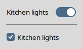

# Der Befehl `tsw::toggleswitch`

## Für Tsw Version 1.5

### von

## Csaba Nemethi

csaba.nemethi@t-online.de

---

## Inhalt

- [Kurzreferenz](#kurzreferenz)
- [Ausführliche Referenz](#ausf-hrliche-referenz)
- [Wahl zwischen toggleswitch und (ttk::)checkbutton](#wahl-zwischen-toggleswitch-und-ttk-checkbutton)

[Startseite](index.md)

---

## Kurzreferenz

[NAME](#ausf-hrliche-referenz)
: `tsw::toggleswitch` – Kippschalter-Widgets erzeugen und bedienen

[ÜBERSICHT](#ausf-hrliche-referenz)
: 

```
tsw::toggleswitch pathName ?options?
```

[STANDARDOPTIONEN](#ausf-hrliche-referenz)
: 

```
-class       -style         -underline
-cursor      -takefocus     -width
-font        -text
-foreground  -textvariable
```

[WIDGET-SPEZIFISCHE OPTIONEN](#ausf-hrliche-referenz)
: `-command command`

: `-offvalue value`

: `-onvalue value`

: `-size 1|2|3`

: `-variable variable`

[WIDGET-BEFEHL](#ausf-hrliche-referenz)
: `pathName attrib ?name ?value name value ...??`

: `pathName cget option`

: `pathName configure ?option ?value option value ...??`

: `pathName hasattrib name`

: `pathName identify ?element? x y`

: `pathName instate stateSpec ?script?`

: `pathName state ?stateSpec?`

: `pathName style`

: `pathName switchstate ?boolean?`

: `pathName toggle`

: `pathName unsetattrib name`

SCHLÜSSELWÖRTER
: toggleswitch, trough, slider, widget


[Inhalt](#inhalt)     [Startseite](index.md)

---

## Ausführliche Referenz

**NAME**
: `tsw::toggleswitch` – Kippschalter-Widgets erzeugen und bedienen

**ÜBERSICHT**
: 

```
tsw::toggleswitch pathName ?options?
```

**BESCHREIBUNG**
: Der Befehl `tsw::toggleswitch` erzeugt ein neues Fenster namens `pathName` und macht es zu einem **toggleswitch**-Widget. Weitere Optionen, die unten beschrieben sind, können auf der Befehlszeile oder in der Optionsdatenbank angegeben werden, um Eigenschaften des toggleswitch-Widgets festzulegen, etwa seine Größe und das Tcl-Skript, das jedes Mal läuft, wenn der Schaltzustand des Widgets umgeschaltet wird. Der Befehl `tsw::toggleswitch` gibt sein Argument `pathName` zurück. Wenn dieser Befehl aufgerufen wird, darf noch kein Fenster namens `pathName` existieren, das Elternfenster von `pathName` muss aber existieren.

: Ein toggleswitch ist ein Megawidget, das im Wesentlichen aus einer waagerechten **Laufschiene** und einem **Schieber** besteht, genau wie ein ttk::scale-Widget. Diese Elemente gehören tatsächlich zu einem ttk::scale, das im Widget enthalten ist. Die Laufschiene ist ein vollständig abgerundetes gefülltes Rechteck, und der Schieber ist ein gefüllter Kreis oder ein vollständig abgerundetes gefülltes Rechteck in der Laufschiene. Beide Elemente werden mit skalierungsbewussten SVG-Bildern gezeichnet. Ihre Abmessungen hängen vom Wert der Konfigurationsoption `-size` ab, vom aktuellen Thema, von der Skalierungsstufe der Anzeige und vom Skalierungsfaktor von Tk, den `[tk scaling]` zum Zeitpunkt angibt, an dem das erste toggleswitch-Widget erzeugt wird. Das Widget enthält außerdem ein ttk::label, das einen optionalen Text links von der Skala anzeigt; dieses Kindwidget wird nur verwaltet, wenn der mit der Option `-text` oder `-textvariable` angegebene Text eine nichtleere Zeichenkette ist.

: Wie ein Lichtschalter kann ein toggleswitch-Widget einen von zwei möglichen **Schaltzuständen** haben: ein oder aus. Im Zustand ein liegt der Schieber am Ende der Laufschiene, und im Zustand aus an ihrem Anfang. Wie der Abschnitt [VORGABEBINDUNGEN](#ausf-hrliche-referenz) unten beschreibt, schaltet der Benutzer mit der Maus oder der Taste `space` zwischen diesen beiden Zuständen um.

: Der Tcl-Befehl, der zu einem toggleswitch-Widget gehört, hat eine sehr einfache API. Mit dem Unterbefehl `switchstate` ändern oder fragen Sie den Schaltzustand des Widgets ab. Mit der Konfigurationsoption `-command` geben Sie ein Skript an, das jedes Mal läuft, wenn der Schaltzustand des Widgets umgeschaltet wird. Wie (ttk::)checkbutton unterstützen toggleswitch-Widgets auch die Optionen `-offvalue`, `-onvalue` und `-variable`.

: Die Farben, mit denen Laufschiene und Schieber in den verschiedenen Widget-Zuständen gezeichnet werden (etwa `active`, `background`, `disabled`, `pressed` und `selected`), hängen vom aktuellen Thema ab. Die Implementierung erzeugt diese Elemente bei Bedarf mit Hilfe allgemeiner Prozeduren für beliebige Themen und themenspezifischer Prozeduren für einige eingebaute Themen. Anwendungen können für ein beliebiges Thema `theme` *ausdrückliche* Unterstützung hinzufügen, indem sie einen passenden Befehl namens `tsw::createElements_theme` bereitstellen.

**STANDARDOPTIONEN**
: 

```
-class       -style         -underline
-cursor      -takefocus     -width
-font        -text
-foreground  -textvariable
```

: Einzelheiten zu den Standardoptionen stehen im Handbucheintrag **ttk_widget**. Der Vorgabewert der Option `-class` ist `Toggleswitch`. Der Wert der Option `-style` ist voreingestellt auf `Toggleswitch2`, passend zum Vorgabewert `2` der Option `-size`. Je nach dem Wert der Option `-size` ist der Standardwert von `-style` einer der Werte `Toggleswitch1`, `Toggleswitch2` oder `Toggleswitch3` (siehe unten). Der Vorgabewert der Option `-takefocus` ist `"ttk::takefocus"` (wie bei den meisten Tk-Themenwidgets).

**WIDGET-SPEZIFISCHE OPTIONEN**
: 

|   |   |
| --- | --- |
| Befehlszeilenname:  | `-command` |
| Name der Datenbank: | ` command` |
| Datenbankklasse: | ` Command` |

Legt ein Tcl-Skript fest, das im globalen Geltungsbereich ausgewertet wird, jedes Mal wenn der Schaltzustand des Widgets umgeschaltet wird (programmgesteuert, durch den Aufruf des Unterbefehls `switchstate` oder `toggle`, oder interaktiv). Die Vorgabe ist eine leere Zeichenkette.


|   |   |
| --- | --- |
| Befehlszeilenname:  | `-offvalue` |
| Name der Datenbank: | ` offValue` |
| Datenbankklasse: | ` OffValue` |

Der Wert, der in der zugehörigen Variablen gespeichert wird, wenn der Schaltzustand des Widgets auf aus gesetzt wird. Voreingestellt ist `0`.


|   |   |
| --- | --- |
| Befehlszeilenname:  | `-onvalue` |
| Name der Datenbank: | ` onValue` |
| Datenbankklasse: | ` OnValue` |

Der Wert, der in der zugehörigen Variablen gespeichert wird, wenn der Schaltzustand des Widgets auf ein gesetzt wird. Voreingestellt ist `1`.


|   |   |
| --- | --- |
| Befehlszeilenname:  | `-size` |
| Name der Datenbank: | ` size` |
| Datenbankklasse: | ` Size` |

Legt den Größenbezeichner des toggleswitch-Widgets fest. Die unterstützten Werte sind die Zeichenketten `1`, `2` (die Vorgabe) und `3`. Ist das aktuelle Thema `aqua`, entsprechen diese Größenkennungen den Steuergrößen „mini“, „small“ und „large“ der nativen Kippschalter unter macOS. Für macOS bis Version 15 (Sequoia) steht der Wert `1` für die Laufschienengröße von 26 x 15 Pixeln, der Wert `2` für die Laufschienengröße von 32 x 18 Pixeln, und der Wert `3` bezeichnet die Laufschienengröße von 38 x 22 Pixeln. Ab macOS 26 (Tahoe) betragen die Laufschienengrößen 29 x 13, 36 x 16 und 44 x 20 Pixel. Bei allen anderen Themen steht auf einem unskalierten Bildschirm der Wert `1` für die Laufschienengröße von 32 x 16 Pixeln, der Wert `2` für die Laufschienengröße von 40 x 20 Pixeln, und der Wert `3` bezeichnet die Laufschienengröße von 48 x 24 Pixeln. Ausnahme: unter Windows 10 und früher ist aus Kompatibilität mit dem nativen Kippschalter bei den Themen `vista`, `winnative` und `xpnative` die unskalierte Laufschienenbreite 35, 44 und 53 Pixel.

Beachten Sie: Wird diese Option auf einen Wert `size` gesetzt, wechselt der Wert der Option `-style` automatisch zu `Toggleswitchsize`, wenn sein bisheriger oder angeforderter Wert einer der Werte `Toggleswitch1`, `Toggleswitch2` oder `Toggleswitch3` war, und zu `prefix.Toggleswitchsize`, wenn sein bisheriger oder angeforderter Wert einer der Werte `prefix.Toggleswitch1`, `prefix.Toggleswitch2` oder `prefix.Toggleswitch3` war.

Umgekehrt wird die Option `-size` automatisch auf `size` gesetzt, wenn die Option `-style` auf einen Wert der Form `Toggleswitchsize` oder `prefix.Toggleswitchsize` gesetzt wird (wobei `size` einer der Werte `1`, `2` oder `3` ist).

Werden beide Optionen `-size` und `-style` konfiguriert, hat die erste Vorrang vor der zweiten, unabhängig von der Reihenfolge, in der sie angegeben wurden. Wenn Sie das Widget zum Beispiel so erzeugen

```
tsw::toggleswitch pathName -size 3 -style My.Toggleswitch3
```

oder aufrufen

```
pathName configure -style My.Toggleswitch3
```

dann wird die Option `-style` auf `My.Toggleswitch3` gesetzt (und die Option `-size` hat den Wert `3`). Wenn Sie das Widget dagegen so erzeugen

```
tsw::toggleswitch pathName -style My.Toggleswitch3
```

dann hat die Option `-style` den Wert `My.Toggleswitch2` und nicht `My.Toggleswitch3`, weil die Erzeugung des Widgets die Vorgabe ` -size 2 ` auslöst, die Vorrang vor ` -style My.Toggleswitch3 ` hat.


|   |   |
| --- | --- |
| Befehlszeilenname:  | `-variable` |
| Name der Datenbank: | ` variable` |
| Datenbankklasse: | ` Variable` |

Der Name einer globalen Variablen, deren Wert mit dem toggleswitch verknüpft ist. Der Schaltzustand des Widgets wechselt auf ein, wenn diese Variable auf den Wert gesetzt wird, den die Option `-onvalue` angibt, und sonst auf aus. Ist nichts angegeben, ist die Vorgabe der Pfadname des Widgets.

Beachten Sie: Wie bei (ttk::)checkbutton führt das Umschalten des Schaltzustands durch eine Änderung des Wertes dieser Variablen *nicht* dazu, dass das von der Option `-command` angegebene Skript ausgeführt wird.

**WIDGET-BEFEHL**
: Der Befehl `tsw::toggleswitch` erzeugt einen neuen Tcl-Befehl, dessen Name `pathName` ist. Mit diesem Befehl rufen Sie verschiedene Operationen auf dem Widget auf. Er hat die folgende allgemeine Form:

```
pathName option ?arg arg ...?
```

: `option` und die `arg`s bestimmen das genaue Verhalten des Befehls. Für toggleswitch-Widgets sind die folgenden Befehle möglich:


`pathName attrib ?name ?value name value ...??`
: Fragt die Attribute des Widgets ab oder ändert sie. Ist kein `name` angegeben, gibt der Befehl eine Liste von Paaren zurück, von denen jedes den Namen und den Wert eines Attributs für `pathName` enthält. Ist `name` ohne `value` angegeben, gibt der Befehl den Wert des genannten Attributs zurück, oder eine leere Zeichenkette, wenn kein entsprechender Wert existiert (mit dem Unterbefehl `hasattrib` unterscheiden Sie diesen Fall von dem, in dem der Wert eines *vorhandenen* Attributs eine leere Zeichenkette ist). Sind ein oder mehrere Paare aus `name` und `value` angegeben, setzt der Befehl die genannten Widget-Attribute auf die genannten Werte; in diesem Fall ist der Rückgabewert eine leere Zeichenkette. `name` kann eine beliebige Zeichenkette sein.

`pathName cget option`
: Gibt den aktuellen Wert der Konfigurationsoption zurück, die `option` angibt. Sie kann jeden Wert haben, den der Befehl `tsw::toggleswitch` akzeptiert.

`pathName configure ?option ?value option value ...??`
: Fragt die Konfigurationsoptionen des Widgets ab oder ändert sie. Ist keine `option` angegeben, gibt der Befehl eine Liste zurück, die alle verfügbaren Optionen für `pathName` beschreibt (das Format dieser Liste steht bei `Tk_ConfigureInfo`). Ist `option` ohne `value` angegeben, gibt der Befehl eine Liste zurück, die die genannte Option beschreibt (diese Liste ist identisch mit der entsprechenden Teilliste des Wertes, der zurückgegeben wird, wenn keine `option` angegeben ist). Sind ein oder mehrere Paare aus `option` und `value` angegeben, ändert der Befehl die genannten Widget-Optionen auf die genannten Werte; in diesem Fall ist der Rückgabewert eine leere Zeichenkette. `option` kann jeden Wert haben, den der Befehl `tsw::toggleswitch` akzeptiert.

`pathName hasattrib name`
: Gibt `1` zurück, wenn das Attribut `name` vorhanden ist, andernfalls `0`.

`pathName identify ?element? x y`
: Siehe den Handbucheintrag zu **ttk_widget**. Die Koordinaten werden relativ zum toggleswitch erwartet, sie werden aber in Werte relativ zum Kind ttk::scale umgerechnet, und der Rückgabewert ist der Name des entsprechenden Stilelements dieses Kindes oder eine leere Zeichenkette.

`pathName instate stateSpec ?script?`
: Siehe den Handbucheintrag zu **ttk_widget**.

`pathName state ?stateSpec?`
: Siehe den Handbucheintrag zu **ttk_widget**.

`pathName style`
: Gibt den Stil zurück, den das zugrunde liegende ttk::scale-Widget verwendet. Bei Tk-Themenwidgets wurde dieser Unterbefehl in Tk 8.7a4 eingeführt, das toggleswitch-Widget stellt ihn aber für alle unterstützten Tk-Versionen bereit.

`pathName switchstate ?boolean?`
: Ändert den Schaltzustand des Widgets oder fragt ihn ab. Ist das optionale Argument vorhanden, muss es ein boolescher Wert sein (ein numerischer Wert, bei dem `0` falsch ist und alles andere wahr, oder eine Zeichenkette wie `true/yes/on` oder `false/no/off`). Ist das Zustandsflag `disabled` des Widgets gesetzt, gibt der Befehl unmittelbar nach der Prüfung des Arguments eine leere Zeichenkette zurück. Sonst setzt der Befehl, wenn das Argument wahr ist, den Schaltzustand des Widgets auf ein, indem er das Flag `selected` des zugrunde liegenden ttk::scale-Widgets setzt, den Schieber an das Ende der Laufschiene bewegt und die zugehörige Variable auf den Wert setzt, den die Option `-onvalue` angibt. Ist das Argument falsch, setzt der Befehl den Schaltzustand des Widgets auf aus, indem er das Flag `selected` löscht, den Schieber an den Anfang der Laufschiene bewegt und die zugehörige Variable auf den Wert setzt, den die Option `-offvalue` angibt.

: Wenn der Wert des Arguments den Schaltzustand des Widgets umschaltet und das Skript, das als Wert der Option `-command` angegeben ist, eine nichtleere Zeichenkette ist, wertet der Befehl dieses Skript im globalen Geltungsbereich aus und gibt dessen Ergebnis zurück; sonst ist der Rückgabewert eine leere Zeichenkette.

: Ist das optionale Argument nicht vorhanden, gibt der Befehl den aktuellen Schaltzustand des Widgets als `0` (aus) oder `1` (ein) zurück. Wenn ein toggleswitch-Widget erzeugt wird, wird sein Schaltzustand mit `0` initialisiert.

`pathName toggle`
: Dieser bequeme Unterbefehl schaltet den Schaltzustand des Widgets um. Er entspricht logisch dem Aufruf des Befehls `switchstate` mit dem Argument `0`, wenn der aktuelle Schaltzustand ein ist, und sonst mit dem Argument `1`.

`pathName unsetattrib name`
: Hebt das Attribut `name` auf. Gibt eine leere Zeichenfolge zurück.


**VORGABEBINDUNGEN**
: Das Paket Tsw ersetzt die Vorgabebindungen des ttk::scale, das in einem toggleswitch-Widget enthalten ist, durch eigene Bindungen, und zwar so:

: Ist das aktuelle Thema `aqua`:

  1. Wird die Maustaste 1 über dem Schieber gedrückt und die Maus dann bei gehaltener Taste 1 gezogen, bis der Zeiger die Laufschiene betritt, bewegt sich der Schieber gleichmäßig zur gegenüberliegenden Kante der Laufschiene, und der Schaltzustand des Widgets wird umgeschaltet. Dasselbe geschieht, wenn die Maustaste 1 außerhalb des Schiebers gedrückt wird und der Zeiger das Widget dann bei gehaltener Taste 1 waagerecht verlässt.
  2. Wird die Maustaste 1 irgendwo im Widget gedrückt und dann über dem Widget losgelassen, ohne dass der Schieber vorher bewegt wurde, bewegt sich dieser gleichmäßig zur gegenüberliegenden Kante der Laufschiene, und der Schaltzustand des Widgets wird umgeschaltet.
  3. Hat das Widget den Eingabefokus, schaltet die Taste `space` seinen Schaltzustand um.

: Ist das aktuelle Thema nicht `aqua`:

  1. Wird die Maustaste 1 irgendwo im Widget gedrückt und die Maus dann bei gehaltener Taste 1 gezogen, bewegt sich der Schieber in derselben (waagerechten) Richtung wie der Zeiger. Beim Loslassen der Taste wird der Schaltzustand auf aus oder ein gesetzt, je nach der Lage des Schiebers relativ zur Mitte des Widgets.
  2. Wird die Maustaste 1 irgendwo im Widget gedrückt und dann über dem Widget losgelassen, ohne dass die Maus vorher waagerecht gezogen wurde, wird der Schaltzustand des Widgets umgeschaltet.
  3. Hat das Widget den Eingabefokus, schaltet die Taste `space` seinen Schaltzustand um.

: Ist das Zustandsflag `disabled` des Widgets gesetzt, tritt keine der oben genannten Aktionen ein.

**WIDGET-ZUSTÄNDE**
: Das Widget setzt den Zustand `selected`, jedes Mal wenn der Schaltzustand auf ein wechselt, und löscht ihn sonst. Die Vorgabebindungen setzen und löschen die Zustandsflags `active` und `pressed`.

**STILOPTIONEN**
: Der Vorgabeklassenname für ein `tsw::toggleswitch` ist `Toggleswitch`.

: Dynamische Zustände: `active`, `background`, `disabled`, `pressed`, `selected`.

: Stiloptionen, die mit `ttk::style` für `Toggleswitch1`, `Toggleswitch2` und `Toggleswitch3` eingestellt werden können:

-padding

padding

Vorgabe ist

0.75p

.

: Das ttk::scale und das ttk::label, das einen optionalen Text anzeigt, sind Kinder eines ttk:frame mit dem Layout `ToggleswitchHull`, das für alle Themen außer `aqua` ein Element `focus` enthält. Stiloptionen, die mit `ttk::style` für `ToggleswitchHull` eingestellt werden können:

-focuscolor

color

Die Vorgabe hängt vom Thema ab.

-focussolid

boolean

Vorgabe ist true für das Thema

classic

und
        false für alle anderen. Diese Option wurde in Tk
        8.6.15 eingeführt; in früheren Tk-Versionen hat sie keine Wirkung.

-focusthickness

amount

Die Vorgabe ist

1

. Der Wert kann jede Form haben, die

Tk_GetPixels

akzeptiert.

: Beim Thema `aqua` werden diese fokusbezogenen Optionen einfach ignoriert.

: Wie ttk-Stile konfiguriert werden, steht auf der Handbuchseite **ttk_style**. SCHLÜSSELWÖRTER toggleswitch, trough, slider, widget 


[Inhalt](#inhalt)     [Startseite](index.md)

---

## Wahl zwischen toggleswitch und (ttk::)checkbutton

Dieser Abschnitt beruht auf dem Microsoft-Learn-Artikel *Toggle switches*.

Für manche Aktionen kann ein toggleswitch oder ein checkbutton passen. Um zu entscheiden, welches Steuerelement besser passt, folgen Sie diesen Hinweisen:

- Verwenden Sie einen toggleswitch für binäre Einstellungen, die wie Aktionen wirken und sofort gelten, nachdem der Benutzer den Schalter umlegt.

  Im folgenden Beispiel sollten Sie zum Einschalten der Küchenbeleuchtung einen toggleswitch verwenden und keinen checkbutton.

  

- Für optionale Einträge („nice to have“) verwenden Sie checkbutton.
- Verwenden Sie checkbutton, wenn der Benutzer mehrere Einträge auswählen kann, die zu einer einzigen Einstellung oder Funktion gehören.
- Verwenden Sie einen checkbutton, wenn der Benutzer weitere Schritte ausführen muss, damit Änderungen wirksam werden. Wenn der Benutzer zum Beispiel eine Schaltfläche „Submit“ oder „Next“ anklicken muss, um Änderungen anzuwenden, verwenden Sie einen checkbutton.

[Inhalt](#inhalt)     [Startseite](index.md)
