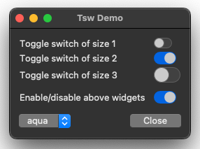
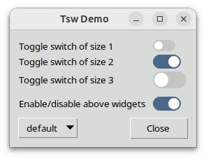
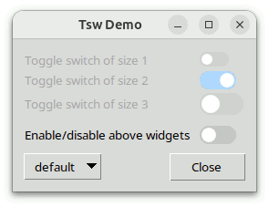

# Tsw-Programmierhandbuch

## Für Tsw Version 1.5

### von

## Csaba Nemethi

csaba.nemethi@t-online.de

---

## Inhalt

#### Überblick

- [Was ist Tsw?](#was-ist-tsw)
- [Woher bekomme ich es?](#woher-bekomme-ich-es)
- [Wie installiere ich es?](#wie-installiere-ich-es)
- [Wie verwende ich es?](#wie-verwende-ich-es)

#### Beispiele

- [Tsw-Demo](#tsw-demo)
- [Tablelist-Bearbeitungsoptionen](#tablelist-bearbeitungsoptionen)

[Startseite](index.md)

---

## Überblick

### Was ist Tsw?

Tsw steht für **T**oggle **sw**itch (Kippschalter) und ist ein Bibliothekspaket für Tcl/Tk ab Version 8.6. Ist die Version 8.6, muss sich zusätzlich die Erweiterung tksvg in den Interpreter laden lassen (Tk ab 8.7 und 9.0 hat SVG fest eingebaut). Das Paket ist in reinem Tcl/Tk geschrieben und enthält:

- die Implementierung des [Kippschalter-Megawidgets toggleswitch](toggleswitch.md), einschließlich eines allgemeinen Hilfsmoduls für Megawidgets;
- zwei ausführlich kommentierte Demo-Skripte mit den typischen Schritten, um toggleswitch-Widgets zu erzeugen und zu bedienen;
- dieses Tutorial;
- eine Referenzseite im HTML-Format.

Ein toggleswitch ist ein Megawidget, das im Wesentlichen aus einer waagerechten Laufschiene (einem vollständig abgerundeten gefüllten Rechteck) und einem Schieber (einem gefüllten Kreis oder einem vollständig abgerundeten gefüllten Rechteck in der Laufschiene) besteht. Das Widget enthält außerdem ein ttk::label, das einen optionalen Text links von der Laufschiene anzeigt; dieses Kindwidget wird nur verwaltet, wenn der mit der Option `-text` oder `-textvariable` angegebene Text eine nichtleere Zeichenkette ist.

Ein toggleswitch-Widget kann einen von zwei Schaltzuständen haben: ein oder aus. Im Zustand ein liegt der Schieber am Ende der Laufschiene, und im Aus-Zustand an ihrem Anfang. Der Benutzer schaltet mit der Maus oder der Leertaste zwischen diesen beiden Zuständen um.

Mit dem Unterbefehl `switchstate` des Tcl-Befehls, der zu einem toggleswitch gehört, ändern oder fragen Sie den Schaltzustand des Widgets ab. Mit der Konfigurationsoption `-command` geben Sie ein Skript an, das jedes Mal läuft, wenn der Schaltzustand des Widgets umgeschaltet wird. Zur Kompatibilität mit (ttk::)checkbutton unterstützen toggleswitch-Widgets auch die Optionen `-offvalue`, `-onvalue` und `-variable`.

### Woher bekomme ich es?

Tsw steht auf der Webseite zum kostenlosen Herunterladen bereit

https://www.nemethi.de

Die Distributionsdatei heißt `tsw1.5.tar.gz` für UNIX und `tsw1_5.zip` für Windows. Diese Dateien enthalten dieselben Angaben, abgesehen von dem zusätzlichen Wagenrücklaufzeichen vor dem Zeilenvorschub am Ende jeder Zeile in den Textdateien für Windows.

Tsw ist auch in tklib enthalten, unter der Adresse

https://core.tcl-lang.org/tklib

### Wie installiere ich es?

Installieren Sie das Paket als Unterverzeichnis eines der Verzeichnisse, die die Variable `auto_path` angibt. Sie können es zum Beispiel als Unterverzeichnis des Verzeichnisses `lib` in Ihrer Tcl/Tk-Installation ablegen (auf derselben Ebene wie das Unterverzeichnis `tk8.X` oder `tk9.X`).

Um Tsw *unter UNIX* zu installieren, wechseln Sie mit `cd` in das gewünschte Verzeichnis und packen die Distributionsdatei `tsw1.5.tar.gz` aus:

```
gunzip -c tsw1.5.tar.gz | tar -xf -
```

Auf den meisten UNIX-Systemen kann dies durch Folgendes ersetzt werden:

```
tar -zxf tsw1.5.tar.gz
```

Beide Befehle legen ein Verzeichnis namens `tsw1.5` an, mit den Unterverzeichnissen `demos`, `doc` und `scripts`.

*Unter Windows* packen Sie mit WinZip oder einem anderen Programm die Distributionsdatei `tsw1_5.zip` in das Verzeichnis `tsw1.5` aus, mit den Unterverzeichnissen `demos`, `doc` und `scripts`.

Beachten Sie, dass tklib das Tsw-Verzeichnis `demos` durch das Unterverzeichnis `tsw` des Verzeichnisses `examples` ersetzt. Bitte berücksichtigen Sie das, wenn Sie die [Beispiele](#beispiele) unten lesen.

### Wie verwende ich es?

Damit Ihre Skripte die Befehle und Variablen des Pakets Tsw erreichen, müssen sie eine der Zeilen enthalten

```
package require tsw ?version?
package require Tsw ?version?
```

Sie können jede der beiden Anweisungen oben verwenden, weil die Datei `tsw.tcl` beide Zeilen enthält

```
package provide tsw ...
package provide Tsw ...
```

Sie können eine dieser beiden Zeilen aus `tsw.tcl` entfernen, wenn das Paket sich nicht unter zwei verschiedenen Namen bekannt machen soll. Damit beschränken Sie das Argument von `package require` auf einen einzigen Namen.

Da das Paket Tsw in einem eigenen Namespace namens `tsw` implementiert ist, führen Sie entweder den Befehl

```
namespace import tsw::toggleswitch
```

aus, um die einzige öffentliche *Prozedur* des Namespace `tsw` zu importieren, oder Sie verwenden den qualifizierten Namen `tsw::toggleswitch`. Die Beispiele unten verwenden den zweiten Weg.

Um auf Tsw-*Variablen* zuzugreifen, *müssen* Sie qualifizierte Namen verwenden. Nur zwei Tsw-Variablen sind dafür vorgesehen, außerhalb des Namespace `tsw` verwendet zu werden:

- Die Variable `tsw::version` enthält die aktuelle Versionsnummer des Pakets Tsw.
- Die Variable `tsw::library` enthält den Ort des Tsw-Installationsverzeichnisses.

[Inhalt](#inhalt)     [Startseite](index.md)

---

## Beispiele

### Tsw-Demo

Das Skript `TswDemo.tcl` im Verzeichnis `demos` erzeugt vier [toggleswitch](toggleswitch.md)-Widgets und zeigt, wie ihr Aussehen vom aktuellen Thema abhängt. Das Thema wählen Sie über das Menü, das zu einem ttk::menubutton-Widget gehört. Außerdem zeigt es, wie Sie ein Skript angeben, das jedes Mal läuft, wenn der Schaltzustand eines toggleswitch umgeschaltet wird.

|   |   |   |
| --- | --- | --- |
|  |  |  |
|  |  |  |

Hier ist der Code, der die vier toggleswitch-Widgets erzeugt:

```
package require Tk
package require tsw

wm title . "Tsw Demo"

ttk::frame .tf
ttk::frame .bf

#
# Create 3 toggleswitch widgets having different values of the -size option
#
set l1 [ttk::label .tf.l1 -text "Toggle switch of size 1"]
set sw1 [tsw::toggleswitch .tf.sw1 -size 1]
set l2 [ttk::label .tf.l2 -text "Toggle switch of size 2"]
set sw2 [tsw::toggleswitch .tf.sw2 -size 2]
$sw2 switchstate 1
set l3 [ttk::label .tf.l3 -text "Toggle switch of size 3"]
set sw3 [tsw::toggleswitch .tf.sw3 -size 3]

#
# Create a toggleswitch widget of default size and set its -command option
#
set l4 [ttk::label .tf.l4 -text "Enable/disable above widgets"]
set sw4 [tsw::toggleswitch .tf.sw4]
$sw4 switchstate 1
$sw4 configure -command [list toggleWidgetsState $sw4]
```

Die toggleswitch-Widgets entstehen durch den Aufruf des Befehls `tsw::toggleswitch`. Bei den ersten drei toggleswitch-Widgets wird die Option `-size` auf `1`, `2` und `3` gesetzt. Beim letzten toggleswitch wird diese Option nicht ausdrücklich gesetzt, sie hat also ihren Vorgabewert `2`. Wie die Bildschirmfotos zeigen, hängen beim Thema `aqua` die Farben der toggleswitch-Widgets auch vom Erscheinungsbild des Systems ab (heller oder dunkler Modus) und von der Akzentfarbe. Die ersten beiden Bildschirmfotos stammen von macOS 15 (Sequoia), das dritte von macOS 26 (Tahoe).

Bei zwei der vier toggleswitch-Widgets wechselt der Schaltzustand vom Vorgabewert `0` (aus) auf `1` (ein), indem der Unterbefehl `switchstate` des zugehörigen Tcl-Befehls aufgerufen wird. Zusätzlich wird beim letzten toggleswitch die Option `-command` auf ein Skript gesetzt, das jedes Mal läuft, wenn der Schaltzustand des Widgets umgeschaltet wird. Dieses Skript ruft die Prozedur `toggleWidgetsState` auf, die so implementiert ist:

```
#------------------------------------------------------------------------------
# toggleWidgetsState
#
# Enables/disables the widgets in the first 3 grid rows, depending on the
# switch state of the specified toggleswitch widget.
#------------------------------------------------------------------------------
proc toggleWidgetsState sw {
    global l1 l2 l3 sw1 sw2 sw3
    set stateSpec [expr {[$sw switchstate] ? "!disabled" : "disabled"}]
    foreach w [list $l1 $l2 $l3 $sw1 $sw2 $sw3] {
        $w state $stateSpec
    }
}
```

Diesmal wird der Unterbefehl `switchstate` ohne das optionale Argument aufgerufen und gibt deshalb den aktuellen Schaltzustand des toggleswitch-Widgets zurück.

Beim Thema `default` sieht das Fenster, nachdem der Schaltzustand des letzten toggleswitch von ein auf aus gewechselt hat, aus wie im Bildschirmfoto unten:



Der Rest des Codes gehört nicht zu Tsw und wird deshalb hier nicht gezeigt.

### Tablelist-Bearbeitungsoptionen

Das Skript `EditingOpts.tcl` im Verzeichnis `demos` ist eine leicht angepasste Fassung des Tablelist-Demo-Skripts `tileWidgets2.tcl`. Es zeigt die interaktive Zellbearbeitung von tablelist mit verschiedenen Ttk-Widgets und dem toggleswitch-Widget. Die zusätzliche Funktion in dieser Fassung steckt in den Prozeduren `configEditing` und `applySwitchState`. Die erste, ausgelöst durch die Schaltfläche „Configure Editing“, öffnet ein Toplevel-Fenster mit [toggleswitch](toggleswitch.md)-Widgets, um die bearbeitungsbezogenen tablelist-Optionen mit booleschen Werten einzustellen, die Tablelist-Benutzer im Lauf der Jahre vorgeschlagen haben. So lässt sich bequem prüfen, welche Wirkung das Setzen und Löschen dieser booleschen Optionen hat.

|   |   |
| --- | --- |
|  |  |

Die Prozedur `configEditing` steht unten:

```
package require Tk
package require tsw
package require tablelist_tile

. . .

#------------------------------------------------------------------------------
# configEditing
#
# Configures the editing-related tablelist options having boolean values with
# the aid of toggleswitch widgets.
#------------------------------------------------------------------------------
proc configEditing tbl {
    set top .top
    if {[winfo exists $top]} {
        raise $top
        focus $top
        return ""
    }

    toplevel $top
    wm title $top "Editing Options"

    set tf [ttk::frame $top.tf]
    set bf [ttk::frame $top.bf]

    #
    # Create the widgets corresponding to the
    # editing-related options with boolean values
    #
    set row 0
    foreach opt {
        -autofinishediting
        -editendonfocusout
        -editendonmodclick
        -editselectedonly
        -forceeditendcommand
        -instanttoggle
        -showeditcursor
    } {
        lassign [$tbl configure $opt] option dbName dbClass default current
        set defaultStr [expr {$default ? "on" : "off"}]

        set sw [tsw::toggleswitch $tf.sw$row -text "$opt ($defaultStr)"]
        if {$current != $default} {
            $sw configure -foreground red2
        }

        $sw switchstate $current        ;# sets the switch state to $current
        $sw attrib default $default     ;# saves $default as attribute value
        $sw configure -command [list applySwitchState $sw $tbl $opt]
        pack $sw -padx 9p -pady {0 3p} -fill x

        incr row
    }

    . . .
}
```

Für jede der 7 bearbeitungsbezogenen Optionen mit booleschen Werten zeigt die Prozedur den Namen der Option und den Vorgabewert in einem toggleswitch-Widget an und setzt dessen [Schaltzustand](toggleswitch.md#ausf-hrliche-referenz) auf den aktuellen Wert der Option. Außerdem ruft sie den Unterbefehl `attrib` des Tcl-Befehls auf, der zum toggleswitch gehört, und speichert den Vorgabewert als Wert des Widget-Attributs mit dem Namen `default`. So „merkt“ sich das Widget den Vorgabewert auf objektorientierte Weise und kann ihn später abrufen, ohne externe Mittel zu brauchen. Zur besseren Bedienung erscheint der Text des toggleswitch in der Vordergrundfarbe `red2`, wenn der aktuelle Wert der Option vom Vorgabewert abweicht.

Jedes Mal, wenn der Schaltzustand des toggleswitch-Widgets umgeschaltet wird, ruft das Skript, das als Wert der Option `-command` angegeben ist, die Prozedur `applySwitchState` auf, die unten steht:

```
#------------------------------------------------------------------------------
# applySwitchState
#
# Sets the configuration option opt of the tablelist tbl and the foreground
# color of the toggleswitch widget sw according to its switch state.
#------------------------------------------------------------------------------
proc applySwitchState {sw tbl opt} {
    set switchState [$sw switchstate]
    $tbl configure $opt $switchState

    set fgColor [expr {$switchState == [$sw attrib default] ? "" : "red2"}]
    $sw configure -foreground $fgColor
}
```

Die angegebene tablelist-Option wird auf den Schaltzustand des toggleswitch-Widgets gesetzt, und ebenso die Vordergrundfarbe des Widgets, abhängig vom Schaltzustand und vom Vorgabewert der Option. Den Vorgabewert holt der Unterbefehl `attrib` des toggleswitch.

Beachten Sie, dass in diesem Beispiel die Texte des Fensters „Editing Options“ die Werte der Option `-text` der toggleswitch-Widgets sind. Im vorigen Beispiel stehen dafür zusätzliche ttk::label-Widgets links neben den zugehörigen toggleswitch-Widgets.

[Inhalt](#inhalt)     [Startseite](index.md)
