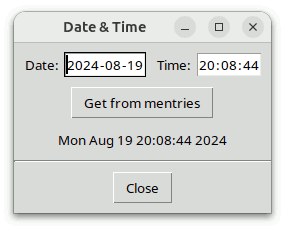
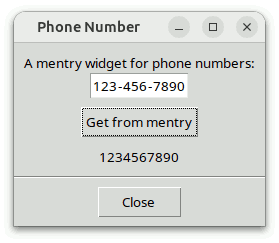

# Mentry Programmer's Guide

## For Mentry Version 4.5.1

### by

## Csaba Nemethi

csaba.nemethi@t-online.de

---

## Contents

#### Overview

- [What Is Mentry?](#what-is-mentry)
- [How to Get It?](#how-to-get-it)
- [How to Install It?](#how-to-install-it)
- [How to Use It?](#how-to-use-it)
- [More on Mentry_tile](#more-on-mentry-tile)

#### Examples

- [A mentry Widget for Phone Numbers](#a-mentry-widget-for-phone-numbers)
- [A mentry Widget for Ethernet Addresses](#a-mentry-widget-for-ethernet-addresses)
- [A mentry Widget for Franking IDs](#a-mentry-widget-for-franking-ids)
- [Using mentry Widgets for Date and Time](#using-mentry-widgets-for-date-and-time)
- [Tile-Based Demo Scripts](#tile-based-demo-scripts)

[Start page](index.md)

---

## Overview

### What Is Mentry?

Mentry is a library package for Tcl/Tk versions 8.4 or higher, written in pure Tcl/Tk code.  It contains:

- the implementation of the [multi-entry mega-widget mentry](mentryWidget.md), including a general utility module for mega-widgets;
- procedures that facilitate the use of multi-entry widgets for displaying and editing [date and time](mentryDateTime.md) in a great variety of formats, [real numbers in fixed-point format](mentryFixedPoint.md), as well as [IP(v4) addresses](mentryIPAddr.md) and [IPv6 addresses](mentryIPv6Addr.md);
- three richly commented demo scripts containing the typical steps needed to create and handle a mentry widget for a particular purpose;
- two demo scripts that show how to use the date- and time-related procedures;
- tile-based counterparts of the above-mentioned demo scripts;
- this tutorial;
- reference pages in HTML format.

A multi-entry widget consists of any number of entry widgets separated by labels, all embedded in a frame.  Appropriately chosen configuration options make this conglomerate look like one single entry containing preinserted text pieces having invariant positions within the widget.  The initial width of an entry component also determines the maximal number of characters that can be inserted into it; when reaching this limit in an entry having the input focus, the latter is set automatically to the next enabled entry component.  The same action is triggered by typing a character contained in the label following the current entry, if the latter is non-empty.

Within a mentry widget, the `Left`, `Right`, `Home`, `End`, and `BackSpace` keys work across entry boundaries, while `Control-Left` and `Control-Right` play the same role as `Tab` and `Shift-Tab` in the case of ordinary entries.

Some of the above features are implemented with the aid of the widget callback package Wcb, written in pure Tcl/Tk code as well.  **The Mentry package requires version 3.1 or higher of Wcb**, whose download location is

https://www.nemethi.de

It is very easy to create a multi-entry widget.  For example, the command

```
mentry::mentry .me -body {3 - 3 - 4}
```

will create a mentry widget consisting of two entries of width 3 and one of width 4, separated by `"-"` characters.  With the command

```
foreach w [.me entries] {
    wcb::cbappend $w before insert wcb::checkStrForNum
}
```

you can make sure that the three entries will only accept numeric input, thus providing a comfortable and safe user interface for editing 10-digit phone numbers.

### How to Get It?

Mentry is available for free download from the same URL as Wcb.  The distribution file is `mentry4.5.1.tar.gz` for UNIX and `mentry4_5_1.zip` for Windows.  These files contain the same information, except for the additional carriage return character preceding the linefeed at the end of each line in the text files for Windows.

Mentry is also included in tklib, which has the address

https://core.tcl.tk/tklib

### How to Install It?

Install the package as a subdirectory of one of the directories given by the `auto_path` variable.  For example, you can install it as a subdirectory of the `lib` directory within your Tcl/Tk installation.

To install Mentry *on UNIX*, `cd` to the desired directory and unpack the distribution file `mentry4.5.1.tar.gz`:

```
gunzip -c mentry4.5.1.tar.gz | tar -xf -
```

On most UNIX systems this can be replaced with

```
tar -zxf mentry4.5.1.tar.gz
```

Both commands will create a directory named `mentry4.5.1`, with the subdirectories `demos`, `doc`, and `scripts`.

*On Windows*, use WinZip or some other program capable of unpacking the distribution file `mentry4_5_1.zip` into the directory `mentry4.5.1`, with the subdirectories `demos`, `doc`, and `scripts`.

The file `mentryThemes.tcl` in the `scripts` directory is only needed for applications using the Mentry_tile package (see next section).

Notice that in tklib the Mentry `demos` directory is replaced with the subdirectory `mentry` of the `examples` directory.  Please take this into account when reading the [examples](#examples) below.

### How to Use It?

The Mentry distribution provides two packages, called **Mentry** and **Mentry_tile**.  The main difference between the two is that Mentry_tile enables the tile-based, theme-specific appearance of mentry widgets; this package requires tile 0.6 or higher.  It is not possible to use both packages in one and the same application, because both are implemented in the same `mentry` namespace and provide identical commands.

To be able to access the commands and variables of the Mentry package, your scripts must contain one of the lines

```
package require mentry ?version?
package require Mentry ?version?
```

You can use either one of the two statements above because the file `mentry.tcl` contains both lines

```
package provide mentry ...
package provide Mentry ...
```

Likewise, to be able to access the commands and variables of the Mentry_tile package, your scripts must contain one of the lines

```
package require mentry_tile ?version?
package require Mentry_tile ?version?
```

Again, you can use either one of the two statements above because the file `mentry_tile.tcl` contains both lines

```
package provide mentry_tile ...
package provide Mentry_tile ...
```

You are free to remove one of the above lines from `mentry.tcl` and `mentry_tile.tcl`, respectively, if you want to prevent the corresponding packages from making themselves known under two different names each.  Of course, by doing so you restrict the argument of  `package require`  to a single name per package.

Since the packages Mentry and Mentry_tile are implemented in the `mentry` namespace, you must either invoke the

```
namespace import mentry::pattern ?mentry::pattern ...?
```

command to import the *procedures* you need, or use qualified names like `mentry::mentry`.  In the examples below we have chosen the latter approach.

To access Mentry *variables*, you *must* use qualified names.  There are only three Mentry variables (and one more when using Mentry_tile) that are designed to be accessed outside the namespace `mentry`:

- The variable `mentry::version` holds the current version number of the Mentry package.
- The variable `mentry::library` holds the location of the Mentry installation directory.
- The read-only variable `mentry::usingTile` has the value `0` in the Mentry package and the value `1` in Mentry_tile.
- In Mentry_tile the array `mentry::themeDefaults` holds the theme-specific default values of a series of Mentry configuration options.

### More on Mentry_tile

As mentioned above, a mentry widget consists of entry and label widgets, embedded in a frame.  While in the Mentry package all of these components are Tk widgets, the Mentry_tile package uses both Tk frame, tile entry, and Tk label widgets.  Due to several incompatibilities between Tk and tile, it is currently not possible to replace all Tk widgets making up a mentry with their tile counterparts.  Actually, the entry components of a tile-based mentry are embedded into Tk frame widgets, which in turn, together with the labels, are packed into a specially constructed tile entry rather than a frame.  This somewhat complicated layout is needed because in several themes it is not possible to draw flat, borderless tile enty widgets.

From the above it follows that **the Mentry_tile package will only work as expected if the Tk frame and label commands haven't been overridden by using  namespace import -force ttk::\*  at global scope**.  While earlier tile releases suggested using this command at global scope for the really adventurous, in newer tile versions this is considered a Really Bad Idea, causing many things to break.  Instead, **you should explicitly invoke ttk::frame, ttk::label, etc. whenever you want to use a tile widget**.

Another restriction to be taken into account is due to the fact that in earlier tile versions the  `(ttk::)style theme use`  command could only be used to set the current theme, but not to retrieve it.  For this reason, if the Mentry_tile package cannot get the current theme with the aid of  `ttk::style theme use`  then it makes use of the variable `ttk::currentTheme` or `tile::currentTheme` (depending on the tile version), which is set by the `ttk::setTheme` or `tile::setTheme` command.  From this it follows that **if the tile version being used doesn't support the  ttk::style theme use  command without an argument then the tile-based mentry widgets will only have the expected appearance if the platform-specific default theme is either left unchanged or replaced with another theme by invoking the library procedure ttk::setTheme or tile::setTheme, depending on the tile version**.  (See also the `mentry::setTheme` command.)

After these cautions concerning the use of tile, the rest of this section describes the differences between the packages Mentry and Mentry_tile.

The Mentry_tile package checks whether the required Tk and tile versions are present, by executing the commands

```
package require Tk 8.4-
if {$::tk_version < 8.5 || [regexp {^8\.5a[1-5]$} $::tk_patchLevel]} {
    package require tile 0.6-
}
```

The second command above reflects the fact that, beginning with Tk 8.5a6, tile is integrated into the Tk core and therefore it should only be loaded explicitly when using an earlier Tk version.

Apart from this and the `_tile` suffix in the  `package require`  command, the only difference (from the programmer's point of view) between the packages Mentry and Mentry_tile is related to the supported configuration options:  The following Tk (entry) widget options, present in the Mentry package, are not supported by Mentry_tile, because they are not available for tile (entry) widgets: `-borderwidth`, `-disabledbackground`, `-disabledforeground`, `-highlightbackground`, `-highlightcolor`, `-highlightthickness`, `-insertbackground`, `-insertborderwidth`, `-insertofftime`, `-insertontime`, `-insertwidth`, `-readonlybackground`, `-relief`, `-selectbackground`, `-selectborderwidth`, and `-selectforeground`.

Notice that the `-background` option doesn't work as expected if the current theme is `Arc`, `plastik`, `tileqt`, `vista`, or `xpnative`, because these themes silently ignore any attempt to change the background color of a tile entry widget.

Finally, take into account that, when using the `tileqt` theme, the version number of the `tile::theme::tileqt` package must be 0.4 or higher, and `tileqt` itself won't work with tile versions earlier than 0.7.

[Contents](#contents)     [Start page](index.md)

---

## Examples

### A mentry Widget for Phone Numbers

Let's resume the [example](#what-is-mentry) mentioned in the Overview in a bit more systematical manner.  First, we will write a procedure for creating a mentry widget that allows to display and edit 10-digit phone numbers and accepts any configuration options supported by the `mentry::mentry` command:

```
#------------------------------------------------------------------------------
# phoneNumberMentry
#
# Creates a new mentry widget win that allows to display and edit 10-digit
# phone numbers.  Sets the type attribute of the widget to PhoneNumber and
# returns the name of the newly created widget.
#------------------------------------------------------------------------------
proc phoneNumberMentry {win args} {
    #
    # Create a mentry widget consisting of two entries of width 3 and one of
    # width 4, separated by "-" characters, and set its type to PhoneNumber
    #
    eval [list mentry::mentry $win] $args
    $win configure -body {3 - 3 - 4}
    $win attrib type PhoneNumber

    #
    # Allow only decimal digits in all entry components; use
    # wcb::cbappend (or wcb::cbprepend) instead of wcb::callback
    # in order to keep the wcb::checkEntryLen callback,
    # registered by mentry::mentry for all entry components
    #
    for {set n 0} {$n < 3} {incr n} {
        set w [$win entrypath $n]
        wcb::cbappend $w before insert wcb::checkStrForNum
        $win adjustentry $n "0123456789"
        bindtags $w [linsert [bindtags $w] 1 MentryPhoneNumber]
    }

    return $win
}
```

The first argument `win` is the name of the widget, and the keyword `args` represents a list of configuration options and their values, just like in the case of the standard Tk widgets.  The value  `{3 - 3 - 4}`  of the `-body` option specifies that the mentry should consist of two entries of width 3 and one of width 4, separated by labels displaying the `"-"` character.

Each mentry widget may have any number of private **attributes**, which can be set and retrieved with the aid of the `attrib` subcommand of the Tcl procedure corresponding to the widget.  We use this subcommand to define the `type` attribute of the newly created widget and set it to the value `"PhoneNumber"`.  Although this is not strictly necessary, it will enable us to distinguish a phone number mentry from other multi-entry widgets.

The `mentry::mentry` command registers the `wcb::checkEntryLen` callback with each entry component of the mentry widget to restrict the number of characters that can be inserted into it to the initial width specified in the `-body` option.  Besides this constraint, we want our entries to accept only decimal digits, therefore we use the `wcb::cbappend` command to *add* the procedure `wcb::checkStrForNum` to the callback list of each entry component.  By invoking `wcb::callback` instead of `wcb::cbappend` (or `wcb::cbprepend`), we would *replace* the callback list with the one consisting of the single element `wcb::checkStrForNum`.

Now we know that each entry component of the mentry widget will only accept a limited number of decimal digits.  But are the widths of the entries large enough to hold the maximal number of 3 or 4 decimal digits, respectively?  In the case of a fixed-width font the answer is definitely "yes", and the same holds true for most proportionally-spaced fonts.  There are, however, fonts in which not all decimal digits have the same width.  For this reason, we invoke the `adjustentry` subcommand for each entry component, passing to it as last argument a string consisting of the allowed characters, which in this example are the decimal digits.  This subcommand will increase the entry widget's width if needed, to make it just large enough for texts of the component-specific maximal length, consisting of characters specified by that string.

Our second procedure outputs a phone number to a mentry widget having a `type` attribute value of `"PhoneNumber"`:

```
#------------------------------------------------------------------------------
# putPhoneNumber
#
# Outputs the phone number num to the mentry widget win of type PhoneNumber.
# The phone number must be a string of length 10, consisting of decimal digits.
#------------------------------------------------------------------------------
proc putPhoneNumber {num win} {
    #
    # Check the syntax of num
    #
    if {[string length $num] != 10 || ![regexp {^[0-9]*$} $num]} {
        return -code error "expected 10 decimal digits but got \"$num\""
    } 

    #
    # Check the widget and display the properly formatted phone number
    #
    checkIfPhoneNumberMentry $win
    $win put 0 [string range $num 0 2] [string range $num 3 5] \
               [string range $num 6 9]
}
```

We use the `put` subcommand of the Tcl procedure corresponding to the mentry widget to display the three substrings of the given phone number in the corresponding entries, starting with the entry whose index is specified as the first argument following the word `put`.

Next, we need a procedure that returns the phone number contained in a mentry widget having a `type` attribute value of `"PhoneNumber"`:

```
#------------------------------------------------------------------------------
# getPhoneNumber
#
# Returns the phone number contained in the mentry widget win of type
# PhoneNumber.
#------------------------------------------------------------------------------
proc getPhoneNumber win {
    #
    # Check the widget
    #
    checkIfPhoneNumberMentry $win

    #
    # Generate an error if any entry component is empty or incomplete
    #
    for {set n 0} {$n < 3} {incr n} {
        if {[$win isempty $n]} {
            focus [$win entrypath $n]
            return -code error EMPTY
        }
        if {![$win isfull $n]} {
            focus [$win entrypath $n]
            return -code error INCOMPL
        }
    }

    #
    # Return the phone number built from the
    # values contained in the entry components
    #
    $win getarray strs
    return $strs(0)$strs(1)$strs(2)
}
```

The procedure runs over the indices of the entry components of the given mentry widget and invokes the `isempty` and `isfull` subcommands of the Tcl command corresponding to the given mentry widget.  If one of the entries is found to be empty or incomplete, the procedure gets its path name by calling the `entrypath` subcommand, sets the focus to that entry, raises an error, and returns the value `"EMPTY"` or `"INCOMPL"`, respectively.  The application invoking this procedure should then display an appropriate error message corresponding to the return value.

Notice that the number `3` in the `for` loop above is nothing else than  `[$win entrycount]`.  Also, it would be sufficient to check whether all entry components are full, because an empty entry is at the same time incomplete.  The preliminary check whether an entry is empty is just made for the user's convenience.

To build the phone number from the values contained in the entry components, we use a temporary array variable and invoke the `getarray` subcommand, which copies the contents of the entries to the corresponding array elements.

The last two procedures presented above contain an invocation of the command `checkIfPhoneNumberMentry`, which is implemented as folows:

```
#------------------------------------------------------------------------------
# checkIfPhoneNumberMentry
#
# Generates an error if win is not a mentry widget of type PhoneNumber.
#------------------------------------------------------------------------------
proc checkIfPhoneNumberMentry win {
    if {![winfo exists $win]} {
        return -code error "bad window path name \"$win\""
    }

    if {[winfo class $win] ne "Mentry" ||
        [$win attrib type] ne "PhoneNumber"} {
        return -code error \
               "window \"$win\" is not a mentry widget for phone numbers"
    }
}
```

This procedure retrieves the value of the `type` attribute of its argument to check whether the latter denotes a mentry widget for phone numbers (recall that this attribute was set to the value `"PhoneNumber"` in the procedure `phoneNumberMentry`).

Finally, recall that in the procedure `phoneNumberMentry`, we inserted the binding tag `MentryPhoneNumber` into the list of binding tags of the mentry's entry components, just after their path names.  The binding script for this tag shown in the code below handles `<<Paste>>` (`<Control-v>` or `<Command-v>`) events in these entry widgets by pasting the current contents of the clipboard into the mentry, provided that it is a valid 10-digit phone number:

```
bind MentryPhoneNumber <<Paste>> { pastePhoneNumber %W }

#------------------------------------------------------------------------------
# pastePhoneNumber
#
# Handles <<Paste>> events in the entry component w of a mentry widget for
# 10-digit phone numbers by pasting the current contents of the clipboard into
# the mentry if it is a valid 10-digit phone number.
#------------------------------------------------------------------------------
proc pastePhoneNumber w {
    set res [catch {::tk::GetSelection $w CLIPBOARD} num]
    if {$res == 0} {
        set win [winfo parent $w]
        catch { putPhoneNumber $num $win }
    }

    return -code break ""
}
```

The five procedures discussed above are implemented in the file `phonenumber.tcl`, contained in the `demos` directory.  This script also puts them together to build a small application displaying the following figure:


Here is the relevant code fragment:

```
package require mentry

set title "Phone Number"
wm title . $title

#
# Add some entries to the Tk option database
#
source [file join [file dirname [info script]] option.tcl]

. . .

#
# Frame .f with a mentry displaying a phone number
#
frame .f
label .f.l -text "A mentry widget for phone numbers:"
phoneNumberMentry .f.me
pack .f.l .f.me

#
# Message strings corresponding to the values
# returned by getPhoneNumber on failure
#
array set msgs {
    EMPTY       "Field value missing"
    INCOMPL     "Incomplete field value"
}

#
# Button .get invoking the procedure getPhoneNumber
#
button .get -text "Get from mentry" -command {
    if {[catch {
        set num ""
        set num [getPhoneNumber .f.me]
    } result] != 0} {
        bell
        tk_messageBox -icon error -message $msgs($result) \
                      -title $title -type ok
    }
}

#
# Label .num displaying the result of getPhoneNumber
#
label .num -textvariable num

. . .

putPhoneNumber 1234567890 .f.me
focus [.f.me entrypath 0]
```

### A mentry Widget for Ethernet Addresses

Ethernet addresses are usuallly written in the form `"XX:XX:XX:XX:XX:XX"`, where each `"X"` is a hexadecimal digit.  The file `ethernetaddr.tcl` in the `demos` directory contains the steps needed to create and use a multi-entry widget for displaying and editing Ethernet addresses.  It implements the procedures `ethernetAddrMentry`, `putEthernetAddr`, and `getEthernetAddr`; the last two invoke the helper procedure `checkIfEthernetAddrMentry`, while the first one is implemented as follows:

```
#------------------------------------------------------------------------------
# ethernetAddrMentry
#   
# Creates a new mentry widget win that allows to display and edit Ethernet
# addresses.  Sets the type attribute of the widget to EthernetAddr and returns
# the name of the newly created widget.
#------------------------------------------------------------------------------
proc ethernetAddrMentry {win args} {
    #
    # Create a mentry widget consisting of 6 entries of width
    # 2, separated by colons, and set its type to EthernetAddr
    #
    eval [list mentry::mentry $win] $args
    $win configure -body {2 : 2 : 2 : 2 : 2 : 2}
    $win attrib type EthernetAddr

    #
    # Install automatic uppercase conversion and allow only hexadecimal
    # digits in all entry components; use wcb::cbappend (or wcb::cbprepend)
    # instead of wcb::callback in order to keep the wcb::checkEntryLen
    # callback, registered by mentry::mentry for all entry components
    #
    for {set n 0} {$n < 6} {incr n} {
        set w [$win entrypath $n]
        wcb::cbappend $w before insert wcb::convStrToUpper \
                      {wcb::checkStrForRegExp {^[0-9A-F]*$}}
        $win adjustentry $n "0123456789ABCDEF"
        bindtags $w [linsert [bindtags $w] 1 MentryEthernetAddr]
    }
    
    return $win
}
```

Notice again the invocation of the `adjustentry` subcommand of the Tcl command associated with the mentry widget, for each of its entry components.  This is necessary, because in the case of a proportionally-spaced font the characters `A` - `F` need more room than the digits `0` - `9` (and it is not even guaranteed that the latters have the same width).

The procedure `putEthernetAddr` expects as its first argument a string of the form `"XX:XX:XX:XX:XX:XX"`, where each `"XX"` must be a hexadecimal string in the range `0` - `255`:

```
#------------------------------------------------------------------------------
# putEthernetAddr
#
# Outputs the Ethernet address addr to the mentry widget win of type
# EthernetAddr.  The address must be a string of the form XX:XX:XX:XX:XX:XX,
# where each XX must be a hexadecimal string in the range 0 - 255.  Leading
# zeros are allowed (but not required), hence the components may have more (but
# also less) than two characters; the procedure displays them with exactly two
# digits.
#------------------------------------------------------------------------------
proc putEthernetAddr {addr win} {
    set errorMsg "expected an Ethernet address but got \"$addr\""

    #
    # Check the syntax of addr
    #
    set lst [split $addr :]
    if {[llength $lst] != 6} {
        return -code error $errorMsg
    }

    #
    # Try to convert the 6 components of addr to hexadecimal
    # strings and check whether they are in the range 0 - 255
    #
    for {set n 0} {$n < 6} {incr n} {
        set val 0x[lindex $lst $n]
        if {[catch {format "%02X" $val} str$n] != 0 || $val < 0 || $val > 255} {
            return -code error $errorMsg
        }
    }

    #
    # Check the widget and display the properly formatted Ethernet address
    #
    checkIfEthernetAddrMentry $win
    $win put 0 $str0 $str1 $str2 $str3 $str4 $str5
}
```

The procedure `getEthernetAddr` raises an error if any entry component of the given mentry widget is empty.  It accepts also entry strings of length one, but in the return value all components will have exactly two digits:

```
#------------------------------------------------------------------------------
# getEthernetAddr
#
# Returns the Ethernet address contained in the mentry widget win of type
# EthernetAddr.
#------------------------------------------------------------------------------
proc getEthernetAddr win {
    #
    # Check the widget
    #
    checkIfEthernetAddrMentry $win

    #
    # Generate an error if any entry component is empty
    #
    for {set n 0} {$n < 6} {incr n} {
        if {[$win isempty $n]} {
            focus [$win entrypath $n]
            return -code error EMPTY
        }
    }

    #
    # Return the properly formatted Ethernet address built
    # from the values contained in the entry components
    #
    $win getarray strs
    return [format "%02X:%02X:%02X:%02X:%02X:%02X" \
            0x$strs(0) 0x$strs(1) 0x$strs(2) 0x$strs(3) 0x$strs(4) 0x$strs(5)]
}
```

We will not show the rest of the code here, because it is very similar to the one presented in the preceding section.  The mentry widget for Ethernet addresses looks like in the following screenshot:


### A mentry Widget for Franking IDs

The German postal service (Deutsche Post) uses 20-character Franking IDs for tracking and sorting mail pieces.  Franking IDs are usually written as strings of the form `"XX XXXX XXXX XX XXXX XXXX"`, where each `"X"` is an uppercase hexadecimal digit and the last one is a CRC checksum of type CCITT (CRC-4).  The file `frankingid.tcl` in the `demos` directory contains the steps needed to create and use a multi-entry widget for displaying and editing Franking IDs.  It implements the main procedures `frankingIdMentry`, `putFrankingId`, and `getFrankingId`, along with the helper ones `checkIfFrankingIdMentry`, `crc4`, and `pasteFrankingId`.

The procedure `frankingIdMentry`, which creates a mentry widget for Franking IDs, is implemented as follows:

```
#------------------------------------------------------------------------------
# frankingIdMentry
#
# Creates a new mentry widget win that allows to display and edit 20-character
# Franking IDs.  Sets the type attribute of the widget to FrankingId and
# returns the name of the newly created widget.
#------------------------------------------------------------------------------
proc frankingIdMentry {win args} {
    #
    # Create a mentry widget consisting of 6 entries of widths 2, 4, 4, 2, 4,
    # and 4, separated by " " characters, and set its type to FrankingId
    #
    eval [list mentry::mentry $win] $args
    $win configure -body {2 " " 4 " " 4 " " 2 " " 4 " " 4}
    $win attrib type FrankingId

    #
    # Install automatic uppercase conversion and allow only hexadecimal
    # digits in all entry components; use wcb::cbappend (or wcb::cbprepend)
    # instead of wcb::callback in order to keep the wcb::checkEntryLen
    # callback, registered by mentry::mentry for all entry components
    #
    for {set n 0} {$n < 6} {incr n} {
        set w [$win entrypath $n]
        wcb::cbappend $w before insert wcb::convStrToUpper \
                      {wcb::checkStrForRegExp {^[0-9A-F]*$}}
        $win adjustentry $n "0123456789ABCDEF"
        bindtags $w [linsert [bindtags $w] 1 MentryFrankingId]
    }

    return $win
}
```

The procedure `putFrankingId` accepts as its first argument both an unformatted (20-character) Franking ID and one of the form `"XX XXXX XXXX XX XXXX XXXX"`:

```
#------------------------------------------------------------------------------
# putFrankingId
#
# Outputs the Franking ID id to the mentry widget win of type FrankingId.  The
# Franking ID must be either a string consisting of 20 uppercase hexadecimal
# digits, or a string of the form "XX XXXX XXXX XX XXXX XXXX", where each X is
# an uppercase hexadecimal digit.
#------------------------------------------------------------------------------
proc putFrankingId {id win} {
    #
    # Check the syntax of num
    #
    set expr1 {^[0-9A-F]{20}$}
    set expr2 {^[0-9A-F]{2} [0-9A-F]{4} [0-9A-F]{4} [0-9A-F]{2} [0-9A-F]{4}\
                [0-9A-F]{4}$}
    if {[regexp $expr1 $id]} {
        set isFormatted 0
    } elseif {[regexp $expr2 $id]} {
        set isFormatted 1
    } else {
        return -code error "expected a Franking ID but got \"$id\""
    }

    #
    # Check the widget and display the properly formatted Franking ID
    #
    checkIfFrankingIdMentry $win
    if {$isFormatted} {
        foreach {str0 str1 str2 str3 str4 str5} [split $id " "] {}
        $win put 0 $str0 $str1 $str2 $str3 $str4 $str5
    } else {
        $win put 0 [string range $id 0 1] [string range $id 2 5] \
                   [string range $id 6 9] [string range $id 10 11] \
                   [string range $id 12 15] [string range $id 16 19]
    }
}
```

Likewise, the Franking ID returned by the procedure `getFrankingId` can be a formatted or unformatted one, depending on the boolean value of its optional argument:

```
#------------------------------------------------------------------------------
# getFrankingId
#
# Returns the Franking ID contained in the mentry widget win of type
# FrankingId, per default formatted as a string of the form
# "XX XXXX XXXX XX XXXX XXXX", where each X is an uppercase hexadecimal digit.
#------------------------------------------------------------------------------
proc getFrankingId {win {formatted 1}} {
    #
    # Check the widget
    #
    checkIfFrankingIdMentry $win

    #
    # Generate an error if any entry component is empty or incomplete.
    # "Incomplete" means in case of the last entry that it has less than
    # 3 characters, and in case of the other entries that it is not full.
    #
    for {set n 0} {$n < 6} {incr n} {
        if {[$win isempty $n]} {
            focus [$win entrypath $n]
            return -code error EMPTY
        }

        if {$n == 5} {
            set w [$win entrypath $n]
            if {[string length [$w get]] < 3} {
                focus $w
                return -code error INCOMPL
            }
        } elseif {![$win isfull $n]} {
            focus [$win entrypath $n]
            return -code error INCOMPL
        }
    }

    #
    # Return the Franking ID built from the values contained in
    # the entry components and extended by the checksum if needed
    #
    set id [$win getstring]
    if {[string length $id] == 24} {  ;# i.e., last entry contains 3 characters
        append id [crc4 $id]
    } elseif {[string index $id end] ne [crc4 [string range $id 0 end-1]]} {
        focus $w
        return -code error BAD_CRC
    }
    return [expr {$formatted ? $id : [string map {" " ""} $id]}]
}
```

As seen in the code above, if the last entry contains 3 characters only then the procedure computes the checksum and appends it to the result.  Otherwise it checks whether the last character equals the checksum built from the first 24 characters (of which only 19 are significant), and raises an error if this is not the case.  (Note that the checksum algorithm ignores the space characters.)

Again, we will not show the rest of the code here.  The mentry widget for Franking IDs looks like in the following screenshot:


### Using mentry Widgets for Date and Time

Multi-entry widgets can be used to display and edit date and time in a great variety of formats.  The Mentry package contains ready-to-use commands for this purpose:

- The procedure `mentry::dateMentry` creates a new mentry widget for displaying and editing a date according to the format passed to the command as a three-character string consisting of the field descriptor characters `"d"`, `"m"`, and `"y"` or `"Y"`, known from the  `clock format`  command.  Another argument expected by the procedure is the string (usually a single character) to be displayed in the labels separating the three components of the date.
- Similarly, the procedure `mentry::timeMentry` creates a new mentry widget for displaying and editing a time according to the format passed to the command as a two- or three-character string consisting of the following field descriptor characters of the  `clock format`  command: `"H"` or `"I"`, followed by `"M"`, and optionally the letter `"S"`.  An `"H"` as first character specifies the time format `"%H:%M"` or `"%H:%M:%S"` (i.e., with the hour between `0` and `23`), while the letter `"I"` stands for  `"%I:%M %p"`  or  `"%I:%M:%S %p"`  (i.e., with AM/PM indicator).  The procedure expects the separator string (which is usually the `":"` character) as another command-line argument.
- Finally, the procedure `mentry::dateTimeentry` creates a new mentry widget for displaying and editing a date & time according to the format passed to the command as a 5- or 6-character string, with the first three characters consisting of the letters `"d"`, `"m"`, and `"y"` or `"Y"`, followed by two or three further field descriptor characters of the  `clock format`  command, which must be: `"H"` or `"I"`, then `"M"`, and optionally the letter `"S"`.  The procedure expects two more arguments, specifying the separators to be used in the date and time parts of the mentry widget, respectively.

Before describing the other date- and time-related commands provided by the Mentry package, let's see how the first two of the above are invoked in the file `datetime1.tcl`, located in the `demos` directory:

```
package require mentry

set title "Date & Time"
wm title . $title 

#
# Add some entries to the Tk option database
#
source [file join [file dirname [info script]] option.tcl]
    
#   
# Date and time formats supported by this demo
# script and the corresponding field separators
#
array set dateFmts {0 mdy  1 dmy  2 Ymd}
array set dateSeps {0 /    1 .    2 -  }
array set timeFmts {0 IMS  1 HMS}
array set timeSeps {0 :    1 :  }

#
# Choose the date & time formats; don't use the %p field descriptor
# for displaying the AM/PM indicator, because it doesn't
# work on UNIX if Tcl/Tk is used in a non-default locale
#
wm withdraw .
set clockVal [clock seconds]
if {[clock format $clockVal -format "%H"] < 12} {
    set meridian AM
} else {
    set meridian PM
}
set dateIdx [tk_dialog .choice $title "Please choose a date format" {} -1 \
                       [clock format $clockVal -format "%m/%d/%y"] \ 
                       [clock format $clockVal -format "%d.%m.%y"] \ 
                       [clock format $clockVal -format "%Y-%m-%d"]]
set timeIdx [tk_dialog .choice $title "Please choose a time format" {} -1 \
                       [clock format $clockVal -format "%I:%M:%S $meridian"] \
                       [clock format $clockVal -format "%H:%M:%S"]]
wm deiconify .

#   
# Frame .f with mentries displaying the date & time
#   
frame .f
label .f.lDate -text "Date: "
mentry::dateMentry .f.date $dateFmts($dateIdx) $dateSeps($dateIdx) \ 
                   -justify center
frame .f.gap -width 10
label .f.lTime -text "Time: "
mentry::timeMentry .f.time $timeFmts($timeIdx) $timeSeps($timeIdx) \
                   -justify center
pack .f.lDate .f.date .f.gap .f.lTime .f.time -side left
```

Before displaying the main window, the script lets the user choose one out of three date and one out of two time formats.  The corresponding command-line arguments passed to `mentry::dateMentry` and `mentry::timeMentry` are taken from the arrays `dateFmts`, `dateSeps`, `timeFmts`, and `timeSeps`.

The following figure corresponds to the choices  `dateIdx = 2`  and  `timeIdx = 1`:



The demo script `datetime2.tcl` displays both the date and time in the same mentry widget, with the aid of the third command described above:

```
#
# Frame .f with a mentry displaying the date & time
#
frame .f
label .f.l -text "Date & time: "
mentry::dateTimeMentry .f.me $dateFmts($dateIdx)$timeFmts($timeIdx) \
                       $dateSeps($dateIdx) $timeSeps($timeIdx) \
                       -justify center
pack .f.l .f.me
```


The Mentry package exports two further commands for date, time, and date & time mentries:

- The procedure `mentry::putClockVal` outputs the date, time, or date & time corresponding to an integer clock value specified as its first argument to a date, time, or date & time mentry widget, passed to it as the second parameter.  Like the  `clock format`  command, the procedure accepts the optional argument pair  `-gmt boolean`.
- The procedure `mentry::getClockVal` returns the clock value corresponding to the date, time, or date & time contained in the date, time, or date & time mentry specified as its first argument.  Like the  `clock scan`  command, the procedure accepts the optional argument pairs  `-base clockValue`  and  `-gmt boolean`.  On failure, the procedure sets the focus to the first erronous entry component, generates an error, and returns one of the values contained in the following code fragment taken from the scripts `datetime1.tcl` and `datetime2.tcl`:

  ```
  #
  # Message strings corresponding to the values
  # returned by mentry::getClockVal on failure
  #
  array set msgs {
      EMPTY       "Field value missing"
      BAD         "Invalid field value"
      BAD_DATE    "Invalid date"
      BAD_YEAR    "Unsupported year"
  }
  ```

  The string `"EMPTY"` is returned if any entry component (except the one containing the seconds) was found to be empty.  The value `"BAD"` means a day, month, or hour value of `0` (the hour must not be `0` if the AM/PM indicator is present).  The string `"BAD_DATE"` is returned when the \<year, month, day> triple is invalid (note that the procedure is aware of leap years).  Finally, even if this triple is valid, the conversion (made with the aid of the  `clock scan`  command) can fail because of an unsupported year value (e.g., between `38` and `70`); in this case the string `"BAD_YEAR"` is returned.


The demo script `datetime1.tcl` invokes the last two commands as follows:

```
#
# Button .get invoking the procedure mentry::getClockVal
#
button .get -text "Get from mentries" -command {
    if {[catch {
        set dateTime ""
        set base [mentry::getClockVal .f.date]
        set clockVal [mentry::getClockVal .f.time -base $base]
        set dateTime [clock format $clockVal -format "%c"]
    } result] != 0} {
        bell
        tk_messageBox -icon error -message $msgs($result) \
                      -title $title -type ok
    }
}

#
# Label .dateTime displaying the result of mentry::getClockVal
#
label .dateTime -textvariable dateTime

. . .

set clockVal [clock seconds]
mentry::putClockVal $clockVal .f.date
mentry::putClockVal $clockVal .f.time
focus [.f.date entrypath 0]
```

To obtain the clock value from the mentry widgets `.f.date` and `.f.time`, we first pass the name of the date mentry to the command `mentry::getClockVal` and then use the result as the value of the `-base` option when passing the name of the time mentry to the same procedure.

The demo script `datetime2.tcl` is simpler:

```
#
# Button .get invoking the procedure mentry::getClockVal
#
button .get -text "Get from mentry" -command {
    if {[catch {
        set dateTime ""
        set clockVal [mentry::getClockVal .f.me]
        set dateTime [clock format $clockVal -format "%c"]
    } result] != 0} {
        bell
        tk_messageBox -icon error -message $msgs($result) \
                      -title $title -type ok
    }
}

#
# Label .dateTime displaying the result of mentry::getClockVal
#
label .dateTime -textvariable dateTime

. . .

set clockVal [clock seconds]
mentry::putClockVal $clockVal .f.me
focus [.f.me entrypath 0]
```

### Tile-Based Demo Scripts

The Mentry distribution contains also tile-based counterparts of the demo scripts discussed above.  As described in the [More on Mentry_tile](#more-on-mentry-tile) section of this tutorial, it is quite easy to port an application using the Mentry package to one based on Mentry_tile.  For example, let's see how to transform the demo script `phonenumber.tcl` into a tile-based one, called `phonenumber_tile.tcl`.  The changes are shown below in [red]{.red} color:

```
package require mentry_tile

set title "Phone Number"
wm title . $title

#
# Add some entries to the Tk option database
#
source [file join [file dirname [info script]] option_tile.tcl]

. . .

proc pastePhoneNumber w {

    . . .

    if {$res == 0} {
        set win [winfo parent [winfo parent $w]]
        . . .
    }
}

. . .

#
# Improve the window's appearance by using a tile
# frame as a container for the other widgets
#
ttk::frame .base

#
# Frame .base.f with a mentry displaying a phone number
#
ttk::frame .base.f
ttk::label .base.f.l -text "A mentry widget for phone numbers:"
phoneNumberMentry .base.f.me
pack .base.f.l .base.f.me

#
# Message strings corresponding to the values
# returned by getPhoneNumber on failure
#
array set msgs {
    EMPTY       "Field value missing"
    INCOMPL     "Incomplete field value"
}

#
# Button .base.get invoking the procedure getPhoneNumber
#
ttk::button .base.get -text "Get from mentry" -command {
    if {[catch {
        set num ""
        set num [getPhoneNumber .base.f.me]
    } result] != 0} {
        bell
        tk_messageBox -icon error -message $msgs($result) \
                      -title $title -type ok
    }
}

#
# Label .base.num displaying the result of getPhoneNumber
#
ttk::label .base.num -textvariable num

. . .

putPhoneNumber 1234567890 .base.f.me
focus [.base.f.me entrypath 0]
```

That's all!  The resulting window has a nice theme-specific appearance:



The only Mentry-specific changes in the code above consist of the use of the `_tile` suffix in `mentry_tile` and a second invocation of  `winfo parent`  in the procedure `pastePhoneNumber` (for technical reasons, the entry components of a tile-based mentry widget are *grand*children of the mentry).

[Contents](#contents)     [Start page](index.md)
