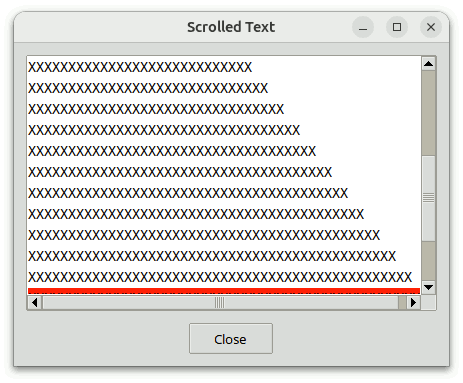
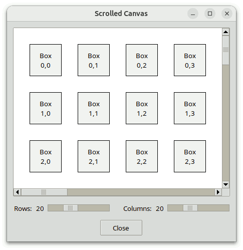
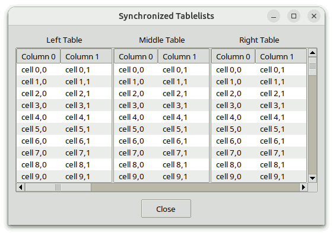
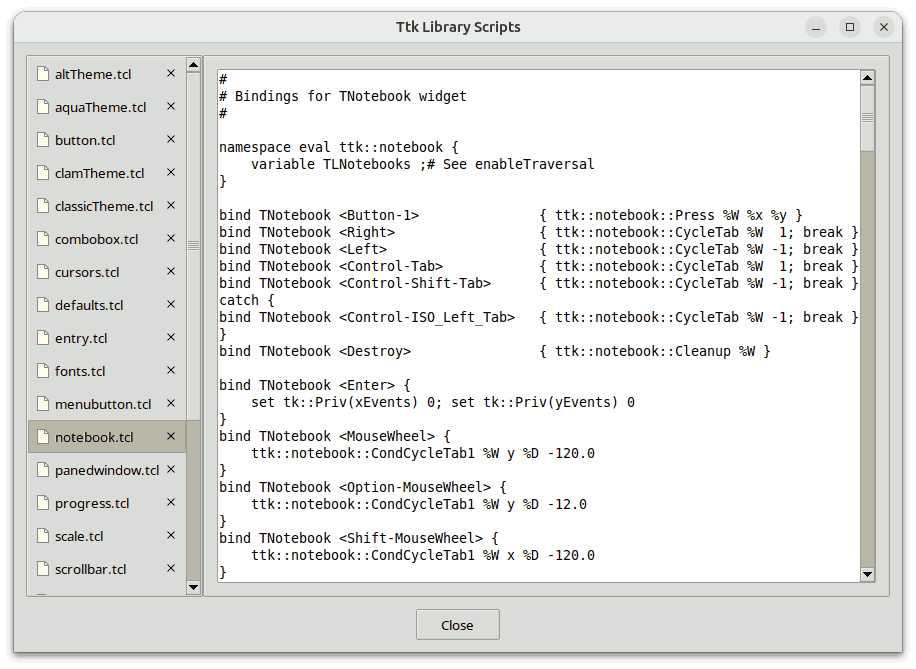
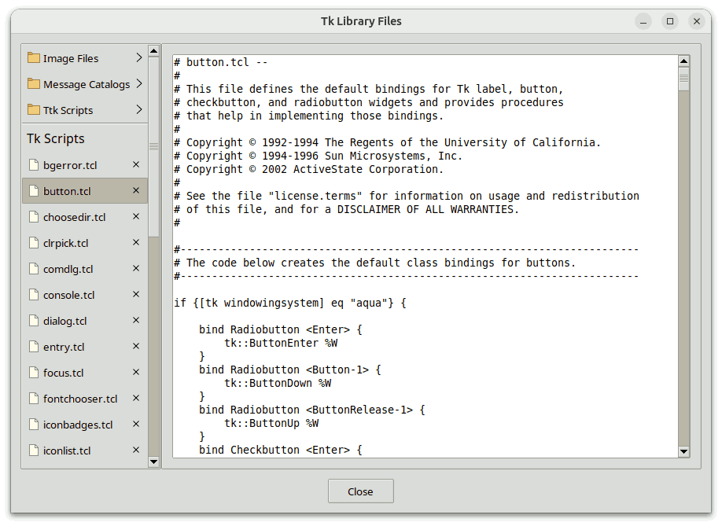
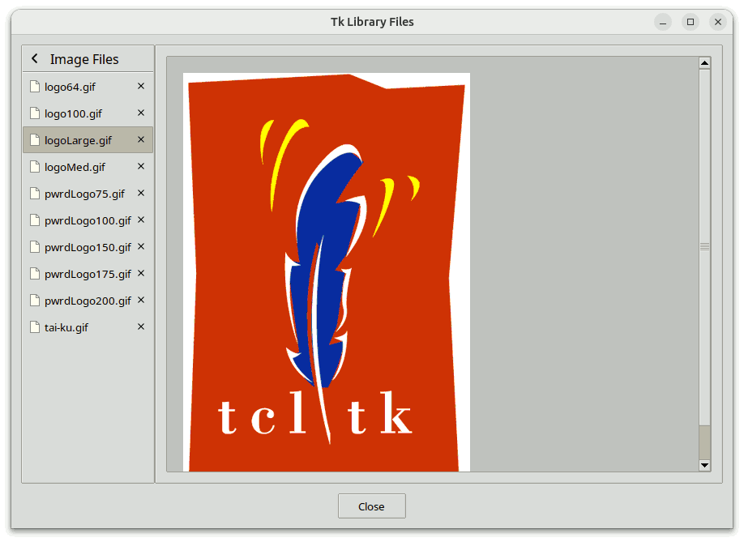

# Scrollutil Programmer's Guide

## For Scrollutil Version 2.11

### by

## Csaba Nemethi

csaba.nemethi@t-online.de

---

## Contents

#### Overview

- [What Is Scrollutil?](#what-is-scrollutil)
- [How to Get It?](#how-to-get-it)
- [How to Install It?](#how-to-install-it)
- [How to Use It?](#how-to-use-it)
- [More on scrollutil::scalingpct](#more-on-scrollutil-scalingpct)
- [The Procedure scrollutil::getScalingPct and Tk's Scaling Factor](#the-procedure-scrollutil-getscalingpct-and-tk-s-scaling-factor)
- [More on scrollutil::svgfmt](#more-on-scrollutil-svgfmt)

#### Examples

- [The Helper Script styleUtil.tcl](#the-helper-script-styleutil-tcl)
- [A Scrolled tablelist Widget](#a-scrolled-tablelist-widget)
- [A Scrolled text Widget](#a-scrolled-text-widget)
- [A Scrolled canvas Widget](#a-scrolled-canvas-widget)
- [Synchronizing Two listbox Widgets](#synchronizing-two-listbox-widgets)
- [Synchronizing Three tablelist Widgets](#synchronizing-three-tablelist-widgets)
- [A Script Using a scrollutil::scrollableframe Widget](#a-script-using-a-scrollutil-scrollableframe-widget)
- [A Script Using a BWidget ScrollableFrame Widget](#a-script-using-a-bwidget-scrollableframe-widget)
- [A Script Using an iwidgets::scrolledframe Widget](#a-script-using-an-iwidgets-scrolledframe-widget)
- [A Script Using Two scrollutil::scrollableframe Widgets](#a-script-using-two-scrollutil-scrollableframe-widgets)
- [A Script Using Two BWidget ScrollableFrame Widgets](#a-script-using-two-bwidget-scrollableframe-widgets)
- [A Script Using Two iwidgets::scrolledframe Widgets](#a-script-using-two-iwidgets-scrolledframe-widgets)
- [A scrollutil::scrollednotebook Demo](#a-scrollutil-scrollednotebook-demo)
- [A scrollutil::plainnotebook Demo](#a-scrollutil-plainnotebook-demo)
- [A scrollutil::pagesman Demo](#a-scrollutil-pagesman-demo)

[Start page](index.md)

---

## Overview

### What Is Scrollutil?

Scrollutil is a library package for Tcl/Tk versions 8.4 or higher, written in pure Tcl/Tk code.  It contains:

- the implementation of the **scrollarea**, **scrollsync**, **scrollableframe**, **scrollednotebook**, **plainnotebook**, and **pagesman** mega-widgets, including a general utility module for mega-widgets.  The scrollednotebook and plainnotebook widgets require tile 0.8 or higher;
- the command `scrollutil::addMouseWheelSupport`, which creates mouse wheel event bindings for a given binding tag;
- commands for *user-friendly* mouse wheel event handling in **scrollable widget containers** like scrollutil::scrollableframe, BWidget ScrollableFrame, and iwidgets::scrolledframe.  These commands require Tcl/Tk versions 8.4 or higher on X11 and Mac OS X/11+ and Tk 8.6b2 or later on Windows;
- commands for *user-friendly* mouse button 2 event handling in scrollutil::scrollableframe widgets;
- demo scripts illustrating the use of the Scrollutil package in connection with various scrollable widgets and the above-mentioned scrollable widget containers;
- demo scripts illustrating the use of the scrollednotebook, plainnotebook, and pagesman widgets;
- this tutorial;
- reference pages in HTML format.

**The scrollutil::scrollarea mega-widget** greatly simplifies the creation of arbitrary scrolled widgets.  It consists of a scrollable widget and two scrollbars connected with that widget.  The display mode of each scrollbar can be `static`, `dynamic`, or `none`.  This scrolled window implementation also supports the widgets that are scrollable in one direction only (e.g., entry and ttk::entry) and respects the header component and title columns of [tablelist](https://www.nemethi.de/tablelist/) widgets (this is freely configurable).

The scrollutil::scrollarea widget is similar to BWidget ScrolledWindow and its snit-based equivalent widget::scrolledwindow, contributed by Jeffrey Hobbs and contained in tklib.  The snit-based [scrodget](http://web.tiscali.it/irrational/tcl/scrodget-2.1/) package by Aldo Buratti and its TclOO-based equivalent [scrolledwidget](https://wiki.tcl-lang.org/page/A+Scrolled+Widget+implemented+with+TclOO) contributed by Johann Oberdorfer are further scrolled window implementations. However, *full* tablelist support is only provided by the scrollarea widget, which is free from external dependencies like BWidget, snit, or (for Tcl 8.5) TclOO.  It is also free from the [shimmering problem in connection with text widgets](https://wiki.tcl-lang.org/page/Scroll+bars+that+appear+only+when+needed), which the above-mentioned scrolled window implementations either share with the autoscroll package (contained in tklib) or circumvent in a suboptimal way.

**The scrollutil::scrollsync mega-widget** is designed for scrolling several widgets simultaneously.  Whenever the horizontal/vertical position of the view in the window of one of its widgets changes, the view in the windows of all the other widgets is automatically adjusted accordingly, thus making sure that the view's position in these windows is kept in sync.  This mega-widget is horizontally and vertically scrollable, hence it can be embedded into a scrollutil::scrollarea widget via the latter's `setwidget` subcommand.

**The scrollutil::scrollableframe mega-widget** is a scrollable widget container.  It contains a content frame, whose dimensions are typically larger than those of the widget itself.  Arbitrary regions of this frame can be brought into view by scrolling, and the widget also provides a command for making individual widgets contained in the content frame visible in the scrollableframe window.

The scrollutil::scrollableframe widget is similar to BWidget ScrollableFrame and iwidgets::scrolledframe.  However, unlike these widgets, which use a canvas for scrolling the content frame, it adjusts the view with the aid of the `place` geometry manager, just like the `scrolledframe::scrolledframe` command of the Scrolledframe package by Maurice Bredelet (ulis) and its optimized and enhanced version contributed by Keith Nash.  For details on these commands see the wiki page

https://wiki.tcl-lang.org/page/A+scrolled+frame

The canvas-free approach is more lightweight and integrates better in applications that use tile widgets.

**The scrollutil::scrollednotebook mega-widget** contains a ttk::notebook within a scrollableframe and supports an arbitrary number of unsqueezed tabs.  Currently not visible tabs can be brought into view by navigating with the mouse wheel, touchpad, or keyboard, and by scrolling with the aid of the two arrow buttons placed on demand in the top-left and top-right or bottom-left and bottom-right corners (depending on the notebook's style).  The widget also provides a command for making individual tabs visible in the scrollednotebook window.  Unlike the ttk::notebook widget, whose `-width` option is quite often overriden by the total width of the tabs, the scrollednotebook widget respects the value of its `-width` option, regardless of the space required by the tabs.

**The scrollutil::plainnotebook mega-widget** extends a ttk::notebook having an arbitrary number of pages with invisible tabs by a ttk::frame to its left or right containing, among others, a scrollableframe whose content frame is the parent of a series of widgets that play the role of vertically laid-out notebook tabs.  Currently not visible "tabs" can be brought into view by navigating with the mouse wheel, touchpad, or keyboard, and by scrolling with the vertical scrollbar of the scrollarea containing the scrollableframe.  The widget also provides a command for making individual "tabs" visible in the plainnotebook window.  Unlike a ttk::notebook widget with vertically aligned tabs, which in most themes has a suboptimal look and whose `-height` option is quite often overriden by the total height of the tabs, the plainnotebook widget respects the value of its `-height` option, regardless of the space required by the "tabs".

**The scrollutil::pagesman mega-widget** provides the basic functionality of a pages manager, meaning that it manages a list of windows, called **pages**, of which only one is visible at a time.  By using it with plainnotebook widgets as pages, it is quite easy to write applications in which the user can descend from a plainnotebook to another one with a single mouse click and switch back in the same way to the original one.  Everything needed for this navigation is provided by appropriate options and subcommands of the plainnotebook widget.

From the point of view of **the commands related to mouse wheel and \<TouchpadScroll> event handling** provided by the Scrollutil package, the scrollability of a widget or widget container window means that the associated Tcl command supports the  `xview scroll number units`  and  `yview scroll number units`  subcommands.  The reason for requiring at least Tk version 8.6b2 on Windows for the commands related to scrollable widget containers is that in earlier Tk versions on this platform the mouse wheel events were sent to the widget having the focus rather than to the one under the pointer.

To make use of the user-friendly mouse wheel and `<TouchpadScroll>` event handling in scrollable widget containers via the Scrollutil package, follow the steps below:

- Create mouse wheel and `<TouchpadScroll>` event bindings for the binding tag `"all"` or for the toplevel widgets (including `"."`) having scrollable widget containers, by invoking the `scrollutil::createWheelEventBindings` command.  In addition, register your scrollable widget containers for scrolling via these bindings with the aid of the `scrollutil::enableScrollingByWheel` command.  Note that for the scrollutil::scrollableframe widget this command is automatically invoked at creation time.  The above-mentioned bindings handle the mouse wheel and `<TouchpadScroll>` events by scrolling the (innermost) registered scrollable widget container that is an ascendant of the widget under the pointer and is contained in the latter's toplevel.
- Invoke the `scrollutil::adaptWheelEventHandling` command for those widgets contained in registered scrollable widget containers that have mouse wheel or `<TouchpadScroll>` event (class) bindings.  This step modifies the mouse wheel and `<TouchpadScroll>` event handling as follows:  If the focus is on the widget under the pointer then the above-mentioned events will be handled by the (class bindings of the) widget only, otherwise by the bindings created with the `scrollutil::createWheelEventBindings` command.  Note that this command accepts as optional argument the `-ignorefocus` switch, which specifies that the above-mentioned events are to be handled by the widget under the pointer (only), ragardless of whether that widget has the focus or not.
- For some widgets it can be desirable to make the focus check within this modified event handling less restrictive.  For example, if the widget under the pointer is an entry component of a [mentry](https://www.nemethi.de/mentry/) of type `"Date"`, `"Time"`, `"DateTime"`, `"IPAddr"`, or `"IPv6Addr"` and the focus is on any of its siblings, then the mouse wheel and `<TouchpadScroll>` events sent to this entry should be handled by the entry widget itself rather than scrolling the widget container that is an ascendant of the mentry.  The `scrollutil::setFocusCheckWindow` command covers exactly cases like this.

The mouse wheel and `<TouchpadScroll>` event handling with the aid of the Scrollutil package was also tested to work with the `scrolledframe::scrolledframe` command of the Scrolledframe package by Maurice Bredelet (ulis) and its optimized and enhanced version contributed by Keith Nash, as well as with the `sframe` command implemented by Paul Walton.  For details on these commands (which provide further implementations of scrollable widget containers) see the above-mentioned wiki page.

**The comands related to mouse button 2 event handling** are restricted to the scrollutil::scrollableframe widget, which provides scan support via the  `scan mark`  and  `scan dragto`  commands.  The mouse button 2 event bindings for the binding tag `"all"`, created automatically by Scrollutil, handle the `<Button-2>`, `<B2-Motion>`, and `<ButtonRelease-2>` events by scanning the content of the (innermost) scrollableframe widget that is an ascendant of the clicked widget and is contained in the latter's toplevel.  By invoking the `scrollutil::adaptBtn2EventHandling` command for the widgets that are contained in a scrollableframe and have mouse button 2 (class) bindings, the handling of these events will be modified as follows:  If the focus is on the clicked widget then the events will be handled by the (class bindings of the) widget only, otherwise by the bindings created for the `"all"` tag.  This comes in handy especially on Android, where it provides user-friendly scan support for scrollableframe widgets via one-finger gestures.

### How to Get It?

Scrollutil is available for free download from the Web page

https://www.nemethi.de

The distribution file is `scrollutil2.11.tar.gz` for UNIX and `scrollutil2_11.zip` for Windows.  These files contain the same information, except for the additional carriage return character preceding the linefeed at the end of each line in the text files for Windows.

Scrollutil is also included in tklib, which has the address

https://core.tcl-lang.org/tklib

### How to Install It?

Install the package as a subdirectory of one of the directories given by the `auto_path` variable.  For example, you can install it as a subdirectory of the `lib` directory within your Tcl/Tk installation.

To install Scrollutil *on UNIX*, `cd` to the desired directory and unpack the distribution file `scrollutil2.11.tar.gz`:

```
gunzip -c scrollutil2.11.tar.gz | tar -xf - 
```

On most UNIX systems this can be replaced with

```
tar -zxf scrollutil2.11.tar.gz 
```

Both commands will create a directory named `scrollutil2.11`, with the subdirectories `demos`, `doc`, and `scripts`.

*On Windows*, use WinZip or some other program capable of unpacking the distribution file `scrollutil2_11.zip` into the directory `scrollutil2.11`, with the subdirectories `demos`, `doc`, and `scripts`.

Notice that in tklib the Scrollutil `demos` directory is replaced with the subdirectory `scrollutil` of the `examples` directory.  Please take this into account when reading the [examples](#examples) below.

### How to Use It?

The Scrollutil distribution provides two packages, called **Scrollutil** and **Scrollutil_tile**.  The main difference between the two is that Scrollutil_tile enables the tile-based, theme-specific appearance of scrollarea, scrollsync, and scrollableframe widgets, and provides the themed scrollednotebook and plainnotebook widgets; this package requires tile 0.8 or higher.  It is not possible to use both packages in one and the same application, because both are implemented in the same `scrollutil` namespace and provide identical commands (except for the commands `scrollutil::scrollednotebook`, `scrollutil::plainnotebook`, `scrollutil::addclosetab`, `scrollutil::removeclosetab`, and `scrollutil::closetabstate`, which are provided by the Scrollutil_tile package only).

To be able to access the commands and variables of the Scrollutil package, your scripts must contain one of the lines

```
package require scrollutil ?version?
package require Scrollutil ?version?
```

You can use either one of the two statements above because the file `scrollutil.tcl` contains both lines

```
package provide scrollutil ...
package provide Scrollutil ...
```

Likewise, to be able to access the commands and variables of the Scrollutil_tile package, your scripts must contain one of the lines

```
package require scrollutil_tile ?version?
package require Scrollutil_tile ?version?
```

Again, you can use either one of the two statements above because the file `scrollutil_tile.tcl` contains both lines

```
package provide scrollutil_tile ...
package provide Scrollutil_tile ...
```

You are free to remove one of these two lines from `scrollutil.tcl` and `scrollutil_tile.tcl`, respectively, if you want to prevent the corresponding packages from making themselves known under two different names each.  Of course, by doing so you restrict the argument of  `package require`  to a single name.

Since the packages Scrollutil and Scrollutil_tile are implemented in the `scrollutil` namespace, you must either invoke the

```
namespace import scrollutil::pattern ?scrollutil::pattern ...?
```

command to import the *procedures* you need, or use qualified names like `scrollutil::scrollarea`.  In the [examples](#examples) below we have chosen the latter approach.

To access Scrollutil *variables*, you *must* use qualified names.  There are only 5 Scrollutil variables that are designed to be accessed outside the namespace `scrollutil`:

- The variable `scrollutil::version` holds the current version number of the Scrollutil package.
- The variable `scrollutil::library` holds the location of the Scrollutil installation directory.
- The read-only variable `scrollutil::scalingpct` is set when loading the Scrollutil or Scrollutil_tile package via  `package require`  to the scaling percentage corresponding to the display's DPI scaling level.  Scrollutil adapts, among others, the default width of the Tk core scrollbars on X11 and that of the ttk::scrollbar widget for the built-in themes `alt`, `clam`, `classic`, and `default` to the value of this variable.  The currently supported values are `100`, `125`, `150`, `175`, and `200`.  You can use this variable, e.g., if you want to create images of different sizes, depending on the DPI scaling level.  For example, if your application uses images of size 16 x 16 on an unscaled display and `scrollutil::scalingpct` has the value `150`, then the image size for this display should be 24 x 24.
- If the Tk version is either at least 8.7 (with built-in SVG support), or 8.6 and the tksvg extension can be loaded into the interpreter, then the variable `scrollutil::svgfmt` is set to a Tcl list that you can pass to the commands that create or manipulate SVG images as the value of their `-format` option to make sure that your images will be properly scaled.
- The read-only variable `scrollutil::usingTile` has the value `0` in the Scrollutil package and the value `1` in Scrollutil_tile.

The Scrollutil_tile package checks whether the required Tk and tile versions are present, by executing the commands

```
package require Tk 8.4-
if {$::tk_version < 8.5 || [regexp {^8\.5a[1-5]$} $::tk_patchLevel]} {
    package require tile 0.8-
}
```

The second command above reflects the fact that, beginning with Tk 8.5a6, tile is integrated into the Tk core and therefore it should only be loaded explicitly when using an earlier Tk version.

### More on `scrollutil::scalingpct`

The Scrollutil code sets the variable `scrollutil::scalingpct` to the value returned by the public procedure `scaleutil::scalingPercentage` of the scaleutil package, which is bundled with Scrollutil.  The way this value is computed depends on the windowing system:

*On Windows and Mac OS X/11+* the scaling percentage is computed from Tk's scaling factor given by  `[tk scaling]`.  Note that on Mac OS X/11+ the result is always `100`, regardless of the display's scaling level.  On this system the desktop engine automatically scales everything as needed.

*On X11*, computing the scaling percentage from  `[tk scaling]`  is done as fallback method only, because the implementation of display scaling is highly dependent on the desktop environment and it mostly manipulates system resources that are resident outside of Xlib, which Tk is based on.  (Traditional X applications like `bitmap` and `xmag` are also affected by this.)  With the partial exception of Xfce and MATE (see below), the procedure computes the scaling percentage from the value of the X resource `Xft.dpi`, by executing the `xrdb` application.  On GNOME-based systems where `xrdb` is not installed per default (e.g., Solus GNOME and Solus Budgie), it uses the `xrandr` application and the file `~/.config/monitors.xml` instead.

- On *Xfce*, the display scaling mode, called *window scaling*, can be "1x" or "2x" and can be selected in the *Appearance* dialog.  Xfce versions 4.16 and later also support fractional scaling, whose parameters can be configured in the *Display* dialog.  If the "2x" mode was selected then the scaling percentage will be set by the procedure `scaleutil::scalingPercentage` to `200`, otherwise it will be computed from the value of the font DPI, given by the X resource `Xft.dpi`.  The value of the font DPI can be set in the *Fonts* tab of the *Appearance* dialog or (on Linux Lite 5+) via the *HiDPI Settings* dialog.
- On *MATE*, the display scaling mode, called *window scaling factor*, can be "Auto-detect", "Regular", or "HiDPI", and can be selected in the *MATE Tweak* dialog.  The same effect can be achieved by using the *Monitor Preferences* dialog and selecting one of the possible scaling values "auto detect", "100%", and "200%".  If needed, the procedure `scaleutil::scalingPercentage` auto-detects which one of the "Regular" ("100%") and "HiDPI" ("200%") modes corresponds to the preset "Auto-detect" ("auto detect") mode.  If the "HiDPI" ("200%") mode was selected by the user or auto-detected by the procedure, then the scaling percentage will be set to `200`, otherwise it will be computed from the value of the font DPI, given by the X resource `Xft.dpi`.  The value of the font DPI can be set via the *Font Rendering Details* dialog, which in turn can be opened from within the *Fonts* tab of the *Appearance Preferences* dialog.
- In case of *GNOME on Xorg, Budgie, and Cinnamon versions earlier than 4.6*, the display scaling can be either 100 % or 200 %, and the procedure sets the scaling percentage accordingly to `100` or `200`.  In newer GNOME and Budgie versions on Ubuntu one can enable the `x11-randr-fractional-scaling` as experimental feature, which adds (at least) 125 %, 150 %, and 175 % to the list of supported scaling percentages.  Note that, due to the way this fractional scaling is implemented, the value returned by `scaleutil::scalingPercentage` will be `200`, regardless of the selected display scaling.  Cinnamon versions 4.6 and later also support fractional scaling; if activated then the scaling percentage returned by the procedure will be `200`, regardless of the selected display scaling.
- *GNOME on Wayland* traditionally supports the display scaling values 100 % and 200 %, and the scaling percentage will be set accordingly to `100` or `200`.  In newer GNOME versions one can enable the experimental feature `scale-monitor-framebuffer`, which adds (at least) 125 %, 150 %, and 175 % to the list of supported scaling percentages.  With this feature enabled, the value returned by `scaleutil::scalingPercentage` will be `100` for older GNOME versions and `200` for newer ones, regardless of the scaling level, due to the fact that in this case, instead of window contents, monitor framebuffers will be scaled in a logical pixel coordinate space.
- *KDE Plasma on Xorg* provides fractional scaling support.  On this desktop, the procedure will return `100`, `125`, `150`, `175`, or `200`, depending on the display's scaling level.
- *KDE Plasma on Wayland* supports fractional scaling, too.  In this case, for older KDE versions the value returned by the procedure will always be `100`, regardless of the display's scaling level, while for newer KDE versions it will be `100`, `125`, `150`, `175`, or `200`.

On GNOME and Budgie, the display scaling can be set in the *Displays* page of the *Settings* dialog, but the value of the X resource `Xft.dpi`, which is used by the procedure `scaleutil::scalingPercentage`, can also be manipulated by setting the scaling factor of the fonts via the *Tweaks* application.  Likewise, on Cinnamon the display scaling can be set in the *Display* page of the *System Settings* dialog, but the value of the X resource `Xft.dpi` can also be manipulated by setting the text scaling factor via the *Font Selection* page of the *System Settings* dialog.  Finally, on KDE Plasma the display scaling can be set in the *Display Configuration* page of the *System Settings* dialog, and on KDE Plasma on Xorg the value of the font DPI, given by the X resource `Xft.dpi` can also be set via the *Fonts* page of the *System Settings* dialog.

Besides computing the scaling percentage, the procedure `scaleutil::scalingPercentage` performs a series of additional tasks.  Among others, it changes the default height of the ttk::treeview rows from the hard-coded value of 20 pixels to a more reasonable one, based on the metrics of the font used by the `Treeview` style (usually `TkDefaultFont`), and makes sure that this step will be repeated whenever the virtual event `<<ThemeChanged>>` is received (e.g., because the value of the `Treeview` style's `-font` option has changed), or the virtual event `<<TkWorldChanged>>` with the `user_data` field (`%d`) set to `FontChanged` is received.  If the Tk version is later than 8.6.11 or 8.7a5, this virtual event is sent by the Tk engine to all widgets when a font is changed, for example, by invoking  `font configure`  (see [TIP 608](https://core.tcl-lang.org/tips/doc/trunk/tip/608.md)).

The additional steps described in the rest of this section are only performed if the scaling percentage is greater than `100`.

On X11, the procedure synchronizes the scaling factor used by Tk to convert between physical units and pixels with the scaling percentage, by passing a value derived from the latter to the  `tk scaling`  command.  While in the vast majority of applications this is the desired and recommended behavior, there might be cases where you want to suppress this step because your application might have its own logic for determining the value of Tk's scaling factor.  You can achieve this by inserting the line

```
namespace eval ::scaleutil { set keepTkScaling 1 }
```

before loading Scrollutil or Scrollutil_tile via  `package require`.

The procedure `scaleutil::scalingPercentage` also corrects the sizes of the standard fonts if needed.  These fonts (`TkDefaultFont`, `TkTextFont`, etc.) are defined in the file `$tk_library/ttk/fonts.tcl`.  For quite a long time, the font sizes for X11 given in this file were sizes in pixels, which was not suitable for use on HiDPI displays.  This caused several Linux distributions to bundle patched versions of this file, in which the sizes in pixels are replaced with sizes in points.  The same fix was committed in February 2020 into the Tk core repository and is now contained in Tk 8.7a5 and later.  To make sure that, regardless of the Tk version, the font sizes will suit the display's scaling level, the procedure examines this library file and, if the latter contains sizes in pixels, then it sets the `-size` option of the standard fonts to corresponding sizes in points (without altering the file).  In addition, for the "2x" mode on Xfce, the procedure doubles the sizes (in points) of the standard fonts (the way display scaling works on that desktop makes this necessary).

The procedure also scales:

- the default parameters of the Tk core panedwindow sash;
- the default size of the Tk core scale widget and its slider;
- the default width of the Tk core scrollbars on X11;
- the default length of the ttk::scale and ttk::progressbar widgets;
- for the built-in themes `alt` and `default`, some styling options of the ttk::scrollbar, ttk::scale, ttk::progressbar, ttk::combobox, ttk::spinbox, ttk::button, toolbutton, ttk::menubutton, ttk::checkbutton, ttk::radiobutton, ttk::notebook, ttk::panedwindow, and ttk::treeview widgets;
- for the built-in theme `clam`, some styling options of the ttk::scrollbar, ttk::scale, ttk::progressbar, ttk::combobox, ttk::spinbox, ttk::button, toolbutton, ttk::menubutton, ttk::checkbutton, ttk::radiobutton, ttk::notebook, ttk::panedwindow, ttk::treeview, and ttk::labelframe widgets;
- for the built-in theme `classic`, some styling options of the ttk::scrollbar, ttk::scale, ttk::progressbar, ttk::combobox, ttk::spinbox, ttk::button, toolbutton, ttk::menubutton, ttk::checkbutton, ttk::radiobutton, ttk::notebook, ttk::panedwindow, and ttk::treeview widgets;
- for the built-in theme `vista`, some styling options of the ttk::combobox, ttk::button, toolbutton, ttk::menubutton, ttk::checkbutton, ttk::radiobutton, ttk::notebook, ttk::panedwindow, and ttk::treeview widgets;
- for the built-in theme `winnative`, some styling options of the ttk::scale, ttk::progressbar, ttk::combobox, ttk::spinbox, toolbutton, ttk::menubutton, ttk::checkbutton, ttk::radiobutton, ttk::notebook, ttk::panedwindow, and ttk::treeview widgets;
- for the built-in theme `xpnative`, some styling options of the ttk::combobox, ttk::spinbox, ttk::button, toolbutton, ttk::menubutton, ttk::checkbutton, ttk::radiobutton, ttk::notebook, ttk::panedwindow, and ttk::treeview widgets.

In addition, the procedure `scaleutil::scalingPercentage` makes sure that in the `vista` and `xpnative` themes the indicators of the ttk::checkbutton and ttk::radiobutton widgets will appear properly scaled, regardless of the Tk release being used.  (A long-standing bug in the implementation of these widgets was fixed in May 2020 and is now contained in both Tk 8.6.11 and later and 8.7a5 and later, but the procedure provides an automatic workaround for the Tk versions that are still affected by this bug.)

Note that in Tk versions earlier than 9, the Tk core checkbutton and radiobutton widgets, as well as the indicators of the ttk::checkbutton and ttk::radiobutton widgets of the `alt` and `winnative` themes are not scalable (they scale automatically in Tk 9 and later).  The same holds true for the ttk::sizegrip widget in the built-in themes.

### The Procedure `scrollutil::getScalingPct` and Tk's Scaling Factor

The Scrollutil package provides the helper procedure `scrollutil::getScalingPct`, which expects no arguments and returns the application's scaling percentage, derived from Tk's *current* scaling factor given by  `[tk scaling]`.  The procedure's return value is restricted to multiples of `25`, is at least `100`, and can be greater than `200`, especially when running AndroWish on a tablet or smartphone.  Scrollutil makes use of this procedure to make sure that the sizes of its GUI components will correspond to Tk's current scaling factor (which might have been changed via  `tk scaling`),  and it is recommended to do this in the application code, too.

If the Tk version is 9 or later then the functionality of the `scaleutil::scalingPercentage` procedure described in the previous section is integrated in the core.  As part of this functionality, Tk 9+ sets the variable `tk::scalingPct` at initialization time to the scaling percentage corresponding to the display's DPI scaling level, and the procedure `scaleutil::scalingPercentage` just returns the minimum of the current value of `tk::scalingPct` and `200`.  Recall that in Tk 9+, whenever the scaling factor is changed via  `tk scaling`,  the value of the variable `tk::scalingPct` is automatically updated.  Consequently, if the application changes Tk's scaling factor *before loading Scrollutil or Scrollutil_tile* via  `package require`,  then the variable `scrollutil::scalingpct` will be set to the minimum of the automatically updated value of `tk::scalingPct` and `200`.  These facts result in the following

**Recommendation:** If your application changes Tk's scaling factor by invoking  `tk scaling`,  it should do this *before loading Scrollutil or Scrollutil_tile*.

### More on `scrollutil::svgfmt`

If the Tk version is either at least 8.7 (with built-in SVG support), or 8.6 and the tksvg package can be loaded into the interpreter, then Scrollutil sets the variable `scrollutil::svgfmt` to

```
[list svg -scale [expr {[scrollutil::getScalingPct] / 100.0}]]
```

Typical values are  `{svg -scale 1.0}`,  `{svg -scale 1.25}`,  `{svg -scale 2.0}`,  etc.

It is recommended to pass the value of the variable `scrollutil::svgfmt` to the commands  `image create photo`,  `imageName configure`,  `imageName put`,  and `imageName read`  as the value of their `-format` option when creating or manipulating SVG images, to make sure that their sizes will correspond to the application's current scaling percentage.

[Contents](#contents)     [Start page](index.md)

---

## Examples

### The Helper Script `styleUtil.tcl`

All the examples in the `demos` directory use tile (ttk) widgets and contain the lines

```
set dir [file dirname [info script]]
source [file join $dir styleUtil.tcl]
```

The script `styleUtil.tcl` starts with a comment related to the `-autohidescrollbars` and `-setfocus` scrollarea configuration options:

```
#
# To set the "-autohidescrollbars" or "-setfocus" option of all scrollarea
# widgets in all demo scripts to true, uncomment the corresponding line below:
#
# option add *Scrollarea.autoHideScrollbars 1
# option add *Scrollarea.setFocus           1
```

You are free to follow this hint or to run the demo scripts with the default  `-autohidescrollbars 0`  and  `-setfocus 0`  scrollarea settings.

The script patches a few ttk widget styles and defines the style `Small.Toolbutton`.

The patch for the style `TCombobox` makes sure that the (readonly) ttk::combobox widgets of the themes `alt`, `clam`, `classic`, and `default` will show whether they have the focus.  This basic requirement, which makes the keyboard navigation more user-friendly, is already fulfilled by the themes `vista`, `xpnative`, and `aqua`.

The ttk::button widgets of the style `Small.Toolbutton` created by the procedure `styleutil::createToolbutton`, implemented in this helper script, will appear raised when they have the focus.  Again, this makes the keyboard navigation more user-friendly.

Yet another procedure provided by this script is `styleutil::getCurrentTheme`, which returns the name of the current theme by invoking the  `ttk::style theme use`  command.  If an old tile version is being used which doesn't yet support this method then the procedure returns the value of the variable `::ttk::currentTheme` (which is set by the `ttk::setTheme` command only).  This procedure is used by nearly all demo scripts included in the Scrollutil distribution.

The script also patches the `clam` theme, by invoking the public procedure `themepatch::patch` of the themepatch package, which is bundled with Scrollutil (but, contrary to the scaleutil package, is not used by the Scrollutil code and therefore it needs to be loaded explicitly via  `package require themepatch`):

```
package require scrollutil_tile

. . .

#
# Patch the clam theme's styles TButton, TMenubutton,
# Heading, TCheckbutton, and TRadiobutton
#
package require themepatch
themepatch::patch clam
```

On X11, the script sets the theme to this patched variant of the `clam` theme, which has smaller ttk::button widgets as well as ttk::treeview and tablelist headers, and its scalable ttk::checkbutton and ttk::radiobutton widgets have a significantly improved look and behavior.

### A Scrolled tablelist Widget

This example shows how you can greatly simplify the creation of a scrolled tablelist by using a [scrollarea](scrollarea.md) widget.

The script `ScrolledTablelist1.tcl` in the `demos` directory creates a horizontally and vertically scrolled tablelist widget having two header rows and one title column, and manages the two scrollbars in such a way that the vertical scrollbar appears below the tablelist's header and the horizontal one starts to the right of the widget's title column area:


The script achieves these requirements using traditional scrollbar management, which is shown below in [red]{.red} color:

```
package require Tk 8.5-
package require tablelist_tile 6.3-
set dir [file dirname [info script]]
source [file join $dir styleUtil.tcl]

wm title . "Scrolled Tablelist"

#
# Create the tablelist and the scrollbars as children
# of a frame having -borderwidth 1 and -relief sunken
#
set f   [ttk::frame .f]
set frm [ttk::frame $f.frm -borderwidth 1 -relief sunken]
set tbl $frm.tbl
set vsb $frm.vsb
set hsb $frm.hsb
tablelist::tablelist $tbl ... -borderwidth 0 \
    -xscrollcommand [list $hsb set] -yscrollcommand [list $vsb set]
. . .
ttk::scrollbar $vsb -orient vertical   -command [list $tbl yview]
ttk::scrollbar $hsb -orient horizontal -command [list $tbl xview]

. . .

#
# Manage the widgets within the frame
#
grid $tbl -row 0 -rowspan 2 -column 0 -columnspan 2 -sticky news
if {[tk windowingsystem] eq "win32"} {
    grid $vsb -row 0 -rowspan 2 -column 2 -sticky ns
} else {
    grid [$tbl cornerpath] -row 0 -column 2 -sticky ew
    grid $vsb              -row 1 -column 2 -sticky ns
}
grid [$tbl cornerpath -sw] -row 2 -column 0 -sticky ns
grid $hsb                  -row 2 -column 1 -sticky ew
grid rowconfigure    $frm 1 -weight 1
grid columnconfigure $frm 1 -weight 1

. . .

#
# Manage the frame
#
pack $frm -expand yes -fill both -padx 9p -pady 9p
pack $f   -expand yes -fill both
```

The script `ScrolledTablelist2.tcl` in the `demos` directory replaces the rather technical code above with just a few lines (shown below in [red]{.red} color), by embedding the tablelist into a scrollarea widget.  It requires Tablelist version 6.5, which is needed so the `-respectheader` and `-respecttitlecolumns` scrollarea options can work as expected (for earlier Tablelist versions these options are silently ignored).  As a further benefit, the scrollbars created with this method will have the default display mode `dynamic`.

```
package require Tk 8.5-
package require tablelist_tile 6.5-
package require scrollutil_tile
set dir [file dirname [info script]]
source [file join $dir styleUtil.tcl]

wm title . "Scrolled Tablelist"

#
# Create the tablelist within a scrollarea
#
set f  [ttk::frame .f]
set sa [scrollutil::scrollarea $f.sa]
set tbl $sa.tbl
tablelist::tablelist $tbl ...
. . .
$sa setwidget $tbl

. . .

#
# Manage the scrollarea
#
pack $sa -expand yes -fill both -padx 9p -pady 9p
pack $f  -expand yes -fill both
```

### A Scrolled text Widget

The script `ScrolledText.tcl` in the `demos` directory shows how the [scrollarea](scrollarea.md) widget circumvents the potential shimmering effect in connection with text widgets.



Here is the relevant code, in which the lines related to the scrollarea widget are shown in [red]{.red} color:

```
package require scrollutil_tile
set dir [file dirname [info script]]
source [file join $dir styleUtil.tcl]

wm title . "Scrolled Text"

#
# Create a text widget within a scrollarea
#
set f  [ttk::frame .f]
set sa [scrollutil::scrollarea $f.sa -lockinterval 10]
set txt [text $sa.txt -font TkFixedFont -width 49 -height 12 \
         -spacing1 1.5p -spacing3 1.5p -wrap none]
$sa setwidget $txt

#
# Populate the text widget and set the background color of line #25 to red
#
for {set i 1} {$i <= 30} {incr i} {
    set j [expr {2*$i}]
    $txt insert end [string repeat x $j]\n
}
$txt delete 30.end
$txt tag configure bgRed -background red
$txt tag add bgRed 25.0 25.end

. . .

#
# Manage the scrollarea
#
pack $sa -expand yes -fill both -padx 9p -pady 9p
pack $f  -expand yes -fill both

#
# Adjust the vertical view in the text window
# so that line #25 becomes the bottom line
#
tkwait visibility $txt
after 100 [list $txt yview 14.0]
```

The script creates a text widget `$txt` embedded into a scrollarea, populates it with 30 lines, and adjusts the vertical view in the text window so that line #25 becomes the bottom line.  This line has 50 characters, hence it doesn't fit completely into the window, whose width is 49 characters.  Consequently, the command  `$txt xview`  will return the list  `{0.0 0.98}`,  hence the scrollarea's horizontal scrollbar will be mapped and will obscure most part of the bottom line.  Since this line has `red` background, it is easy to see how much of it sticks out above the upper edge of the scrollbar.

Let's analyze what happens if the text widget's height is decreased by dragging the main window's upper or lower edge, just until the red pixels get obscured by the horizontal scrollbar.  After performing this action, line #25 is completely out of view and the new bottom line is line #24, which has 48 characters, hence the command  `$txt xview`  will return  `{0.0 1.0}`.  Normally, this would cause the horizontal scrollbar to be unmapped.  However, that would make line #25 to the bottom line, thus causing the horizontal scrollbar to be mapped again.  This time the scrollbar would completely obscure this line, which would result in line #24 to become the bottom line, which would cause the scrollbar to be unmapped again, and so on.  In other words, the horizontal scrollbar would get mapped and unmapped in an endless loop, giving rise to an annoying flickering effect.  The built-in locking mechanism of the scrollarea widget guards against such potential endless loops.  To make sure that the locking will work as expected, we have set the `-lockinterval` scrollarea option to `10` (recall that the default value is `1`).

### A Scrolled canvas Widget

The script `ScrolledCanvas.tcl` in the `demos` directory shows how to use the Scrollutil package for adding scrollbars as well as mouse wheel and `<TouchpadScroll>` event support to a canvas widget.  Further, it shows how to add mouse wheel and `<TouchpadScroll>` event support to ttk::scale widgets.



Here is the relevant code, in which the lines related to the Scrollutil package are shown in [red]{.red} color:

```
package require scrollutil_tile
set dir [file dirname [info script]]
source [file join $dir styleUtil.tcl]

wm title . "Scrolled Canvas"

set scaleFactor [expr {[scrollutil::getScalingPct] / 100.0}]
set width  [expr {13 * 32 * $scaleFactor}]
set height [expr {10 * 32 * $scaleFactor}]
set scrlIncr [expr {16 * $scaleFactor}]

#
# Create a canvas widget within a scrollarea and add mouse wheel support to it
#
set f  [ttk::frame .f]
set sa [scrollutil::scrollarea $f.sa]
set c  [canvas $sa.c -background white -width $width -height $height \
        -xscrollincrement $scrlIncr -yscrollincrement $scrlIncr]
bind $c <Configure> { setScrollRegion %W %w %h }
scrollutil::addMouseWheelSupport $c
$sa setwidget $c

set rows 20
set cols 20

#
# Populate the canvas and then rescale the coordinates
# of all of the items by a factor of $scaleFactor
#
proc populate canv {
    $canv delete all
    global rows cols scaleFactor

    for {set row 0; set y 32} {$row < $rows} {incr row; incr y 96} {
        for {set col 0; set x 32} {$col < $cols} {incr col; incr x 96} {
            $canv create rectangle $x $y [expr {$x+63}] [expr {$y+63}] \
                -fill gray95
            $canv create text [expr {$x+32}] [expr {$y+32}] \
                -text "Box\n$row,$col" -anchor center -justify center
        }
    }

    $canv scale all 0 0 $scaleFactor $scaleFactor
}
populate $c

#
# Sets the scroll region of the canvas.
#
proc setScrollRegion {canv width height} {
    global cols rows scaleFactor
    set rightX [expr {($cols*96 + 32) * $scaleFactor}]
    set lowerY [expr {($rows*96 + 32) * $scaleFactor}]
    if {$rightX < $width}  { set rightX $width }
    if {$lowerY < $height} { set lowerY $height }
    $canv configure -scrollregion [list 0 0 $rightX $lowerY]
}

. . .

#
# Create a ttk::scale widget for setting the number of box rows
#
set fRows [ttk::frame $f.fRows]
pack [ttk::label $fRows.l1 -text "Rows:"] -side left -padx {0 3p}
pack [ttk::label $fRows.l2 -textvariable rows] -side left -padx {0 3p}
pack [ttk::scale $fRows.scl -from 5 -to 50 -value $rows -command \
      [list setBoxRows $fRows.scl]] -side left -expand yes -fill x

proc setBoxRows {scl val} {
    global rows c
    set val [expr {round($val)}]
    if {$val != $rows} {
        set rows $val
        populate $c
        setScrollRegion $c [winfo width $c] [winfo height $c]
    }
}

#
# Create a ttk::scale widget for setting the number of box columns
#

. . .

#
# Add mouse wheel support to the ttk::scale widgets
#
scrollutil::addMouseWheelSupport TScale

. . .
```

The script creates a canvas widget, populates it with `rectangle` and `text` items, and adds mouse wheel and `<TouchpadScroll>` event support to it by passing its name to the `scrollutil::addMouseWheelSupport` command.  Note that in the canvas we work with pixels rather than points, but make the GUI fully scaling-aware with the aid of a variable `scaleFactor`, whose value (`1.0`, `1.25`, `1.5`, etc.) is derived from `[scrollutil::getScalingPct]`.

The script also creates two ttk::scale widgets, used for setting the numbers of box rows and columns in the canvas, and adds mouse wheel and `<TouchpadScroll>` event support to the ttk::scale widgets by passing the widget class `TScale` to the `scrollutil::addMouseWheelSupport` command.

### Synchronizing Two listbox Widgets

The script `SyncListboxes.tcl` in the `demos` directory creates two listboxes within a [scrollsync](scrollsync.md) widget, which in turn is embedded into a [scrollarea](scrollarea.md).


Here is the relevant code, in which the lines related to the scrollarea and scrollsync widgets are shown in [red]{.red} color:

```
package require scrollutil_tile
set dir [file dirname [info script]]
source [file join $dir styleUtil.tcl]

wm title . "European Countries"

. . .

set f  [ttk::frame .f]

. . .

#
# Create a scrollsync widget within a scrollarea
#
set sa [scrollutil::scrollarea $f.sa]
set ss [scrollutil::scrollsync $sa.ss]
$sa setwidget $ss

#
# Populate the scrollsync widget with two listboxes
#

. . .

set lb1 [listbox $ss.lb1 -activestyle none -highlightthickness 0 -width 16]
set lb2 [listbox $ss.lb2 -activestyle none -highlightthickness 0 -width 16]
$ss setwidgets [list $lb1 $lb2]

. . .

grid $lb1 $lb2 -sticky news -padx {0 1.5p}
grid rowconfigure    $ss 0 -weight 1
grid columnconfigure $ss 0 -weight 1
grid columnconfigure $ss 1 -weight 1

. . .

pack $sa -side top -expand yes -fill both -padx 9p -pady {1.5p 9p}
pack $f  -expand yes -fill both

. . .
```

### Synchronizing Three tablelist Widgets

The script `SyncTablelists.tcl` in the `demos` directory creates three tablelists within a [scrollsync](scrollsync.md) widget, which in turn is embedded into a [scrollarea](scrollarea.md).



The relevant code is similar to the one shown in the [previous example](#synchronizing-two-listbox-widgets):

```
package require tablelist_tile
package require scrollutil_tile
set dir [file dirname [info script]]
source [file join $dir styleUtil.tcl]

wm title . "Synchronized Tablelists"

. . .

set f  [ttk::frame .f]

. . .

#
# Create a scrollsync widget within a scrollarea
#
set sa [scrollutil::scrollarea $f.sa]
set ss [scrollutil::scrollsync $sa.ss]
$sa setwidget $ss

#
# Populate the scrollsync widget with three tablelists
#

tablelist::setThemeDefaults
if {$tablelist::themeDefaults(-stripebackground) eq ""} {
    option add *Tablelist.background            white
    option add *Tablelist.stripeBackground      #f0f0f0
}

for {set n 1; set colWidth 40} {$n <= 3} {incr n; incr colWidth 20} {
    set tbl [tablelist::tablelist $ss.tbl$n \
             -columns [list 0 "Column 0" left  $colWidth "Column 1" left]]
    set tbl$n $tbl

    for {set i 0} {$i < 40} {incr i} {
        $tbl insert end [list "cell $i,0" "cell $i,1"]
    }
}
$ss setwidgets [list $tbl1 $tbl2 $tbl3]

grid $tbl1 $tbl2 $tbl3 -sticky news -padx {0 1.5p}
grid rowconfigure    $ss 0 -weight 1
grid columnconfigure $ss 0 -weight 1
grid columnconfigure $ss 1 -weight 1
grid columnconfigure $ss 2 -weight 1

. . .

pack $sa -side top -expand yes -fill both -padx 9p -pady {1.5p 9p}
pack $f  -expand yes -fill both

. . .
```

The option database settings above for the `-background` and `-stripebackground` tablelist configuration options are not present in case of the `aqua` theme, because for this theme the default values of these options are not only `aqua`-specific, but in addition on Mac OS 10.14 (Mojave) and later they also depend on the current system appearance (Light Mode or Dark Mode).

Notice that column #1 of the three tablelist widgets is 40, 60, and 80 characters wide, respectively.  For this reason, when scrolling horizontally to the right, the left table's view will reach its horizontal end position first, then that of the midde table, and as last one the view of the right table.

### A Script Using a scrollutil::scrollableframe Widget

The script `SuScrollableFrmDemo1.tcl` in the `demos` directory creates a [scrollutil::scrollableframe](scrollableframe.md) widget embedded into a [scrollarea](scrollarea.md) and creates mouse wheel and `<TouchpadScroll>` event bindings for the binding tag `"all"` with the aid of the `scrollutil::createWheelEventBindings` command.  Recall that the scrollableframe was automatically registered for scrolling by these bindings at creation time, hence there is no need to invoke the `scrollutil::enableScrollingByWheel` command for it again.  After that, the script populates the content frame of the scrollableframe with ttk::label widgets displaying the names of the European countries, ttk::combobox widgets for selecting the corresponding capital cities, and ttk::button widgets of the style `Small.Toolbutton` (created by using the procedure `styleutil::createToolbutton`, implemented in the file `styleUtil.tcl`) for the less patient users, displaying the text "Resolve".


Here is the relevant code:

```
package require scrollutil_tile
set dir [file dirname [info script]]
source [file join $dir styleUtil.tcl]

wm title . "European Capitals Quiz"

#
# Create a scrollableframe within a scrollarea
#
set f  [ttk::frame .f]
set sa [scrollutil::scrollarea $f.sa]
set sf [scrollutil::scrollableframe $sa.sf]
$sa setwidget $sf

#
# Create mouse wheel event bindings for the binding tag "all"
#
scrollutil::createWheelEventBindings all

#
# Get the content frame and populate it
#

set cf [$sf contentframe]

set countryList {
    Albania Andorra Austria Belarus Belgium "Bosnia and Herzegovina" Bulgaria
    . . .
}
set capitalList {
    Tirana "Andorra la Vella" Vienna Minsk Brussels Sarajevo Sofia
    . . .
}

. . .

set capitalList [lsort $capitalList]

. . .

set row 0
foreach country $countryList {
    . . .

    set w [ttk::combobox $cf.cb$row -state readonly -width 14 \
           -values $capitalList]
    . . .

    #
    # Make the keyboard navigation more user-friendly
    #
    bind $w <<TraverseIn>> [list $sf see %W]

    #
    # Adapt the handling of the mouse wheel and mouse
    # button 2 events for the ttk::combobox widget
    #
    scrollutil::adaptWheelEventHandling $w
    scrollutil::adaptBtn2EventHandling $w

    . . .

    incr row
}

. . .
```

We make the keyboard navigation more user-friendly with the aid of the `see` subcommand of the scrollableframe widget when handling the `<<TraverseIn>>` virtual event for the ttk::combobox and (not shown above) ttk::button widgets.  In addition, we invoke the `scrollutil::adaptWheelEventHandling` command for every ttk::combobox widget, which is needed for a user-friendly event handling, being that this widget has built-in bindings for the mouse wheel and `<TouchpadScroll>` events.  Due to this command, these events over one of the ttk::combobox widgets will only select the next/previous capital city if the widget has the focus, otherwise they will scroll the scrollableframe.

For every ttk::combobox widget, we also invoke the `scrollutil::adaptBtn2EventHandling` command, thus making sure that the mouse button 2 events sent to the widget will only be handled by the widget itself if it has the focus, otherwise they will result in scanning the scrollableframe's content.  During the scan the cursor will take on the shape of a pointing hand, and by draggging the mouse, the content frame will drag at high speed through the window, in the direction the mouse moves.

### A Script Using a BWidget ScrollableFrame Widget

The script `BwScrollableFrmDemo1.tcl` in the `demos` directory creates a BWidget ScrollableFrame embedded into a [scrollarea](scrollarea.md) widget, creates mouse wheel and `<TouchpadScroll>` event bindings for the binding tag `"all"` with the aid of the `scrollutil::createWheelEventBindings` command, and invokes the `scrollutil::enableScrollingByWheel` command for this ScrollableFrame, thus registering the latter for scrolling by these bindings.  After that it populates the content frame of the ScrollableFrame with the same widgets as `SuScrollableFrmDemo1.tcl` in the [previous example](#a-script-using-a-scrollutil-scrollableframe-widget).

Here is the relevant code:

```
package require BWidget
Widget::theme yes
package require scrollutil_tile
set dir [file dirname [info script]]
source [file join $dir styleUtil.tcl]

wm title . "European Capitals Quiz"

#
# Create a ScrollableFrame within a scrollarea
#
set f  [ttk::frame .f]
set sa [scrollutil::scrollarea $f.sa]
set sf [ScrollableFrame $sa.sf]
$sa setwidget $sf

. . .

#
# Create mouse wheel event bindings for the binding tag "all" and
# register the ScrollableFrame for scrolling by these bindings
#
scrollutil::createWheelEventBindings all
scrollutil::enableScrollingByWheel $sf

#
# Get the content frame and populate it
#

set cf [$sf getframe]

set countryList {
    Albania Andorra Austria Belarus Belgium "Bosnia and Herzegovina" Bulgaria
    . . .
}
set capitalList {
    Tirana "Andorra la Vella" Vienna Minsk Brussels Sarajevo Sofia
    . . .
}

. . .

set capitalList [lsort $capitalList]

. . .

set row 0
foreach country $countryList {
    . . .

    set w [ttk::combobox $cf.cb$row -state readonly -width 14 \
           -values $capitalList]
    . . .

    #
    # Make the keyboard navigation more user-friendly
    #
    bind $w <<TraverseIn>> [list $sf see %W]

    #
    # Adapt the handling of the mouse wheel events for the ttk::combobox widget
    #
    scrollutil::adaptWheelEventHandling $w

    . . .

    incr row
}

. . .
```

### A Script Using an iwidgets::scrolledframe Widget

The script `ScrolledFrmDemo1.tcl` in the `demos` directory creates an iwidgets::scrolledframe widget, creates mouse wheel and `<TouchpadScroll>` event bindings for the binding tag `"all"` with the aid of the `scrollutil::createWheelEventBindings` command, and invokes the `scrollutil::enableScrollingByWheel` command for this scrolledframe, thus registering the latter for scrolling by these bindings.  After that it populates the content frame of the scrolledframe with the same widgets as `SuScrollableFrmDemo1.tcl` and `BwScrollableFrmDemo1.tcl` in the two previous examples.

Here is the relevant code:

```
if {[catch {package require iwidgets} result1] != 0 &&
    [catch {package require Iwidgets} result2] != 0} {
    error "$result1; $result2"
}
set dir [file dirname [info script]]
source [file join $dir scrolledwidgetPatch.itk] ;# adds ttk::scrollbar widgets
package require scrollutil_tile
source [file join $dir styleUtil.tcl]

wm title . "European Capitals Quiz"

. . .

#
# Create a scrolledframe
#
set f  [ttk::frame .f]
set sf [iwidgets::scrolledframe $f.sf -borderwidth 1 -relief sunken \
        -scrollmargin 0]
. . .

#
# Create mouse wheel event bindings for the binding tag "all"
# and register the scrolledframe for scrolling by these bindings
#
scrollutil::createWheelEventBindings all
scrollutil::enableScrollingByWheel $sf

#
# Get the content frame and populate it
#

set cf [$sf childsite]
. . .

<exactly as in the previous example, except the stuff related to keyboard navigation>

. . .
```

The code related to keyboard navigation is not present in this example, because the iwidgets::scrolledframe widget doesn't provide a `see` subcommand.

### A Script Using Two scrollutil::scrollableframe Widgets

The script `SuScrollableFrmDemo2.tcl` in the `demos` directory creates a [scrollutil::scrollableframe](scrollableframe.md) widget embedded into a [scrollarea](scrollarea.md) and then `source`s the script `SuScrollableFrmContent.tcl`, which populates the content frame of the scrollableframe with the following widgets:

- a series of ttk::label widgets;
- a scrolled text widget `$txt` within a scrollarea;
- a scrolled listbox widget `$lb` within a scrollarea;
- a ttk::combobox widget `$cb`;
- a ttk::spinbox widget `$sb`;
- a ttk::entry widget `$e`;
- a ttk::separator widget;
- a mentry widget `$me` of type `"Date"`;
- a scrolled tablelist widget `$tbl` within a scrollarea;
- a scrolled ttk::treeview widget `$tv` within a scrollarea.

With the exception of ttk::label and ttk::separator, all these widgets have bult-in mouse wheel and `<TouchpadScroll>` event bindings.  And with the exception of ttk::label, ttk::separator, and ttk::treeview, all these widgets have bult-in mouse button 2 event bindings.


Here is the relevant code:

```
package require Tk 8.5.9-                       ;# for ttk::spinbox
package require mentry_tile 3.2-                ;# for mouse wheel support
package require tablelist_tile 6.5-             ;# for -(x|y)mousewheelwindow
                                                ;# and scrollutil::scrollarea
package require scrollutil_tile
set dir [file dirname [info script]]
source [file join $dir styleUtil.tcl]

wm title . "Scrollutil Demo"

#
# Create a scrollableframe within a scrollarea
#
set tf [ttk::frame .tf]
set sa [scrollutil::scrollarea $tf.sa]
set sf [scrollutil::scrollableframe $sa.sf]
$sa setwidget $sf

#
# Get the content frame and populate it
#
set cf [$sf contentframe]
source [file join $dir SuScrollableFrmContent.tcl]

#
# Make the keyboard navigation more user-friendly
#
foreach w [list $cb $sb $e $me] {
    bind $w <<TraverseIn>> [list $sf see %W]
}
foreach w [list $txt $lb $tbl $tv] {
    bind $w <<TraverseIn>> [list seeScrollarea $sf %W]
}
proc seeScrollarea {sf w} { $sf see [scrollutil::getscrollarea $w] }
```

Whenever the `<<TraverseIn>>` virtual event is sent to one of the four widgets created within scrollareas, we query the path name of the corresponding scrollarea via `scrollutil::getscrollarea` and bring that scrollarea (including the scrollbars and the border) into view rather than just the widget in question.  While *in this script* we could have used  `[winfo parent]`  instead, the command `scrollutil::getscrollarea` is the recommended one, being that it works also for widgets that are no children of the corresponding scrollareas.

Here is the additional stuff related to the mouse wheel and `<TouchpadScroll>` events, using the Scrollutil commands described in the [What Is Scrollutil?](#what-is-scrollutil) section:

```
#
# For the entry components of the mentry widget
# set the "focus check window" to the mentry
#
set entryList [$me entries]
scrollutil::setFocusCheckWindow {*}$entryList $me

#
# Create mouse wheel event bindings for the binding tag "all"
#
scrollutil::createWheelEventBindings all

#
# Adapt the handling of the mouse wheel events for the
# text, listbox, ttk::combobox, ttk::spinbox, ttk::entry,
# tablelist, and ttk::treeview widgets, as well as for
# the entry components of the mentry widget of type "Date"
#
### scrollutil::adaptWheelEventHandling $txt $lb $cb $sb $e {*}$entryList \
    $tbl $tv
$sf preparescroll
```

Notice that the invocation of the `scrollutil::adaptWheelEventHandling` command is commented out and replaced with the much simpler and safer invocation of the `preparescroll` scrollableframe subcommand.

We also have additional stuff related to the mouse button 2 events:

```
#
# Adapt the handling of the mouse button 2 events for the text, listbox,
# ttk::combobox, ttk::spinbox, ttk::entry, and tablelist widgets, as
# well as for the entry components of the mentry widget of type "Date"
#
### scrollutil::adaptBtn2EventHandling $txt $lb $cb $sb $e {*}$entryList $tbl
$sf preparescan
```

Again, the invocation of the `scrollutil::adaptBtn2EventHandling` command is commented out and replaced with the much simpler and safer invocation of the `preparescan` scrollableframe subcommand.

As already mentioned, in the file `SuScrollableFrmContent.tcl` the scrolled text, listbox, tablelist, and ttk::treeview widgets are created within [scrollarea](scrollarea.md) widgets:

```
set _sa [scrollutil::scrollarea ...]
set txt [text $_sa.txt -font TkFixedFont -width 73]
scrollutil::addMouseWheelSupport $txt
$_sa setwidget $txt
grid $_sa ...

. . .

set _sa [scrollutil::scrollarea ...]
set lb [listbox $_sa.lb -width 0]
$_sa setwidget $lb
grid $_sa ...

. . .

set _sa [scrollutil::scrollarea ...]
set tbl [tablelist::tablelist $_sa.tbl ...]
. . .
$_sa setwidget $tbl
grid $_sa ...

. . .

set _sa [scrollutil::scrollarea ... -borderwidth 0]
set tv [ttk::treeview $_sa.tv ...]
. . .
$_sa setwidget $tv
grid $_sa ...
```

In the case of the text, listbox, and tablelist widgets we use scrollarea widgets with their default  `-borderwidth 1 -relief sunken`  settings, which will cause the `setwidget` subcommand of the associated Tcl commands to set the `-borderwidth` option of the text, listbox, and tablelist widgets to `0`.  On the other hand, for the ttk::treeview we use a scrollarea widget with  `-borderwidth 0`,  because the ttk::treeview has a border of width `1` and doesn't support the `-borderwidth` configuration option.

For our text widget we prefer a mouse wheel and `<TouchpadScroll>` event handling that scrolls the widget by lines rather than pixels, as done by the `Text` class bindings in Tk 8.5 and later; we achieve this by passing the path name `$txt` to the `scrollutil::addMouseWheelSupport` command.

The somewhat uncommon look of the ttk::spinbox widget `$sb` displaying the number of changes in a Tablelist release is due to the fact that in the file `SuScrollableFrmContent.tcl` it is created with the `-style` option set to `Wide.TSpinbox` rather than `TSpinbox`:

```
catch {package require wsb}

. . .

set sb [ttk::spinbox $cf.sb -style Wide.TSpinbox -from 0 -to 20 \
        -state readonly -width 4]
```

The small **w**ide **s**pin**b**ox package wsb comes bundled with the Scrollutil distribution, and the attempt to load it via  `package require wsb`  will be successful if the Tk version is either at least 8.7 (with built-in SVG support), or 8.6 and the tksvg extension can be loaded into the interpreter.  If loaded, the wsb package will automatically create the `Wide.TSpinbox` layout.  Otherwise the  `-style Wide.TSpinbox`  setting for the ttk::spinbox widget will have no effect.

The main benefit of the `Wide.TSpinbox` layout over the `TSpinbox` style is the user-friendly size and placement of its scaling-aware up and down arrows, which comes in handy especially when running AndroWish on a tablet or smartphone:

The file `SuScrollableFrmContent.tcl` implements just a minimal interaction between five of the already mentioned widgets within the content frame:  By selecting a Tablelist release from the ttk::combobox `$cb`, the ttk::spinbox `$sb` is set to the corresponding number of changes, the comment associated with that release is inserted into the ttk::entry `$e`, and the corresponding items of the tablelist `$tbl` and ttk::treeview `$tv` are selected and brought into view.

The file `SuScrollableFrmContent.tcl` contains also the implementation of the procedure `configTablelist`, associated with the "Configure Tablelist Widget" button as the value of its `-command` option.  This procedure opens a toplevel window that contains a [scrollutil::scrollableframe](scrollableframe.md) widget created with the  `-fitcontentwidth yes`  setting within a [scrollarea](scrollarea.md).  After that it populates the content frame of the scrollableframe with ttk::label, ttk::combobox, ttk::spinbox, ttk::entry, and ttk::checkbutton or toggleswitch widgets used to display and edit the configuration options of the tablelist widget.  If the ttk::toggleswitch widget is available (it was added to the core in Tk 9.1a1) then we use this widget rather than checkbuttons; else if the toggle switch widget package Tsw can be loaded into the interpreter then we use tsw::toggleswitch widgets instead.  The ttk::spinbox widgets are created with the setting  `-style Wide.TSpinbox`.

The procedure handles the `<<TraverseIn>>` virtual event sent to one of the widgets mentioned above with the aid of the scrollableframe's `see` subcommand.  Whenever a ttk::combobox, ttk::spinbox, or ttk::entry is created, the `scrollutil::adaptWheelEventHandling` command is invoked for it, being that these widgets have their own bindings for the mouse wheel and `<TouchpadScroll>` events.  Similarly, we pass the ttk::combobox, ttk::spinbox, and ttk::entry widgets to the `scrollutil::adaptBtn2EventHandling` command, because these widgets have built-in bindings for the mouse button 2 events.

The widgets populating the content frame are managed using `grid`.  In case of the ttk::entry widgets we invoke `grid` with  `-sticky we`.  Due to this and the  `-fitcontentwidth yes`  scrollableframe setting, the ttk::entry widgets will stretch or shrink whenever the width of the scrollableframe changes as a result of resizing the toplevel window.

|   |   |
| --- | --- |
|  |  |

### A Script Using Two BWidget ScrollableFrame Widgets

The script `BwScrollableFrmDemo2.tcl` in the `demos` directory creates a BWidget ScrollableFrame embedded into a [scrollarea](scrollarea.md) widget and then `source`s the script `BwScrollableFrmContent.tcl`, which populates the content frame of the ScrollableFrame with the same widgets as `SuScrollableFrmContent.tcl` in the [previous example](#a-script-using-two-scrollutil-scrollableframe-widgets).

Here is the relevant code:

```
package require Tk 8.5.9-                       ;# for ttk::spinbox
package require BWidget
Widget::theme yes
package require mentry_tile 3.2-                ;# for mouse wheel support
package require tablelist_tile 6.5-             ;# for -(x|y)mousewheelwindow
                                                ;# and scrollutil::scrollarea
package require scrollutil_tile
set dir [file dirname [info script]]
source [file join $dir styleUtil.tcl]

wm title . "Scrollutil Demo"

#
# Create a ScrollableFrame within a scrollarea
#
set tf [ttk::frame .tf]
set sa [scrollutil::scrollarea $tf.sa]
set sf [ScrollableFrame $sa.sf]
$sa setwidget $sf

. . .

#
# Get the content frame and populate it
#
set cf [$sf getframe]
source [file join $dir BwScrollableFrmContent.tcl]

#
# Make the keyboard navigation more user-friendly
#
foreach w [list $cb $sb $e $me] {
    bind $w <<TraverseIn>> [list $sf see %W]
}
foreach w [list $txt $lb $tbl $tv] {
    bind $w <<TraverseIn>> [list seeScrollarea $sf %W]
}
proc seeScrollarea {sf w} { $sf see [scrollutil::getscrollarea $w] }
```

The additional stuff related to the mouse wheel and `<TouchpadScroll>` events contains the same Scrollutil command invocations as the one in the previous example, except that in addition it registers the ScrollableFrame for scrolling with the mouse wheel and touchpad, and invokes the `scrollutil::prepareScrollingByWheel` command:

```
. . .

#
# Create mouse wheel event bindings for the binding tag "all" and
# register the ScrollableFrame for scrolling by these bindings
#
scrollutil::createWheelEventBindings all
scrollutil::enableScrollingByWheel $sf

#
# Adapt the handling of the mouse wheel events for the
# text, listbox, ttk::combobox, ttk::spinbox, ttk::entry,
# tablelist, and ttk::treeview widgets, as well as for
# the entry components of the mentry widget of type "Date"
#
### scrollutil::adaptWheelEventHandling $txt $lb $cb $sb $e {*}$entryList \
    $tbl $tv
scrollutil::prepareScrollingByWheel $sf
```

The file `BwScrollableFrmContent.tcl` contains also the implementation of the procedure `configTablelist`, associated with the "Configure Tablelist Widget" button as the value of its `-command` option.  This procedure opens a toplevel window that contains a BWidget ScrollableFrame created with the  `-constrainedwidth yes`  setting within a [scrollarea](scrollarea.md) widget and invokes the `scrollutil::enableScrollingByWheel` command for this ScrollableFrame, thus registering the latter for scrolling by the already created mouse wheel and `<TouchpadScroll>` event bindings for the binding tag `"all"`.  After that it populates the content frame of the ScrollableFrame with ttk::label, ttk::combobox, ttk::spinbox, ttk::entry, and ttk::checkbutton or toggleswitch widgets used to display and edit the configuration options of the tablelist widget.  The ttk::spinbox widgets are created with the setting  `-style Wide.TSpinbox`.

The procedure handles the `<<TraverseIn>>` virtual event sent to one of these widgets with the aid of the ScrollableFrame's `see` subcommand.  Whenever a ttk::combobox, ttk::spinbox, or ttk::entry is created, the `scrollutil::adaptWheelEventHandling` command is invoked for it, being that these widgets have their own bindings for the mouse wheel and `<TouchpadScroll>` events.

Again, all this is nearly identical to what we did in the previous example.

### A Script Using Two iwidgets::scrolledframe Widgets

The script `ScrolledFrmDemo2.tcl` in the `demos` directory creates an iwidgets::scrolledframe widget and then `source`s the file `ScrolledFrmContent.tcl`, which populates the content frame of the scrolledframe with the same widgets as `SuScrollableFrmContent.tcl` and `BwScrollableFrmContent.tcl` in the two previous examples.

Here is the relevant code:

```
package require Tk 8.5.9-                       ;# for ttk::spinbox
if {[catch {package require iwidgets} result1] != 0 &&
    [catch {package require Iwidgets} result2] != 0} {
    error "$result1; $result2"
}
set dir [file dirname [info script]]
source [file join $dir scrolledwidgetPatch.itk] ;# adds ttk::scrollbar widgets
package require mentry_tile 3.2-                ;# for mouse wheel support
package require tablelist_tile 6.5-             ;# for -(x|y)mousewheelwindow
                                                ;# and scrollutil::scrollarea
package require scrollutil_tile
source [file join $dir styleUtil.tcl]

wm title . "Scrollutil Demo"

. . .

#
# Create a scrolledframe
#
set tf [ttk::frame .tf]
set sf [iwidgets::scrolledframe $tf.sf -borderwidth 1 -relief sunken \
        -scrollmargin 0]
. . .

#
# Get the content frame and populate it
#
set cf [$sf childsite]
. . .
source [file join $dir ScrolledFrmContent.tcl]
```

The additional stuff related to the mouse wheel and `<TouchpadScroll>` events contains the same Scrollutil command invocations as the one in the previous example.

The file `ScrolledFrmContent.tcl` contains also the implementation of the procedure `configTablelist`, associated with the "Configure Tablelist Widget" button as the value of its `-command` option.  This procedure opens a toplevel window that contains an iwidgets::scrolledframe widget with a manually implemented equivalent of the  `-fitcontentwidth yes`  [scrollutil::scrollableframe](scrollableframe.md) and  `-constrainedwidth yes`  BWidget ScrollableFrame settings and invokes the `scrollutil::enableScrollingByWheel` command for this scrolledframe, thus registering the latter for scrolling by the already created mouse wheel and `<TouchpadScroll>` event bindings for the binding tag `"all"`.  After that it populates the content frame of the scrolledframe with ttk::label, ttk::combobox, ttk::spinbox, ttk::entry, and ttk::checkbutton or toggleswitch widgets used to display and edit the configuration options of the tablelist widget.  The ttk::spinbox widgets are created with the setting  `-style Wide.TSpinbox`.

Whenever a ttk::combobox, ttk::spinbox, or ttk::entry is created, the `scrollutil::adaptWheelEventHandling` command is invoked for it, being that these widgets have their own bindings for the mouse wheel and `<TouchpadScroll>` events.

Again, all this is nearly identical to what we did in the two previous examples.

### A scrollutil::scrollednotebook Demo

The script `ScrolledNotebookDemo.tcl` in the `demos` directory creates a [scrollutil::scrollednotebook](scrollednotebook.md) widget and populates it with panes containing [scrollarea](scrollarea.md)s that wrap text widgets displaying the contents of the Ttk library files.  After that it provides pop-up menu items for left/right moving and closing the panes, and sets the height and width of the scrollednotebook to values computed from the requested height and width of the scrollarea widgets and the padding applied to the panes.


Here is the relevant code:

```
package require scrollutil_tile
set dir [file dirname [info script]]
source [file join $dir styleUtil.tcl]

wm title . "Ttk Library Scripts"

scrollutil::addclosetab My.TNotebook

#
# Create an image corresponding to the display's DPI scaling level
#
if {$tk_version >= 8.7 || [catch {package require tksvg}] == 0} {
    set fmt $scrollutil::svgfmt
    image create photo fileImg -file [file join $dir file.svg] -format $fmt
} else {
    set pct $scrollutil::scalingpct
    image create photo fileImg -file [file join $dir file$pct.gif] -format gif
}

#
# Create a scrollednotebook widget having closable (and, per default,
# movable) tabs and populate it with panes that contain scrolled
# text widgets displaying the contents of the Ttk library files
#
set f  [ttk::frame .f]
set nb [scrollutil::scrollednotebook $f.nb -style My.TNotebook \
        -forgetcommand condCopySel -leavecommand saveSel]
set currentTheme [styleutil::getCurrentTheme]
set panePadding [expr {$currentTheme eq "aqua" ? 0 : "9p"}]
cd [expr {[info exists ttk::library] ? $ttk::library : $tile::library}]
foreach fileName [lsort [glob *.tcl]] {
    set baseName [string range $fileName 0 end-4]
    set sa [scrollutil::scrollarea $nb.sa_$baseName -lockinterval 10]
    $sa configure -yscrollbarmode static        ;# temporarily, for adjustsize
    if {$currentTheme eq "vista"} {
        $sa configure -relief solid
    }
    set txt [text $sa.txt -font TkFixedFont -takefocus 1 -wrap none]
    catch {$txt configure -tabstyle wordprocessor}      ;# for Tk 8.5 and later
    scrollutil::addMouseWheelSupport $txt       ;# old-school wheel support
    $sa setwidget $txt

    set chan [open $fileName]
    $txt insert end [read -nonewline $chan]
    close $chan
    $txt configure -state disabled
    bind $txt <Button-1> { focus %W }   ;# for Tk versions < 8.6.11/8.7a4

    $nb add $sa -text $fileName -image fileImg -compound left \
                -padding $panePadding
}

proc condCopySel {nb widget} {
    set txt $widget.txt
    if {[llength [$txt tag nextrange sel 1.0 end]] == 0} {
        return 1
    }

    set btn [tk_messageBox -title "Copy Selection?" -icon question \
             -message "Do you want to copy the selection to the clipboard?" \
             -type yesnocancel]
    switch $btn {
        yes     { tk_textCopy $txt; return 1 }
        no      { return 1 }
        cancel  { return 0 }
    }
}

proc saveSel {nb widget} {
    set selRange [$widget.txt tag nextrange sel 1.0 end]
    if {[llength $selRange] == 0} {
        $nb unsettabattrib $widget "selRange"
    } else {
        $nb tabattrib $widget "selRange" $selRange
    }

    return 1
}

#
# Create bindings for moving and closing the tabs interactively,
# as well as for the virtual event <<NotebookTabChanged>>
#
bind $nb <<MenuItemsRequested>> { populateMenu %W %d }
bind $nb <<NotebookTabChanged>> { restoreSel %W }

proc populateMenu {nb data} {
    foreach {menu tabIdx} $data {}
    set tabCount [$nb index end]
    set prevIdx [expr {($tabIdx - 1) % $tabCount}]
    set nextIdx [expr {($tabIdx + 1) % $tabCount}]
    set widget [lindex [$nb tabs] $tabIdx]

    $menu add command -label "Move Tab Left"  -command \
        [list $nb insert $prevIdx $widget]
    $menu add command -label "Move Tab Right" -command \
        [list $nb insert $nextIdx $widget]
    $menu add separator
    $menu add command -label "Close Tab" -command \
        [list $nb forget $tabIdx]
}

proc restoreSel nb {
    set widget [$nb select]
    if {$widget ne "" && [$nb hastabattrib $widget "selRange"]} {
        set txt $widget.txt
        $txt tag remove sel 1.0 end
        $txt tag add sel {*}[$nb tabattrib $widget "selRange"]
    }
}

. . .

#
# Set the scrollednotebook's -height and -width options to the
# maximum requested height and width of all panes, respectively
#
after 50 [list resizeNb $nb]

proc resizeNb nb {
    $nb adjustsize
    foreach sa [$nb tabs] {
        $sa configure -yscrollbarmode dynamic                   ;# the default
    }
}
```

We add the `closetab` element to the tabs of the `My.TNotebook` style with the aid of the `scrollutil::addclosetab` command, and create a scrollednotebook widget of this style.  Note that, while in this example we could have used the default ttk::notebook style `TNotebook` instead, working with different ttk::notebook styles is necessary in applications having both notebooks with the `closetab` element in their tabs and notebooks without this element.

If the Tk version is at least 8.7 or the tksvg package can be loaded into the interpreter, then the image `fileImg` is created from the file `file.svg`, using the public variable `scrollutil::svgfmt`.  Otherwise it is created from files whose names contain the display's DPI scaling percentage, given by the public variable `scrollutil::scalingpct`.  The file `file100.gif` contains an image of size 16 x 16, the file `file125.gif` contains an image of size 20 x 20, the file `file150.gif` contains an image of size 24 x 24, and so on.  In the first case a single `file.svg` file is needed and the image will be scaled automatically, according to the display's real scaling percentage, which can be greater than the maximum value `200` of the variable `scrollutil::scalingpct`.  This benefit comes in handy especially when running AndroWish on a tablet or smartphone.  In the second case a total number of 5 `file*.gif` (or `file*.png`) files are needed to make sure that the size of the image will correspond to the value of the variable `scrollutil::scalingpct`.

We set the `-yscrollbarmode` option of the scrollarea widgets that we `add` to the scrollednotebook to `static`, to make sure that the vertical scrollbars are visible when the widget's `adjustsize` subcommand is called to set its dimensions.  After invoking this subcommand (towards the end of the script), we restore the default value `dynamic`.

Note that the state of the text widgets is set to `disabled`, but the user can select a text range and then copy the selection into the clipboard via `Control-c` (`Command-c` on Mac OS X/11+).  When attempting to close a tab, the path name of the corresponding scrollarea widget is automatically passed to the `condCopySel` procedure, which was specified as the value of the `-forgetcommand` option.  This procedure checks the text widget child of the scrollarea for the existence of a selection and enables the user to make sure that the selection will be copied to the clipboard before closing the tab, or to cancel the attempted operation on it.  In a real-world application, the procedure specified as the value of the above-mentioned option would typically ask the user whether to save the changes before closing the tab, or to cancel the attempted operation on it.

When attempting to leave the currently selected window by selecting a different one, the path name of the scrollarea widget is automatically passed to the `saveSel` procedure, which was specified as the value of the `-leavecommand` option.  This procedure saves the two-element list of text indices delimiting the selection in the text widget child of the scrollarea as the value of the `"selRange"` tab attribute, with the aid of the `tabattrib` subcommand, or resets that tab attribute via `unsettabattrib` if the text widget has no selection.  Later, when this tab is selected again, the `restoreSel` procedure, bound to the virtual event `<<NotebookTabChanged>>`, checks the existence of the `"selRange"` tab attribute with the aid of the `hastabattrib` subcommand and restores the text widget selection specified by the value of this tab attribute, retrieved with the aid of the `tabattrib` subcommand.  We chose this approach for saving and restoring the text selection instead of creating the text widgets with  `-exportselection 0`  in order to demostrate the usage of the subcommands related to tab attributes.

We also make use of the virtual event `<<MenuItemsRequested>>` to populate the pop-up menu shown when the user clicks a tab with mouse button 3.

When running the script, the scrollednotebook widget appears with the configured width and tabs displaying the unstripped file names.  For comparison:  The very similar script `TtkNotebookDemo.tcl` in the `demos` directory creates a ttk::notebook widget and populates it in the same way as the script `ScrolledNotebookDemo.tcl` discussed above.  Although the script also sets the notebook's `-width` option to a value corresponding to the requested width of the scrollarea widgets and the padding applied to the panes, the ttk::notebook appears with an exorbitantly large width and (on most displays) with squeezed tabs.  If you resize it to a reasonable width, its tabs become so small that their texts are no longer readable.

### A scrollutil::plainnotebook Demo

The script `PlainNotebookDemo.tcl` in the `demos` directory creates a [scrollutil::plainnotebook](plainnotebook.md) widget and populates it with panes containing [scrollarea](scrollarea.md)s that wrap text widgets displaying the contents of the Ttk library files.  After that it provides pop-up menu items for moving the tabs upward/downward and closing them.



The relevant code is nearly identical to the one shown in the [previous example](#a-scrollutil-scrollednotebook-demo), except that here we make the tabs closable by using the `-closabletabs` plainnotebook option and the widget's width is set automatically to fit that of its panes:

```
package require scrollutil_tile
set dir [file dirname [info script]]
source [file join $dir styleUtil.tcl]

wm title . "Ttk Library Scripts"

#
# Create an image corresponding to the display's DPI scaling level
#
. . .

#
# Create a plainnotebook widget having closable (and, per default,
# movable) tabs and populate it with panes that contain scrolled
# text widgets displaying the contents of the Ttk library files
#
set f  [ttk::frame .f]
set nb [scrollutil::plainnotebook $f.nb -closabletabs 1 \
        -forgetcommand condCopySel -leavecommand saveSel]
. . .

proc condCopySel {nb widget} {
    . . .
}

proc saveSel {nb widget} {
    . . .
}

#
# Create bindings for moving and closing the tabs interactively,
# as well as for the virtual event <<NotebookTabChanged>>
#
bind $nb <<MenuItemsRequested>> { populateMenu %W %d }
bind $nb <<NotebookTabChanged>> { restoreSel %W }

proc populateMenu {nb data} {
    . . .
}

proc restoreSel nb {
    . . .
}

. . .
```

### A scrollutil::pagesman Demo

The script `PagesManDemo.tcl` in the `demos` directory demonstrates the use of the [scrollutil::pagesman](pagesman.md) widget having [scrollutil::plainnotebook](plainnotebook.md) widgets as pages.  It creates a pagesman widget and adds four plainnotebook children as pages to it.  The panes of the first page display the contents of the Tk library files, to be found in the directory `$tk_library`.  The panes of the three other pages display the contents of the GIF image files, message catalogs, and Ttk scripts, situated in the subdirectories `images`, `msgs`, and (for Tk 8.5a5 and later) `ttk`, respectively.



The user can switch from the first page to the three other ones with the aid of the three toolbuttons displaying a folder image and the `descend` style element.  To switch back, he or she has to use the `ascend` toolbutton, shown in the top-left corner of the respective plainnotebook widget.



Here is the relevant code:

```
package require scrollutil_tile
set dir [file dirname [info script]]
source [file join $dir styleUtil.tcl]

wm title . "Tk Library Files"
wm withdraw .

#
# Create two images corresponding to the display's DPI scaling level
#
if {$tk_version >= 8.7 || [catch {package require tksvg}] == 0} {
    set fmt $scrollutil::svgfmt
    image create photo fileImg   -file [file join $dir file.svg]   -format $fmt
    image create photo folderImg -file [file join $dir folder.svg] -format $fmt
} else {
    set pct $scrollutil::scalingpct
    image create photo fileImg   -file [file join $dir file$pct.gif]   \
        -format gif
    image create photo folderImg -file [file join $dir folder$pct.gif] \
        -format gif
}

#
# Populates a given plainnotebook widget with panes that display the contents
# of the files of the specified suffix within the current working directory
#
proc populateNotebook {nb sfx} {
    set currentTheme [styleutil::getCurrentTheme]
    set panePadding [expr {$currentTheme eq "aqua" ? 0 : "9p"}]
    foreach fileName [lsort -dictionary [glob *.$sfx]] {
        set baseName [string range $fileName 0 end-4]
        set sa [scrollutil::scrollarea $nb.sa_$baseName]
        $sa configure -xscrollbarmode none -yscrollbarmode static ;# temporarily
        if {$sfx eq "gif"} {
            set canv [canvas $sa.canv -background #c0c0c0]
            set img [image create photo -file $fileName -format gif]
            $canv create image 15p 15p -anchor nw -image $img
            bind $canv <Configure> [list setScrollRegion %W %w %h $img]
            scrollutil::addMouseWheelSupport $canv
            $sa setwidget $canv
        } else {
            $sa configure -lockinterval 10
            . . .
        }
        $nb add $sa -text $fileName -image fileImg -compound left \
                    -padding $panePadding
    }
}

#
# Create a pagesman widget
#
set f [ttk::frame .f]
set pm [scrollutil::pagesman $f.pm -leavecommand pmLeaveCmd]

#
# Add option database entries for the -closabletabs,
# -forgetcommand, and -leavecommand plainnotebook options
#
option add *Plainnotebook.closableTabs  1
option add *Plainnotebook.forgetCommand condCopySel
option add *Plainnotebook.leaveCommand  saveSel

#
# Create a plainnotebook child displaying the contents of the Tk library files
#
set nbTk [scrollutil::plainnotebook $pm.nbTk]
$pm add $nbTk
$nbTk addbutton 1 "Image Files"      folderImg
$nbTk addbutton 2 "Message Catalogs" folderImg
$nbTk addbutton 3 "Ttk Scripts"      folderImg
$nbTk addseparator
$nbTk addlabel "Tk Scripts"
cd $tk_library
populateNotebook $nbTk "tcl"

#
# Create a plainnotebook child displaying the images for the Tcl (Powered) Logo
#
set nbImgs [scrollutil::plainnotebook $pm.nbImgs -caller 0 -title "Image Files"]
$pm add $nbImgs
cd $tk_library/images
populateNotebook $nbImgs "gif"

#
# Create a plainnotebook child displaying the contents of the message catalogs
#
set nbMsgs [scrollutil::plainnotebook $pm.nbMsgs -caller 0 -title \
            "Message\nCatalogs"]
$pm add $nbMsgs
cd $tk_library/msgs
populateNotebook $nbMsgs "msg"

#
# Create a plainnotebook child displaying the contents of the Ttk library files
#
set nbTtk [scrollutil::plainnotebook $pm.nbTtk -caller 0 -title "Ttk Scripts"]
$pm add $nbTtk
### cd $tk_library/ttk          ;# works for Tk versions 8.5a5 and later only
cd [expr {[info exists ttk::library] ? $ttk::library : $tile::library}]
populateNotebook $nbTtk "tcl"

proc setScrollRegion {canv canvWidth canvHeight img} {
    #
    # Use a margin of 15p around the image
    #
    set pixels [expr {30 * [tk scaling]}]
    set rightX [expr {[image width  $img] + $pixels}]
    set lowerY [expr {[image height $img] + $pixels}]
    if {$rightX < $canvWidth}  { set rightX $canvWidth }
    if {$lowerY < $canvHeight} { set lowerY $canvHeight }
    $canv configure -scrollregion [list 0 0 $rightX $lowerY]
}

proc pmLeaveCmd {pm nb} {
    set widget [$nb select]
    if {$widget eq ""} {
        return 1
    } else {
        return [saveSel $nb $widget]
    }
}

proc condCopySel {nb widget} {
    global nbImgs
    if {$nb eq $nbImgs || [winfo class $widget] ne "Scrollarea"} {
        return 1
    }

    . . .
}

proc saveSel {nb widget} {
    global nbImgs
    if {$nb eq $nbImgs || [winfo class $widget] ne "Scrollarea"} {
        return 1
    }

    . . .
}


#
# For each plainnotebook create bindings for moving and closing its tabs
# interactively, as well as for the virtual event <<NotebookTabChanged>>
#
foreach nb [$pm pages] {
    bind $nb <<MenuItemsRequested>> { populateMenu %W %d }
    bind $nb <<NotebookTabChanged>> { restoreSel %W }
}

proc populateMenu {nb data} {
    . . .
}

proc restoreSel nb {
    . . .
}

. . .

wm deiconify .
after 400 [list configScrollareas $pm]

proc configScrollareas pm {
    wm geometry . [wm geometry .]
    foreach nb [$pm pages] {
        foreach w [$nb tabs] {
            if {[winfo class $w] eq "Scrollarea"} {
                $w configure -xscrollbarmode dynamic -yscrollbarmode dynamic
            }
        }
    }
}
```

The four pages of the pagesman widget, created by using the latter's `add` subcommand, will have the numerical indices `0`, ..., `3`.  We pass the page indices `1`, `2`, and `3` to the first plainnotebook's `addbutton` subcommand, with which we create the three toolbuttons used to descend from this page to the other ones.  When we create the three other plainnotebook widgets, we set their `-caller` option to `0`, which will make their ascend toolbutton visible and will make sure that invoking this button will switch back to the first plainnotebook.

The panes of all the four plainnotebook widgets are [scrollarea](scrollarea.md)s that wrap text and canvas widgets, respectively.  By temporarily configuring the scrollarea widgets with  `-xscrollbarmode none -yscrollbarmode static`,  we make place for up to 80 characters of up to 30 text lines, plus the vertical scrollbar.  400 milliseconds after mapping the main window we invoke the `configScrollareas` proceedure, which freezes the application window's geometry and resets the above-mentioned scrollarea options to their default value `dynamic`.  Due to the frozen geometry, the horizontal scrollbars, when shown, won't make the window higher.

[Contents](#contents)     [Start page](index.md)
