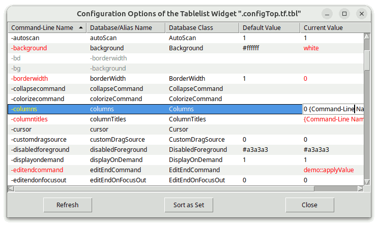
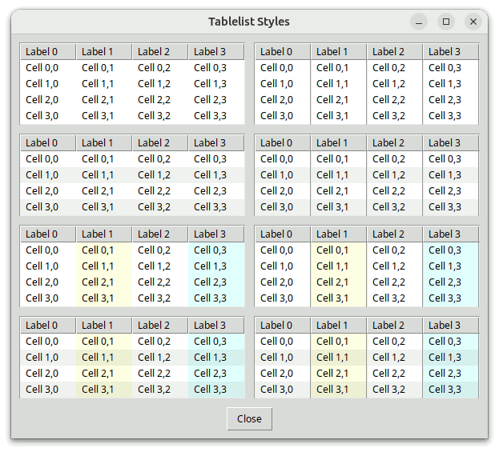
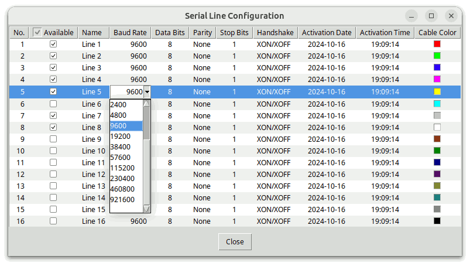
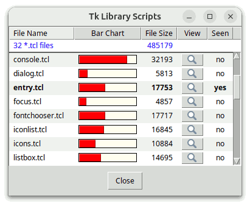
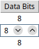
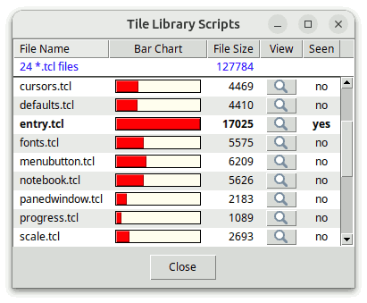

# Tablelist Programmer's Guide

## For Tablelist Version 7.12

### by

## Csaba Nemethi

csaba.nemethi@t-online.de

---

## Contents

#### Overview

- [What Is Tablelist?](#what-is-tablelist)
- [How to Get It?](#how-to-get-it)
- [How to Install It?](#how-to-install-it)
- [How to Use It?](#how-to-use-it)
- [More on tablelist::scalingpct](#more-on-tablelist-scalingpct)
- [The Procedure tablelist::getScalingPct and Tk's Scaling Factor](#the-procedure-tablelist-getscalingpct-and-tk-s-scaling-factor)
- [More on tablelist::svgfmt](#more-on-tablelist-svgfmt)
- [More on Tablelist_tile](#more-on-tablelist-tile)

#### Examples

- [A tablelist Widget for Displaying and Editing Configuration Options](#a-tablelist-widget-for-displaying-and-editing-configuration-options)
- [Two Scalable Widget Browsers Based on a tablelist](#two-scalable-widget-browsers-based-on-a-tablelist)
- [A Scalable Directory Viewer Based on a tablelist](#a-scalable-directory-viewer-based-on-a-tablelist)
- [Improving the Look & Feel of a tablelist Widget](#improving-the-look-feel-of-a-tablelist-widget)
- [Advanced Scalable Interactive tablelist Cell Editing](#advanced-scalable-interactive-tablelist-cell-editing)
- [A tablelist Widget Containing Scalable Embedded Windows](#a-tablelist-widget-containing-scalable-embedded-windows)
- [Tile-Based Demo Scripts](#tile-based-demo-scripts)

[Start page](index.md)

---

## Overview

### What Is Tablelist?

Tablelist is a library package for Tcl/Tk versions 8.4 or higher, written in pure Tcl/Tk code.  It contains:

- the implementation of the [tablelist mega-widget](tablelistWidget.md), including a general utility module for mega-widgets;
- a demo script containing a useful procedure that displays the configuration options of an arbitrary widget in a tablelist and enables you to edit their values interactively;
- a demo script implementing a widget browser based on a tablelist used as multi-column listbox;
- a demo script implementing a widget browser based on a tablelist used as multi-column tree widget;
- a demo script implementing a directory viewer based on a tablelist used as multi-column tree widget;
- a demo script showing several ways to improve the appearance of a tablelist widget;
- five further demo scripts, illustrating the interactive cell editing with the aid of various widgets from the Tk core and from the packages tile, BWidget, Iwidgets, combobox (by Bryan Oakley), Mentry, and Tsw;
- one further demo script, with a tablelist widget containing embedded windows;
- tile-based counterparts of the above-mentioned demo scripts;
- this tutorial;
- reference pages in HTML format.

A tablelist is a multi-column listbox and tree widget.  The width of each column can be dynamic (i.e., just large enough to hold all its elements, including the header) or static (specified in characters or pixels).  The columns are, per default, resizable.  The alignment of each column can be specified as `left`, `right`, or `center`.

The columns, rows, and cells can be configured individually.  Several of the global and column-specific options refer to the header titles, implemented as label widgets.  For instance, the `-labelcommand` option specifies a Tcl command to be invoked when mouse button 1 is released over a header label.  The most common value of this option sorts the items based on the respective column.

The Tablelist package provides a great variety of tree styles controlling the look & feel of the column that displays the tree hierarchy with the aid of indentations and expand/collapse controls.

Interactive editing of the elements of a tablelist widget can be enabled for individual cells and for entire columns.  A great variety of widgets from the Tk core and from the packages tile, BWidget, Iwidgets, combobox, ctext, and Mentry (or Mentry_tile) is supported for being used as embedded edit window.  In addition, a rich set of keyboard bindings is provided for a comfortable navigation between the editable cells.

The Tcl command corresponding to a tablelist widget is very similar to the one associated with a normal listbox.  There are column-, row-, and cell-specific counterparts of the `configure` and `cget` subcommands (`columnconfigure`, `rowconfigure`, `cellconfigure`, ...).  They can be used, among others, to insert images and embedded windows into the cells and the header labels.  The `index`, `nearest`, and `see` command options refer to the rows, but similar subcommands are provided for the columns and cells (`columnindex`, `cellindex`, ...).  The items can be sorted with the `sort`, `sortbycolumn`, and `sortbycolumnlist` command options.

The bindings defined for the body of a tablelist widget make it behave just like a normal listbox.  This includes the support for the virtual event `<<ListboxSelect>>` (which is equivalent to `<<TablelistSelect>>`).  In addition, versions 2.3 or higher of the widget callback package Wcb (written in pure Tcl/Tk code as well) can be used to define callbacks for the `activate`,  `selection set`,  and  `selection clear`  commands, and Wcb versions 3.0 or higher also support callbacks for the `activatecell`,  `cellselection set`,  and  `cellselection clear`  commands.  The download location of Wcb is

https://www.nemethi.de

### How to Get It?

Tablelist is available for free download from the same URL as Wcb.  The distribution file is `tablelist7.12.tar.gz` for UNIX and `tablelist7_12.zip` for Windows.  These files contain the same information, except for the additional carriage return character preceding the linefeed at the end of each line in the text files for Windows.

Tablelist is also included in tklib, which has the address

https://core.tcl-lang.org/tklib

### How to Install It?

Install the package as a subdirectory of one of the directories given by the `auto_path` variable.  For example, you can install it as a subdirectory of the `lib` directory within your Tcl/Tk installation.

To install Tablelist *on UNIX*, `cd` to the desired directory and unpack the distribution file `tablelist7.12.tar.gz`:

```
gunzip -c tablelist7.12.tar.gz | tar -xf -
```

On most UNIX systems this can be replaced with

```
tar -zxf tablelist7.12.tar.gz
```

Both commands will create a directory named `tablelist7.12`, with the subdirectories `demos`, `doc`, and `scripts`.

*On Windows*, use WinZip or some other program capable of unpacking the distribution file `tablelist7_12.zip` into the directory `tablelist7.12`, with the subdirectories `demos`, `doc`, and `scripts`.

The file `tablelistEdit.tcl` in the `scripts` directory is only needed for applications making use of interactive cell editing.  Similarly, the file `tablelistMove.tcl` in the same directory is only required for scripts invoking the `move` or `movecolumn` command.  Finally, the file `tablelistThemes.tcl` is only needed for applications using the Tablelist_tile package (see next section).

Notice that in tklib the Tablelist `demos` directory is replaced with the subdirectory `tablelist` of the `examples` directory.  Please take this into account when reading the [examples](#examples) below.

### How to Use It?

The Tablelist distribution provides two packages, called **Tablelist** and **Tablelist_tile**.  The main difference between the two is that Tablelist_tile enables the tile-based, theme-specific appearance of tablelist widgets; this package requires tile 0.6 or higher.  It is not possible to use both packages in one and the same application, because both are implemented in the same `tablelist` namespace and provide identical commands.

To be able to access the commands and variables of the Tablelist package, your scripts must contain one of the lines

```
package require tablelist ?version?
package require Tablelist ?version?
```

You can use either one of the two statements above because the file `tablelist.tcl` contains both lines

```
package provide tablelist ...
package provide Tablelist ...
```

Likewise, to be able to access the commands and variables of the Tablelist_tile package, your scripts must contain one of the lines

```
package require tablelist_tile ?version?
package require Tablelist_tile ?version?
```

Again, you can use either one of the two statements above because the file `tablelist_tile.tcl` contains both lines

```
package provide tablelist_tile ...
package provide Tablelist_tile ...
```

You are free to remove one of the above lines from `tablelist.tcl` and `tablelist_tile.tcl`, respectively, if you want to prevent the corresponding packages from making themselves known under two different names each.  Of course, by doing so you restrict the argument of  `package require`  to a single name per package.

Since the packages Tablelist and Tablelist_tile are implemented in the `tablelist` namespace, you must either invoke the

```
namespace import tablelist::pattern ?tablelist::pattern ...?
```

command to import the *procedures* you need, or use qualified names like `tablelist::tablelist`.  In the examples below we have chosen the latter approach.

To access Tablelist *variables*, you *must* use qualified names.  There are only 6 Tablelist variables (and one more when using Tablelist_tile) that are designed to be accessed outside the namespace `tablelist`:

- The variable `tablelist::version` holds the current version number of the Tablelist and Tablelist_tile packages.
- The variable `tablelist::library` holds the location of the Tablelist installation directory.
- The read-only variable `tablelist::scalingpct` is set when loading the Tablelist or Tablelist_tile package via  `package require`  to the scaling percentage corresponding to the display's DPI scaling level.  Tablelist adapts, among others, the default sort arrow style on X11 and Windows Vista, 7, 8, and 10+, as well as the sizes of the tree styles `vistaAero`, `vistaClassic`, `win7Aero`, `win7Classic`, and `win10` to the value of this variable.  The currently supported values are `100`, `125`, `150`, `175`, and `200`.  You can use this variable, e.g., if you want to create images of different sizes, depending on the DPI scaling level.  For example, if your application uses images of size 16 x 16 on an unscaled display and `tablelist::scalingpct` has the value `150`, then the image size for this display should be 24 x 24.
- If the Tk version is either at least 8.7 (with built-in SVG support), or 8.6 and the tksvg extension can be loaded into the interpreter, then the variable `tablelist::svgfmt` is set to a Tcl list that you can pass to the commands that create or manipulate SVG images as the value of their `-format` option to make sure that your images will be properly scaled.
- The boolean variable `tablelist::strictTk` (having the default value `0`) controls the strict listbox-compatibility of the default bindings.
- The read-only boolean variable `tablelist::usingTile` has the value `0` in the Tablelist package and the value `1` in Tablelist_tile.
- In Tablelist_tile the array `tablelist::themeDefaults` holds the theme-specific default values of a series of Tablelist configuration options.

### More on `tablelist::scalingpct`

The Tablelist code sets the variable `tablelist::scalingpct` to the value returned by the public procedure `scaleutil::scalingPercentage` of the scaleutil package, which is bundled with Tablelist.  The way this value is computed depends on the windowing system:

*On Windows and Mac OS X/11+* the scaling percentage is computed from Tk's scaling factor given by  `[tk scaling]`.  Note that on Mac OS X/11+ the result is always `100`, regardless of the display's scaling level.  On this system the desktop engine automatically scales everything as needed.

*On X11*, computing the scaling percentage from  `[tk scaling]`  is done as fallback method only, because the implementation of display scaling is highly dependent on the desktop environment and it mostly manipulates system resources that are resident outside of Xlib, which Tk is based on.  (Traditional X applications like `bitmap` and `xmag` are also affected by this.)  With the partial exception of Xfce and MATE (see below), the procedure computes the scaling percentage from the value of the X resource `Xft.dpi`, by executing the `xrdb` application.  On GNOME-based systems where `xrdb` is not installed per default (e.g., Solus GNOME and Solus Budgie), it uses the `xrandr` application and the file `~/.config/monitors.xml` instead.

- On *Xfce*, the display scaling mode, called *window scaling*, can be "1x" or "2x" and can be selected in the *Appearance* dialog.  Xfce versions 4.16 and later also support fractional scaling, whose parameters can be configured in the *Display* dialog.  If the "2x" mode was selected then the scaling percentage will be set by the procedure `scaleutil::scalingPercentage` to `200`, otherwise it will be computed from the value of the font DPI, given by the X resource `Xft.dpi`.  The value of the font DPI can be set in the *Fonts* tab of the *Appearance* dialog or (on Linux Lite 5+) via the *HiDPI Settings* dialog.
- On *MATE*, the display scaling mode, called *window scaling factor*, can be "Auto-detect", "Regular", or "HiDPI", and can be selected in the *MATE Tweak* dialog.  The same effect can be achieved by using the *Monitor Preferences* dialog and selecting one of the possible scaling values "auto detect", "100%", and "200%".  If needed, the procedure `scaleutil::scalingPercentage` auto-detects which one of the "Regular" ("100%") and "HiDPI" ("200%") modes corresponds to the preset "Auto-detect" ("auto detect") mode.  If the "HiDPI" ("200%") mode was selected by the user or auto-detected by the procedure, then the scaling percentage will be set to `200`, otherwise it will be computed from the value of the font DPI, given by the X resource `Xft.dpi`.  The value of the font DPI can be set via the *Font Rendering Details* dialog, which in turn can be opened from within the *Fonts* tab of the *Appearance Preferences* dialog.
- In case of *GNOME on Xorg, Budgie, and Cinnamon versions earlier than 4.6*, the display scaling can be either 100 % or 200 %, and the procedure sets the scaling percentage accordingly to `100` or `200`.  In newer GNOME and Budgie versions on Ubuntu one can enable the `x11-randr-fractional-scaling` as experimental feature, which adds (at least) 125 %, 150 %, and 175 % to the list of supported scaling percentages.  Note that, due to the way this fractional scaling is implemented, the value returned by `scaleutil::scalingPercentage` will be `200`, regardless of the selected display scaling.  Cinnamon versions 4.6 and later also support fractional scaling; if activated then the scaling percentage returned by the procedure will be `200`, regardless of the selected display scaling.
- *GNOME on Wayland* traditionally supports the display scaling values 100 % and 200 %, and the scaling percentage will be set accordingly to `100` or `200`.  In newer GNOME versions one can enable the experimental feature `scale-monitor-framebuffer`, which adds (at least) 125 %, 150 %, and 175 % to the list of supported scaling percentages.  With this feature enabled, the value returned by `scaleutil::scalingPercentage` will be `100` for older GNOME versions and `200` for newer ones, regardless of the scaling level, due to the fact that in this case, instead of window contents, monitor framebuffers will be scaled in a logical pixel coordinate space.
- *KDE Plasma on Xorg* provides fractional scaling support.  On this desktop, the procedure will return `100`, `125`, `150`, `175`, or `200`, depending on the display's scaling level.
- *KDE Plasma on Wayland* supports fractional scaling, too.  In this case, for older KDE versions the value returned by the procedure will always be `100`, regardless of the display's scaling level, while for newer KDE versions it will be `100`, `125`, `150`, `175`, or `200`.

On GNOME and Budgie, the display scaling can be set in the *Displays* page of the *Settings* dialog, but the value of the X resource `Xft.dpi`, which is used by the procedure `scaleutil::scalingPercentage`, can also be manipulated by setting the scaling factor of the fonts via the *Tweaks* application.  Likewise, on Cinnamon the display scaling can be set in the *Display* page of the *System Settings* dialog, but the value of the X resource `Xft.dpi` can also be manipulated by setting the text scaling factor via the *Font Selection* page of the *System Settings* dialog.  Finally, on KDE Plasma the display scaling can be set in the *Display Configuration* page of the *System Settings* dialog, and on KDE Plasma on Xorg the value of the font DPI, given by the X resource `Xft.dpi` can also be set via the *Fonts* page of the *System Settings* dialog.

Besides computing the scaling percentage, the procedure `scaleutil::scalingPercentage` performs a series of additional tasks.  Among others, it changes the default height of the ttk::treeview rows from the hard-coded value of 20 pixels to a more reasonable one, based on the metrics of the font used by the `Treeview` style (usually `TkDefaultFont`), and makes sure that this step will be repeated whenever the virtual event `<<ThemeChanged>>` is received (e.g., because the value of the `Treeview` style's `-font` option has changed), or the virtual event `<<TkWorldChanged>>` with the `user_data` field (`%d`) set to `FontChanged` is received.  If the Tk version is later than 8.6.11 or 8.7a5, this virtual event is sent by the Tk engine to all widgets when a font is changed, for example, by invoking  `font configure`  (see [TIP 608](https://core.tcl-lang.org/tips/doc/trunk/tip/608.md)).

The additional steps described in the rest of this section are only performed if the scaling percentage is greater than `100`.

On X11, the procedure synchronizes the scaling factor used by Tk to convert between physical units and pixels with the scaling percentage, by passing a value derived from the latter to the  `tk scaling`  command.  While in the vast majority of applications this is the desired and recommended behavior, there might be cases where you want to suppress this step because your application might have its own logic for determining the value of Tk's scaling factor.  You can achieve this by inserting the line

```
namespace eval ::scaleutil { set keepTkScaling 1 }
```

before loading Tablelist or Tablelist_tile via  `package require`.

The procedure `scaleutil::scalingPercentage` also corrects the sizes of the standard fonts if needed.  These fonts (`TkDefaultFont`, `TkTextFont`, etc.) are defined in the file `$tk_library/ttk/fonts.tcl`.  For quite a long time, the font sizes for X11 given in this file were sizes in pixels, which was not suitable for use on HiDPI displays.  This caused several Linux distributions to bundle patched versions of this file, in which the sizes in pixels are replaced with sizes in points.  The same fix was committed in February 2020 into the Tk core repository and is now contained in Tk 8.7a5 and later.  To make sure that, regardless of the Tk version, the font sizes will suit the display's scaling level, the procedure examines this library file and, if the latter contains sizes in pixels, then it sets the `-size` option of the standard fonts to corresponding sizes in points (without altering the file).  In addition, for the "2x" mode on Xfce, the procedure doubles the sizes (in points) of the standard fonts (the way display scaling works on that desktop makes this necessary).

The procedure also scales:

- the default parameters of the Tk core panedwindow sash;
- the default size of the Tk core scale widget and its slider;
- the default width of the Tk core scrollbars on X11;
- the default length of the ttk::scale and ttk::progressbar widgets;
- for the built-in themes `alt` and `default`, some styling options of the ttk::scrollbar, ttk::scale, ttk::progressbar, ttk::combobox, ttk::spinbox, ttk::button, toolbutton, ttk::menubutton, ttk::checkbutton, ttk::radiobutton, ttk::notebook, ttk::panedwindow, and ttk::treeview widgets;
- for the built-in theme `clam`, some styling options of the ttk::scrollbar, ttk::scale, ttk::progressbar, ttk::combobox, ttk::spinbox, ttk::button, toolbutton, ttk::menubutton, ttk::checkbutton, ttk::radiobutton, ttk::notebook, ttk::panedwindow, ttk::treeview, and ttk::labelframe widgets;
- for the built-in theme `classic`, some styling options of the ttk::scrollbar, ttk::scale, ttk::progressbar, ttk::combobox, ttk::spinbox, ttk::button, toolbutton, ttk::menubutton, ttk::checkbutton, ttk::radiobutton, ttk::notebook, ttk::panedwindow, and ttk::treeview widgets;
- for the built-in theme `vista`, some styling options of the ttk::combobox, ttk::button, toolbutton, ttk::menubutton, ttk::checkbutton, ttk::radiobutton, ttk::notebook, ttk::panedwindow, and ttk::treeview widgets;
- for the built-in theme `winnative`, some styling options of the ttk::scale, ttk::progressbar, ttk::combobox, ttk::spinbox, toolbutton, ttk::menubutton, ttk::checkbutton, ttk::radiobutton, ttk::notebook, ttk::panedwindow, and ttk::treeview widgets;
- for the built-in theme `xpnative`, some styling options of the ttk::combobox, ttk::spinbox, ttk::button, toolbutton, ttk::menubutton, ttk::checkbutton, ttk::radiobutton, ttk::notebook, ttk::panedwindow, and ttk::treeview widgets.

In addition, the procedure `scaleutil::scalingPercentage` makes sure that in the `vista` and `xpnative` themes the indicators of the ttk::checkbutton and ttk::radiobutton widgets will appear properly scaled, regardless of the Tk release being used.  (A long-standing bug in the implementation of these widgets was fixed in May 2020 and is now contained in both Tk 8.6.11 and later and 8.7a5 and later, but the procedure provides an automatic workaround for the Tk versions that are still affected by this bug.)

Note that in Tk versions earlier than 9, the Tk core checkbutton and radiobutton widgets, as well as the indicators of the ttk::checkbutton and ttk::radiobutton widgets of the `alt` and `winnative` themes are not scalable (they scale automatically in Tk 9 and later).  The same holds true for the ttk::sizegrip widget in the built-in themes.

### The Procedure `tablelist::getScalingPct` and Tk's Scaling Factor

The Tablelist package provides the helper procedure `tablelist::getScalingPct`, which expects no arguments and returns the application's scaling percentage, derived from Tk's *current* scaling factor given by  `[tk scaling]`.  The procedure's return value is restricted to multiples of `25`, is at least `100`, and can be greater than `200`, especially when running AndroWish on a tablet or smartphone.  Tablelist makes use of this procedure to make sure that the sizes of its GUI components will correspond to Tk's current scaling factor (which might have been changed via  `tk scaling`),  and it is recommended to do this in the application code, too.

If the Tk version is 9 or later then the functionality of the `scaleutil::scalingPercentage` procedure described in the previous section is integrated in the core.  As part of this functionality, Tk 9+ sets the variable `tk::scalingPct` at initialization time to the scaling percentage corresponding to the display's DPI scaling level, and the procedure `scaleutil::scalingPercentage` just returns the minimum of the current value of `tk::scalingPct` and `200`.  Recall that in Tk 9+, whenever the scaling factor is changed via  `tk scaling`,  the value of the variable `tk::scalingPct` is automatically updated.  Consequently, if the application changes Tk's scaling factor *before loading Tablelist or Tablelist_tile* via  `package require`,  then the variable `tablelist::scalingpct` will be set to the minimum of the automatically updated value of `tk::scalingPct` and `200`.  These facts result in the following

**Recommendation:** If your application changes Tk's scaling factor by invoking  `tk scaling`,  it should do this *before loading Tablelist or Tablelist_tile*.

### More on `tablelist::svgfmt`

If the Tk version is either at least 8.7 (with built-in SVG support), or 8.6 and the tksvg package can be loaded into the interpreter, then Tablelist sets the variable `tablelist::svgfmt` to

```
[list svg -scale [expr {[tablelist::getScalingPct] / 100.0}]]
```

Typical values are  `{svg -scale 1.0}`,  `{svg -scale 1.25}`,  `{svg -scale 2.0}`,  etc.

It is recommended to pass the value of the variable `tablelist::svgfmt` to the commands  `image create photo`,  `imageName configure`,  `imageName put`,  and `imageName read`  as the value of their `-format` option when creating or manipulating SVG images, to make sure that their sizes will correspond to the application's current scaling percentage.

### More on Tablelist_tile

A tablelist widget consists of a body (containing the items) and a header (displaying the column titles and optional header items).  Both components are contained in a hull, implemented as a frame.  The header has a rather complex structure, consisting, among others, of frame and label widgets.  While in the Tablelist package all of these components are Tk widgets, the Tablelist_tile package uses both Tk and tile frame and label widgets.  Due to several incompatibilities between Tk and tile, it is currently not possible to replace all Tk widgets making up a tablelist with their tile counterparts.

From the above it follows that **the Tablelist_tile package will only work as expected if the Tk frame and label commands haven't been overridden by using  namespace import -force ttk::\*  at global scope**.  While earlier tile releases suggested using this command at global scope for the really adventurous, in newer tile versions this is considered a Really Bad Idea, causing many things to break.  Instead, **you should explicitly invoke ttk::frame, ttk::label, etc. whenever you want to use a tile widget**.

**Overriding some other Tk widgets at global scope may be equally dangerous when using various widgets from the Tk core and from the packages BWidget, Iwidgets, combobox (by Bryan Oakley), ctext, and Mentry for interactive cell editing**, because these packages expect Tk widgets, which may not always be replaced by their tile counterparts.

Another restriction to be taken into account is due to the fact that in earlier tile versions the  `(ttk::)style theme use`  command could only be used to set the current theme, but not to retrieve it.  For this reason, if the Tablelist_tile package cannot get the current theme with the aid of  `ttk::style theme use`  then it makes use of the variable `ttk::currentTheme` or `tile::currentTheme` (depending on the tile version), which is set by the `ttk::setTheme` or `tile::setTheme` command.  From this it follows that **if the tile version being used doesn't support the  ttk::style theme use  command without an argument then the tile-based tablelist widgets will only have the expected appearance if the platform-specific default theme is either left unchanged or replaced with another theme by invoking the library procedure ttk::setTheme or tile::setTheme, depending on the tile version**.  (See also the `tablelist::setTheme` command.)

After these cautions concerning the use of tile, the rest of this section describes the differences between the packages Tablelist and Tablelist_tile.

The Tablelist_tile package checks whether the required Tk and tile versions are present, by executing the commands

```
package require Tk 8.4-
if {$::tk_version < 8.5 || [regexp {^8\.5a[1-5]$} $::tk_patchLevel]} {
    package require tile 0.6-
}
```

The second command above reflects the fact that, beginning with Tk 8.5a6, tile is integrated into the Tk core and therefore it should only be loaded explicitly when using an earlier Tk version.

Apart from this and the `_tile` suffix in the  `package require`  command, the only difference (from the programmer's point of view) between the packages Tablelist and Tablelist_tile is related to the supported configuration options:  The `-highlightbackground`, `-highlightcolor`, `-highlightthickness`, `-labelbackground`, `-labelactivebackground`, `-labelactiveforeground`, `-labeldisabledforeground`, and `-labelheight` options (the latter and `-labelbackground` at both widget and column levels), present in the Tablelist package, are not supported by Tablelist_tile.  The first three are standard Tk widget options that are not available for tile widgets.  The `-labelbackground` option stands for the `-background` option of the column labels, and current versions of the tile engine don't support setting the background color for these widgets with a special header layout.  The remaining options stand for the `-activebackground`, `-activeforeground`, `-disabledforeground`, and `-height` options of the column labels, and these configuration options are not supported for tile label widgets.

Also, take into account that in some themes, setting the `-labelborderwidth` option (at widget or column level) to a value other than the default might be ignored by tile and thus could cause alignment problems.  This is because the border of tile widgets is drawn with theme-specific methods, which will not always produce the results known from Tk widgets.

Finally, notice that, when using the `tileqt` theme, the version number of the `tile::theme::tileqt` package must be 0.4 or higher, and `tileqt` itself won't work with tile versions earlier than 0.7.

[Contents](#contents)     [Start page](index.md)

---

## Examples

### A tablelist Widget for Displaying and Editing Configuration Options

The file `config.tcl` in the `demos` directory contains a procedure `demo::displayConfig` that displays the configuration options of an arbitrary widget in a tablelist contained in a newly created toplevel widget and allows you to edit these options.  This procedure can prove to be quite useful during interactive GUI development.  To test it, start `wish` and evaluate the file by using the `source` command as follows:

- If `wish` was started in the `demos` directory then it is sufficient to enter

  ```
  source config.tcl
  ```

- If `wish` was started in some other directory then you can use the `tablelist::library` variable to find the location of the file.  For example, assuming that your Tablelist installation has the directory structure described in the [How to install it?](#how-to-install-it) section, the required commands are:

  ```
  package require tablelist
  source [file join $tablelist::library demos config.tcl]
  ```


In both cases, the script will print the following message to `stdout`:

```
To display the configuration options of an arbitrary widget, enter

        demo::displayConfig <widgetName>
```

`<widgetName>` can be the path name of any already existing widget.  For example, if you enter

```
demo::displayConfig .
```

then you will see that a tablelist widget `.configTop.tf.tbl` in a new toplevel window is created and its name is printed to `stdout`.  If you then enter

```
demo::displayConfig .configTop.tf.tbl
```

then another toplevel window containing the tablelist widget `.configTop2.tf.tbl` will pop up.  The latter looks like in the following figure:



It is assumed that the Tcl command associated with the widget specified by `<widgetName>` has a `configure` subcommand which, when invoked without any argument, returns a list describing all of the available configuration options for the widget, in the common format known from the standard Tk widgets.  The `demo::displayConfig` procedure inserts the items of this list into a scrolled tablelist with 5 dynamic-width columns and interactive sort capability, and returns the name of the newly created tablelist widget:

```
package require tablelist

namespace eval demo {
    #
    # Add some entries to the Tk option database for the following
    # widget hierarchy within a toplevel widget of the class DemoTop:
    #
    # Name              Class
    # -----------------------------
    # tf                Frame
    #   tbl               Tabellist
    #   vsb, hsb          Scrollbar
    # bf                Frame
    #   b1, b2, b3        Button
    #
    if {[tk windowingsystem] eq "x11"} {
        #
        # Create the font TkDefaultFont if not yet present
        #
        catch {font create TkDefaultFont -family Helvetica -size 9}

        option add *DemoTop*Font                        TkDefaultFont
        option add *DemoTop*selectBackground            #5294e2
        option add *DemoTop*selectForeground            white
    }
    option add *DemoTop.tf.borderWidth                  1
    option add *DemoTop.tf.relief                       sunken
    option add *DemoTop.tf.tbl.borderWidth              0
    option add *DemoTop.tf.tbl.highlightThickness       0
    option add *DemoTop.tf.tbl.background               white
    option add *DemoTop.tf.tbl.stripeBackground         #f0f0f0
    option add *DemoTop.tf.tbl*Entry.background         white
    option add *DemoTop.bf.Button.width                 10
}

#------------------------------------------------------------------------------
# demo::displayConfig
#
# Displays the configuration options of the widget w in a tablelist widget
# contained in a newly created toplevel widget.  Returns the name of the
# tablelist widget.
#------------------------------------------------------------------------------
proc demo::displayConfig w {
    if {![winfo exists $w]} {
        bell
        tk_messageBox -title "Error" -icon error -message \
            "Bad window path name \"$w\""
        return ""
    }

    #
    # Create a toplevel widget of the class DemoTop
    #
    set top .configTop
    for {set n 2} {[winfo exists $top]} {incr n} {
        set top .configTop$n
    }
    toplevel $top -class DemoTop
    wm title $top "Configuration Options of the [winfo class $w] Widget \"$w\""

    #
    # Create a scrolled tablelist widget with 5 dynamic-width
    # columns and interactive sort capability within the toplevel
    #
    set tf $top.tf
    frame $tf
    set tbl $tf.tbl
    set vsb $tf.vsb
    set hsb $tf.hsb
    tablelist::tablelist $tbl \
        -columns {0 "Command-Line Name"
                  0 "Database/Alias Name"
                  0 "Database Class"
                  0 "Default Value"
                  0 "Current Value"} \
        -labelcommand tablelist::sortByColumn -sortcommand demo::compareAsSet \
        -editendcommand demo::applyValue -height 15 -width 100 -stretch all \
        -xscrollcommand [list $hsb set] -yscrollcommand [list $vsb set]
    if {[$tbl cget -selectborderwidth] == 0} {
        $tbl configure -spacing 1
    }
    $tbl columnconfigure 3 -maxwidth 30
    $tbl columnconfigure 4 -maxwidth 30 -editable yes
    scrollbar $vsb -orient vertical   -command [list $tbl yview]
    scrollbar $hsb -orient horizontal -command [list $tbl xview]

    #
    # Create three buttons within a frame child of the toplevel widget
    #
    set bf $top.bf
    frame $bf
    set b1 $bf.b1
    set b2 $bf.b2
    set b3 $bf.b3
    button $b1 -text "Refresh"     -command [list demo::putConfig $w $tbl]
    button $b2 -text "Sort as Set" -command [list $tbl sort]
    button $b3 -text "Close"       -command [list destroy $top]

    #
    # Manage the widgets
    #
    grid $tbl -row 0 -rowspan 2 -column 0 -sticky news
    if {[tk windowingsystem] eq "win32"} {
        grid $vsb -row 0 -rowspan 2 -column 1 -sticky ns
    } else {
        grid [$tbl cornerpath] -row 0 -column 1 -sticky ew
        grid $vsb              -row 1 -column 1 -sticky ns
    }
    grid $hsb -row 2 -column 0 -sticky ew
    grid rowconfigure    $tf 1 -weight 1
    grid columnconfigure $tf 0 -weight 1
    pack $b1 $b2 $b3 -side left -expand yes -pady 7p
    pack $bf -side bottom -fill x
    pack $tf -side top -expand yes -fill both

    #
    # Populate the tablelist with the configuration options of the given widget
    #
    putConfig $w $tbl
    return $tbl
}
```

The procedure invokes the `tablelist::tablelist` command to create a tablelist widget.  The value of the `-columns` option passed to this command specifies the widths, titles, and alignments of the 5 columns.  The width of each column is given as `0`, specifying that the column's width is to be made just large enough to hold all the elements in the column, including its title, which is the string following the width.  We have omitted the alignment specifications (which can optionally follow the titles), because the columns shall all be left-justified.

Since all columns are of dynamic width and left-aligned, instead of `-columns` we could have used the `-columntitles` option as follows:

```
    tablelist::tablelist $tbl \
        -columntitles {"Command-Line Name"
                       "Database/Alias Name"
                       "Database Class"
                       "Default Value"
                       "Current Value"} \
        . . .
```

The command `tablelist::sortByColumn`, specified as the value of the `-labelcommand` option, will be invoked whenever mouse button 1 is released over one of the labels.  This command sorts the items based on the column corresponding to that label, in the right order, by invoking the `sortbycolumn` subcommand of the Tcl command associated with the tablelist widget.

As seen from the creation of the button displaying the text  `"Sort as Set"`,  the items will also be sorted by invoking the `sort` subcommand.  This makes it necessary to specify a command to be used for the comparison of the items, as the value of the `-sortcommand` option.  In our example this is the `demo::compareAsSet` procedure shown below.

The `-editendcommand` option specifies the command to be invoked automatically whenever the interactive editing of a cell's content is finished and the final content of the temporary embedded entry widget used for the editing are different from its original one.  Per default, the elements of a tablelist widget can only be edited programmatically, but we enable the interactive editing for the cells of the last column with the aid of the `-editable` column configuration option.

By specifying the value `all` for the `-stretch` configuration option we make sure that all of the columns will be stretched to eliminate the blank space that might appear at the right of the table.

If the default value of the `-selectborderwidth` option is `0` (this is the case on the Windows and Macintosh platforms, and also in an X11 envronment with Tk 8.5 or above) then we use the `-spacing` option to provide some additional space above and below the rows.

For the last two columns of the tablelist we use the `-maxwidth` column configuration option, to make sure that the dynamic widths of these columns won't exceed 30 average-width characters.

Besides the options given on the command line, our tablelist widget will automatically inherit the ones contained in the Tk option database entries specified in the namespace initialization preceding the `demo::displayConfig` procedure.  The database name `stripeBackground` corresponds to the `-stripebackground` configuration option.  According to this entry, every other row of the tablelist widget will be displayed in the background color `#f0f0f0`, which improves the readability of the items and gives the widget a nice appearance.

The option database entries for `*DemoTop.tf.borderWidth`, `*DemoTop.tf.relief`, `*DemoTop.tf.tbl.borderWidth`, and `*DemoTop.tf.tbl.highlightThickness` are implicitly used when managing the tablelist widget and the two scrollbars with the aid of `grid`.  Notice how the `cornerpath` subcommand enables us to achieve a native look & feel with respect to the vertical scrollbar on the windowing systems other than `win32` (i.e., `aqua` and `x11`).

We populate the tablelist by invoking the `demo::putConfig` procedure discussed below.  The same script is associated with the "Refresh" button, as the value of its `-command` configuration option.  This procedure is implemented as follows:

```
#------------------------------------------------------------------------------
# demo::putConfig
#
# Outputs the configuration options of the widget w into the tablelist widget
# tbl.
#------------------------------------------------------------------------------
proc demo::putConfig {w tbl} {
    if {![winfo exists $w]} {
        bell
        tk_messageBox -title "Error" -icon error -message \
            "Bad window path name \"$w\"" -parent [winfo toplevel $tbl]
        return ""
    }

    #
    # Display the configuration options of w in the tablelist widget tbl
    #
    $tbl delete 0 end
    foreach configSet [$w configure] {
        #
        # Insert the list configSet into the tablelist widget
        #
        $tbl insert end $configSet

        if {[llength $configSet] == 2} {
            $tbl rowconfigure end -foreground gray50 -selectforeground gray75
            $tbl cellconfigure end -editable no
        } else {
            #
            # Change the colors of the first and last cell of the row
            # if the current value is different from the default one
            #
            set default [lindex $configSet 3]
            set current [lindex $configSet 4]
            if {$default ne $current} {
                foreach col {0 4} {
                    $tbl cellconfigure end,$col \
                         -foreground red -selectforeground yellow
                }
            }
        }
    }

    $tbl sortbycolumn 0
    $tbl activate 0
    $tbl attrib widget $w
}
```

After deleting the current items of the tablelist widget `tbl`, the procedure inserts the items of the list returned by the `configure` subcommand of the Tcl command associated with the widget `w`.  For each option that is merely an abbreviated form of some other one, we use the `rowconfigure` tablelist subcommand to change the normal and selection foreground colors of the item just appended, and we disable the interactive editing in the last inserted cell by using the `-editable` cell configuration option.  The `cellconfigure` tablelist operation is also invoked for each real option whose current value is different from the default one, to change the values of the `-foreground` and `-selectforeground` options of the cells no. 0 and 4, containing the command-line name of the option and its current value.

Each tablelist widget may have any number of private **attributes**, which can be set and retrieved with the aid of the `attrib` subcommand of the Tcl command corresponding to the widget.  The `demo::putConfig` procedure sets the `widget` attribute to the name of the widget whose options are displayed in the tablelist.

The implementation of the comparison command `demo::compareAsSet` mentioned above is quite simple:

```
#------------------------------------------------------------------------------
# demo::compareAsSet
#
# Compares two items of a tablelist widget used to display the configuration
# options of an arbitrary widget.  The item in which the current value is
# different from the default one is considered to be less than the other; if
# both items fulfil this condition or its negation then string comparison is
# applied to the two option names.
#------------------------------------------------------------------------------
proc demo::compareAsSet {item1 item2} {
    foreach {opt1 dbName1 dbClass1 default1 current1} $item1 \
            {opt2 dbName2 dbClass2 default2 current2} $item2 {
        set changed1 [expr {$default1 ne $current1}]
        set changed2 [expr {$default2 ne $current2}]
        if {$changed1 == $changed2} {
            return [string compare $opt1 $opt2]
        } elseif {$changed1} {
            return -1
        } else {
            return 1
        }
    }
}
```

Finally, here is the implementation of the `demo::applyValue` procedure, specified as the value of the `-editendcommand` option:

```
#------------------------------------------------------------------------------
# demo::applyValue
#
# Applies the new value of the configuraton option contained in the given row
# of the tablelist widget tbl to the widget whose options are displayed in it,
# and updates the colors of the first and last cell of the row.
#------------------------------------------------------------------------------
proc demo::applyValue {tbl row col text} {
    #
    # Try to apply the new value of the option contained in
    # the given row to the widget whose options are displayed
    # in the tablelist; reject the value if the attempt fails
    #
    set w [$tbl attrib widget]
    set opt [$tbl cellcget $row,0 -text]
    if {[catch {$w configure $opt $text} result] != 0} {
        bell
        tk_messageBox -title "Error" -icon error -message $result \
            -parent [winfo toplevel $tbl]
        $tbl rejectinput
        return ""
    }

    #
    # Replace the new option value with its canonical form and
    # update the colors of the first and last cell of the row
    #
    set text [$w cget $opt]
    set default [$tbl cellcget $row,3 -text]
    if {$default eq $text} {
        foreach col {0 4} {
            $tbl cellconfigure $row,$col \
                 -foreground "" -selectforeground ""
        }
    } else {
        foreach col {0 4} {
            $tbl cellconfigure $row,$col \
                 -foreground red -selectforeground yellow
        }
    }

    return $text
}
```

The procedure retrieves the name of the widget whose options are displayed in the tablelist, as the value of its `widget` attribute, and invokes the `cellcget` tablelist subcommand to get the name of the option specified in the first cell of the row whose last element was just edited.  Next, it tries to apply the new value of the option to the widget, and invokes the `rejectinput` subcommand if the attempt fails.  Otherwise it replaces the new option value with its canonical form and updates the normal and selection foreground colors of the cells no. 0 and 4.  The canonical form of the option value is given by the `cget` subcommand of the Tcl command associated with that widget.  For example, a boolean value will always be replaced with `1` or `0`, even if the entry contains the string `yes` or `no`.  The procedure returns this canonical option value, thus making sure that the latter will become the new content of the cell that was just edited.

### Two Scalable Widget Browsers Based on a tablelist

The files `browse.tcl` and `browseTree.tcl` in the `demos` directory contain a procedure `demo::displayChildren` that displays information about the children of an arbitrary widget in a tablelist contained in a newly created toplevel widget.  To test it, start `wish` and evaluate the chosen file by using the `source` command, in a similar way as in the case of the [previous example](#a-tablelist-widget-for-displaying-and-editing-configuration-options).

Both scripts will print the following message to `stdout`:

```
To display information about the children of an arbitrary widget, enter

        demo::displayChildren <widgetName>
```

`<widgetName>` can be the path name of any already existing widget.  For example, if you enter

```
demo::displayChildren .
```

then you will see that a tablelist widget `.browseTop.tf.tbl` in a new toplevel window is created and its name is printed to `stdout`.

The tablelist created by the procedure `demo::displayChildren` in the file `browse.tcl` is a multi-column listbox:


The tablelist created by the procedure of the same name in the file `browseTree.tcl` is a multi-column tree widget:


The `demo::displayChildren` command inserts some data of the children of the widget specified by `<widgetName>` into a vertically scrolled tablelist with 9 dynamic-width columns and interactive sort capability, and returns the name of the newly created tablelist widget.  By double-clicking an item (e.g., the one containing the path name `.browseTop` in `browse.tcl` and the name `browseTop` in `browseTree.tcl`) or invoking the first entry of a pop-up menu within the body of the tablelist, you can display the data of the children of the widget corresponding to the active item, and with the second menu entry you can display its configuration options (see the [previous example](#a-tablelist-widget-for-displaying-and-editing-configuration-options) for details).  To go one level up, click on the "Parent" button.

There is a lot of code common to the scripts `browse.tcl` and `browseTree.tcl`.  We will restrict the description below to the second one.

```
package require tablelist

namespace eval demo {
    variable dir [file dirname [info script]]

    #
    # Create two images corresponding to the display's DPI scaling level
    #
    variable leafImg [image create photo]
    variable compImg [image create photo]
    variable pct ""
    if {$::tk_version >= 8.7 || [catch {package require tksvg}] == 0} {
        variable fmt $::tablelist::svgfmt
        $leafImg read [file join $dir leaf.svg] -format $fmt
        $compImg read [file join $dir comp.svg] -format $fmt
    } else {
        set pct $::tablelist::scalingpct
        $leafImg read [file join $dir leaf$pct.gif] -format gif
        $compImg read [file join $dir comp$pct.gif] -format gif
    } 
}

source [file join $demo::dir config.tcl]
```

If the Tk version is at least 8.7 or the tksvg package can be loaded into the interpreter, then the two images representing a "compound" widget (with children) and a "leaf" widget (without children), respectively, are created from the files `comp.svg` and `leaf.svg`, respectively, using the public variable `::tablelist::svgfmt`.  Otherwise they are created from files whose names contain the display's DPI scaling percentage, given by the public variable `::tablelist::scalingpct`.  The files `comp100.gif` and `leaf100.gif` contain images of size 16 x 14, the files `*125.gif` contain images of size 20 x 18, the files `*150.gif` contain images of size 24 x 21, and so on.  In the first case only two `*.svg` files are needed and the images will be scaled automatically, according to the display's real scaling percentage, which can be greater than the maximum value `200` of the variable `::tablelist::scalingpct`.  This benefit comes in handy especially when running AndroWish on a tablet or smartphone.  In the second case a total number of 10 `*.gif` (or `*.png`, or `*.xbm`) files are needed to make sure that the sizes of the images will correspond to the value of the variable `::tablelist::scalingpct`.

```
#------------------------------------------------------------------------------
# demo::displayChildren
#
# Displays information on the children of the widget w in a tablelist widget
# contained in a newly created toplevel widget.  Returns the name of the
# tablelist widget.
#------------------------------------------------------------------------------
proc demo::displayChildren w {
    if {![winfo exists $w]} {
        bell
        tk_messageBox -title "Error" -icon error -message \
            "Bad window path name \"$w\""
        return ""
    }

    #
    # Create a toplevel widget of the class DemoTop
    #
    set top .browseTop
    for {set n 2} {[winfo exists $top]} {incr n} {
        set top .browseTop$n
    }
    toplevel $top -class DemoTop

    #
    # Create a vertically scrolled tablelist widget with 9 dynamic-width
    # columns and interactive sort capability within the toplevel
    #
    set tf $top.tf
    frame $tf
    set tbl $tf.tbl
    set vsb $tf.vsb
    tablelist::tablelist $tbl \
        -columns {0 "Name"      left
                  0 "Class"     left
                  0 "X"         right
                  0 "Y"         right
                  0 "Width"     right
                  0 "Height"    right
                  0 "Mapped"    center
                  0 "Viewable"  center
                  0 "Manager"   left} \
        -expandcommand demo::expandCmd -labelcommand demo::labelCmd \
        -yscrollcommand [list $vsb set] -width 0
    if {[$tbl cget -selectborderwidth] == 0} {
        $tbl configure -spacing 1
    }
    foreach col {2 3 4 5} {
        $tbl columnconfigure $col -sortmode integer
    }
    foreach col {6 7} {
        $tbl columnconfigure $col -formatcommand demo::formatBoolean
    }
    scrollbar $vsb -orient vertical -command [list $tbl yview]

    #
    # On X11 configure the tablelist according
    # to the display's DPI scaling level
    #
    variable winSys                                     ;# see config.tcl
    if {[tk windowingsystem] eq "x11"} {
        variable pct                                    ;# ""|100|125|...|200
        $tbl configure -treestyle bicolor$pct
    }

    #
    # When displaying the information about the children of any
    # ancestor of the label widgets, the widths of some of the
    # labels and thus also the widths and x coordinates of some
    # children may change.  For this reason, make sure the items
    # will be updated after any change in the sizes of the labels
    #
    foreach l [$tbl labels] {
        bind $l <Configure> [list demo::updateItemsDelayed $tbl]
    }
    bind $tbl <Configure> [list demo::updateItemsDelayed $tbl]

    #
    # Create a pop-up menu with two command entries; bind the script
    # associated with its first entry to the <Double-1> event, too
    #
    set menu $top.menu
    menu $menu -tearoff no
    $menu add command -label "Display Children" \
                      -command [list demo::putChildrenOfActiveWidget $tbl]
    $menu add command -label "Display Config" \
                      -command [list demo::dispConfigOfActiveWidget $tbl]
    set bodyTag [$tbl bodytag]
    bind $bodyTag <Double-1>   [list demo::putChildrenOfActiveWidget $tbl]
    bind $bodyTag <<Button3>>  [bind TablelistBody <Button-1>]
    bind $bodyTag <<Button3>> +[bind TablelistBody <ButtonRelease-1>]
    bind $bodyTag <<Button3>> +[list demo::postPopupMenu $top %X %Y]

    #
    # Create three buttons within a frame child of the toplevel widget
    #
    set bf $top.bf
    frame $bf
    set b1 $bf.b1
    set b2 $bf.b2
    set b3 $bf.b3
    button $b1 -text "Refresh"
    button $b2 -text "Parent"
    button $b3 -text "Close" -command [list destroy $top]

    #
    # Manage the widgets
    #
    . . .

    #
    # Populate the tablelist with the data of the given widget's children
    #
    putChildren $w $tbl root
    return $tbl
}
```

The procedure invokes the `tablelist::tablelist` command to create a tablelist widget.  The value of the `-columns` option passed to this command specifies the widths, titles, and alignments of the 9 columns.  The width of each column is given as `0`, specifying that the column's width is to be made just large enough to hold all the elements in the column, including its title, which is the string following the width.  Each of the titles is followed by an alignment, which indicates how to justify both the elements and the title of the respective column.

We want to display not only the data of the given widget's children, but also those of its further descendants.  To this end, we need a command to be invoked whenever an item corresponding to a widget with children gets expanded.  This command is specified as the value of the `-expandcommand` option.  As discussed later, the `demo::expandCmd` procedure will insert the children of the row that is about to be expanded, if it has no children yet.

The command `demo::labelCmd`, specified as the value of the `-labelcommand` option, will be invoked whenever mouse button 1 is released over one of the labels.  We will discuss this procedure later.

We specify the value `0` for the widget's `-width` option, meaning that the tablelist's width shall be made just large enough to hold all its columns.

After creating the tablelist widget, we make sure that the elements of its columns 2, 3, 4, and 5 (displaying the x and y coordinates as well as the widths and heights of the children) will be compared as integers when sorting the items based on one of these columns.  We do this with the aid of the `columnconfigure` tablelist operation.

The same `columnconfigure` subcommand enables us to specify that, when displaying the elements of columns 6 and 7 (having the titles `"Mapped"` and `"Viewable"`, respectively), the boolean values `1` and `0` will be replaced with the strings `"yes"` and `"no"`, returned by the `demo::formatBoolean` command shown below.

In a scaling-aware application the value of the `-treestyle` tablelist option should reflect the display's DPI scaling level.  On Windows Vista, 7, 8, and 10+ the default value of this option already fulfills this requirement, and on Mac OS X/11+ the desktop engine automatically scales everything as needed.  On X11 we set the `-treestyle` option to `bicolor` in the presence of SVG support and to one of `bicolor100`, ..., `bicolor200` otherwise (depending on the value of the variable `::tablelist::scalingpct`).

After configuring the `-treestyle` option on X11, we iterate over the elements of the list containing the path names of all header labels of the tablelist widget, returned by the `labels` subcommand of the Tcl command corresponding to the widget.  For each element of the list, we bind the procedure `demo::updateItemsDelayed` to the `<Configure>` event.  In this way we make sure the procedure will be invoked whenever the header label indicated by that list element changes size.

The four invocations of the `bind` command following the creation of the pop-up menu make use of a binding tag whose name depends on the path name of the tablelist widget and is returned by the `bodytag` subcommand of the Tcl command associated with the tablelist widget.  The advantage of using this tag instead of the path name of the tablelist's body is that this binding tag is associated not only with the body but also with the separator frames and with the labels displaying embedded images.  This is important in our example because we want to make sure the `<<Button3>>` and `<Double-1>` events will be handled in the same way within a label containing an embedded image as in the rest of the tablelist's body.  Both the `<<Button3>>` virtual event (used in the first three `bind` commands) and the `TablelistBody` binding tag (used in the first binding script) are created by the Tablelist package.  The first three `bind` commands make sure that a `<<Button3>>` virtual event will select and activate the nearest item and will post a pop-up menu with two command entries that refer to the widget described by that item.

We populate the tablelist by invoking the `demo::putChildren` procedure, implemented as follows:

```
#------------------------------------------------------------------------------
# demo::putChildren
#
# Outputs the data of the children of the widget w into the tablelist widget
# tbl, as child items of the one identified by nodeIdx.
#------------------------------------------------------------------------------
proc demo::putChildren {w tbl nodeIdx} {
    . . .

    if {$nodeIdx eq "root"} {
        set top [winfo toplevel $tbl]
        wm title $top "Children of the [winfo class $w] Widget \"$w\""

        $tbl resetsortinfo
        $tbl delete 0 end
        set row 0
    } else {
        set row [expr {$nodeIdx + 1}]
    }

    #
    # Display the data of the children of the
    # widget w in the tablelist widget tbl
    #
    variable leafImg
    variable compImg
    foreach c [winfo children $w] {
        #
        # Insert the data of the current child into the tablelist widget
        #
        set item {}
        lappend item \
                [winfo name $c] [winfo class $c] [winfo x $c] [winfo y $c] \
                [winfo width $c] [winfo height $c] [winfo ismapped $c] \
                [winfo viewable $c] [winfo manager $c]
        $tbl insertchild $nodeIdx end $item

        #
        # Embed an image into the first cell of the row; mark the
        # row as collapsed if the child widget has children itself
        #
        if {[llength [winfo children $c]] == 0} {
            $tbl cellconfigure end,0 -image $leafImg
        } else {
            $tbl cellconfigure end,0 -image $compImg
            $tbl collapse $row
        }

        $tbl rowattrib $row pathName $c
        incr row
    }

    if {$nodeIdx eq "root"} {
        #
        # Configure the "Refresh" and "Parent" buttons
        #
        $top.bf.b1 configure -command [list demo::refreshView $w $tbl]
        set b2 $top.bf.b2
        set p [winfo parent $w]
        if {$p eq ""} {
            $b2 configure -state disabled
        } else {
            $b2 configure -state normal -command \
                [list demo::putChildren $p $tbl root]
        }
    }
}
```

The last argument of this procedure indicates the tree node to become the parent of the items displaying the data of the children of the widget passed as first argument.  If this parent is the invisible `root` node then we first reset the sorting information by invoking the `resetsortinfo` tablelist subcommand and delete the current items of the tablelist widget `tbl`.  The procedure then iterates over the children of the specified widget and inserts the items built from some data retrieved by using the `winfo` command.  Each new item is added to the end of the parent node's list of children with the aid of the `insertchild(ren)` subcommand.

For each child widget, we invoke the `cellconfigure` tablelist operation to set the value of the `-image` option of the corresponding row's first cell, containing the leaf name of the child.  In this way, the procedure embeds the image `$leafImg` or `$compImg` into the first cell, depending on whether the child in question is a leaf or a composite widget.  (Recall that both images were created outside this procedure, within the initialization of the `demo` namespace.)

We mark every newly created row corresponding to a child widget that has children itself as collapsed by invoking the `collapse` subcommand.  This will prepend an expand/collapse control to the content of the first column, whose column index `0` is the default value of the `-treecolumn` configuration option.

We use the `rowattrib` tablelist subcommand to remember the full path name of every child widget as a private attribute associated with the corresponding tablelist row, because it will be needed at several places later on.

As mentioned above, the `demo::expandCmd` procedure will be invoked automatically when expanding a row that contains an expand/collapse control:

```
#------------------------------------------------------------------------------
# demo::expandCmd
#
# Outputs the data of the children of the widget whose leaf name is displayed
# in the first cell of the specified row of the tablelist widget tbl, as child
# items of the one identified by row.
#------------------------------------------------------------------------------
proc demo::expandCmd {tbl row} {
    if {[$tbl childcount $row] == 0} {
        set w [$tbl rowattrib $row pathName]
        putChildren $w $tbl $row

        #
        # Apply the last sorting (if any) to the new items
        #
        $tbl refreshsorting $row
    }
}
```

The procedure invokes the `childcount` subcommand to check whether the children of the row that is about to be expanded have already been inserted into the tablelist widget, and inserts them if this is not the case.  It also makes sure that the child items will be displayed in the order corresponding to the last sorting (if any), with the aid of the `refreshsorting` tablelist subcommand.  Any sorting (if needed) will only be performed on the child items just inserted into the tablelist widget.

The `demo::formatBoolean` and `demo::labelCmd` procedures mentioned above are trivial:

```
#------------------------------------------------------------------------------
# demo::formatBoolean
#
# Returns "yes" or "no", according to the specified boolean value.
#------------------------------------------------------------------------------
proc demo::formatBoolean val {
    return [expr {$val ? "yes" : "no"}]
}

#------------------------------------------------------------------------------
# demo::labelCmd
#
# Sorts the content of the tablelist widget tbl by its col'th column and makes
# sure the items will be updated 500 ms later (because one of the items might
# refer to a canvas containing the arrow that displays the sorting order).
#------------------------------------------------------------------------------
proc demo::labelCmd {tbl col} {
    tablelist::sortByColumn $tbl $col
    updateItemsDelayed $tbl
}
```

The command `tablelist::sortByColumn` sorts the items of the tablelist widget by the specified column in the right order, by invoking the `sortbycolumn` subcommand of the Tcl command associated with the tablelist widget.

The implementation of the `demo::updateItemsDelayed` command, invoked in this procedure and already encountered in the `demo::displayChildren` procedure above, is quite simple:

```
#------------------------------------------------------------------------------
# demo::updateItemsDelayed
#
# Arranges for the items of the tablelist widget tbl to be updated 500 ms later.
#------------------------------------------------------------------------------
proc demo::updateItemsDelayed tbl {
    #
    # Schedule the demo::updateItems command for execution
    # 500 ms later, but only if it is not yet pending
    #
    if {[$tbl attrib afterId] eq ""} {
        $tbl attrib afterId [after 500 [list demo::updateItems $tbl]]
    }
}

#------------------------------------------------------------------------------
# demo::updateItems
#
# Updates the items of the tablelist widget tbl.
#------------------------------------------------------------------------------
proc demo::updateItems tbl {
    #
    # Reset the tablelist's "afterId" attribute
    #
    $tbl attrib afterId ""

    #
    # Update the items
    #
    set rowCount [$tbl size]
    for {set row 0} {$row < $rowCount} {incr row} {
        set c [$tbl cellcget $row,0 -text]
        if {![winfo exists $c]} {
            continue
        }

        set item {}
        lappend item \
                [winfo name $c] [winfo class $c] [winfo x $c] [winfo y $c] \
                [winfo width $c] [winfo height $c] [winfo ismapped $c] \
                [winfo viewable $c] [winfo manager $c]
        $tbl rowconfigure $row -text $item
    }

    #
    # Repeat the last sort operation (if any)
    #
    $tbl refreshsorting
}
```

As already mentioned in the [previous example](#a-tablelist-widget-for-displaying-and-editing-configuration-options), each tablelist widget may have any number of private attributes, which can be set and retrieved with the aid of the `attrib` subcommand of the Tcl command corresponding to the widget.  The `afterId` attribute is set by the `demo::updateItemsDelayed` procedure when sheduling the `demo::updateItems` command for execution 500 ms later, but only if its value is an empty string.  For this reason, the `demo::updateItems` procedure resets this attribute.  It also makes use of the `cellcget` tablelist subcommand to get the path names contained in the first cell of each row, and updates the data of the children with the aid of the `rowconfigure` subcommand.  After updating the items, the procedure repeats the most recent sorting based on a column (if there was one), with the aid of the `refreshsorting` subcommand.

The procedures `demo::putChildrenOfActiveWidget`, `demo::dispConfigOfActiveWidget`, and `demo::postPopupMenu` (see `demo::displayChildren`) are also straight-forward.  For example, the `demo::putChildrenOfActiveWidget` command shown below makes use of the row index `active` to identify the active row.

```
#------------------------------------------------------------------------------
# demo::putChildrenOfActiveWidget
#
# Outputs the data of the children of the active widget into the tablelist
# widget tbl.
#------------------------------------------------------------------------------
proc demo::putChildrenOfActiveWidget tbl {
    set w [$tbl rowattrib active pathName]
    if {![winfo exists $w]} {
        bell
        tk_messageBox -title "Error" -icon error -message \
            "Bad window path name \"$w\"" -parent [winfo toplevel $tbl]
        return ""
    }

    if {[llength [winfo children $w]] == 0} {
        bell
    } else {
        putChildren $w $tbl
    }
}
```

The procedure `demo::refreshView`, associated with the "Refresh" button, is implemented as follows:

```
#------------------------------------------------------------------------------
# demo::refreshView
#
# Redisplays the data of the children of the widget w in the tablelist widget
# tbl and restores the expanded states of the items as well as the vertical
# view.
#------------------------------------------------------------------------------
proc demo::refreshView {w tbl} {
    #
    # Save the vertical view and get the path names of
    # the child widgets displayed in the expanded rows
    #
    set yView [$tbl yview]
    foreach key [$tbl expandedkeys] {
        set pathName [$tbl rowattrib $key pathName]
        set expandedWidgets($pathName) 1
    }

    #
    # Redisplay the data of the widget's (possibly changed) children and
    # restore the expanded states of the children, along with the vertical view
    #
    putChildren $w $tbl root
    restoreExpandedStates $tbl root expandedWidgets
    $tbl yview moveto [lindex $yView 0]
}
```

Before redisplaying the tablelist's content via `demo::putChildren`, we get the full keys of the currently expanded items with the aid of the `expandedkeys` tablelist subcommand and insert the correspondig widget paths into the array `expandedWidgets`.  After redisplaying the data of the (possibly changed) children of the widget given as first argument, we pass this array to the `demo::restoreExpandedStates` procedure shown below:

```
#------------------------------------------------------------------------------
# restoreExpandedStates
#
# Expands those children of the parent identified by nodeIdx that display the
# data of child widgets whose path names are the names of the elements of the
# array specified by the last argument.
#------------------------------------------------------------------------------
proc demo::restoreExpandedStates {tbl nodeIdx expandedWidgetsName} {
    upvar $expandedWidgetsName expandedWidgets

    foreach key [$tbl childkeys $nodeIdx] {
        set pathName [$tbl rowattrib $key pathName]
        if {[info exists expandedWidgets($pathName)]} {
            $tbl expand $key -partly
            restoreExpandedStates $tbl $key expandedWidgets
        }
    }
}
```

The procedure retrieves the list of full keys of the children of the parent node indicated by `nodeIdx`, by means of the `childkeys` tablelist subcommand.  It then loops over this list, and for each key for which the corresponding row was previously expanded, it invokes the `expand` tablelist subcommand and then calls itself recursively to restore the expanded states of that row's children.

### A Scalable Directory Viewer Based on a tablelist

The script `dirViewer.tcl` in the `demos` directory displays the contents of the volumes mounted on the system (e.g., the root `/` on UNIX and the local drives on Windows) in a tablelist used as multi-column tree widget:


By double-clicking an item or invoking the single entry of a pop-up menu within the body of the tablelist, you can display the content of the folder corresponding to the active item.  To go one level up, click on the "Parent" button.

There are a lot of similarities between this script and the one discussed in the [previous section](#two-scalable-widget-browsers-based-on-a-tablelist).  In the following we will only present a few procedures that invoke tablelist commands not encountered in the examples above:

```
package require tablelist

#
# Add some entries to the Tk option database
#
set dir [file dirname [info script]]
source [file join $dir option.tcl]

#
# Create three images corresponding to the display's DPI scaling level
#
if {$tk_version >= 8.7 || [catch {package require tksvg}] == 0} {
    set pct ""; set sfx "svg"; set fmt $tablelist::svgfmt
} else {
    set pct $tablelist::scalingpct; set sfx "gif"; set fmt "gif"
}
foreach name {clsdFolder openFolder file} {
    set imgFile $name$pct.$sfx          ;# e.g., "file.svg" or "file150.gif"
    image create photo ${name}Img -file [file join $dir $imgFile] -format $fmt
}

#
# Helper procedures needed to work around the fact that
# on Android the directory "/" is normally not readable
#
set onAndroid [expr {[info exists ::tk::android] && $::tk::android}]
proc isReadable name {
    return [expr {$::onAndroid && $name eq "/" ? 1 : [file readable $name]}]
}
proc dirContent dir {
    return [expr {$::onAndroid && $dir eq "/" ? [list /sdcard] :
            [glob -nocomplain -types {d f} -directory $dir *]}]
}
```

If the Tk version is at least 8.7 or the tksvg package can be loaded into the interpreter, then the three images representing a closed folder, an open folder, and a file, respectively, are created from the files `clsdFolder.svg`, `openFolder.svg`, and `file.svg`, respectively, using the public variable `tablelist::svgfmt`.  Otherwise they are created from files whose names contain the display's DPI scaling percentage, given by the public variable `tablelist::scalingpct`.  The files `clsdFolder100.gif`, `openFolder100.gif`, and `file100.gif` contain images of size 16 x 16, the files `*125.gif` contain images of size 20 x 20, the files `*150.gif` contain images of size 24 x 24, and so on.  In the first case only three `*.svg` files are needed and the images will be scaled automatically, according to the display's real scaling percentage, which can be greater than the maximum value `200` of the variable `tablelist::scalingpct`.  This benefit comes in handy especially when running AndroWish on a tablet or smartphone.  In the second case a total number of 15 `*.gif` (or `*.png`) files are needed to make sure that the sizes of the images will correspond to the value of the variable `tablelist::scalingpct`.

```
#------------------------------------------------------------------------------
# displayContents
#
# Displays the content of the directory dir in a tablelist widget.
#------------------------------------------------------------------------------
proc displayContents dir {
    #
    # Create a scrolled tablelist widget with 3 dynamic-
    # width columns and interactive sort capability
    #
    set tf .tf
    frame $tf -class ScrollArea
    set tbl $tf.tbl
    set vsb $tf.vsb
    set hsb $tf.hsb
    tablelist::tablelist $tbl \
        -columns {0 "Name"          left
                  0 "Size"          right
                  0 "Date Modified" left} \
        -height 16 -width 80 -movablecolumns no -showseparators yes \
        -expandcommand expandCmd -xscrollcommand [list $hsb set] \
        -yscrollcommand [list $vsb set]
    if {[$tbl cget -selectborderwidth] == 0} {
        $tbl configure -spacing 1
    }
    $tbl columnconfigure 0 -formatcommand formatString -sortmode dictionary
    $tbl columnconfigure 1 -formatcommand formatSize -sortmode integer
    $tbl columnconfigure 2 -formatcommand formatString
    scrollbar $vsb -orient vertical   -command [list $tbl yview]
    scrollbar $hsb -orient horizontal -command [list $tbl xview]

    #
    # On X11 configure the tablelist according
    # to the display's DPI scaling level
    #
    if {[tk windowingsystem] eq "x11"} {
        global pct                                      ;# ""|100|125|...|200
        $tbl configure -treestyle bicolor$pct
    }

    bind $tbl <<TablelistYViewChanged>> [list addImages $tbl]

    . . .

    #
    # Populate the tablelist with the content of the given directory
    #
    $tbl sortbycolumn 0
    putContents $dir $tbl root
}
```

The procedure `displayContents` creates the tablelist widget and the two scrollbars as children of a frame of class `ScrollArea`.  For this class, the file `option.tcl`, `source`d into the main script, contains some look & feel related settings similar to the ones encountered in our [first example](#a-tablelist-widget-for-displaying-and-editing-configuration-options):

```
option add *ScrollArea.borderWidth                      1
option add *ScrollArea.relief                           sunken
option add *ScrollArea.Tablelist.borderWidth            0
option add *ScrollArea.Tablelist.highlightThickness     0
```

In a scaling-aware application the value of the `-treestyle` tablelist option should reflect the display's DPI scaling level.  On Windows Vista, 7, 8, and 10+ the default value of this option already fulfills this requirement, and on Mac OS X/11+ the desktop engine automatically scales everything as needed.  On X11 we set the `-treestyle` option to `bicolor` in the presence of SVG support and to one of `bicolor100`, ..., `bicolor200` otherwise (depending on the value of the variable `tablelist::scalingpct`).

Whenever the vertical view in the tablelist's window changes, the widget receives a `<<TablelistYViewChanged>>` virtual event.  Our binding for this event invokes the `addImages` procedure, which we show and discuss towards the end of this section.

Let's see how the script populates the tablelist with the content of the given directory:

```
#------------------------------------------------------------------------------
# putContents
#
# Outputs the content of the directory dir into the tablelist widget tbl, as
# child items of the one identified by nodeIdx.
#------------------------------------------------------------------------------
proc putContents {dir tbl nodeIdx} {
    . . .

    if {$nodeIdx eq "root"} {
        if {$dir eq ""} {
            if {[llength [file volumes]] == 1} {
                wm title . "Contents of the File System"
            } else {
                wm title . "Contents of the File Systems"
            }
        } else {
            wm title . "Contents of the Directory \"[file nativename $dir]\""
        }

        $tbl delete 0 end
        set row 0
    } else {
        set row [expr {$nodeIdx + 1}]
    }

    #
    # Build a list from the data of the subdirectories and
    # files of the directory dir.  Prepend a "D" or "F" to
    # each entry's name and modification date & time, for
    # sorting purposes (it will be removed by formatString).
    #
    set itemList {}
    if {$dir eq ""} {
        foreach volume [file volumes] {
            lappend itemList [list D[file nativename $volume] -1 D $volume]
        }
    } else {
        foreach entry [dirContent $dir] {
            if {[catch {file mtime $entry} modTime] != 0} {
                continue
            }

            if {[file isdirectory $entry]} {
                lappend itemList [list D[file tail $entry] -1 \
                    D[clock format $modTime -format "%Y-%m-%d %H:%M"] $entry]
            } else {
                lappend itemList [list F[file tail $entry] [file size $entry] \
                    F[clock format $modTime -format "%Y-%m-%d %H:%M"] ""]
            }
        }
    }

    #
    # Sort the above list and insert it into the tablelist widget
    # tbl as list of children of the row identified by nodeIdx
    #
    set itemList [$tbl applysorting $itemList]
    $tbl insertchildlist $nodeIdx end $itemList

    foreach item $itemList {
        set name [lindex $item end]
        if {$name ne ""} {                                      ;# directory
            $tbl rowattrib $row pathName $name

            #
            # Mark the row as collapsed if the directory is non-empty
            #
            if {[isReadable $name] && [llength [dirContent $name]] != 0} {
                $tbl collapse $row
            }
        }

        incr row
    }

    . . .
}
```

The main difference between the procedure `putContents` above and the procedure `demo::putChildren` described in the [previous section](#two-scalable-widget-browsers-based-on-a-tablelist) is related to the way child items are inserted into the tablelist widget.  Instead of inserting them individually with the aid of the `insertchild(ren)` tablelist subcommand, here we add the relevant data to a list of items and then invoke the much more performant `insertchildlist` subcommand.  Also, instead of first inserting the items and then sorting them via `refreshsorting`, we first perform the necessary sortings on the above-mentioned list of items by invoking the `applysorting` subcommand.  Again, this is much faster than sorting the already inserted child items.

This procedure also illustrates an effective technique based on the `-formatcommand` column configuration option:  In the tablelist widget's internal list, the names and modification times of the directories and files are preceded by a `D` and `F`, respectively.  This makes sure that the directories will sort before the files (when sorting in ascending order).  When displaying the items, the Tablelist code will automatically invoke the `formatString` procedure, which removes the first character.  Similarly, in the widget's internal list, the size of a directory is set to `-1`, which sorts before the sizes of the files.  The `formatSize` procedure, invoked automatically when displaying the items, replaces this value with an empty string:

```
#------------------------------------------------------------------------------
# formatString
#
# Returns the substring obtained from the specified value by removing its first
# character.
#------------------------------------------------------------------------------
proc formatString val {
    return [string range $val 1 end]
}

#------------------------------------------------------------------------------
# formatSize
#
# Returns an empty string if the specified value is negative and the value
# itself in user-friendly format otherwise.
#------------------------------------------------------------------------------
proc formatSize val {
    if {$val < 0} {
        return ""
    } elseif {$val < 1024} {
        return "$val bytes"
    } elseif {$val < 1048576} {
        return [format "%.1f KB" [expr {$val / 1024.0}]]
    } elseif {$val < 1073741824} {
        return [format "%.1f MB" [expr {$val / 1048576.0}]]
    } else {
        return [format "%.1f GB" [expr {$val / 1073741824.0}]]
    }
}

#------------------------------------------------------------------------------
# expandCmd
#
# Outputs the content of the directory whose leaf name is displayed in the
# first cell of the specified row of the tablelist widget tbl, as child items
# of the one identified by row.
#------------------------------------------------------------------------------
proc expandCmd {tbl row} {
    if {[$tbl childcount $row] == 0} {
        set dir [$tbl rowattrib $row pathName]
        putContents $dir $tbl $row
    }
}

#------------------------------------------------------------------------------
# addImages
#
# Embeds an image into the first cell of each row in the current view.
#------------------------------------------------------------------------------
proc addImages tbl {
    set topRow [$tbl index top]
    set btmRow [$tbl index bottom]
    for {set row $topRow} {$row <= $btmRow} {incr row} {
        if {[$tbl hasrowattrib $row pathName]} {        ;# directory item
            set img [expr {[$tbl isexpanded $row] ?
                    "openFolderImg" : "clsdFolderImg"}]
        } else {                                        ;# file item
            set img fileImg
        }
        $tbl cellconfigure $row,0 -image $img
    }
}

. . .

displayContents ""
```

As already mentioned, the `addImages` procedure is invoked whenever the vertical view in the tablelist's window changes.  It embeds an image representing an open or closed folder, or a file into the first cell of each row in the current view.  Unlike in the previous example, here we add the images to the items contained in the current view only, thus saving a significant amount of time and memory.

The last line of the script invokes the procedure `displayContents` with an empty string as argument, i.e., displays the volumes mounted on the system.

### Improving the Look & Feel of a tablelist Widget

The script `styles.tcl` in the `demos` directory demonstrates some ways of making tablelist widgets smarter and improving the readability of their items.  It creates 8 tablelist widgets, shown in the following figure:



Here is the relevant code segment:

```
#
# Create, configure, and populate 8 tablelist widgets
#
frame .f
for {set n 0} { $n < 8} {incr n} {
    set tbl .f.tbl$n
    tablelist::tablelist $tbl \
        -columntitles {"Label 0" "Label 1" "Label 2" "Label 3"} \
        -background white -height 4 -width 40 -stretch all
    if {[$tbl cget -selectborderwidth] == 0} {
        $tbl configure -spacing 1
    }

    switch $n {
        1 {
            $tbl configure -showseparators yes
        }
        2 {
            $tbl configure -stripebackground #f0f0f0
        }
        3 {
            $tbl configure -stripebackground #f0f0f0 -showseparators yes
        }
        4 {
            $tbl columnconfigure 1 -background LightYellow
            $tbl columnconfigure 3 -background LightCyan
        }
        5 {
            $tbl configure -showseparators yes
            $tbl columnconfigure 1 -background LightYellow
            $tbl columnconfigure 3 -background LightCyan
        }
        6 {
            $tbl configure -stripebackground #f0f0f0
            $tbl columnconfigure 1 -background LightYellow \
                -stripebackground #f0f0d2
            $tbl columnconfigure 3 -background LightCyan \
                -stripebackground #d2f0f0
        }
        7 {
            $tbl configure -stripebackground #f0f0f0 -showseparators yes
            $tbl columnconfigure 1 -background LightYellow \
                -stripebackground #f0f0d2
            $tbl columnconfigure 3 -background LightCyan \
                -stripebackground #d2f0f0
        }
    }

    foreach row {0 1 2 3} {
        $tbl insert end \
             [list "Cell $row,0" "Cell $row,1" "Cell $row,2" "Cell $row,3"]
    }
}
```

The only configuration option used here but not discussed in the first three examples (although already encountered in the [previous one](#a-scalable-directory-viewer-based-on-a-tablelist)) is `-showseparators`.  The visual effect it produces looks nice both by itself and combined with horizontal or vertical stripes, created by using the `-stripebackground` option and the `columnconfigure` subcommand, respectively.

### Advanced Scalable Interactive tablelist Cell Editing

The scripts `tileWidgets.tcl`, `bwidget.tcl`, `iwidgets.tcl`, and `miscWidgets.tcl` in the `demos` directory create a tablelist widget displaying some parameters of 16 serial lines, and demonstrate how to use various widgets from the Tk core and from the packages tile, BWidget, Iwidgets, combobox (by Bryan Oakley), ctext, and Mentry (or Mentry_tile) for interactive cell editing.  The following figure shows the tablelist widget, together with a BWidget ComboBox used to edit the content of one of its cells:



Here is the relevant code segment from the script `bwidget.tcl` (the scripts `tileWidgets.tcl`, `iwidgets.tcl`, and `miscWidgets.tcl` are similar).  A few parts of the code are shown in [red]{.red} color – we will return to this towards the end of the section.

```
package require tablelist
package require BWidget

wm title . "Serial Line Configuration"

#
# Add some entries to the Tk option database
#
set dir [file dirname [info script]]
source [file join $dir option.tcl]
option add *Tablelist*Entry.background white

#
# Create the images "checkedImg" and "uncheckedImg", as well as 16 images of
# names like "img#FF0000", displaying colors identified by names like "red"
#
source [file join $dir images.tcl]

#
# Register some widgets from the BWidget package for interactive cell editing
#
tablelist::addBWidgetEntry
tablelist::addBWidgetSpinBox
tablelist::addBWidgetComboBox

#
# Create a tablelist widget with editable columns (except the first one)
#
set tbl .tbl
tablelist::tablelist $tbl \
    -columns {0 "No."             right
              0 "Available"       center
              0 "Name"            left
              0 "Baud Rate"       right
              0 "Data Bits"       center
              0 "Parity"          left
              0 "Stop Bits"       center
              0 "Handshake"       left
              0 "Activation Date" center
              0 "Activation Time" center
              0 "Cable Color"     center} \
    -editstartcommand editStartCmd -editendcommand editEndCmd \
    -aftercopycommand afterCopyCmd -height 0 -width 0
if {[$tbl cget -selectborderwidth] == 0} {
    $tbl configure -spacing 1
}
$tbl columnconfigure 0 -sortmode integer
$tbl columnconfigure 1 -name available -editable yes -editwindow checkbutton \
    -formatcommand emptyStr -labelwindow checkbutton
$tbl columnconfigure 2 -name lineName  -editable yes -editwindow Entry \
    -allowduplicates 0 -sortmode dictionary
$tbl columnconfigure 3 -name baudRate  -editable yes -editwindow ComboBox \
    -sortmode integer
$tbl columnconfigure 4 -name dataBits  -editable yes -editwindow SpinBox
$tbl columnconfigure 5 -name parity    -editable yes -editwindow ComboBox
$tbl columnconfigure 6 -name stopBits  -editable yes -editwindow ComboBox
$tbl columnconfigure 7 -name handshake -editable yes -editwindow ComboBox
$tbl columnconfigure 8 -name actDate   -editable yes -editwindow Entry \
    -formatcommand formatDate -sortmode integer
$tbl columnconfigure 9 -name actTime   -editable yes -editwindow Entry \
    -formatcommand formatTime -sortmode integer
$tbl columnconfigure 10 -name color    -editable yes -editwindow menubutton \
    -formatcommand emptyStr

proc emptyStr   val { return "" }
proc formatDate val { return [clock format $val -format "%Y-%m-%d"] }
proc formatTime val { return [clock format $val -format "%H:%M:%S"] }

#
# Populate the tablelist widget and configure the checkbutton
# embedded into the header label of the column "available"
#
source [file join $dir serialParams.tcl]

. . .
```

The sizes of the images created in the file `images.tcl`, which is `source`d into the main script, depend on the display's scaling level.  For example:

```
if {$tk_version >= 8.7 || [catch {package require tksvg}] == 0} {
    set fmt $tablelist::svgfmt
    image create photo checkedImg   -file [file join $dir checked.svg] \
        -format $fmt
    image create photo uncheckedImg -file [file join $dir unchecked.svg] \
        -format $fmt
} else {
    set pct $tablelist::scalingpct
    image create photo checkedImg   -file [file join $dir checked$pct.gif] \
        -format gif
    image create photo uncheckedImg -file [file join $dir unchecked$pct.gif] \
        -format gif
}
```

We invoke the `tablelist::addBWidgetEntry`, `tablelist::addBWidgetSpinBox`, and `tablelist::addBWidgetComboBox` commands to register the Entry, SpinBox, and ComboBox widgets from the BWidget package for interactive cell editing.  These commands return the values `"Entry"`, `"SpinBox"`, and `"ComboBox"`, respectively, which we then use in the `-editwindow` column configuration option to set the edit window for the columns no. 2, ..., 10.  In columns no. 1 and 10 we use the Tk core checkbutton and menubutton widgets, which are automatically registered for interactive cell editing.

Notice the use of the `-name` column configuration option, which allows us to access the columns by their names instead of by numerical column indices.  This is important, because the file `option.tcl`, which is `source`d into the main script, contains the line

```
option add *Tablelist.movableColumns    yes
```

The `editStartCmd` and `editEndCmd` procedures shown below use the `columncget` subcommand to retrieve the name of the column from the numerical column index.

By the way, two further option database settings contained in the file `option.tcl` are:

```
option add *Tablelist.labelCommand      tablelist::sortByColumn
option add *Tablelist.labelCommand2     tablelist::addToSortColumns
```

The `tablelist::sortByColumn` and `tablelist::addToSortColumns` commands specified in these settings enable the user to sort the items by one or more columns, with the aid of the left mouse button and of the `Shift` key.

Notice also that we set the `-allowduplicates` option of the column containing the names of the serial lines to false, in order to keep these names unique when editing them interactively.

The file `serialParams.tcl`, which is `source`d into the main script, contains the following code, which is related mainly to the  `-labelwindow checkbutton`  setting for column no. 1 and the `-aftercopycommand` configuration option:

```
#
# Populate the tablelist widget; set the activation
# date & time to 10 minutes past the current clock value
#
set clock [expr {[clock seconds] + 600}]
for {set row 0; set line 1} {$row < 16} {set row $line; incr line} {
    $tbl insert end [list $line [expr {$row < 8}] "Line $line" 9600 8 None 1 \
                     XON/XOFF $clock $clock [lindex $colorNames $row]]

    set availImg [expr {($row < 8) ? "checkedImg" : "uncheckedImg"}]
    $tbl cellconfigure $row,available -image $availImg
    $tbl cellconfigure $row,color -image img[lindex $colorValues $row]
}

#
# Configure the "-command" option of the checkbutton embedded into the
# header label of the column "available", and make sure that it will be
# reconfigured whenever any column is moved interactively to a new position
#
proc configCkbtn {tbl col} {
    set ckbtn [$tbl labelwindowpath $col]
    $ckbtn configure -command [list onCkbtnToggle $tbl $col $ckbtn]
}
proc onCkbtnToggle {tbl col ckbtn} {
    upvar #0 [$ckbtn cget -variable] var
    $tbl fillcolumn $col -text $var
    $tbl fillcolumn $col -image [expr {$var ? "checkedImg" : "uncheckedImg"}]
}
configCkbtn $tbl available
bind $tbl <<TablelistColumnMoved>> { configCkbtn %W available }
bind $tbl <<ThemeChanged>>         { configCkbtn %W available }

#
# Make sure that the checkbutton will appear in tri-state mode
#
set ckbtn [$tbl labelwindowpath available]
set varName [$ckbtn cget -variable]
if {[winfo class $ckbtn] eq "Checkbutton"} {
    set $varName ""
} else {
    unset $varName
}

#
# Selects/deselects the checkbutton embedded into the header label
# of the specified column or sets it into the tri-state mode.
#
proc updateHdrCkbtn {tbl col} {
    set lst [$tbl getcolumns $col]
    set ckbtn [$tbl labelwindowpath $col]
    upvar #0 [$ckbtn cget -variable] var

    if {[lsearch -exact $lst 1] < 0} {                  ;# all 0
        set var 0                                       ;# deselect
    } elseif {[lsearch -exact $lst 0] < 0} {            ;# all 1
        set var 1                                       ;# select
    } elseif {[winfo class $ckbtn] eq "Checkbutton"} {
        set var ""                                      ;# tri-state mode
    } else {
        unset -nocomplain var                           ;# tri-state mode
    }
}

#
# For the columns "available" and "color", updates
# the images contained in the column's cells.
#
proc afterCopyCmd {tbl col} {
    switch [$tbl columncget $col -name] {
        available {
            #
            # Update the images contained in the column's cells and
            # the checkbutton embedded into the column's header label
            #
            for {set row 0} {$row < 16} {incr row} {
                set text [$tbl cellcget $row,$col -text]
                set img [expr {$text ? "checkedImg" : "uncheckedImg"}]
                $tbl cellconfigure $row,$col -image $img
            }
            updateHdrCkbtn $tbl $col
        }

        color {
            #
            # Update the images contained in the column's cells
            #
            for {set row 0} {$row < 16} {incr row} {
                set text [$tbl cellcget $row,$col -text]
                $tbl cellconfigure $row,$col -image img$::colors($text)
            }
        }
    }
}
```

Concerning the `configCkbtn` procedure above, see REMARK 2 in the description of the `-labelwindow` column configuration option.

The `editStartCmd` procedure, specified as the value of the `-editstartcommand` configuration option, needs the path name of the edit window, in order to be able to configure the widget in various ways.  This is a common situation, and Tablelist provides the `editwinpath` subcommand for this purpose:

```
#------------------------------------------------------------------------------
# editStartCmd
#
# Applies some configuration options to the edit window; if the latter is a
# ComboBox, the procedure populates it.
#------------------------------------------------------------------------------
proc editStartCmd {tbl row col text} {
    set w [$tbl editwinpath]

    switch [$tbl columncget $col -name] {
        lineName {
            #
            # Set an upper limit of 20 for the number of characters
            #
            $w configure -invalidcommand bell -validate key \
                         -validatecommand {expr {[string length %P] <= 20}}
        }

        baudRate {
            #
            # Populate the ComboBox and allow no more
            # than 6 digits in its Entry component
            #
            $w configure -values {50 75 110 300 1200 2400 4800 9600 19200 38400
                                  57600 115200 230400 460800 921600}
            $w configure -invalidcommand bell -validate key -validatecommand \
                {expr {[string length %P] <= 6 && [regexp {^[0-9]*$} %S]}}
        }

        dataBits {
            #
            # Configure the SpinBox
            #
            $w configure -range {5 8 1} -editable no
        }

        parity {
            #
            # Populate the ComboBox and make it non-editable
            #
            $w configure -values {None Even Odd Mark Space} -editable no
        }

        . . .

        color {
            #
            # Populate the menu and make sure the menubutton will display the
            # color name rather than $text, which is "", due to -formatcommand
            #
            set menu [$w cget -menu]
            foreach name $::colorNames {
                $menu add radiobutton -compound left \
                    -image img$::colors($name) -label $name
            }
            $menu entryconfigure 8 -columnbreak 1
            return [$tbl cellcget $row,$col -text]
        }
    }

    return $text
}
```

The `editEndCmd` procedure, specified as the value of the `-editendcommand` configuration option, is responsible for a final validation of the edit window's text.  Another purpose of this command is to convert the text contained in the edit window to the cell's new *internal* content, which is necessary because the internal value of the activation date and time is a clock value in seconds:

```
#------------------------------------------------------------------------------
# editEndCmd
#
# Performs a final validation of the text contained in the edit window and gets
# the cell's internal content.
#------------------------------------------------------------------------------
proc editEndCmd {tbl row col text} {
    switch [$tbl columncget $col -name] {
        available {
            #
            # Update the image contained in the cell and the checkbutton
            # embedded into the header label of the column "available"
            #
            set img [expr {$text ? "checkedImg" : "uncheckedImg"}]
            $tbl cellconfigure $row,$col -image $img
            after idle [list updateHdrCkbtn $tbl $col]
        }

        baudRate {
            #
            # Check whether the baud rate is an integer in the range 50..921600
            #
            if {![regexp {^[0-9]+$} $text] || $text < 50 || $text > 921600} {
                bell
                tk_messageBox -title "Error" -icon error -message \
                    "The baud rate must be an integer in the range 50..921600"
                $tbl rejectinput
            }
        }

        actDate {
            #
            # Get the activation date in seconds from the last argument
            #
            if {[catch {clock scan $text} actDate] != 0} {
                bell
                tk_messageBox -title "Error" -icon error -message "Invalid date"
                $tbl rejectinput
                return ""
            }

            #
            # Check whether the activation clock value is later than the
            # current one; if this is the case then make sure the cells
            # "actDate" and "actTime" will have the same internal value
            #
            set actTime [$tbl cellcget $row,actTime -text]
            set actClock [clock scan [formatTime $actTime] -base $actDate]
            if {$actClock <= [clock seconds]} {
                bell
                tk_messageBox -title "Error" -icon error -message \
                    "The activation date & time must be in the future"
                $tbl rejectinput
            } else {
                $tbl cellconfigure $row,actTime -text $actClock
                return $actClock
            }
        }

        . . .

        color {
            #
            # Update the image contained in the cell
            #
            $tbl cellconfigure $row,$col -image img$::colors($text)
        }
    }

    return $text
}
```

Instead of making the "Available" column editable via a *temporary* checkbutton and displaying the images `"checkedImg"` and `"uncheckedImg"` in its cells, we can use the `embedcheckbuttons` subcommand to populate the column with *persistently* embedded checkbuttons.  The necessary changes are as follows:

- Remove those parts of the code above that are shown in [red]{.red} color.
- Implement the procedure `ckbtnCmd` as follows:

  ```
  proc ckbtnCmd {tbl row col} { return [updateHdrCkbtn $tbl $col] }
  ```

- After populating the tablelist widget, invoke

  ```
  $tbl embedcheckbuttons 1 ckbtnCmd
  ```

- Instead of the two deleted lines of the `onCkbtnToggle` procedure, insert the following loop:

  ```
      for {set row 0} {$row < 16} {incr row} {
          set ckbtn2 [$tbl windowpath $row,available].ckbtn
          set [$ckbtn2 cget -variable] $var
      }
  ```


As mentioned above, the scripts `tileWidgets.tcl`, `iwidgets.tcl`, and `miscWidgets.tcl` are similar to `bwidget.tcl`.  The first one makes use of the tile entry, spinbox, combobox, checkbutton, and menubutton widgets.  The second one uses (besides the Tk core checkbutton and menubutton) the entryfield, spinint, combobox, dateentry, and timeentry widgets from the Iwidgets package and the validation facilities specific to that library.  The third script makes use of the entry, spinbox, checkbutton, and menubutton widgets from the Tk core, Bryan Oakley's combobox, and of the mentry widgets of type `"Date"` and `"Time"`, and it performs the entry validation with the aid of the Wcb package (which is required anyway for the Mentry library).

### A tablelist Widget Containing Scalable Embedded Windows

The script `embeddedWindows.tcl` in the `demos` directory creates a tablelist widget whose items correspond to the Tk library scripts.  The size of each file (in bytes) is not only displayed as a number, but is also illustrated with the aid of a frame with red background, created as a child of an embedded frame with ivory background.  The files can be viewed by clicking on the corresponding embedded button widgets.

The following screenshot shows the tablelist widget with the mouse cursor over the first header label, causing this label to appear in `active` state:



First, we create and populate the tablelist widget:

```
package require tablelist

wm title . "Tk Library Scripts"

#
# Add some entries to the Tk option database
#
set dir [file dirname [info script]]
source [file join $dir option.tcl]

#
# Create the font TkFixedFont if not yet present
#
catch {font create TkFixedFont -family Courier -size 9}

#
# Create an image corresponding to the display's DPI scaling
# level, to be displayed in buttons embedded in a tablelist widget
#
if {$tk_version >= 8.7 || [catch {package require tksvg}] == 0} {
    set fmt $tablelist::svgfmt
    image create photo viewImg -file [file join $dir view.svg] -format $fmt
} else {
    set pct $tablelist::scalingpct
    image create photo viewImg -file [file join $dir view$pct.gif] -format gif
}

#
# Create a vertically scrolled tablelist widget with 5
# dynamic-width columns and interactive sort capability
#
set tf .tf
frame $tf -class ScrollArea
set tbl $tf.tbl
set vsb $tf.vsb
tablelist::tablelist $tbl \
    -columns {0 "File Name" left
              0 "Bar Chart" center
              0 "File Size" right
              0 "View"      center
              0 "Seen"      center} \
    -yscrollcommand [list $vsb set] -width 0
if {[$tbl cget -selectborderwidth] == 0} {
    $tbl configure -spacing 1
}
$tbl columnconfigure 0 -name fileName
$tbl columnconfigure 1 -formatcommand emptyStr -sortmode integer \
    -stretchwindow yes
$tbl columnconfigure 2 -name fileSize -sortmode integer
$tbl columnconfigure 4 -name seen
scrollbar $vsb -orient vertical -command [list $tbl yview]

proc emptyStr val { return "" }

#
# Create a bold font
#
set tblFont [$tbl cget -font]
set size [font actual $tblFont -size]
if {$size == 0} {                                       ;# e.g., on Ubuntu
    set size 9
}
eval font create BoldFont [font actual $tblFont] -size $size -weight bold

#
# Populate the tablelist widget
#
cd $tk_library
set totalSize 0
set maxSize 0
foreach fileName [lsort [glob *.tcl]] {
    set fileSize [file size $fileName]
    $tbl insert end [list $fileName $fileSize $fileSize "" no]

    incr totalSize $fileSize
    if {$fileSize > $maxSize} {
        set maxSize $fileSize
    }
}
if {$tk_version >= 8.5} {
    $tbl header insert 0 [list "[$tbl size] *.tcl files" "" $totalSize "" ""]
    $tbl header rowconfigure 0 -foreground blue
}
```

The image representing a "view" action is created either from the file `view.svg` or from a GIF image file whose name contains the display's DPI scaling percentage, given by the public variable `tablelist::scalingpct`.

We insert the size of each file not only into the column with the title  `"File Size"`,  but also into the column  `"Bar Chart"`.  Since we configured this column with  `-formatcommand emptyStr`,  the text will remain hidden in it.  It will, however, be needed when sorting the items by that column.

After populating the tablelist's body, we create a header item displaying the total number and size of the library files, by invoking the  `header insert`  subcommand, and change its foreground color with the aid of the  `header rowconfigure`  subcommand.

To be able to create the embedded windows, we have first to implement the creation scripts for them, as specified in the description of the `-window` cell configuration option.  Here is the script that creates a frame to be embedded into the column displaying the bar chart:

```
#------------------------------------------------------------------------------
# createFrame
#
# Creates a frame widget w to be embedded into the specified cell of the
# tablelist widget tbl, as well as a child frame representing the size of the
# file whose name is diplayed in the first column of the cell's row.
#------------------------------------------------------------------------------
proc createFrame {tbl row col w} {
    #
    # Create the frame and replace the binding tag "Frame"
    # with "TablelistBody" in the list of its binding tags
    #
    set height [expr {[font metrics $::tblFont -linespace] * 9 / 10}]
    frame $w -width 72p -height $height -background ivory -borderwidth 1 \
             -relief solid
    bindtags $w [lreplace [bindtags $w] 1 1 TablelistBody]

    #
    # Create the child frame and replace the binding tag "Frame"
    # with "TablelistBody" in the list of its binding tags
    #
    frame $w.f -background red -borderwidth 1 -relief raised
    bindtags $w.f [lreplace [bindtags $w] 1 1 TablelistBody]

    #
    # Manage the child frame
    #
    set fileSize [$tbl cellcget $row,fileSize -text]
    place $w.f -relheight 1.0 -relwidth [expr {double($fileSize) / $::maxSize}]
}
```

Notice that we specify the values of the `-width` and `-height` options for the frame in a scaling-aware manner.

Since the frame will be embedded into the tablelist's body, we want to have the same handling of the mouse events in the frame and in its child frame as in the rest of the tablelist's body.  To this end we replace the binding tag `Frame` (which has no own bindings anyway) with `TablelistBody`, thus making sure that the default binding scripts associated with that tag will be valid for the parent frame and its child, too.

We `place` the red child frame within its parent using the `-relheight` and `-relwidth` options, to make sure that it will vertically fill the area inside its parent's border and its width will remain proportional to the size of the corresponding file when resizing the parent frame (which will happen when resizing its column, as seen below).

The creation script for the buttons used for viewing the Tk library files is quite simple:

```
#------------------------------------------------------------------------------
# createButton
#
# Creates a button widget w to be embedded into the specified cell of the
# tablelist widget tbl.
#------------------------------------------------------------------------------
proc createButton {tbl row col w} {
    set key [$tbl getkeys $row]
    button $w -image viewImg -highlightthickness 0 -takefocus 0 \
              -command [list viewFile $tbl $key]
}

#------------------------------------------------------------------------------
# viewFile
#
# Displays the content of the file whose name is contained in the row with the
# given key of the tablelist widget tbl.
#------------------------------------------------------------------------------
proc viewFile {tbl key} {
    set top .top$key
    if {[winfo exists $top]} {
        raise $top
        focus $top
        return ""
    }

    toplevel $top
    set fileName [$tbl cellcget k$key,fileName -text]
    wm title $top "File \"$fileName\""

    #
    # Create a vertically scrolled text widget as a grandchild of the toplevel
    #
    set tf $top.tf
    frame $tf -class ScrollArea
    set txt $tf.txt
    set vsb $tf.vsb
    text $txt -background white -font TkFixedFont \
              -yscrollcommand [list $vsb set]
    catch {$txt configure -tabstyle wordprocessor}
    scrollbar $vsb -orient vertical -command [list $txt yview]

    #
    # Insert the file's content into the text widget
    #
    set chan [open $fileName]
    $txt insert end [read -nonewline $chan]
    close $chan

    . . .

    #
    # Mark the file as seen
    #
    $tbl rowconfigure k$key -font BoldFont
    $tbl cellconfigure k$key,seen -text yes
}
```

Each file will be displayed in a text widget contained in a toplevel whose name is `.top$key`, where `$key` is obtained with the aid of the `getkeys` subcommand.  By using the key instead of the row number, we will have a unique name for the toplevel, even if the order of the items changes due to interactive sorting by a column.  (Recall that the embedded windows will be destroyed and automatically recreated when sorting the items or moving the columns.)

Having implemented the creation scripts for the frames and buttons, we can now use the `cellconfigure` subcommand to effectively create these widgets as embedded windows:

```
#
# Create embedded windows in the columns no. 1 and 3
#
set rowCount [$tbl size]
for {set row 0} {$row < $rowCount} {incr row} {
    $tbl cellconfigure $row,1 -window createFrame
    $tbl cellconfigure $row,3 -window createButton
}
```

Actually, the script achieves the same result with less code, by using the slightly more efficient `fillcolumn` subcommand:

```
#
# Create embedded windows in the columns no. 1 and 3
#
$tbl fillcolumn 1 -window createFrame
$tbl fillcolumn 3 -window createButton
```

Notice that, due to the  `-stretchwindow yes`  setting for column no. 1, the width of the embedded frames will be adapted to that of the column when the latter is being resized interactively.

### Tile-Based Demo Scripts

The Tablelist distribution contains also tile-based counterparts of the demo scripts discussed above.  As described in the [More on Tablelist_tile](#more-on-tablelist-tile) section of this tutorial, it is quite easy to port an application using the Tablelist package to one based on Tablelist_tile.  For example, let's see how to transform the demo script `bwidget.tcl` into a tile-based one, called `bwidget_tile.tcl`.  The changes are shown below in [red]{.red} color:

First, we replace the starting line

```
package require tablelist
```

with

```
package require tablelist_tile
```

and the command

```
source [file join $dir option.tcl]
```

with

```
source [file join $dir option_tile.tcl]
```

To ensure that the overall appearance of the GUI will conform to the currently used theme, we create a theme-specific container for our widgets:

```
#
# Improve the window's appearance by using a tile
# frame as a container for the other widgets
#
set f [ttk::frame .f]
```

This implies that we have to replace the statement

```
set tbl .tbl
```

defining the path name of our tablelist widget with

```
set tbl $f.tbl
```

Similarly, instead of a Tk button created by the command

```
set btn [button .btn -text "Close" -command exit]
```

we use a tile button that is a child of the above tile frame:

```
set btn [ttk::button $f.btn -text "Close" -command exit]
```

We manage this frame in the usual manner:

```
pack $f -expand yes -fill both
```

The script `option_tile.tcl` is nearly identical to `option.tcl`.  Its tile-specific part uses the values written by the command `tablelist::setThemeDefaults` into the array `tablelist::themeDefaults`, to make sure that the body items will be displayed with stripes and on `X11` the selection will have the same theme-specific look in all the widgets created by the application:

```
set currentTheme [tablelist::getCurrentTheme]
if {$tablelist::themeDefaults(-stripebackground) eq "" &&
    $currentTheme ne "black"} {
    option add *Tablelist.background            white
    option add *Tablelist.stripeBackground      #f0f0f0
}
if {[tk windowingsystem] eq "x11"} {
    option add *Font              TkDefaultFont
    option add *selectBackground  $tablelist::themeDefaults(-selectbackground)
    option add *selectForeground  $tablelist::themeDefaults(-selectforeground)
}
option add *selectBorderWidth     $tablelist::themeDefaults(-selectborderwidth)
```

The demo script `tileWidgets.tcl` uses not only the Tablelist_tile package for creating a tablelist widget with a modern theme-specific look & feel, but also the tile entry, spinbox, combobox, checkbutton, and menubutoon widgets for interactive cell editing.  The resulting window has a nice theme-specific appearance:


The `tileWidgets.tcl` script starts by patching the `default` theme on X11 if needed, by invoking the public procedure `themepatch::patch` of the themepatch package, which is bundled with Tablelist (but, contrary to the scaleutil package, it is not used by the Tablelist code and therefore it needs to be loaded explicitly via  `package require themepatch`):

```
if {[tk windowingsystem] eq "x11" &&
    ($::tk_version < 8.7 || [package vcompare $::tk_patchLevel "8.7a5"] <= 0)} {
    #
    # Patch the default theme's styles TCheckbutton and TRadiobutton
    #
    package require themepatch
    themepatch::patch default
}
```

Due to this (optional) step, the scaling-aware ttk::checkbutton widgets used in the colum "Available" have a modern look and behavior, just like the ones of the themes `aqua` and `vista`:


The demo script `tileWidgets2.tcl` differs from `tileWidgets.tcl` mainly in the fact that it uses the ttk::toggleswitch or tsw::toggleswitch widget rather than the ttk::checkbutton for editing the elements of the "Available" column.  (The ttk::toggleswitch widget was added to the core in Tk 9.1a1.)  Here is the relevant code:

```
if {[llength [info commands ::ttk::toggleswitch]] == 1} {
    set tglswEditWin ttk::toggleswitch
} else {
    #
    # Register the tsw::toggleswitch widget for interactive cell editing
    #
    package require tsw
    tablelist::addToggleswitch
    set tglswEditWin toggleswitch
}

. . .

$tbl columnconfigure 1 -name available -editable yes -editwindow $tglswEditWin \
    -formatcommand emptyStr -labelwindow ttk::checkbutton
```


In addition, in `tileWidgets2.tcl` the ttk::spinbox widget used for editing the elements of the "Data Bits" column is of style `Wide.TSpinbox` rather than `TSpinbox`:

```
catch {package require wsb}

. . .

proc editStartCmd {tbl row col text} {
    set w [$tbl editwinpath]

    switch [$tbl columncget $col -name] {

        . . .

        dataBits {
            #
            # Configure the spinbox
            #
            $w configure -style Wide.TSpinbox -from 5 -to 8 -state readonly
        }
```

The small **w**ide **s**pin**b**ox package wsb comes bundled with the Tablelist distribution, and the attempt to load it via  `package require wsb`  will be successful if the Tk version is either at least 8.7 (with built-in SVG support), or 8.6 and the tksvg extension can be loaded into the interpreter.  If loaded, the wsb package will automatically create the `Wide.TSpinbox` layout.  Otherwise the  `-style Wide.TSpinbox`  setting for a ttk::spinbox widget will have no effect.

The main benefit of the `Wide.TSpinbox` layout over the `TSpinbox` style is the user-friendly size and placement of its scaling-aware up and down arrows, which comes in handy especially when running AndroWish on a tablet or smartphone:



The tile-based version of the demo script `embeddedWindows.tcl` contains a bit more changes, but most of them are not Tablelist-specific.  Please take a look at the file `embeddedWindows_tile.tcl` in the `demos` directory for the details.  Here is a screenshot of the resulting window:



Finally, notice that the following tile-based demo-scripts provide *full* support for the Dark Mode appearance on macOS 10.14 (Mojave) and later with Tk 8.6.10 or above, as well as for the `awdark`, `awlight`, and the six other themes provided by the multi-platform package [awthemes](https://sourceforge.net/projects/tcl-awthemes/) 10.3 or later by Brad Lanam: `browse_tile.tcl`, `browseTree_tile.tcl`, `config_tile.tcl`, `dirViewer_tile.tcl`, `embeddedWindows_tile.tcl`, `tileWidgets.tcl`, and `tileWidgets2.tcl`.  While the Aqua Dark Mode support has been present in Tk since its version 8.6.10, for an optimal user experience on the Mac it is recommended to run these scripts with Tk 8.6.11 or later, due to a few appearance-related improvements made in Tk 8.6.11.

[Contents](#contents)     [Start page](index.md)
