# The `tablelist::tablelist` Command

## For Tablelist Version 7.12

### by

## Csaba Nemethi

csaba.nemethi@t-online.de

---

## Contents

- [Quick Reference](#quick-reference)
- [Detailed Reference](#detailed-reference)

[Start page](index.md)

---

## Quick Reference

[NAME](#detailed-reference)
: `tablelist::tablelist` – Create and manipulate tablelist widgets

[SYNOPSIS](#detailed-reference)
: 

```
tablelist::tablelist pathName ?options?
```

[STANDARD OPTIONS](#detailed-reference)
: 

```
-borderwidth          -highlightthickness  -setgrid
-cursor               -relief              -xscrollcommand
-exportselection      -selectbackground    -yscrollcommand
-highlightbackground  -selectborderwidth
-highlightcolor       -selectforeground
```

[OPTIONS FOR THE BODY AND HEADER COMPONENTS OF THE WIDGET](#detailed-reference)
: 

```
-background  -disabledforeground  -font  -foreground
```

[WIDGET-SPECIFIC OPTIONS](#detailed-reference)
: `-acceptchildcommand command`

: `-acceptdropcommand command`

: `-activestyle frame|none|underline`

: `-aftercopycommand command`

: `-arrowcolor color`

: `-arrowdisabledcolor color`


|   |   |
| --- | --- |
| `-arrowstyle` | `flat7x4\|flat7x7\|flat8x4\|flat8x5\|flat9x5\|flat10x5\|` |
|  | `flat11x6\|flat12x6\|flat13x7\|flat14x7\|flat15x8\|flat16x8\|` |
|  | `flatAngle7x4\|flatAngle7x5\|flatAngle9x5\|flatAngle9x6\|` |
|  | `flatAngle10x6\|flatAngle11x6\|flatAngle13x7\|flatAngle15x8\|` |
|  | `photo0x0\|photo7x4\|photo7x7\|photo9x5\|photo11x6\|` |
|  | `photo13x7\|photo15x8\|sunken8x7\|sunken10x9\|sunken12x11` |

: `-autofinishediting boolean`

: `-autoscan boolean`

: `-button2window window`

: `-collapsecommand command`

: `-colorizecommand command`

: `-columns {width title ?left|right|center? width title ?left|right|center? ...}`

: `-columntitles {title title ...}`

: `-customdragsource boolean`

: `-displayondemand boolean`

: `-editendcommand command`

: `-editendonfocusout boolean`

: `-editendonmodclick boolean`

: `-editselectedonly boolean`

: `-editstartcommand command`

: `-expandcommand command`

: `-forceeditendcommand boolean`

: `-fullseparators boolean`

: `-height units`

: `-inactiveselectbackground color`

: `-inactiveselectforeground color`

: `-incrarrowtype up|down`

: `-instanttoggle boolean`

: `-itembackground color`  or  `-itembg color`

: `-labelactivebackground color`

: `-labelactiveforeground color`

: `-labelbackground color`  or  `-labelbg color`

: `-labelborderwidth screenDistance`  or  `-labelbd screenDistance`

: `-labelcommand command`

: `-labelcommand2 command`

: `-labeldisabledforeground color`

: `-labelfont font`

: `-labelforeground color`  or  `-labelfg color`

: `-labelheight lines`

: `-labelpady screenDistance`

: `-labelrelief raised|sunken|flat|ridge|solid|groove`

: `-listvariable variable`

: `-movablecolumns boolean`

: `-movablerows boolean`

: `-movecolumncursor cursor`

: `-movecursor cursor`

: `-populatecommand command`

: `-protecttitlecolumns boolean`

: `-resizablecolumns boolean`

: `-resizecursor cursor`

: `-selectfiltercommand command`

: `-selectmode single|browse|multiple|extended`

: `-selecttype row|cell`

: `-setfocus boolean`

: `-showarrow boolean`

: `-showbusycursor boolean`

: `-showeditcursor boolean`

: `-showhorizseparator boolean`

: `-showlabels boolean`

: `-showseparators boolean`

: `-snipstring string`

: `-sortcommand command`

: `-spacing screenDistance`

: `-state normal|disabled`

: `-stretch all|columnIndexList`

: `-stripebackground color`  or  `-stripebg color`

: `-stripeforeground color`  or  `-stripefg color`

: `-stripeheight lines`

: `-takefocus 0|1|""|command`

: `-targetcolor color`

: `-tight boolean`

: `-titlecolumns number`

: `-tooltipaddcommand command`

: `-tooltipdelcommand command`

: `-treecolumn columnIndex`


|   |   |
| --- | --- |
| `-treestyle` | `adwaita\|ambiance\|aqua\|aqua11\|arc\|baghira\|bicolor\|bicolor100\|` |
|  | `bicolor125\|bicolor150\|bicolor175\|bicolor200\|blueMenta\|classic\|` |
|  | `classic100\|classic125\|classic150\|classic175\|classic200\|dust\|dustSand\|` |
|  | `gtk\|klearlooks\|mate\|menta\|mint\|mint2\|newWave\|oxygen1\|oxygen2\|phase\|` |
|  | `plain100\|plain125\|plain150\|plain175\|plain200\|plastik\|plastique\|` |
|  | `radiance\|ubuntu\|ubuntu2\|ubuntu3\|ubuntuMate\|vistaAero\|vistaClassic\|` |
|  | `white\|white100\|white125\|white150\|white175\|white200\|win7Aero\|` |
|  | `win7Classic\|win10\|winnative\|winxpBlue\|winxpOlive\|winxpSilver\|yuyo` |

: `-width characters`

: `-xmousewheelwindow window`

: `-ymousewheelwindow window`

[COLUMN CONFIGURATION OPTIONS](#detailed-reference)
: `-align left|right|center`

: `-allowduplicates boolean`

: `-background color`  or  `-bg color`

: `-changesnipside boolean`

: `-changetitlesnipside boolean`

: `-editable boolean`

: `-editwindow name`

: `-font font`

: `-foreground color`  or  `-fg color`

: `-formatcommand command`

: `-hide boolean`

: `-labelalign left|right|center`

: `-labelbackground color`  or  `-labelbg color`

: `-labelborderwidth screenDistance`  or  `-labelbd screenDistance`

: `-labelcommand command`

: `-labelcommand2 command`

: `-labelfont font`

: `-labelforeground color`  or  `-labelfg color`

: `-labelheight lines`

: `-labelimage image`

: `-labelpady screenDistance`

: `-labelrelief raised|sunken|flat|ridge|solid|groove`

: `-labelvalign center|top|bottom`

: `-labelwindow checkbutton|ttk::checkbutton`

: `-maxwidth width`

: `-name name`

: `-resizable boolean`

: `-selectbackground color`

: `-selectfiltercommand command`

: `-selectforeground color`

: `-showarrow boolean`

: `-showlinenumbers boolean`

: `-sortcommand command`

: `-sortmode ascii|asciinocase|command|dictionary|integer|real`

: `-stretchable boolean`

: `-stretchwindow boolean`

: `-stripebackground color`

: `-stripeforeground color`

: `-text list`

: `-title title`

: `-valign center|top|bottom`

: `-width width`

: `-windowdestroy command`

: `-windowupdate command`

: `-wrap boolean`

[ROW CONFIGURATION OPTIONS IN THE TABLELIST BODY](#detailed-reference)
: `-background color`  or  `-bg color`

: `-font font`

: `-foreground color`  or  `-fg color`

: `-hide boolean`

: `-name name`

: `-selectable boolean`

: `-selectbackground color`

: `-selectforeground color`

: `-text list`

[ROW CONFIGURATION OPTIONS IN THE TABLELIST HEADER](#detailed-reference)
: `-background color`  or  `-bg color`

: `-font font`

: `-foreground color`  or  `-fg color`

: `-name name`

: `-text list`

[CELL CONFIGURATION OPTIONS IN THE TABLELIST BODY](#detailed-reference)
: `-background color`  or  `-bg color`

: `-editable boolean`

: `-editwindow name`

: `-font font`

: `-foreground color`  or  `-fg color`

: `-image image`

: `-imagebackground color`

: `-selectbackground color`

: `-selectforeground color`

: `-stretchwindow boolean`

: `-text text`

: `-valign center|top|bottom`

: `-window command`

: `-windowdestroy command`

: `-windowupdate command`

[CELL CONFIGURATION OPTIONS IN THE TABLELIST HEADER](#detailed-reference)
: `-background color`  or  `-bg color`

: `-font font`

: `-foreground color`  or  `-fg color`

: `-image image`

: `-imagebackground color`

: `-stretchwindow boolean`

: `-text text`

: `-valign center|top|bottom`

: `-window command`

: `-windowdestroy command`

: `-windowupdate command`

[ROW INDICES](#detailed-reference)
: 

```
number  knumber  active  anchor  end  last  top  bottom  @x,y  name
```

[NODE INDICES](#detailed-reference)
: 

```
root  number  knumber  active  anchor  end  last  top  bottom  @x,y  name
```

[COLUMN INDICES](#detailed-reference)
: 

```
number  active  anchor  end  last  left  right  @x,y  name
```

[CELL INDICES](#detailed-reference)
: 

```
row,col  active  anchor  end  last  @x,y

    row: number  knumber  active  anchor  end  last  top  bottom  name
    col: number  active  anchor  end  last  left  right  name
```

[HEADER ROW INDICES](#detailed-reference)
: 

```
number  hknumber  end  last  @x,y  name
```

[HEADER CELL INDICES](#detailed-reference)
: 

```
headerRow,col  end  last  @x,y

    headerRow: number  hknumber  end  last  name
    col:       number  active  anchor  end  last  left  right  name
```

[WIDGET COMMAND](#detailed-reference)
: `pathName activate index`

: `pathName activatecell cellIndex`

: `pathName applysorting itemList`

: `pathName attrib ?name? ?value name value ...?`

: `pathName autoscrolltarget event x y`

: `pathName bbox index`

: `pathName bodypath`

: `pathName bodytag`

: `pathName canceledediting`

: `pathName cancelediting`

: `pathName cellattrib cellIndex ?name? ?value name value ...?`

: `pathName cellbbox cellIndex`

: `pathName cellcget cellIndex option`

: `pathName cellconfigure cellIndex ?option? ?value option value ...?`

: `pathName cellindex cellIndex`

: `pathName cellselection option args`

: `pathName cellselection anchor cellIndex`

: `pathName cellselection clear firstCell lastCell`

: `pathName cellselection clear cellIndexList`

: `pathName cellselection includes cellIndex`

: `pathName cellselection set firstCell lastCell`

: `pathName cellselection set cellIndexList`


: `pathName cget option`

: `pathName childcount nodeIndex`

: `pathName childindex index`

: `pathName childkeys nodeIndex`

: `pathName collapse indexList ?-fully|-partly?`

: `pathName collapseall ?-fully|-partly?`

: `pathName columnattrib columnIndex ?name? ?value name value ...?`

: `pathName columncget columnIndex option`

: `pathName columnconfigure columnIndex ?option? ?value option value ...?`

: `pathName columncount`

: `pathName columnindex columnIndex`

: `pathName columnwidth columnIndex ?-requested|-stretched|-total?`

: `pathName configcelllist {cellIndex option value cellIndex option value ...}`

: `pathName configcells ?cellIndex option value cellIndex option value ...?`

: `pathName configcolumnlist {columnIndex option value columnIndex option value ...}`

: `pathName configcolumns ?columnIndex option value columnIndex option value ...?`

: `pathName configrowlist {index option value index option value ...}`

: `pathName configrows ?index option value index option value ...?`

: `pathName configure ?option? ?value option value ...?`

: `pathName containing y`

: `pathName containingcell x y`

: `pathName containingcolumn x`

: `pathName cornerlabelpath`

: `pathName cornerpath ?-ne|-sw?`

: `pathName curcellselection ?-all|-nonhidden|-viewable?`

: `pathName curselection ?-all|-nonhidden|-viewable?`

: `pathName delete firstIndex lastIndex`

: `pathName delete indexList`

: `pathName deletecolumns firstColumn lastColumn`

: `pathName deletecolumns columnIndexList`

: `pathName depth nodeIndex`

: `pathName descendantcount nodeIndex`

: `pathName dicttoitem dictionary`

: `pathName dumptofile fileName`

: `pathName dumptostring`

: `pathName editcell cellIndex`

: `pathName editinfo`

: `pathName editwinpath`

: `pathName editwintag`

: `pathName embedcheckbutton cellIndex ?command?`

: `pathName embedcheckbuttons columnIndex ?command?`

: `pathName embedttkcheckbutton cellIndex ?command?`

: `pathName embedttkcheckbuttons columnIndex ?command?`

: `pathName entrypath`

: `pathName expand indexList ?-fully|-partly?`

: `pathName expandall ?-fully|-partly?`

: `pathName expandedkeys`

: `pathName fillcolumn columnIndex ?-text|-image|-window? value`

: `pathName findcolumnname name`

: `pathName findrowname name ?-descend? ?-parent nodeIndex?`

: `pathName finishediting`

: `pathName formatinfo`

: `pathName get firstIndex lastIndex ?-all|-nonhidden|-viewable?`

: `pathName get indexList`

: `pathName getcells firstCell lastCell ?-all|-nonhidden|-viewable?`

: `pathName getcells cellIndexList`

: `pathName getcolumns firstColumn lastColumn`

: `pathName getcolumns columnIndexList`

: `pathName getformatted firstIndex lastIndex ?-all|-nonhidden|-viewable?`

: `pathName getformatted indexList`

: `pathName getformattedcells firstCell lastCell ?-all|-nonhidden|-viewable?`

: `pathName getformattedcells cellIndexList`

: `pathName getformattedcolumns firstColumn lastColumn`

: `pathName getformattedcolumns columnIndexList`

: `pathName getfullkeys firstIndex lastIndex ?-all|-nonhidden|-viewable?`

: `pathName getfullkeys indexList`

: `pathName getkeys firstIndex lastIndex ?-all|-nonhidden|-viewable?`

: `pathName getkeys indexList`

: `pathName hasattrib name`

: `pathName hascellattrib cellIndex name`

: `pathName hascolumnattrib columnIndex name`

: `pathName hasrowattrib index name`

: `pathName header option ?arg arg ...?`

: `pathName headerpath`

: `pathName headertag`

: `pathName hidetargetmark`

: `pathName imagelabelpath cellIndex`

: `pathName index index`

: `pathName insert index ?item item ...?`

: `pathName insertchildlist parentNodeIndex childIndex itemList`

: `pathName insertchild(ren) parentNodeIndex childIndex ?item item ...?`

: `pathName insertcolumnlist columnIndex {width title ?left|right|center? width title ?left|right|center? ...}`

: `pathName insertcolumns columnIndex ?width title ?left|right|center? width title ?left|right|center? ...?`

: `pathName insertlist index itemList`

: `pathName iselemsnipped cellIndex fullTextName`

: `pathName isexpanded index`

: `pathName istitlesnipped columnIndex fullTextName`

: `pathName isviewable index`

: `pathName itemlistvar`

: `pathName itemtodict item ?excludedColumnIndexList?`

: `pathName labelpath columnIndex`

: `pathName labels`

: `pathName labeltag`

: `pathName labelwindowpath columnIndex`

: `pathName loadfromfile fileName ?-fully|-partly?`

: `pathName loadfromstring string ?-fully|-partly?`

: `pathName move sourceIndex targetIndex`

: `pathName move sourceIndex targetParentNodeIndex targetChildIndex`

: `pathName movecolumn sourceColumn targetColumn`

: `pathName nearest y`

: `pathName nearestcell x y`

: `pathName nearestcolumn x`

: `pathName noderow parentNodeIndex childIndex`

: `pathName parentkey nodeIndex`

: `pathName refreshsorting ?parentNodeIndex?`

: `pathName rejectinput`

: `pathName resetsortinfo`

: `pathName restorecursor`

: `pathName rowattrib index ?name? ?value name value ...?`

: `pathName rowcget index option`

: `pathName rowconfigure index ?option? ?value option value ...?`

: `pathName rowcount`

: `pathName scan mark|dragto x y`

: `pathName searchcolumn columnIndex pattern ?options?`

: `pathName see index`

: `pathName seecell cellIndex`

: `pathName seecolumn columnIndex`

: `pathName selection option args`

: `pathName selection anchor index`

: `pathName selection clear firstIndex lastIndex`

: `pathName selection clear indexList`

: `pathName selection includes index`

: `pathName selection set firstIndex lastIndex`

: `pathName selection set indexList`


: `pathName separatorpath ?columnIndex?`

: `pathName separators`

: `pathName setbusycursor`

: `pathName showtargetmark before|inside index`

: `pathName size`

: `pathName sort ?-increasing|-decreasing?`

: `pathName sortbycolumn columnIndex ?-increasing|-decreasing?`

: `pathName sortbycolumnlist columnIndexList ?sortOrderList?`

: `pathName sortcolumn`

: `pathName sortcolumnlist`

: `pathName sortorder`

: `pathName sortorderlist`

: `pathName stopautoscroll`

: `pathName targetmarkpath`

: `pathName targetmarkpos y ?-any|-horizontal|-vertical?`

: `pathName togglecolumnhide firstColumn lastColumn`

: `pathName togglecolumnhide columnIndexList`

: `pathName togglerowhide firstIndex lastIndex`

: `pathName togglerowhide indexList`

: `pathName toplevelkey index`

: `pathName unsetattrib name`

: `pathName unsetcellattrib cellIndex name`

: `pathName unsetcolumnattrib columnIndex name`

: `pathName unsetrowattrib index name`

: `pathName viewablerowcount ?firstIndex lastIndex?`

: `pathName windowpath cellIndex`

: `pathName xview ?args?`

: `pathName xview`

: `pathName xview units`

: `pathName xview moveto fraction`

: `pathName xview scroll number units|pages`


: `pathName yview ?args?`

: `pathName yview`

: `pathName yview units`

: `pathName yview moveto fraction`

: `pathName yview scroll number units|pages`


[HEADER-RELATED SUBCOMMANDS](#detailed-reference)
: `pathName header bbox headerIndex`

: `pathName header cellattrib headerCellIndex ?name? ?value name value ...?`

: `pathName header cellbbox headerCellIndex`

: `pathName header cellcget headerCellIndex option`

: `pathName header cellconfigure headerCellIndex ?option? ?value option value ...?`

: `pathName header cellindex headerCellIndex`

: `pathName header configcelllist {headerCellIndex option value headerCellIndex option value ...}`

: `pathName header configcells ?headerCellIndex option value headerCellIndex option value ...?`

: `pathName header configrowlist {headerIndex option value headerIndex option value ...}`

: `pathName header configrows ?headerIndex option value headerIndex option value ...?`

: `pathName header containing y`

: `pathName header containingcell x y`

: `pathName header delete firstHeaderIndex lastHeaderIndex`

: `pathName header delete headerIndexList`

: `pathName header embedcheckbutton headerCellIndex ?command?`

: `pathName header embedcheckbuttons columnIndex ?command?`

: `pathName header embedttkcheckbutton headerCellIndex ?command?`

: `pathName header embedttkcheckbuttons columnIndex ?command?`

: `pathName header fillcolumn columnIndex ?-text|-image|-window? value`

: `pathName header findrowname name`

: `pathName header get firstHeaderIndex lastHeaderIndex`

: `pathName header get headerIndexList`

: `pathName header getcells firstHeaderCell lastHeaderCell`

: `pathName header getcells headerCellIndexList`

: `pathName header getcolumns firstColumn lastColumn`

: `pathName header getcolumns columnIndexList`

: `pathName header getformatted firstHeaderIndex lastHeaderIndex`

: `pathName header getformatted headerIndexList`

: `pathName header getformattedcells firstHeaderCell lastHeaderCell`

: `pathName header getformattedcells headerCellIndexList`

: `pathName header getformattedcolumns firstColumn lastColumn`

: `pathName header getformattedcolumns columnIndexList`

: `pathName header getfullkeys firstHeaderIndex lastHeaderIndex`

: `pathName header getfullkeys headerIndexList`

: `pathName header getkeys firstHeaderIndex lastHeaderIndex`

: `pathName header getkeys headerIndexList`

: `pathName header hascellattrib headerCellIndex name`

: `pathName header hasrowattrib headerIndex name`

: `pathName header imagelabelpath headerCellIndex`

: `pathName header index headerIndex`

: `pathName header insert headerIndex ?item item ...?`

: `pathName header insertlist headerIndex itemList`

: `pathName header iselemsnipped headerCellIndex fullTextName`

: `pathName header itemlistvar`

: `pathName header nearest y`

: `pathName header nearestcell x y`

: `pathName header rowattrib headerIndex ?name? ?value name value ...?`

: `pathName header rowcget headerIndex option`

: `pathName header rowconfigure headerIndex ?option? ?value option value ...?`

: `pathName header rowcount`

: `pathName header size`

: `pathName header unsetcellattrib headerCellIndex name`

: `pathName header unsetrowattrib headerIndex name`

: `pathName header windowpath headerCellIndex`

[KEYWORDS](#detailed-reference)
: tablelist, multi-column, listbox, tree, widget


[Contents](#contents)     [Start page](index.md)

---

## Detailed Reference

**NAME**
: `tablelist::tablelist` – Create and manipulate tablelist widgets

**SYNOPSIS**
: 

```
tablelist::tablelist pathName ?options?
```

**DESCRIPTION**
: The `tablelist::tablelist` command creates a new window named `pathName` and of the class `Tablelist`, and makes it into a **tablelist** widget.  Additional options, described below, may be specified on the command line or in the option database to configure aspects of the tablelist such as its colors, font, and columns.  The `tablelist::tablelist` command returns its `pathName` argument.  At the time this command is invoked, there must not exist a window named `pathName`, but `pathName`'s parent must exist.

: A tablelist is a multi-column listbox and tree widget, implemented as a mega-widget, consisting of a **body** and a **header**.  The body displays a list of **items**, one per line.  Each item is a list of **elements**, which are aligned in columns.  In other words, an item is the content of a row, and an element is the text contained in a cell.  The header consists of label widgets displaying the column titles.  They can be used, among others, for interactive column resizing and column-based sorting of the body items, as described below.  For Tk versions 8.5 and higher, the header component can also contain (a typically small number of) items, just like the body.  The order of the header items is not affected by any sorting-related commands or bindings.  The end of the header row area is visualized with the aid of a horizontal separator, placed just below the last header row (if any).

: The reason for restricting the support for header items to Tk versions 8.5 and later is that the header's height is set to be just large enough to hold all its items.  This is done with the aid of the  `count -ypixels`  text widget command, which was introduced in Tk 8.5.

: Each cell (in both the body and the header) and each header label of a tablelist widget can also contain an image or an embedded window, which is placed to the left or right of the text, depending on the column's alignment.  The window embedded into a header label can only be a Tk core checkbutton or ttk::checkbutton widget.

: When a tablelist is used as a tree widget, one of its columns will display the tree hierarchy with the aid of indentations and expand/collapse controls.  The Tablelist package provides a great variety of tree styles controlling the look & feel of that column, and chooses the correct default style depending on the windowing system, operating system version, and tile theme.  In a tablelist used as a multi-column tree widget, every row of its body (but not of its header) is at the same time a tree **node**, having exactly one **parent** node and any number of **child** nodes.  The tree's origin is the invisible **root** node, which has no parent itself and whose children are the **top-level** nodes.

: The elements of a tablelist widget can, per default, be only edited programmatically.  However, interactive editing can be enabled for individual cells and for entire columns of the widget's body.  Per default, the interactive cell editing uses a temporary embedded entry widget, thus making sure that all the validation facilities available for entry widgets can be used during the editing process.  A great variety of widgets from the packages BWidget, Iwidgets, combobox (by Bryan Oakley), ctext, Mentry (or Mentry_tile), and Tsw, as well as Tk core text, spinbox, checkbutton, and menubutton widgets, along with tile entry, spinbox, combobox, checkbutton, and menubutton widgets are also supported as temporary embedded widgets used for cell editing.  In addition, a rich set of keyboard bindings is provided for a comfortable navigation between the editable cells.

: When created, a new tablelist widget has no items.  Items (in both the body and the header) may be added, deleted, or updated using widget commands described below.  In addition, one or more items or elements of the widget's body may be selected.  If a tablelist widget is exporting its selection (see the `-exportselection` option), then it will observe the standard X11 protocols for handling the selection.  Tablelist widget selections are available as types `STRING` and `UTF8_STRING`; the value of the selection will be a text built by taking all of the rows having at least one [viewable](#detailed-reference) selected element, joining these elements together with tabs, and the resulting strings in turn with newlines.  If a tablelist widget that is exporting its selection is the selection owner and some other window claims ownership of the selection away from it, then the virtual event `<<TablelistSelectionLost>>` is generated.

: It is not necessary for all the elements to be displayed in the tablelist widget at once; commands described below may be used to change the horizontal view in the window and the vertical view in the body (but not in the header).  Tablelist widgets allow scrolling in both directions (but no vertical scrolling in the header component), using the standard `-xscrollcommand` and `-yscrollcommand` options.  They also support scanning in the widget's body (but not in its header), as described below.

: Each tablelist widget, as well as each tablelist column, row, and cell (in both the body and the header) may have any number of **attributes**, which can be used in commands that create or manipulate tablelist widgets for particular purposes.

**STANDARD OPTIONS**
: 

```
-borderwidth          -highlightthickness  -setgrid
-cursor               -relief              -xscrollcommand
-exportselection      -selectbackground    -yscrollcommand
-highlightbackground  -selectborderwidth
-highlightcolor       -selectforeground
```

: See the **options** manual entry for details on the standard options.  The `-highlightbackground`, `-highlightcolor`, and `-highlightthickness` options are only supported by the Tablelist package, but not by Tablelist_tile.  When using the package Tablelist_tile, the options `-selectbackground`, `-selectborderwidth`, and `-selectforeground` have theme-specific default values.

: **REMARK 1:**  If the value of the `-width` configuration option is zero or less and the tablelist has stretchable columns, then the `-setgrid` option will be ignored.  This minor restriction has technical reasons and is only relevant on X11.

: **REMARK 2:**  Instead of creating the scrollbar(s) manually and setting the `-xscrollcommand` and/or `-yscrollcommand` options accordingly, you might consider to use the [scrollarea](https://www.nemethi.de/scrollutil/scrollarea.html) widget of the [Scrollutil](https://www.nemethi.de/scrollutil/) package, which greatly simplifies the creation of arbitrary scrolled widgets, supports both static and dynamic scrollbars, and respects the header component and title columns of tablelist widgets.

**OPTIONS FOR THE BODY AND HEADER COMPONENTS OF THE WIDGET**
: 

```
-background  -disabledforeground  -font  -foreground
```

: These options (described in the **options** manual entry) are only valid for the body and header components of the tablelist widget.  As discussed below, the colors and fonts used when drawing the header *labels* can be different from those specified for the body and header *items*.  When using the package Tablelist_tile, these options have theme-specific default values.

**WIDGET-SPECIFIC OPTIONS**
: 

|   |   |
| --- | --- |
| Command-Line Name:  | `-acceptchildcommand` |
| Database Name: | ` acceptChildCommand` |
| Database Class: | ` AcceptChildCommand` |

Specifies a Tcl command used to decide whether a given tablelist node may accept a specified item being moved interactively as a child.  The specified command is automatically concatenated with the path name of the tablelist widget, the node index of the would-be new parent node, and the row index of the dragged item, the resulting script is evaluated in the global scope, and the return value (which must be a boolean) will determine whether to allow to move the source item to the current mouse position as a child of the given parent node.

For example, in the case of a tablelist widget used as a file manager, in which the top-level items represent volumes mounted on the system, the command specified by this option might look like in the (pseudo-)code below:

```
proc acceptChildCmd {tbl targetParentNodeIdx sourceRow} {
    if {[string compare $targetParentNodeIdx "root"] == 0} {
        # Allow only volumes as top-level items
        return [expr {[$tbl depth $sourceRow] == 1}]
    } else {
        # Allow only directories as parent items
        return [$targetParentNodeIdx represents a directory]
    }
}
```


|   |   |
| --- | --- |
| Command-Line Name:  | `-acceptdropcommand` |
| Database Name: | ` acceptDropCommand` |
| Database Class: | ` AcceptDropCommand` |

Specifies a Tcl command used to decide whether a given tablelist row may accept a specified item being moved interactively to be dropped as a sibling just before that row.  The specified command is automatically concatenated with the path name of the tablelist widget, the row index of the would-be new target, and the row index of the dragged item, the resulting script is evaluated in the global scope, and the return value (which must be a boolean) will determine whether to allow to move the source item to the current mouse position, just before the given row.

For example, to make sure that the position of the last row of a tablelist widget won't be affected by the interactive row move operation, the command specified by this option might look like in the code below:

```
proc acceptDropCmd {tbl targetRow sourceRow} {
    set rowCount [[$tbl size]
    return [expr {$sourceRow != $rowCount - 1 && $targetRow < $rowCount}]
}
```


|   |   |
| --- | --- |
| Command-Line Name:  | `-activestyle` |
| Database Name: | ` activeStyle` |
| Database Class: | ` ActiveStyle` |

Specifies how to diplay the active item or element (depending on the value of the `-selecttype` configuration option) when the tablelist has the keyboard focus.  The allowed values are `frame`, `none`, and `underline`.  The default value `frame` shows a thin frame around the active item or element, which in most cases looks nice.  It looks less pretty when applied to the active item if the background color of some of its cells was changed by using the `columnconfigure` or `cellconfigure` widget command and no column separators are shown.  The value `none` specifies that no special indication of the active item or element is to be performed.  The value `underline` produces the same visual effect as in the case of the Tk core listbox.


|   |   |
| --- | --- |
| Command-Line Name:  | `-aftercopycommand` |
| Database Name: | ` afterCopyCommand` |
| Database Class: | ` AfterCopyCommand` |

Specifies a Tcl command to be invoked when after terminating the interactive editing of a cell's content with one of the key sequences `Alt-Return`, `Alt-KP_Enter`, `Alt-a`, `Alt-d`, or `Alt-u`, the copying of the new cell value to some other cells of the column is finished.  On Mac OS X/11+ Aqua the key sequence `Alt-a` is replaced with `Control-Command-a`, and in the other key sequences the `Alt` modifier is substituted with `Command`.  The command is automatically concatenated with the path name of the tablelist widget and the column index of the cell just edited, and the resulting script is evaluated in the global scope.  This option comes in handy, e.g., if the images embedded into the column's cells are to be adapted to the updated cell values.  See the [INTERACTIVE CELL EDITING](#detailed-reference) section for details on the editing process.


|   |   |
| --- | --- |
| Command-Line Name:  | `-arrowcolor` |
| Database Name: | ` arrowColor` |
| Database Class: | ` ArrowColor` |

Specifies the color to use for the up- or down-arrow placed into a column label by the `sortbycolumn` or `sortbycolumnlist` subcommand of the Tcl command associated with the widget.  This option is only relevant if the value of the `-showarrow` option is true.  The default value depends on the windowing system in the Tablelist package and on the current theme in Tablelist_tile.  For example, if the windowing system is `x11` then the default arrow color is `black`.  The same holds true for some tile themes, like `alt`, `clam`, and `default`.  On the windowing system `win32`, the default arrow color is `#595959` for Windows 10+, `#569bc0` for Windows Vista, 7, and 8, `#aca899` for Windows XP, and an empty string for older Windows versions.  Finally, for the windowing system `aqua` on the Macintosh and for the `aqua` theme, the default arrow color depends on the version of the operating system:  Starting with version 10.10 (Yosemite) of Mac OS X, the default arrow color is `#404040` on Mac OS X and `#878787` on macOS 11+, while for earlier operating system versions the default is `#777777`.

**REMARK:**  If the arrow color is as empty string then the sort arrow will inherit the background color of the header label in which it is placed.  In this case, the `-arrowstyle` option should be set to one of `sunken8x7`, `sunken10x9`, or `sunken12x11`, which will give rise to sort arrows with 3-D border and sunken relief.


|   |   |
| --- | --- |
| Command-Line Name:  | `-arrowdisabledcolor` |
| Database Name: | ` arrowDisabledColor` |
| Database Class: | ` ArrowDisabledColor` |

Specifies the color to use for the up- or down-arrow placed into a column label by the `sortbycolumn` or `sortbycolumnlist` subcommand of the Tcl command associated with the widget when the tablelist's `state` is `disabled`.  This option is only relevant if the value of the `-showarrow` option is true.  When the default value of the `-arrowcolor` option is an empty string then this is the default for the `-arrowdisabledcolor` option, too; otherwise the latter's default value equals the default foreground color of the header labels in `disabled` state.


|   |   |
| --- | --- |
| Command-Line Name:  | `-arrowstyle` |
| Database Name: | ` arrowStyle` |
| Database Class: | ` ArrowStyle` |

Specifies the relief, shape, width, and height of the up- or down-arrow placed into a column label by the `sortbycolumn` or `sortbycolumnlist` subcommand of the Tcl command associated with the widget.  This option is only relevant if the value of the `-showarrow` option is true.  The currently supported values are `flat7x4`, `flat7x7`, `flat8x4`, `flat8x5`, `flat9x5`, `flat10x5`, `flat11x6`, `flat12x6`, `flat13x7`, `flat14x7`, `flat15x8`, `flat16x8`, `flatAngle7x4`, `flatAngle7x5`, `flatAngle9x5`, `flatAngle9x6`, `flatAngle10x6`, `flatAngle11x6`, `flatAngle13x7`, `flatAngle15x8`, `photo0x0`, `photo7x4`, `photo7x7`, `photo9x5`, `photo11x6`, `photo13x7`, `photo15x8`, `sunken8x7`, `sunken10x9`, and `sunken12x11`, as shown in the picture below:


While the sort arrows of the styles `flat*` and `sunken*` are created from bitmaps, the arrow styles `photo7x4`, `photo9x5`, `photo11x6`, `photo13x7`, and `photo15x8` use GIF images that look very close to the native sort arrows on Windows Vista, 7, and 8.  When using one of these styles, the `-arrowcolor` and `-arrowdisabledcolor` options have no effect.

The arrow style `photo0x0` uses SVG images that will scale *automatically* according to the display's DPI scaling level and Tk's scaling factor given by  `[tk scaling]`.  This comes in handy especially when running Androwish on a tablet or smartphone.  This arrow style is only supported if the Tk version is either at least 8.7 (with built-in SVG support), or 8.6 and the tksvg extension can be loaded into the interpreter.  The sort arrows of this arrow style are quite similar to those of the styles `flat8x4`, `flat10x5`, `flat12x6`, `flat14x7`, and `flat16x8`, except that they are rendered using anti-aliasing and are unlimitedly scalable.

Finally, the arrow style `photo7x7` uses PNG images that look and behave very close to the native sort arrows on Mac OS X Aqua versions earlier than 10.10 (Yosemite).  This arrow style is only supported if the Tk version is either at least 8.6 (with built-in PNG support), or 8.5 and the `img::png` package can be loaded into the interpreter.  When using this arrow style, the `-arrowcolor` and `-arrowdisabledcolor` options have no effect, but, due to the transparency information contained in the PNG images, the arrows will automatically adapt their color to the various states of the header labels, just like the native sort arrows.

The default value depends on the windowing system in the Tablelist package and on the current theme in Tablelist_tile.  On X11 and in some tile themes the default arrow style is `photo0x0` in the presence of SVG support and (depending on the display's scaling level) one of `flat8x4`, `flat10x5`, `flat12x6`, `flat14x7`, or `flat16x8` (see the 4th column of the above picture) otherwise.  On Windows 10+ the default is `flatAngle7x4`, `flatAngle9x5`, `flatAngle11x6`, `flatAngle13x7`, or `flatAngle15x8` (shown in the third column), and on Windows Vista, 7, and 8, the default chosen by Tablelist is `photo7x4`, `photo9x5`, `photo11x6`, `photo13x7`, or `photo15x8` (shown in the second column of the picture), depending on the display's scaling level.  In the Classic theme of Windows Vista, 7, and 8, the default arrow style is one of the values shown in the first column of the picture.  Finally, for the windowing system `aqua` on the Macintosh and for the `aqua` theme, the default arrow style depends on the version of the operating system:  Starting with version 10.10 (Yosemite) of Mac OS X, the default arrow style is `flatAngle7x4`, while for earlier operating system versions the default is `photo7x7` in the presence of PNG support and `flat7x7` otherwise.

On Windows Vista, 7, 8, and 10+, the sort arrows are shown horizontally centered in the header labels, just below their top edges:

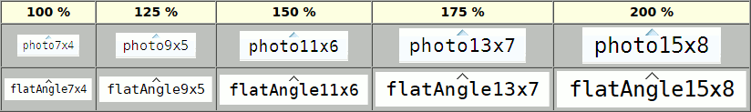


|   |   |
| --- | --- |
| Command-Line Name:  | `-autofinishediting` |
| Database Name: | ` autoFinishEditing` |
| Database Class: | ` AutoFinishEditing` |

Specifies a boolean value that controls whether the interactive cell editing with the aid of a tile combobox, BWidget ComboBox, Iwidgets combobox, Oakley combobox, Tk core menubutton, or tile menubutton widget will be finished automatically by selecting an entry of the combobox or of the menu associated with the menubutton.  The default value is `0`.


|   |   |
| --- | --- |
| Command-Line Name:  | `-autoscan` |
| Database Name: | ` autoScan` |
| Database Class: | ` AutoScan` |

Specifies a boolean value that controls whether to trigger the automatic scrolling when the mouse leaves the tablelist window with button 1 down.  The default is `1`, meaning that automatic scrolling will be in effect, just like in the case of the Tk listbox widget.  However, when using the TkDND package or some other drag & drop implementation, you might want to set this option to `0`, in order to avoid any conflicts between the drag operation and the automatic scrolling.

**REMARK:**  Starting with Tablelist version 5.12, this option has become obsolete, because the default bindings now suppress the above-mentioned automatic scrolling if the tablelist's body component was registered as a drag source for mouse button 1 via the  `tkdnd::drag_source register`  or the BWidget `DragSite::register` command, or the tablelist's `-customdragsource` option was set to true.


|   |   |
| --- | --- |
| Command-Line Name:  | `-button2window` |
| Database Name: | ` button2Window` |
| Database Class: | ` Button2Window` |

Specifies the path name of the window to which the default bindings for the binding tags `TablelistBody` and `TablelistEdit` should redirect the `<Button-2>`, `<B2-Motion>`, and `<ButtonRelease-2>` events via  `event generate`  if the focus window on the display containing the tablelist widget is outside the tablelist.  The default is an empty string, meaning that the mouse button 2 events received by a widget having one of the two above-mentioned binding tags will give rise to scanning within the tablelist or its edit window, regardless of whether the focus is inside or outside the tablelist widget.

**REMARK 1:**  If the tablelist is contained in a [scrollutil::scrollableframe](https://www.nemethi.de/scrollutil/scrollableframe.html) and you set this option to the path name of the containing toplevel widget, then the above-mentioned mouse button 2 events over the tablelist's body will be handled as follows:

  - If the focus is inside the tablelist widget then the events will trigger a scanning of the content of the tablelist or its edit window and no further processing of the events will take place.
  - If the focus is outside the tablelist widget then no scanning within the tablelist's body or edit window will happen.  Instead, the event will be redirected to the toplevel widget with the aid of the  `event generate`  command.  This in turn will give rise to scanning of the scrollableframe's content.

**REMARK 2:**  If you pass the tablelist widget to the `scrollutil::adaptBtn2EventHandling` command then that command will set this option to the path name of the containing toplevel window.


|   |   |
| --- | --- |
| Command-Line Name:  | `-collapsecommand` |
| Database Name: | ` collapseCommand` |
| Database Class: | ` CollapseCommand` |

Specifies a Tcl command to be invoked when collapsing a row of a tablelist used as a tree widget (with the aid of the `collapse` or `collapseall` subcommand).  The specified command is automatically concatenated with the path name of the tablelist widget and the row index, and the resulting script is evaluated in the global scope, before hiding the descendants of the row in question.


|   |   |
| --- | --- |
| Command-Line Name:  | `-colorizecommand` |
| Database Name: | ` colorizeCommand` |
| Database Class: | ` ColorizeCommand` |

Specifies a Tcl command that can be used to change the colors of arbitrary character regions within the cells of the currently visible rows.  Whenever the Tablelist package needs to display the various foreground and background colors (including the stripe- and selection-specific ones), it runs over the cells of the body and header rows that are currently visible in the tablelist window and displays the colors by adding appropriate tags to the body and header text widget areas making up the formatted contents of the cells.  After activating the colors for a cell, the Tablelist code invokes the command specified as the value of this configuration option (provided that it is a nonempty string), in the global scope and with the following arguments specific to the body or header cell being processed:

  - the path name of the tablelist widget;
  - the path name of the tablelist's body or header text widget;
  - the full key of the item containing the element being processed (recall that this starts with the prefix `k` for a body item and with `hk` for a header item);
  - the numerical row or header row index of that item;
  - the numerical index of the cell's column;
  - the text index (of the form `line.char`) of the first `\t` character delimiting the cell in the underlying text widget;
  - the text index (of the form `line.char`) of the second `\t` character delimiting the cell in the underlying text widget;
  - the boolean value `0` or `1` indicating whether the cell being processed is contained in a stripe (see, e.g., the description of the `-stripebackground` option);
  - the boolean value `0` or `1` indicating whether the cell being processed is currently selected.

From the above it follows that the value of this configuration option will typically be the name of a procedure like in the following example:

```
proc myColorizeCmd {tbl textWidget key row col tabIdx1 tabIdx2 inStripe selected} { ... }
```

**REMARK 1:**  To change the colors of some parts of a cell's displayed content, the command specified as the value of this configuration option will have to make use of text widget tags having the desired background and/or foreground colors.  Besides `-background` and `-foreground`, the command may also use a few other tag configuration options, like `-overstrike` and `-underline`.  On the other hand, be aware that the use of some other tag configuration options (particularly `-elide` and `-font`) can cause conflicts with the way Tablelist renders the elements, thus giving rise to various layout problems within the body or header of your tablelist widget!

**REMARK 2:**  Since the multi-line elements are displayed with the aid of embedded message widgets, there is currently no way to change the colors of text areas within multi-line cells.


|   |   |
| --- | --- |
| Command-Line Name:  | `-columns` |
| Database Name: | ` columns` |
| Database Class: | ` Columns` |

Specifies the widths, titles, and alignments of the columns.  The option's value must be a list of the form

```
width title ?alignment? width title ?alignment? ...
```

Each `width` must be a number.  A positive value specifies the column's width in average-size characters of the widget's font.  If `width` is negative, its absolute value is interpreted as a column width in pixels.  Finally, a value of zero specifies that the column's width is to be made just large enough to hold all the elements in the column, including its header (but no larger than the maximum width indicated by the `-maxwidth` column configuration option).  In all three cases, the effective column width will be somewhat greater because of the margins created automatically to the left and right of the column.

Each `title` specifies the text to be displayed in the column's header, and may optionally be followed in the next list element by an `alignment`, which specifies how to align the elements of the column.  Each `alignment` must be one of `left`, `right`, or `center`.  The default is `left`.  The `alignment` also refers to the column's title as long as the `-labelalign` option hasn't been specified for that column, or if its value is an empty string.

The default value of this option is an empty list, specifying that initially the widget has no columns.

**REMARK:**  Columns whose width was specified as zero are called **dynamic-width** columns.  In general, they are more user-friendly than their **static-width** counterparts, being that their widths are automatically adapted to their contents.  On the other hand, if the `-displayondemand` option is true (which is the default) then the static-width columns perform significantly better on item insertion and sorting than the dynamic-width ones.


|   |   |
| --- | --- |
| Command-Line Name:  | `-columntitles` |
| Database Name: | ` columnTitles` |
| Database Class: | ` ColumnTitles` |

This option provides a simplified form of specifying dynamic-width, left-aligned tablelist columns.  Its value is viewed as a list of column titles.  The default is an empty list.

In the simplest case that no columns have been specified yet, setting this option to the value given by the list

```
title title ...
```

is equivalent to setting the `-columns` option to the value given by the list

```
0 title left 0 title left ...
```

If the columns have already been specified then this option updates their titles (as many of them as possible) and, if the number of elements of its value is greater than the number of columns then it uses the remaining elements as titles of additional dynamic-width, left-aligned columns.  For example, if the widget has 3 columns and the option's value is a list of length 5 then the option will update the titles of the 3 columns and will append 2 new dynamic-width, left-aligned columns having as titles the last 2 elements of the list.  If the widget has 3 columns and the option specifies just 2 texts then it will update the titles of the first 2 columns only.


|   |   |
| --- | --- |
| Command-Line Name:  | `-customdragsource` |
| Database Name: | ` customDragSource` |
| Database Class: | ` CustomDragSource` |

Specifies a boolean value that indicates whether the tablelist widget is a drag source for some drag & drop implementation other than TkDND and the drag & drop framework included in BWidget.  If true then the default bindings will perform an automatic drag-friendly handling of the selection and will suppress the automatic scrolling when the mouse leaves the tablelist window with button 1 down.  The default is `0`.


|   |   |
| --- | --- |
| Command-Line Name:  | `-displayondemand` |
| Database Name: | ` displayOnDemand` |
| Database Class: | ` DisplayOnDemand` |

Specifies a boolean value that controls the way the texts of newly inserted rows in the tablelist's body will be displayed in the underlying text widget.  If true then the texts of the new rows won't be inserted into the body text widget until the corresponding cells become visible (e.g., as a result of horizontal or vertical scrolling).  Otherwise the texts of the new rows will be displayed in the underlying text widget immediately after inserting the rows.  The default is `1`.

**REMARK 1:**  The default value true of this option makes the item insertion and sorting significantly faster, especially in the presence of static-width columns, because the snipping of elements that don't fit into their cells will be postponed to the time when they get displayed in the body text widget.  On the other hand, this display on demand imposes some performance penalty on the scrolling, especially if the tablelist widget has many columns.  To speed up the scrolling, you might consider setting this option to false.

**REMARK 2:**  Newly inserted header rows are displayed immediately in the underlying text widget, independently of the value of this option.


|   |   |
| --- | --- |
| Command-Line Name:  | `-editendcommand` |
| Database Name: | ` editEndCommand` |
| Database Class: | ` EditEndCommand` |

Specifies a Tcl command to be invoked on normal termination of the interactive editing of a cell's content if the final text of the temporary embedded widget used for the editing is different from its initial one.  The command is automatically concatenated with the path name of the tablelist widget, the cell's row and column indices, as well as the final content of the edit window, the resulting script is evaluated in the global scope, and the return value becomes the cell's new content after destroying the temporary embedded widget.  The main purpose of this script is to perform a final validation of the edit window's content.  See the description of the `-forceeditendcommand` option for more about the invocation of the command mentioned above, as well as the [INTERACTIVE CELL EDITING](#detailed-reference) section for details on the editing process.


|   |   |
| --- | --- |
| Command-Line Name:  | `-editendonfocusout` |
| Database Name: | ` editEndOnFocusOut` |
| Database Class: | ` EditEndOnFocusOut` |

Specifies a boolean value that controls whether the interactive cell editing will be finished automatically when the tablelist widget loses the focus.  If this option was set to true then losing the focus while interactive cell editing is in progress will automatically trigger an invocation of the `finishediting` subcommand.  The default is `0`.


|   |   |
| --- | --- |
| Command-Line Name:  | `-editendonmodclick` |
| Database Name: | ` editEndOnModClick` |
| Database Class: | ` EditEndOnModClick` |

Specifies a boolean value that controls whether with respect to the termination of the interactive cell editing the `<Shift-Button-1>` and `<Control-Button-1>` events (which are commonly used for extending and toggling the selection, respectively) are handled just like `<Button-1>`.  The default is `1`, meaning that the interactive cell editing will be finished automatically by clicking with the left mouse button anywhere in the tablelist's body, outside the cell just being edited, regardless of whether the `Shift` or `Control` key is down or not.


|   |   |
| --- | --- |
| Command-Line Name:  | `-editselectedonly` |
| Database Name: | ` editSelectedOnly` |
| Database Class: | ` EditSelectedOnly` |

Specifies a boolean value that controls whether to start the interactive cell editing when mouse button 1 is pressed in an editable cell.  If this value is true then the editing will only be started if the cell has previously been selected (interactively or programmatically).  In this case, a first left-click will usually just select the cell (or its row, depending on the value of the `-selecttype` option), and a second mouse click will start the editing session.  The default is `0`, meaning that the editing will be started regardless of whether the cell is selected or not.


|   |   |
| --- | --- |
| Command-Line Name:  | `-editstartcommand` |
| Database Name: | ` editStartCommand` |
| Database Class: | ` EditStartCommand` |

Specifies a Tcl command to be invoked when the interactive editing of a cell's content is started.  The command is automatically concatenated with the path name of the tablelist widget, the cell's row and column indices, as well as the text displayed in the cell, the resulting script is evaluated in the global scope, and the return value becomes the initial content of the temporary embedded widget used for the editing.  The main purpose of this script is to define validations for the edit window's content.  See the [INTERACTIVE CELL EDITING](#detailed-reference) section for details on the editing process.


|   |   |
| --- | --- |
| Command-Line Name:  | `-expandcommand` |
| Database Name: | ` expandCommand` |
| Database Class: | ` ExpandCommand` |

Specifies a Tcl command to be invoked when expanding a row of a tablelist used as a tree widget (with the aid of the `expand` or `expandall` subcommand).  The specified command is automatically concatenated with the path name of the tablelist widget and the row index, and the resulting script is evaluated in the global scope, before displaying the children of the row in question.

**REMARK:**  It is common practice to use the command specified as the value of this option to insert the children of the row that is about to be expanded, if it has no children yet.  For example, the [Directory Viewer](tablelist.md#a-scalable-directory-viewer-based-on-a-tablelist) demo script uses the command implemented as follows:

```
proc expandCmd {tbl row} {
    if {[$tbl childcount $row] == 0} {
        # Get the name of the directory whose leaf name is
        # displayed in the first cell of the specified row
        set dir [$tbl rowattrib $row pathName]

        # Display the content of the directory $dir
        # as child items of the one identified by $row
        putContents $dir $tbl $row
    }

    # The rest is just eye candy:
    if {[$tbl childcount $row] != 0} {
        # Update the image displayed in the row's first cell
        $tbl cellconfigure $row,0 -image openFolderImg
    }
}
```


|   |   |
| --- | --- |
| Command-Line Name:  | `-forceeditendcommand` |
| Database Name: | ` forceEditEndCommand` |
| Database Class: | ` ForceEditEndCommand` |

Specifies a boolean value that controls the invocation of the command given by the the `-editendcommand` option.  If this value is true then the command will be invoked on normal termination of the editing process even if the final text of the temporary embedded widget used for the editing equals its initial one, and will also be invoked when the interactive cell editing is canceled (in the latter case, the text passed to it as last argument will be the edit window's original content, not its final one).  The default value of this option is `0`, meaning that the command will only be invoked on normal termination of the editing process if the final text of the temporary embedded widget is different from its initial one.  See the [INTERACTIVE CELL EDITING](#detailed-reference) section for details on the editing process.

If the option's value is true and no value for the `-editendcommand` option was specified, then on normal termination of the editing process the cell's new content will be set to the text contained in the edit window, even if it has not been changed interactively (but might have been returned by the command given by the the `-editstartcommand` option).

Setting this option to true enables you to execute an arbitrary action whenever the interactive cell editing is finished.  Just binding a script to the `<Destroy>` event for the temporary embedded widget used for the editing won't work, because that widget might be destroyed and recreated automatically under various circumstances.  Alternately, you can use the `<<TablelistCellUpdated>>` and `<<TablelistCellRestored>>` virtual events, generated by the `finishediting` and `cancelediting` subcommands, respectively.


|   |   |
| --- | --- |
| Command-Line Name:  | `-fullseparators` |
| Database Name: | ` fullSeparators` |
| Database Class: | ` FullSeparators` |

Specifies a boolean value that controls whether the separators (if any) shall extend all of the way to the bottom of the tablelist's body.  The default is `0`, meaning that the height of the separators will be adjusted to the widget's content, i.e., they won't extend to the bottom of the tablelist's body if there is free vertical space left below the widget's last row.


|   |   |
| --- | --- |
| Command-Line Name:  | `-height` |
| Database Name: | ` height` |
| Database Class: | ` Height` |

Specifies the desired height for the tablelist's body, in units of characters in the font given by the `-font` option.  This is at the same time the desired height in rows, provided that no column-, row-, or cell-specific fonts, multi-line elements, or embedded images or windows make the height of any of the body items different from the one corresponding to the above-mentioned font.  If the option's value is zero or less, then the body's desired height in units of characters in the widget's font is kept in sync with the number of [viewable](#detailed-reference) body items; again, if all the items in the tablelist's body have the height corresponding to the widget's font then this means that the body's desired height is made just large enough to hold all the viewable body items.

**REMARK:**  Embedded images and windows often make the rows of the tablelist higher, resulting in a discrepancy between the value of this option and the number of rows visible in the body window.  In most cases you can work around this problem by saving the value of the widget's `-font` option, setting the latter to a sufficiently large font, and then setting the `-font` row configuration option of each body and header item to the saved widget font value.


|   |   |
| --- | --- |
| Command-Line Name:  | `-inactiveselectbackground` |
| Database Name: | ` inactiveSelectBackground` |
| Database Class: | ` Foreground` |

Specifies the background color to use for the selection in the tablelist's body when the latter does not have the input focus.  If empty then the value of the **-selectbackground** option at [widget](#detailed-reference), [column](#detailed-reference), [row](#detailed-reference), or [cell](#detailed-reference) level is used when the widget's body does not have the focus.

The default value depends on the windowing system in the Tablelist package and on the current theme in Tablelist_tile:  In the Tablelist package it is non-empty on the windowing systems `aqua` and `win32`, and an empty string on `x11`; in Tablelist_tile it is non-empty for the themes `aqua`, `clam`, `vista`, `winnative`, and `xpnative`, and an empty string for all the other themes.  The choice of the default value makes sure that the selection will appear in native colors also when the widget's body does not have the focus.


|   |   |
| --- | --- |
| Command-Line Name:  | `-inactiveselectforeground` |
| Database Name: | ` inactiveSelectForeground` |
| Database Class: | ` Background` |

Specifies the foreground color to use for the selection in the tablelist's body when the latter does not have the input focus.  This option is only relevant if the value of the `-inactiveselectbackground` option is non-empty, in which case, if the value of this option is an empty string then the value of the **-selectforeground** option at [widget](#detailed-reference) level (only) is used when the tablelist's body does not have the focus.

The default value depends on the windowing system in the Tablelist package and on the current theme in Tablelist_tile:  In the Tablelist package it is non-empty on the windowing systems `aqua` and `win32`, and an empty string on `x11`; in Tablelist_tile it is non-empty for the themes `aqua`, `clam`, `vista`, `winnative`, and `xpnative`, and an empty string for all the other themes.  The choice of the default value makes sure that the selection will appear in native colors also when the widget's body does not have the focus.


|   |   |
| --- | --- |
| Command-Line Name:  | `-incrarrowtype` |
| Database Name: | ` incrArrowType` |
| Database Class: | ` IncrArrowType` |

Specifies the type of the arrow placed into a column label when sorting the items based on that column in increasing order, with the aid of the `sortbycolumn` or `sortbycolumnlist` subcommand of the Tcl command associated with the widget.  The value of this option must be one of `up` or `down`.  The default is `up`.  This option is only relevant if the value of the `-showarrow` option is true.


|   |   |
| --- | --- |
| Command-Line Name:  | `-instanttoggle` |
| Database Name: | ` instantToggle` |
| Database Class: | ` InstantToggle` |

Specifies a boolean value that controls whether the interactive cell editing with the aid of a Tk or tile checkbutton or a toggleswitch widget, if started with the left mouse button, will be finished immediately after automatically toggling the check state of the temporary embedded checkbutton or the switch state of the temporary embedded toggleswitch.  The default value is `0`, meaning that a mouse click into the cell will only start the editing session (and automatically toggle the checkbutton's check state or the toggleswitch widget's switch state), but not also finish it.


|   |   |
| --- | --- |
| Command-Line Name:  | `-itembackground` or `-itembg` |
| Database Name: | ` itemBackground` |
| Database Class: | ` Background` |

Specifies the background color to use when displaying the body and header items, i.e., the background color of the body area filled with the body items and that of the header area filled with the header items (if any).  The default value is an empty string, indicating that these areas will inherit the background color specified by the `-background` configuration option.  Notice that regardless of the value of this option, the blank space that might appear to the right of the body and header items as well as below the last body item will always have the background color given by the `-background` option.


|   |   |
| --- | --- |
| Command-Line Name:  | `-labelactivebackground` |
| Database Name: | ` labelActiveBackground` |
| Database Class: | ` Foreground` |

Specifies the `-activebackground` option for the header labels, i.e., the background color to use when the mouse cursor is positioned over a header label and the value of `tk_strictMotif` is false.  The Tablelist_tile package doesn't support the `-labelactivebackground` option.


|   |   |
| --- | --- |
| Command-Line Name:  | `-labelactiveforeground` |
| Database Name: | ` labelActiveForeground` |
| Database Class: | ` Background` |

Specifies the `-activeforeground` option for the header labels, i.e., the foreground color to use when the mouse cursor is positioned over a header label and the value of `tk_strictMotif` is false.  The Tablelist_tile package doesn't support the `-labelactiveforeground` option.


|   |   |
| --- | --- |
| Command-Line Name:  | `-labelbackground` or `-labelbg` |
| Database Name: | ` labelBackground` |
| Database Class: | ` Background` |

Specifies the `-background` option for the header labels.  This option is only supported by the Tablelist package, but not by Tablelist_tile.


|   |   |
| --- | --- |
| Command-Line Name:  | `-labelborderwidth` or `-labelbd` |
| Database Name: | ` labelBorderWidth` |
| Database Class: | ` BorderWidth` |

Specifies the `-borderwidth` option for the header labels.  This option is different from the standard `-borderwidth` option defined for the tablelist widget itself.  In the package Tablelist_tile this option has a theme-specific default value.

**REMARK:**  Please take into account that in some themes, setting this option to a value other than the default might be ignored by tile and thus could cause alignment problems.  This is because the border of tile widgets is drawn with theme-specific methods, which will not always produce the results known from Tk widgets.


|   |   |
| --- | --- |
| Command-Line Name:  | `-labelcommand` |
| Database Name: | ` labelCommand` |
| Database Class: | ` LabelCommand` |

Specifies a Tcl command to be invoked when mouse button 1 is pressed over one of the header labels and later released over the same label.  Provided that the option's value is a nonempty string, when the `<ButtonRelease-1>` event occurs, the command is automatically concatenated with the path name of the tablelist widget and the column index of the respective label, and the resulting script is evaluated in the global scope.  If another nonempty command was specified as the value of the option of the same name at column level then that column-specific command will be used instead of the global one.  If the tablelist's `state` is `disabled` then this action will not take place.  The most common value of this option is `tablelist::sortByColumn`; this command sorts the items based on the column whose index was passed to it as second argument.


|   |   |
| --- | --- |
| Command-Line Name:  | `-labelcommand2` |
| Database Name: | ` labelCommand2` |
| Database Class: | ` LabelCommand2` |

Specifies a Tcl command to be invoked when mouse button 1 is pressed together with the `Shift` key over one of the header labels and later released over the same label.  Provided that the option's value is a nonempty string, when the `<ButtonRelease-1>` event occurs, the command is automatically concatenated with the path name of the tablelist widget and the column index of the respective label, and the resulting script is evaluated in the global scope.  If another nonempty command was specified as the value of the option of the same name at column level then that column-specific command will be used instead of the global one.  If the tablelist's `state` is `disabled` then this action will not take place.  The most common value of this option is `tablelist::addToSortColumns`; this command adds the column index passed to it as second argument to the list of sort columns and sorts the items based on the columns indicated by the modified list.


|   |   |
| --- | --- |
| Command-Line Name:  | `-labeldisabledforeground` |
| Database Name: | ` labelDisabledForeground` |
| Database Class: | ` DisabledForeground` |

Specifies the `-disabledforeground` option for the header labels, i.e., the foreground color to use for the labels when the tablelist's `state` is `disabled`.  The Tablelist_tile package doesn't support the `-labeldisabledforeground` option.


|   |   |
| --- | --- |
| Command-Line Name:  | `-labelfont` |
| Database Name: | ` labelFont` |
| Database Class: | ` Font` |

Specifies the `-font` option for the header labels.  In the package Tablelist_tile this option has a theme-specific default value.


|   |   |
| --- | --- |
| Command-Line Name:  | `-labelforeground` or `-labelfg` |
| Database Name: | ` labelForeground` |
| Database Class: | ` Foreground` |

Specifies the `-foreground` option for the header labels.  In the package Tablelist_tile this option has a theme-specific default value.


|   |   |
| --- | --- |
| Command-Line Name:  | `-labelheight` |
| Database Name: | ` labelHeight` |
| Database Class: | ` Height` |

Specifies the `-height` option for the header labels.  This option is only supported by the Tablelist package, but not by Tablelist_tile.


|   |   |
| --- | --- |
| Command-Line Name:  | `-labelpady` |
| Database Name: | ` labelPadY` |
| Database Class: | ` Pad` |

In the Tablelist package this option specifies the `-pady` configuration option for the header labels.  In the Tablelist_tile package the value of the `-labelpady` option is mapped to the corresponding components of the value of the `-padding` configuration option of the header labels, and the `-labelpady` option has a theme-specific default value.


|   |   |
| --- | --- |
| Command-Line Name:  | `-labelrelief` |
| Database Name: | ` labelRelief` |
| Database Class: | ` Relief` |

Specifies the `-relief` option for the header labels.  This option is different from the standard `-relief` option defined for the tablelist widget itself.  The default value is `raised`.


|   |   |
| --- | --- |
| Command-Line Name:  | `-listvariable` |
| Database Name: | ` listVariable` |
| Database Class: | ` Variable` |

Specifies the name of a global varable or a qualified name of a namespace variable.  The value of the variable is a list to be displayed inside the widget's body; if the variable value changes then the widget will automatically update itself to reflect the new value.  The value of the variable must be a valid list.  Each list element corresponds to a row within the widget's body, and must be a valid list itself; its elements correspond to the cells within the respective row.  Attempts to assign a variable whose value does not fulfill these conditions to `-listvariable` will cause an error.  Attempts to unset a variable in use as a `-listvariable` will fail but will not generate an error.

**REMARK 1:**  For increased efficiency, updating the widget to reflect a changed value of the variable specified with this option is, whenever possible, done at idle time (i.e., when there are no events to process).  On the other hand, most tablelist subcommands make it necessary to perform an *immediate* update of the widget's internal list according to the value of this variable, before executing the subcommand in question.  Doing this repeatedly can become quite inefficient.  To avoid performance problems, you should always try to separate the operations that build up the value of the variable specified by this option from other commands.  For example, instead of

```
tablelist::tablelist .tbl ... -listvariable var
set var {}
for {set row 0} {$row < 1000} {incr row} {
    lappend var ...
    .tbl cellconfigure $row,3 -image ...
}
```

you should write

```
tablelist::tablelist .tbl ... -listvariable var
set var {}
for {set row 0} {$row < 1000} {incr row} {
    lappend var ...
}
for {set row 0} {$row < 1000} {incr row} {
    .tbl cellconfigure $row,3 -image ...
}
```

The first method above is quite inefficient, because it requires 1000 updates of the widget's internal list.  The second method performs incomparably faster, because it needs only one synchronization (at the beginning of the second loop).

**REMARK 2:**  It is not recommended to set this option for a tablelist used as a tree widget, because adding new items to the list specified as its value will result in inserting those list elements into the widget without respecting the tree's internal structure.  There is no problem if you access the variable for reading only, but for that purpose it is more efficient to use the `itemlistvar` subcommand rather than the `-listvariable` option.


|   |   |
| --- | --- |
| Command-Line Name:  | `-movablecolumns` |
| Database Name: | ` movableColumns` |
| Database Class: | ` MovableColumns` |

Specifies a boolean value that determines whether the columns can be moved interactively.  See the [DEFAULT AND INDIVIDUAL BINDINGS FOR THE HEADER LABELS](#detailed-reference) section below for information on moving a column interactively.  The default value is `0`.


|   |   |
| --- | --- |
| Command-Line Name:  | `-movablerows` |
| Database Name: | ` movableRows` |
| Database Class: | ` MovableRows` |

Specifies a boolean value that determines whether the rows displayed in the tablelist's body can be moved interactively.  See the LOCAL DRAG & DROP subsection of the [DEFAULT AND INDIVIDUAL BINDINGS FOR THE TABLELIST BODY](#detailed-reference) section below for information on moving a row interactively.  The default value is `0`.

**REMARK:**  The support for moving a row is restricted to the widget's body component.  Moving of header rows is not supported.


|   |   |
| --- | --- |
| Command-Line Name:  | `-movecolumncursor` |
| Database Name: | ` moveColumnCursor` |
| Database Class: | ` MoveColumnCursor` |

Specifies the mouse cursor to be used when moving a column interactively.  The default value is `icon` on the windowing systems `x11` and `win32`, and the native cursor `closedhand` on the Macintosh windowing system `aqua`.


|   |   |
| --- | --- |
| Command-Line Name:  | `-movecursor` |
| Database Name: | ` moveCursor` |
| Database Class: | ` MoveCursor` |

Specifies the mouse cursor to be used when moving a row interactively.  The default value is `hand2` on the windowing systems `x11` and `win32`, and the native cursor `pointinghand` on the Macintosh windowing system `aqua`.


|   |   |
| --- | --- |
| Command-Line Name:  | `-populatecommand` |
| Database Name: | ` populateCommand` |
| Database Class: | ` PopulateCommand` |

Specifies a Tcl command to be invoked by the `searchcolumn` subcommand before examining the children (or descendants, when used with the `-descend` option) of a tablelist row whose children have not been inserted yet.  The specified command is automatically concatenated with the path name of the tablelist widget and the row index, and the resulting script is evaluated in the global scope.  It is expected that this script will insert the children of the row in question, without expanding the node or changing its appearance in any other way.

**REMARK:**  There are many similarities between this option and `-expandcommand`.  Both options are used in the first place to insert children on demand.  The main differences between them are as follows:

  1. The command specified by the `-populatecommand` option is only invoked for rows whose children have not been inserted yet, while the one specified by `-expandcommand` is always invoked before expanding a row, regardless of whether the children of that row are already present in the widget or not.
  2. The command specified by the `-expandcommand` option may perform visual changes on the node in question, while the role of the one specified by `-populatecommand` is restricted to inserting the children, without altering the node's appearance in any way.

A logical consequence of the above is that the value of `-populatecommand` is usually just a stripped-down version of the command specified by the `-expandcommand` option.  For example, the [Directory Viewer](tablelist.md#a-scalable-directory-viewer-based-on-a-tablelist) demo script might use a command implemented as follows:

```
proc populateCmd {tbl row} {
    # Get the name of the directory whose leaf name is
    # displayed in the first cell of the specified row
    set dir [$tbl rowattrib $row pathName]

    # Display the content of the directory $dir
    # as child items of the one identified by $row
    putContents $dir $tbl $row
}
```

Moreover, the `-expandcommand` option can be set to a command that invokes the one specified by the `-populatecommand` option:

```
proc expandCmd {tbl row} {
    if {[$tbl childcount $row] == 0} {
        populateCmd $tbl $row
    }

    # The rest is just eye candy:
    if {[$tbl childcount $row] != 0} {
        # Update the image displayed in the row's first cell
        $tbl cellconfigure $row,0 -image openFolderImg
    }
}
```


|   |   |
| --- | --- |
| Command-Line Name:  | `-protecttitlecolumns` |
| Database Name: | ` protectTitleColumns` |
| Database Class: | ` ProtectTitleColumns` |

Specifies a boolean value that determines whether the boundary of the title column area shall be protected from being crossed when moving a column interactively.  See the [DEFAULT AND INDIVIDUAL BINDINGS FOR THE HEADER LABELS](#detailed-reference) section below for information on moving a column interactively.  The default value is `0`, specifying that non-title columns can be moved into the title column area and vice-versa.


|   |   |
| --- | --- |
| Command-Line Name:  | `-resizablecolumns` |
| Database Name: | ` resizableColumns` |
| Database Class: | ` ResizableColumns` |

Specifies a boolean value that determines whether the columns can be resized interactively.  See the [DEFAULT AND INDIVIDUAL BINDINGS FOR THE HEADER LABELS](#detailed-reference) section below for information on interactive column resizing.  The default value is `1`.


|   |   |
| --- | --- |
| Command-Line Name:  | `-resizecursor` |
| Database Name: | ` resizeCursor` |
| Database Class: | ` ResizeCursor` |

Specifies the mouse cursor to be used during interactive column resizing.  The default value is `sb_h_double_arrow` on the windowing systems `x11` and `win32`, and the native cursor `resizeleftright` on the Macintosh windowing system `aqua`.


|   |   |
| --- | --- |
| Command-Line Name:  | `-selectfiltercommand` |
| Database Name: | ` selectFilterCommand` |
| Database Class: | ` SelectFilterCommand` |

Specifies a Tcl command which can be used for filtering the cells that will be selected when the default bindings for the header labels perform a column-wise cell selection.  If the option's value is a nonempty string then this command is concatenated with the path name of the tablelist widget and the numerical index of the respective column, and the resulting script is evaluated in the global scope.  If another nonempty command was specified as the value of the option of the same name at column level then that column-specific command will be used instead of the global one.  In both cases, the resulting script is expected to return a list consisting of the row numbers of those cells contained in the column in question that are to be selected by the column-wise cell selection operation.


|   |   |
| --- | --- |
| Command-Line Name:  | `-selectmode` |
| Database Name: | ` selectMode` |
| Database Class: | ` SelectMode` |

Specifies one of several styles for manipulating the selection.  The value of the option may be arbitrary, but the default bindings expect it to be either `single`, `browse`, `multiple`, or `extended`.  The default value is `browse`.


|   |   |
| --- | --- |
| Command-Line Name:  | `-selecttype` |
| Database Name: | ` selectType` |
| Database Class: | ` SelectType` |

Specifies one of two selection types for the tablelist widget: `row` or `cell`.  If the selection type is `row` then the default bindings will select and deselect entire items, and the whole row having the location cursor will be displayed as active when the tablelist has the keyboard focus.  If the selection type is `cell` then the default bindings will select and deselect individual elements, and the single cell having the location cursor will be displayed as active when the tablelist has the keyboard focus.  The default value is `row`.


|   |   |
| --- | --- |
| Command-Line Name:  | `-setfocus` |
| Database Name: | ` setFocus` |
| Database Class: | ` SetFocus` |

Specifies a boolean value that determines whether a click with the left mouse button anywhere into the tablelist's body, including the separators and the embedded images (more precisely, any descendants of the tablelist widget having the binding tag `TablelistBody`) should set the focus to the body of the tablelist widget if the latter's `state` is `normal`.  The default value is `1`.


|   |   |
| --- | --- |
| Command-Line Name:  | `-showarrow` |
| Database Name: | ` showArrow` |
| Database Class: | ` ShowArrow` |

Specifies a boolean value that determines whether the `sortbycolumn` and `sortbycolumnlist` subcommands of the Tcl command associated with the widget should place an arrow indicating the sort order into the header label(s) of the column(s) specified by their first argument.  The default value is `1`.


|   |   |
| --- | --- |
| Command-Line Name:  | `-showbusycursor` |
| Database Name: | ` showBusyCursor` |
| Database Class: | ` ShowBusyCursor` |

Specifies a boolean value indicating whether the default bindings should display a windowing system-specific busy cursor during the actions that can take a long time to complete, using the `setbusycursor` and `restorecursor` subcommands.  The default value is `1`.

The potentially long-running actions that will temporarily change the mouse cursor when this option is on are as follows:

  - resizing or moving a column;
  - invoking the command specified by the `-labelcommand` or `-labelcommand2` option at widget or column level (e.g., sorting the items by one or more columns);
  - expanding or collapsing a row;
  - extending, toggling, or canceling the (cell) selection if the `-selectmode` option was set to `extended`;
  - extending the column-wise cell selection.

**REMARK:**  If showing the busy cursor per default during potentially long-running actions is not what you prefer, you can override the default for all tablelist instances by inserting the line

```
option add *Tablelist.showBusyCursor 0
```

somewhere at the beginning of your script (before creating any tablelist widgets).


|   |   |
| --- | --- |
| Command-Line Name:  | `-showeditcursor` |
| Database Name: | ` showEditCursor` |
| Database Class: | ` ShowEditCursor` |

Specifies a boolean value indicating whether the mouse cursor should change automatically to one having the shape of a pencil whenever a click with mouse button 1 would start an editing session.  The default value is `1`.

On X11 and Mac OS X/11+, the cursor set by Tablelist when a mouse click would start the interactive cell editing, is Tk's built-in cursor `pencil`.  Since on Windows this cursor is ugly and not really usable, the edit cursor shown by Tablelist on this platform will be the one loaded from the file `pencil.cur`, located in the `scripts` subdirectory of the Tablelist installation directory.  If the application was started as a starpack containing the Tablelist package, then the edit cursor will be loaded from a copy of this file, created automatically by Tablelist in the user's `Temp` directory.  The file `pencil.cur` is a copy of the file  `Ubuntu Handwriting.cur`,  downloaded from the address

http://www.rw-designer.com/cursor-detail/46922

**REMARK:**  If showing the edit cursor per default whenever a click with mouse button 1 would start the editing is not what you prefer, you can override the default for all tablelist instances by inserting the line

```
option add *Tablelist.showEditCursor 0
```

somewhere at the beginning of your script (before creating any tablelist widgets).


|   |   |
| --- | --- |
| Command-Line Name:  | `-showhorizseparator` |
| Database Name: | ` showHorizSeparator` |
| Database Class: | ` ShowHorizSeparator` |

Specifies a boolean value that controls whether to place a horizontal separator just below the last row if the value of the `-showseparators` option is true, that of the `-fullseparators` option is false, and there is free space left between the last row and the bottom of the tablelist window.  The default value is `1`.

**REMARK:**  If showing the horizontal separator per default under the above-mentioned circumstancies is not what you prefer, you can override the default for all tablelist instances by inserting the line

```
option add *Tablelist.showHorizSeparator 0
```

somewhere at the beginning of your script (before creating any tablelist widgets).


|   |   |
| --- | --- |
| Command-Line Name:  | `-showlabels` |
| Database Name: | ` showLabels` |
| Database Class: | ` ShowLabels` |

Specifies a boolean value that determines whether the header labels are to be shown or not.  The default value is `1`.


|   |   |
| --- | --- |
| Command-Line Name:  | `-showseparators` |
| Database Name: | ` showSeparators` |
| Database Class: | ` ShowSeparators` |

Specifies a boolean value that determines whether the columns are to be separated with borders.  The default value is `0`.  The separators are implemented as thin frames with sunken relief in the package Tablelist, and as tile separator widgets in the package Tablelist_tile.  They are attached to the right edges of the header labels, and are only created if the value of this option is true.  In this case, a horizontal separator will also be created and placed just below the last row, provided that the value of the `-showhorizseparator` option is true, that of the `-fullseparators` option is false, and there is free space left between the last row and the bottom of the tablelist window.

**REMARK:**  Tablelist doesn't support horizontal separators (except for the one mentioned above and another one placed just below the last header row), but a nice distinguishing effect for the rows in the widget's body can be achieved with the aid of the `-stripebackground` option described below.


|   |   |
| --- | --- |
| Command-Line Name:  | `-snipstring` |
| Database Name: | ` snipString` |
| Database Class: | ` SnipString` |

Specifies the string to be used as snip indicator when displaying the elements that don't fit into their cells.  The default is an ellipsis (`"..."`).


|   |   |
| --- | --- |
| Command-Line Name:  | `-sortcommand` |
| Database Name: | ` sortCommand` |
| Database Class: | ` SortCommand` |

Specifies a command to be used for the comparison of the items when invoking the `sort` subcommand of the Tcl command associated with the tablelist widget.  To compare two items (viewed as lists of cell contents within one row each) during the `sort` operation, the command is automatically concatenated with the two items and the resulting script is evaluated.  The script should return an integer less than, equal to, or greater than zero if the first item is to be considered less than, equal to, or greater than the second, respectively.


|   |   |
| --- | --- |
| Command-Line Name:  | `-spacing` |
| Database Name: | ` spacing` |
| Database Class: | ` Spacing` |

Specifies additional space to provide above and below each row of the widget, in both the body and the header.  The option's value may have any of the standard forms for screen distances.  It defaults to `0`.  See also the `-tight` option.


|   |   |
| --- | --- |
| Command-Line Name:  | `-state` |
| Database Name: | ` state` |
| Database Class: | ` State` |

Specifies one of two states for the tablelist widget: `normal` or `disabled`.  If the widget is disabled then neither items nor columns may be inserted, deleted, updated, or moved, the items, header labels, and the up- or down-arrow are drawn in the `-disabledforeground`, `-labeldisabledforeground`, and `-arrowdisabledcolor` color, respectively, the selection cannot be modified and is not shown (although the selection information is retained), the header labels are completely insensitive, and no interactive cell editing can be performed.  In addition, in disabled state any color options specified at column, row, or cell level will be ignored.


|   |   |
| --- | --- |
| Command-Line Name:  | `-stretch` |
| Database Name: | ` stretch` |
| Database Class: | ` Stretch` |

Specifies the **stretchable** columns, i.e., the columns to be stretched in order to fill the tablelist window if necessary.  The option's value may be `all` or a list of column indices in any of the forms described in the [COLUMN INDICES](#detailed-reference) section below.  In the second case, the specified column indices are replaced with their numerical equivalents, except for `end` and `last`, which are viewed as dynamic column indices whose numerical equivalent (i.e., the index of the tablelist's last column) might change during program execution and therefore will be recomputed every time the columns are stretched.  The list will be updated automatically whenever columns are inserted, deleted, or moved.  The number of pixels by which a column is stretched is proportional to its width in pixels.  The default value of this option is an empty list, meaning that no column will be stretched to eliminate the blank space that might appear at the right of the table.  (Note that the blank space following the header labels is filled with a dummy, insensitive label having the same background, borderwidth, and relief as the "normal" header labels.)

**REMARK:**  If the value of the `-width` configuration option is zero or less and the tablelist has stretchable columns, then the `-setgrid` option will be ignored.  This minor restriction has technical reasons and is only relevant on X11.


|   |   |
| --- | --- |
| Command-Line Name:  | `-stripebackground` or `-stripebg` |
| Database Name: | ` stripeBackground` |
| Database Class: | ` Background` |

Specifies the background color to use when displaying the body items belonging to a stripe.  Each stripe is composed of the same number `stripeHeight` of consecutive [viewable](#detailed-reference) items, according to the value of the `-stripeheight` configuration option.  The first `stripeHeight` viewable items are "normal" ones; they are followed by a stripe composed of the next `stripeHeight` viewable items, which in turn is followed by the same number of "normal" viewable items, and so on.  In the Tablelist package and in most themes supported by Tablelist_tile, the default value is an empty string, indicating that the stripes will inherit the background color specified by the `-background` configuration option.  When using Tablelist_tile with the `tileqt` theme then the default value is given by the global KDE option `alternateBackground`, which in turn depends on the current color scheme.  In this case it is recommended to either keep that default value retrieved from KDE, or to use an explicitly specified empty string if no stripes are to be displayed.  The `-stripebackground` option has a higher priority than the `-background` column configuration option, but a lower priority than the `-background` option specified at row or cell level.


|   |   |
| --- | --- |
| Command-Line Name:  | `-stripeforeground` or `-stripefg` |
| Database Name: | ` stripeForeground` |
| Database Class: | ` Foreground` |

Specifies the foreground color to use when displaying the body items belonging to a stripe.  Each stripe is composed of the same number `stripeHeight` of consecutive [viewable](#detailed-reference) items, according to the value of the `-stripeheight` configuration option.  The first `stripeHeight` viewable items are "normal" ones; they are followed by a stripe composed of the next `stripeHeight` viewable items, which in turn is followed by the same number of "normal" viewable items, and so on.  The default value is an empty string, indicating that the stripes will inherit the foreground color specified by the `-foreground` configuration option.  The `-stripeforeground` option has a higher priority than the `-foreground` column configuration option, but a lower priority than the `-foreground` option specified at row or cell level.


|   |   |
| --- | --- |
| Command-Line Name:  | `-stripeheight` |
| Database Name: | ` stripeHeight` |
| Database Class: | ` StripeHeight` |

Specifies the number of items in each stripe.  If zero or less then no stripes are displayed.  The default is `1`.


|   |   |
| --- | --- |
| Command-Line Name:  | `-takefocus` |
| Database Name: | ` takeFocus` |
| Database Class: | ` TakeFocus` |

This option determines whether the widget accepts the focus during keyboard traversal.  It is almost identical to the standard option of the same name (see the **options** manual entry for details).  The only difference is that not the widget itself but its body child will receive the focus during keyboard traversal with the standard keys (`Tab` and `Shift-Tab`).


|   |   |
| --- | --- |
| Command-Line Name:  | `-targetcolor` |
| Database Name: | ` targetColor` |
| Database Class: | ` TargetColor` |

Specifies the color of the gap displayed in the tablelist's body or header label area to indicate the target position when moving a row or column interactively.  The target indicator for the tablelist's body can also be displayed explicitly with the aid of the `showtargetmark` subcommand, and its path name can be retrieved via `targetmarkpath`.  The default value is `black`.


|   |   |
| --- | --- |
| Command-Line Name:  | `-tight` |
| Database Name: | ` tight` |
| Database Class: | ` Tight` |

Specifies a boolean value that determines whether to eliminate the one-pixel additional space left below each tablelist row for Tk listbox compatibility, in both the body and the header.  The default value is `0`, which draws a one-pixel additional space below each row, just like a Tk core listbox.

**REMARK:**  You can set this option to true and at the same time provide additional space above and below each row with the aid of the `-spacing` configuratiom option.  As a result, the space below each row will be the same as above the row (and not one pixel higher).


|   |   |
| --- | --- |
| Command-Line Name:  | `-titlecolumns` |
| Database Name: | ` titleColumns` |
| Database Class: | ` TitleColumns` |

Specifies the number of the non-scrollable columns at the left edge of the window, also called **title columns**.  The positions of these columns will not change when adjusting the horizontal view by invoking the `scan`, `seecell`, `seecolumn`, or `xview` subcommand.  The default value is `0`.  The value of this option also determines the scrolling unit used by the commands mentioned above when shifting the horizontal view: if it is positive then the horizontal scrolling is performed column-wise, otherwise by character units (the width of the `0` character).

The end of the title column area is visualized with the aid of a separator, attached to the right edge of the header label corresponding to the last non-hidden title column.  This special separator is always displayed to mark the end of the title columns (if any), independently of the value of the `-showseparators` option.  The user can easily distinguish it from the other separators by means of its background color, which is different from that of the other separators.


|   |   |
| --- | --- |
| Command-Line Name:  | `-tooltipaddcommand` |
| Database Name: | ` tooltipAddCommand` |
| Database Class: | ` TooltipAddCommand` |

Specifies a Tcl command to be used for displaying cell- and column label-specific balloon help.  When the mouse pointer enters a cell in the tablelist's body, the command is automatically concatenated with the path name of the tablelist widget and the cell's row and column indices, and the resulting script is evaluated in the global scope.  Similarly, when the mouse pointer enters a header label, the command is automatically concatenated with the path name of the tablelist widget, the number `-1`, and the column index of the respective label, and the resulting script is evaluated in the global scope.  Finally, when the mouse pointer enters a cell in the tablelist's header, the command is automatically concatenated with the path name of the tablelist widget, the header cell's row index prefixed by the letter `h`, as well as the cell's column index, and the resulting script is evaluated in the global scope.  In all three cases, the action described above is only triggered if both the value of this option and that of `-tooltipdelcommand` are nonempty strings.

For example, consider the procedure `tooltipAddCmd` shown below, which makes use of the `DynamicHelp::add` command from the BWidget package to display the full cell and label texts as tooltips for the cells and header labels with snipped contents.

```
proc tooltipAddCmd {tbl row col} {
    if {($row >= 0 && [$tbl iselemsnipped $row,$col fullText]) ||
        ($row <  0 && [$tbl istitlesnipped $col fullText])} {
        DynamicHelp::add $tbl -text $fullText
    }
}
```

If the widget can also contain header items then a slightly more complicated procedure is needed:

```
proc tooltipAddCmd {tbl row col} {
    if {[string is integer $row]} {
        if {($row >= 0 && [$tbl iselemsnipped $row,$col fullText]) ||
            ($row <  0 && [$tbl istitlesnipped $col fullText])} {
            DynamicHelp::add $tbl -text $fullText
        }
    } else {
        set row [string range $row 1 end]
        if {[$tbl header iselemsnipped $row,$col fullText]} {
            DynamicHelp::add $tbl -text $fullText
        }
    }
}
```

A tablelist widget can use this procedure by specifying

```
... -tooltipaddcommand tooltipAddCmd -tooltipdelcommand DynamicHelp::delete
```

If you prefer to use the `tooltip::tooltip` command from the tooltip package contained in tklib rather than `DynamicHelp::add` then you will have to replace the latter's invocation(s) above with 

```
        tooltip::tooltip $tbl $fullText
```

and to use the resulting procedure by specifying

```
... -tooltipaddcommand tooltipAddCmd -tooltipdelcommand "tooltip::tooltip clear"
```

Please note that in the less common case that the name of your tablelist widget contains spaces, the  `tooltip::tooltip clear`  command won't work as expected if the version of the tooltip package is 1.4.6 or earlier.  As a workaround for this tooltip issue (fixed in version 1.4.7), you can use the slightly modified approach shown below:

```
proc tooltipDelCmd tbl { tooltip::tooltip $tbl "" }

... -tooltipaddcommand tooltipAddCmd -tooltipdelcommand tooltipDelCmd
```

Yet another alternative to `DynamicHelp::add` is the `baltip::tip` command from the baltip package by Alex Plotnikov, which can be downloaded from the location

https://chiselapp.com/user/aplsimple/repository/baltip/download/

Just replace the invocation(s) of `DynamicHelp::add` in the procedure `tooltipAddCmd` above with 

```
        baltip::tip $tbl $fullText
```

and use the resulting procedure by specifying

```
... -tooltipaddcommand tooltipAddCmd -tooltipdelcommand baltip::clear
```

Note that the version of the baltip package must be 1.3 or later.

The examples above make use of the `iselemsnipped`,  `header iselemsnipped`,  and `istitlesnipped` subcommands, to make sure that the full cell and label texts will only be displayed for those cells and header labels whose contents are snipped.


|   |   |
| --- | --- |
| Command-Line Name:  | `-tooltipdelcommand` |
| Database Name: | ` tooltipDelCommand` |
| Database Class: | ` TooltipDelCommand` |

Specifies a Tcl command to be used for removing the cell- or column label-specific balloon help.  When the mouse pointer leaves a cell or a header label, the command specified by this option is automatically concatenated with the path name of the tablelist widget and the resulting script is evaluated in the global scope.  This action is only triggered if both the value of this option and that of `-tooltipaddcommand` are nonempty strings.  Common values for this option are `DynamicHelp::delete` (which requires the BWidget package), `"tooltip::tooltip clear"`  (which requires the tooltip package contained in tklib), and `baltip::clear` (which requires the baltip package by Alex Plotnikov).  Their usage is shown in the examples above.


|   |   |
| --- | --- |
| Command-Line Name:  | `-treecolumn` |
| Database Name: | ` treeColumn` |
| Database Class: | ` TreeColumn` |

Specifies the column to contain the indentations and expand/collapse controls in the body of a tablelist used as a tree widget.  The option's value may be a column index in any of the forms described in the [COLUMN INDICES](#detailed-reference) section below.  The specified column index is replaced with its numerical equivalent, and it will be updated automatically whenever columns are inserted, deleted, or moved.  The default value is `0`.

**REMARK:**  Please note that the tree structure will only be displayed as expected if the column specified by this option is left-aligned.  It is your responsibility to make sure that this restriction is fulfilled when using a tablelist as a tree widget.


|   |   |
| --- | --- |
| Command-Line Name:  | `-treestyle` |
| Database Name: | ` treeStyle` |
| Database Class: | ` TreeStyle` |

Specifies the look & feel of the column containing the indentations and expand/collapse controls in the body of a a tablelist used as a tree widget.  This includes, among others, the images used for displaying the expand/collapse controls, the indentation width, and whether expand/collapse controls and indentations are to be protected when selecting a row or cell.  The currently supported values are shown at a glance in the two tables below:

Tree styles for native look & feel:

|  |  | 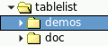 |  | 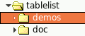 | 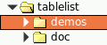 |
| --- | --- | --- | --- | --- | --- |
| `gtk` | `adwaita` | `blueMenta` | `ubuntu` | `ubuntu2` | `ubuntu3` |
|  | 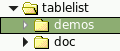 |  | 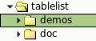 | 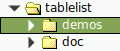 |  |
| `mint` | `mint2` | `mate` | `menta` | `ubuntuMate` | `yuyo` |
| 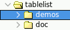 |  | 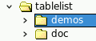 |  |  | 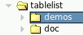 |
| `arc` | `oxygen1` | `oxygen2` | `klearlooks` | `baghira` | `phase` |
|  |  | 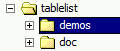 |  | 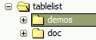 | 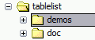 |
| `plastique` | `plastik` | `winnative` | `winxpBlue` | `winxpOlive` | `winxpSilver` |
| 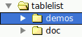 |  |  |  |  |  |
| `aqua` | `vistaAero` | `vistaClassic` | `win7Aero` | `win7Classic` | `win10` |
| 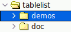 | 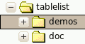 | 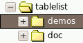 | 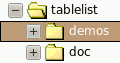 |  | 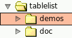 |
| `aqua11` | `ambiance` | `dust` | `dustSand` | `radiance` | `newWave` |

The sizes used by the tree styles `vistaAero`, `vistaClassic`, `win7Aero`, `win7Classic`, and `win10` are *automatically* adapted to the display's scaling percentage.  The same holds true for `aqua11` in the presence of SVG support.

Platform-independent *manual* scaling is supported for the following tree styles:

| 100 % | 125 % | 150 % | 175 % | 200 % |
| --- | --- | --- | --- | --- |
|  |  |  |  | 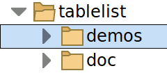 |
| `plain100` | `plain125` | `plain150` | `plain175` | `plain200` |
|  |  |  | 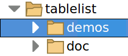 | 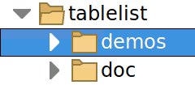 |
| `bicolor100` | `bicolor125` | `bicolor150` | `bicolor175` | `bicolor200` |
| 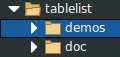 |  | 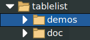 |  |  |
| `white100` | `white125` | `white150` | `white175` | `white200` |

If the tree style is `gtk`, `adwaita`, `blueMenta`, `ubuntu`, `ubuntu2`, `ubuntu3`, `mint`, `mint2`, `mate`, `menta`, `ubuntuMate`, `arc`, `oxygen2`, `aqua`, `vistaAero`, `win7Aero`, `win10`, `newWave`, `plain*`, `bicolor*`, `white*`, or `classic*`, and the Tk version is either at least 8.6 (with built-in PNG support) or 8.5 and the `img::png` package can be loaded into the interpreter, then the images used for displaying the expand/collapse controls are PNG images with alpha channel.  Otherwise (i.e., for the other tree styles shown in the first table above or in the absence of PNG support) GIF images are used for the expand/collapse controls.

If the Tk version is either at least 8.7 (with built-in SVG support), or 8.6 and the tksvg extension can be loaded into the interpreter, then Tablelist supports the additional tree styles `plain`, `bicolor`, `white`, and `classic`, which are quite similar to the styles `plain*`, `bicolor*`, `white*`, and `classic*`, respectively, except that they use SVG images whose sizes are *automatically* adapted to the display's DPI scaling level and Tk's scaling factor given by  `[tk scaling]`.  These unlimitedly scalable tree styles come in handy especially when running Androwish on a tablet or smartphone.

The following table contains a detailed description of the tree styles, in alphabetical order:

| Value | Screenshot | Comments |
| --- | --- | --- |
| `adwaita` |  | Inspired by the GTK 3 theme Adwaita. |
| `ambiance` |  | Inspired by the GTK 2 theme Ambiance.  Recommended to be used with large fonts and images. |
| `aqua` |  |   Tablelist:  Default for the windowing system aqua on Mac OS X. Tablelist_tile:  Default for the themes aqua on Mac OS X and Aquativo.   |
| `aqua11` |  |  When posssible, uses SVG images that scale automatically, according to the display's real scaling percentage.     Tablelist:  Default for the windowing system aqua on macOS 11+. Tablelist_tile:  Default for the aqua theme on macOS 11+.   |
| `arc` |  | Inspired by the Arc icon theme (of the GTK 2/3 theme Arc). |
| `baghira` |  |   Tablelist_tile:  Default for the Qt styles baghira, cde, and motif within the tileqt theme.  Also used by some flavors of qtcurve.   |
| `bicolor` |  |  Uses SVG images that scale automatically, according to the display's real scaling percentage.     Tablelist_tile:  Default for the themes breeze, awbreeze, awlight, awwinxpblue, and sun-valley-light, if SVG support is available.   |
| `bicolor100`,    . . .    `bicolor200` |  |  While the tree style `bicolor100` uses "normal" sizes, the four other styles are suitable for use with large fonts and images (needed on high-resolution displays).     Tablelist_tile:  Default for the themes breeze, awbreeze, awlight, awwinxpblue, and sun-valley-light, in the absence of SVG support.   |
| `classic` |  |  Uses SVG images that scale automatically, according to the display's real scaling percentage.     Tablelist_tile:  Default for the themes arc, awarc, and droid, if SVG support is available.   |
| `classic100`,    . . .    `classic200` | 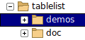 |  While the tree style `classic100` uses "normal" sizes, the four other styles are suitable for use with large fonts and images (needed on high-resolution displays).     Tablelist_tile:  Default for the themes arc, awarc, and droid, in the absence of SVG support.   |
| `blueMenta` |  | Inspired by the GTK 3 theme BlueMenta of versions 1.14 and later of the MATE desktop. |
| `dust` |  | Inspired by the GTK 2 theme Dust.  Recommended to be used with large fonts and images. |
| `dust` |  | Inspired by the GTK 2 theme Dust.  Recommended to be used with large fonts and images. |
| `dustSand` |  | Inspired by the GTK 2 theme Dust Sand.  Recommended to be used with large fonts and images. |
| `gtk` |  |   Tablelist:  Default for the windowing system x11. Tablelist_tile:  Default for the themes alt, blue, clam, classic, clearlooks, default, kroc, sriv, srivlg, and step, as well as for the Qt style gtk+ within the tileqt theme.   |
| `klearlooks` |  |  Inspired by the KDE 4 style Klearlooks.     Tablelist_tile:  Default for the Qt style qtcurve within the tileqt theme.   |
| `mate` |  | Inspired by a few GTK 2 themes of versions earlier than 1.14 of the MATE desktop. |
| `menta` |  | Inspired by the GTK 3 theme Menta of versions 1.14 and later of the MATE desktop. |
| `mint` |  | Inspired by a few GTK 3 themes bundled with versions earlier than 18 of the Linux Mint distribution. |
| `mint2` |  | Inspired by a few GTK 3 themes bundled with versions 18 and later of the Linux Mint distribution. |
| `newWave` |  | Inspired by the GTK 2 theme New Wave.  Recommended to be used with large fonts and images. |
| `oxygen1` |  | Inspired by the KDE 4 style Oxygen. |
| `oxygen2` |  |   Tablelist_tile:  Default for the Qt style oxygen within the tileqt theme.   |
| `phase` |  |   Tablelist_tile:  Default for the Qt style phase within the tileqt theme.   |
| `plain` | 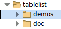 |  Uses SVG images that scale automatically, according to the display's real scaling percentage.     Tablelist_tile:  Default for the awclearlooks theme, if SVG support is available.   |
| `plain100`,    . . .    `plain200` |  |  While the tree style `plain100` uses "normal" sizes, the four other styles are suitable for use with large fonts and images (needed on high-resolution displays).     Tablelist_tile:  Default for the awclearlooks theme, in the absence of SVG support.   |
| `plastik` |  |   Tablelist_tile:  Default for the plastik theme and the Qt style plastik within the tileqt theme.   |
| `plastique` |  |   Tablelist_tile:  Default for the Qt style plastique within the tileqt theme.   |
| `radiance` |  | Inspired by the GTK 2 theme Radiance.  Recommended to be used with large fonts and images. |
| `ubuntu` |  | Inspired by a couple of GTK 3 themes bundled with versions earlier than 15.04 of the Ubuntu Linux distribution. |
| `ubuntu2` |  | Inspired by a couple of GTK 3 themes bundled with versions 15.04 – 16.04 of the Ubuntu Linux distribution. |
| `ubuntu3` |  | Inspired by a couple of GTK 3 themes bundled with versions 16.10 and later of the Ubuntu Linux distribution. |
| `ubuntuMate` |  | Inspired by the themes Ambiant-MATE and Radiant-MATE, bundled with versions 16.10 and later of the Ubuntu MATE distribution and noticeably improved in Ubuntu MATE 20.04. |
| `vistaAero` |  |   Tablelist:  Default for the windowing system win32 on Windows Vista. Tablelist_tile:  Default for the vista theme on Windows Vista with the Aero style.   |
| `vistaClassic` |  |   Tablelist:  Default for the windowing system win32 on Windows Vista with the Windows Classic style. Tablelist_tile:  Default for the vista theme on Windows Vista with the Windows Classic style.   |
| `white` |  |  Uses SVG images that scale automatically, according to the display's real scaling percentage.     Tablelist_tile:  Default for the themes black, awblack, breeze-dark, awbreezedark, awdark, and sun-valley-dark, if SVG support is available.   |
| `white100`,    . . .    `white200` |  |  While the tree style `white100` uses "normal" sizes, the four other styles are suitable for use with large fonts and images (needed on high-resolution displays).     Tablelist_tile:  Default for the themes black, awblack, breeze-dark, awbreezedark, awdark, and sun-valley-dark, in the absence of SVG support.   |
| `win7Aero` |  |   Tablelist:  Default for the windowing system win32 on Windows 7 and 8. Tablelist_tile:  Default for the vista theme on Windows 7 and 8, with the Aero style.   |
| `win7Classic` |  |   Tablelist:  Default for the windowing system win32 on Windows 7 and 8 with the Windows Classic style. Tablelist_tile:  Default for the vista theme on Windows 7 and 8 with the Windows Classic style.   |
| `win10` |  |   Tablelist:  Default for the windowing system win32 on Windows 10+. Tablelist_tile:  Default for the vista theme on Windows 10+.   |
| `winnative` |  |   Tablelist:  Default for the windowing system win32 on Windows 2000 and Windows XP with the Windows Classic style. Tablelist_tile:  Default for the themes keramik, keramik_alt, winnative, and xpnative with the Windows Classic style, as well as for most Qt styles within the tileqt theme.   |
| `winxpBlue` |  |   Tablelist:  Default for the windowing system win32 on Windows XP with the Blue color scheme. Tablelist_tile:  Default for the original winxpblue theme and the xpnative theme on Windows XP with the Blue color scheme.   |
| `winxpOlive` |  |   Tablelist:  Default for the windowing system win32 on Windows XP with the Olive Green color scheme. Tablelist_tile:  Default for the xpnative theme on Windows XP with the Olive Green color scheme.   |
| `winxpSilver` |  |   Tablelist:  Default for the windowing system win32 on Windows XP with the Silver color scheme. Tablelist_tile:  Default for the xpnative theme on Windows XP with the Silver color scheme.   |
| `yuyo` |  | Inspired by the GTK 2 theme Yuyo on Ubuntu MATE. |


|   |   |
| --- | --- |
| Command-Line Name:  | `-width` |
| Database Name: | ` width` |
| Database Class: | ` Width` |

Specifies the desired width for the window, in average-size characters of the widget's font.  If zero or less then the desired width for the window is made just large enough to hold all the columns in the tablelist widget.

**REMARK:**  If the value of this configuration option is zero or less and the tablelist has stretchable columns, then the `-setgrid` option will be ignored.  This minor restriction has technical reasons and is only relevant on X11.


|   |   |
| --- | --- |
| Command-Line Name:  | `-xmousewheelwindow` |
| Database Name: | ` xMouseWheelWindow` |
| Database Class: | ` MouseWheelWindow` |

This option is only relevant if the mouse wheel and `<TouchpadScroll>` events are reported to the widget under the pointer rather than to the one having the focus.  This condition is fulfilled on X11 (for the mouse wheel events) and Mac OS X/11+, and for Tk 8.6b2 and later on Windows, too (in earlier Tk versions the mouse wheel events on Windows were sent to the widget having the focus).

The `-xmousewheelwindow` option specifies the path name of the window to which the default bindings for the binding tags `TablelistBody` and `TablelistEdit` should redirect the mouse wheel and `<TouchpadScroll>` events along the x axis via  `event generate`  if the focus window on the display containing the tablelist widget is outside the tablelist.  The default is an empty string, meaning that the mouse wheel and `<TouchpadScroll>` events along the x axis received by a widget having one of the two above-mentioned binding tags will give rise to horizontal scrolling of the tablelist or its edit window, regardless of whether the focus is inside or outside the tablelist widget.

**REMARK 1:**  The set of mouse wheel events along the horizontal axis depends on the Tk version and partly on the windowing system:

  - *In Tk versions prior to 8.7a4*, the mouse wheel events along the horizontal axis are `<Shift-MouseWheel>` on Windows, `<Shift-MouseWheel>` and `<Shift-Option-MouseWheel>` on Mac OS X/11+, and `<Shift-MouseWheel>`, `<Shift-Button-4>` and `<Shift-Button-5>` on X11 (where `<Shift-MouseWheel>` is not triggered by the X server, but can be produced using  `event generate`).  On X11, when using Tk 8.7a3, there are two more mouse wheel events along the horizontal axis: `<Button-6>` and `<Button-7>`, which are handled just like `<Shift-Button-4>` and `<Shift-Button-5>`, respectively.  These events are commonly triggered by left/right tilting the scroll wheel of a mouse having one or two additional (thumb) buttons.  (In Tk versions 8.6.x, with x >= 10, left/right tilting the scroll wheel of such a mouse gives rise to `<Shift-MouseWheel>` events on Windows and Mac OS X/11+, and to `<Shift-Button-4>` and `<Shift-Button-5>` events on X11.)
  - *In Tk versions 8.7a4 and later*, the mouse wheel events along the horizontal axis are `<Shift-MouseWheel>` and `<Shift-Option-MouseWheel>` on all windowing systems, where the `Option` modifier is bound to the `Option` key on Mac OS X/11+ and to the `Alt` key on Windows and X11.  In these Tk versions, left/right tilting the scroll wheel of a mouse having one or two additional (thumb) buttons gives rise to `<Shift-MouseWheel>` (and `<Shift-Option-MouseWheel>`) events on all windowing systems.

**REMARK 2:**  If the tablelist is contained in a scrollable widget container like a [scrollutil::scrollableframe](https://www.nemethi.de/scrollutil/scrollableframe.html), BWidget ScrollableFrame, or iwidgets::scrolledframe, and you set this option to the path name of the containing toplevel widget, then a horizontal mouse wheel or `<TouchpadScroll>` event over the tablelist's body will be handled as follows:

  - If the focus is inside the tablelist widget then the event will scroll the tablelist or its edit window horizontally and no further processing of the event will take place.
  - If the focus is outside the tablelist widget then no scrolling of the tablelist's body or edit window will happen.  Instead, the event will be redirected to the toplevel widget with the aid of the  `event generate`  command.  This in turn will give rise to horizontal scrolling of the widget container, provided that the containing toplevel widget or the binding tag `all` has the necessary mouse wheel or `<TouchpadScroll>` event bindings.

**REMARK 3:**  If you pass the tablelist widget to the `scrollutil::adaptWheelEventHandling` command without the `-ignorefocus` switch then that command will set this option to the path name of the containing toplevel window.


|   |   |
| --- | --- |
| Command-Line Name:  | `-ymousewheelwindow` |
| Database Name: | ` yMouseWheelWindow` |
| Database Class: | ` MouseWheelWindow` |

This option is only relevant if the mouse wheel and `<TouchpadScroll>` events are reported to the widget under the pointer rather than to the one having the focus.  This condition is fulfilled on X11 (for the mouse wheel events) and Mac OS X/11+, and for Tk 8.6b2 and later on Windows, too (in earlier Tk versions the mouse wheel events on Windows were sent to the widget having the focus).

The `-ymousewheelwindow` option specifies the path name of the window to which the default bindings for the binding tags `TablelistBody` and `TablelistEdit` should redirect the mouse wheel and `<TouchpadScroll>` events along the y axis via  `event generate`  if the focus window on the display containing the tablelist widget is outside the tablelist.  The default is an empty string, meaning that the mouse wheel and `<TouchpadScroll>` events along the y axis received by a widget having one of the two above-mentioned binding tags will give rise to vertical scrolling of the tablelist or its edit window, regardless of whether the focus is inside or outside the tablelist widget.

**REMARK 1:**  The set of mouse wheel events along the vertical axis depends on the Tk version and partly on the windowing system:

  - *In Tk versions prior to 8.7a4*, the mouse wheel events along the vertical axis are `<MouseWheel>` on Windows, `<MouseWheel>` and `<Option-MouseWheel>` on Mac OS X/11+, and `<MouseWheel>`, `<Button-4>` and `<Button-5>` on X11 (where `<MouseWheel>` is not triggered by the X server, but can be produced using  `event generate`).
  - *In Tk versions 8.7a4 and later*, the mouse wheel events along the vertical axis are `<MouseWheel>` and `<Option-MouseWheel>` on all windowing systems, where the `Option` modifier is bound to the `Option` key on Mac OS X/11+ and to the `Alt` key on Windows and X11.

**REMARK 2:**  If the tablelist is contained in a scrollable widget container like a [scrollutil::scrollableframe](https://www.nemethi.de/scrollutil/scrollableframe.html), BWidget ScrollableFrame, or iwidgets::scrolledframe, and you set this option to the path name of the containing toplevel widget, then a vertical mouse wheel or `<TouchpadScroll>` event over the tablelist's body will be handled as follows:

  - If the focus is inside the tablelist widget then the event will scroll the tablelist or its edit window vertically and no further processing of the event will take place.
  - If the focus is outside the tablelist widget then no scrolling of the tablelist's body or edit window will happen.  Instead, the event will be redirected to the toplevel widget with the aid of the  `event generate`  command.  This in turn will give rise to vertical scrolling of the widget container, provided that the containing toplevel widget or the binding tag `all` has the necessary mouse wheel or `<TouchpadScroll>` event bindings.

**REMARK 3:**  If you pass the tablelist widget to the `scrollutil::adaptWheelEventHandling` command without the `-ignorefocus` switch then that command will set this option to the path name of the containing toplevel window.

**COLUMN CONFIGURATION OPTIONS**
: The following options are currently supported by the `columncget`, `columnconfigure`, `configcolumnlist`, and `configcolumns` commands:


`-align alignment`
: Specifies how to align the body and header elements of the column.  It must be one of `left`, `right`, or `center`.  This option also refers to the column's title if the `-labelalign` option hasn't been specified for the given column, or if its value is an empty string.  The `-align` option is tied to the `alignment` element corresponding to this column in the list specifying the value of the `-columns` option for the tablelist widget; changes in either will automatically be reflected in the other.

`-allowduplicates boolean`
: Specifies whether the interactive cell editing will enable the user to set the text of a cell within this column to the text of some other cell of the column. The default is `1`.  The value of this option has also an impact on the key bindings designed for terminating the editing and copying the new cell value to some other cells of the column:  If the option's value is false then none of these actions will be performed.

`-background color` or `-bg color`
: Specifies the normal background color to use when displaying the content of the column in both the body and the header.

`-changesnipside boolean`
: Specifies whether to override the alignment-specific default position of the snip indicator when displaying the body and header elements of the column (excluding its title).  The default value is `0`, meaning that the snip string will be appended to the elements if the column's alignment is `left` or `center` and prepended to them in case the alignment is `right`.

 `-changetitlesnipside boolean`
: Specifies whether to override the alignment-specific default position of the snip indicator when displaying the column's title.  The default value is `0`, meaning that the snip string will be appended to the title if the column's alignment is `left` or `center` and prepended to it in case the alignment is `right`.

`-editable boolean`
: Specifies whether the elements of the column in the tablelist's body can be edited interactively.  The default value is `0`.  The value of this option can be overridden for individual cells by using the [cell configuration option](#detailed-reference) of the same name.

: **REMARK:**  The support for interactive editing is restricted to the widget's body component

`-editwindow name`
: Specifies the type of the temporary embedded widget to be used for interactive editing of the contents of the given column's body cells.  `name` may be one of `entry` (which is the default), `text`, `spinbox`, `checkbutton`, `menubutton`, `ttk::entry`, `ttk::spinbox`, `ttk::combobox`, `ttk::checkbutton`, or `ttk::menubutton` (the latter five only in the presence of the tile widget engine), or the value returned by one of the registration commands for widgets from the packages [BWidget](tablelistBWidget.md), [Iwidgets](tablelistIwidgets.md), [combobox](tablelistCombobox.md) (by Bryan Oakley), [ctext](tablelistCtext.md), [Mentry (or Mentry_tile)](tablelistMentry.md), and [Tsw](tablelistTsw.md).  For example, you can use  `-editwindow ComboBox`  *after* registering the ComboBox widget for interactive cell editing with the aid of the `tablelist::addBWidgetComboBox` command.  Similarly, you can use  `-editwindow combobox`  *after* registering Bryan Oakley's combobox widget for interactive cell editing by invoking the `tablelist::addOakleyCombobox` command.  The value of this option can be overridden for individual cells by using the [cell configuration option](#detailed-reference) of the same name.

`-font font`
: Specifies the font to use when displaying the content of the column in both the body and the header.

`-foreground color` or `-fg color`
: Specifies the normal foreground color to use when displaying the content of the column in both the body and the header.

`-formatcommand command`
: Specifies a Tcl command to be invoked when displaying the content of a body or header cell within this column or adding a body cell's content to the selection when the latter is being exported.  If `command` is a nonempty string then it is automatically concatenated with the cell's text, the resulting script is evaluated in the global scope, and the return value is displayed in the cell or added to the selection instead of the original data.

: For example, if a time value in seconds is being inserted into the cell and `command` is the procedure `formatDate` defined as


```
proc formatDate clockVal {
    return [clock format $clockVal -format "%Y-%m-%d"]
}
```

: then the text displayed in the cell will be the date in the specified format, not the time value in seconds.

: This option is also used by Tablelist when building the return values of the `getformatted`, `getformattedcolumns`, and `getformattedcells` subcommands, as well as their header-related counterparts, or searching for a text pattern passed to the `searchcolumn` subcommand with the `-formatted` option.  All the other subcommands, notably `get`, `getcolumns`, `getcells`, `rowcget`, along with their counterparts for the header, `columncget`, `cellcget`, along with the latter's header-related counterpart, `sort`, `sortbycolumn`, `sortbycolumnlist`, and `refreshsorting` operate on the original cell text, which is contained in the widget's internal list.  In the case of the above example, this will make it possible to sort the items quite easily by time, with a second's precision, even if their visual representation only contains the year, month, and day.

: The `-formatcommand` option comes in handy if only images or embedded windows are to be displayed in a column but the texts associated with the cells may not simply be empty strings because they are needed for other purposes (like sorting or editing).  In such cases, a procedure returning an empty string can be used as the option's value, thus making sure that the textual information contained in that column remains hidden:


```
proc emptyStr val { return "" }
```

: Another important use case is related to tablelist columns whose `-sortmode` option was set to `integer` or `real`.  If some of the cells of such a column are empty then an attempt to sort the items by that column via `sortbycolumn` or `sortbycolumnlist` would generate an error, because the  `lsort -integer`  or  `lsort -real`  invocation made by Tablelist would complain about getting an unexpected empty string instead of an integer or floating-point number.  To avoid this, make sure that the cells intended to display an empty string have as internal value a number that is either strictly less or strictly greater than all the other integer or real numbers contained in the column in question, and use the `-formatcommand` option to control what will be displayed in the column's cells.  For example, if all the elements of the column are nonnegative values then you can use the number `-1` as internal value for the cells that should display an empty string, and set the value of the `-formatcommand` option to `formatNumber`, where `formatNumber` is the procedure implemented as follows:


```
proc formatNumber val { return [expr {$val == -1 ? "" : $val}] }
```

: This will make the cells displaying an empty string appear before all the others when sorting the column in increasing order.  To achieve the opposite effect, you will have to replace the `-1` with an application-specific value that is strictly greater than all the other numbers contained in the column in question.

: The demo scripts included in the Tablelist distribution contain further examples demonstrating the use of this option.  The most interesting ones are also described in [Tablelist Programmer's Guide](tablelist.md).

: In the more sophisticated case that the result of the formatting should also depend on the cell's row, you will have to invoke the `formatinfo` subcommand, which provides the necessary information about the cell whose content is being formatted.

: Due to the `-formatcommand` column configuration option, we will distinguish between the internal value of a tablelist element and its **formatted** version.  The latter is the result of the invocation of the script corresponding to the `-formatcommand` option of the element's column, or the element itself if this option was not set for that column.  Consequently, the formatted version of a tablelist item is a list comprised of the formatted elements of the original item.

`-hide boolean`
: Specifies whether to hide the column when displaying the widget or exporting its selection.  The default value is `0`.  After toggling the hidden state of a column, the `<<TablelistColHiddenStateChanged>>` virtual event is generated, with its `-data` option set to the numerical column index for Tk versions 8.5 and higher.

`-labelalign alignment`
: Specifies how to align the column's title.  It must be one of `left`, `right`, or `center`, or an empty string.  If this option hasn't been specified for the given column, or if its value is an empty string, then the header title will have the same alignment as the elements of the column, as given by the `-align` column configuration option or by the `alignment` element corresponding to this column in the list specifying the value of the `-columns` global option.

`-labelbackground color` or `-labelbg color`  
 `-labelborderwidth screenDistance` or `-labelbd screenDistance`  
 `-labelcommand command`  
 `-labelcommand2 command`  
 `-labelfont fontName`  
 `-labelforeground color` or `-labelfg color`  
 `-labelheight lines`  
 `-labelpady screenDistance`  
 `-labelrelief relief`  
 `-selectfiltercommand command`
: The value of each of these options may also be an empty string.  These options are the column-specific equivalents of the global ones having the same names, described in the [WIDGET-SPECIFIC OPTIONS](#detailed-reference) section.  They override the options of the same names set at widget level if the specified value is not empty.  If one of these options hasn't been specified for the given column, or if its value is an empty string, then that option will not be used at column level; the global option of the same name will be used instead.  The `-labelactivebackground`, `-labelactiveforeground`, and `-labeldisabledforeground` options are only defined at widget level; there are no column configuration options with these names.  The `-labelbackground` and `-labelheight` options are only supported by the Tablelist package, but not by Tablelist_tile.

`-labelimage image`
: Specifies the name of the Tk image to be displayed in the header label.  `image` must be the result of an invocation of the  `image create`  command, or an empty string, specifying that no image is to be displayed.  If the label's text is right-aligned then the image will be displayed to the right of the text, otherwise to its left.  The text and the image are separated from each other by a gap corresponding to the width of a space character in the given label's font.  If for the same column the `-labelwindow` option was specified with a nonempty value then it overrides the `-labelimage` option.

`-labelvalign verticalAlignment`
: Specifies the vertical alignment of the Tk image or window (if any) displayed in the header label.  `verticalAlignment` must be one of `center` (which is the default), `top`, or `bottom`.  Especially if the label contains multi-line text, the embedded image or (ttk::)checkbutton is often not as tall as the text; in such cases, this option enables you to control the column-dependent vertical alignment of the embedded object.

`-labelwindow windowType`
: Specifies the type of the window to be embedded into the header label.  `windowType` must be `checkbutton` or `ttk::checkbutton`, or an empty string, specifying that no embedded window is to be displayed.  If the label's text is right-aligned then the (ttk::)checkbutton widget will be displayed to the right of the text, otherwise to its left.  The text and the (ttk::)checkbutton are separated from each other by a gap corresponding to the width of a space character in the given label's font.  If this option was specified with a nonempty value then it overrides the `-labelimage` column configuration option.

: **REMARK 1:**  The `-variable` option of the (ttk::)checkbutton is set to a global variable whose name is private to Tablelist and whose value is kept when the numerical index of the column changes (due to inserting, deleting, or moving columns).  More precisely:  When the column's numerical index changes then the (ttk::)checkbutton is destroyed and automatically recreated at the new position, with a different variable as the value of its `-variable` option, but the new variable inherits the last value of the old one, thus the (ttk::)checkbutton's check state remains unchanged.

: **REMARK 2:**  An application making use of this column configuration option will commonly retrieve the path name of the (ttk::)checkbutton with the aid of the `labelwindowpath` subcommand and set its `-command` option to a script that manipulates the elements of the column in question depending on the value of the variable associated with the (ttk::)checkbutton.  Since the latter's path and associated variable depend on the column's numerical index, it is strongly recommended to work with column names rather than numerical indices and to repeat this step whenever the `<<TablelistColumnMoved>>` virtual event is sent to the tablelist widget.  The following example is taken from the demo scripts for interactive cell editing:


```
# Configure the "-command" option of the checkbutton embedded into the
# header label of the column "available", and make sure that it will be
# reconfigured whenever any column is moved interactively to a new position
proc configCkbtn {tbl col} {
    set ckbtn [$tbl labelwindowpath $col]
    $ckbtn configure -command [list onCkbtnToggle $tbl $col $ckbtn]
}
proc onCkbtnToggle {tbl col ckbtn} {
    upvar #0 [$ckbtn cget -variable] var
    $tbl fillcolumn $col -text $var
    $tbl fillcolumn $col -image [expr {$var ? "checkedImg" : "uncheckedImg"}]
}
configCkbtn $tbl available
bind $tbl <<TablelistColumnMoved>> { configCkbtn %W available }
```

`-maxwidth width`
: `width` must be a number.  A positive value specifies the column's maximum width in average-size characters of the widget's font.  If `width` is negative, its absolute value is interpreted as a maximum column width in pixels.  Finally, a value of zero (which is the default) specifies that the column's maximum width is to be made just large enough to hold all the elements in the column, including its header.  This option is only relevant if the given column has dynamic width, i.e., if its width was set to `0`.

`-name name`
: Specifies a name associated with the column.  While the numerical index of a column might change by inserting, deleting, or moving columns, its name remains constant and can be used as a safe alternative column index (see the [COLUMN INDICES](#detailed-reference) section for details).  Similarly, it can also be used as the second component of a body cell index of the form `row,col` or a header cell index of the form `headerRow,col`, as described in the [CELL INDICES](#detailed-reference) and [HEADER CELL INDICES](#detailed-reference) sections.  To avoid ambiguities, column names should be different from any other forms of column indices (like numbers, `active`, `anchor`, `end`, `last`, `left`, `right`, or any of their abbreviations).  They should also be different from (any abbreviations of) the string `all`, which may be specified as the value of the `-stretch` configuration option.  The default value is an empty string.

`-resizable boolean`
: Specifies whether the column can be resized interactively.  See the [DEFAULT AND INDIVIDUAL BINDINGS FOR THE HEADER LABELS](#detailed-reference) section for information on interactive column resizing.  The default value is `1`.  This option is only relevant if the value of the `-resizablecolumns` widget configuration option is true.

`-selectbackground color`
: Specifies the background color to use when displaying the content of a body cell in the given column while the cell is selected.

`-selectforeground color`
: Specifies the foreground color to use when displaying the content of a body cell in the given column while the cell is selected.

`-showarrow boolean`
: Specifies whether the `sortbycolumn` command with the given column index as first argument and the `sortbycolumnlist` command having the given column index as element of its first argument should place an arrow indicating the sort order into the column's label.  The default value is `1`.  This option is only relevant if the value of the `-showarrow` widget configuration option is true.

`-showlinenumbers boolean`
: Specifies whether the body part of the given column should display the line numbers (starting with 1 and ending with the number of the non-hidden rows).  The default value is `0`.

: The following details assume that the given column's `-showlinenumbers` option was set to true:  Associating the line numbers with the non-hidden rows takes place automatically whenever body items are inserted, deleted, updated, moved, or sorted, or their `-hide` option is toggled.  For increased efficiency, this is done at idle time.  For example, if several items are inserted into or deleted from the body of a tablelist widget, then the necessary renumbering of the non-hidden rows will be performed as an idle callback, the next time the event loop is entered and there are no events to process.  The line numbers will override any previous contents of the column's cells.  They are, per default, displayed without leading zeros, but this (and the display format in general) can be changed with the aid of the `-formatcommand` column configuration option.

: The `sortbycolumn` and `sortbycolumnlist` subcommands as well as the `tablelist::sortByColumn` and `tablelist::addToSortColumns` commands check the column indices passed to them as arguments and don't perform any sorting by those columns that have been configured to display the line numbers (see the corresponding descriptions for details).

: **REMARK:**  Please note that the line numbers refer to the *non-hidden* rows, which in case of a tablelist used as a tree widget might be different from the [viewable](#detailed-reference) ones.  Consequently, collapsing a row will, in general, not lead to renumbering the lines (instead, it will just elide the corresponding range of line numbers).

`-sortcommand command`
: This option is only relevant if the value of the `-sortmode` option for the given column is `command`.  It specifies a command to be used for the comparison of the column's elements when invoking the `sortbycolumn` command with the given column index as first argument or the `sortbycolumnlist` command having the given column index as element of its first argument.  To compare two elements during the `sortbycolumn` or `sortbycolumnlist` operation, `command` is automatically concatenated with the two elements and the resulting script is evaluated.  The script should return an integer less than, equal to, or greater than zero if the first element is to be considered less than, equal to, or greater than the second, respectively.

`-sortmode mode`
: Specifies how to compare the column's elements when invoking the `sortbycolumn` command with the given column index as first argument or the `sortbycolumnlist` command having the given column index as element of its first argument.  `mode` may have any of the following values:


|   |   |
| --- | --- |
| `ascii` | Use string comparison with Unicode code-point collation order (the name is for backward-compatibility reasons).  This is the default. |
| `asciinocase  ` | This is the same as `ascii`, except that comparisons are handled in a case-insensitive manner. |
| `command` | Use the command specified by the `-sortcommand` column configuration option to compare the column's elements. |
| `dictionary` | Use dictionary-style comparison.  This is the same as `ascii`, except: (a) case is ignored except as a tie-breaker; (b) if two strings contain embedded numbers, the numbers compare as integers, not characters.  For example, `bigBoy` sorts between `bigbang` and `bigboy`, and `x10y` sorts between `x9y` and `x11y`. |
| `integer` | Convert the elements to integers and use integer comparison.  If any of the elements cannot be converted to an integer (e.g., because it is an empty string) then a sort attempt will generate an error.  See the description of the `-formatcommand` option for the recommended way to avoid this problem. |
| `real` | Convert the elements to floating-point values and use floating-point comparison.  If any of the elements cannot be converted to a floating-point value (e.g., because it is an empty string) then a sort attempt will generate an error.  See the description of the `-formatcommand` option for the recommended way to avoid this problem. |

`-stretchable boolean`
: Specifies whether the column is to be stretched in order to fill the tablelist window if necessary.  The value of this option is tied to that of the `-stretch` option for the tablelist widget; changes in either will automatically be reflected in the other.

`-stretchwindow boolean`
: Specifies whether the widths of the windows embedded into the column's body and header cells shall be adapted dynamically to the column's width if the latter is non-zero (i.e., static).  The default value is `0`.  If the value of this option is true and the column was specified with a non-zero width or was resized interactively, then the widths of its embedded windows (if any) will be adjusted automatically so the windows fill the whole horizontal space belonging to the column (except the left and right margins).  Please note that in this case the texts of the column's cells will remain hidden.  On the other hand, if the column is of dynamic width then this option will be ignored and both its texts and its embedded windows (if any) will be displayed as usual.  The easiest way to avoid this discrepancy is to set the column's texts to empty strings or make sure that its elements are always displayed as empty strings, by using the `-formatcommand` column configuration option.  The value of this option can be overridden for individual cells by using the [cell configuration option](#detailed-reference) of the same name.

`-stripebackground color`
: Specifies the background color to use when displaying the content of a body cell in the given column if the cell's row belongs to a stripe.

`-stripeforeground color`
: Specifies the foreground color to use when displaying the content of a body cell in the given column if the cell's row belongs to a stripe.

`-text list`
: Specifies a list of strings to be displayed in the body cells of the given column, i.e., updates the elements contained in the column's body part.  If the tablelist's `state` is `disabled` then no update is performed.

`-title title`
: Specifies the text to be displayed in the column's header label.  This option is tied to the `title` element corresponding to the given column in the list specifying the value of the `-columns` option for the tablelist widget; changes in either will automatically be reflected in the other.

`-valign verticalAlignment`
: Specifies the vertical alignment of embedded images and windows displayed in the body and header cells of the given column.  The `verticalAlignment` must be one of `center` (which is the default), `top`, or `bottom`.  Especially in rows containing multi-line elements, embedded images or windows are often not as tall as the rows themselves; in such cases, this option enables you to control the column-dependent vertical alignment of these embedded objects.  The value of this option can be overridden for individual cells by using the [cell configuration option](#detailed-reference) of the same name.

`-width width`
: `width` must be a number.  A positive value specifies the column's width in average-size characters of the widget's font.  If `width` is negative, its absolute value is interpreted as a column width in pixels.  Finally, a value of zero specifies that the column's width is to be made just large enough to hold all the elements in the column, including its header (but no larger than the maximum width indicated by the `-maxwidth` column configuration option).  This option is tied to the `width` element corresponding to the given column in the list specifying the value of the `-columns` option for the tablelist widget; changes in either will automatically be reflected in the other.

`-windowdestroy command`
: Specifies a Tcl command to be invoked when a window embedded into a body or header cell of the column is destroyed.  Provided that `command` is a nonempty string, it is automatically concatenated with the path name of the tablelist widget, the cell's row and column indices, as well as the path name of the embedded window, and the resulting script is evaluated in the global scope.  This option provides an easy-to-use alternative to binding a script to the `<Destroy>` event of the column's embedded windows from within their creation scripts, specified as the value of the `-window` cell configuration option.  The value of this option can be overridden for individual cells by using the [cell configuration option](#detailed-reference) of the same name.

`-windowupdate command`
: Specifies a Tcl command responsible for adapting the background and foreground colors of a window embedded into a body or header cell of the column to the current background and foreground colors of the cell itself.  The current cell colors depend on whether the tablelist widget's `state` is `normal` or `disabled`, whether the cell is selected, and whether its row is displayed with the colors specified by the `-stripebackground` and `-stripeforeground` widget or column configuration options.  Provided that `command` is a nonempty string, it is automatically concatenated with the path name of the tablelist widget, the cell's row and column indices, the path name of the embedded window, the option name `-background` and the cell's current background color, as well as the option name `-foreground` and the cell's current foreground color.  The resulting script is then evaluated in the global scope.  The specified command can use the colors passed to it as arguments to set the corresponding colors of the embedded window to the same values.

: For example, if the embedded window is a text or ctext widget and you want for its background and foreground colors to be automatically adapted to the cell's current background and foreground colors, then you can achieve this by setting the `-windowupdate` option to `updateWindow`, where the latter is the procedure implemented as follows:


```
proc updateWindow {tbl row col w args} {
    eval [list $w configure] $args
}
```

: With Tcl/Tk 8.5 or above, you can use the more compact form


```
proc updateWindow {tbl row col w args} {
    $w configure {*}$args
}
```

: In this example, `args` is a list of the form


```
-background backgroundColor -foreground foregroundColor
```

: The value of this option can be overridden for individual cells by using the [cell configuration option](#detailed-reference) of the same name.

`-wrap boolean`
: Specifies whether to display those body and header elements of the given column that don't fit into their cells in word-wrapped multi-line rather than snipped form.  The default value is `0`.  If the specified column has static width or a nonzero `-maxwidth` value and the value of this option is true, then elements of the column that are too long to be displayed in a single line will be broken up into several lines.  The same applies to the individual lines of the multi-line elements (i.e., elements containing newline characters): they will also be wrapped if necessary, thus giving rise to additional line breaks.  In both cases, the line breaks are chosen at word boundaries wherever possible, and they are only used for the external representation of the strings contained in the given column, without affecting the internal contents of the cells.


: The `-background`, `-font`, `-foreground`, `-selectbackground`, `-selectforeground`, `-stripebackground`, and `-stripeforeground` column configuration options override the options of the same names set at widget level (but not the ones set at cell or row level) if the specified value is not an empty string.  See the [COLORS AND FONTS](#detailed-reference) section for further details on these options.

**ROW CONFIGURATION OPTIONS IN THE TABLELIST BODY**
: The following options are currently supported by the `rowcget`, `rowconfigure`, `configrowlist`, and `configrows` commands:


`-background color` or `-bg color`
: Specifies the normal background color to use when displaying the content of the row.

`-font font`
: Specifies the font to use when displaying the content of the row.

`-foreground color` or `-fg color`
: Specifies the normal foreground color to use when displaying the content of the row.

`-hide boolean`
: Specifies whether to hide the row when displaying the widget or exporting its selection.  The default value is `0`.  After toggling the hidden state of a row, the `<<TablelistRowHiddenStateChanged>>` virtual event is generated, with its `-data` option set to the numerical row index for Tk versions 8.5 and higher.

: **CAUTION:**  Tk versions 8.3 - 8.4.12 had a bug that caused a segmentation fault if the whole content of a text widget was elided.  This bug was also present in Tk 8.5a1 - 8.5a3.  When using one of these earlier Tk versions, this bug will produce a crash if all the rows of a tablelist widget are hidden.  It is your responsibility to avoid such situations when using a Tk version having this bug!

`-name name`
: Specifies a name associated with the row.  While the numerical index of a row might change by inserting, deleting, or moving rows, or by sorting the items, its name remains constant and can be used as a safe alternative row index (see the [ROW INDICES](#detailed-reference) section for details).  Similarly, it can also be used as the first component of a cell index of the form `row,col`, as described in the [CELL INDICES](#detailed-reference) section.  To avoid ambiguities, row names should be different from any other forms of row indices (like numbers, full keys, `active`, `anchor`, `end`, `last`, `top`, `bottom`, or any of their abbreviations).  The default value is an empty string.

`-selectable boolean`
: Specifies whether the elements displayed in the given row can be selected.  The default value is `1`.  If the value `0` was given then any attempt to select the item contained in this row with the aid of the  `selection set`  widget command or any of its elements by using the  `cellselection set`  command will be silently ignored; moreover, an existing old (cell) selection is removed from the row.

`-selectbackground color`
: Specifies the background color to use when displaying the content of a cell in the given row while the cell is selected.

`-selectforeground color`
: Specifies the foreground color to use when displaying the content of a cell in the given row while the cell is selected.

`-text list`
: Specifies a list of strings to be displayed in the cells of the given row, i.e., updates the item contained in the row.  If the tablelist's `state` is `disabled` or the new item equals the old one then no update is performed.


: The `-background`, `-font`, `-foreground`, `-selectbackground`, and `-selectforeground` row configuration options override the options of the same names set at column or widget level (but not the ones set at cell level) if the specified value is not an empty string.  See the [COLORS AND FONTS](#detailed-reference) section for further details on these options.

**ROW CONFIGURATION OPTIONS IN THE TABLELIST HEADER**
: The following options are currently supported by the  `header rowcget`,  `header rowconfigure`,  `header configrowlist`,  and  `header configrows`  commands:


`-background color` or `-bg color`
: Specifies the background color to use when displaying the content of the header row.

`-font font`
: Specifies the font to use when displaying the content of the header row.

`-foreground color` or `-fg color`
: Specifies the foreground color to use when displaying the content of the header row.

`-name name`
: Specifies a name associated with the header row.  While the numerical index of a header row might change by inserting or deleting header rows, its name remains constant and can be used as a safe alternative header row index (see the [HEADER ROW INDICES](#detailed-reference) section for details).  Similarly, it can also be used as the first component of a header cell index of the form `headerRow,col`, as described in the [HEADER CELL INDICES](#detailed-reference) section.  To avoid ambiguities, header row names should be different from any other forms of header row indices (like numbers, full keys, `end`, `last`, or any of their abbreviations).  The default value is an empty string.

`-text list`
: Specifies a list of strings to be displayed in the cells of the given header row, i.e., updates the item contained in the header row.  If the tablelist's `state` is `disabled` or the new item equals the old one then no update is performed.


: The `-background`, `-font`, and `-foreground` header row configuration options override the options of the same names set at column or widget level (but not the ones set at header cell level) if the specified value is not an empty string.  See the [COLORS AND FONTS](#detailed-reference) section for further details on these options.

**CELL CONFIGURATION OPTIONS IN THE TABLELIST BODY**
: The following options are currently supported by the `cellcget`, `cellconfigure`, `configcelllist`, and `configcells` commands:


`-background color` or `-bg color`
: Specifies the normal background color to use when displaying the content of the cell.

`-editable boolean`
: Specifies whether the content of the cell can be edited interactively.  The default value is `0`.  This option overrides [the one of the same name](#detailed-reference) for the column containing the given cell if the specified value is not an empty string (which is explicitly allowed).

`-editwindow name`
: Specifies the type of the temporary embedded widget to be used for interactive editing of the cell's content.  The default value is `entry`.  This option overrides [the one of the same name](#detailed-reference) for the column containing the given cell if the specified value is not an empty string (which is explicitly allowed).

`-font font`
: Specifies the font to use when displaying the content of the cell.

`-foreground color` or `-fg color`
: Specifies the normal foreground color to use when displaying the content of the cell.

`-image image`
: Specifies the name of the Tk image to be displayed in the cell.  `image` must be the result of an invocation of the  `image create`  command, or an empty string, specifying that no image is to be displayed.  If the column containing the cell is right-aligned then the image will be displayed to the right of the cell's text, otherwise to its left.  The text and the image are separated from each other by a gap of 4 pixels, scaled according to the display's real scaling percentage.  If for the same cell the `-window` option was specified with a nonempty value then it overrides the `-image` option.  If the tablelist's `state` is `disabled` or the new image name equals the old one then no update of the cell's image is performed.

: To display an image in a cell, Tablelist makes use of an embedded label widget (which is created on demand).  This has the main advantage of making it possible to adjust the width of the label containing the image to fit into its column.  This has the visual effect of cutting off part of the image from its right side.  The above-mentioned gap to the left or right of the image is also part of this label.  To make sure that an image with fully or partially transparent background will be displayed correctly, the background color of the label widget containing the embedded image is automatically synchronized with the cell's background color whenever necessary (e.g., when selecting or deselecting the cell's content, or changing its background color), provided that the `-imagebackground` option was not set or its value is an empty string.  This automatic color synchronization makes also sure that the gap between the text and the image is displayed in the right color.

 `-imagebackground color`
: Specifies the background color of the label widget containing the embedded image (if any).  If the value of this option is a valid nonempty color specification then the fully transparent pixels of the embedded image will appear in the specified color, and the partially transparent ones will be shown modified according to their alpha value and the image background color.  The default value is an empty string, meaning that the background color of the label widget containing the embedded image will be automatically updated whenever necessary.

: **REMARK:**  This option works fine if the cell's text (or at least the latter's formatted version) is an empty string.  Otherwise there will be a gap between the text and the image, and this gap will appear in the specified image background color if the latter is a nonempty string.

 `-selectbackground color`
: Specifies the background color to use when displaying the content of the cell while it is selected.

 `-selectforeground color`
: Specifies the foreground color to use when displaying the content of the cell while it is selected.

`-stretchwindow boolean`
: Specifies whether the width of the window embedded into the cell shall be adapted dynamically to the width of the cell's column if the latter is non-zero (i.e., static).  The default value is `0`.  If the value of this option is true and the column was specified with a non-zero width or was resized interactively, then the width of the embedded window (if any) will be adjusted automatically so the window fills the whole horizontal space belonging to that column (except the left and right margins).  Please note that in this case the cell's text will remain hidden.  On the other hand, if the column is of dynamic width then this option will be ignored and both the cell's text and its embedded window (if any) will be displayed as usual.  The easiest way to avoid this discrepancy is to set the cell's text to an empty string or make sure that the column's elements are always displayed as empty strings, by using the `-formatcommand` column configuration option.  This option overrides [the one of the same name](#detailed-reference) for the column containing the given cell if the specified value is not an empty string (which is explicitly allowed).

`-text text`
: Specifies the string to be displayed in the given cell, i.e., updates the element contained in the cell.  If the tablelist's `state` is `disabled` or the new cell text equals the old one then no update is performed.

`-valign verticalAlignment`
: Specifies the vertical alignment of the embedded image or window displayed in the cell (if any).  The default value is `center`.  This option overrides [the one of the same name](#detailed-reference) for the column containing the given cell if the specified value is not an empty string (which is explicitly allowed).

`-window command`
: Specifies a Tcl command creating the window to be embedded into the cell.  The command is automatically concatenated with the path name of the tablelist widget, the cell's row and column indices, as well as the path name of the embedded window to be created, and the resulting script is evaluated in the global scope.  `command` may also be an empty string, specifying that no embedded window is to be displayed.  If the column containing the cell is right-aligned then the window will be displayed to the right of the cell's text, otherwise to its left.  The text and the window are separated from each other by a gap of 4 pixels, scaled according to the display's real scaling percentage.  If this option was specified with a nonempty value then it overrides the `-image` cell configuration option.  If the tablelist's `state` is `disabled` then this option will be ignored.

: **REMARK:**  There are several situations where the embedded window will be destroyed and later recreated by invoking the script mentioned above.  For example, when changing the value of some of the tablelist widget or column configuration options, sorting the items, or moving a row or a column, the widget's content will be redisplayed, which makes it necessary to recreate the embedded windows.  This operation won't preserve the changes made on the embedded windows after their creation.  For this reason, you should avoid any changes on embedded windows outside their creation scripts.

`-windowdestroy command`
: Specifies a Tcl command to be invoked when a window embedded into the cell is destroyed.  Provided that `command` is a nonempty string, it is automatically concatenated with the path name of the tablelist widget, the cell's row and column indices, as well as the path name of the embedded window, and the resulting script is evaluated in the global scope.  This option provides an easy-to-use alternative to binding a script to the embedded window's `<Destroy>` event from within its creation script, specified as the value of the `-window` cell configuration option.  This option overrides [the one of the same name](#detailed-reference) for the column containing the given cell if the specified value is not an empty string.

`-windowupdate command`
: Specifies a Tcl command responsible for adapting the background and foreground colors of a window embedded into the cell to the current background and foreground colors of the cell itself.  The current cell colors depend on whether the tablelist widget's `state` is `normal` or `disabled`, whether the cell is selected, and whether its row is displayed with the colors specified by the `-stripebackground` and `-stripeforeground` widget or column configuration options.  Provided that `command` is a nonempty string, it is automatically concatenated with the path name of the tablelist widget, the cell's row and column indices, the path name of the embedded window, the option name `-background` and the cell's current background color, as well as the option name `-foreground` and the cell's current foreground color.  The resulting script is then evaluated in the global scope.  The specified command can use the colors passed to it as arguments to set the corresponding colors of the embedded window to the same values.  This option overrides [the one of the same name](#detailed-reference) for the column containing the given cell if the specified value is not an empty string.


: The `-background`, `-font`, `-foreground`, `-selectbackground`, and `-selectforeground` cell configuration options override the options of the same names set at row, column, or widget level if the specified value is not an empty string.  See the [COLORS AND FONTS](#detailed-reference) section for further details on these options.

**CELL CONFIGURATION OPTIONS IN THE TABLELIST HEADER**
: The following options are currently supported by the  `header cellcget`,  `header cellconfigure`,  `header configcelllist`,  and  `header configcells`  commands:


`-background color` or `-bg color`
: Specifies the normal background color to use when displaying the content of the header cell.

`-font font`
: Specifies the font to use when displaying the content of the header cell.

`-foreground color` or `-fg color`
: Specifies the foreground color to use when displaying the content of the header cell.

`-image image`
: Specifies the name of the Tk image to be displayed in the header cell.  The details are the same as [for a cell in the tablelist body](#detailed-reference).

 `-imagebackground color`
: Specifies the background color of the label widget containing the embedded image (if any).  The details are the same as [for a cell in the tablelist body](#detailed-reference).

`-stretchwindow boolean`
: Specifies whether the width of the window embedded into the header cell shall be adapted dynamically to the width of the cell's column if the latter is non-zero (i.e., static).  The details are the same as [for a cell in the tablelist body](#detailed-reference).

`-text text`
: Specifies the string to be displayed in the given header cell, i.e., updates the element contained in the cell.  If the tablelist's `state` is `disabled` or the new cell text equals the old one then no update is performed.

`-valign verticalAlignment`
: Specifies the vertical alignment of the embedded image or window displayed in the header cell (if any).  The default value is `center`.  This option overrides [the one of the same name](#detailed-reference) for the column containing the given cell, and may have the same values as its column-related counterpart.

`-window command`
: Specifies a Tcl command creating the window to be embedded into the header cell.  The details are similar to those [for a cell in the tablelist body](#detailed-reference).

`-windowdestroy command`
: Specifies a Tcl command to be invoked when a window embedded into the header cell is destroyed.  The details are the same as [for a cell in the tablelist body](#detailed-reference).

`-windowupdate command`
: Specifies a Tcl command responsible for adapting the background and foreground colors of a window embedded into the header cell to the current background and foreground colors of the cell itself.  The current header cell colors depend on whether the tablelist widget's `state` is `normal` or `disabled`.  The other details are the same as [for a cell in the tablelist body](#detailed-reference).


: The `-background`, `-font`, and `-foreground` header cell configuration options override the options of the same names set at header row, column, or widget level if the specified value is not an empty string.  See the [COLORS AND FONTS](#detailed-reference) section for further details on these options.

**COLORS AND FONTS**
: The `-background`, `-font`, `-foreground`, `-selectbackground`, and `-selectforeground` options can also be specified at column, row, and cell level, by using the `columnconfigure` (or `configcolumnlist`, or `configcolumns`), `rowconfigure` (or `configrowlist`, or `configrows`), and `cellconfigure` (or `configcelllist`, or `configcells`) subcommands of the Tcl command associated with the tablelist widget.  Similarly, the first three of these options can also be specified for the widget's header at row and cell level, with the aid of the  `header rowconfigure`  (or  `header configrowlist` , or  `header configrows`)  and  `header cellconfigure`  (or  `header configcelllist`, or  `header configcells`)  subcommands.  Likewise, the `-stripebackground` and `-stripeforeground` options can also be specified at column level.  For this reason, a particular cell can have up to four values for one and the same color or font option.  If these values conflict, then the option specified at the highest priority level is used.  The decreasing priority order is cell, row, column, widget.

: If one of these options hasn't been specified at cell, row, or column level, or if its value for that level is an empty string (this is explicitly allowed), then that option will not be used at that particular level.

**USING A TABLELIST AS MULTI-COLUMN TREE WIDGET**
: When using a tablelist widget to display a tree hierarchy, there are a few rules to follow:


  1. Do not use the the widget's `-listvariable` option, or at least do not add new items to the variable specified as its value, because adding new items to that list will result in inserting those list elements into the widget without respecting the tree's internal structure.
  2. Make sure that the column specified by the `-treecolumn` option is left-aligned so the tree structure can be displayed as expected.
  3. Use the `insertchild(ren)` or `insertchildlist` subcommand rather than `insert` or `insertlist` for inserting new items into the widget's body.

**INTERACTIVE CELL EDITING**
: Whether or not the content of a cell of a tablelist widget's body can be edited interactively, depends on the `-editable` option at both [cell](#detailed-reference) and [column](#detailed-reference) level.  If the cell-level option was set explicitly then its value determines the editability of the cell's content.  Otherwise the value of the column-level option is used to decide whether the cell can be edited interactively.  From this rule it follows that you can enable interactive cell editing for a whole column by setting its `-editable` option to true.  To exclude some of the column's cells from interactive editing, just set their `-editable` option to false.

: The interactive cell editing is started by the `editcell` subcommand, which is invoked implicitly by clicking with the left mouse button into an editable cell (see the `-editselectedonly` option for details) or using keyboard navigation to move from one editable cell into another.  If the selection type is `cell` and the location cursor is in an editable cell, then the interactive editing of the active element can also be started by pressing `Return` or `KP_Enter`.  Per default, the `editcell` subcommand creates a temporary entry widget and embeds it into the cell whose index was passed to it as argument.  You can, however, use the `-editwindow` [column](#detailed-reference) or [cell](#detailed-reference) configuration option to specify another widget instead of an entry, like a Tk core text, spinbox, checkbutton, or menubutton widget, or a tile entry, spinbox, combobox, checkbutton, or menubutton, or one of the 20 currently supported widgets from the packages [BWidget](tablelistBWidget.md), [Iwidgets](tablelistIwidgets.md), [combobox](tablelistCombobox.md) (by Bryan Oakley), [ctext](tablelistCtext.md), [Mentry (or Mentry_tile)](tablelistMentry.md), and [Tsw](tablelistTsw.md).  Before specifying a widget from one of these library packages as the value of the `-editwindow` column or cell configuration option, you must register it for interactive cell editing by invoking the corresponding `tablelist::add*` command.  The above-mentioned Tk core and tile widgets are automatically registered for cell editing.

: In the simplest case, the text automatically inserted into the temporary embedded widget is the same as the text displayed in the cell, which in turn can be the cell's content or the string obtained from the latter by using the `-formatcommand` option of the cell's column.  However, if the value of the `-editstartcommand` configuration option is a nonempty string, then the text displayed in the cell is passed to that command as its last argument (following the tablelist's path name as well as the cell's row and column indices), the resulting script is evaluated in the global scope, and the return value becomes the edit window's content.  From within this script you can invoke the `cancelediting` subcommand, which destroys the temporary embedded widget and cancels the editing of its content.  The main goal of this script is, however, to enable you to define validations for the editing process.  This can be done either with the aid of the options for entry validation (see the **entry** reference page), or by using the widget callback package [Wcb](https://www.nemethi.de).  The Iwidgets package provides its own validation facilities, which can equally be used if the edit window is a widget belonging to that extension.  In either case, you will need the path name of the temporary embedded widget or that of its entry or entry-like component; use the `editwinpath` and `entrypath` subcommands to get these path names.  Another purpose of the command indicated by the `-editstartcommand` option is to enable you to prepare the edit window in various other ways.  For example, if the latter is a combobox widget then you can set its `-editable` option to false or (for a tile combobox) set its state to `readonly`, and you will have to populate its listbox component.  In the same script, you can change some of the embedded widget's visual attributes (like its background, selection background, or selection foreground color).  (Notice that this can also be done with the aid of the Tk option database.)

: The editing of the text inserted into the edit window uses the widget-specific bindings for mouse and keyboard events, with a few extensions and changes, as described in the [DEFAULT BINDINGS FOR INTERACTIVE CELL EDITING](#detailed-reference) section.  For example, in entry or entry-like components of the edit window, `Control-i` inserts a tab, `Control-j` inserts a newline, and if the edit window is a text or ctext widget then `Return` and `KP_Enter` insert a newline character, too.  `Tab` and `Shift-Tab` are used for navigation between the editable cells, just like `Alt-Left`, `Alt-Right`, `Alt-Up`, `Alt-Down`, `Alt-Prior`, `Alt-Next`, `Alt-Home`, and `Alt-End` (as well as `Control-Home` and `Control-End`, except in the case of a text or ctext widget).  On Mac OS X/11+ Aqua the `Command` key is used instead of `Alt`.  The editing can be aborted with the `Escape` key (or by invoking the `cancelediting` subcommand) and terminated normally with `Return` or `KP_Enter` (together with `Control` for a text or ctext widget).  The bindings for the keys used for normal termination of the editing just invoke the `finishediting` subcommand; the latter can also be called explicitly to terminate the editing programmatically.  Normal termination is also triggered by clicking with the left mouse button anywhere in the tablelist's body, outside the cell just being edited, or moving into another editable cell by using keyboard navigation.  If the editing was started with the left mouse button, the edit window is a Tk or tile checkbutton or a toggleswitch widget, and the value of the `-instanttoggle` option is true, then the normal termination of the editing will take place automatically, without any user interaction.  Similarly, if the edit window is one of the four combobox widgets supported by Tablelist or a (ttk::)menubutton widget, and the value of the `-autofinishediting` option is true, then selecting a combobox or menu entry will automatically terminate the editing session.  Finally, if the value of the `-editendonfocusout` option is true then normal termination is also triggered when the tablelist widget loses the focus.

: Tablelist also supports key bindings that terminate the editing and copy the new cell value to some other cells of the column:  Provided that the value of the column's `-allowduplicates` option is true (the default), `Alt-Return` and `Alt-KP_Enter` terminate the editing and fill the column's selected cells with the new cell value (this is especially useful if the `-selectmode` option was set to `extended` and after clicking into an editable cell, additional cells of its column were selected by dragging the pointer vertically);  `Alt-a` ("fill all") terminates the editing and fills all cells of the column with the new cell value;  `Alt-d` ("fill down") terminates the editing and fills the column's cells below the just edited one with the new cell value;  `Alt-u` ("fill up") terminates the editing and fills the column's cells above the just edited one with the new cell value.  On Mac OS X/11+ Aqua the key sequence `Alt-a` is replaced with `Control-Command-a`, and in the other key sequences the `Alt` modifier is substituted with `Command`.

: When normal termination of the editing process occurs, the Tcl command associated with the tablelist widget compares the edit window's final content with its original one.  If they are equal then the embedded widget is destroyed and the cell's original value is restored.  If the two strings are different and the value of the `-editendcommand` configuration option is a nonempty string, then the edit window's final text is passed to that command as its last argument (following the tablelist's path name as well as the cell's row and column indices), the resulting script is evaluated in the global scope, and the return value becomes the cell's new internal content after destroying the temporary embedded widget.  The main goal of this script is to enable you to do a final validation of the edit window's content.  From within this script you can invoke the `rejectinput` subcommand, which prevents the script's return value from becoming the cell's new content; this subcommand also prevents the destruction of the temporary embedded widget.  Another purpose of the command indicated by the `-editendcommand` option is to convert the edit window's text to the cell's new *internal* content, which is necessary if, due to the `-formatcommand` column configuration option, the cell's internal value is different from its external representation.  See the description of the `-forceeditendcommand` option for more about the invocation of the command mentioned above.

**DRAG & DROP SUPPORT**
: As described in detail in the [DEFAULT AND INDIVIDUAL BINDINGS FOR THE TABLELIST BODY](#detailed-reference) section, the default binding scripts perform an automatic drag-friendly handling of the selection and of pointer movements with mouse button 1 down if the tablelist widget's `-customdragsource` opton was set to true or its body component was registered as a drag source for mouse button 1 via the  `tkdnd::drag_source register`  or the BWidget `DragSite::register` command.

: On the other hand, you can also register a tablelist widget as a TkDND drop target, by invoking the  `tkdnd::drop_target register`  command.  Similarly, you can register the body component of a tablelist widget as a drop target for the drag & drop framework included in BWidget, with the aid of the `DropSite::register` command.  (Notice that for BWidget it is necessary to register the tablelist's *body* rather than the widget itself.)

: Before dropping the dragged object into the tablelist widget's body, the user might need a way to bring the desired place for the drop operation into view.  By invoking the `autoscrolltarget` subcommand, you can make sure that when the mouse pointer leaves the area obtained by removing a few pixels from the scrollable part of the tablelist's body on each side, an automatic scrolling away from the mouse is started, which continues until it gets canceled by the `stopautoscroll` subcommand, or the mouse pointer re-enters that area, or no more scrolling in that direction is possible.

: The action to be triggered by a drop event over a tablelist widget might depend on the row under the mouse and the vertical position of the mouse pointer within the containing row (if any).  For example, your application might insert one or more new siblings before or after the row in question, or a child item having that row as parent, depending on the vertical position of the mouse pointer within the containing row.  Alternatively, the drop event might update the item under the mouse, using the data associated with the drag source, or perform some other, application-specific action.  In any case, you can significantly increase the user-friendliness of your application by displaying a target indicator (a horizontal gap or vertical bar) before or inside the row that will be affected by the drop.  The examples below demonstrate how to achieve this for a tablelist widget `$tbl` with the aid of the `showtargetmark`, `hidetargetmark`, `targetmarkpos`, and `targetmarkpath` subcommands.

: **TkDND EXAMPLE:**  For an introduction to TkDND see the online [TkDND Tutorial](https://wiki.tcl.tk/36708) by Georgios Petasis.  For the following example it is strongly recommended to use TkDND version 2.7 or later, which can be downloaded from the location

https://sourceforge.net/projects/tkdnd/files/

```
package require tkdnd 2.7

tkdnd::drop_target register $tbl DND_Text

bind $tbl <<DropEnter>>    { onTblDropEnterOrPos %W %e %X %Y %a %b }
bind $tbl <<DropPosition>> { onTblDropEnterOrPos %W %e %X %Y %a %b }
bind $tbl <<DropLeave>>    { %W hidetargetmark }
bind $tbl <<Drop>>         { onTblDrop %W %A %D }

proc onTblDropEnterOrPos {tbl event rootX rootY actions buttons} {
    # Scroll the target if the mouse is about to leave its scrollable part
    set x [expr {$rootX - [winfo rootx $tbl]}]
    set y [expr {$rootY - [winfo rooty $tbl]}]
    $tbl autoscrolltarget $event $x $y

    global place row
    foreach {place row} [$tbl targetmarkpos $y] {}

    if {some_optional_excluding_condition} {
        $tbl hidetargetmark
        return refuse_drop
    } else {
        $tbl showtargetmark $place $row
        return copy ;# for example
    }
}

proc onTblDrop {tbl action data} {
    # Cancel the automatic scrolling of the target
    $tbl stopautoscroll

    handleTblDrop $tbl $data
    return $action
}
```

: **BWidget EXAMPLE:**  For an introduction to drag & drop with BWidget see the online tutorial [BWidget example: Drag and Drop Demo](https://wiki.tcl.tk/16126) by Kevin Walzer.  The `DropSite::*` commands used in the following example are described in the "DropSite" reference page included in the BWidget distribution.  When using this drag & drop framework, you will have to register not only the tablelist's body, but also its target indicator as drop sites, to make sure that the target mark won't get hidden by moving the mouse cursor over it with mouse button 1 down:

```
package require BWidget

foreach w [list [$tbl bodypath] [$tbl targetmarkpath]] {
    DropSite::register $w -dropovercmd tblDropOverCmd -dropcmd tblDropCmd \
        -droptypes ...
}

proc tblDropOverCmd {dropTarget dragSrc event rootX rootY op dataType data} {
    # Scroll the target if the mouse is about to leave its scrollable part
    set tbl [tablelist::getTablelistPath $dropTarget]
    set x [expr {$rootX - [winfo rooty $tbl]}]
    set y [expr {$rootY - [winfo rooty $tbl]}]
    $tbl autoscrolltarget $event $x $y

    # $event may be "enter", "motion", or "leave"
    if {[string equal $event "leave"]} {
        set newWidget [winfo containing -displayof $dropTarget $rootX $rootY]
        if {![string equal $newWidget [$tbl targetmarkpath]] &&
            ![string equal $newWidget [$tbl bodypath]]} {
            $tbl hidetargetmark
            return 2 ;# refuse the drop and re-invoke the callback on motion events
        }
    }

    global place row
    foreach {place row} [$tbl targetmarkpos $y] {}

    if {some_optional_excluding_condition} {
        $tbl hidetargetmark
        DropSite::setcursor dot
        return 2 ;# refuse the drop and re-invoke the callback on motion events
    } else {
        $tbl showtargetmark $place $row
        DropSite::setcursor based_arrow_down
        return 3 ;# accept the drop and re-invoke the callback on motion events
    }
}

proc tblDropCmd {dropTarget dragSrc rootX rootY op dataType data} {
    # Cancel the automatic scrolling of the target
    set tbl [tablelist::getTablelistPath $dropTarget]
    $tbl stopautoscroll

    handleTblDrop $tbl $data
    return 1 ;# accept the drop
}
```

: In both examples above, you can restrict the type of the supported drop target indicator by appending the argument `-horizontal` or `-vertical` to the `targetmarkpos` invocation.  When passing the `-vertical` option, you will have to extend the `if` statement following that subcommand invocation as follows:

```
    if {$row < 0 || some_optional_excluding_condition} {
```

: Both examples above invoke the `handleTblDrop` procedure, implemented as follows:

```
proc handleTblDrop {tbl data} {
    $tbl hidetargetmark
    global place row

    if {[string equal $place "before"]}
        if {$row < [$tbl size]} {
            # Insert a sibling of the item indicated by $row, built from $data
            # (For a flat tablelist replace the following 2 lines with
            # "set key [$tbl insert $row ...]")
            set key [$tbl insertchild [$tbl parentkey $row] \
                     [$tbl childindex $row] ...]
        } else {
            # Append a top-level item built from $data
            # (For a flat tablelist replace the following line with
            # "set key [$tbl insert end ...]")
            set key [$tbl insertchild root end ...]
        }
    } else { ;# "inside"
        # Insert a child of the item indicated by $row, built from $data
        # Alternatively, update the item indicated by $row, using $data
        set key [$tbl insertchild $row end ...]
        $tbl expand $row -partly
    }

    . . .
}
```

**VIRTUAL EVENTS**
: Tablelist defines a few virtual events for the purposes of notification, and makes use of the  `event generate`  command to send them to the tablelist widget in question (whose path name will be the value of the `%W` substitution in event scripts).  When using Tk 8.5 or above, most of these virtual events are generated with their `-data` option set to an appropriate event-specific value.  Binding scripts can access this user data as the value of the `%d` substitution.  Unfortunately, the `-data` option to  `event generate`  was not supported by Tk versions earlier than 8.5.  For these Tk versions, the  `event generate`  command will be invoked without the `-data` option.

: The virtual events defined by Tablelist and sent to the tablelist widgets are as follows:


| Virtual Event | Description | User Data (for Tk 8.5 or Later) |
| --- | --- | --- |
| `<<TablelistActivate>>` | Generated by the default bindings whenever the active row or cell changes in the tablelist widget due to user interaction. | Not used. |
| `<<TablelistCellRestored>>` | Generated by the `cancelediting` subcommand. | A list consisting of the numerical row and column indices of the cell whose content is being edited. |
| `<<TablelistCellUpdated>>` | Generated by the `finishediting` subcommand if the editing session has effectively changed the cell's content. | A list consisting of the numerical row and column indices of the cell whose content is being edited. |
|  `<<TablelistColHiddenStateChanged>>` | Generated whenever the hidden state of one or more columns is toggled by using the `columnconfigure`, `configcolumnlist`, `configcolumns`, or `togglecolumnhide` subcommand. | A list consisting of the numerical indices of the columns whose hidden state changed. |
| `<<TablelistColumnMoved>>` | Generated by the default bindings whenever a column is moved interactively to a new position. | A list of length 4, whose first two elements are identical to the two arguments passed to the `movecolumn` subcommand invoked for moving the source column to the target position, and the last two elements are the corresponding column names, retrieved with the aid of the  `columncget ... -name`  subcommand. |
| `<<TablelistColumnResized>>` | Generated by the default bindings whenever a column is resized interactively. | The numerical index of the column that was resized. |
| `<<TablelistColumnSorted>>` | Generated by the `tablelist::sortByColumn` command. | A list consisting of the numerical column index and the sort order (`decreasing` or `increasing`). |
| `<<TablelistColumnsSorted>>` | Generated by the `tablelist::addToSortColumns` command. | A list consisting of the two lists passed to the `sortbycolumnlist` subcommand, invoked to perform the multi-column sorting. |
| `<<TablelistCopyFinished>>` | Generated by the default bindings for the key sequences `Alt-Return`, `Alt-KP_Enter`, `Alt-a`, `Alt-d`, and `Alt-u` in the edit window, when the copying of the new cell value to some other cells of the column is finished.  On Mac OS X/11+ Aqua the key sequence `Alt-a` is replaced with `Control-Command-a`, and in the other key sequences the `Alt` modifier is substituted with `Command`. | The numerical column index of the cell whose content was edited. |
|  `<<TablelistHeaderHeightChanged>>` | Generated whenever the (requested) height of the tablelist's header changes.  Used by the [scrollarea](https://www.nemethi.de/scrollutil/scrollarea.html) widget of the [Scrollutil](https://www.nemethi.de/scrollutil/) package. | The (requested) height of the tablelist's header. |
|  `<<TablelistRowHiddenStateChanged>>` | Generated whenever the hidden state of one or more rows is toggled by using the `rowconfigure`, `configrowlist`, `configrows`, or `togglerowhide` subcommand. | A list consisting of the numerical indices of the rows whose hidden state changed. |
| `<<TablelistRowMoved>>` | Generated by the default bindings whenever a row is moved interactively to a new position. | A list of length 3, whose elements are derived from the arguments passed to the second form of the `move` subcommand invoked for moving the source row to the target position.  The first list element will be the full key corresponding to the first argument, the second one will be `root` or the full key corresponding to the second argument, and the third list element will be identical to the third argument passed to the `move` subcommand. |
| `<<TablelistSelect>>`, `<<ListboxSelect>>` | Generated by the default bindings whenever the selection changes in the tablelist widget due to user interaction. | Not used. |
| `<<TablelistSelectionLost>>` | Sent to the tablelist widget whenever it loses ownership of the PRIMARY selection. | Not used. |
| `<<TablelistTitleColsWidthChanged>>` | Generated whenever the total width of the non-hidden title columns changes.  Used by the [scrollarea](https://www.nemethi.de/scrollutil/scrollarea.html) widget of the [Scrollutil](https://www.nemethi.de/scrollutil/) package. | The total width of the non-hidden title columns. |
| `<<TablelistViewUpdated>>` | Generated whenever the tablelist widget has finished updating its view (which, for performance reasons, is performed at idle time). | Not used. |
| `<<TablelistXViewChanged>>` | Generated whenever the horizontal view in the tablelist widget's window changes (and the horizontal scrollbar, if any, is updated). | A list consisting of the numerical indices of the leftmost and rightmost columns visible in the tablelist window, i.e., of the numerical equivalents of the [column indices](#detailed-reference) `left` and `right`. |
| `<<TablelistYViewChanged>>` | Generated whenever the vertical view in the tablelist widget's window changes (and the vertical scrollbar, if any, is updated). | A list consisting of the numerical indices of the topmost and bottommost body items visible in the tablelist window, i.e., of the numerical equivalents of the [row indices](#detailed-reference) `top` and `bottom`. |

: In addition, Tablelist_tile defines the virtual event `<<TablelistThemeDefaultsChanged>>` and sends it (without any user data) *to the main window* (!) after invoking the `tablelist::setThemeDefaults` command when handling the virtual events `<<ThemeChanged>>`, `<<LightAppearance>>` (formerly: `<<LightAqua>>`), and `<<DarkAppearance>>` (formerly: `<<DarkAqua>>`).  To handle it, use the binding tag `TablelistMain`, which is assigned by Tablelist_tile to the main window.

**ROW INDICES**
: Many of the widget commands for tablelist widgets take one or more row indices as arguments.  A row index specifies a particular item of the tablelist's body component, in any of the following ways:


|   |   |
| --- | --- |
| `number` | Specifies the item as a numerical index, where `0` corresponds to the first item in the tablelist's body. |
| `knumber` | Specifies the item by its full key, composed of the prefix `k` and the sequence number associated with the item.  You can use the `getkeys` widget command to get this sequence number, or the `getfullkeys` widget command to retrieve the full key.  In addition, the `insert`, `insertlist`, `insertchildren`, and `insertchildlist` subcommands return the list of full keys associated with the items just inserted. |
| `active   ` | Indicates the item containing the element that has the location cursor.  Depending on the selection type, this item as a whole or just its element having the location cursor will be displayed according to the value of the `-activestyle` configuration option when the tablelist has the keyboard focus.  This item is specified with the `activate` widget command or as the row containing the element specified with the `activatecell` widget command. |
| `anchor` | Indicates the anchor point for the row selection, which is set with the  `selection anchor`  widget command, or the row containing the anchor point for the cell selection, which is set with the  `cellselection anchor`  widget command. |
| `end` | Indicates the end of the tablelist.  For most commands this refers to the last item in the tablelist, but for a few commands such as `index`, `insert`, `insertlist`, and  `showtargetmark before`,  as well as for the target of the `move` command it refers to the item just after the last one. |
| `last` | Indicates the last item of the tablelist. |
| `top` | Indicates the topmost body item visible in the tablelist window. |
| `bottom` | Indicates the bottommost body item visible in the tablelist window. |
| `@x,y` | Indicates the body item that covers the point in the tablelist window specified by `x` and `y` (in pixel coordinates).  If no item covers that point, then the closest item to that point is used.  The coordinates `x` and `y` are expected to be relative to the tablelist window itself (not its body component). |
| `name` | Specifies the row by the value of its `-name` configuration option.  `name` must be different from all the above row indices, and should be unique (if several rows have the same name then this value is considered to indicate the first matching row). |

: In the widget command descriptions below, arguments named `index`, `firstIndex`, `lastIndex`, `sourceIndex`, and `targetIndex` always contain row indices in one of the above forms.

**NODE INDICES**
: Many of the widget commands for tablelist widgets take a node index as argument.  A node index is either the word `root`, denoting the invisible root node of a tablelist used as a tree widget, or a regular row index in one of the above forms, specifying a particular item of the tablelist.

: In the widget command descriptions below, arguments named `nodeIndex`, `parentNodeIndex`, and `targetParentNodeIndex` always contain node indices.

**COLUMN INDICES**
: Many of the widget commands for tablelist widgets take one or more column indices as arguments.  A column index specifies a particular column of the tablelist, in any of the following ways:


|   |   |
| --- | --- |
| `number` | Specifies the column as a numerical index, where `0` corresponds to the first column in the tablelist. |
| `active   ` | Indicates the column containing the element that has the location cursor.  If the selection type is `cell` then this element will be displayed according to the value of the `-activestyle` configuration option when the tablelist has the keyboard focus.  This element is specified with the `activatecell` widget command. |
| `anchor` | Indicates the column containing the anchor point for the cell selection, which is set with the  `cellselection anchor`  widget command. |
| `end` | Indicates the last column of the tablelist, except for the commands `insertcolumns` and `insertcolumnlist`, as well as for the target of the `movecolumn` command, in which cases it refers to the column just after the last one. |
| `last` | Indicates the last column of the tablelist. |
| `left` | Indicates the leftmost column visible in the tablelist window. |
| `right` | Indicates the rightmost column visible in the tablelist window. |
| `@x,y` | Indicates the column that covers the point in the tablelist window specified by `x` and `y` (in pixel coordinates).  If no column covers that point, then the closest column to that point is used.  The coordinates `x` and `y` are expected to be relative to the tablelist window itself (not its body component). |
| `name` | Specifies the column by the value of its `-name` configuration option.  `name` must be different from all the above column indices, and should be unique (if several columns have the same name then this value is considered to indicate the first matching column). |

: In the widget command descriptions below, arguments named `columnIndex`, `firstColumn`, `lastColumn`, `sourceColumn`, and `targetColumn` always contain column indices in one of the above forms.

**CELL INDICES**
: Many of the widget commands for tablelist widgets take one or more cell indices as arguments.  A cell index specifies a particular cell of the tablelist's body component, in any of the following ways:


|   |   |
| --- | --- |
| `row,col` | Indicates the cell having the row index `row` and column index `col`.  `row` may be a number, a full key (of the form `knumber`), `active`, `anchor`, `end` (where the latter indicates the last row in the tablelist), `last`, `top`, `bottom`, or a row name.  `col` may be a number, `active`, `anchor`, `end`, `last`, `left`, `right`, or a column name. |
| `active   ` | Indicates the element that has the location cursor.  If the selection type is `cell` then this element will be displayed according to the value of the `-activestyle` configuration option when the tablelist has the keyboard focus.  This element is specified with the `activatecell` widget command. |
| `anchor` | Indicates the anchor point for the cell selection, which is set with the  `cellselection anchor`  widget command. |
| `end` | Indicates the last cell in the last row of the tablelist. |
| `last` | Indicates the last cell in the last row of the tablelist (same as `end`). |
| `@x,y` | Indicates the body cell that covers the point in the tablelist window specified by `x` and `y` (in pixel coordinates).  If no body cell covers that point, then the closest body cell to that point is used.  The coordinates `x` and `y` are expected to be relative to the tablelist window itself (not its body component). |

: In the widget command descriptions below, arguments named `cellIndex`, `firstCell`, and `lastCell` always contain cell indices in one of the above forms.

**HEADER ROW INDICES**
: Many of the subcommands of the `header` tablelist widget command take one or more header row indices as arguments.  A header row index specifies a particular item of the tablelist's header component, in any of the following ways:


|   |   |
| --- | --- |
| `number` | Specifies the header item as a numerical index, where `0` corresponds to the first item in the tablelist's header. |
| `hknumber` | Specifies the header item by its full key, composed of the prefix `hk` and the sequence number associated with the item.  You can use the  `header getkeys`  widget command to get this sequence number, or the  `header getfullkeys`  widget command to retrieve the full key.  In addition, the  `header insert`  and  `header insertlist`  subcommands return the list of full keys associated with the header items just inserted. |
| `end` | Indicates the end of the tablelist's header.  For most commands this refers to the last item in the header component, but for a few commands such as  `header index`,  `header insert`,  and  `header insertlist`  it refers to the header item just after the last one. |
| `last` | Indicates the last header item of the tablelist. |
| `@x,y` | Indicates the header item that covers the point in the tablelist window specified by `x` and `y` (in pixel coordinates).  If no header item covers that point, then the closest header item to that point is used.  The coordinates `x` and `y` are expected to be relative to the tablelist window itself (not its header component). |
| `name` | Specifies the header row by the value of its `-name` configuration option.  `name` must be different from all the above header row indices, and should be unique (if several header rows have the same name then this value is considered to indicate the first matching header row). |

: In the widget command descriptions below, arguments named `headerIndex`, `firstHeaderIndex`, and `lastHeaderIndex` always contain header row indices in one of the above forms.

**HEADER CELL INDICES**
: Many of the subcommands of the `header` tablelist widget command take one or more header cell indices as arguments.  A header cell index specifies a particular cell of the tablelist's header component, in any of the following ways:


|   |   |
| --- | --- |
| `headerRow,col` | Indicates the cell having the header row index `headerRow` and column index `col`.  `headerRow` may be a number, a full key (of the form `hknumber`), `end` (where the latter indicates the last header row in the tablelist), `last`, or a header row name.  `col` may be a number, `active`, `anchor`, `end`, `last`, `left`, `right`, or a column name. |
| `end` | Indicates the last cell in the last row of the tablelist's header. |
| `last` | Indicates the last cell in the last row of the tablelist's header (same as `end`). |
| `@x,y` | Indicates the header cell that covers the point in the tablelist window specified by `x` and `y` (in pixel coordinates).  If no header cell covers that point, then the closest header cell to that point is used.  The coordinates `x` and `y` are expected to be relative to the tablelist window itself (not its body component). |

: In the widget command descriptions below, arguments named `headerCellIndex`, `firstHeaderCell`, and `lastHeaderCell` always contain header cell indices in one of the above forms.

**WIDGET COMMAND**
: The `tablelist::tablelist` command creates a new Tcl command whose name is `pathName`.  This command may be used to invoke various operations on the widget.  It has the following general form:

```
pathName option ?arg arg ...?
```

: `option` and the `arg`s determine the exact behavior of the command.  The following commands are possible for tablelist widgets:


`pathName activate index`
: Sets the active item to the one indicated by `index` if the tablelist's `state` is not `disabled`.  If `index` is outside the range of items in the tablelist or it refers to a non-[viewable](#detailed-reference) item then the closest viewable item is activated.  The active item is drawn as specified by the `-activestyle` configuration option when the widget has the input focus and the selection type is `row`.  Its index may be retrieved with the index `active`.  Returns an empty string.

`pathName activatecell cellIndex`
: Sets the active element to the one indicated by `cellIndex` if the tablelist's `state` is not `disabled`.  If `cellIndex` is outside the range of elements in the tablelist or it refers to a non-[viewable](#detailed-reference) element, then the closest viewable element is activated.  The active element is drawn as specified by the `-activestyle` configuration option when the widget has the input focus and the selection type is `cell`.  Its index may be retrieved with the cell index `active`.  Returns an empty string.

`pathName applysorting itemList`
: Sorts the elements of `itemList` according to the parameters of the most recent `sort`, `sortbycolumn`, or `sortbycolumnlist` invocation and returns a new list in sorted order.  The `itemList` argument is supposed to be a well-formed list of lists, where the length of each sublist is expected to be no less than the number of columns of the tablelist widget.  If the items haven't been sorted at all, or the sort information was reset by invoking `resetsortinfo`, then no sorting takes place and the return value will be identical to `itemList`.

: **REMARK:**  This subcommand is usually invoked from within the command specified as the value of the `-expandcommand` configuration option, for a tablelist row whose children have not yet been inserted into the widget.  The most efficient way to insert the child items in the correct order is to add them to a list, sort this list via `applysorting`, and then insert the items of the sorted list by invoking the `insertchildlist` subcommand.

`pathName attrib ?name? ?value name value ...?`
: Queries or modifies the attributes of the widget.  If no `name` is specified, the command returns a list of pairs, each of which contains the name and the value of an attribute for `pathName`.  If `name` is specified with no `value`, then the command returns the value of the one named attribute, or an empty string if no corresponding value exists (you can use the `hasattrib` subcommand to distinguish this case from the one that the value of an *existing* attribute is an empty string).  If one or more `name`-`value` pairs are specified, then the command sets the given widget attribute(s) to the given value(s); in this case the return value is an empty string.  `name` may be an arbitrary string.

`pathName autoscrolltarget event x y`
: This command is designed to be used during a drag & drop operation for which the tablelist widget (or its body component) was registered as a drop target for TkDND or the drag & drop framework included in BWidget.  In the first (TkDND) case it is assumed that the command was invoked from within the binding scripts associated with the virtual events `<<DropEnter>>` and `<<DropPosition>>` and its arguments are as follows: *event* is the value of the `%e` field, while *x* and *y* were obtained by transforming the root coordinates given by the `%X` and `%Y` fields to coordinates relative to the tablelist window.  In the second (BWidget) case it is assumed that the command was invoked from within the command specified as the value of the `-dropovercmd` option of `DropSite::register` and its arguments are as follows: *event* is the value of the 3rd argument passed to that command, while *x* and *y* were obtained by transforming the root coordinates passed to that commad as its 4th and 5th arguments.

: An invocation of this sucommand as described above has the effect that when the mouse pointer leaves the area obtained by removing a few pixels from the scrollable part of the tablelist's body on each side, an automatic scrolling away from the mouse is started, which continues until it gets canceled by the `stopautoscroll` subcommand, or the mouse pointer re-enters that area, or no more scrolling in that direction is possible.  The scrollable part of the tablelist's body is the body itself or the area to the right of the title columns if the value of the `-titlecolumns` option is positive.

: See the [DRAG & DROP SUPPORT](#detailed-reference) section for examples of how to use this subcommand during a drag & drop operation.

`pathName bbox index`
: Returns a list of four numbers describing the bounding box of the row given by `index`.  The first two elements of the list give the x and y coordinates of the upper-left corner of the screen area covered by the row (specified in pixels relative to the widget) and the last two elements give the width and height of the area, in pixels.  If no part of the row given by `index` is visible on the screen, or if `index` refers to a non-existent row, then the result is an empty string; if the row is partially visible, the result gives the full area of the row, including any parts that are not visible.

`pathName bodypath`
: Returns the path name of the body component of the widget.

`pathName bodytag`
: Returns the name of a binding tag whose name depends on the path name of the tablelist widget and which is associated with the tablelist's body, the separators, as well as the message and label widgets used for displaying multi-line elements and images, respectively.  This binding tag precedes the tag `TablelistBody` in the list of binding tags of the tablelist descendants mentioned above, and is designed to be used when defining individual binding scripts for tablelist widgets.  The main advantage of using this tag instead of the path name of the tablelist's body is that it enables you to write event handling scripts that are valid not only for the tablelist's body but also for the separators, multi-line cells, and embedded images.

: For example, to register the body of a tablelist widget `$tbl` as a drag source for mouse button 1 in such a way that the drag works also for the separators, multi-line cells, and embedded images, you can proceed like in the following code samples:

: **TkDND EXAMPLE:**

```
package require tkdnd 2.7

bind [$tbl bodytag] <Button-1> { registerDragSrc %W }

proc registerDragSrc w {
    # $w can be the tablelist's body, a separator, a message widget
    # displaying a multi-line element, or a label widget displaying an
    # image.  Register this widget as a drag source for mouse button 1
    tkdnd::drag_source register $w DND_Text 1
    bind $w <<DragInitCmd>> { onTblDragInit %W }
    bind $w <<DragEndCmd>>  { onTblDragEnd %W %A }
}

proc onTblDragInit w {
    set tbl [tablelist::getTablelistPath $w]
    . . .
}

proc onTblDragEnd {w action} {
    if {![string equal $action "refuse_drop"]} {        ;# drop accepted
        set tbl [tablelist::getTablelistPath $w]
        . . .
    }
}

# Make sure to register the tablelist's body explicitly as a drag source:
registerDragSrc [$tbl bodypath]
```

: **BWidget EXAMPLE:**

```
package require BWidget

bind [$tbl bodytag] <Button-1> { registerDragSrc %W }

proc registerDragSrc w {
    # $w can be the tablelist's body, a separator, a message widget
    # displaying a multi-line element, or a label widget displaying an
    # image.  Register this widget as a drag source for mouse button 1
    DragSite::register $w -dragevent 1 \
        -draginitcmd tblDragInitCmd -dragendcmd tblDragEndCmd
}

proc tblDragInitCmd {dragSrc rootX rootY top} {
    set tbl [tablelist::getTablelistPath $dragSrc]
    . . .
}

proc tblDragEndCmd {dragSrc dropTarget op dataType data result} {
    if {$result != 0} {                                 ;# drop accepted
        set tbl [tablelist::getTablelistPath $dragSrc]
        . . .
    }
}

# Make sure to register the tablelist's body explicitly as a drag source:
registerDragSrc [$tbl bodypath]
```

: In both examples above we also invoke the procedure `registerDragSrc` explicitly for the tablelist's body, because the widget registered as a drag source by its invocation on a `<Button-1>` event can be different from the body component, and the default bindings need the information whether *the tablelist's body* was registered as a drag source.

`pathName canceledediting`
: Returns the value `1` if the most recent interactive cell editing was canceled (by the user or programmatically, with the aid of the `cancelediting` subcommand) and `0` otherwise.

: **REMARK:**  By invoking this subcommand from within the Tcl command specified by the `-editendcommand` configuration option, you can find out whether the editing session was canceled or terminated normally.  This might be of interest if the `-forceeditendcommand` option was set to true, because in this case that Tcl command is also invoked when the editing is canceled (in which case the text passed to it as last argument will be the edit window's original content, not its final one).

`pathName cancelediting`
: This subcommand cancels the interactive editing of the content of the cell whose index was passed to the `editcell` subcommand, destroys the temporary widget embedded into the cell, and restores the original cell content.  This command enables you to cancel the interactive cell editing from within the Tcl command specified by the `-editstartcommand` configuration option if that pre-edit callback encounters an error when preparing the text to be inserted into the edit window.  The command is also invoked implicitly by pressing the `Escape` key when a cell is being edited.  The return value is an empty string.  Before returning this value, the command restores the original value of the tablelist widget's `-exportselection` option and generates the virtual event `<<TablelistCellRestored>>`.  For Tk versions 8.5 and higher, this virtual event is generated with its `-data` option set to a list consisting of the numerical row and column indices of the cell whose content is being edited.  If no cell was being edited when the command was invoked then an empty string is returned without generating a virtual event.

`pathName cellattrib cellIndex ?name? ?value name value ...?`
: Queries or modifies the attributes of the cell given by `cellIndex`.  If no `name` is specified, the command returns a list of pairs, each of which contains the name and the value of an attribute for the cell.  If `name` is specified with no `value`, then the command returns the value of the one named cell attribute, or an empty string if no corresponding value exists (you can use the `hascellattrib` subcommand to distinguish this case from the one that the value of an *existing* cell attribute is an empty string).  If one or more `name`-`value` pairs are specified, then the command sets the given cell attribute(s) to the given value(s); in this case the return value is an empty string.  `name` may be an arbitrary string.

`pathName cellbbox cellIndex`
: Returns a list of four numbers describing the bounding box of the cell given by `cellIndex`.  The first two elements of the list give the x and y coordinates of the upper-left corner of the screen area covered by the cell (specified in pixels relative to the widget) and the last two elements give the width and height of the area, in pixels.  If no part of the cell given by `cellIndex` is visible on the screen, or if `cellIndex` refers to a non-existent cell, then the result is an empty string; if the cell is partially visible, the result gives the full area of the cell, including any parts that are not visible.

`pathName cellcget cellIndex option`
: Returns the current value of the cell configuration option given by `option` for the cell specified by `cellIndex`.  `option` may have any of the values accepted by the `cellconfigure` command.

`pathName cellconfigure cellIndex ?option? value option value ...?`
: Queries or modifies the configuration options of the cell given by `cellIndex`.  If no `option` is specified, the command returns a list describing all of the available options for the cell (see `Tk_ConfigureInfo` for information on the format of this list).  If `option` is specified with no `value`, then the command returns a list describing the one named option (this list will be identical to the corresponding sublist of the value returned if no `option` is specified).  If one or more `option`-`value` pairs are specified, then the command modifies the given cell option(s) to have the given value(s); in this case the return value is an empty string.  `option` may have any of the values described in the [CELL CONFIGURATION OPTIONS IN THE TABLELIST BODY](#detailed-reference) section.

`pathName cellindex cellIndex`
: Returns the canonical cell index value that corresponds to `cellIndex`, in the form `row,col`, where `row` and `col` are integers.

`pathName cellselection option args`
: This command is used to adjust the cell selection within the body of a tablelist widget.  It has several forms, depending on `option`:


`pathName cellselection anchor cellIndex`
: Sets the cell selection anchor to the element given by `cellIndex`.  If `cellIndex` refers to a nonexistent or non-[viewable](#detailed-reference) element, then the closest viewable element is used.  The cell selection anchor is the end of the cell selection that is fixed while dragging out a cell selection with the mouse if the selection type is `cell`.  The cell index `anchor` may be used to refer to the anchor element.

`pathName cellselection clear firstCell lastCell`  
 `pathName cellselection clear cellIndexList`
: If any of the elements between `firstCell` and `lastCell` (inclusive) or corresponding to the cell indices specified by the list `cellIndexList` are selected, they are deselected.  The selection state is not changed for elements outside the range given in the first form of the command or different from those specified by the cell index list given in its second form.

`pathName cellselection includes cellIndex`
: Returns `1` if the element indicated by `cellIndex` is currently selected, `0` if it isn't.

`pathName cellselection set firstCell lastCell`  
 `pathName cellselection set cellIndexList`  

: Selects all of the selectable elements in the range between `firstCell` and `lastCell`, inclusive, or corresponding to the indices specified by the list `cellIndexList`, without affecting the selection state of any other elements.  An element is viewed as selectable if and only if the value of the `-selectable` option of the row containing it is true.


: If the tablelist's `state` is `disabled` and `option` is different from `includes` then the command just returns an empty string, without performing any of the above actions.

`pathName cget option`
: Returns the current value of the configuration option given by `option`, which may have any of the values accepted by the `tablelist::tablelist` command.

`pathName childcount nodeIndex`
: Returns the number of children of the tree node indicated by `nodeIndex`.  If this argument is specified as `root` then the return value will be the number of top-level items of the tablelist widget.

`pathName childindex index`
: Returns the numerical index of the row given by `index` in the list of children of its parent node.

`pathName childkeys nodeIndex`
: Returns the list of full keys of the children of the tree node indicated by `nodeIndex`.  If this argument is specified as `root` then the return value will be the list of full keys of the top-level items contained in the tablelist widget.

`pathName collapse indexList ?-fully|-partly?`
: This subcommand collapses the specified rows of a tablelist used as a tree widget, i.e., elides all their descendants.  The optional argument `-fully` (which is the default) indicates that the command will be performed recursively, i.e., all of the descendants of the nodes specified by `indexList` will be collapsed, so that a subsequent invocation of the non-recursive version of the `expand(all)` subcommand will only display their children but no further descendants of them.  The `-partly` option restricts the operation to just one hierarchy level, implying that by a subsequent invocation of the non-recursive version of the `expand(all)` subcommand exactly the same descendants will be displayed again that were visible prior to collapsing the rows.

: Before hiding the descendants of a row, the command specified as the value of the `-collapsecommand` option (if any) is automatically concatenated with the path name of the tablelist widget and the row index, and the resulting script is evaluated in the global scope.

: **REMARK:**  If you want to collapse several rows, it is much more efficient to do it by invoking this subcommand for the list of their indices than by invoking it in a loop, for the individual rows.

`pathName collapseall ?-fully|-partly?`
: This subcommand collapses all top-level rows of a tablelist used as a tree widget, i.e., elides all their descendants.  The optional argument `-fully` (which is the default) indicates that the command will be performed recursively, i.e., all of the descendants of the top-level nodes will be collapsed, so that a subsequent invocation of the non-recursive version of the `expandall` subcommand will only display their children but no further descendants of them.  The `-partly` option restricts the operation to just one hierarchy level, implying that by a subsequent invocation of the non-recursive version of the `expandall` subcommand exactly the same items will be displayed again that were visible prior to collapsing the top-level ones.

: Before hiding the descendants of a row, the command specified as the value of the `-collapsecommand` option (if any) is automatically concatenated with the path name of the tablelist widget and the row index, and the resulting script is evaluated in the global scope.

`pathName columnattrib columnIndex ?name? ?value name value ...?`
: Queries or modifies the attributes of the column given by `columnIndex`.  If no `name` is specified, the command returns a list of pairs, each of which contains the name and the value of an attribute for the column.  If `name` is specified with no `value`, then the command returns the value of the one named column attribute, or an empty string if no corresponding value exists (you can use the `hascolumnattrib` subcommand to distinguish this case from the one that the value of an *existing* column attribute is an empty string).  If one or more `name`-`value` pairs are specified, then the command sets the given column attribute(s) to the given value(s); in this case the return value is an empty string.  `name` may be an arbitrary string.

`pathName columncget columnIndex option`
: Returns the current value of the column configuration option given by `option` for the column specified by `columnIndex`.  `option` may have any of the values accepted by the `columnconfigure` command.

`pathName columnconfigure columnIndex ?option? ?value option value ...?`
: Queries or modifies the configuration options of the column given by `columnIndex`.  If no `option` is specified, the command returns a list describing all of the available options for the column (see `Tk_ConfigureInfo` for information on the format of this list).  If `option` is specified with no `value`, then the command returns a list describing the one named option (this list will be identical to the corresponding sublist of the value returned if no `option` is specified).  If one or more `option`-`value` pairs are specified, then the command modifies the given column option(s) to have the given value(s); in this case the return value is an empty string.  `option` may have any of the values described in the [COLUMN CONFIGURATION OPTIONS](#detailed-reference) section.

`pathName columncount`
: Returns the number of columns in the tablelist widget.

`pathName columnindex columnIndex`
: Returns the integer column index value that corresponds to `columnIndex`.

: **REMARK:**  If `columnIndex` is `end` then the return value is the numerical index of the last column (not the number of columns).  This behavior is different from that of the `index` subcommand, which (for compatibility with the Tk core listbox) for the argument `end` returns the number of items (not the index of the last item).

`pathName columnwidth columnIndex ?-requested|-stretched|-total?`
: Returns the current width in pixels of the column specified by `columnIndex`.  If the optional argument is `-requested` (which is the default) then the return value is the number of pixels corresponding to the column width specified by the `-columns` widget or `-width` column configuration option (possibly overridden by interactive column resizing); if the column width was specified as `0` (and was not changed by interactive column resizing) then the return value is the actual number of pixels corresponding to the widest [viewable](#detailed-reference) element of the column, including its header.  With the `-stretched` option, the command returns the column width obtained by increasing the value described above by the number of additional pixels that might have been added to the requested column width by a stretch operation (see the `-stretch` widget and `-stretchable` column configuration options).  Finally, if the optional argument is `-total` then the return value is the stretched column width increased by the number of pixels corresponding to the left and right margins within the column; this value equals the width of the header label if the tablelist widget is mapped.  Note that the width of the left and right margins within the column equals the width of the `0` character in the widget's font.

`pathName configcelllist cellConfigSpecList`
: For each cell index, option, and value specified by the list `cellConfigSpecList`, the command modifies the given option of the given cell to have the given value.  The argument `cellConfigSpecList` must be a list of the form

```
cellIndex option value cellIndex option value ...
```

: where each `option` may have any of the values described in the [CELL CONFIGURATION OPTIONS IN THE TABLELIST BODY](#detailed-reference) section.  The return value is an empty string.

: This command has the same effect as

```
eval [list pathName configcells] cellConfigSpecList
```

: but it is more efficient and easier to use.

`pathName configcells ?cellIndex option value cellIndex option value ...?`
: For each `cellIndex`, `option`, and `value`, the command modifies the given option of the given cell to have the given value.  Each `option` may have any of the values described in the [CELL CONFIGURATION OPTIONS IN THE TABLELIST BODY](#detailed-reference) section.  The return value is an empty string.

`pathName configcolumnlist columnConfigSpecList`
: For each column index, option, and value specified by the list `columnConfigSpecList`, the command modifies the given option of the given column to have the given value.  The argument `columnConfigSpecList` must be a list of the form

```
columnIndex option value columnIndex option value ...
```

: where each `option` may have any of the values described in the [COLUMN CONFIGURATION OPTIONS](#detailed-reference) section.  The return value is an empty string.

: This command has the same effect as

```
eval [list pathName configcolumns] columnConfigSpecList
```

: but it is more efficient and easier to use.

`pathName configcolumns ?columnIndex option value columnIndex option value ...?`
: For each `columnIndex`, `option`, and `value`, the command modifies the given option of the given column to have the given value.  Each `option` may have any of the values described in the [COLUMN CONFIGURATION OPTIONS](#detailed-reference) section.  The return value is an empty string.

`pathName configrowlist rowConfigSpecList`
: For each row index, option, and value specified by the list `rowConfigSpecList`, the command modifies the given option of the given row to have the given value.  The argument `rowConfigSpecList` must be a list of the form

```
index option value index option value ...
```

: where each `option` may have any of the values described in the [ROW CONFIGURATION OPTIONS IN THE TABLELIST BODY](#detailed-reference) section.  The return value is an empty string.

: This command has the same effect as

```
eval [list pathName configrows] rowConfigSpecList
```

: but it is more efficient and easier to use.

`pathName configrows ?index option value index option value ...?`
: For each `index`, `option`, and `value`, the command modifies the given option of the given row to have the given value.  Each `option` may have any of the values described in the [ROW CONFIGURATION OPTIONS IN THE TABLELIST BODY](#detailed-reference) section.  The return value is an empty string.

`pathName configure ?option? ?value option value ...?`
: Queries or modifies the configuration options of the widget.  If no `option` is specified, the command returns a list describing all of the available options for `pathName` (see `Tk_ConfigureInfo` for information on the format of this list).  If `option` is specified with no `value`, then the command returns a list describing the one named option (this list will be identical to the corresponding sublist of the value returned if no `option` is specified).  If one or more `option`-`value` pairs are specified, then the command modifies the given widget option(s) to have the given value(s); in this case the return value is an empty string.  `option` may have any of the values accepted by the `tablelist::tablelist` command.

`pathName containing y`
: Given a y-coordinate within the tablelist window, this command returns the index of the tablelist body item containing that y-coordinate.  If no corresponding item is found then the return value is `-1`.  The coordinate `y` is expected to be relative to the tablelist window itself (not its body component).

`pathName containingcell x y`
: Given an x- and a y-coordinate within the tablelist window, this command returns the index of the tablelist body cell containing the point having these coordinates.  If no corresponding cell is found then the row or column component (or both) of the return value is `-1`.  The coordinates `x` and `y` are expected to be relative to the tablelist window itself (not its body component).

`pathName containingcolumn x`
: Given an x-coordinate within the tablelist window, this command returns the index of the tablelist column containing that x-coordinate.  If no corresponding column is found then the return value is `-1`.  The coordinate `x` is expected to be relative to the tablelist window itself (not its body component).

`pathName cornerlabelpath`
: Returns the path name of the label widget contained in the north-east corner frame (see the `cornerpath` subcommand.  When using Tablelist_tile, the return value will be a ttk::label widget of the same style as the header labels.  The global visual options set for the header labels are automatically applied to this (ttk::)label widget, too.

`pathName cornerpath ?-ne|-sw?`
: Returns the path name of one out of two frame widgets that are siblings of the tablelist and are automatically created and destroyed together with the latter.  One of the two frames corresponds to the tablelist's north-east corner and the other one to its south-west corner.  The corner is specified by means of the optional argument: `-ne` (which is the default) stands for north-east and `-sw` stands for south-west.

: If the corner specification has the value `-ne` then the command returns the path name of the **north-east corner frame**, which is designed to be shown to the right of the tablelist widget's top-right corner when managing the vertical scrollbar on Mac OS X/11+ or X11 (see Remark 1 below).  This corner frame contains a label or ttk::label widget, depending on whether the package Tablelist or Tablelist_tile is being used (see the `cornerlabelpath` subcommand).  The height of this corner frame is automatically kept in sync with that of the tablelist's header component, and the height of the above-mentioned (ttk::)label widget is automatically kept in sync with that of the header labels.  Whenever the (requested) height of the tablelist's header (and thus that of the north-east corner frame) changes, the `<<TablelistHeaderHeightChanged>>` virtual event is generated, with its `-data` option set to the (requested) height of the header for Tk versions 8.5 and higher.

: If the corner was specified as `-sw` then the return value is the path name of the **south-west corner frame**, which is designed to be shown just below the tablelist's lower-left corner when managing the horizontal scrollbar if the value of the `-titlecolumns` option is positive (see Remark 2 below).  The width of this corner frame is automatically kept in sync with the total width of the non-hidden title columns.  When using Tablelist_tile, the south-west corner frame will be a ttk::frame widget.labels.  Whenever the total width of the non-hidden title columns (and thus the requested width of the south-west corner frame) changes, the `<<TablelistTitleColsWidthChanged>>` virtual event is generated, with its `-data` option set to the total width of the non-hidden title columns for Tk versions 8.5 and higher.

: **REMARK 1:**  This subcommand enables you to manage the vertical scrollbar (if any) to appear below the tablelist widget's header, thus respecting the native look & feel on Mac OS X/11+ and on many modern Linux systems.  As shown in the following example, it is recommended to always create a scrolled tablelist along with the scrollbar(s) as children of a (ttk::)frame widget:

```
# Add some entries to the Tk option database
option add *ScrollArea.borderWidth                      1
option add *ScrollArea.relief                           sunken
option add *ScrollArea.Tablelist.borderWidth            0
option add *ScrollArea.Tablelist.highlightThickness     0

. . .

# Create the tablelist and the scrollbars as
# children of a frame of the class ScrollArea
set frm [(ttk::)frame ... -class ScrollArea]
set tbl $frm.tbl
set vsb $frm.vsb
set hsb $frm.hsb
tablelist::tablelist $tbl ... \
    -xscrollcommand [list $hsb set] -yscrollcommand [list $vsb set]
(ttk::)scrollbar $vsb -orient vertical   -command [list $tbl yview]
(ttk::)scrollbar $hsb -orient horizontal -command [list $tbl xview]

. . .

# Manage the widgets within the frame
grid $tbl -row 0 -rowspan 2 -column 0 -sticky news
if {[string compare [tk windowingsystem] "win32"] == 0} {
    grid $vsb -row 0 -rowspan 2 -column 1 -sticky ns
} else {
    grid [$tbl cornerpath] -row 0 -column 1 -sticky ew
    grid $vsb              -row 1 -column 1 -sticky ns
}
grid $hsb -row 2 -column 0 -sticky ew
grid rowconfigure    $frm 1 -weight 1
grid columnconfigure $frm 0 -weight 1

# Manage the frame
pack $frm -expand yes -fill both -padx 10 -pady 10
```

: **REMARK 2:**  This subcommand also enables you to manage the horizontal scrollbar (if any) to start to the right of the tablelist widget's non-scrollable title column area if the value of the `-titlecolumns` option is positive.  In the above example, this can be achieved by modifying its second half as follows:

```
. . .

# Manage the widgets within the frame
grid $tbl -row 0 -rowspan 2 -column 0 -columnspan 2 -sticky news
if {[string compare [tk windowingsystem] "win32"] == 0} {
    grid $vsb -row 0 -rowspan 2 -column 2 -sticky ns
} else {
    grid [$tbl cornerpath] -row 0 -column 2 -sticky ew
    grid $vsb              -row 1 -column 2 -sticky ns
}
grid [$tbl cornerpath -sw] -row 2 -column 0 -sticky ns
grid $hsb                  -row 2 -column 1 -sticky ew
grid rowconfigure    $frm 1 -weight 1
grid columnconfigure $frm 1 -weight 1

# Manage the frame
pack $frm -expand yes -fill both -padx 10 -pady 10
```

For a tablelist widget having two header rows and one title column, the scrollbars of the modified example will appear like in the screenshot below (on Windows this is only valid for the horizontal scrollbar):


: **REMARK 3:**  You can greatly simplify the creation of scrolled tablelists (and other scrolled widgets) by using a [scrollarea](https://www.nemethi.de/scrollutil/scrollarea.html) widget, which is part of the [Scrollutil](https://www.nemethi.de/scrollutil/) package.  It supports both static and dynamic scrollbars and respects the header component and title columns of tablelist widgets.  With the aid of the scrollarea widget, the rather technical code in the above example can be replaced with just a few lines:

```
package require scrollutil(_tile)

. . .

# Create the tablelist within a scrollarea
set sa [scrollutil::scrollarea ...]
set tbl $sa.tbl
tablelist::tablelist $tbl ...
$sa setwidget $tbl

. . .

# Manage the scrollarea
pack $sa -expand yes -fill both -padx 10 -pady 10
```

`pathName curcellselection ?-all|-nonhidden|-viewable?`
: Returns a list containing the canonical indices (of the form `row,col`, where `row` and `col` are numbers) of all of the elements in the tablelist that are currently selected.  If there are no such elements in the tablelist then an empty string is returned.

: The optional argument can be used to restrict the set of currently selected elements when building the result list.  The default value `-all` means: no restriction.  The value `-nonhidden` filters out the elements whose row or column has its `-hide` option set to true.  Finally, the value `-viewable` restricts the set of currently selected elements to the [viewable](#detailed-reference) ones.

`pathName curselection ?-all|-nonhidden|-viewable?`
: Returns a list containing the numerical indices of all of the items in the tablelist that contain at least one selected element.  If there are no such items in the tablelist then an empty string is returned.

: The optional argument can be used to restrict the set of currently (partly) selected items when building the result list.  The default value `-all` means: no restriction.  The value `-nonhidden` filters out the items whose row has its `-hide` option set to true.  Finally, the value `-viewable` restricts the set of currently (partly) selected items to the [viewable](#detailed-reference) ones.

`pathName delete firstIndex lastIndex`  
 `pathName delete indexList`
: Deletes one or more items of the tablelist if its `state` is not `disabled`.  In the first form of the command, `firstIndex` and `lastIndex` are indices specifying the first and last items in the range to delete.  The command's second form accepts a list `indexList` of indices specifying the items to be deleted.  In both cases, all descendants of the specified items will be deleted, too.  The return value is an empty string.

: **REMARK:**  If the tablelist widget has no items then both forms of the command return immediately, without any further action (like checking the validity of the indices).  For example,  `pathName delete 0 end`  returns imediately without raising an error, although in this case both indices are invalid.

`pathName deletecolumns firstColumn lastColumn`  
 `pathName deletecolumns columnIndexList`
: Deletes one or more columns of the tablelist if its `state` is not `disabled`.  In the first form of the command, `firstColumn` and `lastColumn` are indices specifying the first and last columns in the range to delete.  The command's second form accepts a list `columnIndexList` of indices specifying the columns to be deleted.  Returns an empty string.

: **REMARK:**  If the tablelist widget has no columns then both forms of the command return immediately, without any further action (like checking the validity of the column indices).  For example,  `pathName deletecolumns 0 end`  returns imediately without raising an error, although in this case both column indices are invalid.

`pathName depth nodeIndex`
: Returns the number of steps from the tree node indicated by `nodeIndex` to the `root` node.  The latter's depth is 0, that of the top-level rows is 1, and so on.

`pathName descendantcount nodeIndex`
: Returns the number of descendants of the tree node indicated by `nodeIndex`.  If this argument is specified as `root` then the return value will be the number of items of the tablelist widget.

`pathName dicttoitem dictionary`
: Returns a tablelist item corresponding to the dictionary indicated by `dictionary`.  The values corresponding to those keys in the specified dictionary that are valid column indices in any of the forms described in the [COLUMN INDICES](#detailed-reference) section, will be interpreted as the elements of the resulting tablelist item.  The keys that are no valid column indices, are silently ignored.  If the number of distinct numerical equivalents of the keys that are valid column indices (see the `columnindex` subcommand) is less than the number of columns, then the elements corresponding to the missing column indices will be set to empty strings.

: For example, if your tablelist widget has 3 columns, of which the first two were configured with  `-name forename`  and  `-name surname`,  respectively, and you pass the dictionary  `{forename Joe  surname Black}`  to the `dicttoitem` subcommand, then the return value will be the list  `{Joe Black {}}`.  If the user swaps the first two columns then, for the same dictionary, the subcommand will return the list  `{Black Joe {}}`.

: This subcommand is only available in the presence of the `dict` command, which is the case when using Tcl version 8.5 or later, or one of the alternative, [Tcl-only dict implementations](https://wiki.tcl.tk/10609).

`pathName dumptofile fileName`
: Writes the header and body items contained in the widget's internal list, along with information regarding the columns, sorting, and tree structure, to the file whose path name is given by `fileName`.  Before writing the data to the file, the subcommand expands all rows of the tablelist by invoking  `expandall -fully`.  You can later load the file's content with the aid of the `loadfromfile` subcommand.

: **REMARK:**  Since the `expandall` subcommand can take quite a long time (several seconds or even minutes), it is recommended to enclose the invocation of `dumptofile` between `setbusycursor` and `restorecursor`.

`pathName dumptostring`
: Returns a string consisting of the header and body items contained in the widget's internal list, along with information regarding the columns, sorting, and tree structure.  Before constructing this string, the subcommand expands all rows of the tablelist by invoking  `expandall -fully`.  You can later load the return string with the aid of the `loadfromstring` subcommand.

: **REMARK:**  Since the `expandall` subcommand can take quite a long time (several seconds or even minutes), it is recommended to enclose the invocation of `dumptostring` between `setbusycursor` and `restorecursor`.

`pathName editcell cellIndex`
: Starts the interactive editing of the cell's content if the tablelist's `state` is not `disabled` and the cell is [viewable](#detailed-reference) and editable.  Returns an empty string.  Before returning this value, the command sets the tablelist widget's `-exportselection` option to `0`, thus making sure that the widget won't lose the selection while the cell's content is being edited.  (Note that on termination of the editing session, the option's original value will be restored.)  See the [INTERACTIVE CELL EDITING](#detailed-reference) section for details on editablity and on the editing process.

`pathName editinfo`
: Returns a three-element list containing information about the tablelist cell whose content is being edited.  The first element of the list is the full key (of the form `knumber`) associated with the item containing the tablelist element that is being edited.  The second and third elements are the cell's row and column indices.  If currently no cell is being edited then the return value is the list  `{"" -1 -1}`.

`pathName editwinpath`
: Returns the path name of the temporary embedded widget used for interactive cell editing, created by the `editcell` subcommand.  If no cell is currently being edited then the return value is an empty string.  This subcommand enables you to access the edit window from within the commands specified by the `-editstartcommand` and `-editendcommand` configuration options.

`pathName editwintag`
: Returns the name of a binding tag whose name depends on the path name of the tablelist widget and which is associated with some of the components of the temporary embedded widget used for interactive cell editing.  These components depend on the edit window: the widget itself in case of a Tk or tile checkbutton or menubutton; the edit window's entry children in case of a mentry widget; the ttk::scale widget contained in a toggleswitch used as edit window; the only entry or entry-like component of the edit window in all other cases (see also the `entrypath` subcommand).  This binding tag precedes the tag `TablelistEdit` in the list of binding tags of the edit window components mentioned above, and is designed to be used when defining individual binding scripts for controlling the interactive cell editing.

: For example, the following command will replace the standard behavior of the `Return` key during cell editing in the tablelist widget `.tbl` with that of the `Tab` key:

```
bind [.tbl editwintag] <Return> "[bind TablelistEdit <Tab>]; break"
```

`pathName embedcheckbutton cellIndex ?command?`
: Sets the `-window` option of the cell indicated by `cellIndex` to a procedure that creates a frame with a checkbutton child having its `-variable` option set to a global variable whose name is private to Tablelist and is initialized with the cell's internal value (which should be the boolean `0` or `1`).  Any change in the checkbutton's check state will automatically set the cell's internal value to the corresponding boolean value `0` or `1`.  If the optional `command` argument is a nonempty string then the checkbutton's `-command` option will be set to a script that concatenates this argument with the path name of the tablelist widget and the cell's current row and column indices (which can be different from the ones at the checkbutton's creation time) and then invokes the resulting script at idle time, thus making sure that at the time of its invocation the cell's internal value will already be updated to reflect the checkbutton's check state.

: **REMARK 1:**  Recall that the `windowpath` subcommand will return the path name of the embedded window, which is a frame; to get the checkbutton's path name, append `.ckbtn` to the frame's one.

: **REMARK 2:**  As described above, the checkbutton's *initial* check state will reflect the cell's internal value, and any change in the checkbutton's check state will automatically update the cell.  On the other hand, if you change the cell's internal value programmatically then it is your responsibility to synchronize the checkbutton's check state.  To this end you will have to retrieve the checkbutton's path name as described above, get the name of its associated variable via  `cget -variable`,  and set this variable to the cell's internal value.

`pathName embedcheckbuttons columnIndex ?command?`
: This command is logically equivalent to invoking `embedcheckbutton` for all body cells of the column specified by `columnIndex`.

`pathName embedttkcheckbutton cellIndex ?command?`
: Similar to `embedcheckbutton`, with the only difference that the frame embedded into the cell will contain a ttk::checkbutton child.

`pathName embedttkcheckbuttons columnIndex ?command?`
: This command is logically equivalent to invoking `embedttkcheckbutton` for all body cells of the column specified by `columnIndex`.

`pathName entrypath`
: Returns the path name of the entry or entry-like component of the temporary embedded widget used for interactive cell editing, created by the `editcell` subcommand.  If no cell is currently being edited or the editing is taking place with the aid of a Tk or tile checkbutton, Tk or tile menubutton, mentry, or toggleswitch widget, then the return value is an empty string; otherwise it is the path name of a Tk or tile entry, text or ctext, Tk or tile spinbox, or BWidget Entry widget, which can be the edit window itself or one of its descendants.  This subcommand enables you to access the entry or entry-like component of the temporary embedded widget from within the commands specified by the `-editstartcommand` and `-editendcommand` configuration options.

`pathName expand indexList ?-fully|-partly?`
: This subcommand expands the specified rows of a tablelist used as a tree widget, i.e., makes all their children visible.  The optional argument `-fully` (which is the default) indicates that the command will be performed recursively, i.e., all of the descendants of the nodes specified by `indexList` will be displayed.  The `-partly` option restricts the operation to just one hierarchy level, indicating that only the children of the specified nodes will be displayed, without changing the expanded/collapsed state of the child nodes.

: Before displaying the children of a row, the command specified as the value of the `-expandcommand` option (if any) is automatically concatenated with the path name of the tablelist widget and the row index, and the resulting script is evaluated in the global scope.  This enables you to insert a tree node's children on demand, just before expanding it.

: **REMARK:**  If you want to expand several rows, it is much more efficient to do it by invoking this subcommand for the list of their indices than by invoking it in a loop, for the individual rows.

`pathName expandall ?-fully|-partly?`
: This subcommand expands all top-level rows of a tablelist used as a tree widget, i.e., makes all their children visible.  The optional argument `-fully` (which is the default) indicates that the command will be performed recursively, i.e., all of the descendants of the top-level nodes will be displayed.  The `-partly` option restricts the operation to just one hierarchy level, indicating that only the children of the top-level nodes will be displayed, without changing the expanded/collapsed state of the child nodes.

: Before displaying the children of a row, the command specified as the value of the `-expandcommand` option (if any) is automatically concatenated with the path name of the tablelist widget and the row index, and the resulting script is evaluated in the global scope.  This enables you to insert a tree node's children on demand, just before expanding it.

`pathName expandedkeys`
: Returns the list of full keys of the expanded items.

`pathName fillcolumn columnIndex ?-text|-image|-window? value`
: This subcommand is logically equivalent to invoking the `cellconfigure` subcommand for all body cells of the specified column, with `-text` (the default), `-image`, or `-window`, as well as `value` as arguments.

`pathName findcolumnname name`
: Returns the index of the first column whose name (given by the `-name` column configuration option) equals `name`.  If no column has the specified name then the return value is `-1`.

`pathName findrowname name ?-descend? ?-parent nodeIndex?`
: Returns the row index of the first child of the tree node indicated by `nodeIndex` whose name (given by the `-name` row configuration option) equals `name`.  The `-descend` option extends the search to all descendants of the tree node given by the `-parent` option.  The default is to restrict the search to the parent node's children only.  The default parent is `root`.  When searching for the given name, the items will be visited in the order of their row indices.  If none of the relevant rows has the specified name then the return value is `-1`.

`pathName finishediting`
: This subcommand attempts to terminate the interactive editing of the content of the cell whose index was passed to the `editcell` subcommand by destroying the temporary widget embedded into the cell and updating the cell's content.  The exact steps involved are as follows:  First, the widget's final text is compared to its original one.  If they are equal then the edit window is destroyed and the cell's original content is restored.  If the two strings are different and the value of the `-editendcommand` configuration option is a nonempty string, then the widget's final text is passed to that command as its last argument (following the tablelist's path name as well as the cell's row and column indices), the resulting script is evaluated in the global scope, and the return value becomes the cell's new content after destroying the edit window.  However, if from within this script the `rejectinput` subcommand was invoked then the cell's value is not changed and the embedded widget remains displayed in the cell; in this case the command returns the boolean value `0`.  In all the other cases, the return value is `1`.  Before returning the value `1`, the command restores the original value of the tablelist widget's `-exportselection` option, and generates the virtual event `<<TablelistCellUpdated>>` if the editing session has effectively changed the cell's content.  For Tk versions 8.5 and higher, this virtual event is generated with its `-data` option set to a list consisting of the numerical row and column indices of the cell whose content is being edited.  If no cell was being edited when the command was invoked then the same value `1` is returned but no virtual event is generated.  Likewise, if the widget's state is `disabled` then the subcommand returns the value `1` immediately, without terminating the editing and generating any virtual event.

: This subcommand is called *implicitly* by pressing `Return` or `KP_Enter` (together with `Control` if the edit window is a text or ctext widget) when editing a cell, or by clicking with the left mouse button anywhere in the tablelist's body, outside the cell just being edited, or moving into another editable cell by using keyboard navigation.  If the editing was started with the left mouse button, the edit window is a Tk or tile checkbutton or a toggleswitch widget, and the value of the `-instanttoggle` option is true, then this subcommand will be invoked automatically, without any user interaction.  Similarly, if the edit window is one of the four combobox widgets supported by Tablelist or a (ttk::)menubutton widget, and the value of the `-autofinishediting` option is true, then selecting a combobox or menu entry will automatically invoke this subcommand and thus terminate the editing session.  Finally, if the value of the `-editendonfocusout` option is true then this subcommand will also be invoked automatically when the tablelist widget loses the focus.

: If the value of the `-allowduplicates` option of the cell's column is true (the default) then further key sequences in the edit window that trigger an invocation of this subcommand are `Alt-Return`, `Alt-KP_Enter`, `Alt-a`, `Alt-d`, and `Alt-u`, which in addition copy the new cell value to some other cells of the column.  After doing so, the bindings for these key sequences generate the virtual event `<<TablelistCopyFinished>>`.  For Tk versions 8.5 and higher, this virtual event is generated with its `-data` option set to the numerical column index of the cell whose content was edited.  If the value of the `-aftercopycommand` configuration option is a nonempty string, then after generating this virtual event, the above-mentioned bindings pass the tablelist's path name and the cell's column index to that command and evaluate the resulting script in the global scope.  On Mac OS X/11+ Aqua the key sequence `Alt-a` is replaced with `Control-Command-a`, and in the other key sequences the `Alt` modifier is substituted with `Command`.

: **REMARK:**  There are also situations where an *explicit* invocation of this subcommand is needed, in order to make sure that the cell just being edited gets updated with the text entered by the user.  For example, if a tablelist widget is part of a dialog used for editing some data, then the command associated with the button designed to accept the data should call this subcommand, because otherwise, if the button is pressed during interactive cell editing then the text entered into the edit window will get lost (except that if that button is a ttk::button widget then by pressing it, the tablelist will lose the focus, which in turn will invoke this subcommand if the `-editendonfocusout` option was set to true).

`pathName formatinfo`
: This command is designed to be invoked from within a Tcl command specified as the value of the `-formatcommand` column configuration option.  It returns a three-element list containing information about the body or header cell whose content is being formatted with the aid of that command.  The first element of the list is the full key (of the form `knumber` or `hknumber`) associated with the body or header item containing the tablelist element that is being formatted.  The second and third list elements are the cell's row (or header row) and column indices.

: **REMARK:**  This subcommand is needed in cases where the result of the formatting should depend on the cell's row.  To be able to use it, specify the value of the `-formatcommand` column configuration option as  `[list formatCommand pathName]`,  like in the following example:

```
.tbl columnconfigure 1 -formatcommand [list formatValue .tbl]

proc formatValue {tbl val} {
    # Get information about the cell whose content is being formatted
    foreach {key row col} [$tbl formatinfo] {}

    # Return a string depending on $val and $row (or $key)
    . . .
}
```

`pathName get firstIndex lastIndex ?-all|-nonhidden|-viewable?`  
 `pathName get indexList`
: The first form of the command returns a list whose elements are all of the tablelist items (i.e., row contents) between `firstIndex` and `lastIndex`, inclusive.  The optional argument can be used to restrict the items when building the result list.  The default value `-all` means: no restriction.  The value `-nonhidden` filters out the items whose row has its `-hide` option set to true.  Finally, the value `-viewable` restricts the items to the [viewable](#detailed-reference) ones.

: The value returned by the second form depends on the number of elements in the list `indexList`: if the latter contains exactly one index then the return value is the tablelist item indicated by that index (or an empty string if the index refers to a non-existent item); otherwise the command returns the list of all of the tablelist items corresponding to the indices specified by `indexList`.

`pathName getcells firstCell lastCell ?-all|-nonhidden|-viewable?`  
 `pathName getcells cellIndexList`
: The first form of the command returns a list whose elements are all of the tablelist elements (i.e., cell contents) between `firstCell` and `lastCell`, inclusive.  The optional argument can be used to restrict the elements when building the result list.  The default value `-all` means: no restriction.  The value `-nonhidden` filters out the elements whose row or column has its `-hide` option set to true.  Finally, the value `-viewable` restricts the elements to the [viewable](#detailed-reference) ones.

: The value returned by the second form depends on the number of elements in the list `cellIndexList`: if the latter contains exactly one cell index then the return value is the tablelist element indicated by that cell index; otherwise the command returns the list of all of the tablelist elements corresponding to the cell indices specified by `cellIndexList`.

`pathName getcolumns firstColumn lastColumn`  
 `pathName getcolumns columnIndexList`
: The first form of the command returns a list whose elements are lists themselves, where each of the sublists corresponds to exactly one column between `firstColumn` and `lastColumn`, inclusive, and consists of all of the tablelist body elements contained in that column.  The value returned by the second form depends on the number of elements in the list `columnIndexList`: if the latter contains exactly one column index then the return value is a list consisting of all of the tablelist body elements contained in the column indicated by that column index; otherwise the command returns a list whose elements are lists themselves, where each of the sublists corresponds to exactly one column index in `columnIndexList` and consists of all of the tablelist body elements contained in that column.

`pathName getformatted firstIndex lastIndex ?-all|-nonhidden|-viewable?`  
 `pathName getformatted indexList`
: The first form of the command returns a list whose elements are all of the formatted tablelist items (i.e., formatted row contents) between `firstIndex` and `lastIndex`, inclusive.  The optional argument can be used to restrict the items when building the result list.  The default value `-all` means: no restriction.  The value `-nonhidden` filters out the items whose row has its `-hide` option set to true.  Finally, the value `-viewable` restricts the items to the [viewable](#detailed-reference) ones.

: The value returned by the second form depends on the number of elements in the list `indexList`: if the latter contains exactly one index then the return value is the formatted tablelist item indicated by that index (or an empty string if the index refers to a non-existent item); otherwise the command returns the list of all of the formatted tablelist items corresponding to the indices specified by `indexList`.

`pathName getformattedcells firstCell lastCell ?-all|-nonhidden|-viewable?`  
 `pathName getformattedcells cellIndexList`
: The first form of the command returns a list whose elements are all of the formatted tablelist elements (i.e., formatted cell contents) between `firstCell` and `lastCell`, inclusive.  The optional argument can be used to restrict the elements when building the result list.  The default value `-all` means: no restriction.  The value `-nonhidden` filters out the elements whose row or column has its `-hide` option set to true.  Finally, the value `-viewable` restricts the elements to the [viewable](#detailed-reference) ones.

: The value returned by the second form depends on the number of elements in the list `cellIndexList`: if the latter contains exactly one cell index then the return value is the formatted tablelist element indicated by that cell index; otherwise the command returns the list of all of the formatted tablelist elements corresponding to the cell indices specified by `cellIndexList`.

`pathName getformattedcolumns firstColumn lastColumn`  
 `pathName getformattedcolumns columnIndexList`
: The first form of the command returns a list whose elements are lists themselves, where each of the sublists corresponds to exactly one column between `firstColumn` and `lastColumn`, inclusive, and consists of all of the formatted tablelist body elements contained in that column.  The value returned by the second form depends on the number of elements in the list `columnIndexList`: if the latter contains exactly one column index then the return value is a list consisting of all of the formatted tablelist body elements contained in the column indicated by that column index; otherwise the command returns a list whose elements are lists themselves, where each of the sublists corresponds to exactly one column index in `columnIndexList` and consists of all of the formatted tablelist body elements contained in that column.

`pathName getfullkeys firstIndex lastIndex ?-all|-nonhidden|-viewable?`  
 `pathName getfullkeys indexList`
: The first form of the command returns a list whose elements are all of the full keys associated with the tablelist items between `firstIndex` and `lastIndex`, inclusive.  The optional argument can be used to restrict the items when building the result list.  The default value `-all` means: no restriction.  The value `-nonhidden` filters out the items whose row has its `-hide` option set to true.  Finally, the value `-viewable` restricts the items to the [viewable](#detailed-reference) ones.

: The value returned by the second form depends on the number of elements in the list `indexList`: if the latter contains exactly one index then the return value is the full key associated with the tablelist item indicated by that index (or an empty string if the index refers to a non-existent item); otherwise the command returns the list of all of the full keys associated with the tablelist items corresponding to the indices specified by `indexList`.

: Each item of a tablelist widget has a unique sequence number that remains unchanged until the item is deleted, thus acting as a key that uniquely identifies the item even if the latter's position (i.e., numerical row index) changes.  This command provides read-only access to the full keys obtained by prepending the letter `k` to these internal item IDs.

`pathName getkeys firstIndex lastIndex ?-all|-nonhidden|-viewable?`  
 `pathName getkeys indexList`
: The first form of the command returns a list whose elements are all of the sequence numbers associated with the tablelist items between `firstIndex` and `lastIndex`, inclusive.  The optional argument can be used to restrict the items when building the result list.  The default value `-all` means: no restriction.  The value `-nonhidden` filters out the items whose row has its `-hide` option set to true.  Finally, the value `-viewable` restricts the items to the [viewable](#detailed-reference) ones.

: The value returned by the second form depends on the number of elements in the list `indexList`: if the latter contains exactly one index then the return value is the sequence number associated with the tablelist item indicated by that index (or an empty string if the index refers to a non-existent item); otherwise the command returns the list of all of the sequence numbers associated with the tablelist items corresponding to the indices specified by `indexList`.

: Each item of a tablelist widget has a unique sequence number that remains unchanged until the item is deleted, thus acting as a key that uniquely identifies the item even if the latter's position (i.e., numerical row index) changes.  This command provides read-only access to these internal item IDs.

`pathName hasattrib name`
: Returns `1` if the attribute `name` exists and `0` otherwise.

`pathName hascellattrib cellIndex name`
: Returns `1` if the attribute `name` for the cell given by `cellIndex` exists and `0` otherwise.

`pathName hascolumnattrib columnIndex name`
: Returns `1` if the attribute `name` for the column given by `columnIndex` exists and `0` otherwise.

`pathName hasrowattrib index name`
: Returns `1` if the attribute `name` for the row given by `index` exists and `0` otherwise.

`pathName header option ?arg arg ...?`
: This command is only supported for Tk versions 8.5 and later.  It is used to invoke various operations on the items in the widget's header component.  The supported subcommnds are described in the [HEADER-RELATED SUBCOMMANDS](#detailed-reference) section.

`pathName headerpath`
: This command is only supported for Tk versions 8.5 and later.  It returns the path name of the text widget containing the header items.

`pathName headertag`
: This command is only supported for Tk versions 8.5 and later.  It returns the name of a binding tag whose name depends on the path name of the tablelist widget and which is associated with the text widget containing the header items, as well as the message and label widgets used for displaying multi-line elements and images, respectively in the header cells.  This binding tag precedes the tag `TablelistHeader` in the list of binding tags of the tablelist descendants mentioned above, and is designed to be used when defining individual binding scripts for tablelist widgets.  The main advantage of using this tag instead of the path name of the text widget containing the header items is that it enables you to write event handling scripts that are valid not only for the above-mentioned text widget but also for the multi-line cells and embedded images contained in it.

`pathName hidetargetmark`
: Hides the horizontal gap or vertical bar displayed by the `showtargetmark` command.  No error is generated if the target indicator is not visible at the time the command is invoked.

: This command is designed to be used during a drag & drop operation for which the tablelist widget (or its body component) was registered as a drop target.  See the [DRAG & DROP SUPPORT](#detailed-reference) section for examples.

`pathName imagelabelpath cellIndex`
: Returns the path name of the label widget containing the image embedded into the cell given by `cellIndex`, as specified with the `-image` option of the `cellconfigure` subcommand.  If no image is currently embedded into the cell then the return value is an empty string.

: **REMARK:**  Recall that the label widgets containing embedded images are created on demand.  Due to this fact, the path name returned by this subcommand will only be a nonempty string if the row containing the specified cell with an embedded image is currently visible in the tablelist window.  Keep this in mind whenever you need access to the label widgets containing embedded images.  For example, to handle mouse clicks on embedded images, you should proceed as shown in the code sample below:

```
bind [.tbl bodytag] <Button-1> {printClickedImage %W %x %y}
proc printClickedImage {w x y} {
    foreach {tbl x y} [tablelist::convEventFields $w $x $y] {}
    set cellIdx [$tbl containingcell $x $y]
    scan $cellIdx "%d,%d" row col
    if {$row >= 0 && $col >= 0 &&
        [string compare $w [$tbl imagelabelpath $cellIdx]] == 0} {
        puts "clicked the image of cell $cellIdx"
    }
}
```

`pathName index index`
: Returns the integer row index value that corresponds to `index`.  For compatibility with the Tk core listbox, if `index` is `end` then the return value is the number of items in the tablelist (not the index of the last item).  To get the numerical index of the last item, you can pass the word `last` as `index` argument.

`pathName insert index ?item item ...?`
: Inserts zero or more new items in the widget's internal list just before the item given by `index` if the tablelist's `state` is not `disabled`.  If `index` equals the number of items or is specified as `end` then the new items are added to the end of the widget's list.  Tabulator characters are displayed as `\t` (i.e., a backslash followed by a `t`) but are inserted unchanged into the internal list.  Newline characters will force line breaks, i.e., will give rise to multi-line elements (which are displayed in embedded message widgets, created on demand).  The return value is the list of full keys associated with the items just inserted.

: **REMARK:**  This subcommand is not suitable for inserting items into a tablelist designed for displaying a tree hierarchy.  For such tablelist widgets use the `insertchildren` or `insertchildlist` subcommand.

`pathName insertchildlist parentNodeIndex childIndex itemList`
: Inserts the items of the list `itemList` in the widget's internal list of children of the node specified by `parentNodeIndex` just before the item given by `childIndex` if the tablelist's `state` is not `disabled`.  `childIndex` must be a number, `last` (specifying the parent's last child), or `end`; if it equals the number of children of the node given by `parentNodeIndex` or is specified as `end` then the new items are added to the end of the parent's list of children.  Tabulator characters are displayed as `\t` (i.e., a backslash followed by a `t`) but are inserted unchanged into the internal list.  Newline characters will force line breaks, i.e., will give rise to multi-line elements (which are displayed in embedded message widgets, created on demand).  The return value is the list of full keys associated with the items just inserted.

: This command has the same effect as

```
eval [list pathName insertchildren parentNodeIndex childIndex] itemList
```

: but it is more efficient and easier to use.

: **REMARK:**  You can achieve a quite significant speadup by using this subcommand to insert a whole list of items rather than using multiple invocations of `insertchildren`.

`pathName insertchildren parentNodeIndex childIndex ?item item ...?`
: Inserts zero or more new items in the widget's internal list of children of the node specified by `parentNodeIndex` just before the item given by `childIndex` if the tablelist's `state` is not `disabled`.  `childIndex` must be a number, `last` (specifying the parent's last child), or `end`; if it equals the number of children of the node given by `parentNodeIndex` or is specified as `end` then the new items are added to the end of the parent's list of children.  Tabulator characters are displayed as `\t` (i.e., a backslash followed by a `t`) but are inserted unchanged into the internal list.  Newline characters will force line breaks, i.e., will give rise to multi-line elements (which are displayed in embedded message widgets, created on demand).  The return value is the list of full keys associated with the items just inserted.

: **REMARK:**  It is explicitly allowed to abbreviate the name `insertchildren` as `insertchild`.  This comes in handy when using this subcommand to insert just one child item.

`pathName insertcolumnlist columnIndex columnList`
: Inserts the columns specified by the list `columnList` just before the column given by `columnIndex` if the tablelist's `state` is not `disabled`.  If `columnIndex` equals the number of columns or is specified as `end` then the new columns are added to the end of the column list.  The argument `columnList` must be a list containing the width, title, and optional alignment specifications for the new columns, in the same form as in the case of the `-columns` configuration option.  The return value is an empty string.  The elements of the new columns are initially empty strings; the easiest way to change these values is to use the `fillcolumn` subcommand or the `-text` column configuration option.

: This command has the same effect as

```
eval [list pathName insertcolumns columnIndex] columnList
```

: but it is more efficient and easier to use.

`pathName insertcolumns columnIndex ?width title ?alignment? width title ?alignment? ...?`
: Inserts zero or more new columns just before the column given by `columnIndex` if the tablelist's `state` is not `disabled`.  If `columnIndex` equals the number of columns or is specified as `end` then the new columns are added to the end of the column list.  The arguments following the column index have the same meanings as in the case of the `-columns` configuration option.  The return value is an empty string.  The elements of the new columns are initially empty strings; the easiest way to change these values is to use the `fillcolumn` subcommand or the `-text` column configuration option.

`pathName insertlist index itemList`
: Inserts the items of the list `itemList` in the widget's internal list just before the item given by `index` if the tablelist's `state` is not `disabled`.  If `index` equals the number of items or is specified as `end` then the new items are added to the end of the widget's list.  Tabulator characters are displayed as `\t` (i.e., a backslash followed by a `t`) but are inserted unchanged into the internal list.  Newline characters will force line breaks, i.e., will give rise to multi-line elements (which are displayed in embedded message widgets, created on demand).  The return value is the list of full keys associated with the items just inserted.

: This command has the same effect as

```
eval [list pathName insert index] itemList
```

: but it is more efficient and easier to use.

: **REMARK 1:**  You can achieve a quite significant speadup by using this subcommand to insert a whole list of items rather than using multiple invocations of `insert`.

: **REMARK 2:**  This subcommand is not suitable for inserting items into a tablelist designed for displaying a tree hierarchy.  For such tablelist widgets use the `insertchildlist` or `insertchildren` subcommand.

`pathName iselemsnipped cellIndex fullTextName`
: Returns the value `1` if the text displayed in the cell specified by `cellIndex` is snipped and `0` otherwise.  In both cases, the full (unsnipped) cell text is stored in the variable having the name given by `fullTextName`; this full text can be the cell's content or the string obtained from the latter by using the `-formatcommand` option of the cell's column.  The most common invocation of this command occurs within the procedure specified as the value of the `-tooltipaddcommand` configuration option.

`pathName isexpanded index`
: Returns the value `1` if the row indicated by `index` is expanded and `0` otherwise.

`pathName istitlesnipped columnIndex fullTextName`
: Returns the value `1` if the text displayed in the header label specified by `columnIndex` is snipped and `0` otherwise.  In both cases, the full (unsnipped) label text is stored in the variable having the name given by `fullTextName`.  The most common invocation of this command occurs within the procedure specified as the value of the `-tooltipaddcommand` configuration option.

`pathName isviewable index`
: Returns the value `1` if the row indicated by `index` is **viewable** and `0` otherwise.  A tablelist row is called viewable if the value of its `-hide` option is false and all its ancestors are (partly) expanded.   Likewise, a tablelist cell is called viewable if its row is viewable and the value of its column's `-hide` option is false.

`pathName itemlistvar`
: Returns the name of a variable used by Tablelist to hold the internal list associated with the widget's body.  The recommended way to use this variable is to create a link to it with the aid of the `upvar` command, like in the following example:

```
upvar #0 [.tbl itemlistvar] itemList
```

: In this example, the value of the variable `itemList` will be the internal list associated with the body of the tablelist widget `.tbl`.  Each element of the list corresponds to one item, and it is in turn a list whose elements correspond to the elements of that item, except that it has one additional element, holding the item's full key.

: **REMARK:**  The `itemlistvar` command provides an efficient way for accessing this internal list, instead of retrieving the items with the `get` subcommand or using the `-listvariable` option (these methods consume significantly more memory).  It can be useful in situations where the elements of a tablelist widget are to be accessed for creating text files, HTML output, XML data, database commands, etc.  This should, however, be a strictly readonly access; otherwise the results will be unpredictable!

`pathName itemtodict item ?excludedColumnIndexList?`
: Returns a dictionary built from the tablelist item indicated by `item`.  The optional argument `excludedColumnIndexList` (which must be a valid list) specifies those column indices (in any of the forms described in the [COLUMN INDICES](#detailed-reference) section) that are to be ignored when building the dictionary.  The dictionary's keys will be column numbers or names, and the values will be the corresponding elements of the given item.  For each column number `col`, if the corresponding column name (returned by  `pathName columncget col -name`)  is a nonempty string then this name will be used as dictionary key, otherwise the numerical column index `col`.  In both cases, if the optional argument `excludedColumnIndexList` contains a column index whose numerical equivalent (returned by the `columnindex` subcommand) equals `col`, then this column will be silently ignored, i.e., the mapping from the key to the corresponding tablelist element will not be inserted into the dictionary.

: For example, if your tablelist widget has 3 columns, of which the first two were configured with  `-name forename`  and  `-name surname`,  respectively, and you pass the item

```
{Joe Black "Young Man in Coffee Shop"}
```

: to the `itemtodict` subcommand, then the return value will be the dictionary

```
{forename Joe  surname Black  2 {Young Man in Coffee Shop}}
```

: If you pass the list `{2}`, or `{end}`, or `{last}` as additional argument to the `itemtodict` subcommand, then the return value will be the dictionary

```
{forename Joe  surname Black}
```

: This subcommand is only available in the presence of the `dict` command, which is the case when using Tcl version 8.5 or later, or one of the alternative, [Tcl-only dict implementations](https://wiki.tcl.tk/10609).

`pathName labelpath columnIndex`
: Returns the path name of the header label corresponding to the column indicated by `columnIndex`.

`pathName labels`
: Returns a list containing the path names of all header labels of the widget.

`pathName labeltag`
: Returns the name of a binding tag whose name depends on the path name of the tablelist widget and which is associated with the header labels as well as with the additional widgets placed by Tablelist into the latters for displaying header images, (ttk::)checkbuttons, and sort arrows.  This binding tag is designed to be used when defining non-default binding scripts for the header labels.  From within such event handling scripts you can retrieve the column number and the tablelist widget's path name with the aid of the helper commands `tablelist::getTablelistColumn` and `tablelist::getTablelistPath`.

`pathName labelwindowpath columnIndex`
: Returns the path name of the Tk core checkbutton or ttk::checkbutton window embedded into the header label of the specified column with the aid of the `-labelwindow` column configuration option.  If that option was not set or was set to an empty string then the return value will be an empty string.

`pathName loadfromfile fileName ?-fully|-partly?`
: Populates the tablelist widget using the items and information regarding the columns, sorting, and tree structure read from the file whose path name is given by `fileName`.  This file must have have been created with the aid of the `dumptofile` subcommand.

: After clearing the widget's current content (if any) and applying to it the sorting-related information retrieved from the file, the subcommand inserts the header items (if any) via  `header insertlist`  and then examines the body items contained in the file.  If all of them were direct children of the original (source) tablelist's `root` node, then the subcommand inserts them as top-level items via `insertlist`.  Otherwise:


    - If the optional argument was given as `-partly` (which is the default), then the subcommand inserts those body items that in the original tablelist were direct children of the `root` node as top-level items, via `insertchildlist`, and sets the widget's `-populatecommand` and `-expandcommand` options to `::tablelist::populateCmd` and `::tablelist::expandCmd`, respectively, thus making sure that the items can later be expanded both programmatically and interactively.  These procedures, which are implemented in the Tablelist distribution file `tablelistWidget.tcl`, make use of documented tablelist subcommands only and are richly commented.  They work as expected regardless of whether the current sort column(s) and/or sort order(s) are still the same as the ones retrieved from the file.  On the other hand, the number and position of the columns must remain unchanged (to this end, the subcommand also sets the widget's `-movablecolumns` option to `0`).
    - If the optional argument was given as `-fully`, then the subcommand inserts all the body items under the corresponding parent nodes via `insertchild`, and after that it collapses all rows of the tablelist by invoking  `collapseall -fully`.

: **REMARK 1:**  Invoking this subcommand with the default `-partly` option is the recommended way to use it, being that it inserts the top-level items only, which makes the widget much more responsive than one having all its items effectively inserted.

: **REMARK 2:**  Since fully populating the widget can take quite a long time (several seconds or even minutes), it is recommended to enclose an invocation of `loadfromfile` with the `-fully` option between `setbusycursor` and `restorecursor`.

`pathName loadfromstring string ?-fully|-partly?`
: Populates the tablelist widget using the items and information regarding the columns, sorting, and tree structure retrieved from the string `string`, which must have have been returned by the `dumptostring` subcommand.

: The remaining details are nearly identical to the ones regarding the `loadfromfile` subcommand (just replace "file" with "string" where appropriate).

`pathName move sourceIndex targetIndex`  
 `pathName move sourceIndex targetParentNodeIndex targetChildIndex`
: The first form of the command moves the item indicated by `sourceIndex` just before the one given by `targetIndex` if the tablelist's `state` is not `disabled`.  If `targetIndex` equals the number of items or is specified as `end` then the source item is moved after the last one.  The item specified by `targetIndex` must have the same parent as the one given by `sourceIndex`, or else it must be the item just below the last descendant of the source node's parent.

: The command's second form moves the item indicated by `sourceIndex` just before the node having the parent indicated by `targetParentNodeIndex` and the index `targetChildIndex` in the parent's list of children if the tablelist's `state` is not `disabled`.  `targetChildIndex` must be a number, `last` (specifying the target parent's last child), or `end`; if it equals the number of children of the target parent node or is specified as `end` then the source item is moved after the target parent node's last child.

: Both forms of the command preserve the node hierarchy under the source item, by moving its descendants accordingly.  The return value is an empty string.

`pathName movecolumn sourceColumn targetColumn`
: Moves the column indicated by `sourceColumn` just before the one given by `targetColumn` if the tablelist's `state` is not `disabled`.  If `targetColumn` equals the number of columns or is specified as `end` then the source column is moved after the last one.  Returns an empty string.

`pathName nearest y`
: Given a y-coordinate within the tablelist window, this command returns the index of the [viewable](#detailed-reference) tablelist body item nearest to that y-coordinate.  The coordinate `y` is expected to be relative to the tablelist window itself (not its body component).

`pathName nearestcell x y`
: Given an x- and a y-coordinate within the tablelist window, this command returns the index of the [viewable](#detailed-reference) tablelist body cell nearest to the point having these coordinates.  The coordinates `x` and `y` are expected to be relative to the tablelist window itself (not its body component).

`pathName nearestcolumn x`
: Given an x-coordinate within the tablelist window, this command returns the index of the non-hidden tablelist column nearest to that x-coordinate.  The coordinate `x` is expected to be relative to the tablelist window itself (not its body component).

`pathName noderow parentNodeIndex childIndex`
: Returns the numerical row index of the node having the parent indicated by `parentNodeIndex` and the index `childIndex` in the parent's list of children.  `childIndex` must be a number, `last` (specifying the parent's last child), or `end`; if it equals the number of children of the parent node or is specified as `end` then the return value will be the row index of the item following the parent node's last descendant.

`pathName parentkey nodeIndex`
: Returns the full key of the parent of the tree node indicated by `nodeIndex`.  If this argument is specified as `root` then the return value will be an empty string.  If `nodeIndex` identifies a top-level item then the subcommand will return `root`.  For all other items the return value will be a full key of the form `knumber`.

`pathName refreshsorting ?parentNodeIndex?`
: Sorts the children of the tablelist node specified by `parentNodeIndex` according to the parameters of the most recent `sort`, `sortbycolumn`, or `sortbycolumnlist` invocation.  If the items haven't been sorted at all, or the sort information was reset by invoking `resetsortinfo`, then no sorting takes place.  The optional argument `parentNodeIndex` defaults to `root`, meaning that all the items are to be sorted per default.  The return value is an empty string.

`pathName rejectinput`
: If invoked from within the Tcl command specified by the `-editendcommand` configuration option, then this subcommand prevents the termination of the interactive editing of the content of the cell whose index was passed to the `editcell` subcommand.  It invokes the `seecell` subcommand to make sure the respective cell becomes visible (in case it was scrolled out of view), and sets the focus to the temporary widget embedded into the cell.  This command enables you to reject the widget's text during the final validation of the string intended to become the new cell content.  The return value is an empty string.

`pathName resetsortinfo`
: Resets the information about the sorting of the items.  Subsequent invocations of `sortcolumn` and `sortorder` will return `-1` and an empty string, respectively.  Similarly, subsequent invocations of `sortcolumnlist` and `sortorderlist` will return an empty string.  This command also removes any existing up- or down-arrows displayed by an earlier invocation of `sortbycolumn` or `sortbycolumnlist`.  The return value is an empty string.

`pathName restorecursor`
: Sets the `-cursor` configuration option to the value that it had before invoking the `setbusycursor` subcommand and returns the boolean value `1`.  If there was no previous `setbusycursor` invocation or this is not the first `restorecursor` invocation since the most recent call to `setbusycursor`, then the command returns the value `0`, without attempting to restore the cursor.

`pathName rowattrib index ?name? ?value name value ...?`
: Queries or modifies the attributes of the row given by `index`.  If no `name` is specified, the command returns a list of pairs, each of which contains the name and the value of an attribute for the row.  If `name` is specified with no `value`, then the command returns the value of the one named row attribute, or an empty string if no corresponding value exists (you can use the `hasrowattrib` subcommand to distinguish this case from the one that the value of an *existing* row attribute is an empty string).  If one or more `name`-`value` pairs are specified, then the command sets the given row attribute(s) to the given value(s); in this case the return value is an empty string.  `name` may be an arbitrary string.

`pathName rowcget index option`
: Returns the current value of the row configuration option given by `option` for the row specified by `index`.  `option` may have any of the values accepted by the `rowconfigure` command.

`pathName rowconfigure index ?option? ?value option value ...?`
: Queries or modifies the configuration options of the row given by `index`.  If no `option` is specified, the command returns a list describing all of the available options for the row (see `Tk_ConfigureInfo` for information on the format of this list).  If `option` is specified with no `value`, then the command returns a list describing the one named option (this list will be identical to the corresponding sublist of the value returned if no `option` is specified).  If one or more `option`-`value` pairs are specified, then the command modifies the given row option(s) to have the given value(s); in this case the return value is an empty string.  `option` may have any of the values described in the [ROW CONFIGURATION OPTIONS IN THE TABLELIST BODY](#detailed-reference) section.

`pathName rowcount`
: Returns the total number of items in the tablelist body.  Synonym for `size`.

`pathName scan option args`
: This command is used to implement scanning on tablelist widgets.  It has two forms, depending on `option`:


`pathName scan mark x y`
: Records `x` and `y` and the current view in the tablelist window; used in conjunction with later  `scan dragto`  commands.  Typically this command is associated with a mouse button press in the body component of the widget.  It returns an empty string.  The coordinates `x` and `y` are expected to be relative to the tablelist window itself (not its body component).

`pathName scan dragto x y`
: This command computes the difference between its `x` and `y` arguments to the last  `scan mark`  command for the widget.  It then adjusts the view (the vertical one only in the body component) by 10 times the difference in coordinates.  This command is typically associated with mouse motion events in the body component of the widget, to produce the effect of dragging the table at high speed through the window.  The return value is an empty string.  The coordinates `x` and `y` are expected to be relative to the tablelist window itself (not its body component).


`pathName searchcolumn columnIndex pattern ?options?`
: This subcommand searches the body elements of the column given by `columnIndex` to see if one of them matches `pattern`.  If a match is found, the row index of the first matching element is returned as result (unless the option `-all` is specified).  If not, the return value is `-1`.  One or more of the following options may be specified to control the search:


|   |   |
| --- | --- |
| `-all` | Changes the result to be the list of all matching row indices, which will be in numeric order (or in reverse numeric order when used with the `-backwards` option). |
| `-backwards` | The search will proceed backward through the given column's elements in the tablelist's body. |
| `-check command` | Specifies an additional condition to be fulfilled by the matching elements.  If an element of the specified column matches the given pattern and *command* is a nonempty string, then the latter is automatically concatenated with the path name of the tablelist widget, the element's row index, the numerical equivalent of `columnIndex`, as well as the element itself or its formatted version (depending on the presence of the `-formatted` option), the resulting script is evaluated in the global scope, and the return value (which must be a boolean) will determine whether the element in question will still be viewed as matching or not.  The default *command* is an empty string.  This option enables you to pass arbitrary additional matching criteria to the searching process. |
| `-descend` | Search the elements of the specified column in all descendants of the tree node given by the `-parent` option.  The elements will be visited in the order of their row indices (or in reverse order of their row indices when used with the `-backwards` option).  The default is to restrict the search to the parent node's children only. |
| `-exact` | The matching element(s) must be identical to the literal string `pattern`. |
| `-formatted` | Examine the formatted versions of the elements rather than the internal cell values. |
| `-glob` | Treat `pattern` as a glob-style pattern and match it against the elements using the same rules as the  `string match`  command. |
| `-nocase` | Causes comparisons to be handled in a case-insensitive manner.  Has no effect if combined with the `-numeric` option. |
| `-not` | This option negates the sense of the match, returning the row index of the first non-matching element (or, in the presence of the `-all` option, the list of row indices of all non-matching elements) of the given column. |
| `-numeric` | The elements are to be compared to `pattern` as integer or floating-point values, using the `==` comparison operator.  This option is only meaningful when used with `-exact`. |
| `-parent nodeIndex  ` | This option restricts the search to the children (or descendants, when used with `-descend`) of the tree node given by `nodeIndex`.  The default parent is `root`. |
| `-regexp` | Treat `pattern` as a regular expression and match it against the elements using the rules described in the `re_syntax` reference page. |
| `-start index` | The elements of the specified column are to be searched (forwards or backwards) starting at the row given by `index`.  This option makes it easy to provide incremental search. |

: If all matching style options `-exact`, `-glob`, and `-regexp` are omitted then the matching style defaults to `-glob`.  If more than one of them is specified, the last matching style given takes precedence.

: Before examining the children (or descendants, when used with the `-descend` option) of a row whose children have not been inserted yet, the command specified as the value of the `-populatecommand` option (if any) is automatically concatenated with the path name of the tablelist widget and the row index, and the resulting script is evaluated in the global scope.  This enables you to insert the children on demand, just before searching them for the specified pattern.

`pathName see index`
: Adjusts the view in the tablelist body so that the item given by `index` is visible.  If the item is already visible then the command has no effect; if the item is near one edge of the window then the tablelist scrolls to bring the item into view at the edge; otherwise the tablelist scrolls to center the item.

`pathName seecell cellIndex`
: Adjusts the view in the tablelist body so that the cell given by `cellIndex` is visible.  If the cell is already visible then the command has no effect; if the cell is near one edge of the window then the tablelist scrolls to bring the cell into view at the edge; otherwise the tablelist scrolls to center the cell.  If the value of the `-titlecolumns` option is positive then the centering of the cell is only done vertically; the horizontal scrolling (which in this case is performed column-wise) will just bring the cell into view next to the title columns or at the right edge of the window.

`pathName seecolumn columnIndex`
: Adjusts the view in the tablelist so that the column given by `columnIndex` is visible.  If the column is already visible then the command has no effect; if the column is near one edge of the window then the tablelist scrolls horizontally to bring the column into view at the edge; otherwise the tablelist scrolls horizontally to center the column.  If the value of the `-titlecolumns` option is positive then the horizontal scrolling (which in this case is performed column-wise) will just bring the column into view next to the title columns or at the right edge of the window.

`pathName selection option args`
: This command is used to adjust the selection within the body of a tablelist widget.  It has several forms, depending on `option`:


`pathName selection anchor index`
: Sets the selection anchor to the item given by `index`.  If `index` refers to a nonexistent or non-[viewable](#detailed-reference) item, then the closest viewable item is used.  The selection anchor is the end of the selection that is fixed while dragging out a selection with the mouse if the selection type is `row`.  The index `anchor` may be used to refer to the anchor item.

`pathName selection clear firstIndex lastIndex`  
 `pathName selection clear indexList`
: If any of the items between `firstIndex` and `lastIndex` (inclusive) or corresponding to the indices specified by the list `indexList` contain at least one selected cell, they are deselected.  The selection state is not changed for items outside the range given in the first form of the command or different from those specified by the index list given in its second form.

`pathName selection includes index`
: Returns `1` if the item indicated by `index` contains at least one selected cell, `0` if it doesn't.

`pathName selection set firstIndex lastIndex`  
 `pathName selection set indexList`
: Selects all of the selectable items in the range between `firstIndex` and `lastIndex`, inclusive, or corresponding to the indices specified by the list `indexList`, without affecting the selection state of any other items.


: If the tablelist's `state` is `disabled` and `option` is different from `includes` then the command just returns an empty string, without performing any of the above actions.

`pathName separatorpath ?columnIndex?`
: If the optional argument is not specified, then this command returns the path name of the special separator displayed to mark the end of the title columns if the value of the `-titlecolumns` option is positive and an empty string otherwise.  If the optional argument is present, then the command returns the path name of the separator attached to the right edge of the header label indicated by `columnIndex` if the value of the `-showseparators` configuration option is true and an empty string otherwise.

`pathName separators`
: Returns a list containing the path names of all column separators.  If the value of the `-titlecolumns` option is positive then the first element of the list will be the path name of the special separator displayed to mark the end of the title columns.  Whether the path names of the other separators are included in the list, depends on the value of the `-showseparators` configuration option.

`pathName setbusycursor`
: Saves the current value of the `-cursor` configuration option and then sets this option to the name of a windowing system-specific busy cursor (`watch` or `wait`).  Since this subcommand is designed to be invoked just before starting an operation that can take a long time to complete, it also makes sure that the new cursor will immediately get visible, by calling  `update idletasks`.  In the rare but possible case that, as a side effect of this invocation, the tablelist widget gets destroyed by some application-specific action scheduled for execution at idle time, the command returns the boolean value `0`, otherwise the value `1`.

`pathName showtargetmark before|inside index`
: Displays a drop target indicator having the form of a horizontal gap or vertical bar before or inside the row specified by `index`.  If the subcommand's name is followed by `before` and `index` equals the number of items or is specified as `end` then the horizontal gap will be shown just *after* the tablelist's last row.  If the subcommand is used with the `inside` option then the index `end` is interpreted as indicating the widget's last item.

: This command is designed to be used during a drag & drop operation for which the tablelist widget (or its body component) was registered as a drop target.  See the [DRAG & DROP SUPPORT](#detailed-reference) section for examples.

`pathName size`
: Returns the total number of items in the tablelist body. 

`pathName sort ?-increasing|-decreasing?`
: Sorts the body items in increasing or decreasing order, as specified by the optional argument.  The default is `-increasing`.  Uses the value of the `-sortcommand` widget configuration option as comparison command.  `sort` also removes any existing up- or down-arrows displayed by an earlier invocation of `sortbycolumn` or `sortbycolumnlist`.  After sorting the items, the command conditionally adjusts the vertical view as follows: (a) if interactive cell editing is in progress then the cell being edited is brought into view; (b) else, if exactly one item is selected then the view is shifted to bring that item into view; (c) else, if the tablelist's body is the most recent window to have the input focus among all the windows in the same toplevel as the widget itself then the currently active item is brought into view.

`pathName sortbycolumn columnIndex ?-increasing|-decreasing?`
: Sorts the body items based on the elements of the column given by `columnIndex`, in increasing or decreasing order, as specified by the optional argument.  The default is `-increasing`.  The sorting process is controlled by the values of the `-sortmode` and `-sortcommand` options for the given column.  If both the value of the `-showarrow` configuration option and that of the `-showarrow` option for the specified column are true then an up- or down-arrow indicating the sort order will be placed into the column's label.  The shape of the arrow depends on the command's optional argument and on the value of the `-incrarrowtype` configuration option.  If the label's text is right-aligned then the arrow will be displayed on the left side of the label, otherwise on its right side, with the exception of Windows Vista, 7, 8, and 10+, where the arrow will be shown horizontally centered in the header label and attached to its top edge.  After sorting the items, the vertical view is adjusted in the same way as in the case of the `sort` subcommand.

: The actions described above are only performed if the specified column's `-showlinenumbers` option hasn't been set to true.

`pathName sortbycolumnlist columnIndexList ?sortOrderList?`
: Sorts the body items based on the elements of the columns given by the `columnIndexList` argument, which must be a list of distinct column indices.  Only those elements of this list are considered significant that identify columns whose `-showlinenumbers` option hasn't been set to true.

: The items are first sorted based on the column specified by the last significant element of `columnIndexList`, then based on the one given by the last but one significant element, and so on.  The order of each sort operation is taken from the optional argument `sortOrderList`, whose elements must be (abbreviations of) `increasing` or `decreasing`.  If this argument was not specified or contains less elements than `columnIndexList` then the missing sort orders are assumed to be `increasing`.  Each sorting process is controlled by the values of the `-sortmode` and `-sortcommand` options for the respective column.  If the column's index was specified among the first 9 significant elements of `columnIndexList` and both the value of the `-showarrow` configuration option and that of the `-showarrow` option for that column are true then an up- or down-arrow indicating the sort order will be placed into the column's label.  The shape of the arrow depends on the respective sort order and on the value of the `-incrarrowtype` configuration option.  If the label's text is right-aligned then the arrow will be displayed on the left side of the label, otherwise on its right side, with the exception of Windows Vista, 7, 8, and 10+, where the arrow will be shown horizontally centered in the header label and attached to its top edge.  If more than one sort arrows are to be displayed then the first 9 sort ranks (`1` for the first significant element of `columnIndexList`, `2` for the second one, and so on) will also be shown to the right of the arrows.  After sorting the items, the vertical view is adjusted in the same way as in the case of the `sort` subcommand.

`pathName sortcolumn`
: Returns the numerical index of the column by which the items were last sorted with the aid of the `sortbycolumn` or `sortbycolumnlist` command, or `-1` if they were last sorted with the `sort` command or haven't been sorted at all, or the sort information was reset by invoking `resetsortinfo`.  If called from within the command specified as the value of the `-sortcommand` widget or [column](#detailed-reference) configuration option, then the return value of this subcommand refers to the sorting in progress rather than the most recent one.

`pathName sortcolumnlist`
: Returns a list consisting of the numerical indices of the columns by which the items were last sorted with the aid of the `sortbycolumnlist` or `sortbycolumn` command (in the second case the list will contain exactly one element), or an empty string if they were last sorted with the `sort` command or haven't been sorted at all, or the sort information was reset by invoking `resetsortinfo`.  If called from within the command specified as the value of the `-sortcommand` widget or [column](#detailed-reference) configuration option, then the return value of this subcommand refers to the sorting in progress rather than the most recent one.

`pathName sortorder`
: Returns the sort order (as `increasing` or `decreasing`) from the last sorting performed by the `sort`, `sortbycolumn`, or `sortbycolumnlist` command, or an empty string if the items haven't been sorted at all, or the sort information was reset by invoking `resetsortinfo`.  If called from within the command specified as the value of the `-sortcommand` widget or [column](#detailed-reference) configuration option, then the return value of this subcommand refers to the sorting in progress rather than the most recent one.

`pathName sortorderlist`
: Returns a list consisting of the sort orders (as `increasing` or `decreasing`) from the last invocation of the `sortbycolumnlist` or `sortbycolumn` command (in the second case the list will contain exactly one element), or an empty string if the items were last sorted with the `sort` command or haven't been sorted at all, or the sort information was reset by invoking `resetsortinfo`.  If called from within the command specified as the value of the `-sortcommand` widget or [column](#detailed-reference) configuration option, then the return value of this subcommand refers to the sorting in progress rather than the most recent one.

`pathName stopautoscroll`
: Cancels the automatic scrolling started by the `autoscrolltarget` subcommand.

: This command is designed to be used during a drag & drop operation for which the tablelist widget (or its body component) was registered as a drop target for TkDND or the drag & drop framework included in BWidget.  In the first (TkDND) case it should be invoked from within the binding script associated with the `<<Drop>>` virtual event.  In the second (BWidget) case it is should be invoked from within the command specified as the value of the `-dropcmd` option of `DropSite::register`.

: See the [DRAG & DROP SUPPORT](#detailed-reference) section for examples of how to use this subcommand during a drag & drop operation.

`pathName targetmarkpath`
: Returns the path name of the drop target indicator (displayed as a horizontal gap or vertical bar).

`pathName targetmarkpos y ?-any|-horizontal|-vertical?`
: Given a y-coordinate within the tablelist window, this command returns a two-element list containing the arguments to be passed to the `showtargetmark` subcommand in order to display the drop target indicator corresponding to that y-coordinate.  The first list element will be the string `before` or `inside`, and the second one a numerical row index.  These list elements depend on the relative position of `y` within the containing row (if any), as well as on the optional second argument:  The default option `-any` allows both `before` and `inside` as first element of the result list, while the options `-horizontal` and `-vertical` restrict the value of the first list element to `before` and `inside`, respectively.  If the option `-vertical` was specified and no item of the tablelist's body contains the given y-position, then the return value is the list  `{inside -1}`.  The coordinate `y` is expected to be relative to the tablelist window itself (not its body component).

: This command is designed to be used during a drag & drop operation for which the tablelist widget (or its body component) was registered as a drop target.  See the [DRAG & DROP SUPPORT](#detailed-reference) section for examples.

`pathName togglecolumnhide firstColumn lastColumn`  
 `pathName togglecolumnhide columnIndexList`
: Toggles the value of the `-hide` option for one or more columns of the tablelist widget.  In the first form of the command, `firstColumn` and `lastColumn` are indices specifying the first and last columns in the range whose visibility is to be toggled.  The command's second form accepts a list `columnIndexList` of indices specifying the columns whose visibility is to be toggled.  Returns an empty string.  After toggling the hidden state of the specified columns, the `<<TablelistColHiddenStateChanged>>` virtual event is generated.  For Tk versions 8.5 and higher, this virtual event is generated with its `-data` option set to a list consisting of the numerical column indices of the columns whose `-hide` option was toggled.  The main advantage of using this command instead of invoking `columnconfigure` for each of the specified columns is that it causes only one redisplay of the widget's content, thus being significantly faster.

`pathName togglerowhide firstIndex lastIndex`  
 `pathName togglerowhide indexList`
: Toggles the value of the `-hide` option for one or more rows of the tablelist widget's body.  In the first form of the command, `firstIndex` and `lastIndex` are indices specifying the first and last rows in the range whose visibility is to be toggled.  The command's second form accepts a list `indexList` of indices specifying the rows whose visibility is to be toggled.  Returns an empty string.  After toggling the hidden state of the specified rows, the `<<TablelistRowHiddenStateChanged>>` virtual event is generated.  For Tk versions 8.5 and higher, this virtual event is generated with its `-data` option set to a list consisting of the numerical row indices of the rows whose `-hide` option was toggled.

: **CAUTION:**  Tk versions 8.3 - 8.4.12 had a bug that caused a segmentation fault if the whole content of a text widget was elided.  This bug was also present in Tk 8.5a1 - 8.5a3.  When using one of these earlier Tk versions, this bug will produce a crash if all the rows of a tablelist widget are hidden.  It is your responsibility to avoid such situations when using a Tk version having this bug!

`pathName toplevelkey index`
: If the item identified by `index` is a top-level one then the subcommand returns the full key of that item.  Otherwise the return value is the full key of the unique top-level item having the given item among its descendants.

`pathName unsetattrib name`
: Unsets the attribute `name`.  Returns an empty string.

`pathName unsetcellattrib cellIndex name`
: Unsets the attribute `name` for the cell given by `cellIndex`.  Returns an empty string.

`pathName unsetcolumnattrib columnIndex name`
: Unsets the attribute `name` for the column given by `columnIndex`.  Returns an empty string.

`pathName unsetrowattrib index name`
: Unsets the attribute `name` for the row given by `index`.  Returns an empty string.

`pathName viewablerowcount ?firstIndex lastIndex?`
: Returns the number of [viewable](#detailed-reference) rows in the index range given by `firstIndex` and `lastIndex`.  If these optional indices are not specified then `firstIndex` defaults to `0` and `lastIndex` defaults to one less the total number of body items, i.e., the index range comprises all rows of the tablelist's body.

`pathName windowpath cellIndex`
: Returns the path name of the window contained in the cell given by `cellIndex`, created with the `-window` option of the `cellconfigure` subcommand.  If no window is currently embedded into the cell then the return value is an empty string.

`pathName xview ?args?`
: This command is used to query and change the horizontal position of the information in the widget's window.  It can take any of the following forms:


`pathName xview`
: Returns a list containing two elements.  Each element is a real fraction between `0` and `1`; together they describe the horizontal span that is visible in the window.  For example, if the first element is `0.2` and the second element is `0.6`, 20% of the tablelist's scrollable text is off-screen to the left, the middle 40% is visible in the window, and 40% of the scrollable text is off-screen to the right.  These are the same values passed to scrollbars via the `-xscrollcommand` option.

`pathName xview units`
: If the value of the `-titlecolumns` option is positive then this command adjusts the view in the window so that the column whose offset from the end of the title column area equals `units` non-hidden columns is displayed next to the title columns.  Otherwise the command adjusts the view in the window so that the character position given by `units` is displayed at the left edge of the window.  Character positions are defined by the width of the character `0`.

`pathName xview moveto fraction`
: Adjusts the view in the window so that `fraction` of the total width of the scrollable tablelist text is off-screen to the left.  `fraction` must be a fraction between `0` and `1`.

`pathName xview scroll number what`
: This command shifts the view in the window left or right according to `number` and `what`.  `number` must be an integer or a float; if it is a float then it is converted to an integer, rounded away from `0`.  `what` must be either `units` or `pages` or an abbreviation of one of these.  If `what` is `units`, the view adjusts left or right by `number` non-hidden columns or character units (the width of the `0` character) on the display, depending on the value of the `-titlecolumns` option; if `what` is `pages` then the view adjusts by `number` screenfuls.  If `number` is negative then columns or characters farther to the left become visible; if it is positive then columns or characters farther to the right become visible.


`pathName yview ?args?`
: This command is used to query and change the vertical position of the text in the window of the widget's body component.  It can take any of the following forms:


`pathName yview`
: Returns a list containing two elements, both of which are real fractions between `0` and `1`.  The first element gives the position of the [viewable](#detailed-reference) tablelist item at the top of the window, relative to the tablelist as a whole (`0.5` means it is halfway through the tablelist, for example).  The second element gives the position of the viewable tablelist item just after the last one in the window, relative to the tablelist as a whole.  These are the same values passed to scrollbars via the `-yscrollcommand` option.

`pathName yview units`
: Adjusts the view in the window so that the item whose offset equals `units` [viewable](#detailed-reference) rows is displayed at the top of the window.

`pathName yview moveto fraction`
: Adjusts the view in the window so that the [viewable](#detailed-reference) item given by `fraction` appears at the top of the window.  `fraction` is a fraction between `0` and `1`; `0` indicates the first viewable item in the tablelist, `0.33` indicates the viewable item one-third the way through the tablelist, and so on.

`pathName yview scroll number what`
: This command shifts the view in the window up or down according to `number` and `what`.  `number` must be an integer or a float; if it is a float then it is converted to an integer, rounded away from `0`.  `what` must be either `units` or `pages` or an abbreviation of one of these.  If `what` is `units`, the view adjusts up or down by `number` [viewable](#detailed-reference) rows; if it is `pages` then the view adjusts by `number` screenfuls.  If `number` is negative then items farther to the top become visible; if it is positive then items farther to the bottom become visible.


**HEADER-RELATED SUBCOMMANDS**
: The `header` tablelist command, used to invoke various operations on the header items, has the following general form:

```
pathName header option ?arg arg ...?
```

: `option` and the `arg`s determine the exact behavior of the command.  The following subcommands are supported for the tablelist header:


`pathName header bbox headerIndex`
: Similar to the `bbox` command for the tablelist body.

`pathName header cellattrib headerCellIndex ?name? ?value name value ...?`
: Similar to the `cellattrib` command for the tablelist body.

`pathName header cellbbox headerCellIndex`
: Similar to the `cellbbox` command for the tablelist body.

`pathName header cellcget headerCellIndex option`
: Similar to the `cellcget` command for the tablelist body.  `option` may have any of the values accepted by the  `header cellconfigure`  subcommand.

`pathName header cellconfigure headerCellIndex ?option? value option value ...?`
: Similar to the `cellconfigure` command for the tablelist body.  Each `option` may have any of the values described in the [CELL CONFIGURATION OPTIONS IN THE TABLELIST HEADER](#detailed-reference) section.

`pathName header cellindex headerCellIndex`
: Similar to the `cellindex` command for the tablelist body.

`pathName header configcelllist headerCellConfigSpecList`
: Similar to the `configcelllist` command for the tablelist body.  The argument `headerCellConfigSpecList` must be a list of the form

```
headerCellIndex option value headerCellIndex option value ...
```

: where each `option` may have any of the values described in the [CELL CONFIGURATION OPTIONS IN THE TABLELIST HEADER](#detailed-reference) section.

`pathName header configcells ?headerCellIndex option value headerCellIndex option value ...?`
: Similar to the `configcells` command for the tablelist body.  Each `option` may have any of the values described in the [CELL CONFIGURATION OPTIONS IN THE TABLELIST HEADER](#detailed-reference) section.

`pathName header configrowlist headerRowConfigSpecList`
: Similar to the `configrowlist` command for the tablelist body.  The argument `headerRowConfigSpecList` must be a list of the form

```
headerIndex option value headerIndex option value ...
```

: where each `option` may have any of the values described in the [ROW CONFIGURATION OPTIONS IN THE TABLELIST HEADER](#detailed-reference) section.

`pathName header configrows ?headerIndex option value headerIndex option value ...?`
: Similar to the `configrows` command for the tablelist body.  Each `option` may have any of the values described in the [ROW CONFIGURATION OPTIONS IN THE TABLELIST HEADER](#detailed-reference) section.

`pathName header containing y`
: Similar to the `containing` command for the tablelist body.

`pathName header containingcell x y`
: Similar to the `containingcell` command for the tablelist body.

`pathName header delete firstHeaderIndex lastHeaderIndex`  
 `pathName header delete headerIndexList`
: Similar to the `delete` command for the tablelist body.

`pathName header embedcheckbutton headerCellIndex ?command?`
: Similar to the `embedcheckbutton` command for the tablelist body.

`pathName header embedcheckbuttons columnIndex ?command?`
: Similar to the `embedcheckbuttons` command for the tablelist body.  Logically equivalent to invoking  `header embedcheckbutton`  for all header cells of the column specified by `columnIndex`.

`pathName header embedttkcheckbutton headerCellIndex ?command?`
: Similar to the `embedttkcheckbutton` command for the tablelist body.

`pathName header embedttkcheckbuttons columnIndex ?command?`
: Similar to the `embedttkcheckbutton` command for the tablelist body.  Logically equivalent to invoking  `header embedttkcheckbutton`  for all header cells of the column specified by `columnIndex`.

`pathName header fillcolumn columnIndex ?-text|-image|-window? value`
: Similar to the `fillcolumn` command for the tablelist body.  Logically equivalent to invoking the  `header cellconfigure`  subcommand for all header cells of the specified column, with `-text` (the default), `-image`, or `-window`, as well as `value` as arguments.

`pathName header findrowname name`
: Similar to the `findrowname` command for the tablelist body.  Returns the header row index of the first header item whose name equals `name`.

`pathName header get firstHeaderIndex lastHeaderIndex`  
 `pathName header get headerIndexList`
: Similar to the `get` command for the tablelist body.

`pathName header getcells firstHeaderCell lastHeaderCell`  
 `pathName header getcells headerCellIndexList`
: Similar to the `getcells` command for the tablelist body.

`pathName header getcolumns firstColumn lastColumn`  
 `pathName header getcolumns columnIndexList`
: Similar to the `getcolumns` command for the tablelist body.

`pathName header getformatted firstHeaderIndex lastHeaderIndex`  
 `pathName header getformatted headerIndexList`
: Similar to the `getformatted` command for the tablelist body.

`pathName header getformattedcells firstHeaderCell lastHeaderCell`  
 `pathName header getformattedcells headerCellIndexList`
: Similar to the `getformattedcells` command for the tablelist body.

`pathName header getformattedcolumns firstColumn lastColumn`  
 `pathName header getformattedcolumns columnIndexList`
: Similar to the `getformattedcolumns` command for the tablelist body.

`pathName header getfullkeys firstHeaderIndex lastHeaderIndex`  
 `pathName header getfullkeys headerIndexList`
: Similar to the `getfullkeys` command for the tablelist body.  Recall that the full keys of the header items start with `hk`.

`pathName header getkeys firstHeaderIndex lastHeaderIndex`  
 `pathName header getkeys headerIndexList`
: Similar to the `getkeys` command for the tablelist body.

`pathName header hascellattrib headerCellIndex name`
: Similar to the `hascellattrib` command for the tablelist body.

`pathName header hasrowattrib headerIndex name`
: Similar to the `hasrowattrib` command for the tablelist body.

`pathName header imagelabelpath headerCellIndex`
: Similar to the `imagelabelpath` command for the tablelist body.

`pathName header index headerIndex`
: Similar to the `index` command for the tablelist body.

`pathName header insert headerIndex ?item item ...?`
: Similar to the `insert` command for the tablelist body.

`pathName header insertlist headerIndex itemList`
: Similar to the `insertlist` command for the tablelist body.

`pathName header iselemsnipped headerCellIndex fullTextName`
: Similar to the `iselemsnipped` command for the tablelist body.

`pathName header itemlistvar`
: Similar to the `itemlistvar` command for the tablelist body.

`pathName header nearest y`
: Similar to the `nearest` command for the tablelist body.

`pathName header nearestcell x y`
: Similar to the `nearestcell` command for the tablelist body.

`pathName header rowattrib headerIndex ?name? ?value name value ...?`
: Similar to the `rowattrib` command for the tablelist body.

`pathName header rowcget index option`
: Similar to the `rowcget` command for the tablelist body.  `option` may have any of the values accepted by the  `header rowconfigure`  subcommand.

`pathName header rowconfigure headerIndex ?option? ?value option value ...?`
: Similar to the `rowconfigure` command for the tablelist body.  Each `option` may have any of the values described in the [ROW CONFIGURATION OPTIONS IN THE TABLELIST HEADER](#detailed-reference) section.

`pathName header rowcount`
: Similar to the `rowcount` command for the tablelist body.  Synonym for `header size`.

`pathName header size`
: Similar to the `size` command for the tablelist body.  Synonym for `header rowcount`.

`pathName header unsetcellattrib headerCellIndex name`
: Similar to the `unsetcellattrib` command for the tablelist body.

`pathName header unsetrowattrib headerIndex name`
: Similar to the `unsetrowattrib` command for the tablelist body.

`pathName header windowpath headerCellIndex`
: Similar to the `windowpath` command for the tablelist body.


**DEFAULT AND INDIVIDUAL BINDINGS FOR THE TABLELIST BODY**
: The body component of a tablelist is implemented as a text widget whose binding tag `Text` is replaced with a new binding tag called `TablelistBody`.  The latter has all the events of the `Listbox` widget class, and several of its binding scripts are obtained from those of `Listbox` by replacing the event fields `%W`, `%x`, and `%y` with the path name of the tablelist widget and the x and y coordinates relative to the latter.  These values are assigned to the help variables `tablelist::W`, `tablelist::x`, and `tablelist::y` by invoking the helper command `tablelist::convEventFields` as follows:

```
foreach {tablelist::W tablelist::x tablelist::y} \
    [tablelist::convEventFields %W %x %y] {}
```

: This conversion of the event fields is necessary because the Tcl command associated with a tablelist expects any coordinates relative to the widget itself, not its body component.  It makes use of help variables from the `tablelist` namespace in order to avoid any conflicts with global variables.

: Several of the events have no `%x` and `%y` fields; in this case another helper command `tablelist::getTablelistPath` is used to set the help variable `tablelist::W` to the path name of the tablelist widget:

```
set tablelist::W [tablelist::getTablelistPath %W]
```

: The binding tag `TablelistBody` replaces the class name (`Frame` or `TSeparator`) of the separator widgets, too.  It also replaces the binding tag `Message` of the message widgets used to display multi-line elements, as well as the binding tag `Label` of the label widgets used to display embedded images.  This makes sure that the default handling of the mouse events on the column separators, multi-line cells, and embedded images is the same as in the rest of the tablelist's body.

: When defining individual bindings for tablelist widgets, the same conversion of the event fields is needed as for the default bindings.  For example, the binding script below for the tablelist widget `.tbl` prints the index of the cell where mouse button 1 was clicked:

```
bind [.tbl bodytag] <Button-1> {printClickedCell %W %x %y}
proc printClickedCell {w x y} {
    foreach {tbl x y} [tablelist::convEventFields $w $x $y] {}
    puts "clicked on cell [$tbl containingcell $x $y]"
```

: By associating the script with the binding tag returned by the `bodytag` subcommand instead of just with the path name of the tablelist's body we make sure to have the same event handling for the separators, multi-line cells, and embedded images as for the rest of the tablelist's body.

: **COMPATIBILITY WITH THE listbox WIDGET:**  The default bindings associated with the binding tag `TablelistBody` ensure that the body component of a tablelist has the same behavior as a Tk core listbox widget.  Whether this is strictly valid, is controlled by the boolean variable `tablelist::strictTk`.  For improved user-friendliness and compatibility with other frameworks, this variable has the default value `0`, which enables a few Tablelist-specific extensions and changes:


  - If `tablelist::strictTk` is true then all default bindings associated with the binding tag `TablelistBody` give rise to exactly the same behavior as the default bindings associated with the binding tag `Listbox`.
  - If `tablelist::strictTk` is false then, *in all selection modes*, the selection state of individual tablelist items or elements (depending on the selection type) can be toggled with the aid of `Control-Button-1`, `Control-space`, and `Control-Select` (see below).

: **BINDINGS FOR THE SELECTION TYPE row:**  If the selection type is `row` (which is the default) then everything described in the "DEFAULT BINDINGS" section of the **listbox** manual entry applies to the body component of a tablelist, too.  The only difference is that the word "element" in that manual page has to be replaced with "item" when applying the description to the body of a tablelist widget.  In addition:


  1. If `tablelist::strictTk` is false (which is the default) then pressing button 1 with the `Control` key down toggles the selection state of the item under the mouse.  If the selection mode is `extended` then additional actions apply, as described in the **listbox** manual entry.  If the selection mode is `single` or `browse` and the selection state of the item changes from unselected to selected then any other selected items will be deselected, just as if button 1 had been pressed without the `Control` key down.
  2. Again, if `tablelist::strictTk` is false, then `Control-space` and `Control-Select` toggle the selection state of the active item just as if button 1 had been pressed over this item with the `Control` key down.

: **BINDINGS FOR THE SELECTION TYPE cell:**  If the selection type is `cell` then everything described in the "DEFAULT BINDINGS" section of the **listbox** manual entry applies to the body component of a tablelist, too, with the following extensions and changes:


  1. If `Tab` or `Shift-Tab` is pressed, the location cursor (active element) moves to the next/previous element.  If the selection mode is `browse` or `extended` then the new active element is also selected and all other elements are deselected.  In `extended` mode the new active element becomes the selection anchor.

      Notice that these bindings replace the common inter-widget navigation via `Tab` and `Shift-Tab` with inter-cell navigation.  Just like in the case of the text widget, `Control-Tab` and `Control-Shift-Tab` are intended to be used for widget-to-widget keyboard navigation.  Unfortunately, this won't always work because some window managers intercept the latter key sequences and use them for their own purposes (like inter-workplace navigation).  For this reason, Tablelist supports the additional key sequences `Meta-Tab` and `Meta-Shift-Tab` as replacements for `Control-Tab` and `Control-Shift-Tab`, respectively.

  2. If the `Left` or `Right` key is pressed, the location cursor (active element) moves to the previous/next element of the active row.  If the selection mode is `browse` or `extended` then the new active element is also selected and all other elements are deselected.  In `extended` mode the new active element becomes the selection anchor.
  3. In `extended` mode, `Shift-Left` and `Shift-Right` move the location cursor (active element) to the previous/next element of the active row and also extend the selection to that element in a fashion similar to dragging with mouse button 1.
  4. If the `Home` or `End` key is pressed, the location cursor (active element) moves to the first/last element of the active row, the new active element is selected, and all other elements are deselected.
  5. In `extended` mode, `Shift-Home` and `Shift-End` extend the selection to the first/last element of the active row.  In `multiple` mode, `Shift-Home` and `Shift-End` move the location cursor to the first/last element of the active row.
  6. If the location cursor is in an editable cell then `Return` and `KP_Enter` start the interactive editing of the active element.
  7. If `tablelist::strictTk` is false (which is the default) then pressing button 1 with the `Control` key down toggles the selection state of the element under the mouse.  If the selection mode is `extended` then additional actions apply, as described in the **listbox** manual entry.  If the selection mode is `single` or `browse` and the selection state of the element changes from unselected to selected then any other selected elements will be deselected, just as if button 1 had been pressed without the `Control` key down.
  8. Again, if `tablelist::strictTk` is false, then `Control-space` and `Control-Select` toggle the selection state of the active element just as if button 1 had been pressed over this element with the `Control` key down.

: **BINDINGS FOR SELECT ALL AND DESELECT ALL:**  The following additional bindings associated with the binding tag `TablelistBody` are valid on the windowing systems `x11` and `win32`:


  1. `Control-a` behaves the same as `Control-slash`, i.e., it selects everything in the widget's body, except in `single` and `browse` modes, in which case it selects the active item or element (depending on the selection type) and deselects everything else.

      **REMARK 1:**  The default widget bindings in current Tk versions on Windows already support `Control-a` as an alternative to `Control-slash`.  In Tablelist this is valid on X11, too.

      **REMARK 2:**  On Mac OS X/11+, the default widget bindings in current Tk versions use the key sequence `Command-a` *instead of* `Control-slash`.

  2. `Shift-Control-A` behaves the same as `Control-backslash`, i.e., it deselects everything in the widget, except in `browse` mode, where it has no effect.

      **REMARK 1:**  This shortcut comes in handy on Windows when using, e.g., a French or German keyboard, because in this case Tk fails to recognize the `Control-backslash` key sequence (for which one has to press `Control`, `AltGr`, and a third key: `_` on a French and `ß` on a German keyboard).  Moreover, on many keyboards it is quite difficult (if not even impossible) to generate the `Control-backslash` key sequence, fact which makes the support for this alternative shortcut even more useful on both X11 and Windows.

      **REMARK 2:**  On Mac OS X/11+, the default widget bindings in current Tk versions use the key sequence `Option-Command-a` *instead of* `Control-backslash`.


: Just like in the case of the listbox widget, any changes to the selection will automatically generate the virtual event `<<ListboxSelect>>`.  Instead of this event (which is supported for compatibility reasons), the virtual event `<<TablelistSelect>>` can be used to be made aware of any changes to tablelist selection.  Both events will be generated independently of the selection type.  A binding script for one of these events can use the `curselection` and `curcellselection` subcommands to retrieve the indices of the selected rows and cells, respectively.

: Likewise, any changes to the active row or cell will automatically generate the virtual event `<<TablelistActivate>>`.  A binding script for this event can access the active item or element by using the word `active` (which is a valid [row](#detailed-reference) and [cell](#detailed-reference) index) or its canonical equivalent given by  `[pathName index active]`  and  `[pathName cellindex active]`,  respectively.

: **LOCAL DRAG & DROP:**  The following binding associated with the binding tag `TablelistBody` is only valid if the selection mode is `single` or `multiple`:

If mouse button 1 is clicked on an item and then dragged outside that item, and the value of the `-movablerows` configuration option is true, then the mouse cursor takes on the shape specified by the `-movecursor` option, indicating that the item in question is being moved to another position.  The new item position (if any) is visualized with the aid of a gap placed before the target row or a bar placed inside the latter (depending on the current mouse position), indicating whether the source item would be moved before this row or become a child of it.  This **local drag & drop** operation ends when mouse button 1 is released, and can be canceled by pressing the `Escape` key.  In both cases, the mouse cursor is reset to its original value, specified by the `-cursor` configuration option.  After releasing mouse button 1 in the presence of a valid target, the source item is moved before the target row or just before the latter's first child, and the virtual event `<<TablelistRowMoved>>` is generated.  For Tk versions 8.5 and higher, this virtual event is generated with its `-data` option set to a list of length 3, whose elements are derived from the arguments passed to the second form of the `move` subcommand invoked for moving the source row to its new position.  The first list element will be the full key corresponding to the first argument, the second one will be `root` or the full key corresponding to the second argument, and the third list element will be identical to the third argument passed to the `move` subcommand.

Notice that, depending on the current mouse position during the local drag & drop, there can be a corresponding potential target row or not.  For instance, a tree item cannot become a sibling of one of its descendants, and not all items might be allowed to have children or to become top-level ones (example: in a file manager, regular file items cannot be parents of other items and should not be allowed to become top-level ones).  To decide whether the row corresponding to the y-coordinate of the current mouse position represents a valid potential target, the Tablelist code first checks whether moving the source item before that row or making it a child of the latter is allowed from the point of view of the general tree structure.  If this is the case and the move operation would change the source item's parent, and the command specified as the value of the `-acceptchildcommand` configuration option is a nonempty string, then this command is concatenated with the path name of the tablelist widget, the node index of the would-be new parent node, and the row index of the dragged item, the resulting script is evaluated in the global scope, and if the return value (which must be a boolean) is false, then the source item will not be allowed to be moved to the current mouse position.  Likewise, if the command specified as the value of the `-acceptdropcommand` configuration option is a nonempty string, then this command is concatenated with the path name of the tablelist widget, the row index of the would-be new target row, and the row index of the dragged item, the resulting script is evaluated in the global scope, and if the return value (which must be a boolean) is false, then the source item will not be allowed to be moved to the current mouse position.

Recall that if the selection mode is `multiple` then *pressing* mouse button 1 on a selected item or element normally deselects that item or element (depending on the selection type).  However, if in addition the value of the `-movablerows` configuration option is true then the clicked row is a potential drag source for the local drag & drop operation described above, and for this reason the clicked item or element will only be deselected when *releasing* mouse button 1 over the same item or element.

: **DRAG SOURCE SUPPORT FOR GLOBAL DRAG & DROP:**  Besides the local drag & drop, the default bindings also support the TkDND compiled extension and the drag & drop framework included in BWidget, as well as custom drag & drop implementations.  A tablelist widget is viewed as a **drag source for mouse button 1** if its body component was registered as such via the  `tkdnd::drag_source register`  or the BWidget `DragSite::register` command, or the tablelist's `-customdragsource` option was set to true.  The default bindings provide drag source support as described below:


  1. If the selection mode is `extended` then *pressing* mouse button 1 on a selected item or element normally deselects all the other items or elements (depending on the selection type).  However, if the tablelist is a drag source for mouse button 1, then the other items or elements will only be deselected when *releasing* mouse button 1 over the clicked item or element.  This is because the mouse click might be followed by a drag, intended for all currently selected items or elements.
  2. Similarly, if the selection mode is `multiple` then *pressing* mouse button 1 on a selected item or element normally deselects that item or element (depending on the selection type).  However, if the tablelist is a drag source for mouse button 1, then the clicked item or element will only be deselected when *releasing* mouse button 1 over the same item or element.  Again, this is because the mouse click might be followed by a drag, intended for all currently selected items or elements.
  3. Whenever the mouse leaves the tablelist window with button 1 down. the default bindings normally perform an automatic scrolling, just like in the case of the Tk listbox widget.  However, if the tablelist is a drag source for mouse button 1, then the automatic scrolling will be suppressed, in order to avoid any conflicts with the drag operation.

: **TREE WIDGET BINDINGS:**  The following bindings associated with the binding tag `TablelistBody` apply to tablelists used as tree widgets:


  1. Pressing mouse button 1 over an expand/collapse control toggles the expanded/collapsed state of the corresponding row by invoking the non-recursive version of the `expand` or `collapse` subcommand (the one with the `-partly` argument).  Pressing mouse button 1 over an expand/collapse control with the `Alt` key down toggles the expanded/collapsed state of the corresponding row with the aid of the `expand` or `collapse` subcommand's recursive version (the one with the `-fully` argument).  On Mac OS X/11+ Aqua the `Command` key is used instead of `Alt`.
  2. If the current active row contains an expand/collapse control in collapsed state then the `Right`, `plus`, and `KP_Add` keys expand that row by invoking the non-recursive version of the `expand` subcommand, while `Alt-Right`, `Alt-plus`, and `Alt-KP_Add` (`Command-Right`, `Command-plus`, and `Command-KP_Add` on Mac OS X/11+ Aqua) expand the row with the aid of the `expand` subcommand's recursive version.
  3. If the current active row contains an expand/collapse control in expanded state then the `Left`, `minus`, and `KP_Subtract` keys collapse that row by invoking the non-recursive version of the `collapse` subcommand, while `Alt-Left`, `Alt-minus`, and `Alt-KP_Subtract` (`Command-Left`, `Command-minus`, and `Command-KP_Subtract` on Mac OS X/11+ Aqua) collapse the row with the aid of the `collapse` subcommand's recursive version.

**DEFAULT AND INDIVIDUAL BINDINGS FOR THE HEADER ITEMS**
: The header items are contained in a text widget whose binding tag `Text` is replaced with a new binding tag called `TablelistHeader`.  This tag replaces also the binding tag `Message` of the message widgets used to display multi-line header elements, as well as the binding tag `Label` of the label widgets used to display embedded images in the header cells.  This makes sure that the default handling of the mouse events on the multi-line cells and embedded images in the tablelist's header is the same as in the rest of the header text widget.

: Header items are designed for display purposes only, they are not intended to be interactive.  For this reason, the only default bindings associated with the binding tag `TablelistHeader` are the ones used internally by Tablelist for tooltip support.  You can, however, define individual bindings for the header component, like in the following example (which requires Tk 8.5 or later):

```
bind [.tbl headertag] <Button-1> {printClickedCell %W %x %y}
proc printClickedCell {w x y} {
    foreach {tbl x y} [tablelist::convEventFields $w $x $y] {}
    puts "clicked on header cell [$tbl header containingcell $x $y]"
```

**DEFAULT AND INDIVIDUAL BINDINGS FOR THE HEADER LABELS**
: Tablelist automatically creates the following bindings for the header labels of a tablelist widget:


  1. If the mouse pointer is on the right edge of a header label or within a few pixels of its right edge, and both the value of the `-resizablecolumns` configuration option and that of the `-resizable` option for the column corresponding to that label are true, then the mouse cursor takes on the shape specified by the `-resizecursor` option.  By clicking mouse button 1 in this area and moving the mouse while its button 1 is down, the column corresponding to that label will be resized by the amount of the cursor motion.  The interactive column resizing ends when mouse button 1 is released, and can be canceled by pressing the `Escape` key.  In both cases, the mouse cursor is reset to its original value, specified by the `-cursor` configuration option.  When the column resize operation is finished, the virtual event `<<TablelistColumnResized>>` is generated, with its `-data` option set to the numerical column index for Tk versions 8.5 and higher.
  2. If mouse button 1 is pressed over a header label but outside the resize area described above and then dragged outside the label, and the value of the `-movablecolumns` configuration option is true, then the mouse cursor takes on the shape specified by the `-movecolumncursor` option, indicating that the column in question is being moved to another position, visualized with the aid of a gap placed before the label of the target column.  This operation ends when mouse button 1 is released, and can be canceled by pressing the `Escape` key when the mouse pointer is outside the label.  In both cases, the mouse cursor is reset to its original value, specified by the `-cursor` configuration option.  After releasing mouse button 1, the source column is moved before the one indicated by the gap mentioned above and the virtual event `<<TablelistColumnMoved>>` is generated.  For Tk versions 8.5 and higher, this virtual event is generated with its `-data` option set to a list of length 4, whose first two elements are identical to the two numerical column indices passed to the `movecolumn` subcommand invoked for moving the source column to its new position, and the last two elements are the corresponding column names, retrieved with the aid of the  `columncget ... -name`  subcommand.
  3. If mouse button 1 is pressed over a header label but outside the resize area described above and later released over the same label, and the command specified by the `-labelcommand` option is a nonempty string, then this command is concatenated with the path name of the tablelist widget and the column index of the respective label, and the resulting script is evaluated in the global scope.  If another nonempty label command was specified at column level by using the `columnconfigure` option of the Tcl command associated with the tablelist widget, then that column-specific command will be used instead of the global one.  If mouse button 1 was pressed together with the `Shift` key then the widget- or column-specific command mentioned above will be replaced with the one specified by the `-labelcommand2` option at widget or column level.
  4. The Tablelist package defines the virtual event `<<Button3>>` as `<Button-3>` for all windowing systems and additionally as `<Control-Button-1>` for Mac OS X/11+ Aqua.  If this event occurs over a header label and both the value of the `-resizablecolumns` configuration option and that of the `-resizable` option for the column corresponding to that label are true, then the width of that column is set to zero, i.e., it is made just large enough to hold all the elements in the column, including the header (but no larger than the maximum width indicated by the `-maxwidth` column configuration option), and the virtual event `<<TablelistColumnResized>>` is generated, with its `-data` option set to the numerical column index for Tk versions 8.5 and higher.  The same action is triggered by double-clicking the resize area of a header label.
  5. The Tablelist package defines the virtual event `<<ShiftButton3>>` as `<Shift-Button-3>` for all windowing systems and additionally as `<Shift-Control-Button-1>` for Mac OS X/11+ Aqua.  If this event occurs over a header label and both the value of the `-resizablecolumns` configuration option and that of the `-resizable` option for the column corresponding to that label are true, then the width of that column is set to its last static width (if any) and the virtual event `<<TablelistColumnResized>>` is generated, with its `-data` option set to the numerical column index for Tk versions 8.5 and higher.  The same action is triggered by double-clicking the resize area of a header label with the `Shift` key held down.

: **BINDINGS FOR COLUMN-WISE CELL SELECTION:**  If the selection type is `cell` then a few further bindings apply to the header labels.  In the description below the `Alt` key can be replaced with `Meta`; on Mac OS X/11+ Aqua the `Command` key is used instead of `Alt` and `Meta`.  Notice also that you can restrict the set of cells that will be selected when these bindings perform a column-wise cell selection:  If the command specified by the `-selectfiltercommand` option is a nonempty string then this command is concatenated with the path name of the tablelist widget and the numerical index of the respective column, and the resulting script is evaluated in the global scope.  If another nonempty command was specified as the value of the option of the same name at column level then that column-specific command will be used instead of the global one.  In both cases, only those cells contained in that column will be selected whose row numbers are contained in the list returned by the script.


  1. Pressing mouse button 1 on a header label with the `Alt` key down selects the cells of the corresponding column, deselects everything else, and sets the anchor to the first viewable selected cell of that column; dragging the mouse with button 1 down extends the selection to include all the columns between the anchor and the column under the mouse, inclusive.
  2. If the anchor column contains at least one selected cell then the range of selected columns can be adjusted by pressing button 1 on a header label with the `Alt` and `Shift` keys down: this modifies the selection to consist of the cells of the columns between the anchor and the one under the mouse, inclusive.  The un-anchored end of this new column-wise cell selection can also be dragged with the button down.
  3. Pressing button 1 on a header label with the `Alt` and `Control` keys down starts a toggle operation: the cells of the column corresponding to the clicked label will be deselected if at least one of them was selected before, and selected otherwise; in the first case the anchor is set to the first viewable cell of that column, while in the second case to the column's first viewable selected cell.  The selection state of other cells is not changed.  If subsequently the mouse is dragged with button 1 down, then the selection state of the cells between the anchor column and the one under the mouse is set to match the toggled state of the anchor column; the selection state of all other cells remains what it was before the toggle operation began.

: If the tablelist's `state` is `disabled` then none of the above actions occur: the labels are completely insensitive.

: If you want to define non-default bindings for the header labels, it is recommended to associate them with the binding tag whose name is returned by the `labeltag` subcommand and make use of the helper commands `tablelist::getTablelistColumn` and `tablelist::getTablelistPath`.  For example, to replace the default binding for `<Button-3>` with a script that performs a column-dependent action, you can proceed like in the code shown below:

```
bind [.tbl labeltag] <Button-3> {
    puts "right-clicked on header label no. [tablelist::getTablelistColumn %W]"
    break
}
```

**DEFAULT BINDINGS FOR INTERACTIVE CELL EDITING**
: Tablelist extends and partially redefines the bindings of some of the components of the temporary embedded widget used for interactive cell editing, which is started by pressing mouse button 1 in an editable cell (see the `-editselectedonly` option for details) or using keyboard navigation to move from one editable cell into another.  If the selection type is `cell` and the location cursor is in an editable cell, then the interactive editing of the active element can also be started by pressing `Return` or `KP_Enter`.

: The affected components of the temporary embedded widget depend on the edit window: the widget itself in case of a Tk or tile checkbutton or menubutton; the edit window's entry children in case of a mentry widget; the ttk::scale widget contained in a toggleswitch used as edit window; the only entry or entry-like component of the edit window in all other cases (see also the `entrypath` subcommand).  The list of binding tags of these edit window components contains two addditional tags, inserted just before their path names: the binding tag whose name is returned by the `editwintag` subcommand, followed by the tag `TablelistEdit`.  The bindings described below are associated with the tag `TablelistEdit`, and can be overridden for individual tablelist widgets by making use of the binding tag given by the `editwintag` subcommand.


  1. `Control-i` inserts a tabulator character into the edit window's entry or entry-like components (if any), at the point of the insertion cursor.
  2. `Control-j` inserts a newline character into the edit window's entry or entry-like components (if any), at the point of the insertion cursor.
  3. If the edit window is a text or ctext widget then `Return` and `KP_Enter` insert a newline character at the point of the insertion cursor.  Otherwise they terminate the editing and destroy the edit window.
  4. `Control-Return` and `Control-KP_Enter` terminate the editing and destroy the edit window.
  5. If the value of the column's `-allowduplicates` option is true (the default) then `Alt-Return` and `Alt-KP_Enter` (`Command-Return`/`Command-KP_Enter` on Mac OS X/11+ Aqua) terminate the editing, destroy the edit window, and fill the column's selected cells with the new cell value.  This comes in handy especially if the tablelist's `-selectmode` option was set to `extended` and after clicking into an editable cell, additional cells of its column were selected by dragging the pointer vertically.
  6. If the value of the column's `-allowduplicates` option is true (the default) then `Alt-a` (`Control-Command-a` on Mac OS X/11+ Aqua) terminates the editing, destroys the edit window, and fills all cells of the column with the new cell value.
  7. If the value of the column's `-allowduplicates` option is true (the default) then `Alt-d` (`Command-d` on Mac OS X/11+ Aqua) terminates the editing, destroys the edit window, and fills the column's cells below the just edited one with the new cell value.
  8. If the value of the column's `-allowduplicates` option is true (the default) then `Alt-u` (`Command-u` on Mac OS X/11+ Aqua) terminates the editing, destroys the edit window, and fills the column's cells above the just edited one with the new cell value.
  9. `Escape` aborts the editing and destroys the edit window.
  10. A click with the left mouse button anywhere in the tablelist's body, outside the cell just being edited, terminates the editing in the current cell and destroys the edit window or moves it into the cell that was just clicked into if the latter is editable.
  11. When editing a cell that is not the only editable cell of the tablelist widget, `Tab` and `Shift-Tab` terminate the editing in the current cell, move the edit window into the next/previous editable cell of the tablelist, select the content of the edit window's first entry or entry-like component (if any), and set the insertion cursor to its end.  If the new edit window is a text or ctext widget then its content is left unselected.

      Notice that these bindings replace the common inter-widget navigation via `Tab` and `Shift-Tab` with inter-cell navigation.  Just like in the case of the text widget, `Control-Tab` and `Control-Shift-Tab` are intended to be used for widget-to-widget keyboard navigation during interactive cell editing.  Unfortunately, this won't always work because some window managers intercept the latter key sequences and use them for their own purposes (like inter-workplace navigation).  For this reason, Tablelist supports the additional key sequences `Meta-Tab` and `Meta-Shift-Tab` as replacements for `Control-Tab` and `Control-Shift-Tab`, respectively.

  12. When editing a cell that is not the first/last editable cell within its row, `Alt-Left`/`Alt-Right` (`Command-Left`/`Command-Right` on Mac OS X/11+ Aqua) terminates the editing in the current cell, moves the edit window into the previous/next editable cell of the row, selects the content of the edit window's first entry or entry-like component (if any), and sets the insertion cursor to its end.  If the new edit window is a text or ctext widget then its content is left unselected.  The key sequence `Meta-Left`/`Meta-Right` has the same effect as `Alt-Left`/`Alt-Right`.  If `tk_strictMotif` is false and the edit window is not a text or ctext widget then `Meta-b` and `Meta-f` behave the same as `Alt-Left` and `Alt-Right`, respectively.  If the edit window is a Tk or tile checkbutton or menubutton, or a toggleswitch widget, then `Left`/`Right` has the same effect as `Alt-Left`/`Alt-Right`.
  13. When editing a cell that is not the first/last editable cell within its column, `Alt-Up`/`Alt-Down` (`Command-Up`/`Command-Down` on Mac OS X/11+ Aqua) terminates the editing in the current cell, moves the edit window one line up/down within the column, selects the content of the edit window's first entry or entry-like component (if any), and sets the insertion cursor to its end.  If the new edit window is a text or ctext widget then its content is left unselected.  The key sequence `Meta-Up`/`Meta-Down` has the same effect as `Alt-Up`/`Alt-Down`.  If `tk_strictMotif` is false and the edit window is not a text or ctext widget or an Iwidgets combobox, then `Control-p` and `Control-n` behave the same as `Alt-Up` and `Alt-Down`, respectively.  If the edit window is a Tk or tile entry, Tk or tile checkbutton, Tk or tile menubutton, toggleswitch, BWidget Entry, Iwidgets entryfield/spinner/spinint, or a mentry widget of type `"FixedPoint"`, then `Up`/`Down` has the same effect as `Alt-Up`/`Alt-Down`.
  14. When editing a cell that is not the first/last editable cell within its column, `Alt-Prior`/`Alt-Next` (`Command-Prior`/`Command-Next` on Mac OS X/11+ Aqua) terminates the editing in the current cell, moves the edit window up/down by one page within the column, selects the content of the edit window's first entry or entry-like component (if any), and sets the insertion cursor to its end.  If the new edit window is a text or ctext widget then its content is left unselected.  The key sequence `Meta-Prior`/`Meta-Next` has the same effect as `Alt-Prior`/`Alt-Next`.  If the edit window is not a text or ctext widget, BWidget SpinBox, Oakley combobox, or a mentry widget of type `"Date"`, `"Time"`, `"DateTime"`, `"IPAddr"`, or `"IPv6Addr"`, then `Prior`/`Next` has the same effect as `Alt-Prior`/`Alt-Next`.
  15. When editing a cell that is not the only editable cell of the tablelist widget, `Alt-Home`/`Alt-End` (`Command-Home`/`Command-End` on Mac OS X/11+ Aqua) terminates the editing in the current cell, moves the edit window into the first/last editable cell of the tablelist, selects the content of the edit window's first entry or entry-like component (if any), and sets the insertion cursor to its end.  If the new edit window is a text or ctext widget then its content is left unselected.  The key sequence `Meta-Home`/`Meta-End` has the same effect as `Alt-Home`/`Alt-End`.  If `tk_strictMotif` is false and the edit window is not a text or ctext widget then `Meta-<` and `Meta->` behave the same as `Alt-Home` and `Alt-End`, respectively.  If the edit window is not a text or ctext widget then `Control-Home`/`Control-End` has the same effect as `Alt-Home`/`Alt-End`.

: Before moving the edit window, the key sequences mentioned under 11 - 15 move the active item or element and change the (cell)selection and the (cell)selection anchor in the body of the tablelist widget.  For example, if `Alt-Up`/`Alt-Down` or `Meta-Up`/`Meta-Down` (`Command-Up`/`Command-Down` on Mac OS X/11+ Aqua) is pressed when editing a cell that is not the first/last editable cell within its column, then the active item or element (depending on the selection type) moves one line up/down.  If the selection mode is `browse` or `extended` then the new active item or element is also selected and all other items or elements are deselected.  In `extended` mode the new active item or element becomes the (cell)selection anchor.  This is exactly the same behavior as the one exhibited by the `Up` and `Down` keys in the tablelist's body.

: If the tablelist's `state` is `disabled` then none of the above actions occur.

**KEYWORDS**
: tablelist, multi-column, listbox, tree, widget


[Contents](#contents)     [Start page](index.md)
