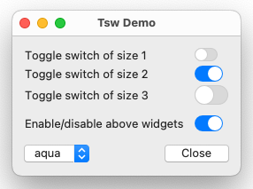
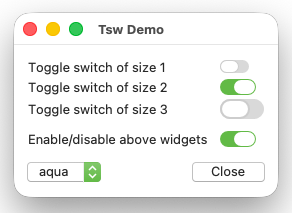
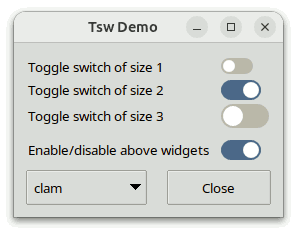
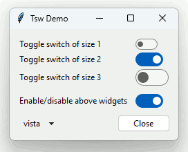
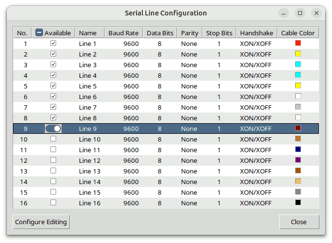
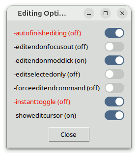

# Tsw Programmer's Guide

## For Tsw Version 1.5

### by

## Csaba Nemethi

csaba.nemethi@t-online.de

---

## Contents

#### Overview

- [What Is Tsw?](#what-is-tsw)
- [How to Get It?](#how-to-get-it)
- [How to Install It?](#how-to-install-it)
- [How to Use It?](#how-to-use-it)

#### Examples

- [Tsw Demo](#tsw-demo)
- [Tablelist Editing Options](#tablelist-editing-options)

[Start page](index.md)

---

## Overview

### What Is Tsw?

Tsw stands for **T**oggle **sw**itch and is a library package for Tcl/Tk versions 8.6 or higher.  If the version is 8.6 then in addition it is required that the tksvg extension can be loaded into the interpreter (Tk versions 8.7 and 9.0 or higher have built-in SVG support).  The package is written in pure Tcl/Tk code and contains:

- the implementation of the [toggle switch mega-widget toggleswitch](toggleswitch.md), including a general utility module for mega-widgets;
- two richly commented demo scripts containing the typical steps needed to create and handle toggleswitch widgets;
- this tutorial;
- a reference page in HTML format.

A toggleswitch is a mega-widget consisting basically of a horizontal trough (a fully rounded filled rectangle) and a slider (a filled circle or fully rounded filled rectangle contained in the trunk).  The widget also contains a ttk::label displaying an optional text to the trough's left; this child widget is only managed if the text specified with the `-text` or `-textvariable` option is a nonempty string.

A toggleswitch widget can have one of two possible switch states: on or off.  In the on state the slider is placed at the end of the trough, and ihttps://core.tcl-lang.org/tklibhttps://core.tcl-lang.org/tklibn the off state at its beginning.  The user can toggle between these two states with the mouse or the space key.

You can use the `switchstate` subcommand of the Tcl command associated with a toggleswitch to change or query the widget's switch state.  By using the `-command` configuration option, you can specify a script to execute whenever the switch state of the widget gets toggled.  For compatibility with the (ttk::)checkbutton, toggleswitch widgets also support the `-offvalue`, `-onvalue`, and `-variable` options.

### How to Get It?

Tsw is available for free download from the Web page

https://www.nemethi.de

The distribution file is `tsw1.5.tar.gz` for UNIX and `tsw1_5.zip` for Windows.  These files contain the same information, except for the additional carriage return character preceding the linefeed at the end of each line in the text files for Windows.

Tsw is also included in tklib, which has the address

https://core.tcl-lang.org/tklib

### How to Install It?

Install the package as a subdirectory of one of the directories given by the `auto_path` variable.  For example, you can install it as a subdirectory of the `lib` directory within your Tcl/Tk installation (at the same level as the `tk8.X` or `tk9.X` subdirectory).

To install Tsw *on UNIX*, `cd` to the desired directory and unpack the distribution file `tsw1.5.tar.gz`:

```
gunzip -c tsw1.5.tar.gz | tar -xf -
```

On most UNIX systems this can be replaced with

```
tar -zxf tsw1.5.tar.gz
```

Both commands will create a directory named `tsw1.5`, with the subdirectories `demos`, `doc`, and `scripts`.

*On Windows*, use WinZip or some other program capable of unpacking the distribution file `tsw1_5.zip` into the directory `tsw1.5`, with the subdirectories `demos`, `doc`, and `scripts`.

Notice that in tklib the Tsw `demos` directory is replaced with the subdirectory `tsw` of the `examples` directory.  Please take this into account when reading the [examples](#examples) below.

### How to Use It?

To be able to access the commands and variables of the Tsw package, your scripts must contain one of the lines

```
package require tsw ?version?
package require Tsw ?version?
```

You can use either one of the two statements above because the file `tsw.tcl` contains both lines

```
package provide tsw ...
package provide Tsw ...
```

You are free to remove one of these two lines from `tsw.tcl` if you want to prevent the package from making itself known under two different names.  Of course, by doing so you restrict the argument of  `package require`  to a single name.

Since the Tsw package is implemented in its own namespace called `tsw`, you must either invoke the

```
namespace import tsw::toggleswitch
```

command to import the only public *procedure* of the `tsw` namespace, or use the qualified name `tsw::toggleswitch`.  In the examples below we have chosen the latter approach.

To access Tsw *variables*, you *must* use qualified names.  There are only two Tsw variables that are designed to be accessed outside the `tsw` namespace:

- The variable `tsw::version` holds the current version number of the Tsw package.
- The variable `tsw::library` holds the location of the Tsw installation directory.

[Contents](#contents)     [Start page](index.md)

---

## Examples

### Tsw Demo

The script `TswDemo.tcl` in the `demos` directory creates four [toggleswitch](toggleswitch.md) widgets and shows how their appearance depends on the current theme, which can be selected with the aid of the menu associated with a ttk::menubutton widget.  In addition, it demonstrates how to specify a script to execute whenever the switch state of a toggleswitch gets toggled.

|   |   |   |
| --- | --- | --- |
|  |  |  |
|  |  |  |

Here is the code that creates the four toggleswitch widgets:

```
package require Tk
package require tsw

wm title . "Tsw Demo"

ttk::frame .tf
ttk::frame .bf

#
# Create 3 toggleswitch widgets having different values of the -size option
#
set l1 [ttk::label .tf.l1 -text "Toggle switch of size 1"]
set sw1 [tsw::toggleswitch .tf.sw1 -size 1]
set l2 [ttk::label .tf.l2 -text "Toggle switch of size 2"]
set sw2 [tsw::toggleswitch .tf.sw2 -size 2]
$sw2 switchstate 1
set l3 [ttk::label .tf.l3 -text "Toggle switch of size 3"]
set sw3 [tsw::toggleswitch .tf.sw3 -size 3]

#
# Create a toggleswitch widget of default size and set its -command option
#
set l4 [ttk::label .tf.l4 -text "Enable/disable above widgets"]
set sw4 [tsw::toggleswitch .tf.sw4]
$sw4 switchstate 1
$sw4 configure -command [list toggleWidgetsState $sw4]
```

We create the toggleswitch widgets by invoking the `tsw::toggleswitch` command.  For the first three toggleswitch widgets we also set the `-size` option to `1`, `2`, and `3`, respectively.  For the last toggleswitch we don't explicitly set this option, hence it will have its default value `2`.  As seen in the screenshots, in the case of the `aqua` theme the colors used when drawing the toggleswitch widgets also depend on the system appearance (light mode or dark mode) and the accent color.  Note that the first two screenshots were taken on macOS 15 (Sequoia), while the third one on macOS 26 (Tahoe).

For two of the four toggleswitch widgets we change the switch state from the default value `0` (off) to `1` (on) by invoking the `switchstate` subcommand of the associated Tcl command.  In addition, for the last toggleswitch we set the `-command` option to a script that will be executed whenever the widget's switch state gets toggled.  This script invokes the procedure `toggleWidgetsState` implemented as follows:

```
#------------------------------------------------------------------------------
# toggleWidgetsState
#
# Enables/disables the widgets in the first 3 grid rows, depending on the
# switch state of the specified toggleswitch widget.
#------------------------------------------------------------------------------
proc toggleWidgetsState sw {
    global l1 l2 l3 sw1 sw2 sw3
    set stateSpec [expr {[$sw switchstate] ? "!disabled" : "disabled"}]
    foreach w [list $l1 $l2 $l3 $sw1 $sw2 $sw3] {
        $w state $stateSpec
    }
}
```

This time the `switchstate` subcommand is invoked without the optional argument, hence it returns the toggleswitch widget's current switch state.

For the `default` theme, after changing the switch state of the last toggleswitch from on to off, the window will look as shown in the screenshot below:


The rest of the code is not Tsw-specific and for this reason is not shown here.

### Tablelist Editing Options

The script `EditingOpts.tcl` in the `demos` directory is a slightly adapted version of the Tablelist demo script `tileWidgets2.tcl`, which demonstrates the interactive tablelist cell editing with the aid of various Ttk widgets and the toggleswitch widget.  The additional functionality in this version is implemented in the procedures `configEditing` and `applySwitchState`.  The first one, triggered by the "Configure Editing" button, opens a toplevel window containing [toggleswitch](toggleswitch.md) widgets for configuring the editing-related tablelist options having boolean values, proposed over the years by Tablelist users.  This is a comfortable way to test the effect of setting/clearing these boolean options.

|   |   |
| --- | --- |
|  |  |

The `configEditing` procedure is shown below:

```
package require Tk
package require tsw
package require tablelist_tile

. . .

#------------------------------------------------------------------------------
# configEditing
#
# Configures the editing-related tablelist options having boolean values with
# the aid of toggleswitch widgets.
#------------------------------------------------------------------------------
proc configEditing tbl {
    set top .top
    if {[winfo exists $top]} {
        raise $top
        focus $top
        return ""
    }

    toplevel $top
    wm title $top "Editing Options"

    set tf [ttk::frame $top.tf]
    set bf [ttk::frame $top.bf]

    #
    # Create the widgets corresponding to the
    # editing-related options with boolean values
    #
    set row 0
    foreach opt {
        -autofinishediting
        -editendonfocusout
        -editendonmodclick
        -editselectedonly
        -forceeditendcommand
        -instanttoggle
        -showeditcursor
    } {
        lassign [$tbl configure $opt] option dbName dbClass default current
        set defaultStr [expr {$default ? "on" : "off"}]

        set sw [tsw::toggleswitch $tf.sw$row -text "$opt ($defaultStr)"]
        if {$current != $default} {
            $sw configure -foreground red2
        }

        $sw switchstate $current        ;# sets the switch state to $current
        $sw attrib default $default     ;# saves $default as attribute value
        $sw configure -command [list applySwitchState $sw $tbl $opt]
        pack $sw -padx 9p -pady {0 3p} -fill x

        incr row
    }

    . . .
}
```

For each of the 7 editing-related options with boolean values, the procedure displays the option's name and default value in a toggleswitch widget and sets the latter's [switch state](toggleswitch.md#detailed-reference) to the option's current value.  In addition, it invokes the `attrib` subcommand of the Tcl command associated with the toggleswitch to save the default as the value of the widget's attribute of name `default`.  In this way, the widget "remembers" the default value in an object-oriented manner and can retrieve it later without needing any external resources.  For increased user-friendliness, the text of the toggleswitch is displayed in the `red2` foreground color if the option's current value is different from the default one.

Whenever the toggleswitch widget's switch state gets toggled, the script specified as the value of its `-command` option invokes the `applySwitchState` procedure shown below:

```
#------------------------------------------------------------------------------
# applySwitchState
#
# Sets the configuration option opt of the tablelist tbl and the foreground
# color of the toggleswitch widget sw according to its switch state.
#------------------------------------------------------------------------------
proc applySwitchState {sw tbl opt} {
    set switchState [$sw switchstate]
    $tbl configure $opt $switchState

    set fgColor [expr {$switchState == [$sw attrib default] ? "" : "red2"}]
    $sw configure -foreground $fgColor
}
```

We set the specified tablelist option to the toggleswitch widget's switch state, and also the widget's foreground color, depending on the switch state and the option's default value, which we retrieve by using the `attrib` toggleswitch subcommand.

Notice that in this example we specify the texts of the "Editing Options" window as the values the `-text` option of the toggleswitch widgets, unlike in the previous example, in which we used extra ttk::label widgets displayed to the left of the corresponding toggleswitches.

[Contents](#contents)     [Start page](index.md)
