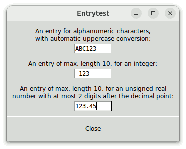
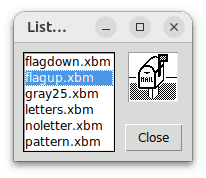
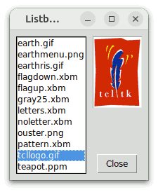
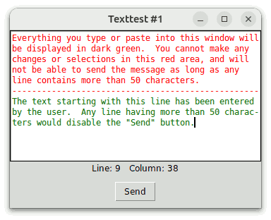
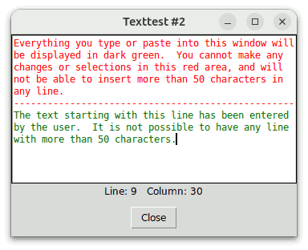

# Wcb Programmer's Guide

## For Wcb Version 4.2

### by

## Csaba Nemethi

csaba.nemethi@t-online.de

---

## Contents

#### Overview

- [Some Common Problems](#some-common-problems)
- [The Wcb Package](#the-wcb-package)
- [How to Get It?](#how-to-get-it)
- [How to Install It?](#how-to-install-it)
- [How to Use It?](#how-to-use-it)

#### Examples

- [Some before-insert Callbacks for entry Widgets](#some-before-insert-callbacks-for-entry-widgets)
- [A selset Callback for a listbox Widget](#a-selset-callback-for-a-listbox-widget)
- [An activate Callback for a listbox Widget](#an-activate-callback-for-a-listbox-widget)
- [Seven Callbacks for a text Widget](#seven-callbacks-for-a-text-widget)

[Start page](index.md)

---

## Overview

### Some Common Problems

Many Tcl/Tk programmers are confronted with questions like the following:

- How to restrict the set of characters that the user can type or paste into a Tk or Ttk entry, BWidget Entry, Tk or Ttk spinbox, Ttk combobox, text, or ctext widget?
- How to manipulate the user input characters before they are inserted into one of these widgets?  In the case of a text or ctext widget:  How to change the font, colors, or other attributes of the input characters?
- How to set a limit for the number of characters that can be typed or pasted into a Tk or Ttk entry, BWidget Entry, Tk or Ttk spinbox, or Ttk combobox widget?
- How to protect some parts of the text contained in a Tk or Ttk entry, BWidget Entry, Tk or Ttk spinbox, Ttk combobox, text, or ctext widget from being changed by the user?
- How to define notifications to be triggered automatically after text is inserted into or deleted from one of these widgets?
- How to define some actions to be invoked automatically whenever the insertion cursor in a Tk or Ttk entry, BWidget Entry, Tk or Ttk spinbox, Ttk combobox, text, or ctext widget is moved?
- How to define a command to be called automatically when selecting a listbox element, a tablelist row or cell, a Ttk treeview item, or a range of characters in a text or ctext widget?
- How to protect any or all items/elements of a listbox, tablelist, or Ttk treeview, or a range of characters in a text or ctext widget from being selected?

In most books, FAQs, newsgroup articles, and widget sets, you can find *individual* solutions to some of the above problems by means of widget bindings.  This approach is based on adding new binding tags or modifying some of the existing ones, which quite often proves to be incomplete.

The Tk core addresses just a few of the above problems:  In Tk 8.1 the `<<ListboxSelect>>` virtual event for listbox widgets was introduced, Tk versions 8.3 and higher support widget options for entry validation, and the spinbox widget (introduced in Tk 8.4) provides the same validation facility.  Finally, Tk versions 8.4 and higher support the `disabled` state for listbox widgets, as well as the `modified` flag, the `<<Modified>>` and `<<Selection>>` virtual events, and an undo/redo mechanism for text widgets.  However, also these improvements are of *individual* nature.

### The Wcb Package

The **W**idget **c**all**b**ack package Wcb provides a completely different, *general* solution to the above problems:  Based on redefining the Tcl command corresponding to a widget, the main Wcb procedure `wcb::callback` enables you to associate arbitrary commands with some Tk entry, Ttk entry, BWidget Entry, Tk spinbox, Ttk spinbox, Ttk combobox, listbox, tablelist, Ttk treeview, text, and ctext widget operations.  These commands will be invoked automatically in the global scope whenever the respective widget operation is executed.  You can request that these commands be called either before or after executing the respective widget operation, i.e., you can define both **before-** and **after-callbacks**.  From within a before-callback, you can cancel the respective widget command by invoking the procedure `wcb::cancel`, or modify its arguments by calling `wcb::extend` or `wcb::replace`.

Besides these (and four other) general-purpose commands, the Wcb package exports four utility procedures for Tk entry, Ttk entry, BWidget Entry, Tk spinbox, Ttk spinbox, and Ttk combobox widgets, as well as some before-`insert` callbacks for [Tk entry, Ttk entry, BWidget Entry, Tk spinbox, Ttk spinbox, Ttk combobox](wcbRef.md#before-insert-callbacks-for-entry-spinbox-and-combobox-widgets), [text, and ctext](wcbRef.md#before-insert-callbacks-for-text-and-ctext-widgets) widgets, which you can use unchanged or modify to suit your needs.  To learn how to do this, have a look at the [Examples](#examples) section below.

The Wcb package is implemented in pure Tcl/Tk code, which makes it completely platform-independent and very easy to install.  It requires version 8.4 or higher of both Tcl and Tk.

### How to Get It?

Wcb is available for free download from the Web page

https://www.nemethi.de

The distribution file is `wcb4.2.tar.gz` for UNIX and `wcb4_2.zip` for Windows.  These files contain the same information, except for the additional carriage return character preceding the linefeed at the end of each line in the text files for Windows.

Wcb is also included in tklib, which has the address

https://core.tcl.tk/tklib

### How to Install It?

Install the package as a subdirectory of one of the directories given by the `auto_path` variable.  For example, you can install it as a subdirectory of the `lib` directory within your Tcl/Tk installation.

To install Wcb *on UNIX*, `cd` to the desired directory and unpack the distribution file `wcb4.2.tar.gz`:

```
gunzip -c wcb4.2.tar.gz | tar -xf -
```

On most UNIX systems this can be replaced with

```
tar -zxf wcb4.2.tar.gz
```

Both commands will create a directory named `wcb4.2`, with the subdirectories `demos`, `doc`, and `scripts`.

*On Windows*, use WinZip or some other program capable of unpacking the distribution file `wcb4_2.zip` into the directory `wcb4.2`, with the subdirectories `demos`, `doc`, and `scripts`.

Notice that in tklib the Wcb `demos` directory is replaced with the subdirectory `wcb` of the `examples` directory.  Please take this into account when reading the [examples](#examples) below.

### How to Use It?

To be able to access the commands and variables of the Wcb package, your scripts must contain one of the lines

```
package require wcb ?version?
package require Wcb ?version?
```

You can use either one of the two statements above because the file `wcb.tcl` contains both lines

```
package provide wcb ...
package provide Wcb ...
```

You are free to remove one of these two lines from `wcb.tcl` if you want to prevent the package from making itself known under two different names.  Of course, by doing so you restrict the argument of  `package require`  to a single name.

Since the Wcb package is implemented in its own namespace called `wcb`, you must either invoke the

```
namespace import wcb::pattern ?wcb::pattern ...?
```

command to import the *procedures* you need, or use qualified names like `wcb::callback`.  In the examples below we have chosen the latter approach.

To access Wcb *variables*, you *must* use qualified names.  There are only two Wcb variables that are designed to be accessed outside the namespace `wcb`:

- The variable `wcb::version` holds the current version number of the Wcb package.
- The variable `wcb::library` holds the location of the Wcb installation directory.

[Contents](#contents)     [Start page](index.md)

---

## Examples

### Some before-`insert` Callbacks for entry Widgets

The script `entrytest.tcl` in the `demos` directory creates three entry widgets with the constraints shown in the following figure:



For the topmost entry `.e1` we define two before-`insert` callbacks contained in the Wcb package:

```
wcb::callback .e1 before insert wcb::checkStrForAlnum \
                                wcb::convStrToUpper
```

To force the second entry `.e2` to accept only integers of maximal length 10, we use again two before-`insert` callbacks from Wcb:

```
wcb::callback .e2 before insert {wcb::checkEntryLen 10} \
                                 wcb::checkEntryForInt
```

And finally, here are the two callbacks for the third entry widget `.e3`:

```
wcb::callback .e3 before insert {wcb::checkEntryLen 10} \
                                 checkNumber

#
# Callback procedure checkNumber
#
proc checkNumber {w idx str} {
    set newText [wcb::postInsertEntryText $w $idx $str]
    if {![regexp {^[0-9]*\.?[0-9]?[0-9]?$} $newText]} {
        wcb::cancel
    }
}
```

This last example also shows the arguments of the callbacks declared with the `wcb::callback` command:  Whenever a callback is invoked, the new name of the original Tcl command for the widget (i.e., the name of the proxy command) as well as the arguments of the respective widget operation are automatically appended to it as parameters.  Since we defined `checkNumber` as a before-callback for the `insert` subcommand, its last three arguments must be: the name of the proxy widget command (`w`, which in this example is `::_.e3`), the index (`idx`), and the string (`str`) to be inserted just before the character indicated by the index.

Notice that in the argument list of a Wcb callback, the name of the proxy widget command can be be preceded by any number of additional arguments.  The procedure `wcb::checkEntryLen` is an example of such a callback.

The command `wcb::postInsertEntryText` invoked in the procedure `checkNumber` returns the text that would be contained in the entry widget `w` after inserting the string `str` before the character indicated by the index `idx`.  If this text is not (the starting part of) an unsigned real number with at most two digits after the decimal point, then we call the procedure `wcb::cancel`, which aborts the `insert` command.

Without the constraint that the content of the third entry must not start with a sign, we could have used the callback procedure `wcb::checkEntryForFixed` instead of `checkNumber`:

```
wcb::callback .e3 before insert {wcb::checkEntryLen 10} \
                                {wcb::checkEntryForFixed 2}
```

### A `selset` Callback for a listbox Widget

In the case of a listbox, you will probably most often want to define a callback for the  `selection set`  widget subcommand.  In most cases it does not matter whether this is a before- or after-callback.  Please note that the `wcb::callback` command expects the abbreviated form `selset` as parameter.  Similarly, you must pass `selclear` to this command when defining a callback for the  `selection clear`  listbox operation.

In the following example we build a listbox `.lb` containing the names of the bitmap files in the subdirectory `images` of the Wcb `demos` directory.  (The directory `images` is a copy of the subdirectory of the same name of the Tk 8.6 `demos` directory.)  Whenever an item is selected, the callback procedure `showBitmap` will display the corresponding bitmap in the label `.picture`.



Here is the relevant code fragment from the script `listboxtest1.tcl`, contained in the `demos` directory:

```
set dirName [file join [file dirname [info script]] images]

#
# Frame .spacer and listbox .lb
#
frame .spacer -width 7p
listbox .lb -height 0 -width 0 -background white
set pattern [file join $dirName *.xbm]
foreach pathName [lsort [glob $pattern]] {
    .lb insert end [file tail $pathName]
}

#
# Label .picture
#
label .picture -relief sunken -background white

#
# Define a before-selset callback for .lb
#
wcb::callback .lb before selset showBitmap

#
# Callback procedure showBitmap
#
proc showBitmap {w first args} {
    global dirName
    set pathName [file join $dirName [$w get $first]]
    .picture configure -bitmap @$pathName
}
```

Recall that the  `selection set`  listbox operation takes as arguments one or two indices, which will be passed automatically to the callback as parameters, along with the new name of the original Tcl command associated with the listbox widget (i.e., the name of the proxy command).  For this reason, the arguments of the callback procedure `showBitmap` are: the name of the proxy widget command (`w`, which in this example is `::_.lb`), the first index (`first`), as well as the `args` keyword representing the empty list or the optional second index passed to the  `selection set`  command.

### An `activate` Callback for a listbox Widget

The listbox used in the preceding example has the default selection mode `browse`, hence the before-`selset` callback `showBitmap` will be fired every time the mouse is dragged from one element to another, with button 1 down.  But what happens if we want to display not only the bitmaps but also the photo images contained in the subdirectory `images` of the Wcb `demos` directory?  Loading a photo image is a much more complex operation than loading a bitmap, which can have the effect that some images cannot be displayed quickly enough to follow the mouse when browsing with it within the listbox.



To solve this problem, we can either change the selection mode to have the less common value `single`, or arrange for the images not to be displayed when browsing with the mouse but when releasing its button 1.  The second method can be implemented with the aid of an `activate` callback, as shown in the following code fragment taken from the script `listboxtest2.tcl`, contained in the `demos` directory:

```
set dirName [file join [file dirname [info script]] images]
image create photo photoImage

#
# Frame .spacer and listbox .lb
#
frame .spacer -width 7p
listbox .lb -height 0 -width 0 -background white
set pattern [file join $dirName *]
foreach pathName [lsort [glob $pattern]] {
    .lb insert end [file tail $pathName]
}

#
# Label .picture
#
label .picture -relief sunken -background white

#
# Define a before-activate callback for .lb
#
wcb::callback .lb before activate showPicture

#
# Callback procedure showPicture
#
proc showPicture {w idx} {
    set leafName [$w get $idx]

    #
    # When traversing the listbox with the arrow keys, the value
    # of idx can become -1 or the number of listbox elements,
    # hence the value of leafName can be an empty string:
    #
    if {$leafName eq ""} {
        return ""
    }

    global dirName
    set pathName [file join $dirName $leafName]
    if {[regexp {^\.(bmp|xbm)$} [file extension $pathName]]} {
        .picture configure -bitmap @$pathName -image ""
    } else {
        .picture configure -bitmap "" -image ""
        catch {
            photoImage configure -file $pathName
            .picture configure -bitmap "" -image photoImage
        }
    }
}
```

### Seven Callbacks for a text Widget

The script `texttest1.tcl` in the `demos` directory creates the text widget shown in the following figure:



Here is the relevant code fragment:

```
#
# Text .txt
#
set width 50
text .txt -width $width -height 12 -setgrid true -wrap none -background white \
          -font TkFixedFont
.txt tag configure prog -foreground red
.txt tag configure user -foreground DarkGreen
.txt insert end "Everything you type or paste into this window will\n"  prog
.txt insert end "be displayed in dark green.  You cannot make any\n"    prog
.txt insert end "changes or selections in this red area, and will\n"    prog
.txt insert end "not be able to send the message as long as any\n"      prog
.txt insert end "line contains more than $width characters.\n"          prog
.txt insert end "--------------------------------------------------\n"  prog
set limit [.txt index insert]

#
# Label .pos displaying the current cursor position
#
label .pos -textvariable pos

#
# Button .send (actually, it does not send anything)
#
button .send -text Send -command exit

#
# Define 5 before- and 2 after-callbacks for .txt
#
wcb::callback .txt before insert protectRedArea changeColor
wcb::callback .txt before delete protectRedArea
wcb::callback .txt before selset protectRedArea
wcb::callback .txt before motion displayPos
wcb::callback .txt  after insert "checkLines $width"
wcb::callback .txt  after delete "checkLines $width"

#
# Callback procedure protectRedArea
#
# The parameters following w can be interpreted either as
# "index string ?tagList string tagList ...?" (for an insert
# callback), or as "from ?to?" (for a delete callback),
# or as "from ?to from to ...?" (for a selset callback).
#
proc protectRedArea {w idx args} {
    global limit
    if {[$w compare $idx < $limit]} {
        wcb::cancel
    }
}

#
# Callback procedure changeColor
#
proc changeColor {w args} {
    wcb::extend user
}

#
# Callback procedure displayPos
#
proc displayPos {w idx} {
    set index [$w index $idx]
    scan $index "%d.%d" line column
    incr column

    global pos
    set pos [format "Line: %d   Column: %d" $line $column]
}

#
# Callback procedure checkLines
#
# The parameter args can be interpreted both as "index
# string ?tagList string tagList ...?" (for an insert
# callback) and as "from ?to?" (for a delete callback).
#
proc checkLines {maxCharsPerLine w args} {
    #
    # Display the new cursor position
    #
    displayPos $w insert

    #
    # Disable or enable the .send button
    #
    scan [$w index end] "%d" lastLine
    for {set line 1} {$line < $lastLine} {incr line} {
        scan [$w index $line.end] "%d.%d" dummy charsInLine
        if {$charsInLine > $maxCharsPerLine} {
            .send configure -state disabled
            return ""
        }
    }
    .send configure -state normal
}

. . .

displayPos .txt insert
focus .txt
```

The procedure `protectRedArea` is a before-`insert`, before-`delete`, and before-`selset` callback.  It checks whether the attempted change would affect the text area displayed in red; if this is the case, it calls the procedure `wcb::cancel`, which aborts the `insert`, `delete`, or  `tag add sel`  command, respectively.

The before-`insert` callback `changeColor` invokes the `wcb::extend` command to append the `user` tag to the argument list of the `insert` command, thus changing the foreground color of the characters entered by the user to `DarkGreen`.

The procedure `displayPos` displays the line and column corresponding to the index passed to it as its second argument.  This index will be the target position of the insertion cursor when the procedure is triggered automatically as a before-`motion` callback.  As seen in the `checkLines` procedure discussed below, it is also invoked after performing an `insert` or `delete` operation; in that case, its second argument will be the new position of the insertion cursor after the execution of `insert` or `delete`.  In this way, we are able to keep track completely of the position of the insertion cursor.

It is interesting to see what happens if we register `displayPos` as an after- instead of before-`motion` callback.  Well, in that case the procedure would have to ignore its second argument and we would have to replace the line

```
set index [$w index $idx]
```

with

```
set index [$w index insert]
```

The reason is that the value of the `idx` argument passed to `displayPos` can be, for instance, `insert+1c`, where `insert` means the position of the insertion cursor *before* moving it forward by one character.  The after-`motion` callback is, however, triggered *after* the insertion cursor has been moved, and at that time the `insert` mark already points to the new cursor position.  For this reason,  `[$w index $idx]`  is not adequate to retrieve the position of the insertion cursor within an after-`motion` callback.

Our last procedure `checkLines` is both an after-`insert` and after-`delete` callback.  After calling `displayPos` to display the new cursor position, it disables or enables the `.send` button, depending upon whether any line of the text widget contains more than `$maxCharsPerLine` characters.

Notice that we could also have defined before-`replace` and after-`replace` callbacks for the `replace` text widget subcommand, introduced in Tk version 8.6.  There is, however, no need for it, because the default text widget bindings currently don't make use of this subcommand.

Instead of just disabling the `.send` button if any line has more than `$maxCharsPerLine` characters, we can even prevent the user from entering lines that are longer than allowed.  The script `texttest2.tcl` in the `demos` directory shows how this can be achieved by combining widget callbacks with the undo mechanism for text widgets.  This script creates the text widget shown in the following figure:



Most of the code contained in the script `texttest2.tcl` is identical to the one in the previous example.  The main difference is a new line activating the undo mechanism for the text widget `.txt` and a new version of the callback procedure `checkLines`:

```
. . .

.txt configure -undo yes

. . .

proc checkLines {maxCharsPerLine w args} {
    #
    # Undo the last insert or delete action if necessary
    #
    scan [$w index end] "%d" lastLine
    for {set line 1} {$line < $lastLine} {incr line} {
        scan [$w index $line.end] "%d.%d" dummy charsInLine
        if {$charsInLine > $maxCharsPerLine} {
            $w edit undo
            bell
            break
        }
    }

    #
    # Clear the undo and redo stacks, and display the new cursor position
    #
    $w edit reset
    displayPos $w insert
}

. . .
```

This version of the callback `checkLines` undoes the last edit action if any text line contains more characters than the allowed maximum.  For this reason, we had to move the invocation of the `displayPos` procedure to the end of the callback, because the  `edit undo`  command might change the position of the insertion cursor.

Note that we could have implemented this example also without making use of the undo mechanism for text widgets, by saving the last accepted contents of the widget, along with the cursor position, and restoring them in case any line gets longer than allowed.

[Contents](#contents)     [Start page](index.md)
